# C 语言程序设计

程序构造、内存表示与算法

本册从可以运行的小程序开始，逐步引入类型、控制流、函数、指针和数组，再用字符串处理、动态内存与排序把这些机制结合起来。每段代码的解释围绕执行时的对象变化展开；变量的名字不能代替类型和存储关系。

编排参考 K&R《C 程序设计语言》第 1 章的示例引入方法，以及第 5 章从地址到数组、从字符存储到复制函数的展开方式。示例按当前课程重写，采用显式返回类型与必要的边界检查。

## 第一章 程序、数据与表达式

一个计算任务必须先变成可以执行的程序。下面先用短程序建立源文件、函数、语句和输入输出之间的联系，再讨论数据类型如何决定运算结果。后续章节只是在这个结构中增加新的计算方式。

### 程序结构与标准输入输出

```c
#include <stdio.h>

int main(void)
{
    int x = 10;
    printf("%d\n", x);
    return 0;
}
```

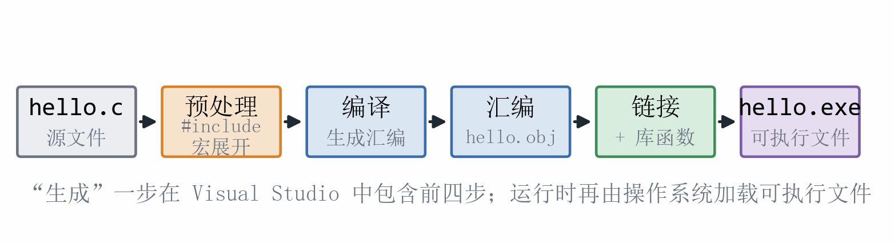


- `#include <stdio.h>`：引入标准输入输出功能。
- `int main(void)`：程序入口；`void` 表示这里不接收参数。
- `{ ... }`：代码块（блок кода）。
- `int x = 10;`：定义并初始化整型变量。
- `return 0;`：结束 `main`，状态码 `0` 通常表示正常结束。

常用格式说明符：

| 数据 | `printf` | 示例 |
|---|---|---|
| `int` | `%d` | `printf("%d", x);` |
| `unsigned int` | `%u` | `printf("%u", u);` |
| `long long` | `%lld` | `printf("%lld", n);` |
| `char` 字符 | `%c` | `printf("%c", ch);` |
| 字符串 | `%s` | `printf("%s", str);` |
| 指针地址 | `%p` | `printf("%p", (void *)p);` |

打印地址不要用 `%d`，应使用 `%p`：

```c
printf("%p\n", (void *)&x);
```


**类型、声明与整数除法**

类型（тип данных）决定可表示的值和可进行的操作。常见类型是 int、unsigned int、float、double、char；不要默认所有平台的 int 都是 4 字节。sizeof 的结果类型是 size_t，输出用 %zu。sizeof(char) 总是 1，但一字节的位数由 <limits.h> 中 CHAR_BIT 表示。

同一声明中逗号分开同类型变量；分号结束声明，换行本身不结束语句。

```c
int a = 7, b = 2;
double r1 = a / b;          // 先整数除法，再变成 3.0
double r2 = (double)a / b;  // 先转换，得到 3.5
double r3 = (double)(a / b);// 已丢掉小数，仍为 3.0
```

整除（целочисленное деление）向零截断：-7 / 2 是 -3，-7 % 2 是 -1。转换（приведение типа）不会把已经丢失的小数补回来。除数不能为 0，INT_MIN / -1 在结果无法表示时也不合法。

**scanf：地址和格式必须匹配**

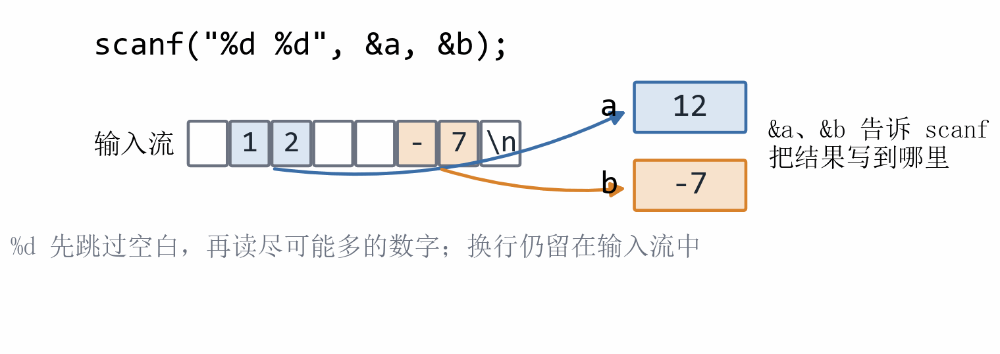


```c
int age;
double height;
char grade;

if (scanf("%d %lf", &age, &height) != 2)
    return 1;
if (scanf(" %c", &grade) != 1)
    return 1;
```

scanf 需要目标对象的地址；返回值表示成功赋值的项目数，不能把输入失败后的未初始化变量拿来计算。printf 输出 double 用 %f（或 %lf），scanf 读 double 必须用 %lf，读 float 用 %f。上面 %c 前面的空格用于跳过空白字符，包括上一次输入留下的换行；如果题目本来要求读取空白字符，就不要加这个空格。

**%d 怎样从输入流中取数**

键盘输入先进入输入流（поток ввода），scanf 按格式从流中依次取字符。%d 先跳过空格、制表符和换行，再读取可选的正负号和尽可能长的一串十进制数字，遇到第一个不能属于整数的字符时停下，该字符留在流中。格式串中的空格表示“跳过任意多个空白”，所以两个整数之间用一个空格、多个空格或回车分隔都可以。

对 `scanf("%d %d", &n, &base)`：

| 输入 | 返回值与结果 |
|---|---|
| `255 16` 回车 | 返回 2，n 为 255，base 为 16 |
| `255` 回车 `16` 回车 | 回车也是空白，同样返回 2 |
| `255 16 8` 回车 | 返回 2，`8` 和换行仍留在流中，后续读取会先遇到它们 |
| `25516` 回车 | 第一个 %d 取走整个 25516；第二个 %d 还没有得到数字，scanf 继续等待输入 |
| `255,16` 回车 | n 为 255 后遇到逗号，逗号不是空白也不是数字，返回 1 |
| `abc 16` 回车 | 第一项就失败，返回 0，n、base 均未被赋值 |
| 立即输入文件结束 | 在 Windows 控制台按 Ctrl+Z 再回车，返回 EOF |

因此 `!= 2` 的检查能发现非数字、分隔符错误和输入提前结束，却不能发现“本想输入两个数但漏了空格”：25516 本身是合法整数，scanf 无从得知书写者原意。若必须检查一行内恰有两个数，应先读入整行再分析，这已超出逐项 scanf 的能力。

**Visual Studio 中的源文件编码**

源文件保存的是字节，编译器先按某种编码把字节解释成字符。中文 Windows 上，MSVC 读取不带 BOM 的源文件时默认采用系统代码页（通常为 936，即 GBK）。如果文件实际按无 BOM 的 UTF-8 保存，注释和字符串中的中文可能被错拆，轻则出现 C4819 警告，重则吞掉引号、换行或括号，引出“常量中有换行符”“未找到匹配令牌”等看似与中文无关的错误。可选的处理是：以带签名（BOM）的 UTF-8 保存，或在编译选项中加入 `/utf-8`，或把源文件统一存成 GBK。不同方法不要混用，否则控制台输出的中文仍可能乱码。

使用 `scanf` 时 MSVC 给出的 C4996 是弃用提示，不是语法错误。`#define _CRT_SECURE_NO_WARNINGS` 必须写在第一个 `#include` 之前才能起作用，它只关闭这类提示，不会让输入变得更安全。

编辑器中代码下方出现的绿色波浪线，多数来自 Visual Studio 的代码分析，编号以 C6 开头。例如第十四章的程序中，`a[fr][fc]` 下方会出现 C6385（可能读取越界）或 C6386（可能写入越界）：fr、fc 由 `random_edge` 通过指针写入，实际只可能是 0、9 或 `rand() % 10`，下标不会越界，但分析器不追踪这种跨函数的取值范围，只能保守地提醒。这类提示是警告而不是错误，程序照常编译运行；是否需要处理，取决于能否说清下标的真实取值范围。2026-10-27 用 `/W4 /analyze` 实测，单位权重版与加权版都在该处给出这类编号的警告；单位权重版去掉 `/analyze` 后，/W4 下没有任何警告。

Visual Studio 按 Ctrl+F5 时，编译运行的是当前窗口中打开的解决方案，而不是眼睛正看着的那份代码。同时开着两个项目窗口时，很容易把代码粘贴进一个项目，却在另一个窗口按下运行。运行结束后，输出窗口末尾会显示所运行的可执行文件路径，例如以 `wave4\x64\Debug\wave4.exe` 结尾，据此可以核对跑的是哪个项目。编辑器标签上带星号表示修改尚未保存；若出现“存在生成错误，是否继续运行上次成功生成的版本”的提示，选择“是”运行的是旧程序。

### 基本类型的大小与取值范围

C 标准只规定了各种整数类型的最小范围和大小顺序（`char` ≤ `short` ≤ `int` ≤ `long` ≤ `long long`），具体占多少字节由编译器和平台决定。实际范围应查 `<limits.h>`（整数）和 `<float.h>`（浮点数）中的常量，不要凭记忆硬写。下面的程序打印本机的实际值：

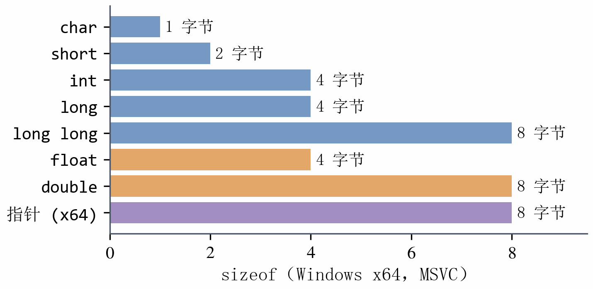


```c
#include <stdio.h>
#include <limits.h>
#include <float.h>

int main(void)
{
    printf("int       %zu  %d .. %d\n", sizeof(int), INT_MIN, INT_MAX);
    printf("long      %zu  %ld .. %ld\n", sizeof(long), LONG_MIN, LONG_MAX);
    printf("long long %zu  %lld .. %lld\n",
           sizeof(long long), LLONG_MIN, LLONG_MAX);
    printf("double    %zu  %e  digits %d\n", sizeof(double), DBL_MAX, DBL_DIG);
    printf("pointer   %zu\n", sizeof(int *));
    return 0;
}
```

2026-10-28 在本机用 Visual Studio 18 的 MSVC 编译为 64 位程序，各类型的实测结果如下：

| 类型 | 字节 | 取值范围 | `printf` 格式 |
|---|---|---|---|
| `char` | 1 | −128 ～ 127（MSVC 中 `char` 有符号） | `%c` 或 `%d` |
| `short` | 2 | −32768 ～ 32767 | `%hd` |
| `int` | 4 | −2147483648 ～ 2147483647（约 ±21 亿） | `%d` |
| `unsigned int` | 4 | 0 ～ 4294967295 | `%u` |
| `long` | 4 | 与 `int` 相同 | `%ld` |
| `long long` | 8 | 约 ±9.22×10¹⁸ | `%lld` |
| `float` | 4 | 最大约 3.4×10³⁸，约 6 位有效数字 | `%f` |
| `double` | 8 | 最大约 1.8×10³⁰⁸，约 15 位有效数字 | `%f`（输出）、`%lf`（输入） |
| 指针 | 8 | 64 位程序中的地址 | `%p` |

需要注意的是，在 Windows 上 `long` 只有 4 字节，而在 64 位 Linux 上通常是 8 字节；需要确定位数的整数时，可以使用 `<stdint.h>` 中的 `int32_t`、`int64_t` 等类型。`float` 只有约六位有效数字，计算中通常优先使用 `double`。

无符号整数的运算按模 \(2^n\) 进行，超出范围时会“绕回”：`UINT_MAX + 1` 的结果是 0，这是标准规定的行为。有符号整数超出范围（例如 `INT_MAX + 1`）则是未定义行为，结果不可预测，必须在计算前避免。

有符号数与无符号数混合比较是一个常见陷阱：

```c
int i = -1;
unsigned int v = 1;
printf("%d\n", i < v);   /* 输出 0 */
```

比较前，`-1` 被转换成无符号数，变成 4294967295，于是比较结果为假。MSVC 在 /W4 下对这一行给出 C4018 警告（有符号/无符号不匹配），遇到这个警告应当认真检查，而不是忽略。

### 常量、转义字符与格式说明

整数常量可以写成十进制 `255`、八进制 `0377`（以 0 开头）或十六进制 `0xFF`（以 0x 开头），三者数值相同。后缀 `u` 表示无符号，`L` 表示 `long`，`LL` 表示 `long long`，例如 `100000LL`。浮点常量默认是 `double`，加后缀 `f` 才是 `float`，如 `3.14f`；`1e-3` 表示 \(10^{-3}\)。字符常量用单引号，如 `'A'`，它的值是该字符的编码（`'A'` 为 65）；字符串常量用双引号，如 `"A"`，末尾还有一个看不见的 `'\0'`，所以 `"A"` 占两个字节（见第八章）。

有些字符无法直接写在引号中，要用反斜杠开头的转义字符表示：

| 转义字符 | 含义 | 转义字符 | 含义 |
|---|---|---|---|
| `\n` | 换行 | `\\` | 反斜杠本身 |
| `\t` | 水平制表（对齐到下一个制表位） | `\'` | 单引号 |
| `\r` | 回车（回到行首） | `\"` | 双引号 |
| `\0` | 空字符，字符串结束标志 | `\a` | 响铃 |
| `\ddd` | 一到三位八进制数表示的字符 | `\xhh` | 十六进制数表示的字符 |

`printf` 的格式说明完整形式为 `%[标志][宽度][.精度]类型`。常用的类型字符除前面已列出的以外，还有 `%o`（八进制）、`%x` 与 `%X`（十六进制小写与大写）、`%e`（科学计数法）、`%g`（自动选择 `%f` 或 `%e` 中较短者）以及 `%%`（输出百分号本身）。常用的标志有 `-`（左对齐）、`0`（用零填充）、`+`（正数也显示正号）。例如：

```c
printf("%d %o %x %X %c\n", 255, 255, 255, 255, 65);
printf("[%6.2f] [%-6d] [%06d] [%e] [%g] [%%]\n",
       3.14159, 42, 42, 12345.678, 0.0001);
```

实际输出为：

```text
255 377 ff FF A
[  3.14] [42    ] [000042] [1.234568e+04] [0.0001] [%]
```

`%6.2f` 表示总宽度六、保留两位小数，不足部分在左边补空格；`%-6d` 左对齐，空格补在右边；`%06d` 用零补齐。宽度只是最小宽度，数据更长时不会被截断。

### 运算符的优先级、结合性与类型转换

一个表达式中有多个运算符时，先算哪一个由优先级决定；优先级相同时，由结合性决定从左到右还是从右到左。下表从高到低列出常用运算符：

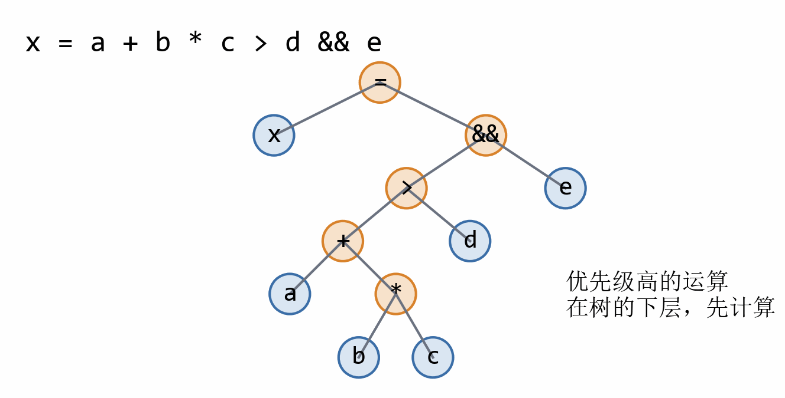


| 优先级 | 运算符 | 结合性 |
|---|---|---|
| 1 | `()` `[]` `->` `.` 后缀 `++` `--` | 左→右 |
| 2 | 前缀 `++` `--`、`+` `-`（正负号）、`!` `~` `*`（解引用）`&`（取地址）`sizeof` `(类型)` | 右→左 |
| 3 | `*` `/` `%` | 左→右 |
| 4 | `+` `-` | 左→右 |
| 5 | `<<` `>>` | 左→右 |
| 6 | `<` `<=` `>` `>=` | 左→右 |
| 7 | `==` `!=` | 左→右 |
| 8 | `&`（按位与） | 左→右 |
| 9 | `^`（按位异或） | 左→右 |
| 10 | 按位或（一条竖线） | 左→右 |
| 11 | `&&` | 左→右 |
| 12 | 逻辑或（两条竖线） | 左→右 |
| 13 | `?:`（条件运算符） | 右→左 |
| 14 | `=` `+=` `-=` `*=` 等赋值 | 右→左 |
| 15 | `,`（逗号） | 左→右 |

表中第 10 行是按位或 `|`，第 12 行是逻辑或 `||`。记忆的大致顺序是：单目运算高于双目运算，算术运算高于移位，移位高于关系比较，比较高于按位运算，按位运算高于逻辑运算，最后是条件、赋值和逗号。两个容易出错的地方：按位运算的优先级低于比较，`x & 1 == 0` 实际上是 `x & (1 == 0)`，应写成 `(x & 1) == 0`；赋值的优先级很低，`(c = getchar()) != EOF` 中的括号不能省。拿不准时加括号，括号既保证次序，也让代码更易读。

自增和自减有前缀与后缀两种形式：

```c
int i = 5;
int j = i++;     /* 先取值后加一：j = 5，i = 6 */
int k = ++i;     /* 先加一后取值：i = 7，k = 7 */
```

在同一个表达式中对同一个变量修改两次，或者修改后又读取它（如 `i = i++ + 1`、`printf("%d %d", i, i++)`），属于未定义行为，结果因编译器而异，不应这样写。

条件运算符 `条件 ? 值1 : 值2` 在条件为真时取值1，否则取值2，例如 `max = a > b ? a : b;`。它是一个表达式，可以出现在需要值的地方，适合代替简单的 `if ... else` 赋值。

**算术类型转换。** 不同类型的数据一起运算时，编译器会先把它们转换成同一类型，基本规则是“向范围更大的类型看齐”：

1. `char`、`short` 在运算前先提升为 `int`（整数提升）。
2. 一个操作数是 `double`，另一个也转换为 `double`；否则若有 `float`，都转换为 `float`。
3. 都是整数时，按 `int` → `unsigned int` → `long` → `long long` 的方向，转换为两者中范围较大的类型；同样大小的有符号数与无符号数相遇，有符号数转换为无符号数（这正是前面 `-1 < 1u` 为假的原因）。
4. 赋值时，右边的值转换为左边变量的类型；从 `double` 赋给 `int` 会直接截去小数部分（向零截断），而不是四舍五入。

强制类型转换 `(类型)表达式` 可以显式地指定转换。例如 `(int)3.99` 得 3，`(double)7 / 2` 得 3.5。字符在运算中按编码值参与：`'A' + 2` 等于 67，即字符 `'C'`；`ch - '0'` 把数字字符转换为对应的整数，这是第四章进制转换中常用的写法。


## 第二章 控制流

计算通常不只是从上到下执行一列语句。条件决定哪些语句执行，循环决定同一段计算重复多少次。分析控制流时，应跟踪条件被检查的时刻和一次迭代结束后的变量状态。

### 条件选择

条件语句（условный оператор）的基本形式：

```c
if (条件)
{
    // 条件为真时执行
}
else
{
    // 条件为假时执行
}
```

例子：

```c
int x = 5;

if (x > 10)
{
    printf("x 大于 10");
}
else
{
    printf("x 不大于 10");
}
```

```text
x > 10 ?
  ├─ 真（истина）→ 执行 if
  └─ 假（ложь）  → 执行 else
```

多个互斥区间使用 `else if`：

```c
int score = 75;

if (score >= 90)
{
    printf("A");
}
else if (score >= 60)
{
    printf("及格");
}
else
{
    printf("不及格");
}
```

程序从上到下判断；一旦某一项成立，后面的分支都跳过。

必须记住：

1. `else` 不能独立出现，它匹配前面尚未匹配的最近一个 `if`。
2. 即使分支里只有一条语句，也建议写 `{}`。
3. `=` 是赋值，`==` 才是比较。

```c
if (x = 5)   // 把 5 赋给 x，再把 5 当作“真”；通常是错误
if (x == 5)  // 判断 x 是否等于 5
```

**if 只控制紧随的一条语句**

语法上，`if (条件)` 后面接的是恰好一条语句。这条语句可以与 if 同行，也可以另起一行；换行和缩进对编译器只是空白，`if (n < 1) goto err;` 与把 `goto err;` 写在下一行完全等价。需要控制多条语句时，必须用花括号组成复合语句（составной оператор），整个代码块才算一条语句。

单独的分号本身是一条合法的空语句（пустой оператор）。在条件的右括号后误加分号，if 控制的就是这条空语句：

```c
int n = 255;

if (n < 1);          /* if 的语句体是空语句；设后文有标签 err */
    goto err;        /* 不受 if 控制，总会执行 */
```

即使 n 为 255，程序也会跳到 err。缩进让第二行看起来属于 if，但编译器不按缩进判断结构。同样地，

```c
if (n < 1)
    printf("输入错误\n");
    goto err;        /* 仍然不受 if 控制 */
```

只有 printf 属于 if。把两条语句放进 `{ }` 之后，二者才同时依赖条件。这类写法通常能通过编译，有的编译器只给出警告，所以分支内总写花括号可以从结构上避免这两种错误。


### 循环迭代

循环（цикл）：

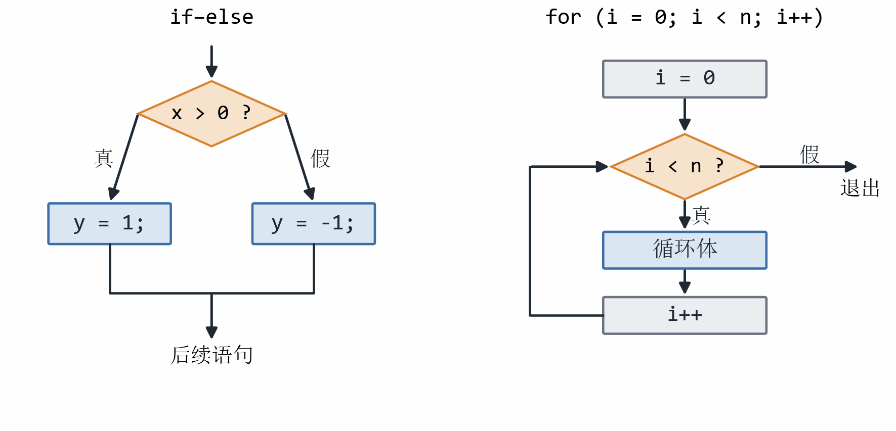


```c
int n = 25;

while (n > 0)
{
    printf("%d ", n);
    n = n - 7;
}
```

逐轮追踪：

| 本轮开始时 `n` | `n > 0` | 输出 | 更新后的 `n` |
|---:|:---:|---:|---:|
| 25 | 真 | 25 | 18 |
| 18 | 真 | 18 | 11 |
| 11 | 真 | 11 | 4 |
| 4 | 真 | 4 | -3 |
| -3 | 假 | 不执行 | 不执行 |

最终输出：

```text
25 18 11 4
```

不输出 `-3`，因为 `while` 每轮先检查条件，`-3 > 0` 为假后不会进入循环体。

对比 `do ... while`：

```c
do
{
    循环体;
} while (条件);
```

`do ... while` 先执行一次再判断，因此循环体至少执行一次。


**for、continue 和嵌套循环**

```c
for (int i = 0; i < 4; ++i)
{
    if (i == 2)
        continue;
    printf("%d ", i);
}
```

输出 0 1 3。for 的执行顺序是：初始化一次 → 判断条件 → 循环体 → 更新表达式 → 再判断。continue 跳过本轮剩余循环体，但仍执行 for 的更新表达式。while 中若把计数更新写在 continue 后，更新可能永远不执行，造成死循环。

| 语句 | 作用范围 | 俄语 |
|---|---|---|
| break | 离开最近一层循环或 switch | выход из цикла |
| continue | 开始最近一层循环的下一轮 | следующая итерация |
| return | 结束整个当前函数 | возврат из функции |

嵌套循环中，内层计数器通常每次进入外层新一轮时重新初始化；内层 break 不会同时结束外层。goto 跳到同一函数中的标签，不会建立新函数调用；基础程序优先用清楚的结构化循环。


### 多路选择

```c
int x = 1;

switch (x)
{
    case 1:
        printf("A ");

    case 2:
        printf("B ");
        break;

    case 3:
        printf("C ");
}

printf("D");
```

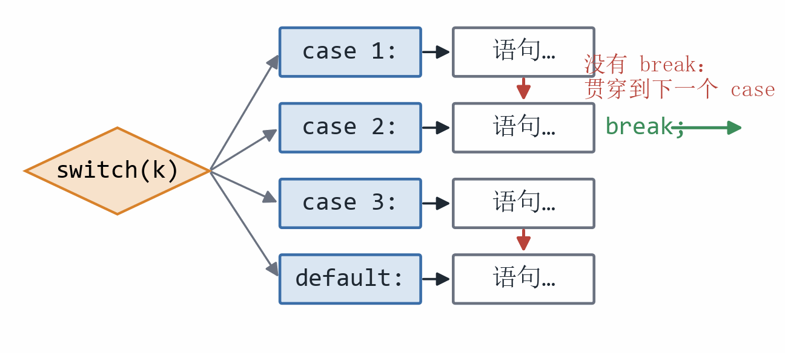


执行路线：

```text
x == 1
→ 进入 case 1
→ 输出 A
→ 没有 break，继续进入 case 2
→ 输出 B
→ break 离开 switch
→ 继续执行 printf("D")
```

最终输出 `A B D`。

没有 `break` 而继续执行下一个 `case` 叫贯穿（fall-through；俄语可说 сквозное выполнение）。

- `break`：离开当前循环或当前 `switch`。
- `return`：结束当前函数，并可把结果返回给调用者。
- `break` 不是“结束整个程序”。

`default`（ветвь по умолчанию）用于没有任何 `case` 匹配时。


## 第三章 函数与程序结构

一段计算可以单独命名，并通过参数接收数据、通过返回值交出结果。这样，主程序表达任务的整体步骤，各个函数承担具体工作。函数接口先于函数内部实现：调用者需要知道输入、输出和对外部对象的影响。

### 函数接口与返回值

```c
int f(int x)
{
    printf("%d ", x);
    return x + 2;
}

int main(void)
{
    int a;
    a = f(5);
    printf("%d", a);
    return 0;
}
```

执行顺序：

```text
进入 main
→ 执行 a = f(5)
→ main 暂停，进入 f
→ f 的参数 x 得到 5
→ 输出 5
→ x + 2 得到 7
→ return 7，同时结束本次 f 调用
→ 回到 main，把 7 赋给 a
→ 输出 7
```

最终输出：`5 7`。

`return x + 2;` 同时做两件事：

1. 把计算结果作为返回值（возвращаемое значение）交给调用者；
2. 立即结束当前函数。

术语：

- 形式参数：формальный параметр
- 实参：аргумент
- 函数调用：вызов функции
- 返回值：возвращаемое значение


**输出和返回不是一回事**

printf 把信息写到输出；return 把结果交给调用者并结束函数。函数打印了 5，不代表它的返回值就是 5。

```c
int square(int x)
{
    return x * x;
}

void show(int x)
{
    printf("%d\n", x);
    return;  // void 函数可提前结束，但不返回数值
}
```

square(3) 的返回值是 9；只有调用者再 printf 才能看到它。void 用在返回类型表示不返回数值，用在参数列表 (void) 表示不接收参数。它不代表“函数没有任何作用”。

`int main(void)` 中的 void 只说明调用 main 时没有参数传入，与程序运行中用 scanf 从键盘读数据是两回事：参数由调用者在调用时给出，键盘输入由函数体中的输入语句在执行时取得。main 的返回值交给启动程序的环境，称为退出状态（код завершения），不会显示在屏幕上。在 Windows 命令提示符中运行程序后执行 `echo %errorlevel%`，PowerShell 中查看 `$LASTEXITCODE`，可以看到上一次程序返回的 0 或 1。习惯上 0 表示正常结束，非零表示出错。

**函数定义位于文件层**

标准 C 中，函数定义只能出现在所有函数之外的文件作用域，不能把一个函数的完整定义写进 main 的花括号里。GCC 的“嵌套函数”是编译器扩展，MSVC 不支持，不能作为标准写法。函数内部可以出现函数的声明，也可以调用其他函数。若一个函数需要递归调用自己，它本身就必须是有名字的独立函数；把它的语句直接摊进 main，就失去了“对规模更小的同类问题再调用一次”的入口。

形参是函数定义中接收值的局部对象，实参是调用时给出的表达式。调用 `print_digit(n % base)` 时，先计算实参 `n % base`，再用其值初始化 print_digit 的形参。形参名只在该函数内可见，main 中看不到它，也不需要与实参同名。


### 作用域、存储期与调用栈

```c
void f(int *p)
{
    int y = 5;
    *p = *p + y;
}

int main(void)
{
    int x = 10;
    f(&x);
    return 0;
}
```

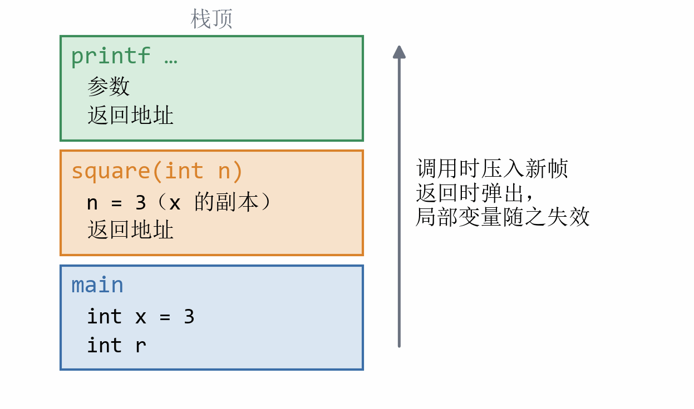


正在执行 `f` 时，可用简化图理解调用栈（стек вызовов）：

```text
较新的调用
┌────────────────┐
│ f 的调用帧     │
│ p → main 的 x  │
│ y = 5          │
├────────────────┤
│ main 的调用帧  │
│ x = 10         │
└────────────────┘
较早的调用
```

执行 `*p = *p + y;` 后，`x` 变为 15。

当 `f` 返回时：

- `f` 的局部变量 `y` 生命周期（время жизни）结束；
- `main` 尚未结束，所以 `main` 的 `x` 仍然有效，而且值为 15。

简化的存储分类：

| 内容 | 教学模型中的位置 |
|---|---|
| `main`、`f` 的机器指令 | 代码区（сегмент кода） |
| 自动存储期的局部变量 `x`、`y` | 通常在栈（стек） |
| 全局变量、静态变量 | 静态存储区/数据区（сегмент данных） |

这是帮助理解的常见模型。编译器优化后，局部变量可能只在寄存器中；标准 C 并不要求所有局部变量物理上都放在栈中。


**返回局部值合法，返回局部地址不合法**

```c
int get_value(void)
{
    int y = 7;
    return y;       // 返回数值副本：合法
}

/* 反例，不要使用返回的指针 */
int *bad(void)
{
    int y = 7;
    return &y;      // y 结束生命周期后成为悬空指针
}
```

作用域（область видимости）指名字能在哪里使用；生命周期（время жизни）指对象存在多久，不能混为一谈。局部 static 对象的名字仍只在相应作用域可见，但对象在整个程序运行期间存在。

```c
int counter(void)
{
    static int count = 0;
    return ++count;
}
```

分别调用 counter 三次，返回 1、2、3；初始化不是每次调用都重新执行。普通自动局部变量和局部 static 不能套用同一个生命周期结论。

**全局变量与 extern。** 定义在所有函数之外的变量称为全局变量（外部变量），它从定义处到文件末尾都可以使用，生命周期是整个程序运行期间，没有显式初始化时自动为零。程序由多个源文件组成时，一个文件中定义的全局变量，另一个文件要使用，需要先用 `extern` 声明：

```c
/* a.c */
int total = 0;          /* 定义：分配存储空间 */

/* b.c */
extern int total;       /* 声明：告诉编译器 total 在别处定义 */
void add(int x) { total += x; }
```

定义只能有一次，声明可以有多次。若在全局变量前加 `static`，它就只能在本文件中使用，其他文件即使声明 `extern` 也看不到；函数前加 `static` 也是同样的含义。这是 `static` 的第二种用法：对局部变量，它改变生命周期；对全局变量和函数，它限制可见范围。全局变量虽然方便，但任何函数都可能修改它，程序变大后很难追踪是谁改变了它的值，所以应尽量通过参数和返回值传递数据。

四种存储类别归纳如下：

| 写法 | 作用域 | 生命周期 | 未初始化时的值 |
|---|---|---|---|
| 函数内普通局部变量 | 所在的代码块 | 进入代码块到离开 | 不确定（垃圾值） |
| 函数内 `static` 局部变量 | 所在的代码块 | 整个程序运行期间 | 0 |
| 函数外全局变量 | 本文件，其他文件可用 `extern` 引用 | 整个程序运行期间 | 0 |
| 函数外 `static` 全局变量 | 只在本文件 | 整个程序运行期间 | 0 |

### 预处理：头文件、宏与条件编译

以 `#` 开头的行是预处理指令，在真正编译之前由预处理器处理，它只做文本替换，不理解 C 的语法。

`#include <文件名>` 把标准库头文件的内容插入到当前位置；`#include "文件名"` 先在当前目录查找，用于自己编写的头文件。头文件中通常放函数原型、宏定义和类型定义，而不放函数的定义。为了防止同一个头文件被重复包含，头文件常用如下的“包含保护”：

```c
/* mylib.h */
#ifndef MYLIB_H
#define MYLIB_H

int add(int a, int b);

#endif
```

第一次包含时 `MYLIB_H` 尚未定义，内容被保留并定义 `MYLIB_H`；再次包含时条件不成立，内容被跳过。

`#define` 定义宏。无参数的宏常用来定义常量，如 `#define N 10`；带参数的宏看起来像函数，但它只是原样替换文本，所以参数和整体都必须加括号：

```c
#define SQUARE_BAD(x) x * x
#define SQUARE(x) ((x) * (x))
#define MAX(a, b) ((a) > (b) ? (a) : (b))

int x = 3;
printf("%d %d\n", SQUARE_BAD(x + 1), SQUARE(x + 1));   /* 输出 7 16 */
```

`SQUARE_BAD(x + 1)` 被替换成 `x + 1 * x + 1`，按优先级计算得 \(3+3+1=7\)，而不是 16。即使加了括号，宏的参数也可能被计算多次，`SQUARE(i++)` 会使 `i` 增加两次，所以不要把带副作用的表达式传给宏。能用函数或 `const` 常量的地方，优先使用它们。

条件编译可以根据宏是否定义，决定保留哪一段代码，常用于调试输出和不同平台的适配：

```c
#define DEBUG
#ifdef DEBUG
    printf("x = %d\n", x);   /* 只有定义了 DEBUG 时才编译这一行 */
#endif
```

本册多处用到的 `#define _CRT_SECURE_NO_WARNINGS` 也是一个宏，MSVC 的头文件根据它是否定义来决定是否给出 C4996 提示，所以它必须写在第一个 `#include` 之前。

**`#include` 是纯文本插入。** 预处理时，`#include` 这一行被原样替换成被包含文件的全部内容，预处理器不关心文件扩展名，也不检查内容是不是声明。若 `file.h` 中写着 `int a;` 和 `int f(void);`，`main.c` 包含它之后就能使用 `a` 和 `f`，因为编译器看到的文本里，使用之前已经有了声明。`f` 在这里只有声明，函数体必须写在某个 `.c` 文件里，否则编译能通过而链接时报“未解析的外部符号”。头文件中直接写变量定义 `int a;`，被多个 `.c` 文件包含时可能造成重复定义；规范做法是头文件中写声明 `extern int a;`，只在一个 `.c` 文件中写定义 `int a;`。

同样的道理，`#include` 可以把一个数据文件嵌进数组的初始化表。若 `data.txt` 的内容是 `1, 2, 38, 75`：

```c
int Arr[] = {
#include "data.txt"
};
```

预处理后编译器看到的是 `int Arr[] = { 1, 2, 38, 75 };`，数组长度由初始化表定为 4。预处理指令必须独占一行，`#` 前面只能有空白，所以不能写成 `int Arr[] = { #include "data.txt" };` 这样的一行。

**`#undef` 与宏的作用范围。** 预处理器从上往下逐行处理，宏只在“定义之后、取消定义之前”的文本中起作用：

```c
#define PI 3.14159
double before = PI;      /* 3.14159 */
#undef PI
#define PI 4
double after = PI;       /* 4 */
```

`#undef` 之前已经替换好的文本不受影响。不先 `#undef` 而直接用不同的内容重新 `#define`，编译器给出“宏重定义”警告；`#undef` 之后若不再定义就使用 `PI`，它只是一个未声明的标识符；对没定义过的宏写 `#undef` 不会出错。

**`#error` 与 `#pragma`。** `#error` 让编译在这一行停止并输出给定的信息，通常放在条件编译中，拦住不支持的配置，把问题暴露在编译阶段而不是运行时：

```c
#if !defined(__linux__) && !defined(_WIN32)
#error "only Linux and Windows are supported"
#endif
```

`#pragma` 向编译器传达特殊指令，能写什么由各编译器自行规定，不认识的 `#pragma` 一般被忽略。常见的有：`#pragma once`（头文件只包含一次，作用与包含保护相同）、`#pragma pack(1)`（结构体按 1 字节对齐，不留填充）、MSVC 的 `#pragma warning(disable: 4996)`（关闭某个警告）。前者的意思是“到这里报错停止”，后者是“请按这种特殊方式处理”。

**预定义宏与 `#line`。** 编译器自动提供一些宏，不需要自己定义：

| 宏 | 替换结果 | 说明 |
|---|---|---|
| `__LINE__` | 当前行号（整数） | 标准 C |
| `__FILE__` | 当前源文件名（字符串） | 标准 C |
| `__DATE__` | 编译日期，如 `"Nov 19 2026"` | 标准 C，格式为“月 日 年”，日为个位数时前补空格 |
| `__TIME__` | 编译时刻，如 `"21:15:03"` | 标准 C |
| `__func__` | 当前函数名 | C99 标准；`__FUNCTION__` 是编译器扩展写法 |
| `__COUNTER__` | 0、1、2……每出现一次加 1 | 非标准，gcc、clang、MSVC 都支持 |
| `_DEBUG` | 调试版本标志 | 非标准，Visual Studio 的 Debug 配置自动定义 |
| `_MSC_VER` | MSVC 版本号 | 如 1943 对应 Visual Studio 2022 17.13，本机 VS 18 为 1951 |
| `_M_X64` | 编译 64 位程序时为 100 | 编译 32 位程序时不定义 |

`__DATE__`、`__TIME__` 在预处理时写死在程序中，记录的是编译时间而不是运行时间：3 月 5 日编译的程序，以后每次运行打印的都是 5 日，只有重新编译才会改变。它们是字符串字面量，可以与相邻的字面量自动拼接，`printf("\nMy Prog " __DATE__);` 等价于把两段合成一个字符串。

`#line N` 修改编译器记录的行号：它的下一行算作第 \(N\) 行，后面依次加一；`#line N "名字"` 同时修改 `__FILE__`。设源文件为 `my.c`：

```c
#include <stdio.h>
int main(void) {
    printf("%d, %s\n", __LINE__, __FILE__);   /* 3, my.c */
#line 10
    printf("%d, %s\n", __LINE__, __FILE__);   /* 10, my.c */
#line 20 "hello.cpp"
    printf("%d, %s\n", __LINE__, __FILE__);   /* 20, hello.cpp */
    printf("%d, %s\n", __LINE__, __FILE__);   /* 21, hello.cpp */
    return 0;
}
```

没有 `#line` 时报告的是真实行号；写了 `#line` 之后按它给的数接着往下数。`#line` 主要供代码生成工具使用，例如由语法描述文件生成 C 程序的工具在生成的代码中插入 `#line`，使编译错误指回原始描述文件中的位置。

**多行宏与断言。** 宏定义在逻辑上只占一行，行尾的反斜杠 `\` 表示下一行接续。下面的宏在条件不成立时报告位置：

```c
#define ASSERT(cond) if (!(cond)) \
    { printf("assertion error line %d, file (%s)\n", __LINE__, __FILE__); }
```

`ASSERT(x > 10)` 展开为 `if (!(x > 10)) {...}`。条件成立时什么也不发生；条件不成立时打印行号与文件名。`__LINE__` 写在宏定义里，报告的却是调用 `ASSERT` 的那一行：宏先被展开到调用处，`__LINE__` 再在那里被替换。参数 `cond` 外加括号，否则 `ASSERT(a == b)` 会展开成 `!a == b`，意思完全变了。断言（assert）表示“断定此处条件必然成立”，用于检查理论上不该发生的情况，例如在链表插入函数之后写 `ASSERT(Head);`：插入后头指针理应非空，若函数有错误把它置成了空指针，程序立即指出这一行，而不必等到后面访问空指针崩溃时才去排查。标准库 `<assert.h>` 的 `assert` 原理相同，失败时还会终止程序。

这种以 `if` 开头的宏紧跟 `else` 时会与调用者的 `if` 错配，规范写法是把宏体包在 `do { ... } while (0)` 中，使展开结果在语法上恰好是一条语句。

**用条件编译开关断言。** 调试时需要检查，发布时希望去掉检查以免拖慢程序。用条件编译给宏装一个开关：

```c
#if _DEBUG
#define ASSERT(cond) if (!(cond)) \
    { printf("assertion error line %d, file (%s)\n", __LINE__, __FILE__); }
#else
#define ASSERT(cond)
#endif
```

开关打开时 `ASSERT(Head);` 展开为检查语句；关闭时宏体为空，展开后只剩一个分号，等于一条空语句。同一份源代码不改一个字，只切换编译配置就决定是否检查。打开开关有三种方法：在 `#if` 之前写 `#define _DEBUG 1`；在编译命令中加 `-D_DEBUG`（gcc）或 `/D_DEBUG`（MSVC），效果等于在开头定义为 1；在 Visual Studio 中选择 Debug 配置。只写 `#define _DEBUG` 而不给值时，`#if _DEBUG` 的条件成了空表达式，MSVC 报错 C1017。

关闭断言时整个参数都会消失，所以参数中不能有必须执行的操作。`ASSERT(p = malloc(100));` 在发布版本中连 `malloc` 都不会执行，应写成 `p = malloc(100);` 再 `ASSERT(p);`。标准库的 `assert` 用 `NDEBUG` 作开关：定义了 `NDEBUG` 就关闭检查。

**字符串化 `#` 与连接 `##`。** 在带参数的宏中，`#参数` 把实参原样加上双引号变成字符串；相邻的字符串字面量在编译时自动拼成一个。`##` 把两侧的记号粘成一个记号，只做文本拼接，不做计算：

```c
#define PRINT_INT(n) printf(#n " = %d\n", n)
#define PRINT(a, b, c) printf("%d\n", a##b##c)
#define POINT(n) int n##_x, n##_y

int x = 23;
PRINT_INT(x);        /* printf("x" " = %d\n", x) -> x = 23 */
PRINT(2, 81, 34);    /* printf("%d\n", 28134) -> 28134, not 117 */
POINT(P1);           /* int P1_x, P1_y; */
```

`PRINT_INT` 的宏体中 `n` 出现两次：`#n` 得到变量名字符串，`n` 得到变量的值，打印变量时不必手写名字。

宏定义末尾一般不写分号，分号留给调用者，这样宏用起来与函数调用一样。若写成 `#define PRINT_INT(n) printf(#n " = %d\n", n);`，调用 `PRINT_INT(x);` 展开后成为两个分号；单独使用时多一条空语句无害，但放在 `if (a > 0) PRINT_INT(x); else PRINT_INT(y);` 中，第二个分号结束了 `if` 语句，后面的 `else` 找不到配对的 `if`，编译出错。

`##` 与 `__COUNTER__` 配合可以生成不重名的变量，但要多套一层宏：

```c
#define CAT2(a, b) a##b
#define CAT(a, b) CAT2(a, b)
#define UNIQUE(name) CAT(name, __COUNTER__)

int UNIQUE(tmp) = 0, UNIQUE(tmp) = 1;   /* int tmp0 = 0, tmp1 = 1; */
```

`##` 两侧的参数不会先展开，直接写 `#define VAR(n) n##__COUNTER__` 时，`VAR(a)` 得到的是 `a__COUNTER__`。中间加一层 `CAT`，`__COUNTER__` 在作为 `CAT` 的实参时先被替换成数字，再由 `CAT2` 粘接。

宏不会自动加括号，这一点与前面的 `SQUARE_BAD` 相同：`#define SUM(A, B) A+B` 时 `SUM(3, 4) * 2` 展开为 `3+4 * 2`，结果是 11 而不是 14；写成 `#define SUM(A, B) ((A) + (B))` 后结果为 14。带参数的宏，每个参数加括号，整个结果再加一层括号。

本节的 `#include` 嵌入数据、`#undef`、`#line`、`#`、`##`、`__COUNTER__`、`ASSERT` 与预定义宏示例，于 2026-11-19 用 MSVC（VS 18，/W4）编译运行，输出与注释一致；直接 `n##__COUNTER__` 的结果与空 `_DEBUG` 的 C1017 错误用 `/E` 预处理输出核对。


## 第四章 递归与数的表示

有些任务可以分解成一个规模更小的同类任务。递归函数正是把这种分解写进函数调用中。分解必须趋近一个可以直接处理的终止情形；调用返回时，尚未完成的工作再依次继续。进制转换同时展示了递归与迭代两种组织计算的方法。

### 递归计算

递归（рекурсия）是函数直接或间接调用自己。

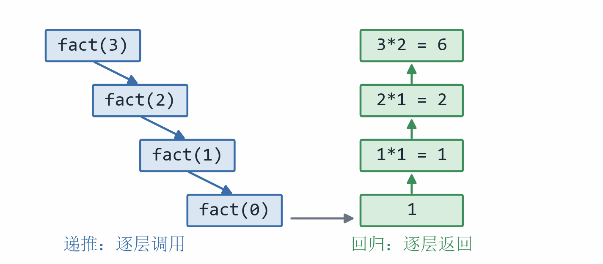


```c
void f(int n)
{
    if (n > 0)
    {
        printf("%d ", n);
        f(n - 2);
        printf("%d ", n);
    }
}
```

调用 `f(5)`。

向下调用：

```text
f(5)：先输出 5，再调用 f(3)，等待
f(3)：先输出 3，再调用 f(1)，等待
f(1)：先输出 1，再调用 f(-1)，等待
f(-1)：n > 0 为假，直接返回
```

向上返回：

```text
回到 f(1)：执行递归调用后面的 printf，输出 1
回到 f(3)：输出 3
回到 f(5)：输出 5
```

完整输出：

```text
5 3 1 1 3 5
```

最关键的规律：

```text
递归调用前面的代码：深入时执行
递归调用后面的代码：返回时执行
```

递归必须有停止条件，也叫基本情况（базовый случай）。没有正确的停止条件会不断调用，最终通常导致栈溢出（переполнение стека）。

做递归题时固定画两列：

| 深入阶段 | 返回阶段 |
|---|---|
| 当前参数是多少 | 回到哪一层 |
| 调用前输出什么 | 调用后输出什么 |
| 下一次调用参数是什么 | 本层何时结束 |


### 进制转换

进制（система счисления）；余数（остаток）；数位（цифра）；位权（вес разряда）。

**递归：先处理高位，再输出当前余数**

```c
/* 调用前保证 base 在 2..32；n 为非负数 */
void print_base(unsigned int n, unsigned int base)
{
    static const char digits[] = "0123456789ABCDEFGHIJKLMNOPQRSTUV";
    if (n >= base)
        print_base(n / base, base);
    putchar(digits[n % base]);
}
```

print_base(38u, 2u) 调用链为 38→19→9→4→2→1，返回时依次输出 1、0、0、1、1、0，得到 100110。n=0 时输出一个 0。base 的检查必须由调用者完成，不能传入 0 或 1。

和“打印进入阶段与返回阶段”的题目比较：递归前打印，会从低层调用之前执行；递归后打印，等更深一层返回才执行。若改写为每层先取余数再打印再调用，通常会得到低位在前的反向表示。

**不用数组：找到最高位权，再逐位取出**

```c
void print_digits(unsigned int n, unsigned int base)
{
    if (base < 2u || base > 32u)
        return;

    unsigned int weight = 1u;
    while (weight <= n / base)
        weight *= base;

    while (weight > 0u)
    {
        printf("%u", n / weight);
        n %= weight;
        weight /= base;
        if (weight > 0u)
            putchar(' ');
    }
}
```

这里只输出“用十进制数字写出的每个数位”，不是 A、B、C 等字符形式。因此 63 的 32 进制显示为 1 31；10000 的 16 进制显示为 2 7 1 0。若要求标准字符形式，使用上一节 digits 查表。

weight <= n/base 避免先计算 weight*base 导致的溢出。第二个循环必须按 weight > 0 判断，不能按 n > 0：余数可能已变成 0，但低位的零仍需输出。例如 10000 的末位 0 不可丢。n=0 时 weight 初值 1，仍能打印一个 0。

**限定语句时的写法：只用 if、goto、return 与函数调用**

有的作业规定：输入 1 到 1000000 的十进制整数和 2 到 32 的进制，只准使用 if、goto、return 和函数调用，不用循环、数组、else 与 switch。这时重复由递归承担，数位字符由字符编码的算术得到，输入检查由 goto 集中到一个出错出口。

```c
#define _CRT_SECURE_NO_WARNINGS
#include <stdio.h>

/* r 在 0..31：0..9 输出数字字符，10..31 输出 A..V */
void print_digit(int r)
{
    if (r < 10)
        goto digit;
    printf("%c", 'A' + r - 10);
    return;
digit:
    printf("%c", '0' + r);
}

/* n >= 1 时输出 n 的 base 进制表示；n == 0 时什么也不输出 */
void convert(int n, int base)
{
    if (n == 0)
        return;
    convert(n / base, base);
    print_digit(n % base);
}

int main(void)
{
    int n, base;

    printf("请输入十进制整数(1~1000000)和进制(2~32)：\n");
    if (scanf("%d %d", &n, &base) != 2)
        goto err;
    if (n < 1)
        goto err;
    if (n > 1000000)
        goto err;
    if (base < 2)
        goto err;
    if (base > 32)
        goto err;

    convert(n, base);
    printf("\n");
    return 0;

err:
    printf("输入错误：整数应在1~1000000之间，进制应在2~32之间。\n");
    return 1;
}
```

`/` 与 `%` 是表达式中的运算，不属于流程控制语句，因此不违反上述限制。四个范围检查各自只有一条 `goto err;`，相当于把“或”条件拆成连续判断；任何一项不满足都转到同一出口，并以 1 作为退出状态。scanf 的返回值也必须检查，否则输入字母时 n、base 未被赋值，后面的比较就读取了不确定的值。

以输入 `255 16` 为例。convert(255,16) 先调用 convert(15,16)，后者再调用 convert(0,16) 并立即返回；回到 convert(15,16) 时输出 15 对应的 F，再回到 convert(255,16) 输出 255%16=15 对应的 F，结果为 FF。递归调用排在 print_digit 之前，高位因而先输出，不需要数组暂存余数。终止条件 `n == 0` 不输出任何字符，所以输入 0 会得到空行；本题规定 n 至少为 1，范围检查恰好排除了这种情况。若允许 0，应在 main 中单独输出 `0`，或改用前面 `n >= base` 作为继续条件的写法。

print_digit 中的 return 不能省略：字母分支输出后若继续向下执行，会越过标签再执行数字分支，把同一位再输出一次。标签本身不是语句的边界，执行流会顺序穿过它。

**字符的数值与输出格式**

`'0' + r` 是整数运算。C 标准保证 `'0'` 到 `'9'` 的编码连续递增，所以 r 为 5 时结果就是字符 `'5'` 的编码；在 ASCII 中这是 48+5=53。%c 把这个整数当作字符编码输出，显示 5；%d 把同一个整数按十进制输出，显示 53。

| 写法 | r=5 时的输出 |
|---|---|
| `printf("%c", '0' + r)` | 5 |
| `printf("%d", '0' + r)` | 53 |
| `printf("%d", r)` | 5 |

数字分支改成 `printf("%d", r)` 也正确，但字母分支只能输出字符，统一用 %c 可使两分支处理同一种对象。`'A' + r - 10` 依赖字母 A 到 V 编码连续，ASCII 及其兼容编码满足这一点，C 标准本身却只保证数字字符连续。前面 digits 查表的写法不依赖这一假定，可移植性更好；在禁止数组的题目中，用字母算术时应注明以 ASCII 为前提。

**带返回值的递归：输出与计算分开追踪**

```c
/* 前提：1 <= n <= 4，避免越界输入与整数溢出 */
int f(int n)
{
    if (n == 1)
        return 2;
    return n * f(n - 1);
}
```

f(1)=2 → f(2)=4 → f(3)=12 → f(4)=48。没有 printf 就不会自动显示 48。该递归不适合直接传 n=0；应先按函数前提检查输入。


## 第五章 指针与间接访问

函数参数接收的是值的副本。如果函数需要修改调用者的对象，就必须获得访问该对象的方法。对象的地址提供了这种方法，指针类型则说明从该位置访问什么类型的数据。先从单个对象的地址与解引用出发，再把相同的机制用于连续存放的数组。

### 指针、地址与间接访问

```c
int x = 10;
int *p = &x;
```

假设 `x` 的地址是 `1000`：

```text
地址 1000
┌──────────┐
│    10    │  ← x 保存的值
└──────────┘
     ↑
     p 保存 1000，所以 p 指向 x
```

| 表达式 | 含义 | 假设值 |
|---|---|---:|
| `x` | `x` 的值 | 10 |
| `&x` | `x` 的地址 | 1000 |
| `p` | 指针 `p` 保存的地址 | 1000 |
| `*p` | 去 `p` 保存的地址处取值 | 10 |

因此：

```c
p  == &x;  // 地址相等
*p == x;   // 值相等
```

**同一个 `*` 的两种语法作用**

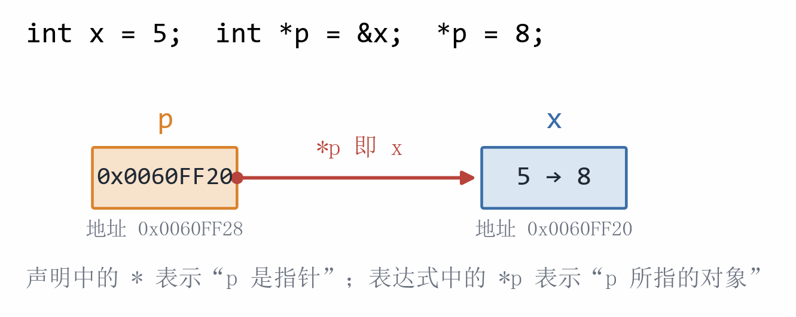


```c
int *p = &x;
```

这里的 `*` 是声明的一部分：声明 `p` 是“指向 `int` 的指针”。

```c
printf("%d", *p);
```

这里的 `*` 是解引用运算符（оператор разыменования）：访问 `p` 指向的对象。

记忆句：

```text
&：从变量得到地址
*：从地址找到对象
```

俄语课堂常见说法：

- 取地址运算符：оператор взятия адреса
- 解引用运算符：оператор разыменования
- 指向：указывает на
- `p` 指向 `x`：`p` указывает на `x`

**通过指针修改变量**

```c
int x = 20;
int *p = &x;
*p = 35;
```

`*p = 35` 不是把 `p` 改成地址 35，而是把 `p` 指向的对象改成 35。因为该对象就是 `x`，所以最后 `x == 35`。


**&p、指针自增和对象自增**

如果 int *p = &x，那么 &p 是指针变量 p 自己的地址，类型是 int **；它不是 x 的地址。

| 表达式 | 解析与作用 |
|---|---|
| p++ | 移动指针；用于合法的数组范围 |
| (*p)++ | 指针不动，所指的整数加 1 |
| ++*p | 等同 ++(*p)，先增加所指的整数 |
| *p++ | 等同 *(p++)，取得原位置对象，再移动指针 |
| *++p | 等同 *(++p)，先移动再解引用新位置 |

不要把这些操作混在复杂的一行中。先确认指针有效、所指对象可写以及移动后的范围，再分析运算符优先级。NULL 表示空指针，不是“指向数值 0 的指针”，不能解引用。


### 函数参数的值传递

C 语言严格来说只有按值传递（передача по значению）。所谓“传地址”，也是把地址这个值复制给函数的指针参数。

**普通值参数**

```c
void f(int x)
{
    x = x * 2;
}

int main(void)
{
    int x = 6;
    f(x);
    printf("%d", x);
}
```

```text
main_x = 6
   ↓ 复制数值 6
f_x = 6
   ↓
f_x = 12

main_x 仍然是 6
```

最终输出 `6`。

**指针参数**

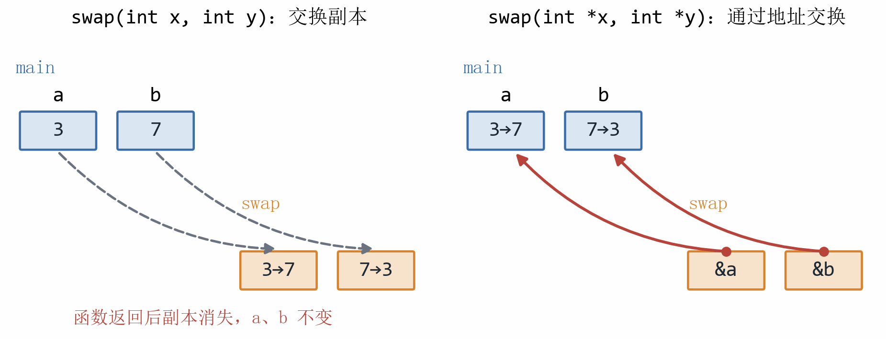


```c
void f(int *p)
{
    *p = *p * 2;
}

int main(void)
{
    int x = 6;
    f(&x);
    printf("%d", x);
}
```

```text
&x = 1000
→ f(&x) 把地址 1000 复制给参数 p
→ p == 1000
→ *p 就是地址 1000 里的 x
→ *p = *p * 2
→ x = 12
```

最终输出 `12`。

| 调用 | 传入内容 | 能否借此修改外部 `x` |
|---|---|---|
| `f(x)` | `x` 当前值的副本 | 不能 |
| `f(&x)` | `x` 地址的副本 | 能，通过 `*p` |

“传地址”可说 передача адреса 或 передача указателя；更严格的说法是 указатель передаётся по значению（指针也是按值传递）。


**两个形参可能指向同一个对象**

```c
void change(int *p, int *q)
{
    *p += 2;
    *q *= 3;
}

/* 调用片段 */
int x = 4;
change(&x, &x);
```

结果是 18，不是分别算出 6 和 12。p、q 都指向 x：第一句把 x 改成 6，第二句读取新的 6，再乘 3。这个现象叫别名（алиасинг）。遇到两个指针参数时，先问“是不是同一个对象”，再画值变化表。


### 指针的算术运算

```text
p + 1 的实际字节位移 = sizeof(*p)
```

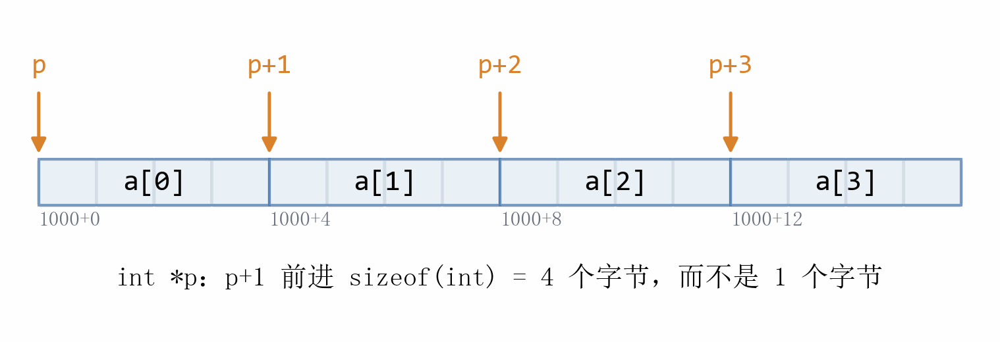


在常见的 `sizeof(int) == 4` 的环境中：

```text
int *pa: 1000 → pa + 1 → 1004
char *pc: 1000 → pc + 1 → 1001
```

但不要把“`int` 一定是 4 字节”当成标准规定。标准只保证 `sizeof(char) == 1`；应使用当前实现的 `sizeof(int)`。

```c
a++;   // a 保存的数值加 1
pa++;  // pa 移到下一个 int 元素的位置
```

指针运算（арифметика указателей）主要只在同一个数组对象内部及其末尾后一个位置有效。

```c
int a, b;
int *p = &a;
p++;
```

不能因为 `a`、`b` 声明相邻，就断言 `p == &b`。独立变量的内存排列没有这种保证，更不能随意解引用越过 `a` 后得到的指针。


## 第六章 数组与存储边界

当许多同类型数据需要统一处理时，逐个命名变量会使程序失去一般性。数组把这些对象按顺序存放，下标把一个整数映射到其中的元素。指针和数组由这种连续关系联系起来，但二者的类型、赋值规则和存储需求并不相同。

### 数组的连续存储与遍历

**数组元素连续存放**

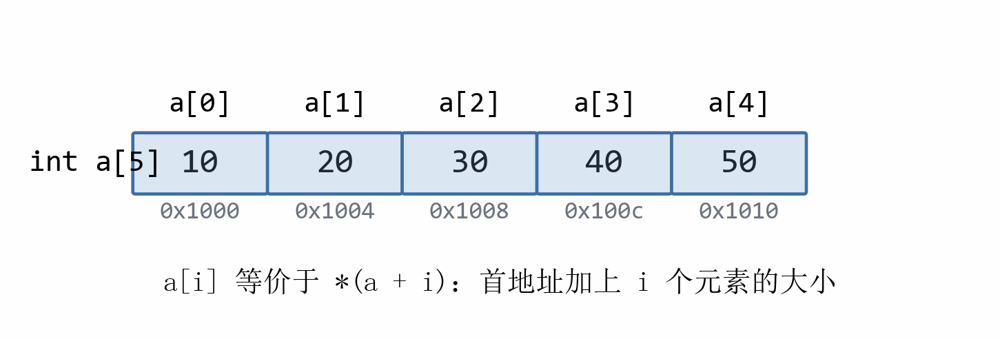


```c
int A[5] = {10, 20, 30, 40, 50};
```

```text
        A[0]  A[1]  A[2]  A[3]  A[4]
       ┌────┬────┬────┬────┬────┐
A ───→ │ 10 │ 20 │ 30 │ 40 │ 50 │
       └────┴────┴────┴────┴────┘
```

在大多数表达式中，数组名 `A` 会转换为指向第一个元素的指针，即 `&A[0]`。但“数组就是指针”不严谨：

```c
int A[5];  // 创建 5 个 int
int *p;    // 只创建一个指针变量
```

**下标的本质**

```c
A[i] == *(A + i)
```

若 `int *p = A;`，则：

```c
p[i] == *(p + i)
```

所以：

```c
*p       == 10;
p[0]     == 10;
p[2]     == 30;
*(p + 2) == 30;
```

**用指针遍历数组**

下标版：

```c
for (int i = 0; i < n; i++)
{
    A[i] = 10;
}
```

指针版：

```c
for (int *p = A; p < A + n; p++)
{
    *p = 10;
}
```

`A + n` 是末尾后一个位置（указатель за последним элементом）。它可以用于比较和作为终点，但不能解引用：

```c
int *end = A + n;  // 可以
*end = 10;         // 错误：越界访问，未定义行为
```

`p < A + n` 与 `p <= &A[n - 1]` 在 `n > 0` 时覆盖同一范围。第一种更自然，也适合表达空区间。

**数组作为函数参数**

在函数参数列表中：

```c
void f(int a[])
void f(int *a)
```

参数会调整为指针类型，因此这两种写法等价。函数通常拿不到数组总长度，必须额外传入 `n`：

```c
void fill(int a[], int n)
{
    for (int i = 0; i < n; i++)
    {
        a[i] = 10;
    }
}
```

俄语：

- 数组：массив
- 数组元素：элемент массива
- 下标/索引：индекс массива
- 遍历数组：обход массива
- 数组长度：длина массива
- 数组越界：выход за границы массива


**sizeof 数组不等于 sizeof 数组参数**

```c
int A[] = {4, 7, 9};
size_t n = sizeof A / sizeof A[0];  // 这里得到 3

void fill(int A[], size_t n)
{
    for (size_t i = 0; i < n; ++i)
        A[i] = 0;
}
```

函数参数位置的 int A[] 会调整为 int *A，函数里的 sizeof A 得到指针大小，不能自动求出原数组长度。应单独传入 n，并保证 A 指向至少 n 个可写元素。

数组名在很多表达式中转换为首元素指针，但数组对象本身并不是指针变量：不能写 A = p；sizeof A 和 &A 也提醒我们二者类型和含义并不相同。


### 数组类型、指针类型与声明

设 `int a[4] = {3, 8, 2, 6};`，表达式 `a` 在大多数表达式中转换成首元素指针，类型为 `int *`；`&a[0]` 也指向首元素。`&a` 则是指向整个数组的指针，类型为 `int (*)[4]`。

它们通常显示相同的起始地址，但加 1 的步长不同：首元素指针前进一个整数，整个数组的指针前进整个四元素数组。类型决定指针运算所用的元素单位，不能只看打印出来的数值。

`int *p[4]` 是含四个指针的数组；`int (*p)[4]` 才是指向四元素数组的指针。括号改变声明结构。

```c
int a[4] = {3, 8, 2, 6};
int *p = &a[1];
printf("%d %d\n", p[0], p[1]); // 8 2
```

`p[0]` 与 `*p` 等价；`p[1]` 与 `*(p + 1)` 等价。这里的下标以 p 当前指向的位置为起点，不一定以原数组 a[0] 为起点。

### 多维数组与行指针

二维数组可以看作“以一维数组为元素的数组”。声明 `int An2[3][5];` 建立三个元素，每个元素又是含五个 int 的数组。因此 An2 在多数表达式中转换为指向第一行的指针，而不是直接转换为 int 指针。

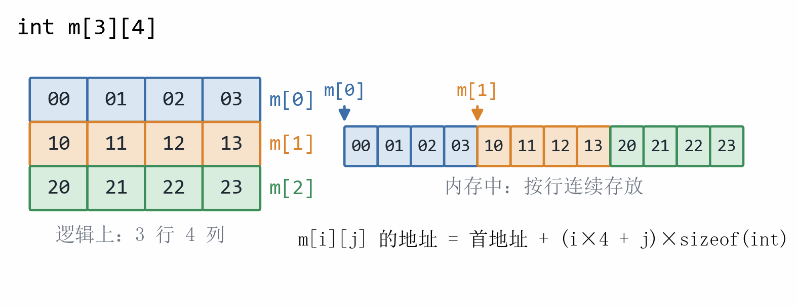


```c
int An1[5] = {10, 20, 30, 40, 50};
int An2[3][5] = {{1, 2, 3, 4, 5},
                 {6, 7, 8, 9, 10},
                 {11, 12, 13, 14, 15}};
int *element = An1;
int (*row)[5] = An2;
```

element 指向一个整数，row 指向一个五元素数组。`element + 1` 越过一个 int；`row + 1` 越过一整行，即五个 int。步长由所指对象类型决定，即使两个指针经转换后代表同一个起始位置，也不因此获得相同的运算规则。

```c
element = An2[1];     // 指向第二行的第一个整数
printf("%d\n", element[2]); // 8
row = &An2[1];       // 指向第二行这个数组对象
printf("%d %d\n", row[0][2], row[1][2]); // 8 13
row = &An1;          // 同为指向 int[5] 的指针
/* element = &An1; 类型不匹配 */
/* row = An1;       类型不匹配 */
```

`An2[1]` 的原始类型是 int[5]，在上述赋值中转换为 int *；`&An2[1]` 的类型则一直是 int (*)[5]。`row[1][2]` 先前进一行，再取那一行的第三个整数。若 row 已指向最后一行，就不能继续访问 row[1]。

把二维下标展开，可以看见两次不同的间接访问：`An2[i][j]` 等价于 `*(*(An2 + i) + j)`。第一次加法以行为单位，第二次以整数为单位。若每行有 c 个 int、sizeof(int) 为 s，元素相对整个数组起点的字节偏移为 `(i*c+j)*s`。这是内存布局的计算式；表达式本身仍须遵守各个数组对象的访问范围，不能把第一行的 int 指针任意跨行当成没有边界的一维数组。

### 二维数组作为函数参数

一维数组形参调整为首元素指针，二维数组也遵循同一规则，只是它的“一个元素”是一整行。设每行五个整数，下列两个声明表示同一种函数参数类型：

```c
void zero_rows(int a[][5], size_t rows);
void zero_rows(int (*a)[5], size_t rows);
```

函数必须知道列数，才能由 `a + i` 找到第 i 行；行数另作为边界传入。形参中的第一维即使写成三，也不会把整个三行数组按值复制进函数，更不能替代运行时的边界检查。

**讲解例：逐行清零。** 下面给出完整调用，`<stddef.h>` 提供 `size_t`。

```c
#include <stddef.h>
#include <stdio.h>

static void zero_rows(int a[][5], size_t rows)
{
    for (size_t i = 0; i < rows; ++i)
        for (size_t j = 0; j < 5; ++j)
            a[i][j] = 0;
}

int main(void)
{
    int a[3][5] = {{1, 2, 3, 4, 5},
                   {6, 7, 8, 9, 10},
                   {11, 12, 13, 14, 15}};
    zero_rows(a, 3);
    printf("%d %d\n", a[0][0], a[2][4]);
    return 0;
}
```

进入函数时，a 指向原数组第一行；i 从零增加到二，每次外循环把一行的五个元素改成零。函数没有建立第二份二维数组，所以调用后两个输出都是零。把三改成四会越界，函数签名不会自动发现实参只有三行。

`int **` 与这里的行指针不兼容。`int **` 指向的是一个“保存 int 指针的对象”，一次解引用应当读出一个指针；连续二维数组的一行里保存的却是整数。强制转换只改变解释方式，不会在整数前面凭空生成行地址表。

```c
int r0[2] = {1, 2};
int r1[3] = {3, 4, 5};
int *rows[] = {r0, r1};
int **pp = rows;
```

这个新例中 rows 确实是指针数组，转换后可赋给 pp。`pp[1][2]` 先读取第二个行地址，再访问 r1 的第三个元素，结果为五。两行长度可以不同，甚至不相邻，函数因而需要分别知道各行长度。相同的双下标语法，背后可能是“固定步长定位”或“先读取地址”，必须由声明判断。

列数也要在运行时变化时，在支持变长数组参数的 C 实现中可以写：

```c
void zero_matrix(size_t rows, size_t cols,
                 int a[rows][cols])
{
    for (size_t i = 0; i < rows; ++i)
        for (size_t j = 0; j < cols; ++j)
            a[i][j] = 0;
}
```

这里 rows、cols 应为正，实参应具有匹配的行宽和足够的行数；参数顺序使 cols 在后面的声明中已经可用。a 仍调整为“指向 cols 个 int 的数组”的指针，`sizeof a` 仍是指针大小。不能把此版本当作所有编译器都支持的固定数组版本；不支持这种参数类型的环境可采用前面的固定列数接口。另一个选择是从一开始就建立真正的一维缓冲区，通过 `i * cols + j` 表示二维索引，并检查长度与乘法溢出。它应与“把现成二维数组第一行的 int 指针任意跨行访问”区分开。

### 通用对象指针与地址比较

函数有时只负责保存或转交对象地址，暂时不需要知道对象类型，C 为此提供 void *。对象指针可转换为 void *，再转换回原类型；它不替程序保存原类型信息。标准 C 不允许对 void * 直接进行有意义的对象读取或指针算术，访问前必须恢复适当类型，并确保原对象仍存在。

```c
void *pv1 = An1;
void *pv2 = &An1;
void *pv3 = &An1[0];
printf("%d\n", pv1 == pv2 && pv2 == pv3); // 1
int first = *(int *)pv1; // 10
```

这里三个地址都对应 An1 的起始位置，转换为 void * 后可比较相等。若第三个改成 `&An2[0]`，它指向另一个数组，便不应沿用“三个都相等”的结论。地址关系必须由实际声明和表达式确定，不能仅凭假设的地址数字判断。

数学中的连等关系不能直接写成 C 的连续比较。`pv1 == pv2 == pv3` 按结合性解析成 `(pv1 == pv2) == pv3`；内层比较得到 int 结果，而这个结果表达式不是空指针常量，不能再这样与指针比较。需要用 `&&` 连接两个合法比较。相似地，对普通整数写 `a < b < c` 也不会得到数学中的区间判断，应写 `a < b && b < c`。


### 下标与合法访问范围

```c
/* 反例，假定 An 只有 20 个元素 */
An[100500] = 15;
```

三个概念一定分开：

| 部分 | 含义 | 俄语 |
|---|---|---|
| An | 数组，表达式中通常转换为首元素指针 | массив |
| 100500 | 相对 An 起点的元素下标，不是绝对地址 | индекс |
| 15 | 右侧要赋给目标元素的数值，不是地址推导结果 | присваиваемое значение |

15 来自赋值语句右侧。若换成 An[i] = i，才是把当前 i 的值写入 An[i]；不能因为下标或地址很大，就自动推导应写入 15。

**地址公式只能在合法范围内用于理解**

对于合法元素，概念上可用“首元素字节地址 + i × sizeof 元素”理解位置。例如假设起点地址 1000，int 占 4 字节，An[3] 位于 1012。这里只是教学假设，不是所有平台的实际地址。

对只有 20 个元素的数组访问 An[100500] 是越界（выход за границы массива）。即使按假设算出 403000，也不能说 C 保证会在那里写入 15：这样的程序已经出现未定义行为，可能崩溃、损坏其他数据、看起来正常，或被优化成意外结果。

**负下标不总是同一回事**

```c
int A[] = {10, 20, 30};
int *p = &A[1];

printf("%d\n", p[-1]); // 合法：等同 A[0]，输出 10
/* A[-1] = 5; */      // 非法：跑到数组起点之前
```

判断标准是“计算后的指针是否仍在所属数组的合法范围”，不是看到负号就下结论。可以形成 A + 3 这个末尾后指针，用于终止比较；不可以读取或写入 *(A + 3)，也不可以继续形成 A + 4。

**未定义行为与输出预测**

未定义行为（неопределённое поведение，UB）意味着 C 标准不要求一个确定结果。它不同于“普通结果未知”，也不同于“程序一定报错”。

读题顺序：长度是否合法 → 下标是否在范围内 → 对象是否仍存活 → 类型是否匹配 → 最后才推算值与输出。UB 示例用于识别错误，不用于实际运行验证某个固定输出。


### 变长数组的长度约束

考虑一个根据运行时长度建立数组的函数：

```c
/* 反例：未检查 n，不要以负数调用 */
void fun(int n)
{
    int An[n];
    for (int i = 0; i < n; ++i)
        An[i] = i;
}
```

An 的长度在运行时决定，属于变长数组（массив переменной длины，VLA）。在支持这一特性的 C 实现中，每次运行到这个声明时，长度必须大于 0。

n = -5 时，i = 0，条件 0 < -5 是假，所以循环体不执行；但数组声明已经在循环前执行。不执行循环不能消除这个声明的问题。编译通过、运行没有报错、不一定立刻崩溃，都不能证明程序合法。

**先检查，再声明**

```c
/* 仅适用于支持 VLA 的编译器 */
void fun(int n)
{
    if (n <= 0 || n > 1000)
        return;
    int An[n];
    for (int i = 0; i < n; ++i)
        An[i] = i;
    printf("%d\n", An[n - 1]);
}
```

这里的 1000 是示例选择的容量上限，不是 C 标准规定的最大数组长度。上限需要结合元素大小与可用资源决定；只检查正数还不够防止过大的自动数组。

微软 MSVC 不支持这种 VLA 写法。若课堂使用 Visual Studio 的 MSVC，可先使用固定容量方案：

```c
void fun_fixed(int n)
{
    if (n <= 0 || n > 1000)
        return;
    int An[1000];  // 实际容量固定，只使用前 n 个元素
    for (int i = 0; i < n; ++i)
        An[i] = i;
    printf("%d\n", An[n - 1]);
}
```

C 中 const int n = 10 也不自动成为整数常量表达式；别把 C++ 的数组长度规则直接搬来。固定编译期长度可以使用 enum { CAPACITY = 1000 };。编译器支持情况见 [Microsoft 的 C11/C17 支持说明](https://learn.microsoft.com/en-us/cpp/overview/install-c17-support?view=msvc-170)。


## 第七章 类型限定与数值表示

一个地址本身不足以说明可以对内存做什么。类型限定约束写入权限，运算规则约束可进行的计算，而数值表示决定哪些数学结果能够被精确保存。本章把这些条件与前面读写对象的操作联系起来。

### const 限定与指针比较

const 相关内容是围绕学习中的问题补充的系统说明。俄语：константный указатель（常量指针）；указатель на константу（指向常量的指针）。

**先分开两个问题**

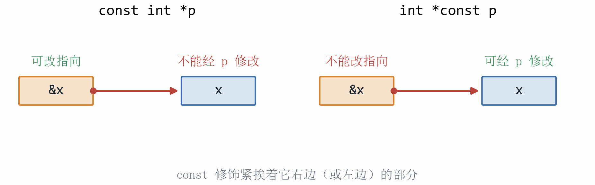


1. 能不能让 p 改为指向另一个对象？
2. 能不能通过 *p 修改当前对象？

| 声明 | p 可以改指向？ | 可以通过 *p 写值？ |
|---|---|---|
| int *p | 可以 | 可以 |
| const int *p | 可以 | 不可以 |
| int const *p | 可以 | 不可以 |
| int *const p = &x | 不可以 | 可以 |
| const int *const p = &x | 不可以 | 不可以 |

const 在 * 左边，限制通过这个指针访问的对象；const 在 * 右边，限制指针变量本身。常量指针必须在定义时给定指向。

```c
int x = 3, y = 8;
const int *p = &x;
p = &y;          // 允许
/* *p = 5; */    // 不允许：通过 p 写值
x = 6;           // 允许：x 本身不是 const 对象

int *const q = &x;
*q = 7;          // 允许：x 可修改
/* q = &y; */    // 不允许：q 不可改指向
```

const int *p 不代表它所指的一切值永远不变，只表示这个访问通道不允许写。如果对象本身定义为 const int x = 3，强制去掉 const 再修改它是未定义行为，不能靠类型转换绕过限制。

**指针相等、大小比较和值比较**

p == q 问“是否指向同一位置”；*p == *q 问“两个对象的值是否相等”。两个不同变量即使都存 5，它们的指针也不因此相等。

*p < *q 可以用于有效整数对象的值排序；p < q 的可移植用法则限于标准规定的关联对象范围，例如同一数组中的元素。不要把四个独立变量的地址大小当成值大小，也不要用地址顺序推断声明顺序。


### 浮点数表示与数值比较

浮点数通常不能精确表示所有十进制小数，例如 1/3。比较近似计算结果时，应根据问题尺度选择绝对或相对容差，而不是把一个固定 0.0001 当成适合所有问题的规则。

```c
#include <math.h>
int close_enough(double a, double b,
                 double abs_tol, double rel_tol)
{
    return fabs(a - b) <= abs_tol + rel_tol * fmax(fabs(a), fabs(b));
}
```

这是有限普通数值的课堂示例，未把 NaN 和无穷的完整策略纳入。`fabs` 接受浮点数；整数绝对值与浮点绝对值函数不是同一个接口。

地址用 `%p` 配 `(void *)p` 输出。不要把地址保存进 int 并假定不会截断。`uintptr_t` 是可选的无符号整数类型，若实现提供它，可用于相应指针与整数转换；它的存在也不使任意整数地址成为可安全访问的对象。

## 第八章 字符串与字符指针

字符串在 C 中以字符数组保存，用零字符标记结尾。这种表示使字符串可以沿用数组和指针的操作，同时要求程序始终明确字符内容和存储容量的区别。

### 字符编码与零结尾表示

`char` 保存字符编码。ASCII 环境下，`'A'` 的值为十进制 65、十六进制 41；这三个写法表达同一个数值。输出格式决定显示方式，不能由此认为所有 C 实现都必须使用 ASCII。

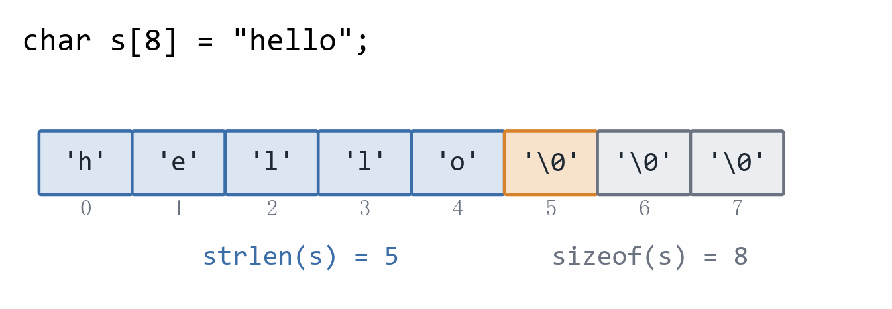


```c
char ch = 'A';
printf("%c %d %x\n", ch, (int)ch, (unsigned int)(unsigned char)ch);
/* ASCII 环境：A 65 41 */
```

`%c` 输出一个字符，`%s` 从给定地址读取字符直到第一个零字符。`'\0'` 是数值为零的字符；`'0'` 是数字零的字符，两者不同。`'\n'` 是一个换行字符，虽然代码中用两个可见符号书写，但只占一个 char 元素。

```c
char a[] = "ABC";                 // 4 元素，末尾有 '\0'
char b[] = {'A', 'B', 'C'};       // 3 元素，没有结束符
char c[] = {'A', 'B', 'C', '\0'}; // 4 元素，是字符串
char d[3] = "ABC";               // C 中合法，但没有 '\0'
char e[10] = {'A', 'B', 'C'};     // 其余元素补零，是字符串
char Mes[] = {'\n', 'A', 'B', 'C', 'D', '\0'};
```

字符数组是否带有结束符，取决于初始化方式与数组容量。字符串字面量自带结束符，但定长字符数组恰好只能容纳普通字符时可以省去它；逐项初始化时，未显式给值的剩余数组元素补零，完全填满的数组不会额外增加一个元素。因此 b 和 d 不能交给 `%s` 或 strlen；它们仍然是合法字符数组，却不是零结尾字符串。

`Mes` 与 `char Mes[] = "\nABCD";` 的内容相同。输出时使用 `printf("%s", Mes);`，不要把可变内容直接放在格式参数位置；否则内容中的 `%` 会被解释成格式说明。

### 字面量、变量与字符存储

程序中的 10、'A'、"ABC" 直接给出了固定的值或字符序列，通常称为字面量；C 标准将 'A' 称为字符常量。变量名则标识保存数据的对象。`char a[] = "ABC";` 用字面量初始化新的字符数组，`const char *p = "ABC";` 只建立一个指向字面量的指针，两种初始化产生的对象不同。

### 字符数组与字符串字面量

```c
char str1[10] = "ABC";
char str2[] = "DEF";
const char *str3 = "GHI";

str1[1] = '_';
str2[1] = '_';
/* str3[1] = '_'; 约束违反，编译器须给出诊断 */
printf("%s %s %s\n", str1, str2, str3);
/* A_C D_F GHI */
```

str1 和 str2 自己拥有可写字符存储；str3 是保存地址的指针。const 禁止通过它写字符。在 C 中，即使写成 `char *p = "GHI";`，也不能修改字面量：尝试写入会产生未定义行为。现代标准 C++ 不允许用字符串字面量直接初始化 char *，通常会在编译时拒绝此声明。C 与 C++ 的规则不能混用。指针能否改指向，与所指字符能否修改，是两个问题。

### 字符串指针数组与双下标

```c
char *sarr[] = {str1, str2};
const char *sarr2[] = {str1, str2, str3, "banana"};
printf("%s %s\n", sarr[1], sarr2[3]); // D_F banana
printf("%c\n", sarr[1][2]);          // F
sarr2[0] = "hello";                 // 可以改保存的地址
/* sarr2[0][0] = 'X'; 不允许通过 const char * 写字符 */
```

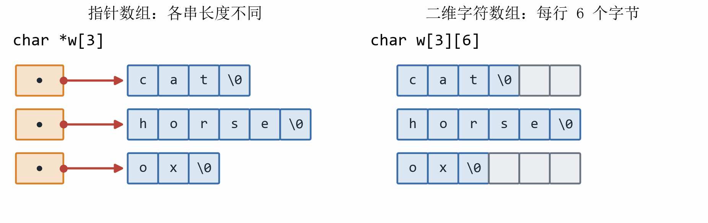


sarr 是数组，每个元素为 char 指针。`sarr[1]` 取第二个指针；`sarr[1][2]` 再取该指针指向位置之后的第三个字符，等价于 `*(*(sarr + 1) + 2)`。它不同于 `char (*p)[5]`：后者是一个指向五元素字符数组的指针。

### 字符串长度与对象大小

strlen 声明在 `<string.h>`，返回第一个结束符之前的字节数，不包含结束符。它要求输入已经是有效字符串，不能用它先判断一个无结束符数组是否安全。sizeof 是运算符，计算对象或类型的字节大小。

```c
#include <stdio.h>
#include <string.h>

int main(void)
{
    char str1[10] = "ABC";
    char str2[] = "DEF";
    char Mes[] = "\nABCD";
    printf("%zu %zu %zu\n", strlen(str1), strlen(str2), strlen(Mes));
    printf("%zu %zu %zu\n", sizeof str1, sizeof str2, sizeof Mes);
    // 两行分别为：3 3 5 和 10 4 6
    str1[1] = '\0';
    printf("%zu %zu\n", strlen(str1), sizeof str1); // 1 10
    return 0;
}
```

两者结果类型都是 size_t，输出用 `%zu`。对 `const char *p = "GHI";`，`strlen(p)` 为 3，`sizeof p` 是指针自身大小，不能推断为 4，也不能据此获得目标容量。函数参数中的数组声明会调整为指针，同样不能在函数内用 sizeof 参数求原数组容量。

示例中的 `ls` 是小写字母 l 和 s，不是数字 1 加 s，也不是关键字。它只是长度变量，规范写法为 `size_t ls = strlen(str2);`。中文等多字节编码下，strlen 计算字节数，不等同于人所理解的汉字个数。

## 第九章 字符串处理函数

把字符串交给函数处理之前，必须先约定源数据的结束位置和目标的可写范围。复制函数并不拥有数组，它只能依照调用者给出的地址与长度读写内存。

### 字符串的逐字符复制

`strcpy(dst, src)` 从源复制到目标，包含结束符。前提是源为有效字符串、目标可写且容量至少为 `strlen(src) + 1`，源目标区域不能重叠。

```c
char dst[10] = "ABC";
char src[] = "D_F";
strcpy(dst, src);
printf("%s\n", dst); // D_F
```

实际写入 D、_、F、零字符，共四个字节。数组剩余位置不会被该函数自动清零。不能写 `dst = src` 给整个数组赋值；若两边都是指针，赋值只是改变地址，也不会复制字符串。

### 从下标循环到指针循环

复制两个数组的内容，归根结底是依次读取源元素、写入目标元素。对于字符串，循环还要识别结束符，并把这个结束符也写入目标。先不调用库函数，写出最直接的实现：

```c
/* 前提：src 是有效字符串，dst 容量足够，区域不重叠 */
void copy_text(char *dst, const char *src)
{
    size_t i = 0;
    for (;;) {
        dst[i] = src[i];
        if (src[i] == '\0')
            break;
        ++i;
    }
}
```

若源为 "CAT"，i 为 0、1、2 时依次写入 C、A、T；i 为 3 时先写入零字符，再退出。检查发生在写入之后，所以结束符不会遗漏。这里的函数名使用 copy_text，以免同标准库 strcpy 的声明冲突。

下标只是指针加法与解引用的另一种写法。因此，也可以用两个指针记录当前位置：

```c
void copy_text_pointer(char *dst, const char *src)
{
    for (;;) {
        *dst = *src;
        if (*src == '\0')
            break;
        ++dst;
        ++src;
    }
}
```

两个函数做同一件事：前者改变下标，后者改变局部指针。形参指针本身按值传入，函数内移动 dst 不会让调用者的指针跟着移动；通过 *dst 写入的字符则属于调用者提供的数组。由此，值传递和间接修改在同一段程序里同时出现，并不矛盾。

进一步把赋值结果用于条件，可以写成 `while ((*dst++ = *src++) != '\0') { }`。后缀自增使本次读写仍使用原地址，随后两个局部指针各前进一个字符；最后复制零字符，比较结果为假，循环结束。这个短写法需要从完整版本逐步理解，不能仅凭外形背诵。

上述实现都没有目标容量参数，不能自行检查可写空间。库函数 strcpy 也有相同前提。代码行数变少不会使容量问题消失，结束符约定和数组边界仍然是调用者必须满足的条件。


### 定长复制与零填充

`strncpy(dst, src, n)` 最多从源取 n 个字符；若先遇结束符，则用零填满目标的这 n 个位置。若源的前 n 个字符都不是零，目标不会自动追加结束符。目标必须有至少 n 个可写位置，区域仍不得重叠。

```c
char dst[10] = "ABCDEFG";
char src[] = "DEF";
size_t ls = strlen(src); // 3
strncpy(dst, src, ls);
printf("%s\n", dst);   // DEFDEFG：旧尾部仍在
dst[ls] = '\0';
printf("%s\n", dst);   // DEF
```

这里手工补零合法，因为 ls 小于目标容量；不能在任意长度下照抄。给源数组 `src[ls]` 写零不会替目标补结束符。手工补结束符的下标必须小于目标容量，否则补零本身也是越界写入。

下面例子先检查容量，再完整复制；空间不足时保留原目标，不进行截断：

```c
size_t ls = strlen(src);
if (ls < sizeof dst) { // 这里 dst 必须确实是数组对象
    strcpy(dst, src);
} else {
    puts("destination too small");
}
```

### strcpy_s、strncpy_s 与微软扩展

在支持相应接口的环境中，`strcpy_s(dst, capacity, src)` 有三个参数；微软的 `strncpy_s(dst, capacity, src, count)` 有四个。两者的参数个数和复制范围不同。`_countof(array)` 是微软提供的数组元素个数宏，不是通用标准 C 写法，不能用指针推算原数组容量。

```c
/* 以下为 Microsoft CRT 环境示例 */
char dst[10] = "ABC";
errno_t err = strcpy_s(dst, _countof(dst), "DEF");
if (err != 0) {
    /* 按项目要求处理复制失败 */
}
```

容量必须如实描述目标可写范围，并为结束符留位置。微软 CRT 某些参数错误会先触发无效参数处理器，默认行为可能终止程序，不能假定任何错误都会正常返回到 if。标准 C 的 Annex K 接口是可选部分，可用性和配置因实现而异；跨平台示例优先明确管理容量，不能假设所有编译器都提供上述函数。

带 `_s` 的函数返回 `errno_t`，零表示成功。使用 `_TRUNCATE` 时要区分两个相似的名字：`_TRUNCATE`（带下划线）是调用者**传入**的计数参数，表示允许截断；`STRUNCATE`（以 S 开头）是函数**返回**的错误码，表示确实发生了截断。截断并不是失败，目标中仍是合法字符串，只是内容不完整。

```c
/* Microsoft CRT 环境示例：dst 是容量为 cap 的可写缓冲区 */
errno_t err = strncpy_s(dst, cap, "Hello!", _TRUNCATE);
if (err == STRUNCATE) {
    printf("\nString was truncated");
} else if (err != 0) {
    printf("\nError in strncpy_s");
} else {
    dst[5] = '?';          /* 成功复制后才修改：Hello? */
}
```

判断顺序不能颠倒。`STRUNCATE` 本身也是非零值，若先写 `err != 0`，截断情形会被当作一般错误，第一个分支永远不会执行。`dst[5]` 是第六个字符：H、e、l、l、o、! 的下标依次为零到五，所以感叹号被换成问号。

Visual Studio 编译 `strcpy`、`strncpy`、`strcat` 时会给出 C4996 警告，建议改用 `_s` 版本。课堂代码在文件第一行写 `#define _CRT_SECURE_NO_WARNINGS`（必须位于任何头文件之前）可以关闭这一类警告；关闭警告只是允许使用标准函数，容量检查仍由程序自己负责。

### 拼接与目标容量

拼接在目标字符串原有结束符处开始写入。若使用 `strcat(dst, src)`，必须已有合法目标字符串，容量至少为 `strlen(dst) + strlen(src) + 1`，源与目标不得重叠。`strncat` 的 n 限制的是最多从源复制多少字符，仍会另外写结束符，n 也不是目标总容量。设目标容量八，原内容 "ab"，再接 "cde" 需六个元素；若继续接 "fgh"，总需求九个，已经超出容量，不能因为每次只加三个就认定安全。内容、已用长度和总容量始终是三个量。

课堂板书把 `strcat(str1, str2)` 的含义写成 `str1 = str1 + str2`：把 str2 接到 str1 后面，结果仍存在 str1 中。这只是对操作含义的描述。C 中数组名不能被赋值，两个指针相加也没有意义，拼接文字只能靠逐字符复制。

**讲解例：容量不足时 strcat 怎样越界。**

```c
/* 反例：目标只有 4 个元素 */
char str1[4] = "ABC";
char str2[]  = "DEF";
strcat(str1, str2);
```

第一行开出下标 0 到 3 的四个元素，依次为 A、B、C 和结束符。第二行由编译器按初始值计数，也是四个元素。第三行在函数内部分成以下几步：

1. 从 `str1[0]` 向后寻找结束符，在下标 3 找到；

2. 把 D 写入下标 3，覆盖原结束符，这一格仍在数组内；

3. 把 E、F 写入下标 4、5，已经超出数组；

4. 把 str2 的结束符写入下标 6，然后停止。

拼接结果需要 3 + 3 + 1 = 7 个元素，数组只有 4 个，多出的三次写入落在不属于 str1 的内存上，程序产生未定义行为。strcat 不会自己停下，原因在于它只收到 str1 的首地址：数组作为实参时转换为指针，长度信息没有传进函数。函数唯一的停止条件是复制完源串的结束符。把第一行改为 `char str1[7] = "ABC";`，同一调用就是正确的。

**讲解例：strncat 的第三个参数。**

```c
char str1[8] = "ABC";
char str2[]  = "DEF";
size_t len2 = strlen(str2);     /* 3 */
strncat(str1, str2, len2);      /* str1 为 "ABCDEF" */
```

`len2` 是变量名，读作“第二个字符串的长度”，不是“长度为二”。它的值是 `strlen(str2)`，即结束符之前的三个字符；`sizeof str2` 则是四。传入完整长度时，效果与 strcat 相同。若在原内容仍为 "ABC" 时调用 `strncat(str1, str2, 2)`，只取 D、E，再自动写一个结束符，结果为 "ABCDE"。这里的 2 是“最多取几个”，并不知道 str1 还剩几个空位。

**讲解例：strncat_s 用目标容量截断。**

```c
/* Microsoft CRT 环境示例 */
char str1[6] = "ABC";
errno_t err = strncat_s(str1, _countof(str1), "DEF", _TRUNCATE);
/* err == STRUNCATE，str1 为 "ABCDE" */
```

`_countof(str1)` 为 6，留一格给结束符，字符串最多容纳五个字符。已有三个，只剩两个空位，所以只放入 D、E，F 被舍去，下标 5 写结束符。六个元素恰好用完，没有越界。这是 strncat_s 比 strncat 多出的能力：它知道目标总容量。

若第四个参数不是 `_TRUNCATE` 而是普通计数，例如 3，则 3 + 3 + 1 = 7 超过容量。此时函数不会写到数组之外，而是把 `str1[0]` 置为结束符并调用无效参数处理器；调试版默认弹出错误并终止，若处理器允许继续，函数返回 `ERANGE`。所以“放不下”有两种可选处理：传 `_TRUNCATE` 接受截断，或检查返回值按错误处理。strncat_s 还要求目标已是带结束符的字符串，否则返回 `EINVAL`。

strcat_s、strncat_s 只能防止写出边界，不会让数组变大。容量不够时得到的是安全的失败或截断，而不是完整结果；需要完整结果时，应先按实际长度准备足够的存储，第十章的动态内存正是为此而设。

### 内容比较与整行输入

地址相等只说明两个指针指向同一位置，不说明两个不同数组保存的文字是否相同。`strcmp` 比较零结尾字符串的内容，返回负、零、正分别表示前者按字节比较较小、相等、较大；标准不要求恰好返回负一或一。

```c
char first[] = "cat";
char second[] = "cat";
printf("%d\n", strcmp(first, second) == 0); // 1
```

两个数组是不同对象，但字符依次相同。比较按第一个不同字符的 unsigned char 值决定，不是按字符串长度决定，也不是自然语言词典排序。`strncmp(a, b, n)` 最多比较 n 个字符，因此前 n 个字符相同不能推出整个字符串相同。例如 "cart" 与 "carpet" 的前三个字符相同。

**讲解例：指针与数组的 == 比较。**

```c
const char *s1 = "Hello!";
const char *s2 = "Hello!";
char s3[] = "Hello!";
char s4[] = "Hello!";
/* s1 == s2：结果由实现决定；s3 != s4：恒为真 */
```

s1、s2 是指针，各自只保存一个地址。两个内容相同的字面量是否共用同一块只读存储，C 标准明确留给实现决定（N1570 6.4.5）。许多编译器会合并相同字面量，MSVC 在开启字符串池（/GF，优化编译时默认开启）时就是如此，这时 s1、s2 指向同一个 H，`s1 == s2` 为真；但程序不能依赖这个结果。同样，若另有一个字面量 "!"，它在内存中是感叹号加结束符，恰好与 "Hello!" 的最后两个字节相同，实现可以让指向 "!" 的指针直接指向 "Hello!" 的尾部，不另存一份。用 MSVC 实测：不开优化（/Od）时 `s1 == s2` 为假，开 /O2 时为真；"!" 两种情况下都没有共用尾部。同一份代码换一个编译选项结果就变，正说明这个比较不可依赖。

s3、s4 是两个独立的数组对象，各开七个元素，各自复制一份 "Hello!"。比较时数组名转换为首元素地址，两个不同对象的地址必然不同，所以 `s3 != s4` 恒为真，与内容是否相同无关。要比较的若是文字内容，无论指针还是数组，都应写 `strcmp(s3, s4) == 0`。

读取含空格的整行时，可以让 `fgets` 接收缓冲区容量：

```c
char line[80];
if (fgets(line, sizeof line, stdin) != NULL) {
    size_t p = strcspn(line, "\n");
    int complete = line[p] == '\n';
    line[p] = '\0';
    printf("%s\n", line);
    /* complete 为 0 时，仍须判断是否读到了完整一行。 */
}
```

成功读取时，函数至多保存七十九个输入字符，再补结束符；读到换行且有空间时，换行也会保存。`strcspn` 找到首个换行或原结束符的位置，随后置零可去掉已读到的换行。但缓冲区里没有换行，可能是最后一行没有换行，也可能是一行过长、剩余部分还在输入流中。二者不能混为“成功读完整行”，应按应用要求继续读取、丢弃余段或报告过长。

字符串函数普遍依赖有效对象和容量条件；它们不能修复已经没有结束符的输入。若要移动可能重叠的字节区间，应使用按字节长度操作的 `memmove`，而不是 `strcpy` 或要求不重叠的 `memcpy`。字节搬运本身不自动补字符串结束符。关于参数调整与标准库语义，可核对 [WG14 C11 委员会草案 N1570](https://www.open-std.org/jtc1/sc22/wg14/www/docs/n1570.pdf) 的 6.7.6.3、7.21.7.2 和 7.24；它是语义参考，本册讲解仍按对象、边界、操作过程展开。

## 第十章 动态内存

第九章的字符串函数都要求调用者事先准备好容量足够的目标。固定数组的容量在写代码时就已确定，运行时遇到更长的数据既不能变大，也不能活过定义它的函数。本章讨论动态内存（динамическая память）：程序在运行时按实际需要向系统申请存储，用完再归还。它与第三章的调用栈、第六章的越界访问和第九章的字符串容量是同一条线索：先确定存储有多大、存在多久，再谈怎样读写。

### 固定数组的三个限制

动态内存并不替代越界检查。第九章的 `char str1[4] = "ABC"; strcat(str1, str2);` 根本没有用到 malloc，同样越界；问题出在往存储之外写，与存储从哪里来无关。动态内存解决的是另一类问题，即固定数组做不到的三件事。

第一，**容量必须在编译时写定。** 读入用户姓名、读文件或拼接许多字符串时，事先不知道需要多长。写小了会越界或只能截断，写大了大部分时间浪费。第六章的变长数组可以在运行时定长度，但 MSVC 不支持，而且仍受下一条限制。

第二，**自动数组不能太大。** 函数中的普通数组通常位于调用栈上，而栈空间有限，Visual Studio 生成的程序默认栈大小约为 1 MB。`int a[1000000];` 约需 4 MB，在函数内定义就可能使程序因栈溢出而终止。

第三，**自动数组随函数返回而结束生命周期。** 第三章已经说明，返回局部变量的地址得到的是悬空指针。下面的拼接函数犯的正是这个错误：

```c
/* 反例：返回局部数组的地址 */
char *join_bad(const char *a, const char *b)
{
    char result[100];
    strcpy(result, a);
    strcat(result, b);
    return result;      /* 函数返回后 result 已不存在 */
}
```

调用者拿到的地址指向一块已经结束生命周期的存储，使用它是未定义行为；而且 100 是写死的，a、b 稍长就越界。若最大长度事先确定且不大，例如日期 "2026-10-22"、学号或一行命令，用固定数组配合容量检查完全可以。长度事先未知、数据很大、或者结果要交给函数外使用时，才需要动态内存。

### 堆与 malloc、calloc

动态分配的存储来自一片称为堆（куча）的区域。课堂板书用一条长线表示这片区域：调用 `malloc(N)` 时，系统从空闲（свободно）部分划出 N 个字节标记为已占用（занято），再把这块存储的起始地址交给用户（передаём пользователю）。动态内存的操作只有两类：分配（выделение）与释放（освобождение）。

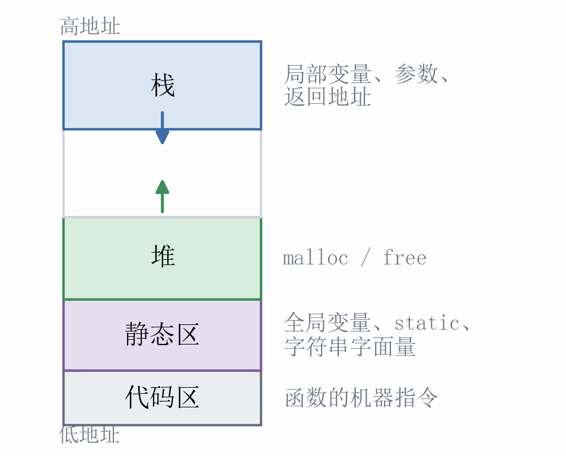


```c
#include <stdlib.h>

void *malloc(size_t size);
void *calloc(size_t number, size_t size);
void  free(void *memblock);
void *realloc(void *memblock, size_t newsize);
```

malloc 的参数是**字节数**（в байтах），类型 `size_t` 是表示大小的无符号整数。返回值是指向已分配存储的指针，或者空指针（板书写作 ук. на выдел. память или Ø）。返回类型为 `void *`，表示“尚未说明指向什么类型的地址”，因为 malloc 不知道调用者要存 char 还是 int。C 中 `void *` 可以隐式转换为其他对象指针，课堂代码写成 `(char *)malloc(...)` 是显式转换，在 C 中可写可不写；C++ 中则必须写。

malloc 只划出存储，不初始化，其中的字节是不确定值。calloc 接受“元素个数”和“每个元素的字节数”两个参数，总共分配二者之积，并把全部字节置零。板书举的例子是 `malloc(100)` 与 `calloc(25, 4)`：后者表示 25 个各占四字节的元素，同样是 100 字节，区别只在是否清零。规范写法不直接写 4，而写 `sizeof(int)`，换类型时不会算错：

```c
int *a = malloc(25 * sizeof(int));   /* 100 字节（int 占 4 字节时），内容不确定 */
int *b = calloc(25, sizeof(int));    /* 同样大小，全部为零 */
```

calloc 清零后的字节就是数值为零的字符，与 `'\0'` 相同（第八章已区分 `'\0'` 与字符 `'0'`，后者在 ASCII 中为 48）。因此用 calloc 为字符串分配存储时，第一个字节就是结束符，存储一开始就是合法的空字符串，可以直接 strcat。malloc 得到的存储里没有可靠的结束符，必须先 strcpy，或手工写 `p[0] = '\0';`，否则 strcat 找不到结尾，会一直向后读。

申请可能失败。空闲存储不够时，两个函数都返回空指针，所以每次分配后都要先检查，再使用：

```c
int *p = malloc(100 * sizeof *p);
if (p == NULL) {
    /* 分配失败，不能使用 p */
}
```

不检查就写 `p[0] = 5;`，等于通过空指针写入，程序通常立即崩溃。`sizeof *p` 按指针所指类型计算元素大小，与 `sizeof(int)` 相同，好处是改动 p 的类型时不必同步修改。

### free 与配对规则

`void free(void *memblock)` 把一块动态存储交还给系统。前面的 `void`（不带星号）表示 free 不返回任何值；参数 `void *memblock` 是要归还的那块存储的地址。板书把 malloc 前的 `void *` 圈起来，连线到 free 的参数，含义是：分配时拿到什么地址，释放时就交回什么地址。又在 malloc 和 free 上分别标出 1、2，强调二者必须成对出现。

使用 free 有四条规则：

1. 只能释放 malloc、calloc、realloc 返回的地址。普通数组 `char s[10];` 不能 free，指向块中间的指针也不能 free。

2. 同一块不能释放两次。

3. 释放后不能再通过原指针访问。指针变量里仍存着旧地址，但那块存储已不属于程序，这样的指针称为悬空指针。释放后写 `p = NULL;` 是常用的防误用习惯。

4. `free(NULL)` 是合法的，什么也不做。

忘记释放时，那块存储一直标记为已占用，程序自己也无法再使用它，称为内存泄漏（утечка памяти）。短程序结束时操作系统会回收全部存储，所以看不出影响；长时间运行的程序会越来越慢，最终 malloc 返回空指针。

### 按需分配字符串

把第九章的拼接与本章的分配合在一起，就能写出不会越界、又能把结果交给调用者的拼接函数：

```c
#include <stdlib.h>
#include <string.h>

/* 返回新分配的字符串，调用者负责 free；分配失败时返回 NULL */
char *join(const char *a, const char *b)
{
    size_t n = strlen(a) + strlen(b) + 1;   /* 内容长度之和，再加结束符 */
    char *result = malloc(n);
    if (result == NULL)
        return NULL;
    strcpy(result, a);   /* 新存储没有结束符，不能先 strcat */
    strcat(result, b);
    return result;       /* 堆上的存储不会因函数返回而消失 */
}
```

调用方式为：

```c
char *s = join("ABC", "DEF");
if (s != NULL) {
    printf("%s\n", s);   /* ABCDEF */
    free(s);
}
```

n 的计算就是第九章反复出现的 3 + 3 + 1 = 7。长度在运行时由 strlen 得到，申请恰好这么多，不浪费也不会不够。函数用 strcpy 放入第一段，是因为 malloc 得到的存储中没有结束符；若改用 `calloc(n, 1)`，则可以直接两次 strcat。结果在堆上，函数返回后仍然有效，这与 join_bad 的局部数组根本不同。释放的责任随指针一起转交给调用者，函数注释应写明这一点。

strcat_s 与 malloc 的分工也由此看清：malloc 负责“容量足够”，strcat_s 负责“万一算错也不越界”，二者可以同时使用。注意此时容量参数要传 n，不能写 `sizeof result`：result 是指针，`sizeof result` 只是指针本身的大小（64 位程序中为 8），与它指向的存储有多大无关。

```c
/* Microsoft CRT 环境示例 */
strcpy_s(result, n, a);
strcat_s(result, n, b);
```

**读入长度未知的输入。** 拼接两个已有字符串时，长度摆在那里可以算出；读用户输入时，输入之前谁也不知道多长，不能事先算准。常用做法有两种。其一，先读入一个有上限的临时数组，再按实际长度分配：

```c
char tmp[256];
if (fgets(tmp, sizeof tmp, stdin) != NULL) {
    tmp[strcspn(tmp, "\n")] = '\0';
    size_t n = strlen(tmp) + 1;
    char *name = malloc(n);
    if (name != NULL) {
        strcpy(name, tmp);
        /* ...使用 name... */
        free(name);
    }
}
```

fgets 最多读 255 个字符，绝不越界；超长部分留在输入流中，需要时按第九章的方法另行处理。临时数组随函数结束而消失，长期保存的副本只占实际需要的大小。其二，边读边扩大：先分配一个小缓冲区，逐个字符读入，满了就换一块两倍大的，把旧内容搬过去，直到读到换行。这一步由下一节的 realloc 完成。后一种做法程序本身不设上限，但存储并非无限：真正的上限是系统剩余的可用内存。缓冲区不断加倍，总有一次申请失败，代码必须能处理这种情况。

### realloc 与容量调整

`realloc(memblock, newsize)` 把一块已分配的存储调整为 newsize 字节。课堂例子中，buf 只有 100 字节，却要放入 105 个字节，于是板书从 strncpy 调用里的 buf 和 105 各引一条箭头，分别连到 realloc 的 memblock 与 newsize：先把 buf 扩成 105 字节，再写入。

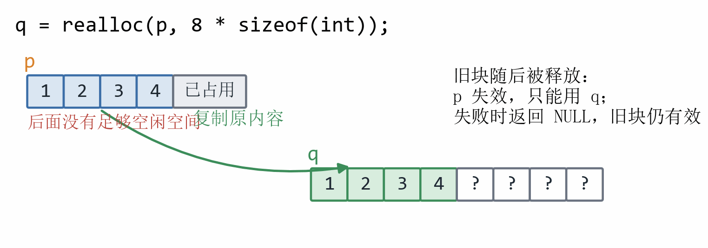


realloc 内部有两种情况。若原块后面恰有足够的空闲字节，就原地延长，返回的地址与原地址相同；若后面已被占用，就另找一块足够大的存储，把原有内容复制过去，释放原块，返回新地址。板书在返回值下写 возможно == buf（可能等于 buf），说的正是这一点：调用者事先不知道是哪种情况，所以必须使用返回值，不能假定地址不变。扩大时原有内容保留，新增部分与 malloc 一样是不确定值；缩小时只保留前 newsize 个字节。`realloc(NULL, n)` 等价于 `malloc(n)`。

realloc 也可能失败，失败时返回空指针，原块保持不变、仍归调用者所有（板书：проверить на NULL）。因此不能直接写 `buf = realloc(buf, 105);`：一旦失败，buf 被改成空指针，原块的地址随之丢失，既无法继续使用其中内容，也无法释放。稳妥的写法先把结果放进临时变量：

```c
char *tmp = realloc(buf, 105);
if (tmp == NULL) {
    free(buf);                     /* 原块仍有效，可以正常释放 */
    printf("Not enough memory");
    return -1;
}
buf = tmp;
sz = 105;                          /* 记录容量的变量要同步更新 */
```

课堂板书直接写 `buf = (char *)realloc(buf, 105);` 再检查是否为空。在 main 中失败后立即返回、程序随之结束的情形下，系统会收回全部存储，这种写法不会造成实际后果；在还要继续运行的普通函数中，应使用临时变量的写法。

**讲解例：板书程序的完整版本。** 下面把课堂上分几次写出的代码整理为一个可编译程序，并修正其中的越界与参数缺漏。

```c
#define _CRT_SECURE_NO_WARNINGS
#include <stdio.h>
#include <stdlib.h>
#include <string.h>

int main(void)
{
    char *buf;
    size_t sz;
    errno_t err;

    sz = 100;
    buf = (char *)malloc(sz * sizeof(char));
    if (buf == NULL) {
        printf("Not enough memory");
        return -1;
    }
    buf[1] = 'A';

    /* 要写入 105 个字节，先把容量扩到 105 */
    char *tmp = (char *)realloc(buf, 105);
    if (tmp == NULL) {
        free(buf);
        printf("Not enough memory");
        return -1;
    }
    buf = tmp;
    sz = 105;

    err = strncpy_s(buf, sz, "Hello!", _TRUNCATE);
    if (err == STRUNCATE) {
        printf("\nString was truncated");
    } else if (err != 0) {
        printf("\nError in strncpy_s");
    } else {
        buf[5] = '?';
        printf("%s\n", buf);   /* Hello? */
    }

    free(buf);
    return 0;
}
```

逐段说明如下。

`size_t sz;` 保存要申请的大小。板书在 `sz = 5;` 旁注明若写成 `sz = -5;`，结果是 очень большое число（一个非常大的数）。size_t 是无符号类型，不能表示负数；把 −5 转换成它，按模 \(2^{N}\) 得到 \(2^{N}-5\)，其中 N 是 size_t 的位数。可以想象成一个表盘：从零往下减一，绕到最大值。以八位无符号数为例，−5 变成 \(256-5=251\)；64 位程序中 size_t 有 64 位，−5 变成 18446744073709551611。拿这个数去 malloc，没有任何系统能满足，函数返回空指针。所以计算大小时要防止算出“负数”，例如两个 size_t 相减之前先比较大小。

`errno_t err;` 声明错误码变量，后面接收 strncpy_s 的返回值。`malloc(sz * sizeof(char))` 中的乘法把“元素个数”换算成“字节数”，`sizeof(char)` 恒为一，写出来是为了换成其他类型时不出错：100 个 int 应写 `100 * sizeof(int)`。分配失败时打印信息并从 main 返回 −1，非零返回值告诉操作系统程序出错；若不返回而继续执行，后面就会通过空指针写入。

`buf[1] = 'A';` 说明分配到的存储可以像数组一样用下标访问，合法范围是 `buf[0]` 到 `buf[sz - 1]`。这一行写的是第二个字节；其余字节仍是不确定值，此时 buf 还不是合法字符串，`buf[0]` 是什么、哪里有结束符都不知道。

板书原来在这里写的是 `strncpy(buf, "……很长的字符串", 105);`，而 buf 只有 100 字节。strncpy 不知道 buf 的容量，只相信调用者给的 105，于是写到 `buf[100]` 至 `buf[104]`，越界五个字节，破坏堆的管理信息。即使源字符串很短，strncpy 也会用结束符补满 n 个位置，照样越界；反过来，若源串长度不小于 n，它不会写结束符，结果不是合法字符串。规则只有一条：传给复制函数的长度不能超过分配时的容量。程序中改为先 realloc 扩容，再复制。若坚持使用 strncpy，应写成 `strncpy(buf, src, sz - 1); buf[sz - 1] = '\0';`，最后一格手工放结束符。

板书最后一段的 `err strncpy_s(buf, "Hello!", _TRUNCATE)` 漏写了等号与第二个参数。buf 是 malloc 得到的指针，函数无法自己知道它的容量，必须把 sz 传进去，否则不能通过编译。"Hello!" 连同结束符共七个字节，105 字节放得下，不发生截断，err 为零，执行 else 分支，`buf[5]` 的感叹号被改为问号，输出 Hello?。最后 free 与开头的 malloc 配对。

**复制与追加的选择。** 这里用 strncpy_s 而不用 strncat_s，是因为两者含义不同：复制从目标开头写，覆盖原内容；追加先在目标中寻找结束符，从那里接着写。malloc 得到的 buf 中只有 `buf[1]` 确定，其他字节不确定，strncat_s 可能在某个碰巧为零的位置之后接上 "Hello!"，前面留下乱码，也可能在容量内找不到结束符而返回 `EINVAL`。若先执行 `buf[0] = '\0';`，或一开始用 calloc 分配，二者效果才相同。要把新内容放入一块刚分配的存储，用复制；要在已有字符串后面接内容，用追加，并且前提是目标已经是合法字符串。同理，`buf = "Hi";` 也不能代替复制：它只是让 buf 改指向字面量，原来分配的地址随之丢失，再也无法释放。

### 动态二维数组的三种组织方式

第六章的 `int a[10][15]` 要求行数和列数在编译时写定。行列数来自用户输入或文件时，只能在堆上申请；同时又希望保留 `a[i][j]` 这种自然的写法。课堂板书给出三种组织方式，区别在于“第几行第几列”怎样换算成内存位置。

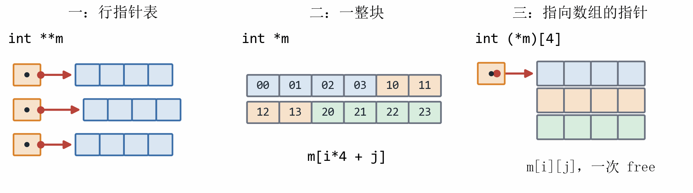


**方式一：行指针表 `int **`。** 先申请一列指针，再为每一行单独申请一段整数，把各行地址存进那一列：

```c
int **table, rn, cn;
rn = 10; cn = 15;

table = (int **)calloc(rn, sizeof(int *));     /* 1 block of addresses */
for (int i = 0; i < rn; i++)
    table[i] = (int *)calloc(cn, sizeof(int)); /* rn rows */

table[2][1] = 100;

for (int i = 0; i < rn; i++)
    free(table[i]);                            /* rows first */
free(table);                                   /* then the column */
```

`int **` 是“指向 int 指针的指针”：`int` 里存整数，`int *` 里存一个 int 的地址，`int **` 里存一个 `int *` 的地址。声明中有几个星号，就要间接访问几次才能拿到整数。这里第一层存的是地址，所以写 `sizeof(int *)` 而不是 `sizeof(int)`；第二层每行存的是整数，才写 `sizeof(int)`。三个名字的类型逐层递减：`table` 是 `int **`，`table[i]` 是 `int *`，`table[i][j]` 是 `int`。由 `a[i]` 与 `*(a+i)` 等价，

\[
\texttt{table[2][1]}=\ast\bigl(\ast(\texttt{table}+2)+1\bigr):
\]

`table+2` 走到指针列的第三格，`*` 取出其中存的第三行起始地址，`+1` 在这一行里前进一个 int，外层 `*` 访问该元素。整个过程中行的长度 15 没有参与运算，行地址是“查”出来的，不是“算”出来的。

释放必须与申请一一对应。上面共调用了 \(1+rn=11\) 次 calloc，就要 11 次 free。`free(table)` 只归还指针列这一块，它不会顺着其中的地址去释放各行；若先释放 `table`，再读 `table[i]` 就是访问已释放的存储，各行地址随之丢失，造成内存泄漏。所以顺序是先内后外。板书省略了分配失败的检查，正式程序中每次 calloc 后都应检查返回值是否为 `NULL`。

在指针占八字节、int 占四字节的 64 位平台上，这张表占用 \(10\times8+10\times15\times4=80+600=680\) 字节。各行是十次独立申请得到的，在内存中不一定相邻。这种方式的好处是：行列数都在运行时确定，可以直接写 `table[i][j]`；各行长度可以不同，适合三角矩阵或长短不一的字符串；交换两行只需交换两个指针；函数写成 `void f(int **t, int rn, int cn)` 即可处理任意尺寸。代价是要调用 \(rn+1\) 次分配和释放，多占一列指针，行不连续时遍历的缓存效率也较低。

**方式二：一整块存储。** 内存中并没有“行”，只有一条连续的存储带；“第几行第几列”是我们的理解方式。一次申请 \(rn2\times cn2\) 个 int，再自己按每行 \(cn2\) 个划分：

```c
int *table2, rn2, cn2;
rn2 = 5; cn2 = 7;
table2 = (int *)malloc(rn2 * (cn2 * sizeof(int)));   /* 5*7*4 = 140 bytes */
table2[2 * cn2 + 1] = 20;                           /* row 2, column 1 */
free(table2);                                       /* one malloc, one free */
```

第 \(i\) 行第 \(j\) 列的编号为 \(i\cdot cn2+j\)：前面 \(i\) 行各占 \(cn2\) 个，再在本行前进 \(j\) 个。本例为 \(2\times7+1=15\)。`table2` 只是一个 `int *`，类型中没有记录每行多长，所以编译器无法替我们计算 `table2[2][1]`，这样写会编译出错，只能手写编号。这也是方式一引入指针列的原因。手写编号容易出错且编译器发现不了：课堂板书一度把 `2*cn2` 写成上一例的 `2*cn`，得到 \(2\times15+1=31\)，没有越界（共 35 格），却指向第四行第三列，程序照样运行，结果悄悄出错。另需注意 malloc 不清零，存储中原有的是不确定值。

用宏可以把编号公式只写一次：

```c
#define TABLE2(j, i)  table2[(j)*cn2 + (i)]

TABLE2(3, 2) = 15;     /* expands to table2[(3)*cn2 + (2)], element 23 */
```

宏是预处理阶段的文字替换，不是函数，参数不会先求值。若定义时省去括号，写成 `table2[j*cn2 + i]`，则 `TABLE2(1+1, 0)` 展开为 `table2[1+1*cn2 + 0]`，按乘法优先得 \(1+7=8\)，而不是应有的 \((1+1)\times7=14\)。所以宏的每个参数和整个表达式都要加括号。这个宏直接使用名字 `table2` 与 `cn2`，使用处必须能看到这两个变量。

**方式三：指向数组的指针。** 第六章已经见过行指针 `int (*row)[5]`，它也可以指向动态申请的一整块：

```c
int (*table3)[5], rn3;
rn3 = 10;
table3 = (int (*)[5])malloc(5 * rn3 * sizeof(int)); /* 200 bytes */
table3[2][1] = 30;
free(table3);
```

声明从名字向外读：`(*table3)` 说明 table3 是指针，`[5]` 说明它指向含五个元素的数组，`int` 说明元素是整数。括号不能省，`int *table3[5]` 是五个指针组成的数组。因为“一行五个 int”写在类型里，编译器能自己算出 `table3[2][1]` 的编号 \(2\times5+1=11\)；`table3+1` 一次越过一整行 20 字节。它兼有前两种方式的优点：一整块、一次释放，又能写双下标。代价是列数必须在编译时写定。C99 的变长数组类型允许写 `int (*t)[cn] = malloc(rn * sizeof *t);`，列数也在运行时确定，但第六章已说明 MSVC 不支持变长数组。

| 方式 | 行数 | 列数 | 访问写法 | 分配与释放次数 |
|---|---|---|---|---|
| `int a[10][15]` | 编译时 | 编译时 | `a[i][j]` | 不需要 |
| `int **table` | 运行时 | 运行时 | `table[i][j]` | \(rn+1\) |
| `int *table2` | 运行时 | 运行时 | `table2[i*cn2+j]` 或宏 | 1 |
| `int (*table3)[5]` | 运行时 | 编译时 | `table3[i][j]` | 1 |

上述三种方式的代码（补上分配失败检查后）已于 2026-10-31 用 Visual Studio 18 的 MSVC 按 C（/TC）、/W4 编译运行：`table[2][1]` 与 `*(*(table+2)+1)` 均为 100，calloc 的其余元素为 0；64 位下两层共 680 字节；`table2[15]` 为 20、`table2[23]` 为 15；不加括号的展开结果为 8，加括号为 14；`table3+1` 与 `table3` 相差 20 字节，`table3[2][1]` 位于整块的第 11 个 int。

### 堆的检查

为了管理堆，分配器在每块交出去的存储旁边还保存着少量管理信息，例如块的大小和是否占用。越界写，比如上一节 105 写进 100 的 strncpy，最先破坏的往往就是相邻块的这些信息。

Visual Studio 的 CRT 提供 `int _heapchk(void);`（声明在 `<malloc.h>`），用于检查堆的一致性。名字前的下划线表示它是微软扩展，不是标准 C。括号中的 void 表示没有参数。返回 `_HEAPOK` 表示检查通过；其他返回值包括 `_HEAPBADNODE`（某块的管理信息损坏，通常由越界写造成）、`_HEAPBADBEGIN`（堆起始信息损坏）、`_HEAPEMPTY`（堆尚未初始化）等。

```c
/* Microsoft CRT 环境示例，演示越界写，不要用于正式代码 */
#include <malloc.h>

char *s = malloc(4);
strcpy(s, "ABC");
strcat(s, "DEF");                /* 4 个字节写入 7 个：越界 */
if (_heapchk() != _HEAPOK)
    printf("heap is corrupted\n");
```

课堂上的思路是在可疑位置调用一次检查，尽早发现问题。但检查能否发现越界，取决于运行库怎样组织堆。2026-10-22 用 Visual Studio 18（MSVC 14.51）实测，上面这段越界写入后 `_heapchk` 仍返回 `_HEAPOK`：分配器实际划出的块按固定粒度取整，大于请求的四个字节，越界的三个字节落在块内的填充区，管理信息没有被碰到。把越界量加大到四十字节时，发布版程序在后续堆操作中被系统以“堆损坏”（状态码 0xC0000374）直接终止，同样没有经过 `_heapchk` 的报告。所以通过检查不能证明程序没有越界。

Visual Studio 的调试版运行库（`/MDd` 或 `/MTd`，即 Debug 配置的默认设置）更适合查找这类错误。调试堆在每块的前后各放几个保护字节，`_CrtCheckMemory()`（声明在 `<crtdbg.h>`）检查这些字节；对同一段代码，它返回 0 并报告 “HEAP CORRUPTION DETECTED: after Normal block”，说明程序写过了缓冲区末尾，free 该块时还会再报一次。查找越界时应在 Debug 配置下运行，并在可疑位置调用 `_CrtCheckMemory()`。

在 C 中特别需要关心这类错误，原因在于内存错误往往不在出错处立即表现出来。设某个程序第十行越界写了三个字节，程序照常运行；这三个字节改坏了别的变量或管理信息，到第五百行使用被改坏的数据时才崩溃或算错。查看第五百行，代码没有问题，真正的原因却在第十行。越界写到哪里、覆盖了什么，取决于当时的内存布局，所以同一程序可能在调试时正常、换一台计算机就出错。若越界写入的内容来自用户输入，攻击者可以故意输入超长数据，覆盖关键数据甚至控制程序的执行，这就是缓冲区溢出攻击。Python、Java 等语言会自动检查下标并回收存储；C 为了效率把这些责任交给程序员，所以程序员需要调试堆这样的工具帮助定位。

### 栈上的动态分配：_alloca 与 _malloca

板书在 `_heapchk` 下面又画一条横线，写出两个使用栈而不是堆的微软扩展函数。

`void *_alloca(size_t size);` 在当前函数的栈帧中分配 size 字节。它与 malloc 一样可以在运行时决定大小，但不在堆上：存储在**调用它的函数返回时**自动释放（离开某个代码块并不会释放），不需要也不允许 free，板书写作 не надо освоб.（无须释放）。栈空间不足时，`_alloca` 不返回空指针，而是引发栈溢出异常；这是 Windows 的结构化异常（SEH，Structured Exception Handling），用 `if (p == NULL)` 检查不到，只能用 `__try`/`__except` 捕获，捕获后还需调用 `_resetstkoflw` 恢复栈的保护页。由于存储随函数返回而消失，`_alloca` 的结果不能返回给调用者。

`void *_malloca(size_t size);` 把两者结合起来：请求不超过 `_ALLOCA_S_THRESHOLD` 字节（Visual Studio 中为 1024）时在栈上分配，超过时在堆上分配；调试版总在堆上分配，便于查错。无论实际落在哪里，都必须用 `void _freea(void *memblock);` 释放：落在堆上时 _freea 真正释放，落在栈上时什么也不做，调用者不必自己判断。在堆上分配失败时返回空指针；在栈上空间不足时，仍是栈溢出的结构化异常。

```c
/* Microsoft CRT 环境示例 */
#include <malloc.h>

void f(size_t n)
{
    char *buf = _malloca(n);   /* 小请求用栈，大请求用堆 */
    if (buf == NULL)
        return;                /* 走堆时可能失败 */
    /* ...使用 buf... */
    _freea(buf);               /* 必须配对，即使可能在栈上 */
}
```

`_malloca` 解决了“单次请求太大把栈撑破”的问题，但不能当作万能写法。阈值只看**这一次**请求多大，不看栈上已经用了多少。若在递归函数中每层都 `_malloca(1000)`，每次都不超过 1024，每次都落在栈上，递归一千层后累计约 1 MB，照样栈溢出；循环中反复分配而不释放也有同样问题。另外，同一行 `_malloca(n)` 这次可能在栈上、下次可能在堆上，写代码时无法保证它在堆上，所以结果一律不能返回出函数，必须在同一函数内 `_freea`。它只在 MSVC 中可用，换用 gcc、clang 时无法编译；它比 malloc 快的好处，也只在小块、临时、调用极其频繁时才明显。

三组函数的配对与适用场合如下：

| 分配函数 | 存储位置 | 释放方式 | 结果能否返回函数外 | 可用环境 |
|---|---|---|---|---|
| `malloc`、`calloc`、`realloc` | 堆 | `free` | 可以 | 标准 C，各编译器均可用 |
| `_alloca` | 栈 | 函数返回时自动释放，不可 free | 不可以 | 仅 MSVC 可用 |
| `_malloca` | 小请求在栈，大请求在堆 | `_freea` | 不可以 | 仅 MSVC 可用 |

选择时先看三件事：大小能否事先确定且较小，数据要用多久，程序要在哪些编译器上编译。大小固定且小，用数组；要返回出去、数据较大或要长期保存，用 malloc 系列；在 Visual Studio 中某个频繁调用的函数内临时要一块大小不定的小存储，才考虑 `_malloca`。作业或考试若指定了函数，按要求使用。

## 第十一章 交换与按位运算

排序把一组对象按比较关系排列起来。实现它之前，需要分清是移动整数值，还是改变指向这些值的指针。交换操作确定以后，才能准确描述一轮排序改变了什么、保持了什么。排序之后，中位数可以直接由位置确定；如果不能排序，也可以从元素的秩出发寻找它。

### 间接修改与指针形参

**交换两个变量的值**

```c
void swap_values(int *a, int *b)
{
    int temp = *a;
    *a = *b;
    *b = temp;
}
```

调用 `swap_values(&x, &y);` 后，`x` 和 `y` 的值互换。

**交换两个指针保存的地址**

```c
int *pt = pb;
pb = pa;
pa = pt;
```

若最初：

```text
a = 35，pa → a
b = 8， pb → b
```

交换后：

```text
a 仍为 35，b 仍为 8
pa → b，所以 *pa == 8
pb → a，所以 *pb == 35
```

交换指针不等于交换变量里的值。

如果要在函数中修改调用者的指针变量本身，需要二级指针：

```c
void swap_pointers(int **p1, int **p2)
{
    int *temp = *p1;
    *p1 = *p2;
    *p2 = temp;
}
```

调用：

```c
swap_pointers(&pa, &pb);
```

不要为了“不使用第三个变量”而对指针做异或交换。标准 C 不允许直接对指针使用 `^`；把指针转为整数再异或也会降低可移植性和可读性。临时指针是清楚、安全的常规写法。

相关俄语作业表述：

- `4 переменных`：4 个变量。
- `сортировка по возрастанию`：升序排序。
- `сортировка по убыванию`：降序排序。
- `обмен указателей`：交换指针。
- `без использования третьей переменной`：不使用第三个变量。
- `x86 / x64`：常用于讨论 32 位/64 位环境。指针大小应用 `sizeof(void *)` 判断，不要写死。


### 对象交换与地址交换

**交换两个整数值**，需要两个整数对象的地址：

```c
void swap_values(int *pv, int *qv)
{
    int t = pv[0];
    pv[0] = qv[0];
    qv[0] = t;
}
```

调用 `swap_values(&a[0], &a[3]);` 会改变 a 中的值。数组下标同样是间接访问；`pv[0]` 与 `*pv` 访问的是同一个整数对象。

**交换相邻值**，只传一个起始指针也可以，但必须确认后面还有一个有效元素：

```c
void swap_neighbors(int *pv)
{
    int t = pv[0];
    pv[0] = pv[1];
    pv[1] = t;
}
```

调用 `swap_neighbors(&a[1]);` 交换 a[1] 与 a[2]。不能把 a[3] 的地址传给它并访问 pv[1]，因为那会越界。

**交换指针数组中的地址**，临时变量应是 `int *`：

```c
void swap_addresses(int *p[], int i, int j)
{
    int *temp = p[i];
    p[i] = p[j];
    p[j] = temp;
}
```

这改变 p 的访问顺序，不改变 a 中整数的排列。看函数时不要只看名字 swap，要看赋值号左边究竟是 `p[i]` 还是 `*p[i]`。

### 按位异或与整数运算边界

**^ 不是乘方，也不是逻辑或**

按位异或（побитовое исключающее ИЛИ，XOR）逐位比较整数：不同为 1，相同为 0。

| 第一位 | 第二位 | 异或结果 |
|---|---|---|
| 0 | 0 | 0 |
| 0 | 1 | 1 |
| 1 | 0 | 1 |
| 1 | 1 | 0 |

```text
5       0101
3       0011
5 ^ 3   0110  → 6
```

规则：x ^ x = 0，x ^ 0 = x，(a ^ b) ^ b = a。这是按位运算的性质，不是地址交换的理由。

C 表达式务必写清括号：(5u ^ 3u) == 6u 为真。若写 5u ^ 3u == 6u，== 比 ^ 优先级高，会被解释为 5u ^ (3u == 6u)，含义已经不同。

**三步整数交换**

```c
unsigned int a = 5u, b = 3u;
a ^= b;    // a=6，b=3
b ^= a;    // a=6，b=5
a ^= b;    // a=3，b=5
```

第二步得到 b_old ^ (a_old ^ b_old) = a_old；第三步再次抵消原 a，恢复原 b。其依据在于取消重复的位，而不是“神奇地交换”。

如果通过两个指针做异或交换，两个指针不能指向同一个整数：第一次 *p ^= *q 就会把它清零。一般代码直接使用临时变量，含义更清楚；不要把技巧当成更好的默认写法。

**整数溢出与模运算**

数学上 a=a+b; b=a-b; a=a-b 可交换整数；但有符号整数的 a+b 若超出可表示范围，会出现未定义行为。不能因为后两步能“减回来”，就忽略第一步的溢出（переполнение）。

无符号整数按模运算回绕，不能一概说“回绕就一定交换失败”。以恰好 8 位的无符号存储为教学例：250+10 回绕为 4；4-10 回绕为 250；4-250 回绕为 10，最终仍可交换。本例是模 256 的推导，不代表 unsigned int 在所有平台都是 8 位。

**指针运算的类型与范围条件**

| 运算 | 是否可以 | 前提 |
|---|---|---|
| p + k、p - k | 可以 | 结果在同一数组内或末尾后一位置 |
| p - q | 可以 | 同一数组或末尾后一位置；差可表示 |
| p + q | 不可以 | C 不定义两个指针相加 |
| p ^ q | 不可以 | ^ 要求整数操作数 |
| *p ^ *q | 可以 | p、q 指向有效的整数对象 |

指针差的类型是 ptrdiff_t，头文件 <stddef.h>，printf 可用 %td。差表示相隔的元素数，不是字节数。

把指针强转为整数再异或，不是可移植的指针交换办法。uintptr_t 是可选类型；它支持的是符合规定的指针原值往返转换，不保证任意异或后的中间整数转成指针再转回来仍保持位模式。不要把这种写法收入“推荐代码”。


## 第十二章 伪随机数与排序

排序算法需要把比较结果转化为数据移动。以一个固定数组追踪每轮的变化，可以先检查算法本身；需要批量产生测试数据时，再使用伪随机数生成器。

### 伪随机数与区间映射

```c
#include <stdlib.h>
#include <time.h>
```

**`rand()` 是伪随机**

`rand()` 生成伪随机数（псевдослучайное число）：

```text
0 <= rand() <= RAND_MAX
```

`RAND_MAX` 是 `<stdlib.h>` 中的常量。C 标准保证它至少为 `32767`，具体值由实现决定：

```c
printf("%d\n", RAND_MAX);
```

**种子决定序列从哪里开始**

```c
void init_rng(void)
{
    srand((unsigned int)time(NULL));
}
```

- 种子：seed；俄语常说 начальное значение 或 зерно генератора。
- 相同实现中，相同种子产生相同的伪随机序列。
- 当前时间不断变化，因此常用作简单程序的种子。
- 一般在程序开始时初始化一次，不要每生成一个数就重新 `srand`。

```c
int main(void)
{
    init_rng();
    int a = rand();
    int b = rand();
}
```

调用并丢弃开头几个 `rand()` 不是必要规则，也不能从根本上提高随机质量。

**缩放到 0～1000**

```c
int gen_rnd_int(void)
{
    long long t = ((long long)rand() * 1000) / RAND_MAX;
    return (int)t;
}
```

`1000` 只是例子选择的上限，不是 `rand()` 的规定。

在进行乘法前先转换为 `long long`，是为了扩大中间结果的表示范围。

```c
(long long)rand() * 1000
```

这样乘法在较宽的整数类型中进行，降低 `int` 乘法溢出的风险。转换必须在乘法之前；若写成 `(long long)(rand() * 1000)`，内部乘法可能已经溢出。

边界：

- `rand() == 0` → 结果为 `0`；
- `rand() == RAND_MAX` → 结果为 `1000`。

所以该公式包含 `1000`。

```c
rand() % 1000
```

会得到 `0～999`，但可能存在模偏差（modulo bias）。对分布要求不高的演示可以采用这种写法；安全、密码或高质量统计用途不能使用 `rand()`。


### 指针数组的间接排序

题目要按升序（по возрастанию）读取四个值，同时保持 a、b、c、d 本身不变。应比较所指的值，再交换指针保存的地址，而不是交换 *pa 与 *pb。

```c
#include <stdio.h>

void order_pair(int **p, int **q)
{
    if (**p > **q)
    {
        int *tmp = *p;
        *p = *q;
        *q = tmp;
    }
}

int main(void)
{
    int a = 35, b = 8, c = 22, d = 4;
    int *pa = &a, *pb = &b, *pc = &c, *pd = &d;

    order_pair(&pa, &pb);
    order_pair(&pc, &pd);
    order_pair(&pa, &pc);
    order_pair(&pb, &pd);
    order_pair(&pb, &pc);

    printf("original: %d %d %d %d\n", a, b, c, d);
    printf("sorted: %d %d %d %d\n", *pa, *pb, *pc, *pd);
    return 0;
}
```

预期输出：

```text
original: 35 8 22 4
sorted: 4 8 22 35
```

**二级指针的接口作用**

调用 &pa 传的是“指针变量 pa 自己的地址”。函数内 *p 就是 pa，**p 才是 pa 所指整数。比较 **p > **q 是比较数值；赋值 *p = *q 是改调用者的指针，而不是改 a、b、c、d。

| 次序 | 比较位置 | 比较后按 pa、pb、pc、pd 读取 |
|---|---|---|
| 初始 | — | 35、8、22、4 |
| 1 | pa、pb | 8、35、22、4 |
| 2 | pc、pd | 8、35、4、22 |
| 3 | pa、pc | 4、35、8、22 |
| 4 | pb、pd | 4、22、8、35 |
| 5 | pb、pc | 4、8、22、35 |

前两步各自整理两个小组；随后把最小值送到第一位、最大值送到第四位；最后整理中间两位。因为比较使用 >，相等时不交换本次所比较的两个指针；但不能因此声称整个网络是稳定排序。

**算法实现与接口约束**

上面的可读版本使用临时指针 tmp 和辅助函数；若题目明确禁止新增变量、禁止函数或禁止交换，这个版本不满足该额外限制。它用于解释正确目标和标准做法，不能标成“满足所有限制的答案”。应先确认题目到底允许重绑定指针、条件表达式还是只禁止某一种 swap 写法，再选择策略。禁止临时变量不等于允许对指针做非法算术。


### 选择排序及循环不变量

从大到小排序时，第 i 轮在尚未排列的区间 i…n−1 中找最大值下标，再与第 i 个位置交换。外层循环固定“这一轮排好哪里”，内层循环负责“在剩余部分找谁最大”。

循环不变量：第 i 轮开始前，前 i 个位置已经按降序放好了最大的 i 个值。完成这一轮后，这个性质扩展到 i+1 个位置。这个解释说明算法为何正确，而不仅是解释每行语法。

**小例子。** 3、8、2、6：第 0 轮找到 8，交换后是 8、3、2、6；第 1 轮从 3、2、6 中找 6，得到 8、6、2、3；第 2 轮得到 8、6、3、2。最后一个数自然就位，所以只需 n−1 轮。

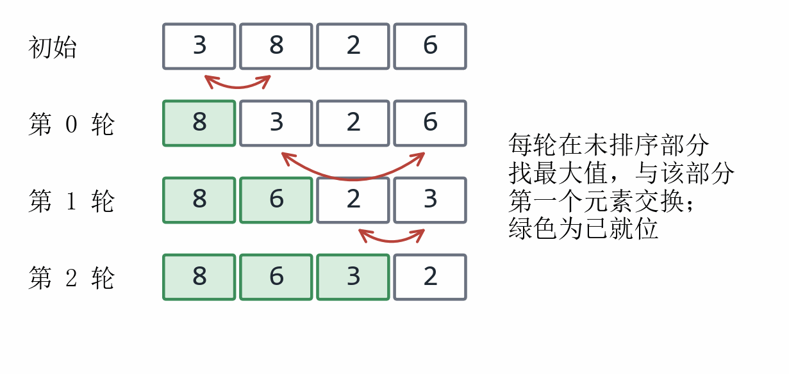


下面是用指针数组实现降序访问的完整课堂程序。注释和输出使用英文。随机数缩放沿用课堂公式，它适合演示，不保证 0…1000 每个值严格等概率。

```c
#define _CRT_SECURE_NO_WARNINGS
#include <stdio.h>
#include <stdlib.h>
#include <time.h>

int gen_rnd_int(void)
{
    return (int)(((long long)rand() * 1000) / RAND_MAX);
}

void swap_addresses(int *p[], int i, int j)
{
    int *temp = p[i];
    p[i] = p[j];
    p[j] = temp;
}

int main(void)
{
    int a[100];
    int *p[100];
    int i, j, max_index;
    double median;

    srand((unsigned int)time(NULL));
    printf("Original numbers:\n");
    for (i = 0; i < 100; i++) {
        a[i] = gen_rnd_int();
        p[i] = &a[i];
        printf("%d ", a[i]);
        if ((i + 1) % 10 == 0)
            printf("\n");
    }

    // Sort the pointers by the values they refer to
    for (i = 0; i < 99; i++) {
        max_index = i;
        for (j = i + 1; j < 100; j++) {
            if (*p[j] > *p[max_index])
                max_index = j;
        }
        swap_addresses(p, i, max_index);
    }

    printf("Descending order:\n");
    for (i = 0; i < 100; i++) {
        printf("%d ", *p[i]);
        if ((i + 1) % 10 == 0)
            printf("\n");
    }
    median = *p[49] / 2.0 + *p[50] / 2.0;
    printf("Median: %.1f\n", median);
    return 0;
}
```

`max_index` 保存位置，不保存最大值本身；比较的是 `*p[j]`，不是两个地址谁更大。`(i+1)%10==0` 表示已经打印的数量是 10 的倍数，此时换行。

如果改成直接交换 a 中的值，比较和交换对象都要一致替换；不要留下指针版的一半逻辑，又混入数值版的一半逻辑。

### 选择排序的状态变化

`max_index` 记录的是数组位置。它不能一会儿保存下标、一会儿保存数值，否则后面的 `a[max_index]` 就可能把普通数值误当作下标。以数组 3、8、2、6 的第一轮为例，固定 i=0，内层搜索过程为：

| 已检查的位置 | 当前比较 | max_index | 已检查部分的最大值 |
|---|---|---|---|
| 初始化 | 把当前位置作为候选 | 0 | 3 |
| j=1 | 8 大于 a[0] | 1 | 8 |
| j=2 | 2 不大于 a[1] | 1 | 8 |
| j=3 | 6 不大于 a[1] | 1 | 8 |

搜索过程中数组没有改变。只有内层循环结束后，才交换 a[0] 与 a[1]，把这一轮已经确认的最大值固定到前端。第二轮 i=1 时，`max_index = i` 重新把未排序区间的第一个位置作为候选；不能沿用上一轮的候选位置，因为上一轮的元素已经进入排好部分。

内层从 j=i+1 开始，是因为 a[i] 已经作为候选，不必再同自己比较；内层必须扫描到 n-1，才能保证没有漏掉更大值。外层只到 i=n-2，因为前 n-1 个位置确定后，剩下最后一个元素已经无处可选。

### 同一算法的两种存储方案

直接排序整数数组时，比较对象是整数，交换对象也是整数。下面的函数使用下标形式访问指针指向的对象，能够交换不相邻位置：

```c
void swap_values(int *left, int *right)
{
    int temp = left[0];
    left[0] = right[0];
    right[0] = temp;
}

void selection_sort_desc(int a[], int n)
{
    int i, j, max_index;
    for (i = 0; i < n - 1; ++i) {
        max_index = i;
        for (j = i + 1; j < n; ++j) {
            if (a[j] > a[max_index])
                max_index = j;
        }
        swap_values(&a[i], &a[max_index]);
    }
}
```

若调用前 a 是 3、8、2、6，函数结束后 a 自身变成 8、6、3、2。相反，指针数组方案先令 `p[i] = &a[i]`；比较 `*p[j]` 与 `*p[max_index]`，再交换 p 中的两个地址。此时 a 仍保持 3、8、2、6，只有依 p 访问时才读到 8、6、3、2。两种程序共享“在剩余部分找最大值”的算法，但保存排序结果的位置不同。

若只传入一个指针 pv，函数内交换 `pv[0]` 与 `pv[1]`，它只能操作当前位置及紧邻的下一个元素。选择排序找到的最大值可能距离当前位置很远，因此应传两个地址，或者把数组和两个下标传进去，不能把单指针的相邻交换函数原样替代上述交换。

### 程序变量与显示格式

`int a[100];` 建立一百个整数对象；`int *p[100];` 建立一百个指针对象。局部声明本身不会生成随机数，也不会使 p 自动指向 a。必须先给 a[i] 写入数值，再按需要让 p[i] 保存对应地址，之后才能读取它们。i、j 是循环计数器，max_index 是候选位置，median 是最后的统计量，它们承担的角色各不相同。

每行显示十个数时，下标 i 与已打印数量相差一。i 为 9 时刚打印第十个数，所以条件是 `(i + 1) % 10 == 0`；若写 `i % 10 == 0`，第一个数刚输出就换行，版面会错位。这个条件只控制显示，不参与排序或中位数计算。

示例开头的 `_CRT_SECURE_NO_WARNINGS` 是 Microsoft CRT 相关宏，用于抑制一类运行库弃用提示，不是 `#nowarning` 这样的 C 指令，也不改变数组边界或函数语义。涉及该运行库头文件时，宏应在包含头文件之前定义。其他工具链不需要靠这个宏才能使用标准 C 语法。

### 平均值与整数除法

若两个中间值为 20、21，表达式 `(20 + 21) / 2` 的两个操作数都是整数，结果是 20；随后赋给 double 也只能得到 20.0。写成 `(20 + 21) / 2.0`，才在除法之前引入浮点运算，得到 20.5。`%.1f` 决定显示一位小数，并不会把一个已经截断的整数结果恢复为正确平均值。

对本例 0—1000 的输入，两数相加不会超过通常使用的 int 范围；若函数后来处理任意 int，则应避免先做可能溢出的整数加法。本册用 `x / 2.0 + y / 2.0` 表达平均值，先转换再运算。能否准确表示任意大整数还取决于 double 的精度，不能从这段课堂数据范围推广为无限精确。

### 冒泡排序与插入排序

选择排序之外，还有两种同样基础、思路不同的排序方法。

**冒泡排序**反复比较相邻的两个元素，若前者大于后者就交换。每一趟从头到尾比较一遍，当前最大的元素会像气泡一样被“冒”到末尾；下一趟就不必再比较已经到位的末尾部分。若某一趟没有发生任何交换，说明数组已经有序，可以提前结束：

```c
void bubble_sort(int a[], int n)
{
    int i, j, tmp, swapped;
    for (i = 0; i < n - 1; i++) {
        swapped = 0;
        for (j = 0; j < n - 1 - i; j++) {
            if (a[j] > a[j + 1]) {
                tmp = a[j];
                a[j] = a[j + 1];
                a[j + 1] = tmp;
                swapped = 1;
            }
        }
        if (!swapped)      /* no swap in this pass: already sorted */
            break;
    }
}
```

内层循环的上限 `n - 1 - i` 很重要：第 `i` 趟结束后，末尾的 `i + 1` 个元素已经是最大的若干个并且有序，再比较它们是浪费；同时 `j + 1` 最大为 `n - 1 - i`，不会越界。

**插入排序**像整理手中的扑克牌：把数组分成前面已排好序的部分和后面未处理的部分，每次取出未处理部分的第一个元素，在已排序部分中从后向前寻找它的位置，比它大的元素依次后移一格，最后把它放入空出的位置：

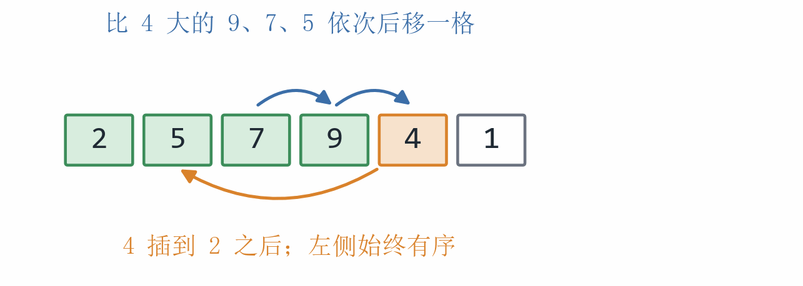


```c
void insertion_sort(int a[], int n)
{
    int i, j, key;
    for (i = 1; i < n; i++) {
        key = a[i];
        j = i - 1;
        while (j >= 0 && a[j] > key) {
            a[j + 1] = a[j];   /* shift larger element right */
            j--;
        }
        a[j + 1] = key;
    }
}
```

`key` 必须先保存，因为后移会覆盖 `a[i]` 原来的位置。`while` 条件中 `j >= 0` 必须写在前面，利用 `&&` 的短路求值，在 `j` 变成 −1 时不再读取 `a[-1]`。

三种基础排序的比较如下（\(n\) 为元素个数）：

| 方法 | 比较次数（最坏） | 已有序时 | 特点 |
|---|---|---|---|
| 选择排序 | 约 \(n^2/2\) | 仍约 \(n^2/2\) | 交换次数最少，最多 \(n-1\) 次 |
| 冒泡排序 | 约 \(n^2/2\) | 约 \(n\)（一趟无交换即停止） | 只交换相邻元素，相等元素不改变先后次序 |
| 插入排序 | 约 \(n^2/2\) | 约 \(n\) | 对基本有序的数据很快，相等元素不改变先后次序 |

三者的时间复杂度都是 \(O(n^2)\)：数据量增加十倍，运行时间大约增加一百倍。处理大量数据时应使用 \(O(n\log n)\) 的算法，例如标准库的 `qsort`（见本章最后一节）。

### 二分查找

在有序数组中查找一个值，不必从头逐个比较。二分查找每次取当前范围的中间元素：若等于目标，找到；若小于目标，目标只可能在右半部分；若大于目标，只可能在左半部分。每比较一次，范围缩小一半：

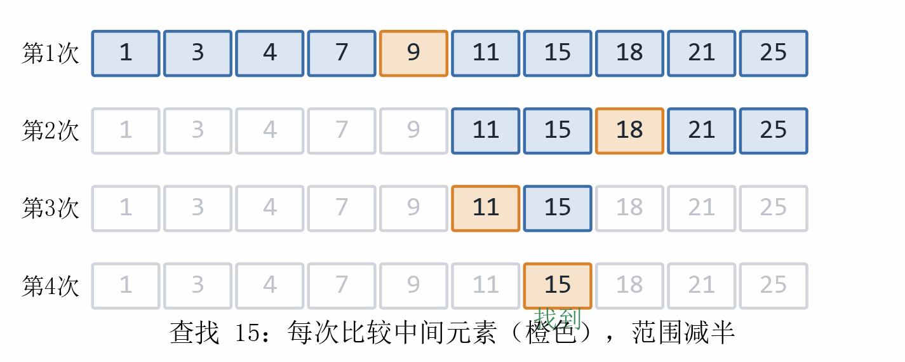


```c
int binary_search(const int a[], int n, int target)
{
    int lo = 0, hi = n - 1;
    while (lo <= hi) {
        int mid = lo + (hi - lo) / 2;
        if (a[mid] == target)
            return mid;
        else if (a[mid] < target)
            lo = mid + 1;
        else
            hi = mid - 1;
    }
    return -1;              /* not found */
}
```

几个细节决定了程序是否正确：循环条件是 `lo <= hi`，范围只剩一个元素时也要检查；更新时写 `mid + 1` 和 `mid - 1`，否则范围可能不再缩小而陷入死循环；中点写成 `lo + (hi - lo) / 2` 而不是 `(lo + hi) / 2`，避免两个大下标相加时溢出。\(n\) 个元素最多只需比较约 \(\log_2n+1\) 次，一百万个元素不超过二十一次；而逐个查找最坏要一百万次。二分查找的前提是数组已经有序，对无序数组使用会得到错误的结果。

用数组 `{1, 2, 3, 5, 7, 9}` 测试，查找 7 返回下标 4，查找 4 返回 −1。

### 函数指针与 qsort

函数在内存中也有地址，存放函数地址的变量称为函数指针。它的声明要写出函数的返回类型和参数类型，并用括号把 `*` 和名字括在一起：

```c
int (*f)(const void *, const void *);   /* f 指向这样的函数 */
f = cmp_int;                            /* 函数名就代表函数的地址 */
int r = f(&x, &y);                      /* 通过指针调用 */
```

若省略括号写成 `int *f(...)`，含义就变成“返回 `int *` 的函数”。函数指针的主要用途是把“做什么”作为参数传给另一个函数，标准库的排序函数 `qsort` 就是这样设计的：

```c
void qsort(void *base, size_t n, size_t size,
           int (*compar)(const void *, const void *));
```

四个参数依次是数组首地址、元素个数、每个元素的字节数和比较函数。`qsort` 不知道元素是什么类型，所以用 `void *` 传递地址，由比较函数自己转换回实际类型。比较函数的约定是：第一个元素应排在前面时返回负数，相等时返回零，应排在后面时返回正数：

```c
int cmp_int(const void *p, const void *q)
{
    int x = *(const int *)p;
    int y = *(const int *)q;
    return (x > y) - (x < y);
}

int cmp_desc(const void *p, const void *q)
{
    return cmp_int(q, p);       /* swap arguments: descending */
}

int c[] = {5, 2, 9, 1, 7, 3};
qsort(c, 6, sizeof c[0], cmp_desc);   /* c becomes 9 7 5 3 2 1 */
```

比较函数中常见的写法 `return x - y;` 在 `x`、`y` 相差很大时可能溢出（例如 `INT_MAX - (-1)`），`(x > y) - (x < y)` 只返回 −1、0、1，没有这个问题。要改为降序，只需交换比较的两个参数。同一个 `qsort` 配合不同的比较函数，可以按任何规则排序任何类型的数组，第十五章将用它按成绩对结构体数组排序。

本章冒泡排序、插入排序、二分查找和 `qsort` 的代码已于 2026-10-28 合成一个测试程序，用 Visual Studio 18 的 MSVC 按 C（/TC）与 C++（/TP）、/W4 编译均无警告，运行结果为两种排序都得到 `1 2 3 5 7 9`、查找结果 4 和 −1、降序排序得到 `9 7 5 3 2 1`。


## 第十三章 中位数与顺序统计

中位数是按大小次序选出的位置统计量。它由秩决定，而不是由原数组的存储顺序决定。排序是求中位数的一种实现方式，但中位数的定义不依赖是否真的执行排序。

### 顺序统计量与中位数

对 100 个数，中间两个次序统计量是第 50 小和第 51 小；数组下标从 0 开始，对应 49、50。平均值可能为半整数，因此用 double。

不排序时，对每一个候选值 v 统计：L 个数严格小于 v，E 个数等于 v。v 在升序中的位置覆盖 L+1…L+E，因此它是第 k 小的充要条件为：

\[
\boxed{L<k\leq L+E}.
\]

这个区间能正确处理重复值。例如 2、2、2、9，候选值 2 的 L=0、E=3，所以第 1、2、3 小都等于 2。不要只统计小于数而忽略重复数。

完整的不排序程序如下，它保留原数组：

```c
#define _CRT_SECURE_NO_WARNINGS
#include <stdio.h>
#include <stdlib.h>
#include <time.h>

int main(void)
{
    int a[100];
    int i, j, less, equal;
    int x = 0, y = 0;
    double median;

    srand((unsigned int)time(NULL));
    printf("Original numbers:\n");
    for (i = 0; i < 100; i++) {
        a[i] = (int)(((long long)rand() * 1000) / RAND_MAX);
        printf("%d ", a[i]);
        if ((i + 1) % 10 == 0)
            printf("\n");
    }

    // Find ranks 50 and 51 without sorting
    for (i = 0; i < 100; i++) {
        less = 0;
        equal = 0;
        for (j = 0; j < 100; j++) {
            if (a[j] < a[i])
                less++;
            else if (a[j] == a[i])
                equal++;
        }
        if (less < 50 && less + equal >= 50)
            x = a[i];
        if (less < 51 && less + equal >= 51)
            y = a[i];
    }
    median = x / 2.0 + y / 2.0;
    printf("Median: %.1f\n", median);
    return 0;
}
```

虽然 x 和 y 都由 a[i] 赋值，每一轮的 i 却不同，而且两个 if 的条件也不同。某个候选值可能只覆盖第 50 小，另一个覆盖第 51 小；若两个位置恰好落在同一重复值区间，也可以得到相同的 x、y。

这个算法时间复杂度为 O(n²)，适合当前知识范围；不排序并不自动意味着比排序快。更高效的选择算法可以以后再学。

## 第十四章 网格最短路径与波算法

前面各章分别建立了二维数组、指针形参、伪随机数、浮点比较和循环控制。本章把它们组合成一个完整问题：在有障碍的方格场地中，从起点走到终点，使经过格子的权重总和最小。所用方法称为波算法（俄语 волновой алгоритм，也称 Lee 算法），课堂题目为“波算法寻路”（волновой алгоритм поиска пути）。程序本身不需要新的语法，难点在于把“距离”的定义、更新规则与结束条件想清楚。

### 场地模型与邻域偏移表

场地是 10×10 的格子（клетка）。每格有权重（вес），表示经过该格的代价；部分格子是障碍（препятствие），不能进入。基础题中每格权重都是 1，代价就等于步数；加强题把权重改为 1.00 到 5.00 之间的随机小数，此时步数少的路线不一定便宜。

从一格可以走到相邻的 8 格：上下左右与 4 个斜角。若当前格为 (r, c)，第 k 个邻格的行列变化写在两个平行数组里：

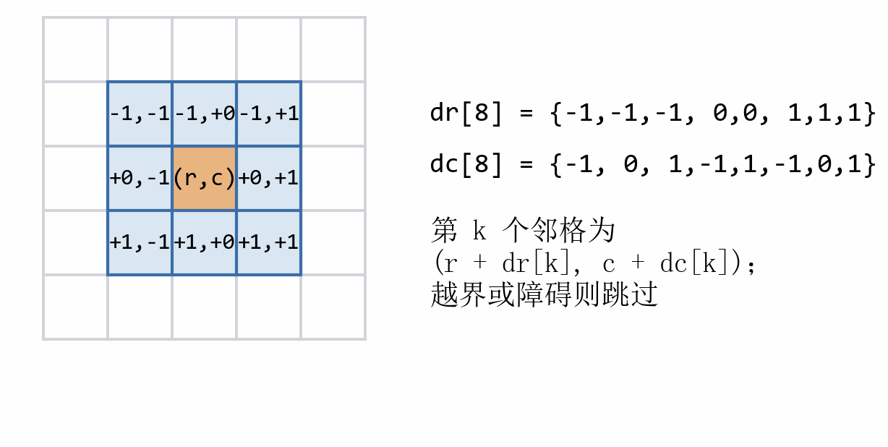


```c
int dr[8] = {-1, -1, -1,  0, 0,  1, 1, 1};
int dc[8] = {-1,  0,  1, -1, 1, -1, 0, 1};
```

同一个下标 k 的两个数构成一对偏移量，邻格为 `(r + dr[k], c + dc[k])`。k=0 是左上 (−1,−1)，k=1 是正上 (−1,0)，k=4 是正右 (0,1)，k=7 是右下 (1,1)。行号向上减一、向下加一，列号向左减一、向右加一。这样一个 `for (k = 0; k < 8; k++)` 就能依次访问全部邻格，不必写 8 段几乎相同的代码。

若只允许上下左右移动，改用 4 个元素的偏移表并把循环上限改为 4：

```c
int dr[4] = {-1, 1,  0, 0};
int dc[4] = { 0, 0, -1, 1};
```

其余代码不变。限制为 4 方向后，原来一步斜走要拆成两步，路径通常更长；两块障碍只在角上相接时，8 方向可以从斜缝穿过，4 方向则被挡住，因此障碍较多时无路可走的情况更常见。

访问邻格前必须先检查下标：

```c
if (nr < 0 || nr >= 10 || nc < 0 || nc >= 10)
    continue;
if (w[nr][nc] < 0)
    continue;
```

两条判断的顺序不能交换。先确认 nr、nc 在 0 到 9 之间，才能读取 `w[nr][nc]`；否则当前格在边上时会读到 `w[-1][3]` 这类数组外对象，属于第六章所说的未定义行为。`||` 的短路求值保证一旦出界就不再计算后面的条件。

出界检查也可以从数据上取消：把数组开成 12×12，真正的场地放在第 1 到 10 行、第 1 到 10 列，最外一圈（第 0、11 行与第 0、11 列）全部写成障碍。场地内任一格向 8 个方向各走一步，行列号最多到 0 或 11，仍在数组之内；而那一圈本来就是障碍，已有的障碍判断会把它挡住，于是 `nr < 0 || nr >= 10 ...` 这一行可以整行删去。这种为省去边界判断而在数据外围补上的特殊元素称为哨兵（барьерные элементы；“围墙”）。代价是下标整体平移一格：扫描与输出循环改为 `r = 1; r <= 10`，随机位置写 `rand() % 10 + 1`，`random_edge` 中的边改为 1 和 10，初始化先把整个数组写成障碍，再把中间 10×10 写成普通格；输出坐标若仍想从 0 数起，打印时减 1。只把判断包成函数 `inside(r, c)` 并不减少比较次数，只是书写变短。

### 随机场地的生成

`rand() % n` 的余数只能是 0 到 n−1，因此可以把一个大随机整数映射到所需范围。权重写成

```c
w[r][c] = 1.0 + (rand() % 401) / 100.0;
```

`rand() % 401` 给出 0 到 400 的整数，除以 `100.0` 得 0.00 到 4.00，加 1 后为 1.00 到 5.00，步长 0.01。除数必须写成 `100.0`：若写 `100`，两个操作数都是整数，237 / 100 得 2，小数部分在除法时就已丢失，这与第十二章平均值的整数除法是同一问题。同理，`30 + rand() % 31` 给出 30 到 60 的障碍百分比，`rand() % 4` 选择四条边之一，`rand() % 10` 选择边上的位置。

起点与终点要放在场地边缘。一个函数需要同时交出行号和列号，而 `return` 只能返回一个值，所以通过指针形参写回调用者的变量：

```c
void random_edge(int *r, int *c)
{
    int side = rand() % 4;   // 0 top, 1 bottom, 2 left, 3 right
    int k = rand() % 10;     // position along that side

    switch (side) {
    case 0:  *r = 0; *c = k; break;
    case 1:  *r = 9; *c = k; break;
    case 2:  *r = k; *c = 0; break;
    default: *r = k; *c = 9; break;
    }
}
```

调用 `random_edge(&sr, &sc)` 时，函数内的 `*r` 就是 sr。终点用 `do ... while (fr == sr && fc == sc)` 选取：至少选一次，与起点重合就重选。起点终点在放障碍之前确定，放障碍时才能避开它们。

障碍个数为 `10 * 10 * pct / 100`。放置循环每次随机抽一格，抽到起点、终点或已是障碍的格子时 `continue` 重抽；`placed++` 写在这些 `continue` 之后，只有真正放下一块障碍才计数。若漏掉“已是障碍”的判断，同一格会被重复计数，实际障碍就少于目标数。

### 标记值与数组的分工

每个数组元素总要存一个数，“没有值”也必须用某个值表示。选用的标记值必须是真实数据永远取不到的数。权重的真实范围是 1.00 到 5.00，累计代价是若干权重之和，也不小于 1.00，所以两者都可以用 −1.0 作标记：

| 数组 | 含义 | 标记值 |
|---|---|---|
| `w[r][c]` | 该格权重 | −1.0 表示障碍 |
| `dist[r][c]` | 从该格走到终点的最小累计代价 | −1.0 表示波尚未到达 |
| `on_path[r][c]` | 是否在最终路径上 | 0 不在，1 在 |

两个数组都用 −1 并不冲突。判断是否障碍只看 w，判断波是否到达只看 dist，同一个数在不同数组中含义不同。判断时写 `< 0` 而不写 `== -1.0`，避免对小数做相等比较。也可以选一个“大到不可能”的数作标记，例如 \(10^9\) 表示尚未到达，或者另设 `int reached[10][10]` 专门记录是否到达；后者含义最直白，但多一个数组，更新时也多一处要同步。标记值 3.0 则不可用，因为某格的真实代价可能恰好是 3.00，两种含义会混淆。

障碍格永远不会被波进入，它的 dist 始终停在 −1。因此输出第二张表时必须先判断 w，再判断 dist；顺序颠倒会把障碍显示成“未到达”。`if ... else if` 链应从特殊情况写到一般情况，前一个条件成立后，后面的条件不再检查。

### 波的传播与松弛

记 \(d(v)\) 为从格 v 出发、沿可走格子到达终点 F 的路径上全部格子权重之和的最小值，包括 v 和 F 本身。终点满足 \(d(F)=w(F)\)。若 v 的下一步走到邻格 u，则代价是 \(w(v)+d(u)\)，于是

\[
d(v)=w(v)+\min_{u\text{ 与 } v \text{ 相邻}} d(u),\qquad v\ne F.
\]

课堂的做法是从终点放波：终点写下初值，然后把数值一圈圈推向外侧。基础题中终点写 0，每一圈加 1；加强题中终点写它自己的权重，每推进一格加上那一格的权重。对一条路径而言，权重之和与从哪一端开始累加无关，所以从终点放波与从起点放波得到相同的最小代价；从终点放波的好处是找路径时可以从起点出发，按行走方向读出路线。

程序中的核心操作称为松弛：站在已到达的格 (r, c)，检查邻格经过当前格到达终点的代价是否更小。

```c
nd = dist[r][c] + w[nr][nc];
if (dist[nr][nc] < 0 || nd < dist[nr][nc] - 0.000001) {
    dist[nr][nc] = nd;
    changed = 1;
}
```

条件包含两种情况。`dist[nr][nc] < 0` 表示波第一次到达该邻格，直接写入；否则只有新代价确实更小才覆盖旧值。若改用很大的数表示“未到达”，第一种情况会自动包含在第二种里，只需一个比较。

带权重时，先到达的不一定最便宜。下面用两条路线说明（数值为示范，与课堂板书的数字结构一致）。从累计代价为 1 的格子出发，到达一个权重为 2 的目标格：

| 路线 | 依次经过的权重 | 累计代价 | 步数 |
|---|---|---|---|
| 直行穿过两格高价区 | 10, 10, 2 | 1 → 11 → 21 → 23 | 3 |
| 绕行四格低价区 | 1, 1, 1, 1, 2 | 1 → 2 → 3 → 4 → 5 → 7 | 5 |

直行步数少，可能先把目标写成 23；绕行路线后到，算出 7，比 23 小，于是覆盖为 7。被覆盖的格子还要把新值继续向外传，所以一次扫描不够，必须反复进行。

程序用一个开关变量控制反复扫描：

```c
changed = 1;
while (changed) {
    changed = 0;
    /* scan every cell, try every neighbour */
}
```

开头置 1，是为了让 `while` 至少执行一轮（也可以改用 `do ... while`）。每轮开始先置 0，假定本轮不会有任何改动；只要有一次松弛成功就置 1。某一轮从头扫到尾没有任何格子变小，开关保持 0，循环结束。若每轮开头忘了重置，开关一旦变为 1 就永远不会回到 0，循环不会停止。

扫描次序影响需要的轮数，但不影响结果。设一行 4 格权重都为 1，终点在最右端，程序每轮从左向右扫描：

| 轮次 | 本轮发生的更新 | 结束时的 dist | changed |
|---|---|---|---|
| 1 | 扫到第 3 列时把第 2 列写成 2 | −1, −1, 2, 1 | 1 |
| 2 | 第 2 列把第 1 列写成 3 | −1, 3, 2, 1 | 1 |
| 3 | 第 1 列把第 0 列写成 4 | 4, 3, 2, 1 | 1 |
| 4 | 每次比较都不更小 | 4, 3, 2, 1 | 0 |

第 1 轮中第 2 列刚被写入时，扫描已经越过它，本轮没有机会再从它往外传，所以波每轮只向左推进一格。若终点在最左端，扫描方向与传播方向一致，第 1 轮就能把整行写完，第 2 轮只用于确认没有改动。轮数事先无法确定，这正是用开关而不写死“扫 10 遍”的原因。

第 4 轮“不更小”的含义可以逐项核对：例如第 1 列 dist 为 3，向第 0 列试探得 3+1=4，不小于已有的 4；向第 2 列试探得 4，不小于 2。全部试探都失败，`if` 内的语句一次也没有执行。

**为什么循环一定结束，且结果是最小代价。** 每个 dist 值都是某条实际路线的代价，因为它只能由已到达邻格的值加上一个权重得到。每次更新至少使某个值减小 0.000001 以上，而权重不小于 1，代价不超过某个上界的路线长度有限，路线条数也有限，所以更新不可能无限进行。循环停止时，对任意相邻且可走的两格都有 \(d(v)\le d(u)+w(v)\)（在容差意义下）。沿任意一条从 v 到 F 的路线，从 F 端逐格向回套用这个不等式，便得到 \(d(v)\) 不超过这条路线的代价；它又是某条路线的代价，因此等于最小值。

**容差 0.000001 的作用。** 第七章说明，大多数小数在 double 中只能近似存储，例如 `0.1 + 0.2` 实际比 0.3 略大。两条真实代价同为 6.50 的路线，求和次序不同，可能分别得到 6.500000000000001 和 6.499999999999999。若直接比较 `nd < dist`，后到的路线会被误判为“更小”，导致多扫一轮，并使路线选择依赖舍入误差的方向。要求新值至少小 0.000001 才更新，舍入误差（约 \(10^{-15}\) 量级）造成的假更小被挡住；而本题权重精确到 0.01，两条代价不同的路线至少相差 0.01，真正的改进仍能通过。容差取在“远大于舍入误差、远小于真实差距”的范围内即可，0.0001 同样可用。去掉容差后最小代价通常仍然正确，它主要防止无意义的更新。

### 由代价表恢复路径

放波结束后，若起点的 dist 仍为 −1，说明障碍把起点与终点完全隔开，不存在路径。否则从起点出发，每一步走向满足

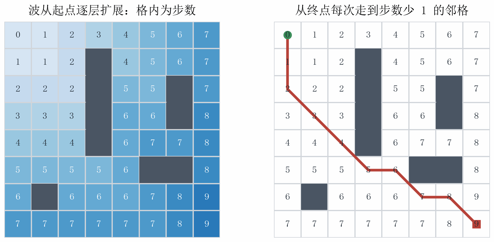


\[
d(\text{下一格})=d(\text{当前格})-w(\text{当前格})
\]

的邻格。基础题中权重全为 1，这一条就是“走向比自己小 1 的格子”：起点为 7 时依次走 6、5、4、3、2、1，到达写 0 的终点。

```c
r = sr;
c = sc;
while (r != fr || c != fc) {
    on_path[r][c] = 1;
    target = dist[r][c] - w[r][c];
    for (k = 0; k < 8; k++) {
        nr = r + dr[k];
        nc = c + dc[k];
        if (nr < 0 || nr >= 10 || nc < 0 || nc >= 10)
            continue;
        if (dist[nr][nc] < 0)
            continue;
        diff = dist[nr][nc] - target;
        if (diff > -0.000001 && diff < 0.000001)
            break;
    }
    r = nr;
    c = nc;
    steps++;
}
on_path[fr][fc] = 1;
```

`break` 立即跳出 `for`，此时 nr、nc 保存的正是刚找到的邻格，随后把它设为当前格。比较仍用容差，原因与放波时相同。dist 为负的邻格既可能是障碍，也可能是波未到达的格子，一律跳过。循环条件 `r != fr || c != fc` 表示“行不同或列不同”，即尚未到达终点；终点在循环中不会被标记，所以结束后单独补上。

这样的下一格一定存在：当前格的 dist 正是由某个邻格的值加上 w(当前格) 得到的，放波结束时该关系对最小值成立。每走一步，dist 至少减少 1.00（最小权重），数值严格下降，所以不会原地打转，最终到达只有终点才具有的那一个值。

另一种做法是在松弛时再用两个数组 `prev_r`、`prev_c` 记下“该格的值是从哪一格传来的”，找路径时顺着它们走。从终点放波时，prev 指向离终点更近一步的格子，从起点顺着 prev 一直走就到终点。读取时要先把两个值都取出再赋值：

```c
pr = prev_r[r][c];
pc = prev_c[r][c];
r = pr;
c = pc;
```

若写成 `r = prev_r[r][c]; c = prev_c[r][c];`，第二句使用的 r 已被第一句改掉，读到的是另一格的列号。这与第十一章交换两个变量需要临时变量是同一个道理。两种做法得到同样合法的最短路径；下坡走法少用两个数组，并与板书“往小的数走”的思路一致。也可以把行列压缩为一个整数 `r * 10 + c`，再用 `/ 10` 和 `% 10` 拆开，但这只是节省一个数组，读起来反而更绕。

### 压缩存储：用一个数组记录全部状态

前面的程序用 w、dist、on_path 三个数组分别保存权重、代价和路径标记。本节在不改变算法的前提下逐步减少数组：先让地图生成后只有一个数组被修改，再把所有信息装进同一个整数数组。所用手段只有标记值的重新约定和第三章的整数除法与取余，它们也说明了“一个数能装多少信息”取决于取值范围。

**第一步：两个数组，只改 dist。** 权重表在输出第一张表时还要用，不能被覆盖，所以 w 生成后保持只读。把 on_path 并入 dist 的关键，是让 dist 的每一类取值只有一种含义：

| `dist[r][c]` 的值 | 含义 |
|---|---|
| 0 | 波尚未到达 |
| 正数 | 波算出的最小代价 |
| 负数 | 该格在最终路径上，绝对值仍是代价 |

真实代价不小于 1.00，不可能是 0，所以 0 可以充当“未到达”的标记，负数就空出来专门表示路径。放波时把判断改为 `dist[r][c] <= 0` 跳过、`dist[nr][nc] <= 0 || nd < ...` 更新；放波结束后用 `dist[sr][sc] > 0` 判断波是否到达起点。找路径时每走到一格，先算出下一格应有的值，再把当前格变为负数：

```c
target = dist[r][c] - w[r][c];
dist[r][c] = -dist[r][c];
```

两句的次序不能颠倒，否则 target 由负数算出。已变负的格子不会被误选为下一格，因为 target 一定是正数。这里 `dist[r][c] == 0` 的相等比较是安全的：0.0 是直接赋入的值，没有经过运算，不存在舍入误差；第七章要求留容差的是计算得到的小数。

**第二步：一个整数数组。** 只剩一个数组时，每格必须同时保存权重和代价两个数：权重在放波、重新松弛和找路径时都要用，代价是放波的结果。一个 double 元素只能放一个数，直接把代价写进去就丢失了权重。办法是先改用整数，再把两个整数拼成一个。

权重精确到 0.01，可以按“百分之一”为单位存成整数，例如 3.79 存为 379。生成时直接写 `100 + rand() % 401`，得到 100 到 500 之间的整数，正好对应 1.00 到 5.00。这种用固定单位把小数化成整数的做法称为定点表示（представление с фиксированной точкой）。全部运算变成整数加减和比较，不再有舍入误差，放波时的容差 0.000001 和找路径时的 diff 判断都可以删去，“更小”直接写 `nd < ncost`，“相等”直接写 `== target`。

设权重 \(w\) 满足 \(0\le w<1000\)，代价为 \(d\)，令

\[
v=1000\,d+w .
\]

由整数除法的定义，\(v/1000=d\)，\(v\%1000=w\)。例如代价 13.80、权重 3.79 存为 1380379，`1380379 / 1000` 得 1380，`1380379 % 1000` 得 379。拆分成立的条件是低位部分严格小于乘数：权重最大为 500，小于 1000，后三位只装权重，不会与代价混在一起；若权重可能达到 1000 或更大，乘数也必须相应放大。这与前面把行列压缩成 `r * 10 + c` 是同一个原理，那里要求列号 \(0\le c<10\)。

数组 `int a[10][10]` 的三类取值约定如下：

| `a[r][c]` 的值 | 含义 |
|---|---|
| −1 | 障碍 |
| \(1000d+w\)，\(d=0\) | 普通格子，波尚未到达 |
| \(1000d+w\)，\(d>0\) | 普通格子，波已到达，最小代价为 d |
| \(-(1000d+w)\) | 该格在路径上，数值本身不变，只是取负 |

代价以“分”计不小于 100，路径格的值不小于 \(1000\times 100+100\)，取负后远小于 −1，不会与障碍混淆。为了让路径格也能正确拆分，取值写成两个小函数，负数先变回正数：

```c
int weight_of(int v)
{
    if (v < 0)
        v = -v;
    return v % 1000;
}

int cost_of(int v)
{
    if (v < 0)
        v = -v;
    return v / 1000;
}
```

C99 起，负数的整数除法向零截断，余数与被除数同号，例如 `-1380379 % 1000` 得 −379。先取绝对值再拆分，避免依赖这条规则，含义也更清楚。障碍值 −1 不能交给这两个函数，所以每处都先判断 `a[r][c] == -1`。

“波尚未到达”这一初始状态不需要专门写入。生成场地时每格只存了权重，取值在 100 到 500 之间，都小于 1000，按 \(v=1000d+w\) 读就是 \(d=0\)：例如 \(379=1000\times 0+379\)，`379 / 1000` 得 0。放置障碍只把一部分格子改成 −1，所以放波之前，除障碍外所有格子的代价段都是 0。

终点的初值是“代价等于自身权重”，写作 `a[fr][fc] = weight_of(a[fr][fc]) * 1000 + weight_of(a[fr][fc]);`：乘 1000 的一项是代价段，后加的一项是权重段，两项恰好都取终点权重。若终点权重为 292，这一句把 292 改成 292292，终点成为全图唯一代价段不为 0 的格子。放波循环中 `if (cost == 0) continue;` 只是检查而不是设置：第一轮扫描时，除终点外的格子全部被跳过，真正向外传播从终点开始；邻格一旦被松弛，值就不小于 1000，下一次扫到它时也能向外传播。松弛时代价改变而权重不变：

```c
nw = weight_of(a[nr][nc]);
ncost = cost_of(a[nr][nc]);
nd = cost + nw;
if (ncost == 0 || nd < ncost) {
    a[nr][nc] = nd * 1000 + nw;
    changed = 1;
}
```

找路径时目标代价为 `cost_of(a[r][c]) - weight_of(a[r][c])`，必须在 `a[r][c] = -a[r][c];` 之前计算；邻格判断写 `a[nr][nc] < 0` 即跳过，它同时排除了障碍与已走过的路径格。起点进入路径后会变成负数，所以总代价要在找路径之前存入一个变量，输出时使用该变量。输出时把整数换回带小数的金额要写 `cost_of(v) / 100.0`，若写 `/ 100` 则是整数除法，小数部分丢失。

还要检查整数是否会溢出。一条路径最多经过 100 格，每格权重不超过 500，代价不超过 \(100\times 500=50000\)，编码值不超过 \(50000\times 1000+500\approx 5\times 10^7\)，远小于 int 至少能表示的 \(2^{31}-1\approx 2.1\times 10^9\)（Windows 与常见平台上 int 为 32 位；C 标准只保证不小于 32767，若用 16 位 int 的环境就必须改用 long）。

下面是一次运行中从起点到终点的路径代价（示范数据），每一步都满足“当前代价 − 当前格权重 = 下一格代价”：

\[
19.78-4.82=14.96,\quad 14.96-3.08=11.88,\quad 11.88-1.34=10.54,
\]
\[
10.54-2.76=7.78,\quad 7.78-1.93=5.85,\quad 5.85-2.93=2.92 .
\]

最后的 2.92 是终点自身的权重，即终点的初值。三种写法得到同样的最短代价，区别只在存储：单数组写法最省空间，并顺带消除了浮点误差；代价是每次读写都要经过拆分和拼合，可读性依赖注释和取值约定表。约定一旦写下，程序中所有判断都必须遵守它：找路径时 `a[nr][nc] < 0` 有意把障碍和路径格一起跳过，输出第二张表时则必须先判断 `== -1` 再判断 `< 0`，才能把两者分开显示。

### 单位权重时的单数组写法

基础题中每格权重都是 1，累计代价就是步数。上一节的单数组写法仍然可用，但已无必要：每格不必再保存权重，拼合与拆分随之取消，一个整数直接存“到终点的步数”。算法的骨架不变，仍是从终点放波、`while (changed)` 反复扫描、下坡找路径、走过的格子取负；变化集中在取值约定上。

步数是“走了几步”的计数，从终点的 0 开始，放波时每次只做 `a[nr][nc] = a[r][c] + 1`，只增不减，所以真实步数总是非负整数。10×10 的场地上除终点外至多 99 格，任何最短路线的步数都不超过 99，真实步数只能取 0 到 99。依照前面“标记值必须取真实数据永远取不到的数”的原则，可以这样约定：

| `a[r][c]` 的值 | 含义 |
|---|---|
| −100 | 障碍 |
| 100 | 波尚未到达 |
| 0 ～ 99 | 到终点的步数，终点为 0 |
| −1 ～ −99 | 该格在路径上，绝对值是步数 |

加权版用过的两个标记在这里都不能沿用。终点现在写 0，0 已是真实步数，不能再表示“未到达”；路径格取负后是 −1、−2、…，离终点一步的路径格恰好是 −1，若仍用 −1 表示障碍，两种含义就会混淆。±100 落在真实取值范围 \([-99,99]\) 之外，与任何真实步数、任何路径标记都不冲突。

“未到达”取 100 而不取别的负数，还有一层好处。100 比任何真实步数都大，第一次到达某格时 `a[r][c] + 1 < 100` 自然成立，松弛条件只需一个比较：

```c
if (a[r][c] + 1 < a[nr][nc]) {
    a[nr][nc] = a[r][c] + 1;
    changed = 1;
}
```

这正是“波的传播与松弛”一节所说的情形：用很大的数表示未到达，“第一次到达”被包含在“更小就更新”之中，不必像加权版那样另写 `dist[nr][nc] < 0` 或 `ncost == 0`。障碍要在比较之前单独排除，因为 −100 比任何步数都小，若参与比较，条件永远不成立，结果虽不出错，但含义不清。放波的扫描中同样先跳过 −100 和 100 两类格子：前者不可走，后者波尚未到达，不能从它向外传播。放波结束后，起点仍为 100 说明它与终点不连通，判断写作 `a[sr][sc] != 100`。

找路径时，下一格应有的步数是当前步数减 1，必须在当前格取负之前算出：

```c
target = a[r][c] - 1;
a[r][c] = -a[r][c];
```

邻格判断写 `a[nr][nc] < 0` 即跳过，它同时排除障碍（−100）和已经走过的路径格；未到达的格子值为 100，不可能等于 target，也不会被选中。终点的值是 0，取负后仍是 0，无法用符号标出，所以终点不做标记，输出时靠行列号与 F 识别。

第二张表的格子分为四类：X 是障碍；“-”是不为障碍、但被障碍围住而波始终到不了的格子，它的值停在 100；正数是波到达过的格子；负数是最终路径上的格子，负号只是记号，去掉负号就是步数。表中的 −7 并不表示“走了 −7 步”，而是“这一格在路径上，离终点 7 步”。若起点本身落在被围住的区域里，起点也显示为“-”，程序输出不存在路径。

输出用 `%4d`，4 是字段总宽度，不足时在左侧补空格，例如 −7 印成 `␣␣-7`；X 和“-”手工写成 `"   X"`、`"   -"`，宽度同为 4，再接一个标记字符，每格固定 5 个字符。下面是一次运行的第二张表（示范数据，障碍 30%）：

```text
  10    9    8    7    X    X    X    0F   1    2
   X    9    8    7    6    X    X    X   -1    2
   X    9    X    7    6    5    4    X   -2    X
  10    9    8    7    6    5    4   -3    X    3
   X    X    8    7    X    X    X   -4    4    4
  10    9    8    X    X    X    X   -5    5    5
   X    9    9    X    8   -7   -6    X    6    X
   X    X   10    X   -8    7    7    7    7    X
  12   11  -10   -9    8    8    X    8    8    8
  12  -11S  10    9    9    9    9    9    9    9

Path length: 11 steps
```

从 S 出发依次经过 −11、−10、…、−1，到达 0F，每步恰好小 1，与板书“往小的数走”的走法一致。两种单数组写法的区别如下：

| | 加权版 | 单位权重版 |
|---|---|---|
| 每格存放 | 代价 × 1000 + 权重 | 步数 |
| 取值函数 `weight_of`、`cost_of` | 需要 | 不需要 |
| 终点初值 | 自身权重 | 0 |
| 松弛时增加 | 邻格的权重 | 1 |
| 下一格应有的值 | 当前代价 − 当前权重 | 当前步数 − 1 |
| 障碍 / 未到达 | −1 / 代价段为 0 | −100 / 100 |
| 输出格式 | `%6.2f` | `%4d` |

单位权重版本于 2026-10-27 用 MSVC 14.51 分别按 C（/TC）与 C++（/TP）、/W4 编译无警告，并实际运行；上面的表即该次运行的输出。无路径分支本次未遇到相应随机场地，只经逻辑审阅。

### 定宽输出与两张表

加强题要求输出两张表：原始权重表和计算出的路径表，每格都要对齐。`%6.2f` 中 6 是字段总宽度，2 是小数位数；实际字符不足 6 个时在左侧补空格。

| 数值 | 输出 | 说明 |
|---|---|---|
| 3.879 | `␣␣3.88` | 四舍五入为两位小数，补两个空格 |
| 13.8 | `␣13.80` | 补一个空格 |
| -18.56 | `-18.56` | 恰好 6 个字符 |

每格输出 `%6.2f` 后再跟一个字符：平时为空格，起点为 S，终点为 F，因此每格固定 7 个字符。障碍和未到达的格子没有数值，手工写成同样宽度的 `"     X"` 和 `"     -"`（5 个空格加 1 个字符），表格就不会错位。若数值超过字段宽度，例如 `1234.567` 用 `%6.2f` 输出为 7 个字符的 `1234.57`，宽度不够时不会截断，而是整体变宽，所以字段宽度要按最大可能值选取。

第二张表按四种情况输出：障碍显示 X；未到达显示 −；路径上的格子显示代价的相反数；其余格子显示代价。路径用负号显示只是一种标记方式，`-dist[r][c]` 只改变打印的值，数组中存的仍是正数，程序判断“是否到达”时不会受影响。printf 中单个 `%` 是转换说明的开头，若要输出百分号本身，应写 `%%`。

下面是完整程序。它从终点放波，用下坡走法找路径，只使用前面各章介绍过的语法：

```c
#include <stdio.h>
#include <stdlib.h>
#include <time.h>

// Pick a random cell on the border of the 10x10 field
void random_edge(int *r, int *c)
{
    int side = rand() % 4;   // 0 top, 1 bottom, 2 left, 3 right
    int k = rand() % 10;     // position along that side

    switch (side) {
    case 0:  *r = 0; *c = k; break;
    case 1:  *r = 9; *c = k; break;
    case 2:  *r = k; *c = 0; break;
    default: *r = k; *c = 9; break;
    }
}

int main(void)
{
    double w[10][10];        // weight, -1.0 means obstacle
    double dist[10][10];     // cost from this cell to the finish, -1.0 means not reached
    int on_path[10][10];     // 1 if the cell is on the path
    int dr[8] = {-1, -1, -1,  0, 0,  1, 1, 1};
    int dc[8] = {-1,  0,  1, -1, 1, -1, 0, 1};
    int sr, sc, fr, fc;
    int pct, walls, placed;
    int r, c, k, nr, nc;
    int changed, found, steps;
    double nd, target, diff;
    char mark;

    srand((unsigned int)time(NULL));

    // Field: weights 1.00 ~ 5.00
    for (r = 0; r < 10; r++) {
        for (c = 0; c < 10; c++) {
            w[r][c] = 1.0 + (rand() % 401) / 100.0;
            on_path[r][c] = 0;
        }
    }

    // Start and finish on the border, chosen before the obstacles
    random_edge(&sr, &sc);
    do {
        random_edge(&fr, &fc);
    } while (fr == sr && fc == sc);

    // Obstacles: 30% ~ 60% of the cells
    pct = 30 + rand() % 31;
    walls = 10 * 10 * pct / 100;
    placed = 0;
    while (placed < walls) {
        r = rand() % 10;
        c = rand() % 10;
        if (r == sr && c == sc)
            continue;
        if (r == fr && c == fc)
            continue;
        if (w[r][c] < 0)
            continue;
        w[r][c] = -1.0;
        placed++;
    }

    // Wave from the finish: repeat until no cell can be improved
    for (r = 0; r < 10; r++)
        for (c = 0; c < 10; c++)
            dist[r][c] = -1.0;
    dist[fr][fc] = w[fr][fc];

    changed = 1;
    while (changed) {
        changed = 0;
        for (r = 0; r < 10; r++) {
            for (c = 0; c < 10; c++) {
                if (dist[r][c] < 0)
                    continue;
                for (k = 0; k < 8; k++) {
                    nr = r + dr[k];
                    nc = c + dc[k];
                    if (nr < 0 || nr >= 10 || nc < 0 || nc >= 10)
                        continue;
                    if (w[nr][nc] < 0)
                        continue;
                    nd = dist[r][c] + w[nr][nc];
                    if (dist[nr][nc] < 0 || nd < dist[nr][nc] - 0.000001) {
                        dist[nr][nc] = nd;
                        changed = 1;
                    }
                }
            }
        }
    }

    // Path: from the start, always step to the neighbour with dist = dist - w
    found = 0;
    if (dist[sr][sc] >= 0)
        found = 1;
    steps = 0;
    if (found) {
        r = sr;
        c = sc;
        while (r != fr || c != fc) {
            on_path[r][c] = 1;
            target = dist[r][c] - w[r][c];
            for (k = 0; k < 8; k++) {
                nr = r + dr[k];
                nc = c + dc[k];
                if (nr < 0 || nr >= 10 || nc < 0 || nc >= 10)
                    continue;
                if (dist[nr][nc] < 0)
                    continue;
                diff = dist[nr][nc] - target;
                if (diff > -0.000001 && diff < 0.000001)
                    break;
            }
            r = nr;
            c = nc;
            steps++;
        }
        on_path[fr][fc] = 1;
    }

    // Two tables, every cell 7 characters wide
    printf("Obstacles: %d percent (%d cells)\n", pct, walls);
    printf("\nTable 1. Weights\n");
    for (r = 0; r < 10; r++) {
        for (c = 0; c < 10; c++) {
            mark = ' ';
            if (r == sr && c == sc)
                mark = 'S';
            else if (r == fr && c == fc)
                mark = 'F';
            if (w[r][c] < 0)
                printf("     X%c", mark);
            else
                printf("%6.2f%c", w[r][c], mark);
        }
        printf("\n");
    }

    printf("\nTable 2. Costs (negative = path)\n");
    for (r = 0; r < 10; r++) {
        for (c = 0; c < 10; c++) {
            mark = ' ';
            if (r == sr && c == sc)
                mark = 'S';
            else if (r == fr && c == fc)
                mark = 'F';
            if (w[r][c] < 0)
                printf("     X%c", mark);
            else if (dist[r][c] < 0)
                printf("     -%c", mark);
            else if (on_path[r][c])
                printf("%6.2f%c", -dist[r][c], mark);
            else
                printf("%6.2f%c", dist[r][c], mark);
        }
        printf("\n");
    }

    if (found)
        printf("\nPath cost: %.2f, steps: %d\n", dist[sr][sc], steps);
    else
        printf("\nNo path from S to F\n");
    return 0;
}
```

一次实际运行中，第二张表的路径数值从起点的 20.64 一路减小，到终点为 1.04，共 9 步；任取相邻两格核对，前一格的值都等于后一格的值加上前一格的权重。找不到路径时，两张表仍完整输出，只是第二张表中没有负数，终点周围是一片“−”。

### 按圈扩展：只让当前波前传播

课堂板书上的波严格一圈一圈地画：先写完所有 1，再写所有 2。前面的程序反复扫描整张表，每一轮都让所有已到达的格子把 8 个邻格重新试探一遍；障碍、波未到达的格子和早已定型的内圈格子也逐一被读到，同一轮可能推进好几圈，也可能某个方向只推进一格。单位权重时可以只让“当前这一圈”向外传播，仍然只用一个数组 a，取值约定沿用上一节（−100 障碍、100 未到达、终点 0）。

第 d 轮只处理值恰好等于 d 的格子，把它们尚未到达的邻格写成 d+1：

```c
total2 = 0;
d = 0;                           // the ring being processed
changed = 1;
while (changed) {
    changed = 0;
    for (r = 1; r <= 10; r++)
        for (c = 1; c <= 10; c++) {
            if (a[r][c] != d)
                continue;        // not on the current ring
            for (k = 0; k < 8; k++) {
                nr = r + dr[k];
                nc = c + dc[k];
                if (a[nr][nc] == 100) {
                    a[nr][nc] = d + 1;
                    changed++;   // one more cell written
                }
            }
        }
    total2 = total2 + changed;
    d++;
}
```

这里用了上一节开头的围墙写法，所以没有出界检查。`if (a[r][c] != d) continue;` 一句同时跳过障碍（−100）、未到达的格子（100）和更早几圈的格子，它们的值都不等于 d。邻格只写值为 100 的格子：权重全为 1 时，波第一次到达某格给出的就是最少步数，之后不可能更小，因此既不必比较大小，也不会把障碍（−100）误写。某一轮一个新格子都没写，说明波已无处可去，`changed` 停在 0，循环结束。

**计数与结束条件。** 若要比较两种写法的工作量，可把开关改成计数：每写一个格子 `changed++`。计数必须在每轮开头清零，`while (changed)` 才仍然表示“上一轮至少写过一个格子”；跨轮的累计另交给 `total2`。如果让 `changed` 一直累加而不清零，它在第一次写入后永远大于 0，循环不会停止，就只能另设一个变量记下“本轮开始时的计数”再作比较；每轮清零再累加到总数，能保留 `while (changed)` 的原有结构，也不需要那个额外变量。旧写法同样把 `changed = 1` 改为 `changed++`，并在每轮末尾 `total1 = total1 + changed`，两种算法对同一张地图运行（运行新算法前把非障碍格恢复为 100、终点恢复为 0），最后输出 `total1` 与 `total2`。

**为什么新写法的计数不会更多。** 新写法中每个格子只在波第一次到达时被写一次，`total2` 恰好等于波能到达的格子数（不含终点）。旧写法也至少要把这些格子各写一次；扫描次序若让某格先从较远的一侧被写上偏大的数，后面的轮次还要再把它改小，同一格被写了两次，`total1` 就多出这些重写。所以总有 \(\text{total2}\le\text{total1}\)，扫描次序恰好顺着波的方向时二者相等。终点被障碍围死时两者都是 0；只有起点被围住时，波仍在终点所在的连通区域里扩散，计数不为 0。写入次数只是工作量的一部分，旧写法真正多出的开销在于每轮对所有已到达格子重复试探 8 个邻格；若要显示这一差别，可另设计数器统计“试探邻格”的次数。

**缩小扫描范围。** 上面的循环每轮仍从第 1 行扫到第 10 行，只是遇到不等于 d 的格子立刻跳过。可以再记下本轮新写格子的最小、最大行号与列号，下一轮只扫这个外接矩形：

```c
top = fr; bot = fr; lef = fc; rig = fc;    // box of the current ring
d = 0;
while (top <= bot) {                       // empty box: no ring left
    nt = 10; nb = -1; nl = 10; nrg = -1;   // next box starts empty
    for (r = top; r <= bot; r++)
        for (c = lef; c <= rig; c++) {
            if (a[r][c] != d)
                continue;
            for (k = 0; k < 8; k++) {
                nr = r + dr[k];
                nc = c + dc[k];
                if (nr < 0 || nr >= 10 || nc < 0 || nc >= 10)
                    continue;
                if (a[nr][nc] != 100)
                    continue;
                a[nr][nc] = d + 1;
                if (nr < nt)  nt = nr;     // enlarge the next box
                if (nr > nb)  nb = nr;
                if (nc < nl)  nl = nc;
                if (nc > nrg) nrg = nc;
            }
        }
    top = nt; bot = nb; lef = nl; rig = nrg;
    d++;
}
```

这一段按原来 10×10、下标从 0 开始的数组书写，所以保留出界检查。新框先设成“空”的（`nt = 10 > nb = -1`），本轮一格未写时它保持为空，`top <= bot` 不成立，循环结束，作用与 `changed == 0` 相同。框外的障碍和未到达格子完全不被读取；框内若夹着它们，仍要做一次 `!= d` 的比较才能跳过。在只允许一个数组的条件下，这已接近能做到的最少：程序要找到波前，要么把波前格子的坐标另存起来，要么在表中扫描寻找，二者必居其一。

若允许另用数组，可以把本圈和下一圈波前的坐标分别存在 `curR/curC` 与 `nxtR/nxtC` 中，每轮只遍历本圈，结束时把下一圈整体抄过来。这只是两个普通数组成批替换，没有队头队尾，不是队列；单位权重时每格只进入波前一次。权重不同时，被改小的格子还要再次进入波前，并需用标记防止它在同一圈被记两次。

本节三种单位权重写法（反复松弛、按圈扩展、外接矩形）已于 2026-10-28 合成一个对照程序，用本机 Visual Studio 18 的 MSVC 按 C（/TC）与 C++（/TP）、/W4 编译无警告，在 20000 张随机场地（障碍约 35%）上运行：三者得到的步数表逐格相同，按圈写法的写入次数从不超过反复松弛，其中 16332 张严格更少，最多少 33 次。

### 队列与逐层扩展

按圈扩展仍要在表中寻找本圈格子。若把待处理的格子按到达顺序排成队列（очередь），就能直接取出下一格，既不扫描也不需要圈数。

队列遵循先进先出：新元素加在队尾，取出时从队头取。用一个数组和两个下标即可实现：

```c
int q[100];
int head = 0, tail = 0;

q[tail] = x;  tail++;    // enqueue
x = q[head];  head++;    // dequeue
/* head < tail means the queue is not empty */
```

取出时数组元素并未被删除，只是 head 后移，前面的元素视为已离开。每格最多入队一次，100 个位置足够。格子坐标可以压成一个整数 `r * 10 + c` 入队，取出后用 `/ 10` 和 `% 10` 还原。

权重全为 1 时，从终点开始：终点写 0 并入队；只要队列非空，就取出一格，把它尚未写数、又不是障碍的邻格写成“本格加 1”并入队。

```c
step[fr][fc] = 0;
q[tail] = fr * 10 + fc;
tail++;
while (head < tail) {
    cell = q[head];
    head++;
    r = cell / 10;
    c = cell % 10;
    for (k = 0; k < 8; k++) {
        nr = r + dr[k];
        nc = c + dc[k];
        if (nr < 0 || nr >= 10 || nc < 0 || nc >= 10)
            continue;
        if (w[nr][nc] < 0 || step[nr][nc] >= 0)
            continue;
        step[nr][nc] = step[r][c] + 1;
        q[tail] = nr * 10 + nc;
        tail++;
    }
}
```

这里 step 预先全部置为 −1。因为先进先出，所有写 1 的格子都比写 2 的格子先出队，所有写 2 的又比写 3 的先出队，波严格按 0、1、2、3 逐层扩展。每格只入队和处理一次，不需要反复扫描整张表。这种逐层搜索称为广度优先搜索。

队列只保证“步数少的先处理”。权重不同时，步数少不代表代价小，前面 23 与 7 的例子正说明了这一点，所以加强题不能直接套用普通队列。

### 课程延伸：Dijkstra 算法

带非负权重时，可以改为每次处理“当前累计代价最小、且尚未确定”的格子。这就是 Dijkstra 算法。它的依据是：所有权重都为正时，未确定的格子中代价最小的那一格，不可能再经由其他未确定格子得到更小的值，因为任何绕行都只会再加上正的权重。于是该格的值可以立即确定，并用它松弛邻格。

在只用数组的写法中，另设 `int done[10][10]` 记录已确定的格子，每一轮扫描整张表找出最小者：

```c
for (round = 0; round < 100; round++) {
    br = -1;
    bc = -1;
    for (r = 0; r < 10; r++)
        for (c = 0; c < 10; c++) {
            if (done[r][c] || dist[r][c] < 0)
                continue;
            if (br < 0 || dist[r][c] < dist[br][bc]) {
                br = r;
                bc = c;
            }
        }
    if (br < 0)
        break;
    done[br][bc] = 1;
    for (k = 0; k < 8; k++) {
        nr = br + dr[k];
        nc = bc + dc[k];
        if (nr < 0 || nr >= 10 || nc < 0 || nc >= 10)
            continue;
        if (w[nr][nc] < 0 || done[nr][nc])
            continue;
        nd = dist[br][bc] + w[nr][nc];
        if (dist[nr][nc] < 0 || nd < dist[nr][nc])
            dist[nr][nc] = nd;
    }
}
```

初始化与前面相同：全部 dist 置 −1，终点置为自身权重，done 全部置 0。找不到可处理的格子时（br 仍为 −1），剩余格子都无法到达，提前结束。每格恰好确定一次，最多 100 轮，每轮扫描 100 格；反复松弛的写法则可能需要更多轮次。两种方法得到的代价表相同。权重全为 1 时，Dijkstra 的处理次序退化为逐层扩展，与队列写法一致。

本章程序及队列、Dijkstra 两段代码已在 2000 张随机场地上对照运行：反复松弛与 Dijkstra 的代价表逐格相同；权重全为 1 时，反复松弛得到的代价减一等于队列写法的步数。

## 第十五章 结构体、共用体与枚举

前面各章的数组只能存放同一类型的多个数据。实际问题中，一个对象往往由几种不同类型的数据共同描述，例如一个学生有姓名（字符串）、学号（整数）和成绩（小数）。如果用三个独立的数组分别存放，排序时就必须同时移动三个数组中的对应元素，很容易出错。结构体把这些相关的数据组合成一个整体。

### 结构体的定义与使用

结构体类型用 `struct` 定义，花括号中列出各个成员：

```c
typedef struct {
    char name[20];
    int id;
    double score;
} Student;
```

`typedef` 为类型起一个新名字，这里把整个结构体类型命名为 `Student`，以后可以像 `int` 一样写 `Student s;`。不用 `typedef` 时，要写成 `struct 标签名 { ... };`，使用时写 `struct 标签名 s;`。

访问成员用点运算符：`s.id = 1;`、`s.score = 78.5;`。字符数组成员不能直接用 `=` 赋字符串，要用 `strcpy`（第九章）。结构体变量可以在定义时按成员顺序初始化，也可以组成数组：

```c
Student cls[3] = {
    {"Li", 1, 78.5},
    {"Wang", 2, 91.0},
    {"Zhao", 3, 85.0}
};
```

`cls[1].name` 是第二个学生的姓名，`cls[1].name[0]` 是这个姓名的第一个字符。

结构体变量之间可以直接用 `=` 整体赋值，所有成员（包括字符数组）都会被复制，复制后两者互不影响。但结构体不能用 `==` 比较，要比较就必须逐个成员比较。

数组不能整体赋值，`int Ar1[10], Ar2[10]; Ar1 = Ar2;` 编译出错，因为数组名在表达式中转换为首元素地址，不能作为赋值对象；复制数组要逐个元素赋值，或用 `memcpy(Ar1, Ar2, sizeof Ar1);`（`<string.h>`）。把数组放进结构体，就可以随结构体整体复制：

```c
struct Arr { int data[10]; };
struct Arr s1, s2;
s1 = s2;                  /* all 10 elements are copied */
```

结构体赋值按字节把整块存储原样复制，不去理解其中各字节代表什么，所以成员里的数组也一并复制了。反过来，成员若是指针，复制的也只是指针本身这几个字节，而不是它指向的数据：

```c
struct S { int *ptr; };
struct S s1, s2;
s2.ptr = malloc(10 * sizeof(int));
s1 = s2;                  /* s1.ptr and s2.ptr hold the same address */
s1.ptr[0] = 100;          /* s2.ptr[0] is now 100 too */
```

这称为浅拷贝（поверхностное копирование）。复制后两个结构体共用同一块数据，通过任何一个修改，另一个都能看到；释放时也只能释放一次。需要真正独立的副本时，要另行 malloc 一块存储并把内容逐个复制过去，这称为深拷贝。

`sizeof(Student)` 实测为 32 字节，在本例中恰好等于各成员大小之和 \(20+4+8=32\)，但一般情况下可能更大：编译器为了让 `double` 等成员从合适的地址开始，会在成员之间插入空白字节（称为内存对齐）。所以计算结构体大小时一律用 `sizeof`，不要手工相加。

**类型与变量。** `int`、`float` 是语言内置的类型（встроенные типы），`struct` 让程序员自己构造新类型（пользовательский тип）。类型像一张图纸，告诉编译器这种数据占多少字节、各字节怎样解释；图纸本身不占存储，照着它声明变量时才分配。不用 typedef 时，结构体定义与变量声明分两步写：

```c
struct P3d {
    int x, y, z;          /* same as int x; int y; int z; */
};                        /* type only, no storage yet */

struct P3d point1;
struct P3d point2, *p;
```

在 C 中这个类型的名字是 `struct P3d` 两个词，单写 `P3d` 不是类型名（C++ 中可以）。三个 int 都已对齐，`sizeof(struct P3d)` 为 12。`point1`、`point2` 各占一整个结构体的大小，是两份独立的存储，改 `point2.x` 不影响 `point1.x`；与 `int a, *b;` 一样，`*` 只属于紧挨着它的 `p`，`p` 只是一个指针，在 64 位平台上占八字节，必须先赋值如 `p = &point1;` 才能使用。刚声明的局部结构体变量各成员是不确定值，需要清零时写 `struct P3d point2 = {0};`，按顺序初始化写 `= {1, 2, 3}`。

执行 `point1.x = 15; point2.y = 25; p = &point1; p->y = 30; point1.z = 15;` 后，`p->y` 改的正是 `point1.y`，虽然这一句没有出现 `point1` 这个名字。再写 `(*p).z = 25;`，与 `p->z = 25;` 完全相同（俄语板书注为 одно и то же，“是同一回事”），后写的覆盖先写的，`point1` 最终为 \((15,30,25)\)，而 `point2` 只有 `y` 被赋值。

类型定义与变量声明也可以合为一步，`}` 与 `;` 之间可以写变量表：

```c
struct Name1 {
    int a, b;
} v1, v2;                 /* defines the type and two variables */
```

它等价于先写 `struct Name1 {...};` 再写 `struct Name1 v1, v2;`。由此可见结构体定义末尾的分号是整条声明语句的结束，两步写法只是把变量表留空，分号仍不能省。漏写分号时，编译器会把下一行的内容当成变量表的一部分，报出与真正错误位置无关的奇怪信息。若省去标签名写成 `struct { ... } va, vb;`，这是匿名结构体，以后无法再声明同类型的新变量，只适合一次性使用。实际编程多用两步写法：类型定义放在头文件（`.h`）中供多个源文件共用，变量在各个 `.c` 文件中按需声明；一步写法若写在所有函数之外，得到的是全局变量。

typedef 的格式是 `typedef 已有类型 新名字;`，它只给已有类型起别名（синоним），不创造新类型，如 `typedef int myint;`。它有两种常见用法：给匿名结构体命名，`typedef struct { int x, y, z; } SP3d;`，此后可写 `SP3d v1, v2;`；给已有的结构体起别名，`typedef struct Name1 SName1;`，此后 `struct Name1 v1;` 与 `SName1 v2;` 声明的是同一种类型。比较

```c
        struct { int x, y, z; } SP3d;   /* SP3d is a variable  */
typedef struct { int x, y, z; } SP3d;   /* SP3d is a type name */
```

可得一个记忆方法：先把整句当作声明变量去读，在前面加上 typedef 后，原来的变量名就变成了类型名。

**对齐的计算。** 成员按书写顺序存放，每个成员通常从其自身大小（对齐要求）的整数倍地址开始，整个结构体的大小还要补成最大对齐要求的整数倍。以

```c
struct Example { char c; int x; double d; };
```

为例，计算步骤为：

1. `char c` 占第 0 字节。
2. `int x` 需从 4 的倍数开始，第 1—3 字节为填充，`x` 占第 4—7 字节。
3. `double d` 需从 8 的倍数开始，第 8 字节正合适，占第 8—15 字节。
4. 总长 16 已是 8 的倍数，无需尾部填充。

所以 `sizeof(struct Example)` 为 \(1+3+4+8=16\)，而不是 \(1+4+8=13\)。具体的对齐要求由平台和编译器决定，上述结果为 x64 MSVC 的实测值，其他平台上仍应以 `sizeof` 为准。

**结构体不能包含自身。** 编译器读到 `};` 时结构体的大小才完全确定（板书强调 точно знать размер структуры，“必须准确知道结构体的大小”）。若写

```c
struct Node {
    void *p;
    int a;
    struct Node next;     /* error: incomplete type */
};
```

设其大小为 \(S\)，按成员相加得 \(S=8+4+S\)，两边消去 \(S\) 得 \(0=12\)，不可能成立；直观地说，每个结点里都要装一个完整的结点，永远装不完。从编译过程看，读到 `struct Node next;` 时类型尚未定义完，属于不完整类型，不能用来定义成员。改为指针 `struct Node *pnext;` 就可以了，因为无论指向什么，指针的大小都固定。此时布局为：`void *p` 占 0—7，`int a` 占 8—11，指针需从 8 的倍数开始，12—15 为填充，`pnext` 占 16—23，共 24 字节。`next`、`pnext` 只是成员名，前缀 p 是表示“指针”的命名习惯；`void *` 是可存放任何对象地址的通用指针，使用前要转换成具体类型。这种“每个结点存着下一个结点地址”的结构就是本章后面的链表。

### 指向结构体的指针与参数传递

把结构体传给函数时，若直接按值传递，函数得到的是整个结构体的副本，修改副本不影响原变量，而且复制大的结构体也费时。通常传递结构体的地址：

```c
void raise_score(Student *s, double delta)
{
    s->score += delta;          /* same as (*s).score += delta */
}

raise_score(&cls[0], 10.0);     /* cls[0].score becomes 88.5 */
```

通过指针访问成员用箭头运算符 `->`，`s->score` 与 `(*s).score` 等价。后者的括号不能省略，因为 `.` 的优先级高于 `*`，`*s.score` 会被理解为 `*(s.score)`。函数只读取而不修改结构体时，参数写成 `const Student *s`，既避免复制，又防止误改。

把结构体交给函数共有四种形参写法，区别在于函数拿到的是副本还是地址、能否修改：

1. `void f(struct pt v)`：按值传递，函数得到整个对象的副本（板书注为 копия объекта），修改副本不影响调用者；结构体大时复制开销也大。
2. `void f(struct pt *p)`：传地址，只复制一个指针，函数通过 `p->x` 修改的就是原对象。
3. `void f(const struct pt *p)`：传地址但承诺只读，`p->x = 100;` 会编译出错；只需读取时最常用。
4. `void f(struct pt **pp)`：传指针变量自身的地址，函数可以改变调用者的指针指向哪里，典型用途是在函数中分配新对象。

第四种与第十一章交换指针的 `int **` 是同一道理：

```c
int create(struct pt **pp)
{
    *pp = malloc(sizeof **pp);   /* changes the caller's pointer */
    if (*pp == NULL)
        return 0;
    (*pp)->x = 1;
    (*pp)->y = 2;
    return 1;
}

struct pt *ptr = NULL;
if (create(&ptr))                /* ptr now points to the new object */
    printf("%d %d\n", ptr->x, ptr->y);
free(ptr);
```

若形参只写 `struct pt *p`，函数里给 `p` 赋值改的只是指针的副本，调用者的 `ptr` 仍为 `NULL`。设 `struct pt val = {1, 2};`，依次调用按值修改、按指针修改和只读求和，输出为 1、100、102，`create` 后输出 `1 2`。本段与上文对齐、浅拷贝、结构体中数组的复制等结果，已于 2026-10-31 用 MSVC（/TC、/W4）编译运行核对：`struct Example` 为 16 字节，含指针的 `struct Node` 为 24 字节，`struct P3d` 与 `SP3d` 均为 12 字节；整体赋值后修改 `s2` 不影响 `s1`；浅拷贝后两个 `ptr` 相等，`s2.ptr[0]` 随之变为 100。

结合第十二章的 `qsort`，可以按任意成员对结构体数组排序。比较函数把 `void *` 转换为 `const Student *`，再比较成绩：

```c
int cmp_score(const void *p, const void *q)
{
    const Student *a = (const Student *)p;
    const Student *b = (const Student *)q;
    return (a->score < b->score) - (a->score > b->score);  /* descending */
}

qsort(cls, 3, sizeof cls[0], cmp_score);
```

排序时整个结构体一起移动，姓名、学号与成绩始终保持对应。上例中第一个学生加十分后为 88.5，按成绩降序排列的结果是 Wang 91.0、Li 88.5、Zhao 85.0。

### 链表

数组的长度在定义时就固定了，在中间插入或删除元素需要移动后面的所有元素。链表是另一种存放一列数据的方式：每个结点用 `malloc` 单独分配，除了数据外还保存下一个结点的地址，结点之间通过指针连成一串。

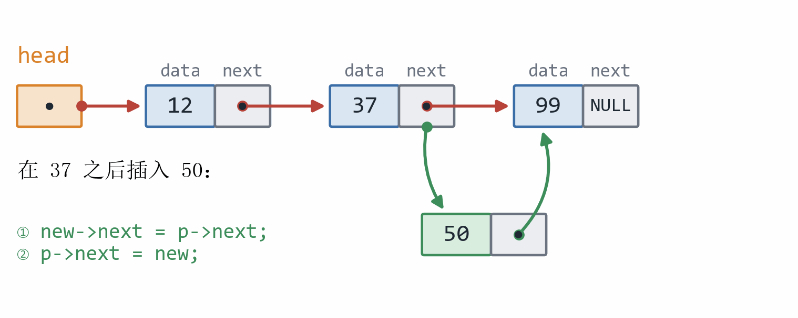


```c
struct Node {
    int value;
    struct Node *next;
};
```

成员 `next` 的类型是指向同一种结构体的指针，这种结构称为自引用结构。注意这里必须使用结构体标签 `struct Node`，因为在花括号内部，`typedef` 定义的新名字还不存在。最后一个结点的 `next` 为 `NULL`，表示链表结束；整个链表用指向第一个结点的头指针 `head` 表示，空链表的 `head` 为 `NULL`。

在链表头部插入一个新结点：

```c
struct Node *push_front(struct Node *head, int value)
{
    struct Node *p = malloc(sizeof *p);
    if (p == NULL)
        return head;
    p->value = value;
    p->next = head;     /* new node points to old first node */
    return p;           /* new node becomes the head */
}
```

遍历链表时，用一个指针从头指针出发，沿 `next` 逐个前进，直到 `NULL`：

```c
struct Node *p;
for (p = head; p != NULL; p = p->next)
    printf("%d -> ", p->value);
printf("NULL\n");
```

链表使用完毕后必须逐个释放结点，并且要先保存下一个结点的地址再释放当前结点，否则释放后就再也无法访问 `next`：

```c
void free_list(struct Node *head)
{
    while (head != NULL) {
        struct Node *next = head->next;  /* save before free */
        free(head);
        head = next;
    }
}
```

依次在头部插入 10、20、30、40 后，遍历输出为 `40 -> 30 -> 20 -> 10 -> NULL`，最后插入的在最前面。

链表与数组的比较如下：

| 方面 | 数组 | 链表 |
|---|---|---|
| 存储 | 连续的一块内存 | 各结点分散，用指针连接 |
| 按下标访问第 \(k\) 个元素 | 直接计算地址，很快 | 必须从头逐个走 \(k\) 步 |
| 在已知位置插入或删除 | 要移动后面的元素 | 只需修改指针 |
| 长度 | 定义时固定（或用 `realloc` 调整） | 随时增减结点 |
| 额外开销 | 无 | 每个结点多一个指针 |

使用链表时最常见的错误有三种：忘记检查 `malloc` 是否返回 `NULL`；修改指针的顺序不对，导致后面的结点丢失；释放后继续使用结点（悬空指针）或者忘记释放（内存泄漏），这与第十章动态内存的规则相同。

### 双向链表与柔性数组成员

单向链表只能从头往后走：要删除某个结点，必须先找到它前面的结点，才能修改前者的 `next`；要在末尾追加，也得从头走到尾。双向链表（двусвязный список）在每个结点中再存一个指向前一个结点的指针，并同时保存首、尾两个指针，这样在已知结点地址时，删除和尾部追加都只需修改几个指针。下面以课堂上保存城市名的程序为例。

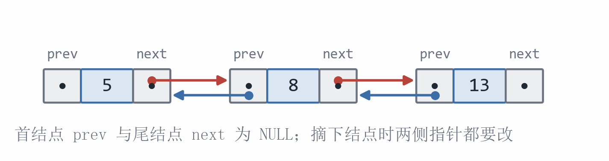


```c
#include <stdio.h>
#include <stdlib.h>
#include <string.h>

struct town {
    struct town *pNext;   /* next node */
    struct town *pPrev;   /* previous node */
    char Name[];          /* flexible array member */
};
typedef struct town Town;

Town *pFirst = NULL, *pLast = NULL;   /* empty list */
```

`pNext` 指向下一个结点，`pPrev` 指向上一个结点。第一个结点的 `pPrev` 和最后一个结点的 `pNext` 都是 `NULL`（板书上记作 ∅）。全局指针 `pFirst`、`pLast`（板书上的 F、L）分别指向首结点和尾结点，二者都为 `NULL` 表示空表。按习惯，以 `p` 开头的名字表示指针，例如下面函数参数 `po` 意为“指向对象的指针”，它保存的是结点的地址，不是结点本身。

**柔性数组成员。** `Name[]` 没有写长度，称为柔性数组成员（flexible array member，C99 起）。它的规则如下：

1. 只能作为结构体的最后一个成员，并且结构体中至少还要有一个其他成员。
2. `sizeof(Town)` 不计入它，这里只是两个指针的大小（可能另含对齐填充）。
3. 实际长度在 `malloc` 时决定：名字有多长，就在结构体之后多申请多少字节，名字的字符紧跟在两个指针后面。
4. 含柔性数组成员的结构体不能作数组元素，也不宜按值赋值或传参，因为赋值只复制 `sizeof(Town)` 个字节，名字部分不会被复制，所以总是通过指针使用。

与固定写成 `char Name[50]` 相比，这种写法既不浪费空间，也不会因名字超过 49 个字符而越界。

**创建与释放结点。**

```c
Town *Create(const char *name)
{
    size_t len = strlen(name);
    Town *po = (Town *)malloc(sizeof(Town) + len + 1);
    if (po == NULL)
        return NULL;
    memcpy(po->Name, name, len + 1);   /* copies the '\0' too */
    po->pNext = po->pPrev = NULL;
    return po;
}

void Destroy(Town *po)
{
    if (po)
        free(po);
}
```

`strlen` 返回的长度不含结尾的 `'\0'`，所以申请 `sizeof(Town) + len + 1` 个字节：两个指针、`len` 个字符、一个结束符。复制时连同 `'\0'` 一共 `len + 1` 个字节。板书使用 `strncpy_s(po->Name, len + 1, name, len + 1)`，四个参数依次是目标、目标大小、源、最多复制的字符数；它属于 C11 的可选附录 K，Visual Studio 提供，gcc 与 clang 的标准库通常没有，所以这里用到处可编译的 `memcpy`。`Create` 只制造结点，还没有把它放进链表；链接工作由下面的 `AddToList` 完成。实际上 `free(NULL)` 本身什么也不做，`Destroy` 中的判断只是让意图更明确。

**在表尾追加结点。**

```c
void AddToList(Town *po)
{
    if (pLast) pLast->pNext = po;    /* (1) old tail points to new node */
    po->pPrev = pLast;               /* (2) new node points back to old tail */
    pLast = po;                      /* (3) tail pointer moves */
    po->pNext = NULL;                /* (4) nothing after the new tail */
    if (pFirst == NULL) pFirst = po; /* (5) list was empty */
}
```

分两种情况追踪：

1. 空表：第 (1) 步因 `pLast` 为 `NULL` 而跳过；第 (2) 步 `po->pPrev = NULL`；第 (3) 步 L 指向 `po`；第 (4) 步 `po->pNext = NULL`；第 (5) 步 F 原为 `NULL`，也指向 `po`。结果 F、L 指向同一个结点，它的两个指针都是 `NULL`。
2. 非空表：第 (1) 步旧尾结点的 `pNext` 由 `NULL` 改为 `po`；第 (2) 步 `po` 的 `pPrev` 指回旧尾结点；第 (3) 步 L 移到 `po`；第 (4) 步 `po->pNext = NULL`；第 (5) 步 F 不变。

顺序不能随意调换：第 (1)(2) 步都要用到旧尾结点的地址，而这个地址只保存在 `pLast` 中，必须在第 (3) 步改写 `pLast` 之前使用。若先执行 `pLast = po`，旧尾结点就再也找不到了。第 (1) 步前的 `if (pLast)` 也不可省略，对空指针使用 `->` 会使程序崩溃。

依次追加 SPb、Moscow、Beijing、The Hague 四个结点：第一次走空表情况，得到只含 SPb 的表；以后每次走非空表情况，最后得到 SPb ⇄ Moscow ⇄ Beijing ⇄ The Hague，F 指向 SPb，L 指向 The Hague。

**摘下结点、查找与遍历。** 板书只给出了这三个函数的声明，下面是一种实现。

```c
void DelFromList(Town *po)   /* unlink only, does not free */
{
    if (po->pPrev) po->pPrev->pNext = po->pNext;
    else           pFirst = po->pNext;          /* po was the first */

    if (po->pNext) po->pNext->pPrev = po->pPrev;
    else           pLast = po->pPrev;           /* po was the last */

    po->pNext = po->pPrev = NULL;
}

Town *Search4(const char *name)   /* NULL if not found */
{
    for (Town *p = pFirst; p != NULL; p = p->pNext)
        if (strcmp(p->Name, name) == 0)
            return p;
    return NULL;
}

void PrintAllTowns(void)
{
    if (pFirst == NULL) {
        printf("(list is empty)\n");
        return;
    }
    for (Town *p = pFirst; p != NULL; p = p->pNext)
        printf("%s%s", p->Name, p->pNext ? " <-> " : "\n");
}
```

`po->pPrev->pNext = po->pNext;` 要从左往右读：`po->pPrev` 找到前一个结点，再取它的 `pNext` 成员，改成 `po` 的后一个结点，于是前一个结点直接跳过 `po`。后半句对后一个结点做对称的修改。没有前一个结点时 `po` 是首结点，改为移动 F；没有后一个结点时 `po` 是尾结点，改为移动 L。这样，删除中间结点、首结点、尾结点以及唯一结点四种情况都被两组 `if` 覆盖。删除唯一结点时，F 被置为 `po->pNext`，即 `NULL`，L 被置为 `po->pPrev`，也是 `NULL`，表恢复为空。

`DelFromList` 只把结点从表中摘下，不释放内存，调用者随后可以 `Destroy(po)`，也可以把它挂到另一张表上。程序结束前释放整张表的写法是反复摘下首结点并释放：

```c
void DestroyAll(void)
{
    while (pFirst) {
        Town *p = pFirst;
        DelFromList(p);
        Destroy(p);
    }
}
```

**主函数。** 板书在第一次 `Town *po = Create("SPb");` 之后用“同上”号表示对其余城市重复同样的操作。真正书写时，后面几次不能再写 `Town *po`，否则在同一作用域中重复定义同一变量，编译出错；应写成 `po = Create("Moscow");`，或者改用循环：

```c
int main(void)
{
    const char *names[] = { "SPb", "Moscow", "Beijing", "The Hague" };
    PrintAllTowns();                       /* (list is empty) */
    for (int i = 0; i < 4; i++) {
        Town *po = Create(names[i]);
        if (po == NULL) { DestroyAll(); return -1; }
        AddToList(po);
    }
    PrintAllTowns();
    Town *po = Search4("Moscow");
    if (po) { DelFromList(po); Destroy(po); }
    PrintAllTowns();
    DestroyAll();
    return 0;
}
```

循环体内的 `po` 每次循环都是一个新变量，与循环后面定义的 `po` 作用域不同，不算重复定义。输出依次为：

```
(list is empty)
SPb <-> Moscow <-> Beijing <-> The Hague
SPb <-> Beijing <-> The Hague
```

来源会话中，与此等价的完整程序已用 gcc 以 `-std=c11 -Wall -Wextra -pedantic` 编译运行，并分别测试了删除中间、首、尾结点和查找不存在的名字；本教材的维护环境没有 C 编译器，上面的代码未在本机重新编译。

### 二叉搜索树

链表查找要从头逐个比较，元素有 \(n\) 个时最坏比较 \(n\) 次。若在插入时就按大小安排位置，查找可以快得多，二叉搜索树（двоичное дерево поиска）就是这样的结构。每个结点最多有左、右两个子结点；对任一结点，左子树中的键都小于它，右子树中的键都大于它。

**插入规则。** 新键从根开始比较：比当前结点大往右（направо），小往左（налево），相等则忽略（игнорируем），一直走到某个空位置，把新结点放在那里。依次插入 5、8、15、3、7、11：5 成为根；8 大于 5，成为 5 的右子；15 大于 5、大于 8，成为 8 的右子；3 小于 5，成为 5 的左子；7 大于 5、小于 8，成为 8 的左子；11 大于 5、大于 8、小于 15，成为 15 的左子。

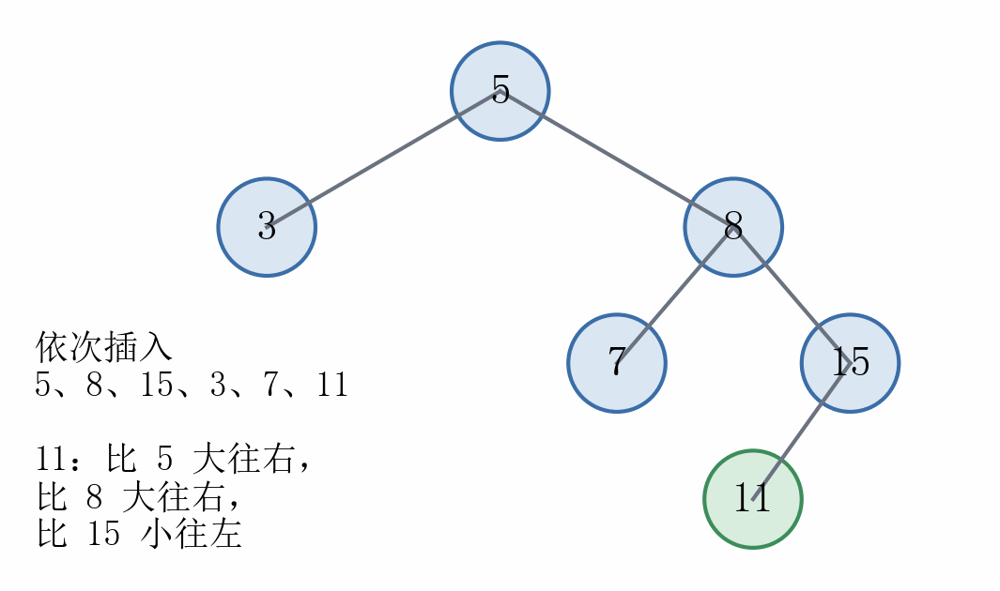


插入可以只用循环，不用递归。结点中除左右指针外再存父结点指针 `parent`，它的作用与双向链表中的 `pPrev` 相同，使后面的遍历也能只用循环沿树上下移动。

```c
struct TNode {
    int key;
    struct TNode *left, *right, *parent;
};

/* returns the new node, or NULL for a duplicate or allocation failure */
struct TNode *tree_insert(struct TNode **root, int key)
{
    struct TNode *parent = NULL;
    struct TNode **link = root;
    while (*link != NULL) {
        parent = *link;
        if (key == parent->key)
            return NULL;                       /* duplicate: ignore */
        link = key < parent->key ? &parent->left : &parent->right;
    }
    struct TNode *n = malloc(sizeof *n);
    if (n == NULL)
        return NULL;
    n->key = key;
    n->left = n->right = NULL;
    n->parent = parent;
    *link = n;                                 /* hang it in the empty slot */
    return n;
}
```

`link` 是指向指针的指针，它始终指向“下一步要检查的那个指针变量”：开始时指向 `root` 本身，以后指向某个结点的 `left` 或 `right` 成员。循环结束时 `*link` 为 `NULL`，正是新结点应挂的位置，于是空树和非空树用同一句 `*link = n;` 处理，不需要单独判断根。这与第十章用二级指针在函数中修改调用者的指针是同一个道理。

**两种平衡。** 插入顺序不利时，树会变成一边很长的链，例如按升序插入 1、2、3、4，每个结点只有右子，查找退化为逐个比较。平衡就是限制这种偏斜，常见的标准有两种：

1. 按层数平衡（по количеству уровней）：每个结点左右子树的高度差不超过 1。
2. 按元素个数平衡（по количеству элементов）：每个结点左右子树中的结点个数差不超过 1。

课堂作业要求的是第二种。两者并不相同：若根的左子树是含 3 个结点的满二叉树（高 2），右子树只有 1 个结点（高 1），则高度差为 1，按层数是平衡的；但结点数为 3 与 1，相差 2，按个数不平衡。按个数平衡的树一定按层数平衡，反之不一定。

上面由 5、8、15、3、7、11 建成的树中，根 5 的左子树 1 个结点、右子树 4 个结点，按个数不平衡。六个键排序后为 3、5、7、8、11、15，取中间的 7 作根，左边 {3, 5}、右边 {8, 11, 15}，个数为 2 与 3；再在每一侧同样取中间元素作子树的根：左侧以 5 为根、3 为其左子，右侧以 11 为根、8 和 15 为左右子。检查每个结点，左右子树个数之差分别为 1（结点 7）、1（结点 5）、0（结点 11）以及叶结点的 0，全部满足要求。判断时若在每个结点中再存以它为根的子树结点数 `count`，就不必每次重新数，插入时沿途各祖先的 `count` 各加一即可。

**横向打印树。** 在终端中把树横过来打印最简单：根在最左列，深一层多缩进 4 格，右子树印在上方，左子树印在下方，把头向左偏过去看，就是通常画法的树。打印次序是“右子树、结点本身、左子树”，即中序遍历的逆序。利用父指针，不用递归和栈也能完成：记住上一步从哪个结点来，就能判断现在是刚从父结点下来、从右子树返回还是从左子树返回。

```c
void tree_print(const struct TNode *root)
{
    const struct TNode *p = root, *prev = NULL;
    int depth = 0;
    while (p != NULL) {
        if (prev == p->parent && p->right) {        /* go right first */
            prev = p; p = p->right; depth++;
            continue;
        }
        if (prev == p->parent || prev == p->right) { /* right side finished */
            printf("%*s%d\n", 4 * depth, "", p->key);
            if (p->left) { prev = p; p = p->left; depth++; continue; }
        }
        prev = p; p = p->parent; depth--;           /* whole subtree finished */
    }
}
```

`printf("%*s", w, "")` 用 `*` 从参数中取宽度 `w`，打印 `w` 个空格。对上面未平衡的树，追踪如下：从 5 下行，有右子先到 8，再到 15；15 没有右子，印出 15（深度 2），转到左子 11，印出 11（深度 3）后返回 15；从左子返回说明 15 的子树已完成，再返回 8；从右子返回，印出 8（深度 1），转到左子 7，印出 7 后返回；8 的子树完成，返回 5，印出 5，转到 3，印出 3，最后从 5 返回到 `NULL`，循环结束。输出为

```
        15
            11
    8
        7
5
    3
```

每个结点最多被经过三次（下来一次、从两侧各返回一次），时间与结点数成正比。父指针在根结点处为 `NULL`，初值 `prev = NULL` 恰好表示“从根的父结点下来”，所以根不需要特殊处理。该函数与插入函数均为本教材补写的示范实现，已与下面的平衡函数一起放入测试程序编译运行（见本节末说明）。

**按元素个数平衡的实现。** 课堂作业的完整要求是：生成 30 至 50 个 0 到 1000 之间的随机数，依次插入树中（相等的忽略），然后按元素个数把树调平衡并打印；整个过程不得使用递归，也不得使用额外数组（дополнительные массивы）。下面把它分成结点计数、挪动一个键、自顶向下调整、无递归遍历与释放几部分讲解。

先给结点增加计数字段 `count`，表示以该结点为根的子树中共有几个键（包括它自己）。叶结点的 `count` 为 1；其余结点满足“`count` 等于左子的 `count` 加右子的 `count` 再加 1”，根的 `count` 就是整棵树的键数。有了它，比较左右两侧的个数只需读两个整数，不必每次把子树重新数一遍。空子树对应空指针，对空指针使用 `->` 会使程序崩溃，所以读取个数时先经过一个小函数，把空子树的个数定为 0：

```c
struct TNode {
    int key;
    int count;                         /* nodes in the subtree rooted here */
    struct TNode *left, *right, *parent;
};

int cnt(const struct TNode *n)
{
    if (n == NULL)
        return 0;                      /* empty subtree holds no keys */
    return n->count;
}
```

前面的 `tree_insert` 只需在 `*link = n;` 之后补两步：新结点的 `count` 置 1；再沿父指针从 `parent` 一直走到根，把每个祖先的 `count` 加 1，因为它们的子树里都多了一个键。

```c
    n->count = 1;
    for (struct TNode *q = parent; q != NULL; q = q->parent)
        q->count++;                   /* each ancestor gains one */
```

平衡的基本动作是把一个键从较重的一侧挪到较轻的一侧，同时不破坏左小右大的规则。以结点 \(x\) 的右侧过重为例，步骤如下：

1. 在右子树中一直向左走，找到右子树里最小的结点 \(p\)。它的键是全树中紧跟在 \(x\) 的键之后的那个键，称为 \(x\) 的中序后继。
2. 把 \(p\) 从原位置摘下。\(p\) 没有左子，只需让它的右子（可能为空）接替它在父结点下的位置；从 \(p\) 的父结点到 \(x\) 之前的各结点 `count` 减 1。
3. 交换 \(x\) 与 \(p\) 的键：后继的键升到 \(x\) 处，\(x\) 原来的键交给 \(p\)。
4. 把 \(p\) 作为叶结点挂到左子树的最右端，也就是左子树中最大的位置；左子树为空时直接作 \(x\) 的左子。沿途各结点 `count` 加 1。

这一步为什么不破坏顺序？把全部键从小到大排成一列（中序序列），\(x\) 原来的键记为 \(a\)，后继的键记为 \(b\)，二者在序列中相邻。挪动之前，左子树的键都小于 \(a\)，右子树的键都不小于 \(b\)；挪动之后，\(a\) 成为左子树中最大的键，\(b\) 处在 \(x\)，右子树只少了 \(b\)。从左往右读，仍是“左子树原有的键、\(a\)、\(b\)、右子树其余的键”，序列完全不变，所以平衡只改变结点之间的上下关系，不改变从小到大的次序。插入的先后次序本来就不由树保存：同一组数按不同次序插入，长成的树形状不同，平衡后也看不出原来的插入次序；若需要保留，应在结点中另设字段记录序号。

挪动一次，较重一侧少 1 个，较轻一侧多 1 个，两侧之差减少 2；重复挪动，直到差不超过 1。左侧过重的情形完全对称：把 `left` 与 `right`、“最左”与“最右”对调即可。

```c
struct TNode *leftmost(struct TNode *n)
{
    while (n->left != NULL)
        n = n->left;
    return n;
}

struct TNode *rightmost(struct TNode *n)
{
    while (n->right != NULL)
        n = n->right;
    return n;
}

/* right side of x is too heavy: move one key to the left side */
void move_right_to_left(struct TNode *x)
{
    struct TNode *p = leftmost(x->right);      /* smallest key on the right */

    /* unhook p; it has no left child, its right child takes its place */
    struct TNode *par = p->parent, *child = p->right;
    if (par->left == p)
        par->left = child;
    else
        par->right = child;
    if (child != NULL)
        child->parent = par;
    for (struct TNode *q = par; q != x; q = q->parent)
        q->count--;

    /* exchange keys: the successor rises into x */
    int old = x->key;
    x->key = p->key;
    p->key = old;

    /* p, now holding the old key of x, becomes the largest on the left */
    p->left = p->right = NULL;
    p->count = 1;
    if (x->left == NULL) {
        x->left = p;
        p->parent = x;
    } else {
        struct TNode *m = rightmost(x->left);
        m->right = p;
        p->parent = m;
        for (struct TNode *q = m; q != x; q = q->parent)
            q->count++;
    }
}
```

摘下 \(p\) 时，若 \(p\) 恰好就是 \(x\) 的右子，它的父结点就是 \(x\)，`count` 的循环一次也不执行，`par->right = child` 让 \(p\) 的右子直接接到 \(x\) 下面，这种情形不需要单独处理。\(x\) 本身的 `count` 在整个过程中不变，因为子树里键的总数没有变化。

整棵树的调整从根开始自顶向下进行：先把当前结点调到左右个数之差不超过 1，再处理它的子结点，即按先序（自己、左子树、右子树）的次序访问。这样做是正确的，因为在某个结点 \(x\) 内部挪动键，只改变 \(x\) 子树内部各结点的计数，\(x\) 的祖先左右两侧的个数都不受影响，已经调好的上层结点不会被下层的调整重新打乱。先序的“下一个结点”同样可以借父指针用循环求出：有左子先去左子，没有左子而有右子就去右子；两者都没有时沿父指针上行，直到某个祖先的左子树刚刚走完且它有右子，就转到那个右子；一直上行到根之上仍找不到，遍历结束。

```c
/* preorder successor: node, left subtree, right subtree */
struct TNode *next_preorder(struct TNode *n)
{
    if (n->left != NULL)
        return n->left;
    if (n->right != NULL)
        return n->right;
    while (n->parent != NULL) {
        struct TNode *par = n->parent;
        if (par->left == n && par->right != NULL)
            return par->right;                 /* left side done: go right */
        n = par;
    }
    return NULL;                               /* back above the root */
}

void tree_balance(struct TNode *root)
{
    for (struct TNode *n = root; n != NULL; n = next_preorder(n)) {
        while (cnt(n->left) > cnt(n->right) + 1)
            move_left_to_right(n);
        while (cnt(n->right) > cnt(n->left) + 1)
            move_right_to_left(n);
    }
}
```

挪动只交换键、改挂叶结点，根结点本身始终是同一个结点，所以 `tree_balance` 不需要修改调用者的根指针。

**例题** 把前面由 5、8、15、3、7、11 建成的树按元素个数平衡，写出每一次挪动。

解：从根 5 开始，左侧 1 个（3），右侧 4 个（8、7、15、11），右侧过重。右子树中最小的结点是 7，把它摘下，键 7 升到根，原来的键 5 挂到左子树最大的位置，即 3 的右子。此时根 7 左侧 2 个（3、5），右侧 3 个（8、15、11），差 1，满足要求。

按先序转到结点 3：左侧 0 个，右侧 1 个，满足；结点 5 是叶结点。再转到结点 8：左侧 0 个，右侧 2 个（15、11），右侧过重。右子树中最小的是 11（15 的左子），把它摘下，键 11 升到 8 的位置，原来的键 8 因左侧为空，直接成为它的左子。此时该结点左右各 1 个；之后访问的 8、15 都是叶结点，调整结束。

验算：平衡后根 7 的左右个数为 2 与 3，结点 3 为 0 与 1，结点 11 为 1 与 1，叶结点均为 0 与 0，每处之差都不超过 1；中序序列仍为 3、5、7、8、11、15；树高由 4 层降为 3 层。用前面的 `tree_print` 打印：

```
        15
    11
        8
7
        5
    3
```

这棵树与前面取中间元素得到的形状不同：那里 5 为子树根、3 为其左子，这里 3 为子树根、5 为其右子。两者都满足按个数平衡的要求，平衡后的形状一般不唯一。

**两侧通用的挪动函数。** `move_right_to_left` 与 `move_left_to_right` 只有方向不同，可以合并成一个函数 `move_key(x, p)`：由调用者先选好要挪走的结点 \(p\)（右侧过重时取右子树最左的结点，左侧过重时取左子树最右的结点），函数本身不再区分左右。合并的关键在于下面三点观察：

1. 被选中的 \(p\) 是某棵子树的最左或最右结点，所以它至多只有一个孩子：最左结点没有左子，最右结点没有右子。摘下 \(p\) 时，用“有左子取左子，否则取右子（可能为空）”找出这个孩子，让它接替 \(p\) 的位置，两种情形用同一段代码。
2. 交换 \(x\) 与 \(p\) 的键，这一步本来就与方向无关。
3. \(x\) 原来的键 \(a\) 不必再指定挂到“左子树最右端”还是“右子树最左端”，而是从 \(x\) 出发按插入的规则往下走：比当前结点的键小就向左，否则向右，走到空位就把 \(p\) 挂上。

第 3 点为什么一定挂到较轻一侧、紧挨着 \(x\) 的位置？以右侧过重为例，交换后 \(x\) 的键变成后继 \(b\)，而 \(a<b\)，所以第一步向左进入左子树；左子树中的键都小于 \(a\)，此后每一步都向右，最终落在左子树的最右端，正是原来第 4 步指定的位置。左侧过重时，交换后 \(x\) 的键是前驱 \(c\)，\(a>c\)，第一步向右进入右子树，此后一直向左，落在右子树的最左端。可见“从 \(x\) 往下按插入规则走”自动完成了方向判断。摘下与挂上之后，各沿父指针修正 `count`：摘下时从 \(p\) 原来的父结点到 \(x\) 之前各减 1，挂上时从新父结点到 \(x\) 之前各加 1，\(x\) 本身的 `count` 不变。

```c
/* move the key of p (leftmost of x's right subtree, or rightmost of
   x's left subtree) to the other side of x; works for both sides */
void move_key(struct TNode *x, struct TNode *p)
{
    /* (1) unhook p: it has at most one child */
    struct TNode *par = p->parent;
    struct TNode *child = p->left;
    if (child == NULL)
        child = p->right;
    if (par->left == p)
        par->left = child;
    else
        par->right = child;
    if (child != NULL)
        child->parent = par;
    for (struct TNode *q = par; q != x; q = q->parent)
        q->count--;

    /* (2) swap keys: p's key rises into x */
    int old = x->key;
    x->key = p->key;
    p->key = old;

    /* (3) hang p back as a leaf, walking down from x like an insertion */
    p->left = NULL;
    p->right = NULL;
    p->count = 1;
    struct TNode *cur = x, *last = x;
    while (cur != NULL) {
        last = cur;
        if (old < cur->key)
            cur = cur->left;
        else
            cur = cur->right;
    }
    if (old < last->key)
        last->left = p;
    else
        last->right = p;
    p->parent = last;
    for (struct TNode *q = last; q != x; q = q->parent)
        q->count++;
}
```

**先判断哪侧重，再只朝一个方向挪。** 前面的 `tree_balance` 对每个结点写了两个 `while`，先处理左侧过重，再处理右侧过重。其实对同一个结点，这两个循环最多只有一个真正执行。设某结点左侧 \(L\) 个、右侧 \(R\) 个，且左侧过重，即 \(L-R\ge 2\)。每挪一次，\(L\) 减 1、\(R\) 加 1，差值变为

\[
(L-1)-(R+1)=(L-R)-2 .
\]

差值每次减少 2，从不小于 2 的值出发，第一次降到 1 或 0 时循环即停，不会降为负数，也就不会“挪过头”变成右侧过重。所以只需在开始时判断一次哪侧重，之后一直朝较轻的一侧挪：

```c
int tree_balance(struct TNode *root)
{
    int moves = 0;
    for (struct TNode *n = root; n != NULL; n = next_preorder(n)) {
        if (cnt(n->left) > cnt(n->right)) {            /* left side heavier */
            while (cnt(n->left) > cnt(n->right) + 1) {
                move_key(n, rightmost(n->left));        /* biggest left key */
                moves++;
            }
        } else {                             /* right heavier or equal */
            while (cnt(n->right) > cnt(n->left) + 1) {
                move_key(n, leftmost(n->right));        /* smallest right key */
                moves++;
            }
        }
    }
    return moves;
}
```

两侧相等时进入 `else` 分支，循环条件一开始就不成立，一次也不挪。这个版本返回挪动的总次数，便于打印每次平衡做了多少工作。对前面的例题，它与两个 `while` 的写法挪动的键与次序完全相同，结果仍是上面那棵根为 7 的树。

**不用递归遍历与释放。** 除先序后继外，按从小到大的次序访问也只靠父指针。结点 \(n\) 的中序后继这样求：有右子树时，后继是右子树的最左结点；没有右子树时，沿父指针上行，直到某一步是从左子回到父结点，这个父结点就是后继；若一直从右子上行到根之上，说明 \(n\) 已是最大键。释放整棵树时，从根出发，有左子就下到左子，否则有右子就下到右子；两者都没有便是叶结点，先把父结点中指向它的指针置空，再释放它，然后回到父结点继续。每个结点最终都会变成叶结点而被释放。

```c
/* inorder successor: the next larger key */
struct TNode *next_inorder(struct TNode *n)
{
    if (n->right != NULL)
        return leftmost(n->right);
    while (n->parent != NULL && n->parent->right == n)
        n = n->parent;
    return n->parent;
}

void tree_free(struct TNode **root)
{
    struct TNode *n = *root;
    while (n != NULL) {
        if (n->left != NULL)
            n = n->left;
        else if (n->right != NULL)
            n = n->right;
        else {                         /* leaf: cut off, go up */
            struct TNode *par = n->parent;
            if (par != NULL) {
                if (par->left == n)
                    par->left = NULL;
                else
                    par->right = NULL;
            }
            free(n);
            n = par;
        }
    }
    *root = NULL;
}
```

`tree_free` 接收根指针的地址，释放完把调用者的根指针置空，避免留下悬空指针，道理与第十章相同。

**生成随机数与“不用额外数组”。** 键的个数用 `30 + rand() % 21` 得到，取值 30 到 50；每个键用 `rand() % 1001` 得到，取值 0 到 1000。程序开头用 `srand` 设定随机种子，以当前时间 `time(NULL)` 为种子时每次运行结果不同，固定种子时结果可以重复，便于检查。

```c
srand((unsigned)time(NULL));
int n = 30 + rand() % 21;                  /* 30..50 keys */
for (int i = 0; i < n; i++)
    tree_insert(&root, rand() % 1001);     /* 0..1000; duplicates ignored */
tree_balance(root);
tree_print(root);
tree_free(&root);
```

“额外数组”指树本身以外、另开来保存或辅助处理数据的数组，一个也不允许用。因此每生成一个数就必须立刻插入树中：变量只能存一个数，下一次生成时上一个数就被覆盖，树本身就是存放这些数的地方。题目中的“生成”和“插入”说的是要完成的两件事，而不是先全部生成、再统一插入。用数组临时存数、把数组排序后取中间元素建树、用数组模拟栈或队列来遍历树，都属于违反要求的做法。

若允许使用数组，确有“一开始就平衡”的建法：先把全部键排序，取中间的键作根，再对左右两半分别重复同样的做法。它需要排序数组，一般还要递归，正是作业禁止的两样，所以作业的思路是先插入、后调整。另一种做法是边插边平衡：每插入一个新键就调用一次 `tree_balance`，树在任何时刻都按个数平衡，适合键不断加入、中途还要查找的场合。实际使用的平衡树（如 AVL 树、红黑树）沿用这一思路，但每次插入只做常数次局部调整，效率比这里的整树检查高得多。

**边插边平衡与插完再平衡的比较。** 作业的一种具体安排是：先生成并插入 3 个数，平衡一次；此后每生成一个数就插入、平衡一次，每一步打印插入后与平衡后两张图。在 `main` 的循环中，用 `i >= 2` 判断“前 3 个数已经插入”，从这时起每轮都调用 `tree_balance`。两种做法得到的树有哪些相同、哪些不同，可以从按个数平衡的树本身的性质说明。

先看相同之处。设某结点的子树共有 \(n\) 个键，除去它自己还剩 \(n-1\) 个分给左右两侧，两侧之差不超过 1：

- \(n-1\) 为偶数时只能对半分，两侧各 \(\frac{n-1}{2}\) 个；
- \(n-1\) 为奇数时只能分成 \(\frac{n-2}{2}\) 与 \(\frac{n}{2}\)，较多的一个可以在左，也可以在右。

所以每棵子树的大小几乎是确定的，层数也就确定。记 \(n\) 个键按个数平衡后的层数为 \(h(n)\)，较大一侧有 \(\lceil \frac{n-1}{2}\rceil\) 个键，于是

\[
h(1)=1,\qquad h(n)=1+h\!\left(\left\lceil \frac{n-1}{2}\right\rceil\right)\quad(n\ge 2).
\]

逐个代入：\(h(2)=h(3)=2\)，\(h(4)=\dots=h(7)=3\)，\(h(8)=\dots=h(15)=4\)。一般地，\(2^{k-1}\le n<2^k\) 时 \(h(n)=k\)，即

\[
h(n)=\lfloor \log_2 n\rfloor+1 .
\]

验证这一公式只需检查递推：若 \(2^{k-1}\le n<2^k\)（\(k\ge 2\)），则 \(2^{k-1}-1\le n-1\le 2^k-2\)，除以 2 再向上取整得 \(2^{k-2}\le \lceil \frac{n-1}{2}\rceil\le 2^{k-1}-1\)，较大一侧的层数为 \(k-1\)，加上根这一层正好是 \(k\)。因此不论用哪种次序插入、哪种时机平衡，只要最后每个结点都满足按个数平衡，树高就相同，而且是 \(n\) 个结点的二叉树所能达到的最小高度；中序序列也相同，都是全部键从小到大排列。

不同之处只在“剩奇数个”的结点：多出来的那一个放在左侧还是右侧，取决于插入与挪动的先后，两种做法常常选得不同，于是形状不同。挪动次数也不同：边插边平衡时，已经调好的树每插入一个新键又可能被打破，需要再调，总的挪动次数更多；换来的是树在任何时刻都保持平衡。

**例题** 把 5、8、15、3、7、11 按“先插入 3 个、平衡一次，之后每插入 1 个平衡一次”的方式建树，写出每次平衡的结果，并与全部插入后再平衡的结果比较。

解：插入 5、8、15 后，树是向右的一条链。根 5 左侧 0 个、右侧 2 个，右侧过重，取右子树最小的 8，键 8 升到根，5 从根往下按插入规则走到左侧空位。挪动 1 次，得到根 8、左子 5、右子 15。

插入 3：3 挂在 5 的左侧。根 8 左侧 2 个（5、3），右侧 1 个，差 1；结点 5 左侧 1 个、右侧 0 个，差 1。不需要挪动。

插入 7：7 比 8 小、比 5 大，挂在 5 的右侧。根 8 左侧 3 个（5、3、7），右侧 1 个，左侧过重。取左子树最大的结点 7，把它摘下（它是 5 的右子，没有孩子），键 7 升到根，原来的键 8 从根往下走：8 大于 7 向右，小于 15 向左，左侧为空，挂为 15 的左子。挪动 1 次后根 7 左侧 2 个（5、3），右侧 2 个（15、8）；结点 5 左 1 右 0，结点 15 左 1 右 0，都满足要求。

插入 11：11 大于 7 向右，小于 15 向左，大于 8 向右，挂为 8 的右子。根 7 左侧 2 个、右侧 3 个，差 1，满足；按先序转到结点 5，满足；转到结点 15，左侧 2 个（8、11），右侧 0 个，左侧过重。取左子树最大的 11 摘下，键 11 升到 15 的位置，原来的键 15 往下走，大于 11 向右，右侧为空，挂为 11 的右子。挪动 1 次，调整结束。

最终的树为

```
        15
    11
        8
7
    5
        3
```

验算：中序序列 3、5、7、8、11、15，与全部插入后再平衡相同；树高 3 层，等于 \(\lfloor \log_2 6\rfloor+1=3\)，也相同。四次平衡共挪动 3 次（1、0、1、1），全部插入后再平衡只挪 2 次。两棵树右侧完全一样；左侧在这里是 5 为子树根、3 为其左子，在前面的例题中是 3 为子树根、5 为其右子。6 个键的根下剩 5 个，只能分成 2 与 3，两棵树都是左 2 右 3，差别出在结点“3、5”这棵 2 个键的子树里：剩下的 1 个放在左侧还是右侧。两种结果都满足要求。

用测试程序对 1 至 10000 号随机种子各生成 30 至 50 个键，同时按两种方式建树（测试结果，不是课堂数据）：树高 10000 次全部相同，且都等于 \(\lfloor \log_2 n\rfloor+1\)；两棵树形状完全相同的只有 721 次，约 7%；平均挪动次数，边插边平衡约 58.6 次，插完再平衡约 38.5 次。

本节的插入、横向打印、计数维护、挪动、先序调整、中序后继和释放函数，于 2026-11-05 一并放入测试程序，用 MSVC（/W4）编译无警告并实际运行：黑板例子的输出与上文一致；另用 1 至 3000 号随机种子各生成 30 至 50 个键，分别检验“全部插入后再平衡”和“每插入一个就平衡”两种方式，每次都核对中序严格递增、各结点 `count` 正确、左右个数之差不超过 1 以及父指针一致，全部通过。左侧过重的 `move_left_to_right` 按对称关系写出，同样参与了上述测试。两侧通用的 `move_key`、先判断重侧的 `tree_balance` 与“先插 3 个、之后逐个插入并平衡”的流程，于 2026-11-19 与作业程序一起用 MSVC（/W4）编译运行：上面例题每一步的挪动次数与打印出的树与正文一致，10000 组随机数据每次平衡后左右个数之差都不超过 1。

### 共用体与枚举

共用体（`union`）的写法与结构体相似，但所有成员共用同一块存储空间，大小等于最大成员的大小，同一时刻只有最后存入的那个成员有意义：

```c
union Number {
    int i;
    float f;
};
```

`sizeof(union Number)` 为 4。若先给 `u.i` 赋值，再给 `u.f` 赋值，`u.i` 原来的内容就被覆盖了。共用体用于节省空间，或者让同一块数据有几种解释方式，初学阶段使用较少。

枚举（`enum`）为一组整数常量起名字，使程序更易读：

```c
enum Color { RED, GREEN = 5, BLUE };
```

未指定值的枚举常量从零开始，每个比前一个大一；指定了值的从该值继续。所以这里 `RED` 为 0，`GREEN` 为 5，`BLUE` 为 6。枚举常适合表示有限几种状态，例如 `enum State { IDLE, RUNNING, STOPPED };`，比直接写 0、1、2 更不容易出错。

本章结构体、链表、共用体和枚举的代码已于 2026-10-28 合成一个测试程序，用 Visual Studio 18 的 MSVC 按 C（/TC）、/W4 编译并运行，输出与正文所列结果一致。按 C++ 编译时，`malloc` 返回的 `void *` 不能隐式转换为 `struct Node *`，需要写强制转换；这是 C 与 C++ 的差别，本册按 C 语言书写。

## 第十六章 文件与命令行参数

程序运行结束后，变量中的数据就消失了。要长期保存数据，或者处理大量的输入数据，就需要读写文件。俄语课程把这一章称为“文件操作”（работа с файлами），先讲文件在磁盘上怎样存放、怎样用路径找到它，再讲 C 的读写函数。前一部分解释了后一部分的许多设计：为什么文件函数要带缓冲区，为什么可以跳到文件的任意位置读写，为什么相对路径有时找不到文件。

### 文件在磁盘上的存储

磁盘（диск）是关机后仍能保存数据的外部存储器。机械硬盘（жёсткий диск，HDD）由一张或几张带磁性涂层的盘片组成，数据以磁化方向记录为 0 和 1。盘片表面划分成一圈圈同心圆，称为磁道（дорожка）；每条磁道再分成若干段，称为扇区（сектор）。扇区是硬件一次读写的最小单位，传统大小为 512 字节，较新的硬盘也有 4096 字节的扇区。多张盘片上同一半径的磁道合称柱面（цилиндр）。读一个扇区要先把磁头移到对应磁道（寻道），再等盘片转到该扇区（旋转延迟），这两段机械等待远比内存访问慢。光盘的数据不是同心圆，而是从中心向外的一条螺旋轨道（спиральная дорожка），适合从头到尾连续读取。

扇区太小，若文件系统逐个扇区地记录文件占用哪些位置，管理表会非常庞大。因此文件系统把若干个相邻扇区合成一个簇（кластер），作为给文件分配空间的最小单位。课堂上的取值是

\[
1\ \text{簇}=4\ \text{KB}=4096\ \text{B}=8\times512\ \text{B}=8\ \text{个扇区}.
\]

一个簇只能属于一个文件，即使文件只用到其中一个字节。所以文件占用的磁盘空间是簇大小的整数倍：若文件大小为 \(S\)、簇大小为 \(C\)，所需簇数为 \(\lceil S/C\rceil\)（向上取整），占用空间为 \(\lceil S/C\rceil\cdot C\)。

**讲解例：文件大小与占用空间。** 簇大小为 4 KB，文件大小为 12.5 KB。所需簇数为 \(\lceil 12.5/4\rceil=\lceil3.125\rceil=4\)，占用空间为 \(4\times4=16\) KB，最后一个簇只用了 \(12.5-12=0.5\) KB，空出的 \(16-12.5=3.5\) KB 别的文件也不能使用。这部分称为簇内浪费（slack space）。验算：前三个簇恰好装下 12 KB，剩余 0.5 KB 必须另占一个簇，与向上取整的结果一致。Windows 文件属性中“大小”与“占用空间”两个数不同，原因就在这里。

簇的大小是一种折中。每个文件的最后一个簇平均大约空出半个簇，所以簇越大，平均浪费越多：一万个小文件在 4 KB 簇下约浪费 \(10000\times2\) KB \(\approx20\) MB，在 64 KB 簇下约浪费 \(10000\times32\) KB \(\approx320\) MB。簇越小，簇的总数越多，记录簇的表越大，大文件也被拆成更多块，管理开销随之增大。常见的折中取值是 4 KB。

文件系统（файловая система）要记录每个文件由哪些簇组成。FAT 文件系统用一张文件分配表（таблица размещения файлов），表中每个簇对应一项，写着该文件的下一个簇的编号，最后一个簇写结束标记，于是一个文件的各簇像链表（第十五章）一样串起来；目录项中记录文件名和第一个簇的编号。Windows 现在使用的 NTFS 用更复杂的主文件表记录同样的信息。

文件被反复创建、删除和加长之后，空闲簇会变得零散，新文件只能拆开放进各处空隙，同一文件的簇不再相邻，这称为碎片化（фрагментация）。读这样的文件时，机械硬盘的磁头要来回寻道，速度变慢。碎片整理（дефрагментация）把同一文件的簇搬到一起连续存放。固态硬盘没有机械磁头，碎片对它的影响很小，一般不需要整理。

### 目录树与路径

目录（каталог，也称文件夹）中可以存放文件和下一级目录，所以整个磁盘的组织是一棵树（дерево）：盘符 `C:` 是根，目录是分支，文件是叶子。从根沿分支走到某个文件所经过的目录序列，就是该文件的路径（путь）。下面的讨论都以这棵示意目录树为例，其中 `b`、`d`、`i` 是目录，`g`、`k`、`l` 是文件：

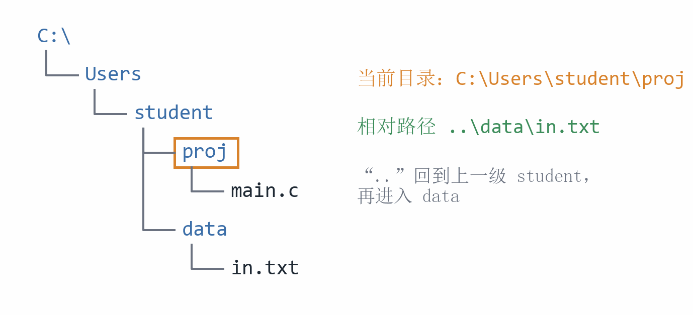


```text
C:
├── a
├── b
│   ├── e
│   ├── f
│   └── g
├── c
└── d
    ├── h
    ├── i
    │   ├── k
    │   └── l
    └── j
```

路径中的分隔符有两种写法。正斜杠 `"C:/b/g"` 在 Windows、Linux 和 macOS 上都能识别；反斜杠只有 Windows 识别，而且在 C 字符串中必须写成两个，即 `"C:\\b\\g"`，因为单个反斜杠与后面的字母组成转义字符。若误写成 `"C:\b\g"`，其中 `\b` 被编译为退格字符，路径就错了。写可移植的程序时，用正斜杠更省事。

从盘符（根）开始写出的路径称为绝对路径（абсолютный путь），无论程序在哪里运行，它都指向同一个文件。不从根开始的路径称为相对路径（относительный путь），它从程序的当前工作目录（текущий рабочий каталог）出发解析。相对路径中有两个特殊名字：

- `.` 表示当前目录本身，写在开头只是强调“从这里出发”，`".\\..\\d\\i\\l"` 与 `"..\\d\\i\\l"` 意义相同。
- `..` 表示上一级目录（父目录），每出现一次就向根退一层。
- 以分隔符开头而不带盘符的路径，如 `"\\abc"`，从当前盘的根目录开始，若当前盘为 C，就等于 `"C:\\abc"`。

**讲解例：解析相对路径。** 设当前目录为 `C:\d`。`"i\\k"` 先进入 `i` 再找 `k`，得到 `C:\d\i\k`；`"..\\b\\g"` 先退到 `C:`，再进入 `b`，得到 `C:\b\g`。路径 `"..\\a\\b\\..\\..\\..\\d"` 按顺序逐步解析：先上一级，再进入 `a`、`b` 两层，随后的两个 `..` 正好退回进入 `a` 之前的位置，再一个 `..` 又上一级，最后进入 `d`。进入后又退出的两层互相抵消，整条路径化简为 `"..\\..\\d"`，即向上两级再进入 `d`。验算：上升三次、下降两次，净上升一级后进入 `d`，与“上两级再进一级”的层数一致。

早期 DOS 与 FAT 文件系统规定文件名不超过 8 个字符、扩展名不超过 3 个字符，称为 8.3 格式，例如 `myprog12.exe`。目录项中名字与扩展名分别占固定的 8 个与 3 个字节，不足部分用空格补齐，中间的点不存储。现在的 NTFS 支持长文件名，但旧程序中 `PROGRA~1` 这类短名就是这一格式留下的。若在 C 中保存 `"myprog12.exe"`，字符串有 12 个可见字符，数组至少要 13 个元素，留出结尾的 `'\0'`。

### 当前工作目录：getcwd 与 chdir

相对路径从当前工作目录出发，所以程序需要能查看和改变这个目录。查看用 `getcwd`（get current working directory），改变用 `chdir`（change directory）。在 Linux 和 macOS 上，它们声明在 `<unistd.h>` 中；在 Visual Studio 中应使用带下划线的 `_getcwd` 和 `_chdir`，头文件为 `<direct.h>`，参数和用法相同。

```c
char *_getcwd(char *buf, int size);
int   _chdir(const char *path);
```

`buf` 是调用者事先准备好的字符数组，函数把当前目录的路径字符串写进去；`size` 是该数组的容量，防止路径过长时写出数组边界。成功时返回 `buf`，失败（例如数组太小）时返回 `NULL`。C 没有能自动变长的字符串类型，函数也不能替调用者凭空分配一块长期有效的存储，所以采用“调用者提供缓冲区、同时告知容量”的约定，这与 `fgets`（下文）以及第八章的字符串函数一致。`_chdir` 成功时返回 0，失败（例如目录不存在）时返回 -1；它只改变本程序自己的当前目录，程序结束后不影响命令行窗口或其他程序。

```c
#include <stdio.h>
#include <string.h>
#include <direct.h>   /* Linux/macOS: <unistd.h>, getcwd, chdir */

int main(void)
{
    char buf[260];                       /* traditional MAX_PATH */
    if (_getcwd(buf, sizeof buf) == NULL)
        return 1;
    printf("%s\n", buf);                 /* e.g. C:\b */

    if (_chdir("..\\d\\i") == 0) {       /* relative to C:\b */
        _getcwd(buf, sizeof buf);
        printf("%s\n", buf);             /* C:\d\i */
        FILE *f = fopen("k", "r");       /* now means C:\d\i\k */
        if (f != NULL)
            fclose(f);
    } else {
        printf("no such directory\n");
    }
    return 0;
}
```

若以 `C:\b` 为当前目录运行，第一行输出 `C:\b`；`"..\\d\\i"` 先退到 `C:` 再进入 `d\i`，切换成功后第二行输出 `C:\d\i`，此后 `fopen("k", "r")` 打开的就是 `C:\d\i\k`。

取得当前目录后，还可以在其后接上文件名，拼成绝对路径：`buf` 为 `C:\a\b` 时，执行 `strcat(buf, "\\1.txt")` 后得到 `C:\a\b\1.txt`。拼接前必须确认数组剩余容量足够，否则会越界写入；更稳妥的写法是用 `snprintf(path, sizeof path, "%s\\%s", buf, "1.txt")` 生成到另一个数组中，它最多写入给定的字节数。

在集成开发环境中运行程序时，当前工作目录往往是项目文件夹，而不一定是 `.exe` 所在的文件夹。`fopen` 用相对路径打不开文件时，先用 `_getcwd` 打印当前目录，再核对文件实际放在哪里，往往就能找到原因。

### 文件的打开与关闭

C 语言通过 `FILE` 类型的指针操作文件。使用文件的基本步骤是：

1. 用 `fopen` 打开文件，得到 `FILE *` 指针。
2. 检查指针是否为 `NULL`；为 `NULL` 表示打开失败（文件不存在、路径错误、没有权限等）。
3. 用读写函数处理文件内容。
4. 用 `fclose` 关闭文件，把缓冲区中的数据真正写入磁盘，并释放系统资源。

```c
FILE *fp = fopen("scores.txt", "w");
if (fp == NULL) {
    perror("fopen");        /* print the reason of failure */
    return 1;
}
/* ... write ... */
fclose(fp);
```

`fopen` 的第二个参数是打开方式：

| 方式 | 含义 | 文件不存在时 | 文件已存在时 |
|---|---|---|---|
| `"r"` | 只读 | 打开失败，返回 `NULL` | 从头读 |
| `"w"` | 只写 | 新建 | 清空原内容 |
| `"a"` | 追加写 | 新建 | 在末尾继续写 |
| `"r+"` | 读写 | 打开失败 | 保留内容 |
| `"w+"` | 读写 | 新建 | 清空原内容 |
| `"a+"` | 读与追加写 | 新建 | 保留内容；可以移到任意位置读，但写入总在末尾 |

前三种方式中，`"r"` 是读（чтение），要求文件已经存在；`"w"` 是写（запись），文件不存在时新建，存在时截断为零字节；`"a"` 是追加（дозапись），新内容接在原内容之后。加 `+` 表示同一文件既可读又可写，`"r+"` 与 `"w+"` 的区别在于前者要求文件存在并保留内容，后者新建或清空。

在方式后面加 `b`（如 `"rb"`、`"wb"`）表示以二进制方式打开。用 `"w"` 打开已有的文件会立即清空它，这是最容易造成数据丢失的地方。文件名中的路径在 C 字符串里要写成双反斜杠，如 `"C:\\data\\a.txt"`，因为单个反斜杠会被当作转义字符的开始。MSVC 对 `fopen` 也会给出 C4996 提示，处理方法与 `scanf` 相同。

**文本方式与二进制方式。** 磁盘上的任何文件都只是一串字节，文本文件也不例外：字母 `A` 存为一个字节，数值 65，即二进制 01000001。`fopen` 不看扩展名，`.txt`、`.jpg`、`.exe` 都可以打开；两种方式的区别不在文件里存了什么，而在读写时是否改动字节。换行在不同系统中的表示不同：Windows 用回车（возврат каретки，ВК，`'\r'`，代码 13）加换行（перевод строки，ПС，`'\n'`，代码 10）两个字节，Linux 和 macOS 只用 `'\n'`。这两个名字来自打字机，回车把字头推回行首，换行把纸卷上一行。Windows 上以文本方式读写时，C 库自动转换：

1. 读入时，文件中的 `"\r\n"` 变成程序中的一个 `'\n'`。
2. 写出时，程序中的 `'\n'` 变成文件中的 `"\r\n"`。
3. 以二进制方式读写时，字节原样进出，不作任何转换。

因此程序内部始终只需处理 `'\n'`。图片、压缩包、可执行文件以及 `.doc`、`.pdf` 等文档必须用二进制方式处理：它们除文字外还保存字体、版式和压缩数据，其中恰好等于 13、10 的字节若被当作换行转换，文件就被破坏了。`.docx` 实际上是一个 ZIP 压缩包；用 `"rb"` 打开 PDF 读到的是这种原始字节，而不是阅读器中显示的页面。

`b` 可以接在任一方式之后，`"r+b"` 与 `"rb+"` 两种写法都合法。课堂上还写到 `"rt"`、`"wt"`，其中 `t` 明确表示文本方式，这是 Windows 编译器的扩展，标准 C 只规定 `b`，不写 `b` 即为文本方式。

`fclose` 的原型是 `int fclose(FILE *stream);`，成功时返回 0，失败时返回 `EOF`。关闭时它完成三件事：把缓冲区中尚未写出的数据写入磁盘，释放系统为该文件分配的资源（同时打开的文件数有上限），并解除对文件的占用（Windows 上未关闭的文件可能无法被其他程序删除或修改）。关闭后不能再通过该指针读写，同一指针不能关闭两次；`fopen` 返回 `NULL` 时也不要对它调用 `fclose`。写入重要数据时，可以检查 `fclose` 的返回值，以发现磁盘已满等写出失败的情况。

### 文本文件的读写

站在程序的角度，数据从外部进入变量都叫输入，也就是读；从变量送到外部都叫输出，也就是写。键盘与屏幕、磁盘文件都只是数据流动的通道，C 把它们统称为流（stream），这正是读写函数参数名 `stream` 的由来。`scanf` 从键盘这条流读，`fscanf` 从指定的文件流读；先用 `fprintf` 把变量写进文件，以后再用 `fscanf` 读回变量，数据就跨越了程序的多次运行。因此文本文件的读写函数与控制台输入输出一一对应，只是多了一个文件指针参数：

| 控制台 | 文件 | 作用 |
|---|---|---|
| `printf` | `fprintf(fp, ...)` | 按格式写 |
| `scanf` | `fscanf(fp, ...)` | 按格式读 |
| `putchar` / `getchar` | `fputc` / `fgetc` | 写、读一个字符 |
| `puts` | `fputs(s, fp)` | 写一个字符串 |
| `gets`（已废除） | `fgets(s, n, fp)` | 读一行 |

下面的程序先把三个学生的成绩写入文件，再读出来计算平均值：

```c
fprintf(fp, "Li 88.5\n");
fprintf(fp, "Wang 91.0\n");
fprintf(fp, "Zhao 76.0\n");
fclose(fp);

fp = fopen("scores.txt", "r");
if (fp == NULL)
    return 1;
char name[20];
double score, sum = 0.0;
int count = 0;
while (fscanf(fp, "%19s %lf", name, &score) == 2) {
    sum += score;
    count++;
}
fclose(fp);
printf("count = %d, average = %.2f\n", count, sum / count);
```

运行输出 `count = 3, average = 85.17`。读循环的条件是 `fscanf` 的返回值等于要读的项数，这与第一章检查 `scanf` 返回值的道理相同：读到文件末尾或数据格式不对时，返回值小于二，循环结束。`%19s` 限制最多读十九个字符，给结尾的 `'\0'` 留出位置，防止名字过长时越界。

一个常见的错误写法是 `while (!feof(fp))`。`feof` 只有在一次读取已经因为到达末尾而失败之后才返回真，所以这样写会在最后多执行一次循环体，使用一次没有读成功的数据。正确的做法始终是检查读取函数本身的返回值。

按行读取用 `fgets`，它最多读入 `n - 1` 个字符，并保留行末的换行符：

```c
char line[64];
while (fgets(line, sizeof line, fp) != NULL) {
    line[strcspn(line, "\n")] = '\0';   /* remove newline */
    printf("[%s]\n", line);
}
```

`strcspn(line, "\n")` 返回第一个换行符的位置（没有换行时返回字符串长度），把该位置改为 `'\0'` 就去掉了换行。`fgets` 在到达文件末尾时返回 `NULL`。

“一行”是按换行字符划分的：从当前位置读到第一个 `'\n'` 为止（含该字符）就是一行，与编辑器窗口的宽度和屏幕上的自动折行无关。文件内容为 `"Hello\nI love C\nBye"` 时，连续三次 `fgets` 依次得到 `"Hello\n"`、`"I love C\n"` 和 `"Bye"`，最后一行因为没有换行而不带 `'\n'`；若某行比数组还长，一次 `fgets` 只读入它的前 `n - 1` 个字符，余下部分留给下一次读取。与之配对的 `fputs(s, fp)` 把字符串原样写出，不自动加换行，成功时返回非负数，失败时返回 `EOF`。

**fgetc 为什么返回 int。** 逐字符读写的两个函数原型为

```c
int fgetc(FILE *stream);
int fputc(int c, FILE *stream);
```

`fgetc` 读到一个字节时返回该字节作为 `unsigned char` 的值，范围 0～255；读到文件末尾或出错时返回 `EOF`，通常为 -1。一个字节的 256 种取值都可能是合法数据，再加上“读完了”这一种状态，共有 257 种结果，`char` 只有 8 位，装不下，所以返回类型必须是 `int`，保存结果的变量也必须是 `int`：

```c
int c;                                   /* not char */
while ((c = fgetc(in)) != EOF)
    fputc(c, out);                       /* copy byte by byte */
```

俄语课堂的典型例子是字母 `я`。俄语 Windows 常用的 Windows-1251 编码中，`я` 的代码为 255，即二进制 11111111。若把 `fgetc` 的结果存进 `char`，在 `char` 为有符号类型的平台上（Visual Studio 与桌面 Linux 的 GCC 都是），这 8 个 1 按补码解释为

\[
11111111_2=-2^7+2^6+2^5+2^4+2^3+2^2+2^1+2^0=-128+127=-1 ,
\]

与 `EOF` 相等，循环在第一个 `я` 处提前结束，后面的内容全部丢失。用 `int` 保存时，`я` 是 \(0\cdots0\,11111111_2=255\)，`EOF` 是 32 位全为 1 的 -1，两者可以区分。注意出问题的是补码而不是反码：按反码规则，11111111 表示负零，不会与 -1 相撞；现代计算机都用补码表示有符号整数。

`char`、`signed char` 与 `unsigned char` 都占一个字节，区别只在最高位的解释：`unsigned char` 的范围是 0～255，最高位代表 128；`signed char` 的范围是 -128～127，最高位代表 -128。普通 `char` 有无符号由实现决定，许多 ARM 平台上 `char` 是无符号的，这时 `char c` 永远不等于 -1，上面的循环又会永不结束。两种情况都说明，`fgetc` 的结果只能存进 `int`。处理原始字节（如二进制数据、编码值）时，应明确使用 `unsigned char`。

### 二进制文件

文本文件把数据转换成字符保存，便于阅读；二进制文件把内存中的字节原样保存，读写更快、不损失精度，但用记事本打开看到的是乱码。二进制读写使用 `fwrite` 和 `fread`：

```c
int data[4] = {1, 2, 3, 4}, back[4] = {0};

fp = fopen("data.bin", "wb");      /* check fp != NULL as above */
size_t w = fwrite(data, sizeof data[0], 4, fp);
fclose(fp);

fp = fopen("data.bin", "rb");
size_t r = fread(back, sizeof back[0], 4, fp);
fclose(fp);
```

两个函数的参数依次是数据的地址、每个元素的字节数、元素个数和文件指针，返回值是实际读写的元素个数，应检查它是否等于要求的个数。本例中写入四个、读出四个，`back[3]` 为 4。二进制文件依赖于类型的大小和字节顺序，在不同平台之间交换时要特别注意。

**把二叉树存入文件。** 含指针的结构体不能直接用 `fwrite` 整块写入：指针保存的是本次运行时的内存地址，下次运行读回来，这些地址已经毫无意义；`char *name` 也只是地址，名字的字符本身在别处。保存一棵树，要把它的形状与内容按一个确定的次序“摊平”成字节序列，读的时候按同样的次序重建。常用做法是先序遍历（自己、左子树、右子树）：每个结点依次写编号、名字长度和名字的字符，空子树写一个不会作编号的标记 \(-1\)。结点结构为

```c
struct Node {
    int id;
    char *name;
    struct Node *L, *R;
};
```

保存与读取按同一次序进行，这里使用第四章的递归，比用父指针循环更短：

```c
/* preorder: id, length, characters; an empty subtree is written as -1 */
void tree_save(FILE *f, const struct Node *t)
{
    int mark = -1;
    if (t == NULL) {
        fwrite(&mark, sizeof mark, 1, f);
        return;
    }
    int len = (int)strlen(t->name);
    fwrite(&t->id, sizeof t->id, 1, f);
    fwrite(&len, sizeof len, 1, f);
    fwrite(t->name, 1, len, f);
    tree_save(f, t->L);
    tree_save(f, t->R);
}

/* read back in the same order; ids must not be -1 */
struct Node *tree_load(FILE *f)
{
    int id, len;
    if (fread(&id, sizeof id, 1, f) != 1 || id == -1)
        return NULL;
    if (fread(&len, sizeof len, 1, f) != 1)
        return NULL;
    struct Node *t = malloc(sizeof *t);
    if (t == NULL)
        return NULL;
    t->name = malloc(len + 1);
    if (t->name == NULL || fread(t->name, 1, len, f) != (size_t)len) {
        free(t->name);
        free(t);
        return NULL;
    }
    t->name[len] = '\0';
    t->id = id;
    t->L = tree_load(f);
    t->R = tree_load(f);
    return t;
}
```

读回时为每个结点重新 `malloc`，名字多分配一个字节放结尾的 `'\0'`，因为文件中只存了 `len` 个字符。重建的树与原树形状相同，结点却在新的地址上。先序次序加空标记能唯一确定形状：读到 \(-1\) 就知道这一侧为空，转去读另一侧；读到编号就知道后面紧跟这个结点的名字、左子树和右子树。

**讲解例：文件的大小。** 按编号 50、30、70、60 依次插入，名字为 Sidorov、John、Robert、Ivanov，得到根 50、左子 30、右子 70、70 的左子 60。先序写出的序列是：50 Sidorov，30 John，\(-1\)，\(-1\)，70 Robert，60 Ivanov，\(-1\)，\(-1\)，\(-1\)。在 `int` 为 4 字节时，4 个结点各写编号与长度共 \(4\times8=32\) 字节，名字字符共 \(7+4+6+6=23\) 字节；\(n\) 个结点的二叉树恰有 \(n+1\) 个空子树，标记共 \(5\times4=20\) 字节，合计 75 字节。程序写完后用 `ftell` 得到的长度也是 75，读回后先序打印 `(50 Sidorov (30 John - -) (70 Robert (60 Ivanov - -) -))` 与保存前一致。“\(n\) 个结点恰有 \(n+1\) 个空子树”是因为每个结点有两个子指针，共 \(2n\) 个，其中除根以外每个结点恰被一个指针指向，用掉 \(n-1\) 个，剩下 \(2n-(n-1)=n+1\) 个为空。

这两个函数与建树、打印、释放函数一起，于 2026-11-19 用 MSVC（/W4）编译运行，无警告，输出与上文一致。

### 文件定位与随机访问

每个打开的文件都有一个文件位置指示器，记录下一次读写从第几个字节开始（从 0 开始计数）；每读写一次，它自动向后移动所读写的字节数。俄语课程称这一部分为定位（позиционирование）。查看和移动位置的函数是

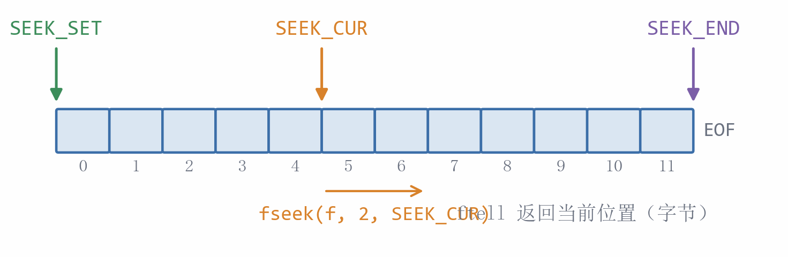


```c
long ftell(FILE *stream);
int  fseek(FILE *stream, long offset, int origin);
void rewind(FILE *stream);
```

`ftell` 返回当前位置距文件开头的字节数，失败时返回 -1L。`fseek` 把位置设为“起点加偏移”，成功时返回 0，起点 `origin` 取三个常量之一：

- `SEEK_SET`：从文件开头算（от начала）。
- `SEEK_CUR`：从当前位置算（от текущей позиции）。
- `SEEK_END`：从文件末尾算（от конца）。

偏移量 `offset` 可以为负，表示向文件开头方向移动。`rewind(fp)` 回到开头并清除错误标志，作用相当于 `fseek(fp, 0, SEEK_SET)`。

**讲解例：求文件大小。** 以二进制方式打开文件后，

```c
fseek(fp, 0, SEEK_END);       /* go to the end */
long size = ftell(fp);        /* end position = number of bytes */
fseek(fp, 0, SEEK_SET);       /* back to the beginning before reading */
```

末尾位置距开头的字节数就是文件的总字节数。最后一行不能省：位置停在末尾时，接下来的任何读取都立即遇到文件结束。以 12.5 KB（12800 字节）的文件为例，`size` 为 12800，而不是它在磁盘上占用的 16 KB，后者取决于簇的分配，对程序不可见。

**讲解例：随机访问第 k 个记录。** 二进制文件中连续存放了若干个 `int`，要直接读取下标为 5 的元素：

```c
int x;
fseek(fp, 5 * (long)sizeof(int), SEEK_SET);  /* byte 20 when int is 4 bytes */
if (fread(&x, sizeof x, 1, fp) == 1)
    printf("%d\n", x);
```

不必把前五个元素读一遍，这称为随机访问。若文件由上一节的 `fwrite(data, sizeof data[0], 4, fp)` 写成，则下标 2 对应偏移 8，读到的是 3；下标 5 超出文件长度，`fread` 返回 0，因此必须检查它的返回值。

使用定位函数有两点限制。第一，标准只保证二进制流上的任意字节偏移有意义；对文本流，`fseek` 的偏移量只能是 0，或者是先前 `ftell` 返回的值配合 `SEEK_SET`，因为 Windows 文本方式下的 `"\r\n"` 转换使程序看到的字符数与文件中的字节数不一致。第二，`ftell` 返回 `long`，在 Windows 上 `long` 只有 32 位，最大值为 \(2^{31}-1=2147483647\) 字节，约 2 GB，更大的文件要用 64 位版本：Visual Studio 中为 `_ftelli64` 与 `_fseeki64`，POSIX 系统中为 `ftello` 与 `fseeko`。另外，以 `"r+"` 等读写方式打开时，从写转为读或从读转为写之前，必须先调用 `fseek`、`rewind` 或 `fflush`（写转读时），否则行为未定义。

### 命令行参数

`main` 函数还可以写成带参数的形式，从命令行接收参数：

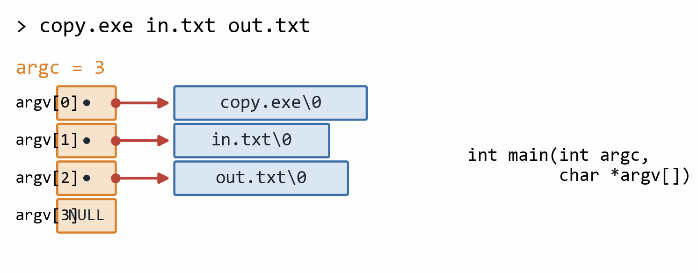


```c
int main(int argc, char *argv[])
{
    int i;
    printf("argc = %d\n", argc);
    for (i = 0; i < argc; i++)
        printf("argv[%d] = %s\n", i, argv[i]);
    return 0;
}
```

`argc` 是参数的个数，`argv` 是字符串指针数组（第八章），`argv[0]` 是程序本身的路径，`argv[1]` 起才是用户输入的参数，`argv[argc]` 为 `NULL`。在命令行中输入 `t5_file in.txt 5` 运行，`argc` 为 3，`argv[1]` 为 `"in.txt"`，`argv[2]` 为 `"5"`。注意参数都是字符串，需要数值时要用 `atoi`、`strtol` 或 `sscanf` 转换。在 Visual Studio 中，可以在项目属性的“调试—命令参数”一栏中填写参数。

本章文件读写和命令行参数的代码已于 2026-10-28 合成一个测试程序，用 Visual Studio 18 的 MSVC 按 C（/TC）与 C++（/TP）、/W4 编译均无警告，并实际运行，输出与正文所列结果一致。2026-11-13 新增的目录切换、`fgetc` 与 0xFF 字节、文本方式换行转换、`"a+"` 追加和文件定位各段代码，合成一个测试程序后用同一编译器按 C（/TC）、/W4 编译无警告并实际运行：用 `int` 计数读到 3 个字节，用 `char` 只读到 1 个；文本方式写出的三行在磁盘上多出两个回车字节；文件大小、下标 2 的元素和越界读取的返回值与正文一致。

## 附录 术语与阅读资料

变量对应俄语 переменная，值为 значение，地址为 адрес，指针为 указатель，数组为 массив，函数为 функция，实参为 аргумент，循环为 цикл，递归为 рекурсия。指针解引用称为 разыменование，升序排列为 по возрастанию。第十章的动态内存为 динамическая память，堆为 куча，分配为 выделение，释放为 освобождение，已占用与空闲为 занято、свободно，内存泄漏为 утечка памяти。第十四章的波算法为 волновой алгоритм，寻路为 поиск пути，格子为 клетка，权重为 вес，障碍为 препятствие，起点与终点在课堂上写作 Start、Finish，队列为 очередь。第十五、十六章的结构体为 структура，成员为 поле（элемент структуры），链表为 связный список，结点为 узел，枚举为 перечисление，文件为 файл，打开与关闭文件为 открытие、закрытие файла，命令行参数为 аргументы командной строки。

K&R《C 程序设计语言》第二版：第 1 章提供由小程序引入语言机制的教学顺序；第 2—4 章讨论表达式、控制流和程序结构；第 5 章将地址、指针、数组和字符处理结合起来。所用本地 PDF 的第 21—23、41—43、96—108、112—113 页已读取相关正文。原书中的隐式 int 和旧式函数示例应结合现代编译器要求辨别，不能直接当作当前推荐写法。

程序语义参照 WG14 N1570；Microsoft CRT 的 *_s 与 _countof 依工具链文档核查。完整程序、函数片段和反例已分别标明；片段需配合头文件与调用者。除第十章、第十四章和第十五章“二叉搜索树”一节外，本册示例仅经逻辑审阅，未编译运行。第十章的板书完整程序、join、calloc 拼接、_malloca 函数，以及第九章新增的 strncat、strncat_s、字面量比较示例，于 2026-10-22 用 MSVC 14.51（/W4）编译无警告并实际运行，输出与正文一致；_heapchk 与调试堆的结论来自同日实测。fgets 读入片段未单独运行。第十四章完整程序于 2026-10-21 用 MSVC（/W4）编译无警告并实际运行；队列与 Dijkstra 片段放入测试程序，在 2000 张随机场地上与反复松弛的结果对照一致。

2026-10-31增补依据 claude.ai 网页对话《数组构建方式》中的课堂板书讲解：第十章新增“动态二维数组的三种组织方式”（行指针表、整块存储与宏、指向数组的指针），第十五章补类型与变量、一步定义与匿名结构体、typedef 规律、对齐计算、结构体不能包含自身、数组成员的整体复制与浅拷贝、四种传参方式。两处的代码合成一个测试程序，用 Visual Studio 18 的 MSVC 按 C（/TC）、/W4 编译无警告并运行，输出与正文所列一致。

2026-11-03增补依据 claude.ai 网页对话《黑板内容讲解》中的 C 语言课堂板书：第十五章新增“双向链表与柔性数组成员”（柔性数组成员规则、Create 一次分配、strncpy_s 与 memcpy、AddToList 两种情况与修改顺序、DelFromList/Search4/PrintAllTowns/DestroyAll 的实现、“同上”写法造成的重复定义）与“二叉搜索树”（插入规则、用二级指针的非递归插入、按层数与按元素个数两种平衡、利用父指针不用递归的横向打印）。双向链表程序在来源会话中已用 gcc 编译运行；树的两个函数为本册补写的示范实现，本机无 C 编译器，未编译，已手工追踪示例输出。

2026-11-05增补依据同一对话的后续追问：二叉搜索树一节补写“按元素个数平衡的实现”（结点计数 count 及空子树取 0、插入时祖先计数加一、挪动一个键的四步与中序序列不变的论证、先序次序自顶向下调整及其正确性、黑板例子的逐次挪动与验算、平衡形状不唯一、插入次序不被保存、用父指针求先序与中序后继、非递归释放、随机数个数与取值范围、“不用额外数组”的含义、先排序取中建树与边插边平衡两种对照）。本机已找到 Visual Studio 的 MSVC，本节全部树函数于同日编译运行并通过 3000 组随机数据自检，2026-11-03 记为“未编译”的插入与横向打印函数一并验证。
