# 线性代数

从线性方程组到向量空间与特征分解

## 导读：计算背后的共同结构

本册讨论有限维实向量空间中的线性关系。学习线性代数时，会陆续遇到矩阵、消元、秩、行列式、逆矩阵、特征值等一系列工具。它们各有分工：矩阵用来记录方程组的系数，也可以看作作用在向量上的变换；消元把一组约束整理成容易求解的形式；秩说明其中真正相互独立的条件有几个；行列式用来判断一个方阵是否退化，即它是否把空间压扁、是否可逆；特征向量则是线性变换作用后方向保持不变的向量。

这些内容并不是几套互不相干的算法，而是从不同角度观察同一个对象。例如，一个方阵的行列式不为零、秩等于阶数、可逆、对应的齐次方程组只有零解，这几种说法讲的是同一件事。本册的顺序是：先弄清矩阵怎样作用于向量，再用消元分析方程组，然后建立行列式、逆矩阵、向量空间和对角化之间的联系，最后引入内积，讨论长度、正交和最小二乘。涉及复数时会专门说明；没有特别说明时，数和向量分量都取实数。

全书的例题都写出完整解法。历史会话中只有附件占位、没有图像正文的题目，本册不凭猜测补写。为了讲清结构而重新选取的数据，都作为本册自己的教学例题使用，不表示与原图逐字相同。

## 第一章 矩阵与线性运算

### 1.1 从方程到矩阵

线性方程是指未知数只以一次形式出现的方程：每个未知数最多乘上一个常数，未知数之间不相乘，也不出现平方、开方等运算。例如 \(2x-y=3\) 是线性的，而 \(xy=3\)、\(x^2+y=1\) 都不是。线性方程组的好处在于，它的解集具有很规则的结构（直线、平面或它们的高维推广），可以用一套统一的方法处理。本册把线性方程组写成

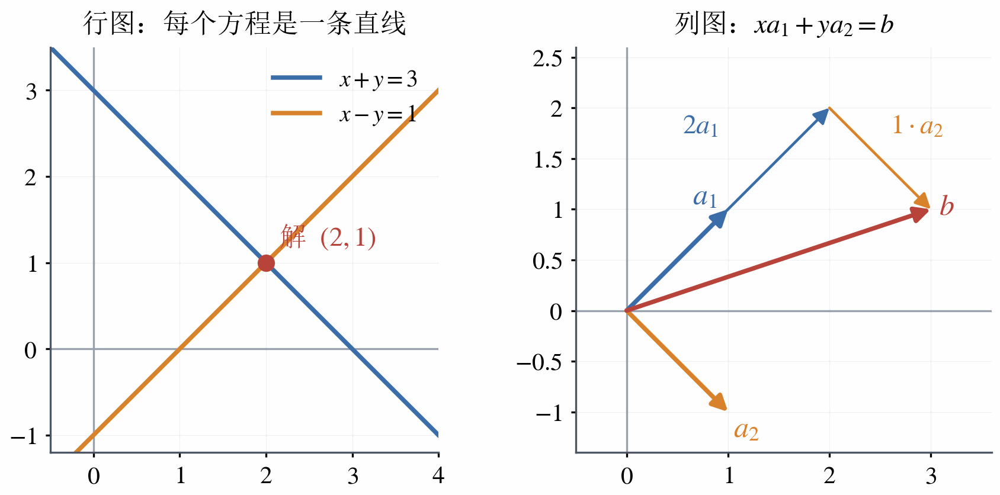

\[
Ax=b,
\qquad A=(a_{ij})_{m\times n},\quad x\in\mathbb R^n,\quad b\in\mathbb R^m.
\]

这里 \(A\) 称为系数矩阵，\(a_{ij}\) 是第 \(i\) 个方程中第 \(j\) 个未知数的系数：下标的第一个数字表示行，第二个表示列。矩阵 \(A\) 有多少列，就有多少个未知数；有多少行，就有多少个方程。向量 \(b\) 是等号右端的常数列，它是已知的，不属于未知量。若右端所有常数都为零，即 \(b=0\)，这样的方程组称为齐次方程组；否则称为非齐次方程组。

初学时要把矩阵与行列式分清。矩阵是一张按行和列排好的数表，可以是长方形的，它本身不是一个数；行列式则是由方阵（行数等于列数的矩阵）按一定规则算出的一个数。第四章会专门讨论行列式。

两个矩阵相等，是指它们尺寸相同，并且对应位置的元素全部相等。矩阵加法只对同型矩阵（尺寸相同的矩阵）定义，做法是对应元素相加；数乘是用一个数去乘矩阵的每一个元素。零矩阵是所有元素都为零的矩阵。书写时，同一个符号 \(0\) 可能指数零、零向量或某个尺寸的零矩阵，需要根据上下文判断，不能因为写法相同就认为它们是同一个对象。

### 1.2 乘法与运算次序

矩阵乘法的定义如下。若 \(A\) 为 \(m\times n\) 矩阵，\(B\) 为 \(n\times p\) 矩阵，则

\[
(AB)_{ij}=\sum_{k=1}^{n}a_{ik}b_{kj},\qquad AB\text{ 的尺寸为 }m\times p.
\]

也就是说，乘积第 \(i\) 行第 \(j\) 列的元素，等于 \(A\) 的第 \(i\) 行与 \(B\) 的第 \(j\) 列逐项相乘再相加。只有当 \(A\) 的列数等于 \(B\) 的行数时，这样的“一行对一列”才配得上，乘积才有定义。

这个看似复杂的规则有明确的来历。把矩阵看成对向量的变换：\(Bx\) 先把向量 \(x\) 变成新向量，\(A(Bx)\) 再对结果做一次变换。把两步合成一步，得到的矩阵恰好就是按上式计算的 \(AB\)。所以 \(AB\) 表示“先做 \(B\) 代表的变换，再做 \(A\) 代表的变换”，写在右边的矩阵先起作用。

矩阵乘法满足结合律 \((AB)C=A(BC)\) 和分配律 \(A(B+C)=AB+AC\)，但通常不满足交换律，即一般 \(AB\ne BA\)。单位矩阵 \(I_n\) 是主对角线元素全为一、其余元素全为零的 \(n\) 阶方阵，它对任何向量的作用都是保持不变，因此在矩阵乘法中扮演数字一的角色：\(AI=IA=A\)。

**讲解例题：乘法顺序改变结果。** 取

\[
A=\begin{pmatrix}1&1\\0&1\end{pmatrix},\qquad
B=\begin{pmatrix}2&0\\0&3\end{pmatrix}.
\]

按定义逐项计算。以第一行第二列为例，\(AB\) 的这一项是 \(A\) 的第一行 \((1,1)\) 与 \(B\) 的第二列 \((0,3)^T\) 的乘积之和，即 \(1\cdot0+1\cdot3=3\)；而 \(BA\) 同一位置的元素是 \(B\) 的第一行 \((2,0)\) 与 \(A\) 的第二列 \((1,1)^T\) 的乘积之和，即 \(2\cdot1+0\cdot1=2\)。其余位置同样计算，得到

\[
AB=\begin{pmatrix}2&3\\0&3\end{pmatrix},\qquad
BA=\begin{pmatrix}2&2\\0&3\end{pmatrix}.
\]

两个结果不同，说明交换乘法顺序会改变结果。因此，在矩阵等式中不能像普通数那样随意把一个矩阵“移到等号另一边”或调换位置。即使尺寸上允许相乘，也必须保留它是左乘还是右乘。

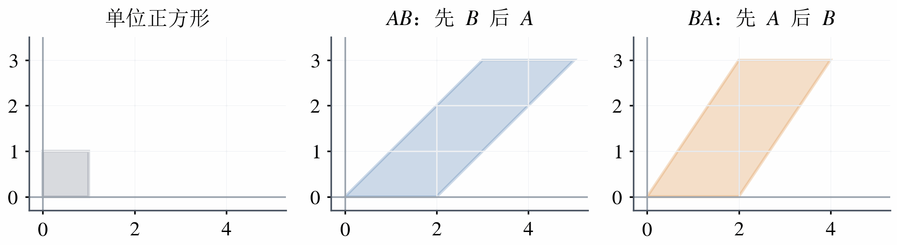

还要注意，由 \(AB=0\) 不能推出 \(A=0\) 或 \(B=0\)。例如 \(A=\begin{pmatrix}1&0\\0&0\end{pmatrix}\)、\(B=\begin{pmatrix}0&0\\0&1\end{pmatrix}\) 都不是零矩阵，乘积却为零：\(B\) 只保留第二个坐标方向，\(A\) 又恰好把这个方向消去。这说明两个非零矩阵的作用可能前后抵消，普通数“乘积为零则必有一个因子为零”的性质在矩阵中不成立。

转置 \(A^T\) 是把矩阵的行与列互换得到的矩阵：\(A\) 的第 \(i\) 行变成 \(A^T\) 的第 \(i\) 列。由乘法的元素公式可以推出

\[
(AB)^T=B^TA^T.
\]

推导时比较两边第 \(i\) 行第 \(j\) 列的元素。左边是 \((AB)_{ji}\)，即 \(A\) 的第 \(j\) 行与 \(B\) 的第 \(i\) 列逐项相乘之和；右边 \(B^TA^T\) 的这一项是 \(B^T\) 的第 \(i\) 行（即 \(B\) 的第 \(i\) 列）与 \(A^T\) 的第 \(j\) 列（即 \(A\) 的第 \(j\) 行）逐项相乘之和，两者相同。所以记这个公式时，不能只记“每个矩阵都转置”，还要记住相乘的次序必须反过来。

转置的全部运算规则可以归纳为

\[
(A^T)^T=A,\qquad (A+B)^T=A^T+B^T,\qquad (kA)^T=kA^T,\qquad (AB)^T=B^TA^T .
\]

前三条直接由“行列互换”的定义得到。最后一条可以推广到多个矩阵：\((ABC)^T=C^TB^TA^T\)，次序整体反转。

满足 \(A^T=A\) 的方阵称为对称矩阵，它关于主对角线对称，即 \(a_{ij}=a_{ji}\)；满足 \(A^T=-A\) 的称为反对称矩阵，它的对角元必为零。对任意矩阵 \(A\)（不必是方阵），\(A^TA\) 和 \(AA^T\) 都是对称矩阵，因为 \((A^TA)^T=A^T(A^T)^T=A^TA\)。任意方阵都可以唯一地写成对称部分与反对称部分之和：

\[
A=\frac{A+A^T}2+\frac{A-A^T}2 .
\]

这些对称矩阵将在第八章的正交对角化和第十章的格拉姆矩阵中反复出现。

## 第二章 初等行变换与高斯消元

### 2.1 等价变换的含义

解线性方程组的基本方法是消元：利用一个方程消去其他方程中的某个未知数，逐步把方程组化简。用矩阵记录这一过程更为简洁。把系数矩阵与右端常数列并排写在一起，得到增广矩阵 \((A\mid b)\)，竖线左边是系数，右边是常数。对方程组允许做的三种初等行变换是：

1. 交换两行（记作 \(R_i\leftrightarrow R_j\)），相当于交换两个方程的书写顺序；
2. 把某一行乘以一个非零常数（\(R_i\leftarrow kR_i\)，\(k\ne0\)），相当于把一个方程两边同乘一个非零数；
3. 把某一行的若干倍加到另一行上（\(R_i\leftarrow R_i+kR_j\)），相当于把一个方程的倍数加到另一个方程上。

这三种变换都可以撤销：交换两次就复原，乘 \(k\) 后再乘 \(1/k\) 就复原，加上 \(k\) 倍后再减去 \(k\) 倍就复原。正因为可逆，变换前后的方程组有完全相同的解集，称为等价变换。乘以零不在允许之列，因为它把一个方程变成 \(0=0\)，丢掉了信息，而且无法撤销。

行变换必须作用于整行，包括竖线右边的常数。如果只改变系数而不改变右端，得到的已经是另一个方程组了。列变换也可以用来研究矩阵的秩，但在解方程时，交换两列意味着交换两个未知数的位置，必须另外记录这种变化，否则会把未知数对应错。因此初学阶段解方程只用行变换。

消元的目标是阶梯形矩阵。每个非零行从左数第一个不为零的元素称为该行的主元；阶梯形要求下一行的主元比上一行的主元更靠右，全为零的行放在最下面。这样排列后，矩阵左下方全是零，形状像台阶。简化阶梯形还进一步要求每个主元等于一，并且主元所在列的其他元素都为零。求解时并不一定要化到简化阶梯形：通常先化成阶梯形，再从最后一个方程开始逐个向上代入（称为回代），计算量更小。

高斯消元的操作步骤可以归纳为：

1. 写出增广矩阵 \((A\mid b)\)。
2. 从第一列开始，找一个不为零的元素作主元；必要时交换两行，把它换到当前最上面的一行。
3. 用倍加变换把主元下方同一列的元素全部消为零。
4. 去掉已处理的行和列，对剩下的部分重复第 2、3 步，直到得到阶梯形。
5. 检查是否出现 \(0=c\)（\(c\ne0\)）形式的矛盾行；若有，方程组无解。
6. 若无矛盾，把无主元的未知数设为自由参数，从最后一个非零行开始逐个向上回代，求出主元变量。

### 2.2 一个系统的三种结局

一个线性方程组只可能有三种结局：有唯一解、有无穷多解、无解。当方程中含有参数时，参数取不同的值，结局也可能不同。下面的例题说明怎样系统地讨论。

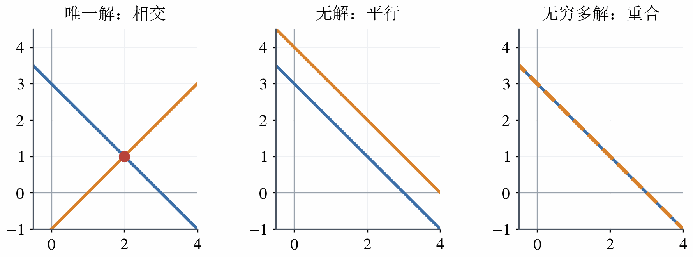

**讲解例题：参数出现时先分类再除法。** 考察

\[
\begin{cases}
x+y+z=1,\\
x+2y+3z=2,\\
x+3y+[5+(a-1)(a-2)]z=a+2.
\end{cases}
\]

写出增广矩阵后，先用第一行消去下面两行的 \(x\)：执行 \(R_2\leftarrow R_2-R_1\)、\(R_3\leftarrow R_3-R_1\)（\(R_i\) 表示第 \(i\) 行，箭头表示用右边的结果替换左边的行）。这时第二行为 \((0,1,2\mid1)\)，第三行为 \((0,2,4+(a-1)(a-2)\mid a+1)\)。再执行 \(R_3\leftarrow R_3-2R_2\) 消去第三行的 \(y\)，得到

\[
\left(\begin{array}{ccc|c}
1&1&1&1\\0&1&2&1\\0&0&(a-1)(a-2)&a-1
\end{array}\right).
\]

最后一行代表方程 \((a-1)(a-2)z=a-1\)。要解出 \(z\)，需要除以 \((a-1)(a-2)\)，而这个数可能为零，所以必须先按它是否为零分情况讨论。

若 \(a\ne1,2\)，系数 \((a-1)(a-2)\ne0\)，可以除过去，得到 \(z=1/(a-2)\)（约去了不为零的 \(a-1\)）。代入第二行 \(y+2z=1\)，再代入第一行 \(x+y+z=1\)，得

\[
y=1-\frac2{a-2},\qquad x=\frac1{a-2}.
\]

这时方程组有唯一解。

若 \(a=1\)，最后一行变成 \(0\cdot z=0\)，即恒等式 \(0=0\)。它对 \(z\) 没有任何限制，等于这个方程组实际上只有两个独立方程，三个未知数中会有一个可以自由取值。令 \(z=t\)（\(t\) 为任意实数），由第二行 \(y+2t=1\) 得 \(y=1-2t\)，再由第一行得 \(x=1-y-z=t\)。把解写成向量形式：

\[
x=\begin{pmatrix}0\\1\\0\end{pmatrix}
+t\begin{pmatrix}1\\-2\\1\end{pmatrix},\qquad t\in\mathbb R.
\]

这是空间中经过点 \((0,1,0)\)、方向为 \((1,-2,1)\) 的一条直线，方程组有无穷多解。

若 \(a=2\)，最后一行变成 \(0\cdot z=1\)，即 \(0=1\)，这是不可能成立的矛盾方程，因此方程组无解。

这道题的难点不在公式复杂，而在于讨论顺序：用含参数的式子做除法之前，必须先把它等于零的情况单独拿出来。如果一开始就把最后一行两边的 \(a-1\) 约掉，得到 \((a-2)z=1\)，那么 \(a=1\) 时会得到唯一解 \(z=-1\)，从而漏掉整条解直线，结论就错了。

讨论含参数的线性方程组，一般按以下步骤进行：

1. 只用不含参数的倍加和交换把增广矩阵化为阶梯形，避免过早除以含参数的式子。
2. 找出主元位置上含参数的系数，求出使它们等于零的参数值。
3. 对这些特殊参数值逐一代回阶梯形，判断是出现矛盾行（无解）还是出现零行（有自由变量）。
4. 对其余参数值（系数均不为零），方程组有唯一解，再用回代写出用参数表示的解。
5. 最后把各种情况汇总，并任选一组具体参数值代入原方程组验算。

### 2.3 主元变量与自由变量

在阶梯形中，主元所在列对应的未知数称为主元变量，没有主元的列对应的未知数称为自由变量。自由变量可以任意取值，主元变量则由自由变量通过回代表示出来。

需要注意，“自由变量”并不是说这个未知数不出现在任何方程中，而是说方程组中独立的约束不足以把它唯一确定。上例中 \(a=1\) 时，\(z\) 在三个原方程里都出现，但它仍可以自由取值；\(z\) 一旦取定，\(x\) 和 \(y\) 就随之确定。自由变量的个数等于未知数个数减去独立方程个数，第三章会把它与秩联系起来。

同一个解集可以有不同的参数表示。例如上例的解 \((t,1-2t,t)\)，如果改为令 \(y=s\) 作自由参数，由 \(y=1-2t\) 得 \(t=(1-s)/2\)，解写成 \(((1-s)/2,s,(1-s)/2)\)。两种写法看起来不同，但因为 \(s=1-2t\) 是一一对应的换元，它们描述的是同一条直线。检验一个通解是否正确，要做两件事：

1. 把通解代入原方程组，确认参数取任何值时每个方程都成立；
2. 确认自由参数的个数等于未知数个数减去独立约束的个数，避免只找到解集的一部分。

## 第三章 秩与方程组相容性

### 3.1 秩的三种等价观察

上一章看到，一个方程组中有些方程可能是多余的，真正起作用的独立方程个数决定了解的结构。秩就是对“独立信息有多少”的精确刻画。

秩可以用子式来定义。从矩阵中任意选出若干行和同样多的列，保持原来的相对次序，组成一个小方阵，它的行列式称为矩阵的一个子式。矩阵的秩定义为不为零的子式的最高阶数。零矩阵没有非零子式，规定它的秩为零。

秩还有另外几种等价的描述：它等于矩阵的行向量组中线性无关向量的最多个数（行空间的维数），也等于列向量组中线性无关向量的最多个数（列空间的维数），用行变换化为阶梯形后，它等于非零行的个数。这些说法相互等价，是可以证明的定理。消元只是计算秩的一种方便手段，并不是说“只有先消元，秩才存在”。

为什么阶梯形的非零行数就是秩？在阶梯形中，各非零行的主元位置逐行向右移动。看最上面一行的主元所在的列：它下面各行在这一列都是零，所以这一行不可能由下面各行组合出来；依此类推，所有非零行彼此线性无关。零行不带来任何新信息。又因为初等行变换都可以撤销，变换不会增加也不会减少独立信息的总量，所以原矩阵的秩等于阶梯形的非零行数。

\(m\times n\) 矩阵的秩最多为 \(\min(m,n)\)：行向量最多有 \(m\) 个独立，列向量最多有 \(n\) 个独立，两个说法给出同一个数，所以秩不超过两者中较小的一个。秩的概念不要求矩阵是方阵，长方形矩阵同样有秩。

### 3.2 增广一列与行变换的区别

**讲解例题：常数列带来矛盾。** 令

\[
A=\begin{pmatrix}1&1\\2&2\end{pmatrix},\qquad
b=\begin{pmatrix}1\\3\end{pmatrix}.
\]

先求系数矩阵的秩。\(A\) 有不为零的元素，所以秩至少为一；\(A\) 唯一的二阶子式就是它自身的行列式 \(1\cdot2-1\cdot2=0\)，所以秩不到二。于是 \(r(A)=1\)。再看增广矩阵 \((A\mid b)\)，它有三列。取它的第一列和第三列组成二阶子式：

\[
\begin{vmatrix}1&1\\2&3\end{vmatrix}=1,
\]

这个子式不为零，因此 \(r(A\mid b)=2\)。

从方程的角度看，第一个方程是 \(x+y=1\)，第二个是 \(2x+2y=3\)，即 \(x+y=3/2\)。同一个 \(x+y\) 不能既等于 \(1\) 又等于 \(3/2\)，所以方程组无解。秩的变化正好反映了这一矛盾。

这里要分清两件事。行变换是对增广矩阵做可逆的变换，不改变秩；而“在 \(A\) 的右边增加一列 \(b\)”是在扩充矩阵，不是可逆变换，所以增广前后的秩没有必须相等的理由。另一方面，增加一列最多只能带来一个新的独立方向，所以秩最多增加一。

从列的角度看得更清楚。\(Ax\) 等于用 \(x\) 的各分量作系数，把 \(A\) 的各列加权相加。所以方程 \(Ax=b\) 有解，恰好等价于 \(b\) 能写成 \(A\) 的各列的线性组合，即 \(b\) 属于 \(A\) 的列空间。如果 \(b\) 在列空间里，把它加进来不会增加列空间的维数，秩不变；如果不在，就多出一个独立方向，秩增加一。由此得到判断方程组是否有解（称为相容）的判据：

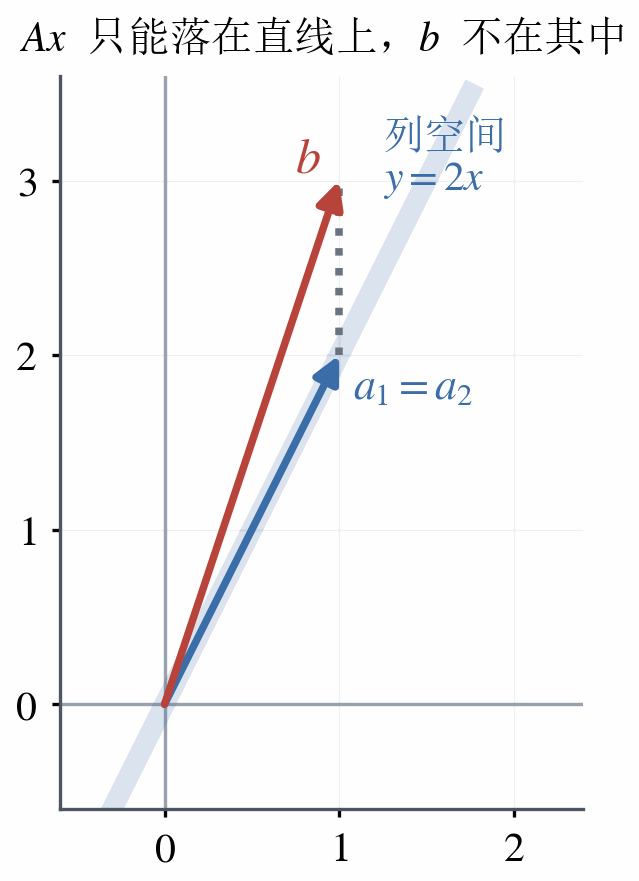

\[
r(A)=r(A\mid b)\iff Ax=b\text{ 有解}.
\]

在有解的前提下，再看解的个数。设未知数有 \(n\) 个。若秩等于 \(n\)，每个未知数都是主元变量，方程组有唯一解；若秩小于 \(n\)，有 \(n-r(A)\) 个自由变量，每个都可以取任意实数，所以在实数范围内有无穷多解。

还有一个常见的误判：“未知数多于方程，所以一定有解”。这句话只对齐次方程组成立。齐次方程组总有零解，未知数多于方程时秩必小于未知数个数，因此一定还有非零解。非齐次方程组则不同，即使未知数很多，方程之间仍可能互相矛盾（例如两个方程左边相同而右边不同），不能只数方程的个数就断定有解。

判断一个 \(n\) 元线性方程组 \(Ax=b\) 解的情况，可按以下步骤：

1. 对增广矩阵 \((A\mid b)\) 做行变换，化为阶梯形。
2. 由阶梯形读出 \(r(A)\)（竖线左边的非零行数）和 \(r(A\mid b)\)（整行的非零行数）。
3. 若 \(r(A)<r(A\mid b)\)，方程组无解。
4. 若 \(r(A)=r(A\mid b)=n\)，方程组有唯一解。
5. 若 \(r(A)=r(A\mid b)<n\)，方程组有无穷多解，通解中含 \(n-r(A)\) 个自由参数。

对齐次方程组，第 3 种情况不会出现（零向量总是解），所以只需比较 \(r(A)\) 与 \(n\)：相等时只有零解，小于 \(n\) 时有非零解。特别地，\(n\) 个方程的 \(n\) 元齐次方程组有非零解，当且仅当 \(\det A=0\)。

### 3.3 秩的常用公式

下面这些关于秩的公式在后面各章和习题中经常用到。设各矩阵的尺寸使运算有意义，\(A\) 为 \(m\times n\) 矩阵。

**秩的不变性。** 转置不改变秩，非零数乘不改变秩，左乘或右乘可逆矩阵也不改变秩：

\[
r(A^T)=r(A),\qquad r(kA)=r(A)\ (k\ne0),\qquad r(PAQ)=r(A)\ (P,Q\ \text{可逆}).
\]

第一式是“行秩等于列秩”的另一种说法；第三式成立是因为可逆矩阵相当于一串初等变换，而初等变换不改变秩。

**秩与零空间维数（秩—零化度定理）。** 未知数个数等于主元变量个数加自由变量个数，所以

\[
r(A)+\dim\ker A=n .
\]

**和与积的秩。** 

\[
r(A+B)\le r(A)+r(B),\qquad r(AB)\le\min\bigl(r(A),r(B)\bigr).
\]

第一式成立，是因为 \(A+B\) 的每一列都是 \(A\) 的列与 \(B\) 的列之和，所以它的列空间包含在两个列空间之和中，维数不超过两者维数之和。第二式成立，是因为 \(AB\) 的每一列都是 \(A\) 的各列的组合，列空间不超过 \(A\) 的列空间；同理 \(AB\) 的每一行是 \(B\) 的各行的组合，行空间不超过 \(B\) 的行空间。乘法只会丢失信息，不会增加信息。

**西尔维斯特不等式。** 若 \(A\) 为 \(m\times n\)、\(B\) 为 \(n\times p\)，则

\[
r(A)+r(B)-n\le r(AB).
\]

一个重要推论是：若 \(AB=0\)，则 \(r(A)+r(B)\le n\)。直接理解也很容易：\(AB=0\) 说明 \(B\) 的每一列都是 \(Ax=0\) 的解，所以 \(B\) 的列空间包含在 \(\ker A\) 中，\(r(B)\le\dim\ker A=n-r(A)\)。

**与转置相乘的秩。** 对实矩阵，

\[
r(A^TA)=r(A).
\]

证明只需说明 \(A^TAx=0\) 与 \(Ax=0\) 同解。后者的解显然是前者的解；反过来，若 \(A^TAx=0\)，左乘 \(x^T\) 得 \(x^TA^TAx=\|Ax\|^2=0\)，所以 \(Ax=0\)。两个方程组同解，零空间维数相同，由秩—零化度定理，秩也相同。第十章最小二乘中“列线性无关时 \(A^TA\) 可逆”正是这一结论的特例。

**讲解例题：由乘积为零估计秩。** 设 \(A\) 为 \(3\times3\) 矩阵，\(r(A)=2\)，三阶非零矩阵 \(B\) 满足 \(AB=0\)。求 \(r(B)\)。由推论 \(r(A)+r(B)\le3\)，得 \(r(B)\le1\)；又 \(B\ne0\)，所以 \(r(B)\ge1\)。因此 \(r(B)=1\)。这时 \(B\) 的每一列都是 \(Ax=0\) 的解，而该方程组的解空间是一条直线（维数 \(3-2=1\)），所以 \(B\) 的各列都落在这条直线上。

## 第四章 行列式及其运算

### 4.1 行列式记录方阵的退化程度

先强调一次符号。矩阵是按行列排好的一组数，通常写在圆括号或方括号中；行列式是由方阵算出的一个数，写在一对单竖线中：

\[
A=\begin{pmatrix}a&b\\c&d\end{pmatrix},
\qquad
|A|=\det A=\begin{vmatrix}a&b\\c&d\end{vmatrix}=ad-bc.
\]

这里的 \(|A|\) 表示矩阵 A 的行列式，与 \(\det A\) 是同一个数。它不是把每个元素取绝对值，也不是向量的长度。数的绝对值如 \(|-3|=3\)，向量长度通常写成 \(\|v\|\)（双竖线）。这几种记号都带竖线，但所指的对象和定义各不相同。行列式本身可以是负数，只有在把它解释为面积或体积时，才取它的绝对值。

三阶行列式也写在两条竖线之间。沿第一行展开的完整形式是

\[
\begin{vmatrix}
a&b&c\\d&e&f\\g&h&i
\end{vmatrix}
=a\begin{vmatrix}e&f\\h&i\end{vmatrix}
-b\begin{vmatrix}d&f\\g&i\end{vmatrix}
+c\begin{vmatrix}d&e\\g&h\end{vmatrix}.
\]

每一项是第一行的一个元素，乘上划掉该元素所在行和列后剩下的二阶行列式，符号按正、负、正交替。把三个二阶行列式算出来再相加，得到 \(aei+bfg+cdh-ceg-bdi-afh\)。这六项对应从三列中各取一个元素、且每行恰好取一个的六种取法（即三列的六种排列）。四阶行列式有二十四项，常见的三阶“对角线画法”到四阶就不再成立，不能照搬。本书中 \(\det A\) 与 \(|A|\) 表示同一个数；书写 \(\det(A-\lambda I)\) 这类式子时用 \(\det\) 更清楚，而把元素逐个写出来计算时，则直接用两侧竖线。

行列式的几何意义是理解它的关键。二阶行列式 \(ad-bc\) 的绝对值，等于两个列向量 \((a,c)^T\) 和 \((b,d)^T\) 张成的平行四边形的面积；它的正负号记录两个向量的先后方向（从第一列转到第二列是逆时针还是顺时针）。三维中，三阶行列式的绝对值是三个列向量张成的平行六面体的体积。把矩阵看成变换时，行列式就是这个变换把面积（或体积）放大的倍数。

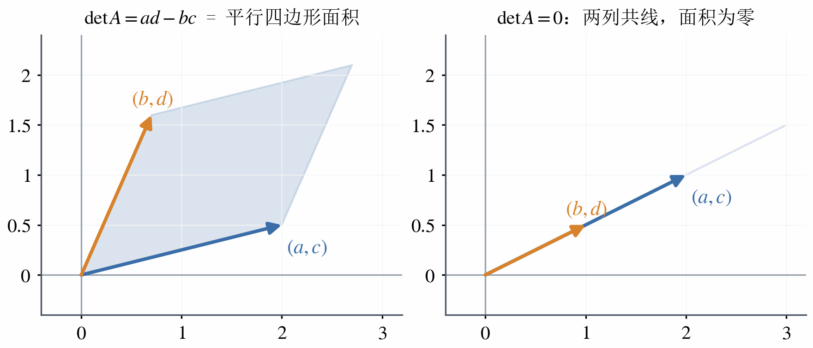

由此可以理解“行列式为零”的含义：变换把整个平面压成了一条线或一个点（三维中压成平面、直线或点），面积或体积变成零，信息丢失，所以变换不可逆。它并不意味着矩阵的每个元素都是零，也不意味着秩为零，只说明秩不满。

对一般的 \(n\) 阶矩阵，行列式可以由三条基本性质完全确定：对每一列（或每一行）分别是线性的（称为多线性）；交换两列，行列式变号；单位矩阵的行列式为一。由这些性质可以推出三条常用的行变换规则：

1. 交换两行，行列式变号；
2. 某一行乘以 \(k\)，行列式也乘以 \(k\)（反过来说，某一行的公因子可以提到行列式外面）；
3. 把某一行的 \(k\) 倍加到另一行，行列式不变。

第三条的理由是：按被加的那一行用多线性拆开，行列式分成原行列式与另一个行列式之和，而后者有两行相同（一行是原来那一行的 \(k\) 倍，另一行就是那一行），两行相同的行列式为零。此外，上三角矩阵（主对角线以下全为零）的行列式等于主对角线元素的乘积。这几条结合起来，就得到用消元计算行列式的方法。

**讲解例题：用消元计算行列式。** 对

\[
A=\begin{pmatrix}2&1&3\\4&3&7\\2&2&5\end{pmatrix},
\]

目标是只用“倍加”变换把它化成上三角形，这样行列式不会改变。依次执行 \(R_2\leftarrow R_2-2R_1\)（第二行变为 \((0,1,1)\)）、\(R_3\leftarrow R_3-R_1\)（第三行变为 \((0,1,2)\)）、\(R_3\leftarrow R_3-R_2\)（第三行变为 \((0,0,1)\)），得到

\[
\begin{pmatrix}2&1&3\\0&1&1\\0&0&1\end{pmatrix}.
\]

\[
|A|=\begin{vmatrix}2&1&3\\4&3&7\\2&2&5\end{vmatrix}
=\begin{vmatrix}2&1&3\\0&1&1\\0&0&1\end{vmatrix}=2.
\]

因为整个过程只用了倍加变换，行列式不变，原行列式等于上三角矩阵对角线的乘积 \(2\cdot1\cdot1=2\)。如果途中为了方便把第一行除以二，就必须记下行列式也被除以了二，最后再乘回来。这是解方程与求行列式的一个重要区别：解方程时可以随意把一个方程乘以非零数，因为解不变；求行列式时，每一次缩放都会改变结果的数值，必须如实记录。

用消元计算行列式的步骤是：

1. 用交换和倍加把矩阵化为上三角形；每交换一次两行，记下一个因子 \(-1\)。
2. 若为了方便提出某行的公因子 \(k\)，记下因子 \(k\)。
3. 化成上三角形后，把对角线元素相乘，再乘上前面记录的全部因子。
4. 若中途出现全为零的行，或某一列在当前行及以下全为零，行列式为零，可以立即停止。

再看一个结构上的例子。四阶矩阵的各行依次为 \((1,2,3,4)\)、\((5,6,7,8)\)、\((9,10,11,12)\)、\((13,14,15,16)\)。检查发现第三行等于第二行的两倍减去第一行：\(2(5,6,7,8)-(1,2,3,4)=(9,10,11,12)\)。一行能由其他行线性表示，行列式就为零。值得注意的是，这个矩阵中任何两行都不成比例。所以“找不到两行之间的倍数关系”并不能说明行列式不为零，还要考虑多行组合的情况。

### 4.2 整体数乘与乘积公式

若把整个 \(n\) 阶矩阵乘以 \(k\)，相当于每一行都乘以 \(k\)。由上一节第二条规则，每一行都贡献一个因子 \(k\)，共 \(n\) 行，所以

\[
\det(kA)=k^n\det A,\qquad
\det(A^T)=\det A,\qquad
\det(AB)=\det A\det B.
\]

第二式说明转置不改变行列式，因此一切关于行的性质对列同样成立。第三式称为乘积公式，几何上很好理解：先做变换 \(B\) 把面积放大 \(\det B\) 倍，再做变换 \(A\) 放大 \(\det A\) 倍，合起来放大的倍数就是两者之积。

例如三阶矩阵 \(A\) 的行列式为二，则 \(\det(3A)=27\cdot2=54\)，而不是 \(3\cdot2=6\)，因为三行各贡献一个因子三。另外，行列式一般不满足加法：\(\det(A+B)\) 通常不等于 \(\det A+\det B\)。多线性的意思是固定其他各行、只看某一行时，行列式对这一行是线性的；它并不是说行列式对整个矩阵是线性的。

### 4.3 由基本性质连成一组公式

由基本性质可以推出一系列判断行列式为零的条件，下面任何一条成立，行列式都为零：

1. 有一行（或一列）全为零；
2. 有两行（或两列）相同；
3. 有两行（或两列）成比例；
4. 更一般地，某一行（或一列）是其他行（列）的线性组合。反过来，行列式为零说明各行作为一个整体线性相关，但不保证能找到两行直接成比例，上一节的四阶矩阵就是例子。由于转置不改变行列式，以上关于行的结论对列同样成立。

设 A、B 为同阶方阵，k 为数，m 为正整数。反复使用乘积公式，并把 \(-A\) 看成 \((-1)A\)，得到

\[
|A^m|=|A|^m,\qquad |-A|=(-1)^n|A|.
\]

当 A 可逆时，在 \(AA^{-1}=I\) 两边取行列式，由乘积公式得 \(|A|\,|A^{-1}|=|I|=1\)。由此

\[
|A^{-1}|=\frac1{|A|},\qquad
|A^{-m}|=|A|^{-m}.
\]

这些公式只在 A 可逆时有意义，不可逆矩阵没有逆矩阵可谈。

例如三阶矩阵 \(|A|=-2\)，则 \(|-A|=(-1)^3\cdot(-2)=2\)，\(|2A|=2^3\cdot(-2)=-16\)，\(|A^2|=(-2)^2=4\)，\(|A^{-1}|=-1/2\)。计算时要分清两种指数：\(|kA|\) 中的指数 n 来自矩阵的阶数，\(|A^m|\) 中的指数 m 来自矩阵自乘的次数，两者来源不同，不能混淆。

对于分块结构的矩阵，还可以简化计算：

\[
\begin{vmatrix}B&C\\0&D\end{vmatrix}=|B|\,|D|.
\]

这里 B、D 各自必须是方阵，C 的尺寸与之匹配，左下角是零块。这个公式成立的原因是：展开行列式时，每一项要从每行每列各取一个元素；由于左下块全为零，前几列只能从 B 所在的行中取元素，否则这一项含零因子，于是非零的项恰好由 B 和 D 各自的展开相乘得到。如果左下块不为零，就不能直接把两个对角块的行列式相乘。普通的上三角矩阵可以看成每个对角块都是一阶的特殊情形。

行列式与可逆变换、相似之间也有联系。若 P 可逆，则

\[
|P^{-1}AP|=|P^{-1}|\,|A|\,|P|=|A|.
\]

矩阵 \(P^{-1}AP\) 与 \(A\) 称为相似，它表示同一个线性变换在另一组基下的矩阵（第八章将详细说明）。上式说明换基不改变行列式，这与“行列式是变换的面积放大倍数”的几何意义一致：放大倍数是变换本身的性质，与用哪组坐标描述无关。但如果只在一侧乘一个矩阵，行列式一般会改变。最后再强调一次两类任务的区别：解方程时只关心解集是否不变，可以任意缩放方程；计算行列式时还要追踪数值因子，两种做法不能混用。

### 4.4 几类常见的特殊行列式

**三角形与对角形。** 上三角、下三角和对角矩阵的行列式都等于主对角线元素的乘积。这是因为展开时，每一项要从每行每列各取一个元素，而除了全取主对角线元素的那一项外，其余各项都会取到零。

**范德蒙德行列式。** 由 \(n\) 个数 \(x_1,\ldots,x_n\) 的各次幂构成的行列式有简洁的结果：

\[
\begin{vmatrix}
1&1&\cdots&1\\
x_1&x_2&\cdots&x_n\\
\vdots&\vdots&&\vdots\\
x_1^{n-1}&x_2^{n-1}&\cdots&x_n^{n-1}
\end{vmatrix}
=\prod_{1\le i<j\le n}(x_j-x_i).
\]

以三阶为例说明来历。从最后一行起，每一行减去上一行的 \(x_1\) 倍（先做第三行，再做第二行），第一列变成 \((1,0,0)^T\)，第 \(j\) 列的下两项变为 \(x_j-x_1\) 和 \(x_j(x_j-x_1)\)。沿第一列展开，再从第二、三列分别提出公因子 \(x_2-x_1\)、\(x_3-x_1\)，剩下的是二阶范德蒙德行列式 \(x_3-x_2\)。所以三阶结果为 \((x_2-x_1)(x_3-x_1)(x_3-x_2)\)。一般情形用同样的方法归纳得到。由公式可知，范德蒙德行列式不为零，当且仅当 \(x_1,\ldots,x_n\) 两两不同。这正是“过 \(n\) 个横坐标互不相同的点，恰有一条次数不超过 \(n-1\) 的多项式曲线”的代数依据。例如取 \(1,2,3\)，行列式为 \((2-1)(3-1)(3-2)=2\)。

**行和相等的行列式。** 若每一行元素之和都相等，可以把其余各列都加到第一列，使第一列的元素全部相同，再提出公因子。例如

\[
\begin{vmatrix}a&b&b\\b&a&b\\b&b&a\end{vmatrix}
=(a+2b)\begin{vmatrix}1&b&b\\1&a&b\\1&b&a\end{vmatrix}
=(a+2b)\begin{vmatrix}1&b&b\\0&a-b&0\\0&0&a-b\end{vmatrix}
=(a+2b)(a-b)^2 .
\]

第二步是用第二、三行分别减去第一行。取 \(a=2,b=1\) 检验：直接展开得 \(2(4-1)-1(2-1)+1(1-2)=4\)，公式给出 \(4\cdot1=4\)，一致。

## 第五章 余子式、伴随矩阵与逆矩阵

### 5.1 拉普拉斯展开

上一章沿第一行展开了三阶行列式，这一方法可以推广到任意一行或一列。在 \(n\) 阶矩阵中删去第 \(i\) 行和第 \(j\) 列，剩下的 \(n-1\) 阶行列式称为元素 \(a_{ij}\) 的余子式，记为 \(M_{ij}\)；再乘上符号 \((-1)^{i+j}\)，得到代数余子式 \(C_{ij}=(-1)^{i+j}M_{ij}\)。沿第 \(i\) 行展开的公式是

\[
\det A=\sum_j a_{ij}C_{ij}.
\]

符号 \((-1)^{i+j}\) 在矩阵中按棋盘方式排列：左上角为正，相邻位置正负交替。展开时必须固定一整行（或一整列），用这一行的每个元素乘以各自的代数余子式再相加，不能从不同行列中随意挑几个元素。实际计算时，应选择零元素最多的行或列展开，因为零元素对应的项不必计算。前面提到，三阶的对角线画法不能不加证明地推广到四阶；高阶行列式一般先用消元化简，或者用拉普拉斯展开降阶。

### 5.2 伴随矩阵转置的由来

把所有代数余子式排成矩阵后再转置，得到伴随矩阵，记作 \(\operatorname{adj}(A)=(C_{ij})^T\)。也就是说，伴随矩阵第 \(i\) 行第 \(j\) 列的元素是 \(C_{ji}\)。为什么要转置？看 \(A\) 与伴随矩阵相乘时第 \(i,j\) 项：

\[
[A\operatorname{adj}(A)]_{ij}=\sum_k a_{ik}C_{jk}.
\]

分两种情况。当 \(i=j\) 时，这正是沿第 \(i\) 行的拉普拉斯展开，值为 \(\det A\)。当 \(i\ne j\) 时，这个和式相当于把原矩阵的第 \(j\) 行换成第 \(i\) 行之后，再沿第 \(j\) 行展开（第 \(j\) 行的代数余子式与第 \(j\) 行的内容无关，所以换掉第 \(j\) 行不影响 \(C_{jk}\)）；但换完之后矩阵有两行相同，行列式为零。因此乘积是一个对角线全为 \(\det A\)、其余为零的矩阵：

\[
A\operatorname{adj}(A)=\operatorname{adj}(A)A=(\det A)I.
\]

转置的作用，就是把同一行元素的代数余子式排到一列里，使矩阵乘法中“第 \(i\) 行乘第 \(j\) 列”恰好对上拉普拉斯展开的形式。如果不转置，乘积中的下标对不上，这个恒等式一般不成立。当 \(\det A\ne0\) 时，两边同除以 \(\det A\)，就得到逆矩阵公式 \(A^{-1}=\operatorname{adj}(A)/\det A\)。

**讲解例题：完整计算三阶伴随矩阵。** 取会话中已有文字记录的

\[
B=\begin{pmatrix}2&7&3\\3&9&4\\1&5&3\end{pmatrix}.
\]

逐个计算九个代数余子式。以 \(C_{12}\) 为例：删去第一行和第二列，剩下 \(\begin{pmatrix}3&4\\1&3\end{pmatrix}\)，余子式 \(M_{12}=3\cdot3-4\cdot1=5\)；位置 \((1,2)\) 的符号为 \((-1)^{1+2}=-1\)，所以 \(C_{12}=-5\)。其余各项同样计算，得到代数余子式矩阵及其转置（即伴随矩阵）：

\[
(C_{ij})=\begin{pmatrix}7&-5&6\\-6&3&-3\\1&1&-3\end{pmatrix},
\quad\operatorname{adj}(B)=\begin{pmatrix}7&-6&1\\-5&3&1\\6&-3&-3\end{pmatrix}.
\]

行列式可以直接利用已算出的第一行代数余子式，沿第一行展开：\(\det B=2\cdot7+7(-5)+3\cdot6=-3\)。行列式不为零，B 可逆，于是

\[
B^{-1}=-\frac13\begin{pmatrix}7&-6&1\\-5&3&1\\6&-3&-3\end{pmatrix}.
\]

验算时可以先计算 \(B\operatorname{adj}(B)\)。例如第一行第一列为 \(2\cdot7+7\cdot(-5)+3\cdot6=-3\)，第一行第二列为 \(2\cdot(-6)+7\cdot3+3\cdot(-3)=0\)。全部算完，第一行为 \((-3,0,0)\)，第二行为 \((0,-3,0)\)，第三行为 \((0,0,-3)\)，即 \(-3I\)；除以负三后正好是单位矩阵，说明结果正确。历史记录中提到的“交叉算”排布，只有在它实际计算的正是这些余子式、并且完成了转置时才是正确的，不能把某种排布的外观本身当成一般方法。

对二阶矩阵，伴随矩阵法给出一个值得记住的公式。\(A=\begin{pmatrix}a&b\\c&d\end{pmatrix}\) 的四个代数余子式为 \(C_{11}=d\)、\(C_{12}=-c\)、\(C_{21}=-b\)、\(C_{22}=a\)，转置后得到伴随矩阵，所以当 \(ad-bc\ne0\) 时

\[
\begin{pmatrix}a&b\\c&d\end{pmatrix}^{-1}=\frac1{ad-bc}\begin{pmatrix}d&-b\\-c&a\end{pmatrix}.
\]

记法是：主对角线两元素互换位置，副对角线两元素变号，再除以行列式。对角矩阵的逆更简单，只需把每个对角元取倒数：\(\operatorname{diag}(d_1,\ldots,d_n)^{-1}=\operatorname{diag}(1/d_1,\ldots,1/d_n)\)，前提是每个 \(d_i\ne0\)。

### 5.3 初等行变换求逆与矩阵方程

伴随矩阵法适合理论推导和低阶矩阵；实际求逆更常用行变换。做法是把 A 与同阶单位矩阵并排写成 \((A\mid I)\)，只用行变换把左半部分化为单位矩阵，这时右半部分就是 \(A^{-1}\)，即 \((A\mid I)\) 变为 \((I\mid A^{-1})\)。

原理如下。每一次初等行变换都相当于在左边乘一个可逆矩阵（称为初等矩阵），一串行变换合起来就是左乘某个可逆矩阵 \(E\)。对 \((A\mid I)\) 左乘 \(E\) 得到 \((EA\mid E)\)。如果左半部分变成了单位矩阵，即 \(EA=I\)，那么 \(E\) 就是 \(A^{-1}\)，而右半部分正好是 \(E\)。例如

![图 5-1　用初等行变换求逆：对增广矩阵 [A | I] 消元](figures/02_inverse_rowops.png)

\[
\left(\begin{array}{cc|cc}1&2&1&0\\3&4&0&1\end{array}\right)
\sim\left(\begin{array}{cc|cc}1&2&1&0\\0&-2&-3&1\end{array}\right)
\sim\left(\begin{array}{cc|cc}1&0&-2&1\\0&1&3/2&-1/2\end{array}\right).
\]

第一步执行 \(R_2\leftarrow R_2-3R_1\)；第二步先执行 \(R_1\leftarrow R_1+R_2\) 消去第一行的二，再把第二行除以 \(-2\)。右侧的二阶矩阵 \(\begin{pmatrix}-2&1\\3/2&-1/2\end{pmatrix}\) 就是逆矩阵，可以与原矩阵相乘验证得到单位矩阵。如果行变换过程中左侧出现零行、无法化为单位矩阵，说明 A 不可逆，这时右侧得到的矩阵不能称为逆矩阵。

行变换求逆的步骤是：

1. 写出 \(n\times2n\) 矩阵 \((A\mid I)\)。
2. 只用行变换（不用列变换），先把左半部分化为阶梯形；若出现零行，停止并判定 A 不可逆。
3. 继续把主元化为一，并把主元上方的元素也消为零，使左半部分成为单位矩阵。
4. 读出右半部分，即为 \(A^{-1}\)。
5. 计算 \(AA^{-1}\) 验证是否得到单位矩阵。

逆矩阵满足以下运算规则（设 \(A,B\) 为同阶可逆矩阵，\(k\ne0\)）：

\[
(A^{-1})^{-1}=A,\qquad (kA)^{-1}=\frac1kA^{-1},\qquad (A^T)^{-1}=(A^{-1})^T,\qquad (AB)^{-1}=B^{-1}A^{-1}.
\]

每一条都可以用定义直接验证：只要把右边与左边括号内的矩阵相乘，看是否得到单位矩阵。以最后一条为例，\((AB)(B^{-1}A^{-1})=A(BB^{-1})A^{-1}=AA^{-1}=I\)。与转置一样，乘积的逆要把次序反过来：先做 \(B\) 再做 \(A\) 的变换，撤销时则要先撤销后做的 \(A\)、再撤销先做的 \(B\)。还要注意，和的逆没有类似公式，\((A+B)^{-1}\) 一般不等于 \(A^{-1}+B^{-1}\)。

分块对角矩阵的逆可以分块求：若 \(B,D\) 都是可逆方阵，则

\[
\begin{pmatrix}B&0\\0&D\end{pmatrix}^{-1}=\begin{pmatrix}B^{-1}&0\\0&D^{-1}\end{pmatrix}.
\]

此外，判断方阵可逆时，只需验证一侧：若 \(AB=I\)，则必有 \(BA=I\)，\(B=A^{-1}\)。这是因为由 \(AB=I\) 取行列式得 \(|A||B|=1\)，\(A\) 可逆，两边左乘 \(A^{-1}\) 即得 \(B=A^{-1}\)。

矩阵方程的解法同样要尊重乘法次序。对 \(AXB=C\)，若 \(A,B\) 都可逆，先在两边左乘 \(A^{-1}\) 得 \(XB=A^{-1}C\)，再在两边右乘 \(B^{-1}\)，得到 \(X=A^{-1}CB^{-1}\)。对 \(XA+B=C\)，先两边减去 \(B\) 得 \(XA=C-B\)，再右乘 \(A^{-1}\)，得 \(X=(C-B)A^{-1}\)。注意 \(A^{-1}\) 必须乘在右边，写成 \(A^{-1}(C-B)\) 是错误的。这些步骤的依据是结合律和逆矩阵的定义（\(AA^{-1}=A^{-1}A=I\)），而不是“移项时改变顺序”之类的口诀：乘在哪一侧，就必须在等式两边的同一侧同时乘。

### 5.4 伴随矩阵的同类公式与秩

伴随矩阵由 n−1 阶代数余子式组成，所以它的性质可以直接从行列式的性质推出。以下设 \(n\ge2\)：

\[
\operatorname{adj}(A^T)=[\operatorname{adj}(A)]^T,\qquad
\operatorname{adj}(kA)=k^{n-1}\operatorname{adj}(A).
\]

第一式成立，是因为删去 \(A^T\) 的第 \(i\) 行第 \(j\) 列，相当于删去 \(A\) 的第 \(j\) 行第 \(i\) 列后再转置，而转置不改变行列式。第二式中，\(kA\) 的每个余子式是一个 n−1 阶行列式，其中每一行都带有因子 k，共贡献 \(k^{n-1}\)，所以指数是 n−1。不要把它与 \(|kA|=k^n|A|\) 混淆。k=0 时两边都是零矩阵，公式也成立。

若 A 可逆，由上一节得 \(\operatorname{adj}(A)=|A|A^{-1}\)。两边取行列式：右边是数 \(|A|\) 乘以 n 阶矩阵 \(A^{-1}\)，所以行列式为 \(|A|^n|A^{-1}|\)，再用逆矩阵的行列式公式，得到

\[
|\operatorname{adj}(A)|=|A|^n|A^{-1}|=|A|^{n-1}.
\]

这个结论对不可逆的 A 也成立（这时两边都是零），但不能用上面的方法证明，因为不可逆矩阵没有逆。奇异情形要改从余子式和秩来论证，见下文。

利用 \(\operatorname{adj}(A)=|A|A^{-1}\)，还可以推出伴随矩阵的另外几条性质。设 \(A,B\) 为同阶可逆矩阵，\(n\ge2\)：

\[
\operatorname{adj}(AB)=\operatorname{adj}(B)\operatorname{adj}(A),\qquad
\operatorname{adj}(A^{-1})=[\operatorname{adj}(A)]^{-1}=\frac{A}{|A|},\qquad
\operatorname{adj}(\operatorname{adj}A)=|A|^{n-2}A .
\]

第一式：\(\operatorname{adj}(AB)=|AB|(AB)^{-1}=|B|B^{-1}\cdot|A|A^{-1}\)，次序与乘积的逆一样要反过来。第二式：\(\operatorname{adj}(A^{-1})=|A^{-1}|A=A/|A|\)，而 \([\operatorname{adj}(A)]^{-1}=(|A|A^{-1})^{-1}=A/|A|\)，两者相等。第三式：对 \(\operatorname{adj}A\) 再用一次 \(\operatorname{adj}(M)=|M|M^{-1}\)，其中 \(|\operatorname{adj}A|=|A|^{n-1}\)，\((\operatorname{adj}A)^{-1}=A/|A|\)，相乘得 \(|A|^{n-2}A\)。这些公式对不可逆矩阵也成立（可由连续性论证），但初学阶段在可逆条件下使用即可。例如三阶矩阵 \(|A|=2\) 时，\(|\operatorname{adj}A|=2^2=4\)，\(\operatorname{adj}(\operatorname{adj}A)=2A\)。

伴随矩阵的秩完全由 A 的秩决定。若 \(r(A)\le n-2\)，则 A 的所有 n−1 阶子式都为零（否则秩至少为 n−1），所以伴随矩阵的元素全为零，是零矩阵。若 \(r(A)=n-1\)，至少有一个 n−1 阶子式不为零，所以伴随矩阵不是零矩阵，秩至少为一；另一方面 \(A\operatorname{adj}(A)=(\det A)I=0\)，说明伴随矩阵的每一列都是方程 \(Ax=0\) 的解，而这个方程的解空间维数为 \(n-r(A)=1\)，所以伴随矩阵的各列都在同一条直线上，秩至多为一。两方面合起来，秩恰好为一。再加上可逆的情况（这时伴随矩阵等于 \(|A|A^{-1}\)，也可逆），可以归纳为

\[
r(\operatorname{adj}A)=
\begin{cases}
n,&r(A)=n,\\
1,&r(A)=n-1,\\
0,&r(A)\le n-2.
\end{cases}
\]

因此当 n≥2 时，若 A 不可逆，伴随矩阵也不可逆，其行列式为零，与 \(|A|^{n-1}=0\) 一致。这里 n≥2 的条件不能省略：一阶矩阵的伴随矩阵通常约定为 \((1)\)（零阶余子式取为一），不能未经说明就套用上面的分类。

**讲解例。** 取 \(A=\operatorname{diag}(1,1,0)\)，即对角线为 \(1,1,0\) 的对角矩阵，秩为二，行列式为零。逐个计算代数余子式：只有删去第三行第三列时剩下 \(\operatorname{diag}(1,1)\)，其行列式为一，其余余子式都含零行或零列而为零，所以 \(\operatorname{adj}A=\operatorname{diag}(0,0,1)\)，秩为一。可见“行列式为零”并不等于“伴随矩阵为零”。若改成 \(\operatorname{diag}(1,0,0)\)，秩为一，所有二阶子式都为零，伴随矩阵才变成零矩阵。这个对比把矩阵的行列式、低一阶的子式与秩下降的程度联系了起来。

## 第六章 克莱默法则与奇异参数

对于方程个数等于未知数个数、并且系数行列式 \(D=\det A\ne0\) 的方程组，克莱默法则给出每个未知数的显式公式：\(x_j=D_j/D\)，其中 \(D_j\) 是把系数矩阵的第 \(j\) 列换成右端常数列 \(b\) 后得到的行列式。

这个法则的道理并不复杂。方程组 \(Ax=b\) 说明 \(b\) 等于各系数列以未知数为权重相加：\(b=x_1a_1+\cdots+x_na_n\)，其中 \(a_k\) 表示第 \(k\) 列。把第 \(j\) 列换成 \(b\) 后，按这一列的线性性把行列式拆成 \(n\) 项：第 \(k\) 项是把第 \(j\) 列换成 \(x_ka_k\) 的行列式。当 \(k\ne j\) 时，这一项中第 \(j\) 列与第 \(k\) 列成比例，行列式为零；只剩 \(k=j\) 的一项，等于 \(x_jD\)。所以 \(D_j=x_jD\)，在 \(D\ne0\) 时就得到 \(x_j=D_j/D\)。

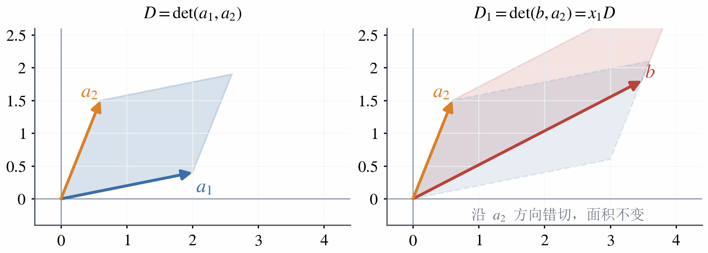

**讲解例题：约分不删除适用条件。** 取

\[
A=\begin{pmatrix}a&1&0\\1&a&1\\0&1&a\end{pmatrix},\quad
b=\begin{pmatrix}1\\\lambda\\1\end{pmatrix}.
\]

沿第一行展开，\(D=a(a^2-1)-1\cdot(a-0)=a(a^2-1)-a=a(a^2-2)\)。把第二列换成 \(b\) 后，同样沿第一行展开，得 \(D_2=a(a\lambda-1)-a=a(a\lambda-2)\)。当 \(D\ne0\)，即 \(a\ne0,\pm\sqrt2\) 时，由克莱默法则

\[
x_2=\frac{a\lambda-2}{a^2-2}.
\]

这个结果在约分时消去了公因子 \(a\)，看起来 \(a=0\) 时分母 \(-2\) 不为零，似乎公式仍能用。但这是错觉：\(a=0\) 时原来的 \(D\) 等于零，克莱默法则本身就不适用，约分不能把这个适用条件一并消掉。凡是 \(D=0\) 的参数值，都要代回原方程组单独讨论。

\(a=0\) 时，第一个和第三个方程都变成 \(x_2=1\)，第二个方程为 \(x_1+x_3=\lambda\)。\(x_3\) 可以任取，记为 \(\lambda-t\)，则 \(x_1=t\)，通解是 \((t,1,\lambda-t)\)，有无穷多解，与上面公式给出的唯一值情形完全不同。

\(a=\pm\sqrt2\) 时，第一个方程为 \(ax_1+x_2=1\)，第三个方程为 \(x_2+ax_3=1\)，两式相减得 \(a(x_1-x_3)=0\)，即 \(x_1=x_3\)；记其为 \(t\)，则 \(x_2=1-at\)。代入中间的方程 \(x_1+ax_2+x_3=\lambda\)，得 \(2t+a(1-at)=\lambda\)，由于 \(a^2=2\)，左边化为 \(2t+a-2t=a\)，即条件 \(a=\lambda\)。因此当 \(\lambda=a\) 时，方程组有通解 \((t,1-at,t)\)；当 \(\lambda\ne a\) 时，中间的方程无法满足，方程组无解。分母为零时，不能用一个已经失去意义的分式去代替这些讨论。

使用克莱默法则的步骤可以归纳为：

1. 确认方程个数等于未知数个数，并计算系数行列式 \(D\)。
2. 若 \(D\ne0\)，依次把第 \(j\) 列换成常数列，计算 \(D_1,\ldots,D_n\)，由 \(x_j=D_j/D\) 写出唯一解。
3. 若 \(D=0\)，克莱默法则不再适用，改用消元法判断方程组是无解还是有无穷多解。
4. 含参数时，先求出使 \(D=0\) 的全部参数值，对它们逐一代回原方程组讨论，不能用约分后的公式代替。

克莱默法则主要用于理论分析和二、三阶的小方程组。\(n\) 个未知数需要计算 \(n+1\) 个 \(n\) 阶行列式，阶数稍高时计算量远大于消元法。

## 第七章 向量空间、基与解空间

### 7.1 线性组合与线性无关

给定一组向量 \(v_1,\ldots,v_k\)，用任意数作系数相加得到的向量 \(c_1v_1+\cdots+c_kv_k\) 称为它们的线性组合，所有线性组合构成的集合称为这组向量的张成空间。例如平面上两个不共线的向量可以张成整个平面，同一直线上的两个向量只能张成这条直线。

一组向量线性无关，是指只有全部系数为零的组合才等于零向量：

\[
c_1v_1+\cdots+c_kv_k=0\Rightarrow c_1=\cdots=c_k=0.
\]

反之，如果存在系数不全为零的组合等于零向量，这组向量就线性相关。这时可以把某个系数不为零的向量移到等号一边，用其余向量表示出来，说明它是多余的，去掉它不会缩小张成空间。

判断线性相关时，只检查两两之间是否成比例是不够的。例如 \((1,0),(0,1),(1,1)\) 中任意两个都不平行，但第三个等于前两个之和，即 \((1,0)+(0,1)-(1,1)=0\)，整组向量仍然线性相关。

基是指一组既线性无关、又能张成整个空间的向量：线性无关保证没有多余的向量，张成保证没有缺少的方向。一个空间中任何一组基包含的向量个数都相同，这个数称为空间的维数。维数说的是基中向量的个数，不是向量分量的最大值。向量在一组指定的基下的坐标，就是用这组基表示它时的线性组合系数。换一组基，坐标会改变，但向量本身（几何上的那支箭头）并没有改变。

**讲解例题：坐标与基矩阵。** 在平面中取 \(v_1=(1,1)^T\)、\(v_2=(1,-1)^T\)。以它们为列的矩阵行列式为 \(1\cdot(-1)-1\cdot1=-2\ne0\)，所以两向量线性无关，构成平面的一组基。对向量 \(w=(3,1)^T\)，求它在这组基下的坐标，即求 \(c_1,c_2\) 使 \(w=c_1v_1+c_2v_2\)。比较两个分量，得 \(c_1+c_2=3\)、\(c_1-c_2=1\)，两式相加得 \(c_1=2\)，再得 \(c_2=1\)。验算：\(2(1,1)^T+1\cdot(1,-1)^T=(3,1)^T\)。

于是同一个向量 \(w\) 在标准基下的坐标是 \((3,1)^T\)，在新基 \(\mathcal B=\{v_1,v_2\}\) 下的坐标是 \((2,1)^T\)。以新基向量为列组成的矩阵 \(P=(v_1,v_2)\) 称为基矩阵，它把新坐标换算成标准坐标：\(w=P[w]_{\mathcal B}\)。这两个坐标列描述的是同一个向量，但数值不同，不能把它们当作同一个数表直接比较。反过来，由标准坐标求新坐标，要用基矩阵的逆：

\[
[w]_{\mathcal B}=P^{-1}w .
\]

本例中 \(P^{-1}=\frac12\begin{pmatrix}1&1\\1&-1\end{pmatrix}\)，代入得 \([w]_{\mathcal B}=\frac12(3+1,\,3-1)^T=(2,1)^T\)，与上面解方程的结果一致。

判断一组向量 \(v_1,\ldots,v_k\) 是否线性相关，可按以下步骤：

1. 以这些向量为列组成矩阵 \(V=(v_1,\ldots,v_k)\)。
2. 用行变换把 \(V\) 化为阶梯形，求出秩 \(r(V)\)。
3. 若 \(r(V)=k\)，向量组线性无关；若 \(r(V)<k\)，线性相关。
4. 若向量个数与维数相同（\(V\) 为方阵），也可以直接看 \(\det V\) 是否为零。
5. 相关时，阶梯形中主元所在的列对应原向量组的一个极大线性无关组，其余向量可以由它们线性表示。

由第 3 步还可以看出：\(\mathbb R^n\) 中任意 \(n+1\) 个向量一定线性相关，因为 \(n\) 行矩阵的秩不超过 \(n\)。

### 7.2 齐次与非齐次解的结构

齐次方程组 \(Ax=0\) 的解有一个重要性质：两个解相加仍是解（因为 \(A(x+y)=Ax+Ay=0\)），一个解乘以任意数仍是解（因为 \(A(cx)=cAx=0\)）。所以全体解构成一个向量空间，称为 \(A\) 的零空间，记作 \(\ker A\)。它的维数等于自由变量的个数，即 \(n-r(A)\)。

非齐次方程组 \(Ax=b\) 的解集不再是向量空间（例如零向量不是解），但它的结构可以通过齐次方程组来描述。设已经找到一个特解 \(x_p\)，即 \(Ax_p=b\)。对任意解 \(x\)，有 \(A(x-x_p)=b-b=0\)，所以 \(x-x_p\) 属于零空间；反过来，特解加上零空间中任何一个向量也都是解。因此

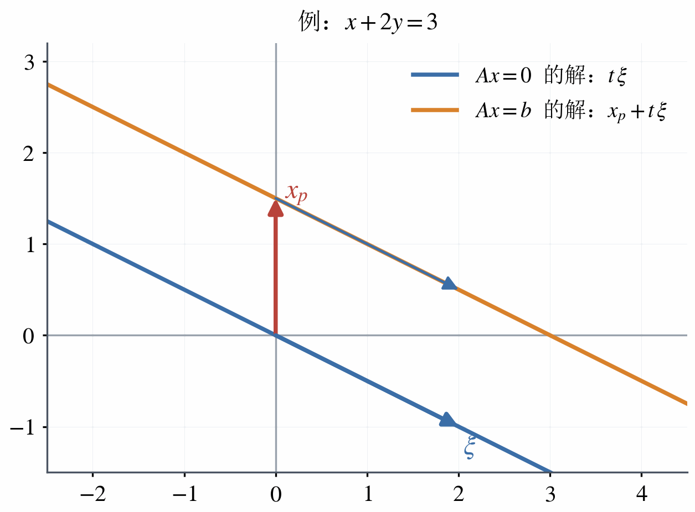

\[
x=x_p+z,\qquad z\in\ker A.
\]

这就是“非齐次通解等于一个特解加上齐次通解”的含义。

例如方程 \(x+2y-z=3\) 中，\(y\) 和 \(z\) 是自由变量。令 \(y=s,z=t\)，则 \(x=3-2s+t\)，写成向量形式为

\[
(x,y,z)=(3,0,0)+s(-2,1,0)+t(1,0,1).
\]

其中 \((3,0,0)\) 是一个特解（取 \(s=t=0\)）；两个方向向量 \((-2,1,0)\) 和 \((1,0,1)\) 线性无关，并且都满足对应的齐次方程 \(x+2y-z=0\)，它们构成零空间的一组基，称为基础解系。特解不属于基础解系。几何上，解集是把过原点的平面 \(x+2y-z=0\) 平移后得到的平面，它不经过原点，因此不是向量子空间。

求非齐次方程组通解的步骤是：

1. 对增广矩阵做行变换化为阶梯形，比较 \(r(A)\) 与 \(r(A\mid b)\)，确认方程组有解。
2. 确定主元变量和自由变量，自由变量共 \(n-r(A)\) 个。
3. 令全部自由变量为零，回代求出一个特解 \(x_p\)。
4. 把右端换成零（即对齐次方程组），令自由变量依次取一个为一、其余为零，回代得到 \(n-r(A)\) 个解，它们构成基础解系 \(\xi_1,\ldots,\xi_{n-r}\)。
5. 写出通解 \(x=x_p+c_1\xi_1+\cdots+c_{n-r}\xi_{n-r}\)，其中 \(c_i\) 为任意常数。

对 \(n\) 阶实方阵 \(A\)，下面各条相互等价，只要其中一条成立，其余各条都成立：

1. \(A\) 可逆；
2. \(r(A)=n\)，即满秩；
3. \(\det A\ne0\)；
4. 齐次方程组 \(Ax=0\) 只有零解；
5. 对任意右端 \(b\)，方程 \(Ax=b\) 都有唯一解；
6. \(A\) 的列向量组（或行向量组）线性无关，构成 \(\mathbb R^n\) 的一组基；
7. 零不是 \(A\) 的特征值（见第八章）；
8. \(A\) 可以写成若干个初等矩阵的乘积，即能用行变换化为单位矩阵。但这一串等价关系只适用于方阵，讨论非方阵时不能原封不动地套用，例如非方阵根本没有行列式。

## 第八章 特征值、特征空间与对角化

### 8.1 先求特征值，再求全部对应向量

一般来说，矩阵作用在向量上会同时改变向量的长度和方向。但有些特殊的方向，矩阵只把向量拉长或缩短（或者反向），不改变它所在的直线。这些方向反映了变换最本质的结构。

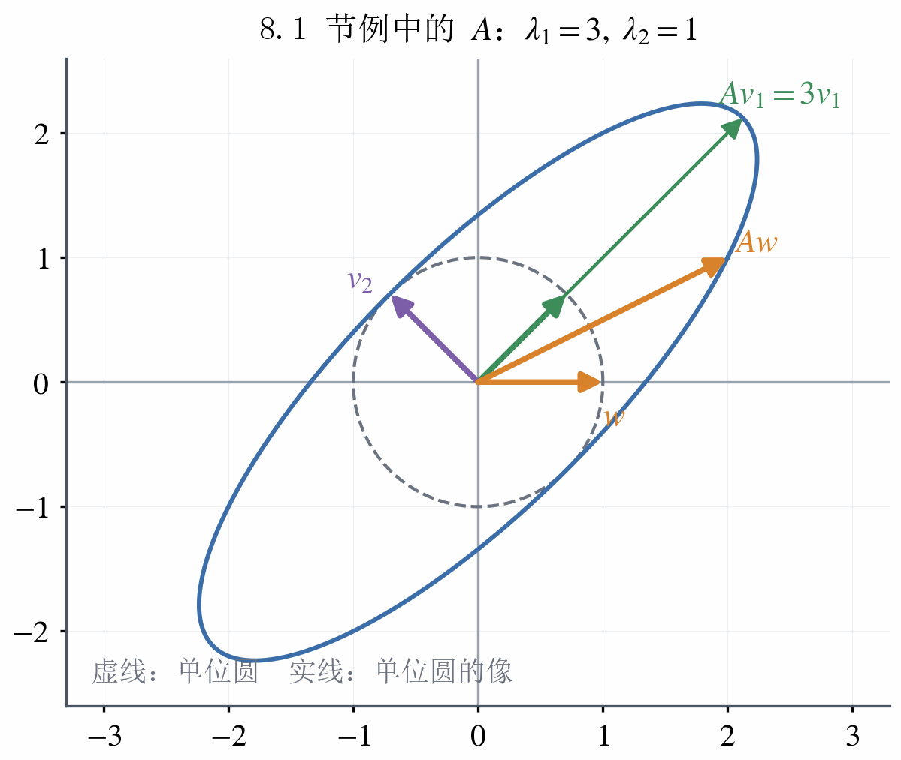

准确地说，若非零向量 \(v\) 满足 \(Av=\lambda v\)，就称 \(v\) 为矩阵 \(A\) 的特征向量，数 \(\lambda\) 为对应的特征值，它表示沿这个方向的伸缩倍数。定义中排除零向量，是因为零向量对任何 \(\lambda\) 都满足这个等式，无法确定任何特殊方向。

求解时，把等式改写为 \((A-\lambda I)v=0\)。这是一个以 \(v\) 为未知量的齐次方程组，它有非零解的充要条件是系数矩阵不可逆，即 \(\det(A-\lambda I)=0\)。这个关于 \(\lambda\) 的方程称为特征方程，它的根就是特征值。所以计算分两步：先由特征方程求出全部特征值，再对每个特征值解齐次方程组，求出全部特征向量。求出特征值只完成了一半，不能把特征值直接当作特征向量的分量。

求特征值与特征向量的步骤是：

1. 写出 \(A-\lambda I\)（或 \(\lambda I-A\)），计算特征多项式 \(\det(A-\lambda I)\)。
2. 解特征方程 \(\det(A-\lambda I)=0\)，求出全部特征值，并记下每个根的重数。
3. 对每个特征值 \(\lambda_i\)，解齐次方程组 \((A-\lambda_iI)x=0\)，求出基础解系。
4. 属于 \(\lambda_i\) 的全部特征向量是基础解系的非零线性组合。
5. 用 \(Av=\lambda v\) 验算，并检查特征值之和是否等于迹、之积是否等于行列式（见 8.3 节）。

对二阶矩阵，特征多项式可以直接写出：

\[
\det(\lambda I-A)=\lambda^2-(\operatorname{tr}A)\,\lambda+\det A .
\]

下面几个事实可以省去大量计算：三角矩阵（包括对角矩阵）的特征值就是它的对角元，因为 \(\lambda I-A\) 仍是三角矩阵，行列式等于对角元之积 \(\prod_i(\lambda-a_{ii})\)；\(A\) 与 \(A^T\) 有相同的特征值，因为 \(\det(\lambda I-A^T)=\det((\lambda I-A)^T)=\det(\lambda I-A)\)，但两者的特征向量一般不同；相似矩阵有相同的特征多项式，因为

\[
\det(\lambda I-P^{-1}AP)=\det\bigl(P^{-1}(\lambda I-A)P\bigr)=\det(\lambda I-A).
\]

所以相似矩阵的特征值、迹和行列式都相同。最后，\(A\) 可逆当且仅当零不是它的特征值，因为 \(\lambda=0\) 是特征值等价于 \(Ax=0\) 有非零解。

**讲解例题：非对角矩阵的特征结构。** 取

\[
A=\begin{pmatrix}2&1\\1&2\end{pmatrix}.
\]

特征方程为 \(\det(A-\lambda I)=(2-\lambda)^2-1=0\)，即 \(2-\lambda=\pm1\)，得 \(\lambda=3\) 或 \(\lambda=1\)。

对 \(\lambda=3\)，方程组 \((A-3I)v=0\) 的系数矩阵为 \(\begin{pmatrix}-1&1\\1&-1\end{pmatrix}\)，两行成比例，只剩一个方程 \(-x+y=0\)，即 \(y=x\)。全部特征向量为 \(t(1,1)^T\)，\(t\ne0\)。对 \(\lambda=1\)，系数矩阵为 \(\begin{pmatrix}1&1\\1&1\end{pmatrix}\)，方程为 \(x+y=0\)，全部特征向量为 \(s(1,-1)^T\)，\(s\ne0\)。几何上，这个矩阵把沿直线 \(y=x\) 的向量放大三倍，沿直线 \(y=-x\) 的向量保持不变。

对一个特征值，方程 \((A-\lambda I)v=0\) 的全部解（包括零向量）构成一个子空间，称为该特征值的特征空间。而“全部特征向量的集合”不含零向量，所以它本身不是子空间，两者相差的只是零向量。

再看对角矩阵 \(A=\operatorname{diag}(a,b)\)。若 \(a\ne b\)，它的特征向量分别沿两条坐标轴，特征值就是对角元。若 \(a=b\)，则 \(A=aI\)，它把每个向量都放大 \(a\) 倍，任何非零向量都是特征向量。这是一个特征值重复出现时、可能拥有多个独立特征方向的最简单例子。

许多教材把特征向量满足的方程写成 \((\lambda E-A)x=0\)，其中 \(E\) 就是单位矩阵 \(I\)。由于 \(\lambda E-A=-(A-\lambda I)\)，两者只差一个整体负号，解集完全相同；对应的特征方程 \(\det(\lambda E-A)\) 与 \(\det(A-\lambda I)\) 也只差因子 \((-1)^n\)，根相同。

**讲解例题：用秩判断哪些行可以舍去。** 取实对称矩阵

\[
A=\begin{pmatrix}17&-2&-2\\-2&14&-4\\-2&-4&14\end{pmatrix}.
\]

它的迹（主对角线之和）为 45，行列式为 2916，特征值为 \(18,18,9\)。可以用 8.3 节的关系验算：特征值之和 \(18+18+9=45\) 等于迹，特征值之积 \(18\cdot18\cdot9=2916\) 等于行列式。现在求 \(\lambda=9\) 对应的特征向量，需要解

\[
(9E-A)x=0,\qquad
9E-A=\begin{pmatrix}-8&2&2\\2&-5&4\\2&4&-5\end{pmatrix}.
\]

按常规消元，可以先交换第一、二行，使首行首元为 2，便于消去下面两行的首元；然后令第二行（即原来的第一行）加上第一行的四倍、第三行减去第一行，分别得到 \((0,-18,18)\) 与 \((0,9,-9)\)。前者恰好是后者的 \(-2\) 倍，把它加上后者的两倍就成为零行；最后把 \((0,9,-9)\) 除以 9：

\[
\begin{pmatrix}-8&2&2\\2&-5&4\\2&4&-5\end{pmatrix}
\to
\begin{pmatrix}2&-5&4\\0&9&-9\\0&0&0\end{pmatrix}
\to
\begin{pmatrix}2&-5&4\\0&1&-1\\0&0&0\end{pmatrix}.
\]

零行的出现是必然的。因为 9 是特征值，\(\det(9E-A)=0\)，系数矩阵不满秩，消元后至少会出现一个零行。如果消完之后没有零行，说明前面的计算出了错，这一点可以用来检查。

还有一种更省事的做法：先判断秩，再直接舍去多余的方程。系数矩阵不满秩，所以秩不超过 2；而第二、三行 \((2,-5,4)\) 与 \((2,4,-5)\) 不成比例，线性无关，所以秩恰好为 2。三行中只有两行独立，既然后两行已经独立，第一行必定能由它们线性表示。事实上，第二行加第三行为 \((4,-1,-1)\)，乘以 \(-2\) 正好是 \((-8,2,2)\)。所以第一个方程可以由后两个推出，删去它不改变解集，只需对后两行消元：第三行减第二行得 \((0,9,-9)\)，与上面的结果相同。

一般地，若 \(n\) 阶方阵对某个特征值的 \(\lambda E-A\) 秩为 \(n-1\)，只要选出 \(n-1\) 个确实线性无关的行，其余的行就可以不参与消元。这里的前提是先确认所选的行线性无关；如果仅仅因为某一行“看起来复杂”就把它删掉，而它恰好是独立的约束，就会得到错误的解。

化简后的方程为 \(x_2-x_3=0\) 与 \(2x_1-5x_2+4x_3=0\)。由第一式 \(x_2=x_3\)，代入第二式得 \(2x_1-5x_3+4x_3=0\)，即 \(2x_1-x_3=0\)，\(x_1=x_3/2\)。这里 \(x_3\) 是自由变量。取 \(x_3=1\) 会得到分量 \(1/2\)；为了避免分数，取 \(x_3=2\)，得到整数形式的基础解系

\[
\alpha_3=(1,2,2)^T.
\]

自由变量取任何非零值都是正确的，取 2 只是为了让分量都是整数。\(\lambda=9\) 的全部特征向量为 \(k(1,2,2)^T\)，\(k\ne0\)。验算：\(A\alpha_3=(17-4-4,\,-2+28-8,\,-2-8+28)^T=(9,18,18)^T=9\alpha_3\)，确实满足定义。

作为对照，再看 \(\lambda=18\)。\(18E-A\) 的三行为 \((1,2,2)\)、\((2,4,4)\)、\((2,4,4)\)，后两行都是第一行的两倍，秩为 1，只剩一个方程 \(x_1+2x_2+2x_3=0\)，有两个自由变量。分别令 \((x_2,x_3)=(1,0)\) 和 \((0,1)\)，得到基础解系 \((-2,1,0)^T\)、\((-2,0,1)^T\)。所以二重特征值 18 对应一个二维的特征空间。这两个向量与 \(\alpha_3\) 的内积都为零，例如 \((-2)\cdot1+1\cdot2+0\cdot2=0\)，这正是 8.4 节要证明的结论：实对称矩阵属于不同特征值的特征向量互相正交。

### 8.2 对角化是换到特征向量构成的基

对角矩阵的作用最简单：它只是把每个坐标分别乘一个数。对角化的想法是，如果能找到一组由特征向量构成的基，那么在这组基下，矩阵就变成对角矩阵。

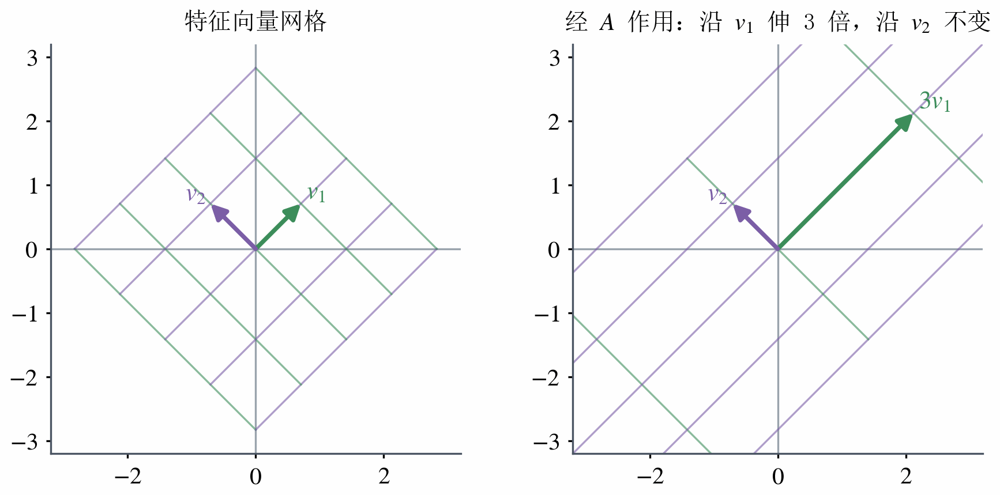

具体地说，设 \(A\) 有 \(n\) 个线性无关的特征向量 \(p_1,\ldots,p_n\)，对应特征值为 \(\lambda_1,\ldots,\lambda_n\)。把这些特征向量按列排成矩阵 \(P\)，把对应的特征值按相同顺序放在对角矩阵 \(D\) 的对角线上。由 \(Ap_i=\lambda_ip_i\) 逐列比较，得 \(AP=PD\)。因为 \(P\) 的各列线性无关，\(P\) 可逆，于是 \(P^{-1}AP=D\)。对上一小节的第一个例子，可以取

\[
P=\begin{pmatrix}1&1\\1&-1\end{pmatrix},\quad
P^{-1}=\frac12\begin{pmatrix}1&1\\1&-1\end{pmatrix},\quad D=\begin{pmatrix}3&0\\0&1\end{pmatrix}.
\]

对角化的一个重要用途是计算矩阵的幂。由 \(A=PDP^{-1}\)，有 \(A^2=PDP^{-1}PDP^{-1}=PD^2P^{-1}\)，中间的 \(P^{-1}P\) 抵消；一般地 \(A^k=PD^kP^{-1}\)，而对角矩阵的幂只需把对角元分别取幂。代入计算得

\[
A^k=\frac12\begin{pmatrix}3^k+1&3^k-1\\3^k-1&3^k+1\end{pmatrix},\qquad k\ge0.
\]

可以用 \(k=1\) 检验：右边为 \(\frac12\begin{pmatrix}4&2\\2&4\end{pmatrix}=A\)。这说明了对角化的意义：在特征向量构成的坐标系中，矩阵反复作用只是让每个坐标分别乘上自己的特征值。

关于能否对角化，有一个常用的充分条件。属于不同特征值的特征向量一定线性无关，所以 \(n\) 阶矩阵若有 \(n\) 个互不相同的特征值，就一定有 \(n\) 个独立的特征向量，可以对角化。但这个条件不是必要的：特征值有重复时，只要特征向量仍然够 \(n\) 个独立的，也可以对角化，例如单位矩阵。

准确的判断条件要用到两种重数。特征值 \(\lambda_i\) 作为特征方程的根的重数，称为代数重数，记作 \(n_i\)；它的特征空间的维数称为几何重数，等于 \(n-r(A-\lambda_iI)\)。几何重数总在一与代数重数之间。\(n\) 阶矩阵可以对角化，当且仅当每个特征值的几何重数都等于代数重数：

\[
n-r(A-\lambda_iI)=n_i\qquad\text{对每个特征值 }\lambda_i\text{ 成立}.
\]

这时把各特征空间的基合在一起，恰好得到 \(n\) 个线性无关的特征向量。

对角化的步骤是：

1. 求出全部特征值及其代数重数。
2. 对每个特征值求特征空间的基础解系，检查几何重数是否等于代数重数；只要有一个不相等，矩阵就不能对角化。
3. 把全部基础解系向量按列排成矩阵 \(P\)。
4. 把对应的特征值按同样的顺序排在对角矩阵 \(D\) 的对角线上，同一特征值有几个基向量就重复几次。
5. 得到 \(P^{-1}AP=D\)；可以用 \(AP=PD\) 验算，以免计算 \(P^{-1}\)。

**讲解例题：重复根与独立方向。** 对

\[
J=\begin{pmatrix}2&1\\0&2\end{pmatrix},
\]

特征多项式为 \((2-\lambda)^2\)，\(\lambda=2\) 是二重根，称它的代数重数为二。但方程 \((J-2I)v=0\) 的系数矩阵为 \(\begin{pmatrix}0&1\\0&0\end{pmatrix}\)，只给出一个条件 \(y=0\)，特征向量只有 \(t(1,0)^T\) 一个方向，特征空间的维数为一，称几何重数为一。两个独立的特征向量凑不齐，所以 \(J\) 不能对角化。

但 \(J\) 是可逆的，它的行列式为四。反过来，\(\operatorname{diag}(0,1)\) 本身已经是对角矩阵，却不可逆。可见可逆性与能否对角化回答的是不同的问题：前者看特征值中有没有零，后者看特征向量够不够多。

实矩阵也可能没有实特征值。例如把平面上的向量逆时针旋转九十度的矩阵 \(\begin{pmatrix}0&-1\\1&0\end{pmatrix}\)，特征方程是 \(\lambda^2+1=0\)，没有实根：旋转九十度后，没有任何非零向量还停在原来的直线上。所以它在实数范围内不能对角化；但在复数范围内，它有两个不同的特征值 \(\pm i\)，可以对角化。判断能否对角化时，必须说明是在哪个数的范围（数域）内讨论。实对称矩阵则总有一组两两正交的单位特征向量，可以取正交矩阵 \(Q\)（满足 \(Q^TQ=I\)），使 \(Q^TAQ\) 成为对角矩阵。这一性质将用于二次型、惯性张量和优化问题中的曲率分析。

### 8.3 特征值与迹、行列式和矩阵多项式

矩阵的迹是主对角线元素之和，记作 \(\operatorname{tr}A=\sum_i a_{ii}\)。它与特征值有简单的关系。把特征多项式取为 \(p_A(t)=|tI-A|\)，它是 \(t\) 的 n 次多项式，最高次项为 \(t^n\)。再看次高次项 \(t^{n-1}\) 的系数：在行列式展开中，要凑出 n−1 个 t，必须在 n−1 个对角位置选 t，剩下的一个位置只能选同一行同一列上的对角元 \(-a_{ii}\)，所以这一项的系数是 \(-\operatorname{tr}A\)。常数项是令 \(t=0\) 时的值，即 \(|-A|=(-1)^n|A|\)。

另一方面，在复数范围内，n 次多项式可以分解为 \((t-\lambda_1)\cdots(t-\lambda_n)\)，其中每个特征根按它的重数重复计入。展开后，\(t^{n-1}\) 的系数是 \(-(\lambda_1+\cdots+\lambda_n)\)，常数项是 \((-1)^n\lambda_1\cdots\lambda_n\)。比较两种写法的系数，得到

\[
\sum_{i=1}^{n}\lambda_i=\operatorname{tr}A,
\qquad
\prod_{i=1}^{n}\lambda_i=|A|.
\]

这两个关系不要求 A 能够对角化。对上一小节的 J，两个特征根都是二，和为四、积为四，恰好等于它的迹和行列式，尽管它的特征向量不足以构成一组基。这两个关系常用来检验算出的特征值是否正确，但不能代替求根：对二阶矩阵，知道和与积就能解出两个特征值；对三阶及更高阶矩阵，仅凭和与积还不够，特征多项式的其他系数也需要知道。

特征向量对矩阵的多项式同样适用。若 \(Av=\lambda v\)，则 \(A^2v=A(\lambda v)=\lambda Av=\lambda^2v\)，反复作用得 \(A^kv=\lambda^kv\)。对多项式 \(f(t)=c_0+c_1t+\cdots+c_mt^m\)，把各项分别作用在 \(v\) 上再相加，有

\[
f(A)v=f(\lambda)v.
\]

所以同一个特征向量，对 \(A+aI\)、\(cA\)、\(A^k\) 的对应特征值分别为 \(\lambda+a\)、\(c\lambda\)、\(\lambda^k\)。若 A 可逆，则它的特征值都不为零（否则 \(Av=0\) 有非零解，与可逆矛盾），在 \(Av=\lambda v\) 两边左乘 \(A^{-1}\) 并除以 \(\lambda\)，得到 \(A^{-1}v=\lambda^{-1}v\)。这些结论只需要一个特征向量就能推出；如果要写成整个矩阵的公式 \(f(A)=Pf(D)P^{-1}\)，则需要事先有一组完整的特征向量基，即 A 可对角化。

**讲解例：由一次分解计算一组变换。** 对本章的 \(A=\begin{pmatrix}2&1\\1&2\end{pmatrix}\)，两个特征值为三和一。设 \(B=A^2-4A+3I\)，则 B 对应的特征值为 \(f(3)=3^2-4\cdot3+3=0\) 与 \(f(1)=1-4+3=0\)。由于本例中 A 可对角化，在特征向量构成的基下 B 的矩阵是 \(\operatorname{diag}(0,0)\)，即零矩阵，所以 \(A^2-4A+3I=0\)。由此还可以得到逆矩阵：整理为 \(A(4I-A)=3I\)，所以 \(A^{-1}=(4I-A)/3\)。

但要注意，不能仅凭“B 的特征值全为零”就对任意矩阵断言 B=0。例如 \(\begin{pmatrix}0&1\\0&0\end{pmatrix}\) 不是零矩阵，它的特征值却只有零；它恰好是不能对角化的矩阵。上面的推理用到了 A 可对角化这一条件。

细心观察会发现，上例中的 \(t^2-4t+3\) 正是 A 的特征多项式 \(\lambda^2-(\operatorname{tr}A)\lambda+\det A=\lambda^2-4\lambda+3\)。这不是巧合，而是一个对所有方阵都成立的定理，称为凯莱—哈密顿定理：把矩阵代入它自己的特征多项式，结果是零矩阵，

\[
p_A(A)=0,\qquad p_A(t)=|tI-A| .
\]

对二阶矩阵，就是 \(A^2-(\operatorname{tr}A)A+(\det A)I=0\)，可以直接展开验证。对可对角化的矩阵，上面的论证已经说明了原因：每个特征值都是特征多项式的根，所以在特征基下 \(p_A(A)\) 的每个对角元都为零。定理对不能对角化的矩阵同样成立（例如 J 满足 \((J-2I)^2=0\)），一般证明需要用到伴随矩阵，这里不展开。它的一个用途是降低矩阵幂的次数和求逆：由 \(A^2-4A+3I=0\) 可得 \(A^2=4A-3I\)，任何高次幂都能化为 \(A\) 和 \(I\) 的组合；当 \(\det A\ne0\) 时，把常数项移到一边再除以它，就得到 \(A^{-1}\) 的多项式表示，正如上例所做的那样。

### 8.4 正交对角化与二次型

实对称矩阵（满足 \(A=A^T\)）有特别好的性质：属于不同特征值的特征向量互相正交。证明如下。设 \(Av=\lambda v\)、\(Aw=\mu w\)，且 \(\lambda\ne\mu\)。一方面 \(v^TAw=v^T(\mu w)=\mu v^Tw\)；另一方面，由于 \(A^T=A\)，\(v^TAw=(A^Tv)^Tw=(Av)^Tw=\lambda v^Tw\)。两式相减得 \((\lambda-\mu)v^Tw=0\)，而 \(\lambda\ne\mu\)，只能 \(v^Tw=0\)，即两向量正交。

对于重特征值，它的特征空间内部也可以选取两两正交的单位向量（例如用第十章的格拉姆—施密特方法）。把所有特征值的正交单位特征向量合在一起，就得到一个正交矩阵 Q，使 \(Q^TAQ=D\)，即 \(A=QDQ^T\)。由于正交矩阵的逆就是它的转置，这样的对角化计算起来格外方便，称为正交对角化。

正交对角化的一个重要应用是二次型。形如 \(x^TAx\)（\(A\) 对称）的表达式称为二次型，它是各分量的二次齐次多项式。作换元 \(x=Qz\)，则 \(x^TAx=z^TQ^TAQz=z^TDz=\sum_i\lambda_i z_i^2\)，交叉项全部消失，只剩各平方项，系数就是特征值。由此可以判断二次型的符号：若全部特征值都为正，则对任意非零 x 都有 \(x^TAx>0\)，称为正定；若全部特征值都非负，称为半正定；若特征值有正有负，二次型能取正值也能取负值，称为不定。注意只看 \(|A|>0\) 不足以判断正定。例如 \(-I_2\) 的行列式为一，但它的两个特征值都是负一，二次型 \(-x^2-y^2\) 处处非正。

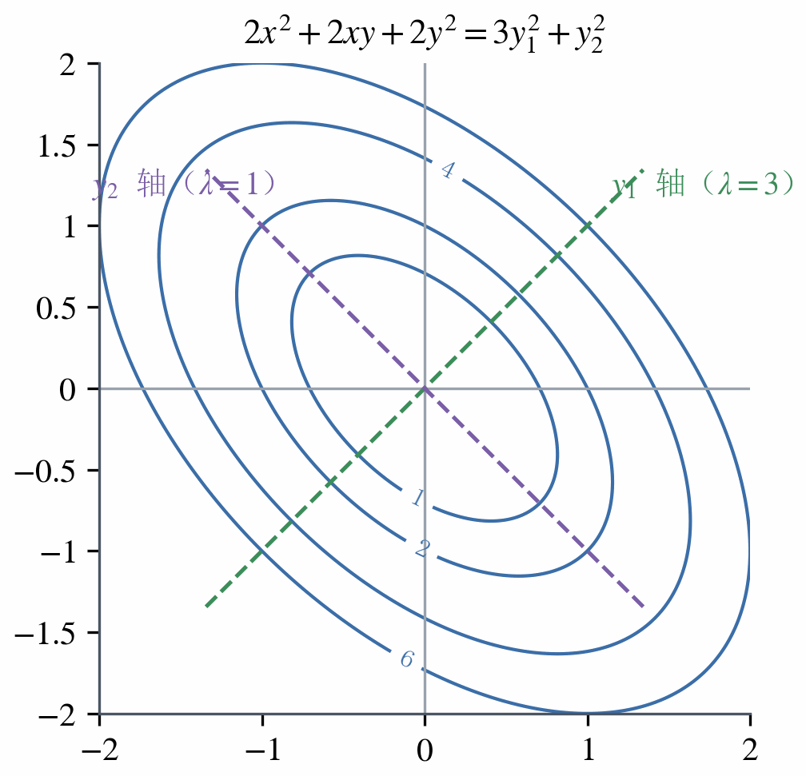

以本章的 A 为例，对应的二次型为 \(2x^2+2xy+2y^2\)。取 \(z_1=(x+y)/\sqrt2\)、\(z_2=(x-y)/\sqrt2\)，它化为 \(3z_1^2+z_2^2\)，两个系数都为正，所以这个二次型严格正定，即除 \(x=y=0\) 外总是正的。同一次换基既给出了特征值，也消去了二次曲线 \(2x^2+2xy+2y^2=1\) 中的交叉项 \(xy\)；下一册《解析几何》将利用这一点识别旋转后的二次曲线。

**正交矩阵的性质。** 满足 \(Q^TQ=I\) 的方阵称为正交矩阵，等价于 \(Q^{-1}=Q^T\)，也等价于它的各列（或各行）是两两正交的单位向量。正交矩阵有以下性质：

\[
\|Qx\|=\|x\|,\qquad \langle Qx,Qy\rangle=\langle x,y\rangle,\qquad \det Q=\pm1 .
\]

前两式说明正交变换保持长度和夹角，几何上就是旋转或反射：\(\|Qx\|^2=x^TQ^TQx=x^Tx\)。第三式由 \(\det(Q^TQ)=(\det Q)^2=\det I=1\) 得到；行列式为一的是旋转，为负一的包含一次反射。两个正交矩阵的乘积仍是正交矩阵。正是因为正交变换不改变长度和角度，用它化简二次型时，曲线的形状和大小都不会改变。

正交对角化实对称矩阵的步骤是：

1. 求出全部特征值。
2. 对每个特征值求特征空间的基础解系。
3. 对重特征值的基础解系做格拉姆—施密特正交化（见 10.3 节）；不同特征值的特征向量已经正交，不必处理。
4. 把所有向量单位化，按列排成正交矩阵 \(Q\)。
5. 得到 \(Q^TAQ=D\)，\(D\) 的对角元按相同顺序排列对应的特征值。

**正定性的顺序主子式判别法。** 判断实对称矩阵是否正定，除了求出全部特征值，还可以看它的顺序主子式，即左上角 \(1\times1\)、\(2\times2\)、……、\(n\times n\) 子矩阵的行列式 \(\Delta_1,\ldots,\Delta_n\)。西尔维斯特判别法指出：

\[
A\ \text{正定}\iff \Delta_1>0,\ \Delta_2>0,\ \ldots,\ \Delta_n>0 .
\]

这个方法不需要解特征方程，计算量小。例如本章的 \(A=\begin{pmatrix}2&1\\1&2\end{pmatrix}\)，\(\Delta_1=2>0\)，\(\Delta_2=3>0\)，所以正定，与特征值三和一都为正的结论一致。对 8.1 节的三阶矩阵，\(\Delta_1=17\)，\(\Delta_2=17\cdot14-4=234\)，\(\Delta_3=2916\)，全为正，也是正定，与特征值 \(18,18,9\) 一致。注意这个判别法只用于判断正定；判断负定时，应改看 \(-A\) 是否正定，即 \(\Delta_k\) 的符号正负交替、从负号开始。

## 第九章 代数余子式的结构应用

代数余子式还有一个巧妙的用法。如果遇到形如 \(\sum_j b_jC_{ij}\) 的式子（\(C_{ij}\) 是原矩阵第 \(i\) 行元素的代数余子式），可以把原矩阵的第 \(i\) 行换成 \((b_1,\ldots,b_n)\)，再沿这一行展开：展开式正好就是这个和式。之所以可以这样做，是因为计算第 \(i\) 行的代数余子式时，第 \(i\) 行本来就被删掉了，换掉它不影响这些余子式的值。

例如第五章中矩阵 \(B\) 的第一行代数余子式为 \((7,-5,6)\)。若要计算 \(C_{11}+C_{12}+C_{13}\)，只需把第一行换成 \((1,1,1)\)，所得行列式沿第一行展开就是 \(7-5+6=8\)，不必重新计算全部小行列式。

更一般地，对任意列向量 \(u,v\)，有

\[
\det(A+uv^T)=\det A+v^T\operatorname{adj}(A)u.
\]

这个公式可以由行列式对各列的多线性推出。矩阵 \(uv^T\) 的第 \(j\) 列是 \(v_ju\)，所以 \(A+uv^T\) 的第 \(j\) 列是 \(a_j+v_ju\)。按各列把行列式拆开，每一列要么取 \(a_j\)，要么取 \(v_ju\)：所有列都取 \(a_j\) 时得到原行列式 \(\det A\)；恰好有一列取 \(u\) 的倍数时，得到的项按该列展开是余子式的组合，全部加起来正是 \(v^T\operatorname{adj}(A)u\)；有两列或更多列取 \(u\) 的倍数时，这些列相互成比例，行列式为零。

这个公式不要求 \(A\) 可逆。只有进一步把它写成 \(\det A(1+v^TA^{-1}u)\) 时（利用 \(\operatorname{adj}(A)=\det A\cdot A^{-1}\)），才需要 \(A\) 可逆。明确这一步的条件，可以避免在不可逆矩阵的问题中错误地使用逆矩阵。

## 第十章 内积、正交化与最小二乘

### 10.1 内积把代数结构与长度联系起来

到目前为止，向量空间只规定了加法和数乘，这足以讨论线性组合、维数和方程组，却无法谈论长度和角度。要讨论“两个向量是否垂直”“一个向量有多长”，需要再引入内积。

在实坐标空间中，标准内积就是熟悉的点积：\(\langle x,y\rangle=x^Ty\)，即对应分量相乘再相加。相应的长度为 \(\|x\|=\sqrt{\langle x,x\rangle}\)，两个向量内积为零时称为正交。一般地，实内积应满足三条性质：对称性 \(\langle x,y\rangle=\langle y,x\rangle\)；对每个变量都是线性的；非零向量与自身的内积严格为正。满足这些性质的运算都可以称为内积。换用不同的内积，长度和正交关系也可能随之改变，所以不能只因为坐标相同，就认定几何关系没有改变。

最常用的内积不等式是柯西不等式 \(|\langle x,y\rangle|\le\|x\|\|y\|\)。它可以从“长度的平方不会是负数”推出：对所有实数 \(t\)，都有 \(\|x-ty\|^2\ge0\)。把左边展开为 \(\|y\|^2t^2-2\langle x,y\rangle t+\|x\|^2\)，这是关于 \(t\) 的二次式，它对所有 \(t\) 都非负，所以判别式不能为正：\(4\langle x,y\rangle^2-4\|x\|^2\|y\|^2\le0\)，整理即得柯西不等式。等号成立时，存在某个 \(t\) 使 \(\|x-ty\|^2=0\)，即 \(x=ty\)，两向量线性相关。这个不等式有两个直接用途：它保证由 \(\cos\theta=\langle x,y\rangle/(\|x\|\|y\|)\) 算出的余弦值落在负一到一之间，从而夹角有定义；它也说明一个向量在另一方向上的投影不会比它本身更长。

由内积可以写出一组相互关联的几何公式。两个非零向量的夹角 \(\theta\in[0,\pi]\) 由

\[
\cos\theta=\frac{\langle x,y\rangle}{\|x\|\,\|y\|}
\]

确定。向量 \(x\) 在非零向量 \(y\) 方向上的正交投影为

\[
\operatorname{proj}_y x=\frac{\langle x,y\rangle}{\langle y,y\rangle}\,y ,
\]

\(x\) 减去这个投影后剩下的部分与 \(y\) 正交，下面的格拉姆—施密特方法和最小二乘都建立在这一点上。长度还满足三角不等式

\[
\|x+y\|\le\|x\|+\|y\|,
\]

它由展开 \(\|x+y\|^2=\|x\|^2+2\langle x,y\rangle+\|y\|^2\) 再用柯西不等式得到。若 \(x\) 与 \(y\) 正交，交叉项为零，就得到勾股定理 \(\|x+y\|^2=\|x\|^2+\|y\|^2\)。

一组两两正交且都不为零的向量一定线性无关。证明很简短：设它们的某个线性组合等于零，用其中第 \(i\) 个向量与等式两边取内积。由于两两正交，其他各项的内积全部为零，只剩第 \(i\) 个系数乘以该向量长度的平方，而长度不为零，所以这个系数为零。对每个 \(i\) 都这样做，所有系数都为零。这也说明了正交基计算方便的原因：一个向量在正交基下的坐标，可以直接用它与各基向量的内积（投影）求出，而不必每次求解一个完整的方程组。

### 10.2 格拉姆矩阵与独立性

给定向量 \(v_1,\ldots,v_k\)，把它们两两之间的内积排成矩阵 \(G=(\langle v_i,v_j\rangle)\)，称为格拉姆矩阵。若把这些向量作为列放入矩阵 \(V\)，在标准内积下有 \(G=V^TV\)。格拉姆矩阵是对称的，并且对任何系数向量 \(c\) 都有

\[
c^TGc=\|Vc\|^2=\left\|\sum_i c_iv_i\right\|^2\ge0.
\]

所以格拉姆矩阵是半正定的。进一步，若这组向量线性无关，那么对任何非零的 \(c\)，组合 \(\sum_ic_iv_i\) 都不为零，上式严格大于零，格拉姆矩阵正定，因而可逆；若这组向量线性相关，则存在非零的 \(c\) 使组合为零，于是 \(Vc=0\)，进而 \(Gc=V^TVc=0\)，格拉姆矩阵不可逆。

由此得到一个判断独立性的方法：向量组线性无关，当且仅当格拉姆矩阵的行列式不为零。这个方法的好处是不要求向量矩阵是方阵。例如三维空间中的两个向量排成的是 \(3\times2\) 矩阵，没有行列式，但它们的格拉姆矩阵是二阶方阵，可以计算行列式。

**例题：由格拉姆行列式看面积。** 取 \(v_1=(1,1,0)^T\)、\(v_2=(1,0,1)^T\)。两个向量与自身的内积都是 \(1+1+0=2\)，相互的内积是 \(1\cdot1+1\cdot0+0\cdot1=1\)，所以

\[
G=\begin{pmatrix}2&1\\1&2\end{pmatrix},\qquad\det G=3.
\]

行列式大于零，说明两个向量线性无关。还可以用另一种方法核对：它们的叉积为 \((1,-1,-1)^T\)，模的平方也是三，所以它们张成的平行四边形面积为 \(\sqrt3\)。这不是巧合。一般地，两个向量的格拉姆行列式等于 \(\|v_1\|^2\|v_2\|^2-\langle v_1,v_2\rangle^2\)；把 \(\langle v_1,v_2\rangle=\|v_1\|\|v_2\|\cos\theta\) 代入，得 \(\|v_1\|^2\|v_2\|^2\sin^2\theta\)，正是平行四边形面积的平方。这样，行列式、内积和几何量就联系在一起了。

### 10.3 格拉姆—施密特正交化

给定一组线性无关的向量，常常希望把它换成一组两两正交、张成同一空间的向量，以便利用正交基的计算优势。格拉姆—施密特正交化的做法是：保留第一个向量的方向；从第二个向量中减去它在第一个方向上的投影，剩下的部分就与第一个方向垂直；从第三个向量中减去它在前两个正交方向上的投影；依此类推。记尚未归一化的正交向量为 \(u_j\)，公式为

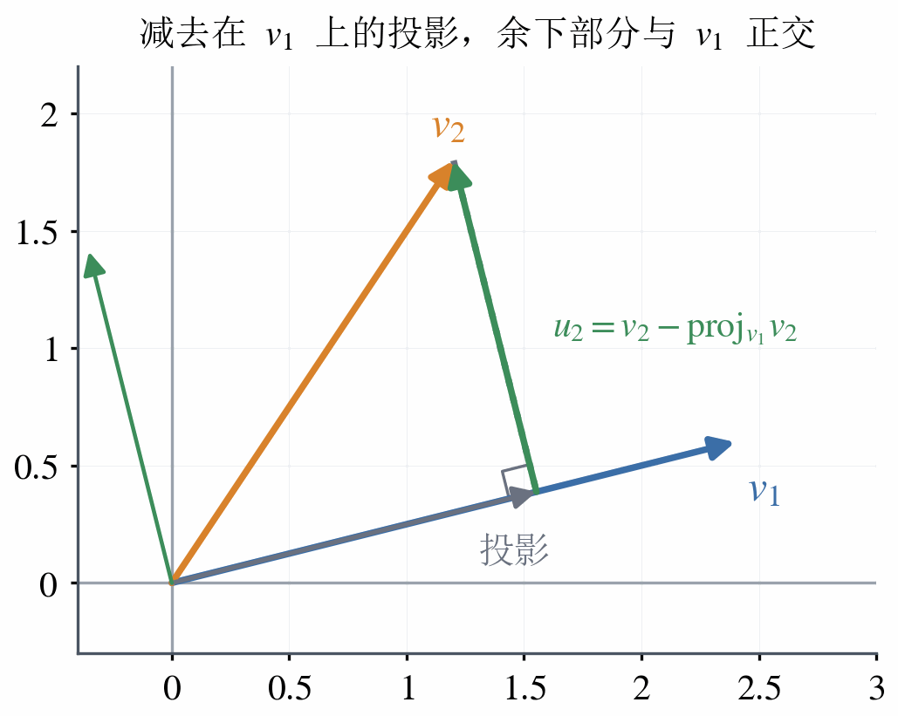

\[
u_1=v_1,\qquad
u_j=v_j-\sum_{i<j}\frac{\langle v_j,u_i\rangle}{\langle u_i,u_i\rangle}u_i,
\quad e_j=\frac{u_j}{\|u_j\|}.
\]

其中 \(\dfrac{\langle v_j,u_i\rangle}{\langle u_i,u_i\rangle}u_i\) 是 \(v_j\) 在 \(u_i\) 方向上的投影，\(e_j\) 是把 \(u_j\) 除以自身长度后得到的单位向量。每一步得到的新向量都与前面所有方向正交，并且前 \(j\) 个新向量张成的空间与前 \(j\) 个原向量张成的空间相同。如果某一步算出了零向量，说明这个输入向量已经位于前面向量的张成空间内，也就是原向量组其实线性相关。这时不能再除以零来归一化，应当删去这个多余的向量，或者重新检查独立性的判断。

具体操作步骤是：

1. 令 \(u_1=v_1\)。
2. 对 \(j=2,3,\ldots\)，计算 \(v_j\) 与前面每个 \(u_i\) 的内积，以及每个 \(u_i\) 的长度平方 \(\langle u_i,u_i\rangle\)。
3. 从 \(v_j\) 中减去它在每个 \(u_i\) 上的投影，得到 \(u_j\)；为避免分数，可以把 \(u_j\) 乘以适当的非零数，这不改变方向。
4. 检查 \(u_j\) 与前面各向量的内积是否为零。
5. 全部求出后，把每个 \(u_j\) 除以自身长度，得到单位正交向量组 \(e_j\)。

**例题：在同一个二维子空间里构造正交单位基。** 仍取上一节的两个向量。先令 \(u_1=v_1=(1,1,0)^T\)。\(v_2\) 在 \(u_1\) 上的投影系数为 \(\langle v_2,u_1\rangle/\langle u_1,u_1\rangle=1/2\)，从 \(v_2\) 中减去 \(\tfrac12u_1\)，得 \(u_2=(1,0,1)^T-(1/2,1/2,0)^T=(1/2,-1/2,1)^T\)。为避免分数，可先把 \(u_2\) 乘以二变为 \((1,-1,2)^T\)，这不改变方向。再分别除以长度 \(\sqrt2\) 和 \(\sqrt6\)，得到

\[
e_1=\frac1{\sqrt2}(1,1,0)^T,\qquad
e_2=\frac1{\sqrt6}(1,-1,2)^T.
\]

验算：\(e_1\) 与 \(e_2\) 的内积为 \((1-1+0)/\sqrt{12}=0\)，两者长度都为一。这两个新向量并不是随便取的两个垂直向量，它们仍然张成原来那个平面。

还要把正交化与求特征向量区分开。正交化只要求保持张成的空间不变，同时改善基向量之间的几何关系；特征向量则要求变换作用前后方向不变。对非对称矩阵的特征向量随意做正交化，得到的新向量一般不再是特征向量。

### 10.4 投影与无解方程组的最小二乘近似

实际问题中常常遇到方程比未知数多、彼此又不完全一致的方程组，例如用一条直线拟合多个测量点。这时 \(Ax=b\) 无解，但可以退而求其次：寻找使误差 \(\|Ax-b\|^2\) 最小的 \(x\)，称为最小二乘解。

几何上，\(Ax\) 只能取遍 \(A\) 的列空间中的向量，问题就是在列空间中找离 \(b\) 最近的点。最近点处的误差向量（残差）\(b-Ax\) 必须垂直于整个列空间；否则沿某个列方向稍微调整 \(x\)，还能让残差变短。“残差与 \(A\) 的每一列都正交”写成矩阵形式就是

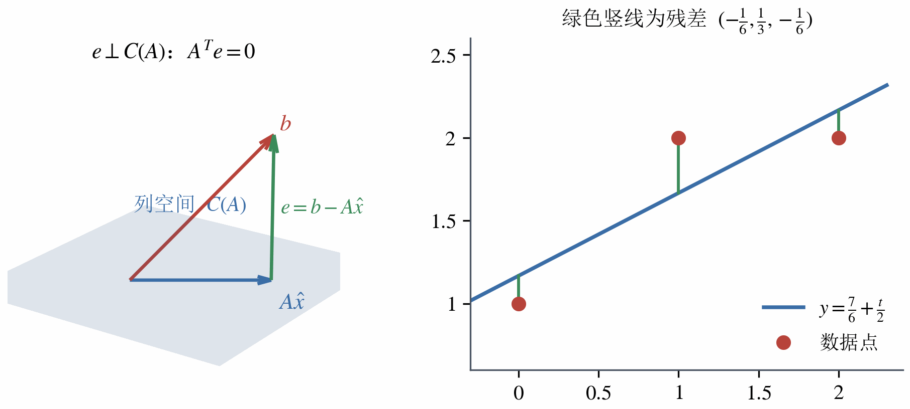

\[
A^T(Ax-b)=0,\qquad A^TAx=A^Tb.
\]

第二个方程称为正规方程。若 \(A\) 的各列线性无关，由上一节，格拉姆矩阵 \(A^TA\) 正定可逆，最小二乘解唯一。若各列线性相关，离 \(b\) 最近的那个向量 \(Ax\) 仍然唯一，但表示它的系数 \(x\) 可能不唯一。需要说明的是，正规方程主要是理论推导的工具；在大规模数值计算中，直接构造 \(A^TA\) 可能放大舍入误差（使问题病态），实际软件通常采用正交分解等方法。这里的重点是理解投影的几何结构，而不是把某一条公式当作全部的数值算法。

当 \(A\) 的列线性无关时，由正规方程解出 \(x=(A^TA)^{-1}A^Tb\)，于是 \(b\) 在列空间上的投影为 \(Ax=Pb\)，其中

\[
P=A(A^TA)^{-1}A^T
\]

称为投影矩阵。它满足 \(P^2=P\)（投影两次与投影一次结果相同）和 \(P^T=P\)（对称），而 \(I-P\) 则把向量投影到列空间的正交补上，给出残差。当 \(A\) 只有一列 \(a\) 时，\(P=aa^T/(a^Ta)\)，正是前面向量投影公式的矩阵形式。

求最小二乘解的步骤是：

1. 根据模型写出设计矩阵 \(A\) 和观测向量 \(b\)，每个数据点对应一行。
2. 计算 \(A^TA\) 和 \(A^Tb\)。
3. 解正规方程 \(A^TAx=A^Tb\)。
4. 计算残差 \(b-Ax\)，检查它与 \(A\) 的每一列的内积是否为零。
5. 必要时计算残差平方和 \(\|b-Ax\|^2\)，用来衡量拟合的好坏。

**例题：拟合一条直线。** 数据点为 \((0,1),(1,2),(2,2)\)，要用直线 \(y=\alpha+\beta t\) 拟合。把三个点代入，得到三个关于 \(\alpha,\beta\) 的方程 \(\alpha=1\)、\(\alpha+\beta=2\)、\(\alpha+2\beta=2\)，它们没有公共解。写成矩阵形式，设计矩阵 \(A\) 的第一列全为一（对应常数项 \(\alpha\)），第二列是横坐标（对应斜率 \(\beta\)），右端 \(b=(1,2,2)^T\)。计算得

\[
A=\begin{pmatrix}1&0\\1&1\\1&2\end{pmatrix},\quad
A^TA=\begin{pmatrix}3&3\\3&5\end{pmatrix},\quad
A^Tb=\begin{pmatrix}5\\6\end{pmatrix}.
\]

正规方程为 \(3\alpha+3\beta=5\)、\(3\alpha+5\beta=6\)。两式相减得 \(2\beta=1\)，所以 \(\beta=1/2\)，再代回得 \(\alpha=7/6\)。拟合直线为 \(y=7/6+t/2\)。

检验残差：\(b-Ax=(1-7/6,\ 2-5/3,\ 2-13/6)^T=(-1/6,1/3,-1/6)^T\)。它与常数列 \((1,1,1)^T\) 的点积为 \(-1/6+1/3-1/6=0\)，与横坐标列 \((0,1,2)^T\) 的点积为 \(1/3-1/3=0\)，验证了残差与列空间正交的条件。原方程组没有精确解，是因为三个点不在同一条直线上；最小二乘并没有把无解变成有解，而是明确规定了一个“最接近”的目标，并求出达到这个目标的近似解。

### 10.5 参数讨论应追踪秩改变的位置

含参数矩阵的秩，通常只在某些子式等于零的参数值处下降。但要注意，最高阶的行列式等于零只说明矩阵不满秩，至于秩下降到多少，还需要继续检查低一阶的子式是否不为零。例如

\[
A(a)=\begin{pmatrix}1&1&1\\1&a&1\\1&1&a\end{pmatrix}
\sim\begin{pmatrix}1&1&1\\0&a-1&0\\0&0&a-1\end{pmatrix}.
\]

这里用第一行分别消去第二、三行的首元（\(R_2\leftarrow R_2-R_1\)、\(R_3\leftarrow R_3-R_1\)）。若 \(a\ne1\)，三行都有主元，秩为三。若 \(a=1\)，后两行全变为零，只剩一个独立行，秩直接降到一，而不是降到二。如果只想到“行列式为零时秩为二”，就会得出错误结论。

再加上右端 \((b_1,b_2,b_3)^T\)。同样的倍加变换使右端后两个分量变为 \(b_2-b_1\) 和 \(b_3-b_1\)。当 \(a=1\) 时，后两行变成 \(0=b_2-b_1\) 与 \(0=b_3-b_1\)，所以只有当 \(b_1=b_2=b_3\) 时方程组才有解（相容），这时只剩一个方程 \(x+y+z=b_1\)，有两个自由参数；其他情况下方程组无解。这个例子说明，处理含参数矩阵的秩，应按以下步骤：

1. 用不含参数的行变换把矩阵化简，或者计算最高阶行列式，找出可能使矩阵奇异的参数值。
2. 对这些参数值，分别代回原矩阵重新化为阶梯形，读出实际的秩，不要默认秩只下降一。
3. 若涉及方程组，同时比较系数矩阵与增广矩阵的秩，判断相容性。
4. 对其余参数值，矩阵满秩，直接写出结论。

这样才不会漏掉秩一次下降超过一的情况。

## 来源与学习衔接

本册依据可读会话正文《串讲线性代数方法》《解释行列式定理》《解释未知数表示未知数》《计算行列式值》《解释矩阵初等变换》《求矩阵X解答》《解释特征向量对角化》《二阶对角矩阵特征向量》以及有关参数方程组的记录，重新推导整理而成。涉及的俄语术语有 матрица（矩阵）、определитель（行列式）、ранг（秩）、собственный вектор（特征向量）。会话题目中系数看不清的图片，以及只有附件占位的内容，都没有当作已经核实的原题使用。

first CC 已提取的教材清单中没有独立的线性代数教材，因此本册不声称来自某本线性代数书的逐页研读。本册内容与后续各册相互衔接：几何意义在下一册《解析几何》的投影、交线与距离中继续展开；特征分解则进一步用于微分方程组、振动和控制系统。遇到具体计算时，先辨认研究对象和适用条件，再决定用消元、行列式还是换基，才不会把某一种工具误当成全部理论。
