# 解析几何

向量方法、平面与空间直线及二次曲线

## 导读

解析几何的基本思想，是把位置、方向、垂直、相交这些几何关系写成代数方程，再用代数运算来回答几何问题。方程并不是图形的替代品，而是对图形所受约束的精确表达。例如，要确定一条直线，既要知道它朝哪个方向延伸，也要知道它经过哪个位置；要求两个图形之间的距离，就要在无数条连接线段中找出最短的一条。

本册以向量运算为主线，因为几类基本几何问题恰好各有一种向量工具来处理：点积处理投影、长度和夹角；叉积处理垂直方向和面积；混合积处理体积和共面；线性方程组处理多个约束的公共部分（交点、交线）。

本册的顺序是：先建立直角坐标系中的向量与投影，再推导直线和平面的方程，接着讨论它们之间的位置关系、夹角和距离，然后用二次曲线和二次曲面说明坐标变换怎样简化几何问题，最后总结几何解题中常见的完整性问题。前七章覆盖已有课程会话的主要内容；二次曲线和二次曲面是为补足解析几何的基本体系而写的衔接内容，不代表曾经上传过的课程页面。

## 第一章 向量及其坐标表示

### 1.1 点、位置向量与位移

点表示一个位置，向量表示一个既有大小又有方向的量，例如位移、速度和力。选定坐标原点 \(O\) 之后，每个点 \(P\) 都可以用从原点指向它的位置向量 \(\overrightarrow{OP}\) 来表示。但要注意“位置”与“位移”含义不同：位置向量依赖原点的选取，而两点之间的位移只与这两点有关。从点 \(P\) 到点 \(Q\) 的位移是

\[
\overrightarrow{PQ}=\overrightarrow{OQ}-\overrightarrow{OP}
=(x_Q-x_P,y_Q-y_P,z_Q-z_P).
\]

即“终点坐标减起点坐标”。减法的顺序由箭头方向决定，顺序颠倒得到的是反向位移 \(\overrightarrow{QP}=-\overrightarrow{PQ}\)。数学中讨论的向量通常是自由向量：只要大小和方向不变，平移到哪里都算同一个向量，因此不必固定起点。但物理中的力矩等问题还与力的作用点有关，这时不能把力随意平移到作用线以外的位置。

在正交单位基（三条坐标轴两两垂直、单位长度相同）下，向量 \(a=(a_x,a_y,a_z)\) 的长度由勾股定理得到：

\[
|a|=\sqrt{a_x^2+a_y^2+a_z^2}.
\]

非零向量除以自身长度，得到与它同方向的单位向量（长度为一的向量），这一步称为归一化。零向量长度为零、没有确定的方向，所以不能归一化。数乘 \(\lambda a\) 中，\(\lambda\) 的正负决定方向是否反转，\(|\lambda|\) 决定长度放大的倍数。两个非零向量共线（平行），等价于其中一个是另一个的数倍，也等价于对应坐标成比例。零向量与任何向量在代数上都算线性相关，但谈论它与其他向量的几何夹角没有意义。

**方向余弦。** 非零向量 \(a\) 与三条坐标轴正方向的夹角记为 \(\alpha,\beta,\gamma\)，它们的余弦称为方向余弦：

\[
\cos\alpha=\frac{a_x}{|a|},\qquad \cos\beta=\frac{a_y}{|a|},\qquad \cos\gamma=\frac{a_z}{|a|},\qquad
\cos^2\alpha+\cos^2\beta+\cos^2\gamma=1 .
\]

三个方向余弦正好是 \(a\) 方向上单位向量的三个坐标，平方和为一就是“单位向量长度为一”。

**定比分点与中点。** 设点 \(M\) 在线段 \(AB\) 上，且 \(\overrightarrow{AM}=\lambda\overrightarrow{MB}\)（\(\lambda\ne-1\)），则

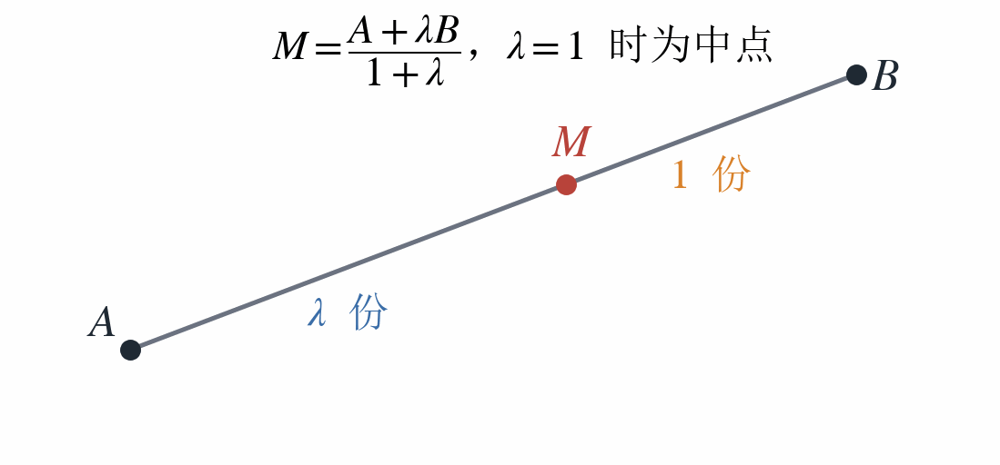

\[
M=\frac{A+\lambda B}{1+\lambda},\qquad \text{特别地,\ 中点 } M=\frac{A+B}2 .
\]

推导只需把 \(M-A=\lambda(B-M)\) 解出 \(M\)。\(\lambda>0\) 时 \(M\) 在线段内部，\(\lambda<0\) 时在线段延长线上。三角形 \(ABC\) 的重心（三条中线的交点）为 \(G=(A+B+C)/3\)，它把每条中线分成二比一。

**例1：从两点得到方向与单位方向。** 设 \(P=(1,-1,2)\)、\(Q=(3,2,2)\)。用终点减起点，再求长度和单位向量：

\[
\overrightarrow{PQ}=(2,3,0),\quad |PQ|=\sqrt{13},\quad
 e=\left(\frac2{\sqrt{13}},\frac3{\sqrt{13}},0\right).
\]

第三个分量为零，表示这段位移在竖直方向上没有变化，并不表示整个位移为零。反方向的单位向量是 \(-e\)。还要注意，把三个坐标直接相加得到五，并不能代表长度：各坐标方向互相垂直，长度必须按勾股关系计算，结果是 \(\sqrt{13}\approx3.61\)。

### 1.2 线性组合与参数

用向量可以很自然地描述直线和平面。若 \(r=r_0+ta\)（\(a\ne0\)），当参数 \(t\) 取遍全体实数时，点 \(r\) 从 \(r_0\) 出发沿固定方向 \(a\) 前后移动，轨迹是一条直线。若 \(r=r_0+su+tv\)，且 \(u,v\) 不共线，那么两个独立的参数 \(s,t\) 让点在两个方向上自由移动，轨迹是一个平面。这是用向量表示几何对象的出发点。参数本身不一定代表时间；只有在明确给出运动模型时，才能把参数的变化率解释为速度。

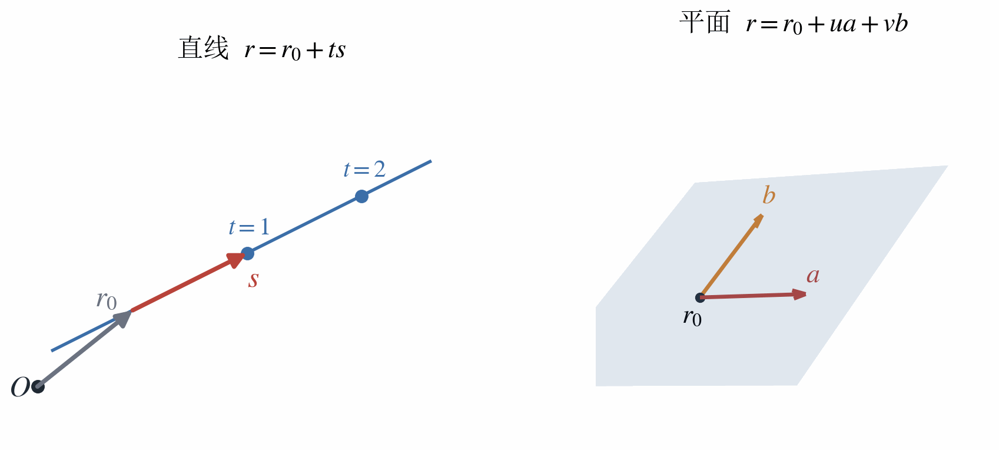

参数化的写法并不唯一。把方向向量乘以二、同时把参数改为原来的一半，得到的点集不变；把基点沿直线移动到另一个点，再相应平移参数，点集也不变。所以判断两个方程是否表示同一个图形，应比较它们所表示的点集，而不是看符号是否完全一致。

## 第二章 点积、投影与正交分解

### 2.1 点积的几何意义

对非零向量 \(a,b\)，点积（也称数量积、内积）定义为

\[
a\cdot b=|a||b|\cos\theta
=a_xb_x+a_yb_y+a_zb_z,\qquad 0\le\theta\le\pi.
\]

其中 \(\theta\) 是两向量的夹角。左边的定义说明点积的几何含义，右边的坐标公式用于计算，两者相等可以由余弦定理推出：在以 \(a,b\) 为两边的三角形中，第三边为 \(a-b\)，余弦定理给出 \(|a-b|^2=|a|^2+|b|^2-2|a||b|\cos\theta\)，再把左边按坐标展开比较，即得坐标公式。

点积的结果是一个数（标量），不是向量。它的符号反映夹角的类型：锐角时点积为正，钝角时为负，直角时为零。说“点积为零则垂直”时，非零的条件必须保留：零向量与任何向量的点积都为零，但不能据此说它与别的向量成直角。点积满足以下运算规律：

\[
a\cdot b=b\cdot a,\qquad (\lambda a)\cdot b=\lambda(a\cdot b),\qquad a\cdot(b+c)=a\cdot b+a\cdot c,\qquad a\cdot a=|a|^2 .
\]

由此可以展开 \(|a\pm b|^2=|a|^2\pm2a\cdot b+|b|^2\)，它是余弦定理的向量形式；当 \(a\perp b\) 时就是勾股定理。

点积最重要的用途是计算投影。在非零向量 \(b\) 的方向上，单位向量为 \(e=b/|b|\)。向量 \(a\) 在这个方向上的有向投影长度（标量投影）为 \(a\cdot e=|a|\cos\theta\)，它可以为负，表示投影指向 \(b\) 的反方向；把这个长度乘上单位方向 \(e\)，得到投影向量：

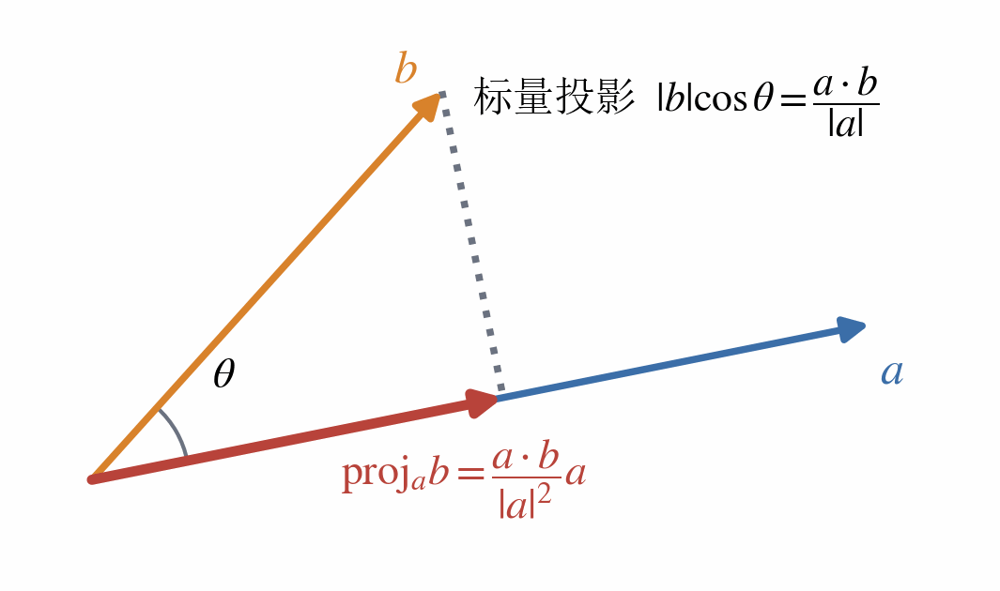

\[
a_{\parallel}=\frac{a\cdot b}{b\cdot b}b.
\]

\(a\) 减去投影向量后，剩下的部分 \(a_\perp=a-a_\parallel\) 与 \(b\) 垂直，因为 \(a_\perp\cdot b=a\cdot b-\dfrac{a\cdot b}{b\cdot b}(b\cdot b)=0\)。这样，任意向量都被分解为平行于 \(b\) 和垂直于 \(b\) 的两部分，称为正交分解。后面所有点到直线、点到平面的距离公式，都来自这个分解。

**例2：分清标量投影和向量投影。** 取 \(a=(3,1,0)\)、\(b=(1,1,0)\)。先算 \(a\cdot b=3+1=4\)、\(|b|=\sqrt2\)，所以有向投影长度为 \(4/\sqrt2=2\sqrt2\)；投影向量为 \(\frac{4}{2}(1,1,0)=(2,2,0)\)。垂直分量为 \(a-a_\parallel=(1,-1,0)\)，长度为 \(\sqrt2\)。检验：\(|a|^2=10\)，两个分量长度平方之和为 \(8+2=10\)，符合勾股定理，与正交分解一致。

如果把 \(b\) 换成 \(-b\)，有向投影长度变号，但投影向量不变，因为单位方向和标量系数同时变号。几何中的距离取的是垂直分量的长度，所以与人为选定的方向符号无关。

### 2.2 夹角与正交基

由点积的定义可得两向量夹角的余弦：\(\cos\theta=(a\cdot b)/(|a||b|)\)。这里要区分两种对象。如果讨论两条直线的夹角，直线本身没有指向，规定取较小的那个角，即在零到九十度之间，所以要给分子加绝对值；如果讨论两个给定箭头（有方向的向量）的夹角，角可以是钝角，就不能随意加绝对值。这个差别来自对象有没有定向，并不是两个互相冲突的公式。

若取一组两两正交的单位向量作为基，任何向量都可以分解为在各基方向上的投影之和，坐标就是这些投影的长度。正交基使坐标、长度、角度都有简单公式。在一般的斜坐标系中，坐标的平方和不再等于长度的平方；本册所有长度公式都以正交单位坐标为前提。

## 第三章 叉积、混合积与面积体积

### 3.1 叉积的大小与方向

在三维右手直角坐标系中，两个向量的叉积（也称向量积）\(a\times b\) 是一个向量，它的定义包含三个方面：方向同时垂直于 \(a\) 和 \(b\)；长度为 \(|a||b|\sin\theta\)，等于以 \(a,b\) 为邻边的平行四边形的面积；指向按右手规则确定，即右手四指从第一个向量转向第二个向量（转过小于 \(180^\circ\) 的角），拇指所指就是叉积的方向。交换两个向量的次序，方向反转：\(b\times a=-a\times b\)。夹角为钝角时 \(\sin\theta\) 仍然非负，面积不会变成负数；方向另由向量的先后次序决定。

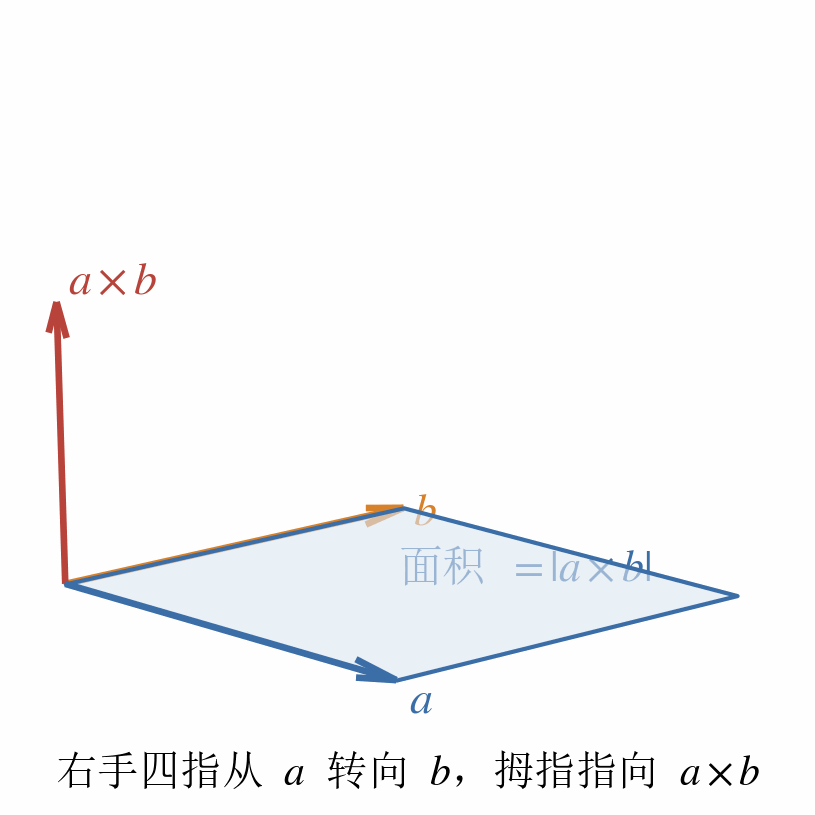

坐标公式是

\[
a\times b=(a_yb_z-a_zb_y,\ a_zb_x-a_xb_z,\ a_xb_y-a_yb_x).
\]

这个公式并不是由行列式“定义”出来的，而是由基向量之间的叉积和分配律推出的。在右手系中，三个单位基向量按循环次序相乘：

\[
i\times j=k,\qquad j\times k=i,\qquad k\times i=j,
\]

逆着循环次序相乘则变号，例如 \(j\times i=-k\)、\(i\times k=-j\)；任何向量与自身的叉积为零（夹角为零，面积为零）。把 \(a=a_xi+a_yj+a_zk\)、\(b=b_xi+b_yj+b_zk\) 像多项式一样逐项相乘，共得九项。其中 \(i\times i\)、\(j\times j\)、\(k\times k\) 三项为零，余下六项按基向量归并：

\[
a\times b=(a_yb_z-a_zb_y)\,i-(a_xb_z-a_zb_x)\,j+(a_xb_y-a_yb_x)\,k.
\]

它恰好等于形式行列式

\[
a\times b=\begin{vmatrix}i&j&k\\a_x&a_y&a_z\\b_x&b_y&b_z\end{vmatrix}
\]

按第一行展开的结果。第一行放的是向量而不是数，所以这个行列式只是一个帮助排好六项正负号的计算格式。第二项前的负号来自按行展开的符号规律，对应 \(i\times k=-j\) 这类逆循环的乘积，计算时不能遗漏。叉积本身是向量，它的长度 \(|a\times b|\) 才是平行四边形的面积；由同一顶点出发的两条边构成的三角形，面积再除以二。

叉积满足以下运算规律：

\[
a\times b=-b\times a,\qquad (\lambda a)\times b=\lambda(a\times b),\qquad a\times(b+c)=a\times b+a\times c,\qquad a\times a=0 .
\]

但叉积不满足结合律，一般 \((a\times b)\times c\ne a\times(b\times c)\)。两个重要的恒等式是拉格朗日恒等式和二重叉积公式：

\[
|a\times b|^2+(a\cdot b)^2=|a|^2|b|^2,\qquad a\times(b\times c)=b\,(a\cdot c)-c\,(a\cdot b).
\]

第一式就是 \(\sin^2\theta+\cos^2\theta=1\) 两边乘以 \(|a|^2|b|^2\)，它给出不必算叉积就能求面积的办法：\(|a\times b|=\sqrt{|a|^2|b|^2-(a\cdot b)^2}\)。第二式可按坐标逐项验证，记法是“远乘近减近乘远”的形式：结果落在 \(b,c\) 所在的平面内。

**平面三角形的坐标面积公式。** 平面上三点 \(A(x_1,y_1)\)、\(B(x_2,y_2)\)、\(C(x_3,y_3)\) 构成的三角形面积，可以把它们看成 \(z=0\) 的空间点，用叉积的第三个分量求出：

\[
S=\frac12\left|(x_2-x_1)(y_3-y_1)-(x_3-x_1)(y_2-y_1)\right| .
\]

绝对值内的式子为零，说明三点共线。

**例3：逐项计算并核对垂直性。** 取 \(a=(1,2,0)\)、\(b=(0,1,3)\)。按坐标公式计算三个分量：

\[
a\times b=(2\cdot3-0\cdot1,\ 0\cdot0-1\cdot3,\ 1\cdot1-2\cdot0)
=(6,-3,1).
\]

与原向量分别作点积：\((6,-3,1)\cdot(1,2,0)=6-6=0\)，\((6,-3,1)\cdot(0,1,3)=-3+3=0\)，所以结果确实同时垂直于两个向量。平行四边形面积为 \(\sqrt{36+9+1}=\sqrt{46}\)，三角形面积为 \(\sqrt{46}/2\)。也可以用拉格朗日恒等式核对：\(|a|^2|b|^2-(a\cdot b)^2=5\cdot10-2^2=46\)，一致。交换两边次序得到 \((-6,3,-1)\)，面积相同而方向相反。

叉积为零意味着两向量共线（线性相关）。在求平面法向量时，如果两条已知方向共线，叉积为零，说明给出的信息不足以确定平面，不能把零向量当作法向量继续写平面方程。

### 3.2 混合积与共面条件

三个向量的混合积定义为先作叉积、再作点积，结果是一个数：

\[
[a,b,c]=a\cdot(b\times c)
=\begin{vmatrix}a_x&a_y&a_z\\b_x&b_y&b_z\\c_x&c_y&c_z\end{vmatrix}.
\]

行列式形式可以直接验证。把 \(b\times c\) 的三个分量与 \(a\) 的对应分量相乘再相加，得到

\[
a\cdot(b\times c)=a_x(b_yc_z-b_zc_y)-a_y(b_xc_z-b_zc_x)+a_z(b_xc_y-b_yc_x),
\]

这正是上面三阶行列式按第一行展开的结果。换句话说，混合积就是把叉积形式行列式第一行的 \(i,j,k\) 换成 \(a\) 的三个坐标。由此还能看出叉积的垂直性：\(b\cdot(b\times c)\) 对应一个有两行相同的行列式，值为零，所以 \(b\times c\perp b\)；同理 \(b\times c\perp c\)。

混合积的几何意义是有向体积。设 \(b,c\) 不共线，它们张成的平行四边形面积为 \(S=|b\times c|\)，而 \(b\times c\) 的方向垂直于这个底面。记 \(\theta\) 为 \(a\) 与 \(b\times c\) 的夹角，则

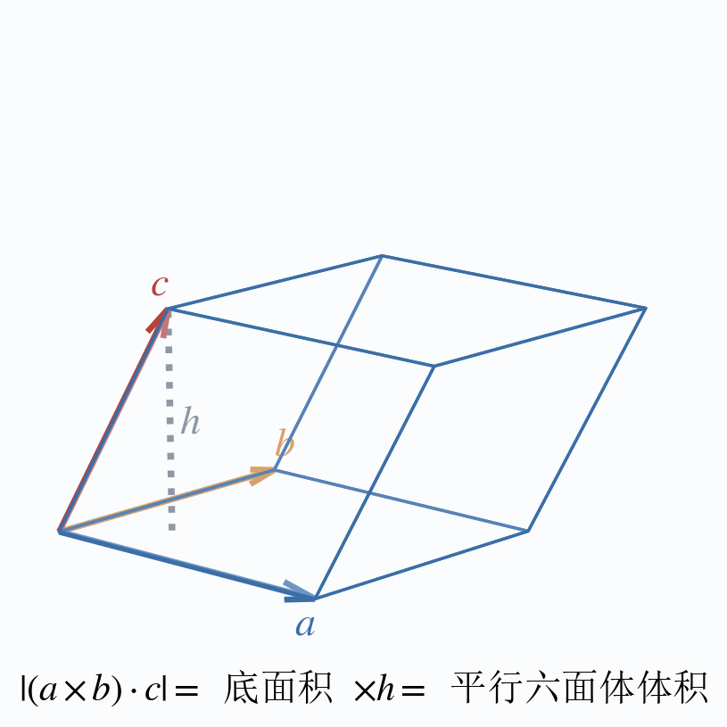

\[
a\cdot(b\times c)=|a|\,|b\times c|\cos\theta=S\cdot h,
\]

其中 \(h=|a|\cos\theta\) 是 \(a\) 在底面法线方向上的有向投影，也就是以 \(b,c\) 为底的平行六面体的有向高。因此混合积的绝对值等于以 \(a,b,c\) 为棱的平行六面体的体积；以这三个向量为棱的四面体体积是它的六分之一：

\[
V_{\text{平行六面体}}=|[a,b,c]|,\qquad V_{\text{四面体}}=\frac16|[a,b,c]| .
\]

混合积的符号由三个向量的排列方式决定：循环排列（\(a,b,c\to b,c,a\to c,a,b\)）不改变混合积，交换任意两个向量则变号，这对应于交换行列式的两行。

混合积为零，等价于三个向量共面，也等价于它们线性相关。理由是：若 \(b,c\) 不共线，则 \(S\ne0\)，混合积为零只能是 \(h=0\)，即 \(a\) 落在 \(b,c\) 所在的平面内；若 \(b,c\) 本来就共线，三个向量显然在同一平面内。反过来，三个向量共面时，平行六面体被压扁，体积为零，混合积也为零。

**例4：用两种算法求混合积。** 取 \(a=(1,2,3)\)、\(b=(0,1,4)\)、\(c=(5,6,0)\)。先求叉积

\[
b\times c=(1\cdot0-4\cdot6,\ 4\cdot5-0\cdot0,\ 0\cdot6-1\cdot5)=(-24,20,-5),
\]

再与 \(a\) 点乘，得 \(-24+40-15=1\)。也可以直接按第一行展开行列式：

\[
\begin{vmatrix}1&2&3\\0&1&4\\5&6&0\end{vmatrix}
=1\cdot(0-24)-2\cdot(0-20)+3\cdot(0-5)=1.
\]

两种算法结果一致。混合积不为零，所以三个向量不共面；以它们为棱的平行六面体体积为一，四面体体积为六分之一。

**例5：由点确定体积。** 设 \(P=(1,0,0)\)，另外三点为 \(Q=(2,0,0)\)、\(R=(1,2,0)\)、\(S=(1,0,3)\)。从同一点 \(P\) 出发的三条棱为 \(Q-P=(1,0,0)\)、\(R-P=(0,2,0)\)、\(S-P=(0,0,3)\)，混合积为对角线乘积六，所以四面体体积为 \(6/6=1\)。必须先相减得到边向量，不能直接把四个点中任意三个点的位置坐标放进行列式，否则结果会随原点的选取而改变。

判断四点是否共面，就是取同一个基点出发的三个差向量，看它们的混合积是否为零。但如果其中三点本来就共线，即使混合积为零，也不能由它们唯一确定一个平面。“四点共面”与“三点能确定唯一平面”是两个不同的条件，需要分别检查。

求面积和体积的步骤可以归纳为：

1. 选定一个公共顶点，用其他各点减去它，得到边向量。
2. 求平行四边形面积，计算两边向量的叉积再取模；三角形面积再除以二。
3. 求体积，计算三个边向量的混合积（三阶行列式）再取绝对值；平行六面体为该值，四面体再除以六。
4. 若结果为零，说明点共线（面积）或共面（体积），图形退化。

## 第四章 平面中的直线

### 4.1 从一点和法向量推导一般式

在平面上，确定一条直线最直接的方式之一，是给出它经过的一点和一个与它垂直的方向。已知直线经过 \(M_0=(x_0,y_0)\)，非零向量 \(n=(A,B)\) 垂直于直线，称为直线的法向量。直线上任意一点 \(M=(x,y)\) 与 \(M_0\) 的连线都在直线上，所以位移 \(M-M_0\) 与法向量垂直，点积为零：

\[
A(x-x_0)+B(y-y_0)=0.
\]

这称为直线的点法式方程。展开后得到 \(Ax+By+C=0\)（其中 \(C=-Ax_0-By_0\)），称为直线的一般方程（общее уравнение прямой），条件是 \(A^2+B^2\ne0\)，即 \(A,B\) 不同时为零。若二者都为零，方程只剩 \(C=0\)，其中不再含 \(x,y\)：它或者对一切点成立（\(C=0\)），或者对任何点都不成立（\(C\ne0\)），都不表示直线。

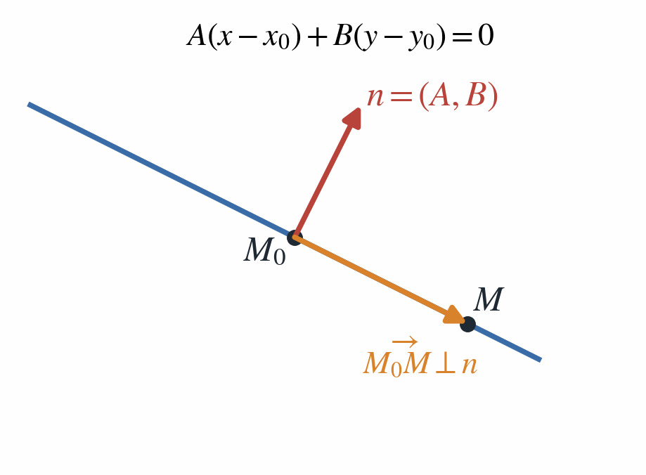

一般式的两个系数直接给出法向量 \((A,B)\)，而不是沿直线的方向。沿直线的一个方向向量可以取 \((B,-A)\)，因为它与 \((A,B)\) 的点积为零。

系数为零的几种情形各有几何意义：

- \(C=0\) 时方程为 \(Ax+By=0\)，原点满足它，直线过原点。
- \(B=0\) 时方程化为 \(x=-C/A\)，横坐标固定，直线平行于纵轴 \(Oy\)（竖直线）。
- \(A=0\) 时方程化为 \(y=-C/B\)，纵坐标固定，直线平行于横轴 \(Ox\)（水平线）。
- 两个条件同时成立，例如 \(B=C=0\)，得到的就是纵轴本身 \(x=0\)。

若 \(B\ne0\)，把 \(Ax\) 与 \(C\) 移到右边再除以 \(B\)，得到斜截式

\[
y=kx+b,\qquad k=-\frac AB,\quad b=-\frac CB.
\]

斜率 \(k\)（угловой коэффициент）等于直线与 \(Ox\) 轴正方向夹角 \(\varphi\)（倾斜角）的正切，\(k=\tan\varphi\)；\(b\) 是直线与 \(Oy\) 轴交点的纵坐标，称为纵截距。竖直线的 \(B=0\)，只能写作 \(x=c\)，没有有限的斜率。两点式中的斜率 \((y_2-y_1)/(x_2-x_1)\) 也只在两点横坐标不等时才能使用。向量式和一般式不需要排除竖直线，因此适用范围更完整。

**截距式。** 若直线不过原点，且与两坐标轴分别交于 \((a,0)\) 和 \((0,b)\)（\(a,b\ne0\)），则方程可写成

\[
\frac xa+\frac yb=1 .
\]

把两个交点代入即可验证。截距式便于画图和求直线与坐标轴围成的三角形面积（\(|ab|/2\)），但它不能表示过原点或平行于坐标轴的直线。

**法线式。** 把一般式两边除以 \(\pm\sqrt{A^2+B^2}\)，使常数项为负（或零），得到

\[
x\cos\alpha+y\sin\alpha-p=0,\qquad p\ge0,
\]

其中 \((\cos\alpha,\sin\alpha)\) 是指向直线一侧的单位法向量，\(p\) 是原点到直线的距离。法线式的好处是：把任意一点代入左边，得到的就是该点到直线的有向距离（见 4.3 节）。

**例6：已知一点和法向量。** 求过 \(M=(3,-5)\)、垂直于向量 \(n=(2,7)\) 的直线。所求直线垂直于 \(n\)，即 \(n\) 是它的法向量，代入点法式：

\[
2(x-3)+7(y+5)=0,\qquad 2x+7y+29=0.
\]

检验：\(2\cdot3+7\cdot(-5)+29=0\)，点在直线上；结果中 \(x,y\) 的系数恰为 \((2,7)\)，与给定法向量一致。再取直线上另一点 \((-4,-3)\)，代入得 \(-8-21+29=0\)，同样成立。

**例7：两点确定直线。** 过 \(P=(1,2)\)、\(Q=(3,5)\) 的直线，方向向量为 \(Q-P=(2,3)\)，把两个分量交换并改变其中一个的符号，可取法向量 \((3,-2)\)。点法式为 \(3(x-1)-2(y-2)=0\)，整理得 \(3x-2y+1=0\)。把两点分别代入均得零，说明位置正确；法向量与 \((2,3)\) 的点积为零，说明方向也正确。斜截式是 \(y=3x/2+1/2\)，两式描述同一条直线。

### 4.2 由方向向量写直线：标准方程、参数方程、两点式与点斜式

4.1 节从法向量出发写直线，这里改从沿直线的方向出发。两种出发点可以互相转换：法向量 \((A,B)\) 对应方向向量 \((B,-A)\)，方向向量 \((l,m)\) 对应法向量 \((m,-l)\)。

**标准方程。** 已知直线过 \(M_0=(x_0,y_0)\)，且平行于非零向量 \(s=(l,m)\)，\(s\) 称为方向向量（направляющий вектор）。点 \(M=(x,y)\) 在直线上，当且仅当 \(\overrightarrow{M_0M}=(x-x_0,y-y_0)\) 与 \(s\) 平行，而两个平面向量平行等价于对应坐标成比例：

\[
\frac{x-x_0}{l}=\frac{y-y_0}{m}.
\]

这称为平面直线的标准方程或典范方程（каноническое уравнение прямой）。比例式的真正含义是交叉相乘后的 \(m(x-x_0)-l(y-y_0)=0\)，这个形式在 \(l\) 或 \(m\) 为零时仍然成立。因此，若 \(l=0\)，分式写法只是一种约定，直线就是竖直线 \(x=x_0\)；若 \(m=0\)，直线是水平线 \(y=y_0\)。

**参数方程。** 把标准方程两边的公共比值记作 \(t\)：

\[
\frac{x-x_0}{l}=\frac{y-y_0}{m}=t.
\]

拆成两个等式，分别乘以分母再移项，得到参数方程（параметрические уравнения прямой）：

\[
\begin{cases}x=x_0+l\,t,\\ y=y_0+m\,t,\end{cases}\qquad t\in\mathbb R.
\]

\(t=0\) 对应点 \(M_0\)；\(t=1\) 对应从 \(M_0\) 沿 \(s\) 走一个 \(s\) 的长度；\(t\) 为负时沿 \(s\) 的反方向移动。\(t\) 取遍全体实数，点就走遍整条直线。参数式不含除法，方向分量为零时不需要特殊处理，这一点与 1.2 节的向量式 \(r=r_0+ts\) 相同。

**两点式。** 已知直线过 \(M_0=(x_0,y_0)\)、\(M_1=(x_1,y_1)\)，取 \(s=\overrightarrow{M_0M_1}=(x_1-x_0,\ y_1-y_0)\) 代入标准方程：

\[
\frac{x-x_0}{x_1-x_0}=\frac{y-y_0}{y_1-y_0}.
\]

这就是过两点的直线方程（уравнение прямой, проходящей через две точки）。几何上，分别以 \(M_0M_1\) 和 \(M_0M\) 为斜边作两个直角三角形，直角边平行于坐标轴；三点共线时两条斜边方向相同，两个三角形相似，对应直角边成比例，得到同一个式子。两点式只是标准方程的特例。若 \(x_1=x_0\)，直线为 \(x=x_0\)；若 \(y_1=y_0\)，直线为 \(y=y_0\)。

**点斜式。** 若直线不竖直，方向向量的 \(l\ne0\)，斜率 \(k=m/l=\tan\varphi\)。对直线上任一点 \(M\ne M_0\)，以 \(M_0M\) 为斜边的直角三角形给出 \(k=(y-y_0)/(x-x_0)\)，去分母得

\[
y-y_0=k(x-x_0).
\]

这是过点 \(M_0\)、斜率为 \(k\) 的直线方程（уравнение прямой с угловым коэффициентом）。\(M=M_0\) 时两边都为零，同样成立。展开得 \(y=kx+(y_0-kx_0)\)，即斜截式中的 \(b=y_0-kx_0\)。竖直线没有斜率，不能写成点斜式，只能写成 \(x=x_0\)。

平面直线各种方程的适用条件归纳如下：

1. 一般式 \(Ax+By+C=0\)：能表示所有直线，系数给出法向量。
2. 点法式、标准方程、参数方程：能表示所有直线，分别需要一点加法向量或一点加方向向量。
3. 两点式：需要两点的横坐标不同、纵坐标也不同，否则改写为 \(x=x_0\) 或 \(y=y_0\)。
4. 点斜式、斜截式：不能表示竖直线。
5. 截距式：不能表示过原点或平行于坐标轴的直线。

**例8：同一条直线的四种写法。** 直线过 \(M_0=(2,-1)\)，方向向量 \(s=(3,4)\)。

标准方程为 \((x-2)/3=(y+1)/4\)，交叉相乘得 \(4(x-2)=3(y+1)\)，整理成一般式 \(4x-3y-11=0\)。

参数方程为 \(x=2+3t\)、\(y=-1+4t\)。取 \(t=1\) 得点 \((5,3)\)，代入一般式 \(20-9-11=0\)，在直线上。反过来，由第一式解出 \(t=(x-2)/3\)，代入第二式得 \(y=-1+4(x-2)/3\)，两边乘三整理，回到 \(4x-3y-11=0\)。

斜率为 \(k=m/l=4/3\)，点斜式为 \(y+1=\tfrac43(x-2)\)；两边乘三得 \(3y+3=4x-8\)，仍是同一个一般式。

四种写法给出同一个点集。一般式的系数 \((4,-3)\) 是法向量，与方向向量 \((3,4)\) 的点积为 \(12-12=0\)。

**例9：两点式。** 过 \(M_0=(1,2)\)、\(M_1=(3,6)\) 的直线，

\[
\frac{x-1}{3-1}=\frac{y-2}{6-2},\qquad \frac{x-1}2=\frac{y-2}4.
\]

两边乘四得 \(2(x-1)=y-2\)，整理为 \(2x-y=0\)。两点代入均为零；常数项为零，说明直线过原点，原点 \((0,0)\) 代入也确实成立。

### 4.3 点到直线距离与垂足

点到直线的距离，是从这个点到直线上所有点的连线中最短的那一条，它沿着法线方向。所以，从直线外一点 \(P\) 到直线上任意一点 \(M_0\) 作连接向量，把它投影到法向量上，投影长度的绝对值就是距离：

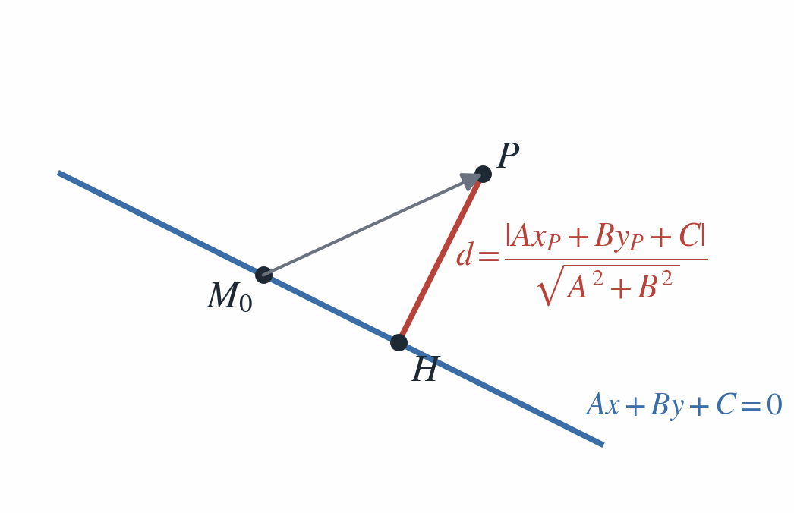

\[
d=\frac{|n\cdot(P-M_0)|}{|n|}
=\frac{|Ax_P+By_P+C|}{\sqrt{A^2+B^2}}.
\]

最后一步用到了 \(M_0\) 在直线上，即 \(Ax_0+By_0=-C\)，所以 \(n\cdot(P-M_0)=Ax_P+By_P-(Ax_0+By_0)=Ax_P+By_P+C\)。分母的作用是把法向量归一化。若把整个方程乘以十，分子和分母同时乘十，距离保持不变。这也说明，不能只把点代入方程左端，就把所得的值当作距离。

代入值 \(Ax_P+By_P+C\) 的符号也有意义：在直线同一侧的点代入后符号相同，在两侧的点符号相反；值为零表示点在直线上。这常用来判断两点是否位于直线同侧。

垂足 \(H\) 位于从 \(P\) 出发、沿法向量方向的直线上，可设 \(H=P-\tau n\)。把它代入直线方程，解出

\[
\tau=\frac{Ax_P+By_P+C}{A^2+B^2}.
\]

**两条平行直线之间的距离。** 平行直线可以写成 \(Ax+By+C_1=0\) 与 \(Ax+By+C_2=0\)（先把两个方程的 \(x,y\) 系数化成相同）。在第一条直线上任取一点，用上面的公式求它到第二条直线的距离，得到

\[
d=\frac{|C_1-C_2|}{\sqrt{A^2+B^2}} .
\]

注意必须先把两式的 \(A,B\) 化为相同，否则不能直接相减常数项。

**例10：同时求距离和垂足。** 对直线 \(3x+4y-10=0\)，点 \(P=(2,3)\) 的代入值为 \(6+12-10=8\)，法向量的模为 \(\sqrt{9+16}=5\)，距离为 \(8/5\)。由 \(\tau=8/25\)，垂足为

\[
H=(2,3)-\frac8{25}(3,4)=\left(\frac{26}{25},\frac{43}{25}\right).
\]

检验：\(3\cdot26/25+4\cdot43/25-10=(78+172-250)/25=0\)，垂足在直线上；\(P-H=\frac8{25}(3,4)\) 是法向量的倍数，垂直关系成立。只知道垂直方向不能确定垂足，必须同时要求它落在直线上。

**例11：代入值为负时的距离。** 求点 \(M=(1,-3)\) 到直线 \(4x+3y-15=0\) 的距离。读出 \(A=4,B=3,C=-15\)，代入值为

\[
4\cdot1+3\cdot(-3)-15=-20,
\]

取绝对值得二十；分母 \(\sqrt{16+9}=5\)，所以 \(d=4\)。代入值为负只说明 \(M\) 位于法向量 \((4,3)\) 所指方向的另一侧，距离仍然取绝对值。由垂足公式，\(\tau=-20/25=-4/5\)，

\[
H=(1,-3)+\frac45(4,3)=(4.2,-0.6).
\]

检验：\(4\cdot4.2+3\cdot(-0.6)-15=16.8-1.8-15=0\)，\(H\) 在直线上；\(|MH|=\sqrt{3.2^2+2.4^2}=\sqrt{16}=4\)，与公式结果相同。

求点到直线的距离与垂足，步骤如下：

1. 把直线化为一般式 \(Ax+By+C=0\)，读出法向量 \((A,B)\)。
2. 计算代入值 \(g=Ax_P+By_P+C\)。
3. 距离为 \(|g|/\sqrt{A^2+B^2}\)。
4. 若需要垂足，计算 \(\tau=g/(A^2+B^2)\)，得 \(H=P-\tau(A,B)\)。
5. 验算：\(H\) 代入直线方程为零，且 \(P-H\) 平行于法向量。

### 4.4 两直线的位置关系、夹角与交点

两条平面直线的位置关系，先由方向判断是否平行；平行时再由位置判断是否重合；不平行时必有唯一交点。判断可以用斜率，也可以用法向量或方向向量。三种写法都来自同一个向量夹角公式，只是适用的方程形式不同。

**斜率判据。** 设 \(L_1:y=k_1x+b_1\)、\(L_2:y=k_2x+b_2\)，方向向量可取 \((1,k_1)\)、\((1,k_2)\)。

1. 平行条件（условие параллельности）：\(k_1=k_2\) 且 \(b_1\ne b_2\)；若截距也相等，两线重合。

2. 垂直条件（условие перпендикулярности）：两方向向量的点积 \(1+k_1k_2=0\)，即 \(k_1k_2=-1\)。

3. 夹角：设两线倾斜角为 \(\varphi_1,\varphi_2\)，由正切差角公式

\[
\tan(\varphi_2-\varphi_1)=\frac{\tan\varphi_2-\tan\varphi_1}{1+\tan\varphi_1\tan\varphi_2}=\frac{k_2-k_1}{1+k_1k_2}.
\]

不加绝对值时，它给出从 \(L_1\) 逆时针转到 \(L_2\) 的有向角；求两直线的较小夹角时取绝对值。俄语教材常把正切写作 \(\operatorname{tg}\)。分母为零正好是垂直的情形，此时公式没有定义，应改用垂直条件。竖直线没有斜率，斜率判据不适用。

**法向量与方向向量判据。** 对一般式 \(L_i:A_ix+B_iy+C_i=0\)，法向量为 \(n_i=(A_i,B_i)\)。每条直线的法向量都是把直线方向转过一个直角得到的，所以两个法向量的夹角与两直线的夹角相等或互补。取锐角（угол между прямыми）：

\[
\cos\varphi=\frac{|A_1A_2+B_1B_2|}{\sqrt{A_1^2+B_1^2}\,\sqrt{A_2^2+B_2^2}}.
\]

对标准方程，用方向向量 \(s_i=(l_i,m_i)\) 写出同样的式子：

\[
\cos\varphi=\frac{|l_1l_2+m_1m_2|}{\sqrt{l_1^2+m_1^2}\,\sqrt{l_2^2+m_2^2}}.
\]

分子加绝对值的理由见 2.2 节：直线没有定向，把法向量换成反向量，夹角从 \(\theta\) 变为 \(\pi-\theta\)，表示的仍是同一对直线。由此得到垂直条件 \(A_1A_2+B_1B_2=0\)（或 \(l_1l_2+m_1m_2=0\)），以及平行条件“两法向量成比例”，即 \(A_1B_2-A_2B_1=0\)；后者还要比较常数项，才能区分平行与重合：若 \(A_1:A_2=B_1:B_2=C_1:C_2\)，两线重合；若前两个比相等而第三个不等，两线平行。这两种判据对竖直线也适用。

**交点。** 交点同时在两条直线上，它的坐标必须同时满足两个方程，所以求交点就是解二元一次方程组。系数行列式

\[
\begin{vmatrix}A_1&B_1\\A_2&B_2\end{vmatrix}=A_1B_2-A_2B_1
\]

不为零时恰有一个解，对应两线相交；为零时方程组无解或有无穷多解，分别对应平行与重合。

**过两直线交点的直线束。** 若两直线 \(L_1:A_1x+B_1y+C_1=0\)、\(L_2:A_2x+B_2y+C_2=0\) 相交，则对任意不全为零的实数 \(\lambda,\mu\)，方程

\[
\lambda(A_1x+B_1y+C_1)+\mu(A_2x+B_2y+C_2)=0
\]

表示一条经过交点的直线，因为交点使两个括号都为零。反过来，过交点的每条直线都能这样写出。解题时常取 \(\mu=1\)，用一个参数 \(\lambda\) 表示除 \(L_1\) 以外的全部直线，再由附加条件（如过某点、平行于某方向）确定 \(\lambda\)，这样不必先求出交点坐标。

**两直线夹角的平分线。** 到两条直线距离相等的点，满足

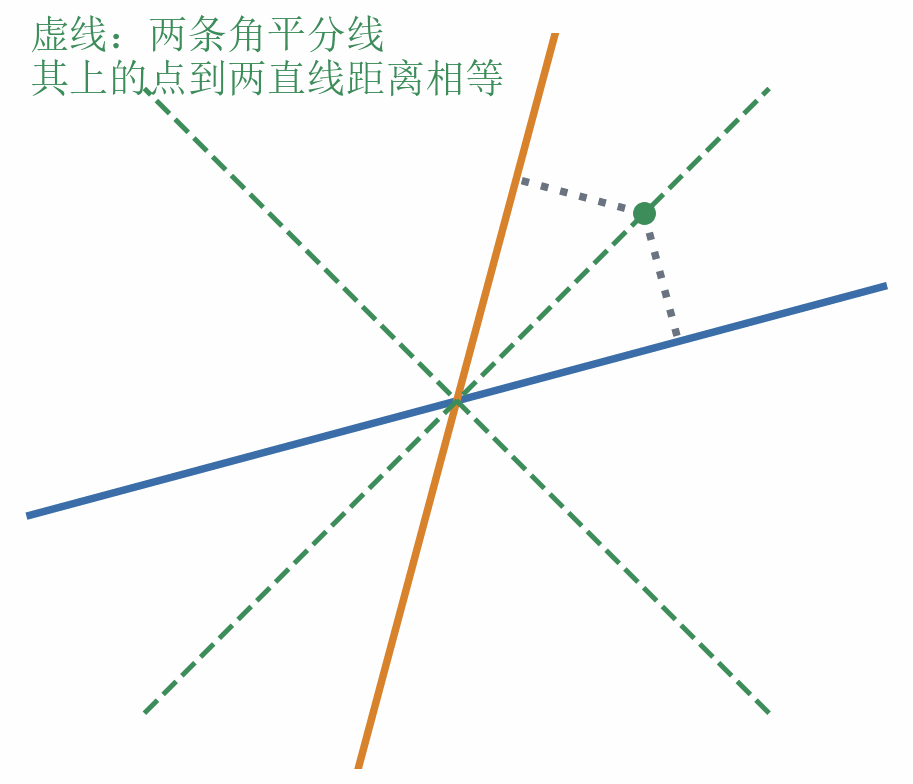

\[
\frac{A_1x+B_1y+C_1}{\sqrt{A_1^2+B_1^2}}=\pm\frac{A_2x+B_2y+C_2}{\sqrt{A_2^2+B_2^2}},
\]

取正、负号分别得到两条互相垂直的角平分线。

**例12：同一对直线的交点与夹角。** 设 \(L_1:5x+4y+2=0\)、\(L_2:2x-y-7=0\)。

求交点：\(L_2\) 中 \(y\) 的系数为 \(-1\)，先解出 \(y=2x-7\)，代入 \(L_1\)：

\[
5x+4(2x-7)+2=0,\qquad 13x-26=0,\qquad x=2,
\]

回代得 \(y=-3\)，交点为 \((2,-3)\)。检验：\(10-12+2=0\)，\(4+3-7=0\)。

求夹角：法向量 \(n_1=(5,4)\)、\(n_2=(2,-1)\)，

\[
\cos\varphi=\frac{|10-4|}{\sqrt{41}\,\sqrt5}=\frac{6}{\sqrt{205}}\approx0.419,\qquad \varphi\approx65.2^\circ.
\]

改用方向向量 \(s_1=(4,-5)\)、\(s_2=(1,2)\)，分子为 \(|4-10|=6\)，分母仍为 \(\sqrt{41}\sqrt5\)，结果相同。再用斜率 \(k_1=-5/4\)、\(k_2=2\)：

\[
\tan\varphi=\left|\frac{2+5/4}{1-5/2}\right|=\left|\frac{13/4}{-3/2}\right|=\frac{13}{6}.
\]

由 \(\cos\varphi=6/\sqrt{205}\) 得 \(\sin\varphi=\sqrt{1-36/205}=13/\sqrt{205}\)，正切正是 \(13/6\)。三种算法给出同一个角。

**例13：法向量夹角为钝角的情形。** 求直线 \(x+4y+1=0\) 与 \(x-2y+3=0\) 的夹角。法向量 \((1,4)\)、\((1,-2)\) 的点积为 \(1-8=-7\)，两模之积为 \(\sqrt{17}\sqrt5=\sqrt{85}\)。不加绝对值时，法向量夹角的余弦为 \(-7/\sqrt{85}\)，对应约 \(139.4^\circ\)；两直线的夹角是它的补角：

\[
\cos\varphi=\frac{7}{\sqrt{85}},\qquad \varphi\approx40.6^\circ.
\]

用斜率核对：\(k_1=-1/4\)、\(k_2=1/2\)，

\[
\tan\varphi=\frac{1/2+1/4}{1-1/8}=\frac{3/4}{7/8}=\frac67.
\]

由 \(\cos\varphi=7/\sqrt{85}\) 得 \(\sin\varphi=6/\sqrt{85}\)，\(\tan\varphi=6/7\)，一致。所以答案可以写成 \(\arccos(7/\sqrt{85})\)，也可以写成 \(\operatorname{arctg}(6/7)\)。

**例14：过定点作已知直线的垂线。** 求过 \(M=(2,3)\)、垂直于 \(-5x-3y+8=0\) 的直线。

向量法：已知直线的法向量 \((-5,-3)\) 垂直于已知直线，而所求直线也垂直于已知直线，所以这个法向量平行于所求直线，可以作为所求直线的方向向量；取与它反向的 \((5,3)\) 也可以，因为直线没有定向，方向向量只需平行即可。于是所求直线的法向量为 \((3,-5)\)，点法式为

\[
3(x-2)-5(y-3)=0,\qquad 3x-5y+9=0.
\]

斜率法：已知直线化为 \(y=-\tfrac53x+\tfrac83\)，\(k_1=-5/3\)。由 \(k_1k_2=-1\) 得 \(k_2=3/5\)，点斜式 \(y-3=\tfrac35(x-2)\)，两边乘五整理，同样得到 \(3x-5y+9=0\)。检验：\(6-15+9=0\)，点在直线上；两法向量 \((-5,-3)\)、\((3,-5)\) 的点积为 \(-15+15=0\)，确实垂直。

过定点作已知直线 \(Ax+By+C=0\) 的平行线或垂线，可直接写出：平行线为 \(A(x-x_0)+B(y-y_0)=0\)（法向量不变）；垂线为 \(B(x-x_0)-A(y-y_0)=0\)（法向量换成原来的方向向量）。

### 4.5 三角形中的直线计算

三角形问题把前面几节的工具串联起来：边所在的直线用两点式，中线（медиана）先求对边的中点，高（высота）用垂直条件确定方向、用点到直线的距离求长度。

**例15：三角形的边、中线与高。** 已知三角形顶点 \(A=(-2,1)\)、\(B=(3,3)\)、\(C=(1,0)\)。

第一，边 \(AB\) 的方程（уравнение стороны）。由两点式

\[
\frac{x+2}{3+2}=\frac{y-1}{3-1},\qquad 2(x+2)=5(y-1),\qquad 2x-5y+9=0.
\]

也可以先求斜率 \(k=(3-1)/(3+2)=2/5\)，用点斜式 \(y-1=\tfrac25(x+2)\) 得到同一方程。\(A,B\) 代入均为零；\(C\) 代入得 \(2-0+9=11\ne0\)，说明三点不共线，确实构成三角形。

第二，边 \(AC\) 的中点。中点坐标是两端点坐标的平均：

\[
M=\left(\frac{-2+1}2,\ \frac{1+0}2\right)=\left(-\frac12,\ \frac12\right).
\]

第三，中线 \(BM\)。方向向量 \(M-B=(-7/2,-5/2)\)，乘以 \(-2\) 后取 \((7,5)\)，比例不变而分数消去：

\[
\frac{x-3}7=\frac{y-3}5,\qquad 5(x-3)=7(y-3),\qquad 5x-7y+6=0.
\]

检验：\(B\) 代入 \(15-21+6=0\)，\(M\) 代入 \(-2.5-3.5+6=0\)。

第四，高 \(CD\) 的方程。\(CD\) 过 \(C\) 且垂直于 \(AB\)。\(AB\) 的法向量 \((2,-5)\) 平行于 \(CD\)，所以 \(CD\) 的法向量可取 \((5,2)\)：

\[
5(x-1)+2(y-0)=0,\qquad 5x+2y-5=0.
\]

两法向量的点积 \(2\cdot5+(-5)\cdot2=0\)，垂直关系成立。

第五，高 \(CD\) 的长度，就是 \(C\) 到直线 \(AB\) 的距离：

\[
|CD|=\frac{|2\cdot1-5\cdot0+9|}{\sqrt{2^2+(-5)^2}}=\frac{11}{\sqrt{29}}=\frac{11\sqrt{29}}{29}\approx2.04.
\]

作为核对，联立 \(AB\) 与 \(CD\) 的方程求垂足。系数行列式为 \(2\cdot2-(-5)\cdot5=29\)，解得 \(D=(7/29,\ 55/29)\)。于是

\[
|CD|=\frac{\sqrt{22^2+55^2}}{29}=\frac{\sqrt{3509}}{29}=\frac{11\sqrt{29}}{29},
\]

其中 \(3509=121\times29\)。距离公式不需要先求垂足，联立法则同时给出了垂足的位置。

还可以用 3.1 节的坐标面积公式核对：\(S=\frac12|(3+2)(0-1)-(1+2)(3-1)|=\frac12|-5-6|=\frac{11}2\)；另一方面 \(S=\frac12|AB|\cdot|CD|=\frac12\sqrt{29}\cdot\frac{11}{\sqrt{29}}=\frac{11}2\)，两者一致。

## 第五章 空间平面

### 5.1 方程与参数形式

空间中的平面与平面上的直线类似，可以由一点和一个法向量确定。已知平面经过点 \(P_0\)（位置向量 \(r_0\)），非零法向量为 \(n=(A,B,C)\)，平面上任意一点 \(r\) 与 \(P_0\) 的连线都垂直于 \(n\)，于是

\[
n\cdot(r-r_0)=0,
\qquad Ax+By+Cz+D=0.
\]

左式是向量形式，右式是展开后的一般方程，其中 \(D=-n\cdot r_0\)。一个平面上有两个独立的方向，法向量只限制了垂直于平面的那一个方向。若已知平面上三个不共线的点 \(P,Q,R\)，两条边向量 \(Q-P\)、\(R-P\) 都在平面内，它们的叉积就垂直于平面，可取 \(n=(Q-P)\times(R-P)\)。同一平面的方程乘以任意非零常数，表示的点集不变。若 \(A=B=C=0\)，方程要么是恒等式、表示整个空间，要么是矛盾式、表示空集，都不再是平面。

一般式中系数为零的情形同样有几何意义：\(D=0\) 时平面过原点；缺少某个变量（如 \(C=0\)，方程中没有 \(z\)）时，法向量垂直于该坐标轴，平面平行于该坐标轴；缺少两个变量（如 \(Ax+D=0\)）时，平面垂直于剩下那个变量的坐标轴。

**截距式与法线式。** 若平面与三条坐标轴分别交于 \((a,0,0)\)、\((0,b,0)\)、\((0,0,c)\)（均不为零），方程可写成

\[
\frac xa+\frac yb+\frac zc=1 .
\]

把一般式除以 \(\pm\sqrt{A^2+B^2+C^2}\)，使常数项非正，得到法线式 \(x\cos\alpha+y\cos\beta+z\cos\gamma-p=0\)，其中 \((\cos\alpha,\cos\beta,\cos\gamma)\) 是单位法向量的方向余弦，\(p\ge0\) 是原点到平面的距离。

**例16：三点确定平面。** 设 \(P=(1,0,0)\)、\(Q=(0,1,0)\)、\(R=(0,0,1)\)。两条边为 \(Q-P=(-1,1,0)\)、\(R-P=(-1,0,1)\)，叉积为 \((1\cdot1-0\cdot0,\ 0\cdot(-1)-(-1)\cdot1,\ (-1)\cdot0-1\cdot(-1))=(1,1,1)\)。所以平面为 \(1\cdot(x-1)+y+z=0\)，即 \(x+y+z-1=0\)，它也就是截距都为一的截距式。参数式为

\[
r=(1,0,0)+s(-1,1,0)+t(-1,0,1).
\]

把参数式代入一般式，\(x+y+z=(1-s-t)+s+t=1\)，各参数项全部抵消；反过来，对满足一般式的点，可令 \(s=y,t=z\)，得到 \(x=1-s-t\)，因此参数式没有遗漏任何点。这一反向验证说明两种方程确实等价。

俄语课堂中，\(Ax+By+Cz+D=0\) 称为平面的一般方程（общее уравнение плоскости），\(n=(A,B,C)\) 称为平面的法向量（вектор нормали）。板书把点法式 \(A(x-x_0)+B(y-y_0)+C(z-z_0)=0\) 称为 нормальное уравнение；不少俄语教材中这个名称专指法向量已经单位化的形式 \(x\cos\alpha+y\cos\beta+z\cos\gamma-p=0\)，阅读时应按上下文区分。

**三点式。** 过不共线三点 \(M_1,M_2,M_3\) 的平面，可以不先算法向量，直接写成行列式：

\[
\begin{vmatrix}
x-x_1&y-y_1&z-z_1\\
x_2-x_1&y_2-y_1&z_2-z_1\\
x_3-x_1&y_3-y_1&z_3-z_1
\end{vmatrix}=0.
\]

三行依次是 \(\overrightarrow{M_1M}\)、\(\overrightarrow{M_1M_2}\)、\(\overrightarrow{M_1M_3}\)。由 3.2 节，这个行列式就是三者的混合积，等于零表示三个向量共面，也就是点 \(M\) 落在三点确定的平面上。展开来看，它等于 \(\overrightarrow{M_1M}\cdot(\overrightarrow{M_1M_2}\times\overrightarrow{M_1M_3})=0\)，其中叉积正是平面的法向量，所以三点式是“先用叉积求法向量、再写点法式”两步合成的一步。若三点共线，后两行成比例，行列式对一切 \(M\) 都为零，方程不再确定平面。

对上例三点，按第一行展开：

\[
\begin{vmatrix}x-1&y&z\\-1&1&0\\-1&0&1\end{vmatrix}
=(x-1)\cdot1-y\cdot(-1)+z\cdot1=0,
\]

即 \(x+y+z-1=0\)，与叉积法的结果相同。

求平面方程的常见情形可以归纳为：

1. 已知一点和法向量：直接写点法式。
2. 已知不共线三点：用叉积求法向量再写点法式，或直接写三点式行列式。
3. 已知一点和平面内两个不共线方向：两方向的叉积作法向量。
4. 已知一点且平行于已知平面：沿用已知平面的法向量。
5. 已知平面经过一条直线：用 5.3 节的平面束，或用直线方向与另一条已知方向的叉积作法向量。

### 5.2 点到平面的距离和镜像

与平面直线的情形一样，把连接向量投影到法向量上，得到点到平面的距离：

\[
d(P,\Pi)=\frac{|Ax_P+By_P+Cz_P+D|}{\sqrt{A^2+B^2+C^2}}.
\]

令 \(g=Ax_P+By_P+Cz_P+D\)（代入值），垂足是 \(H=P-gn/|n|^2\)，关于平面的对称点是 \(P'=P-2gn/|n|^2\)，即从 \(P\) 出发沿法向量走两倍的投影距离。距离、垂足和对称点都来自同一个正交分解。

**例17：垂足与对称点。** 对 \(\Pi:x+y+z=0\)，点 \(P=(1,1,1)\)，有 \(g=3\)、\(|n|^2=3\)。垂足为 \(P-(1,1,1)=(0,0,0)\)，即原点，距离为 \(3/\sqrt3=\sqrt3\)，对称点为 \(P-2(1,1,1)=(-1,-1,-1)\)。当然不能把原点当作任意平面的垂足；本例成立，是因为点 \(P\) 的位置向量恰好平行于法向量，而平面又过原点。

两个平面的法向量若成比例，两平面可能平行，也可能重合。例如 \(x+y+z=1\) 与 \(2x+2y+2z=2\) 重合，而与 \(2x+2y+2z=3\) 平行。必须连同常数项一起比较。平行平面 \(Ax+By+Cz+D_1=0\) 与 \(Ax+By+Cz+D_2=0\) 之间的距离为

\[
d=\frac{|D_1-D_2|}{\sqrt{A^2+B^2+C^2}},
\]

前提同样是先把两个方程的 \(A,B,C\) 化为相同。例如 \(x+y+z=1\) 与 \(2x+2y+2z=3\)，先把后者化为 \(x+y+z-3/2=0\)，距离为 \(|{-1}+3/2|/\sqrt3=1/(2\sqrt3)\)。

不平行的两个平面的较小夹角满足 \(\cos\theta=|n_1\cdot n_2|/(|n_1||n_2|)\)，写成坐标就是

\[
\cos\theta=\frac{|A_1A_2+B_1B_2+C_1C_2|}{\sqrt{A_1^2+B_1^2+C_1^2}\,\sqrt{A_2^2+B_2^2+C_2^2}}.
\]

它与 4.4 节两条平面直线的夹角公式是同一个向量夹角公式，只是空间向量有三个坐标，点积和模长都要包含第三项。两平面垂直的条件是 \(A_1A_2+B_1B_2+C_1C_2=0\)；平行（或重合）的条件是 \(A_1:A_2=B_1:B_2=C_1:C_2\)。

**例18：两平面夹角的余弦。** 求 \(\pi_1:2x-2y+z-5=0\) 与 \(\pi_2:x-z+7=0\) 的夹角余弦。法向量 \(n_1=(2,-2,1)\)；\(\pi_2\) 中没有 \(y\) 项，\(y\) 的系数是零，所以 \(n_2=(1,0,-1)\)，不能漏写这个零，也不能把 \(-1\) 挪到第二个位置。于是

\[
\cos\theta=\frac{|2\cdot1+(-2)\cdot0+1\cdot(-1)|}{\sqrt{4+4+1}\,\sqrt{1+0+1}}=\frac{1}{3\sqrt2}=\frac{\sqrt2}{6}\approx0.236,
\]

\(\theta\approx76.4^\circ\)。如果只取前两个坐标计算，会得到 \(2/(2\sqrt2)\approx0.707\)，约为 \(45^\circ\)。丢掉第三个坐标相当于把法向量投影到 \(xy\) 平面上，方向已经改变，结果自然错误。

### 5.3 平面束

与平面上的直线束类似，若两个平面 \(\pi_1:A_1x+B_1y+C_1z+D_1=0\) 与 \(\pi_2:A_2x+B_2y+C_2z+D_2=0\) 相交于一条直线 \(\ell\)，则对不全为零的 \(\lambda,\mu\)，

\[
\lambda(A_1x+B_1y+C_1z+D_1)+\mu(A_2x+B_2y+C_2z+D_2)=0
\]

表示一个经过交线 \(\ell\) 的平面，因为 \(\ell\) 上的点使两个括号同时为零；并且经过 \(\ell\) 的每一个平面都能这样写出。全体这样的平面称为过 \(\ell\) 的平面束。

**例：过交线和一点的平面。** 求经过平面 \(x+y-z=0\) 与 \(x-y+2z-1=0\) 的交线、并且经过点 \((1,1,1)\) 的平面。设所求平面为 \((x+y-z)+\lambda(x-y+2z-1)=0\)，代入 \((1,1,1)\)：\(1+\lambda\cdot1=0\)，得 \(\lambda=-1\)。所求平面为 \((x+y-z)-(x-y+2z-1)=0\)，即 \(2y-3z+1=0\)。检验：点 \((1,1,1)\) 代入 \(2-3+1=0\)。这个方法不需要先求出交线的方程。用 \(\mu=1\) 的写法会遗漏 \(\pi_2\) 本身，若答案恰好是 \(\pi_2\)，需要单独检查。

## 第六章 空间直线与平面交线

### 6.1 直线的多种表达

空间直线由一点和一个方向确定。过点 \(P_0=(x_0,y_0,z_0)\)、方向为非零向量 \(d=(a,b,c)\) 的直线写作

\[
r=r_0+td,\qquad x=x_0+at,\ y=y_0+bt,\ z=z_0+ct.
\]

前者是向量式，后者是参数方程。当三个方向分量都不为零时，可以从三个式子中各解出 \(t\) 并令它们相等，消去参数，得到对称式（标准方程）

\[
\frac{x-x_0}{a}=\frac{y-y_0}{b}=\frac{z-z_0}{c}.
\]

若某个方向分量为零，例如 \(a=0\)，应把 \(x=x_0\) 单独保留，只对其余非零分量写分式。方向分量为零表示对应坐标恒定不变，而不是该坐标“没有约束”。例如 \(r=(1,2,3)+t(0,1,-2)\) 表示 \(x=1\) 且 \((y-2)/1=(z-3)/(-2)\)，绝不能写出除以零的式子。

俄语教材把对称式称为直线的典范方程（каноническое уравнение прямой），中文教材也称点向式或标准方程；有的译文把它误译成“正则方程”。俄语课堂上常见分母为零的写法，例如过点 \(M_0(8,1,-1)\)、方向 \(\vec a=(0,3,-1)\) 的直线写成
\[
\frac{x-8}{0}=\frac{y-1}{3}=\frac{z+1}{-1}.
\]
这不是在做除法，而是一种约定：连比式的本义是 \(\overrightarrow{M_0M}=t\vec a\)，第一个分量给出 \(x-8=t\cdot0=0\)，所以分母为零时分子也必须为零。保留零是为了让三个分母直接读出方向向量的三个坐标。按上一段的规范写法，它等价于
\[
\begin{cases}x=8,\\[4pt] \dfrac{y-1}{3}=\dfrac{z+1}{-1},\end{cases}
\qquad\text{参数方程为}\qquad x=8,\ y=1+3t,\ z=-1-t .
\]
阅读俄语板书时应按这一约定理解，自己书写时仍以拆开的方程组为准。

空间直线不能只用一个方程表示。空间中的点有三个自由坐标，一个（相容的线性）方程消去一个自由度，剩下二维，是一个平面；直线是一维的，必须消去两个自由度，所以要两个方程，几何上就是两个平面的交线。对称式看起来像一个等式，其实连等号 \(a=b=c\) 同时表示 \(a=b\) 与 \(b=c\) 两个方程，每个方程都是一个平面。平面直角坐标系中只有两个坐标，一个方程 \(Ax+By+C=0\) 就足以表示直线；到了空间多一个坐标，就要多一个方程。6.3 节用秩的语言给出同一结论。

过两点 \(M_1,M_2\) 的空间直线，取方向 \(d=M_2-M_1\)，得到两点式

\[
\frac{x-x_1}{x_2-x_1}=\frac{y-y_1}{y_2-y_1}=\frac{z-z_1}{z_2-z_1}.
\]

空间直线还可以看作两个不平行平面的交线，写成方程组形式（一般方程）；6.2 节讨论怎样从这种形式求出点和方向。

### 6.2 两个平面的公共直线

两个不平行平面的交线同时位于两个平面内，所以它的方向同时垂直于两个法向量，可取 \(d=n_1\times n_2\)。但方向只确定了一族互相平行的直线，还要联立两个平面方程求出一个公共点，才能确定是哪一条。找公共点时，可以尝试令某个坐标为零，把问题化为两个方程两个未知数；若这样做导致矛盾，并不说明交线不存在，只说明交线与所选的坐标平面平行，应换一个坐标再试，或直接消元得到参数形式。

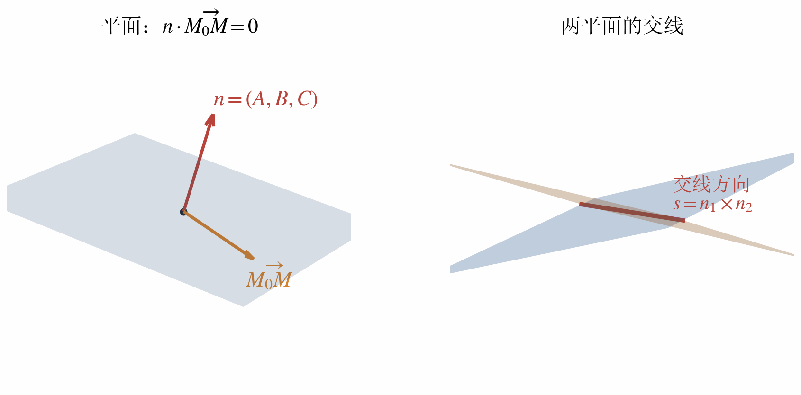

**例19：带有符号核验的交线。** 对

\[
\begin{cases}2x+3y-z+5=0,\\x+y-z-2=0,\end{cases}
\]

两个法向量为 \((2,3,-1)\)、\((1,1,-1)\)，叉积为 \((3\cdot(-1)-(-1)\cdot1,\ (-1)\cdot1-2\cdot(-1),\ 2\cdot1-3\cdot1)=(-2,1,-1)\)。再找一个公共点：取 \(z=0\)，得到 \(x+y=2\)、\(2x+3y=-5\)，消元得 \(y=-9,x=11\)。所以交线为

\[
r=(11,-9,0)+t(-2,1,-1).
\]

验算时把参数式代回两个平面方程，常数部分和含 \(t\) 部分应分别为零。代回第一个平面，常数部分是 \(22-27+5=0\)，含 \(t\) 部分的系数是 \(-4+3+1=0\)；代回第二个平面，常数部分 \(11-9-0-2=0\)，含 \(t\) 部分 \(-2+1+1=0\)，也都为零。若另一份解答写成经过 \((1,1,0)\) 的同方向直线，把该点代回原第一个平面得 \(2+3+5=10\)，而不是零，因此它不是同一条直线；只有把第一个方程的常数改为负五时，该点才满足方程。由此可以判断两份文字方程互不相容，但不能仅凭旧会话中对图片的解释，就断言原课件一定印错。

**讲解例：一般方程化为典范方程。** 直线由
\[
\begin{cases}x-y+7z=0,\\ -3x+y+2z+11=0\end{cases}
\]
给出，要写出它的典范方程，需要求出一点 \(M_0\) 和方向向量 \(\vec s\)。两个法向量为 \(\vec n_1=(1,-1,7)\)、\(\vec n_2=(-3,1,2)\)。方向取叉积：
\[
\vec s=\vec n_1\times\vec n_2=\begin{vmatrix}\vec i&\vec j&\vec k\\1&-1&7\\-3&1&2\end{vmatrix},
\]
按第一行展开，三个分量依次为
\[
(-1)\cdot2-7\cdot1=-9,\qquad -\bigl(1\cdot2-7\cdot(-3)\bigr)=-23,\qquad 1\cdot1-(-1)\cdot(-3)=-2,
\]
即 \(\vec s=(-9,-23,-2)\)。方向向量乘以 \(-1\) 不改变直线，取 \(\vec s=(9,23,2)\)。再找一点：取 \(z=1\)，得 \(x-y=-7\)、\(-3x+y=-13\)，两式相加 \(-2x=-20\)，\(x=10\)，\(y=17\)，所以 \(M_0=(10,17,1)\)。典范方程为
\[
\frac{x-10}{9}=\frac{y-17}{23}=\frac{z-1}{2}.
\]
验算：\(M_0\) 代入两平面，\(10-17+7=0\)，\(-30+17+2+11=0\)；方向与两法向量垂直，\(9-23+14=0\)，\(-27+23+4=0\)。若取 \(z=0\)，得到 \(M_0=(11/2,11/2,0)\)，方程不同但表示同一条直线，只是含分数。

求两平面交线的步骤是：

1. 检查两个法向量是否成比例；若成比例，两平面平行或重合，没有唯一的交线。
2. 计算 \(d=n_1\times n_2\) 作为交线方向。
3. 令某个坐标取定值（通常为零），解另外两个坐标，得到一个公共点；若无解，换另一个坐标。
4. 写出参数式或对称式。
5. 把参数式代回两个平面方程，检验常数部分和含参数部分都为零。

### 6.3 方程秩与几何维数

线性方程组的秩决定了它的解集是什么几何对象。在三维空间中，一个有解（相容）的线性方程组，若系数矩阵的秩为一，解集是一个平面；秩为二，是一条直线；秩为三，是一个点；秩为零（方程全是 \(0=0\)），是整个空间。统一地说，解集的维数是 \(3-r(A)\)。若增广矩阵的秩大于系数矩阵的秩，方程组无解，几何上就是没有公共点。这个维数关系只适用于线性约束构成的相容方程组，不能用它断言任意一个三元方程都表示平面，例如 \(x^2+y^2+z^2=1\) 表示的是球面。

## 第七章 相对位置、夹角与距离

### 7.1 直线与平面

判断直线与平面的关系，最直接的方法是把直线的参数式 \(r=r_0+td\) 代入平面方程 \(n\cdot r+D=0\)，得到关于 \(t\) 的一次方程

\[
(n\cdot d)t+n\cdot r_0+D=0.
\]

分三种情况：若 \(n\cdot d\ne0\)，方程有唯一解，直线与平面有唯一交点；若 \(n\cdot d=0\) 但常数项不为零，方程无解，直线平行于平面；若两项都为零，方程对一切 \(t\) 成立，整条直线位于平面内。这样分类比单独记忆三幅图更直接。

由此得到两个常用条件：直线平行于平面（或在平面内）的条件是方向向量垂直于法向量，\(n\cdot d=0\)，即 \(Aa+Bb+Cc=0\)；直线垂直于平面的条件是方向向量平行于法向量，即 \(a:A=b:B=c:C\)。

**例20：求交点和线面角。** 直线 \(r=(0,0,1)+t(1,1,-2)\) 与平面 \(z=0\)：代入得 \(1-2t=0\)，\(t=1/2\)，交点为 \((1/2,1/2,0)\)。平面的法向量为 \((0,0,1)\)，方向向量的模为 \(\sqrt6\)，所以直线与平面的夹角 \(\alpha\) 满足

\[
\sin\alpha=\frac{|d\cdot n|}{|d||n|}=\frac2{\sqrt6}.
\]

这里用正弦，是因为直线与平面的夹角，等于直线与它在平面上投影的夹角，它与“方向向量和法向量的夹角”互为余角。若误用余弦，求出的将是另一个角。可以用极端情形核对：方向平行于法向量时，直线垂直于平面，\(\sin\alpha=1\)，\(\alpha=90^\circ\)；方向垂直于法向量时，直线平行于平面，\(\alpha=0\)。

**讲解例：数字不整齐的交点与线面角。** 直线 \(\dfrac{x}{1}=\dfrac{y+1}{-1}=\dfrac{z-4}{3}=t\) 与平面 \(x-5z+1=0\)。参数式为 \(x=t\)、\(y=-1-t\)、\(z=4+3t\)，代入平面：
\[
t-5(4+3t)+1=0\ \Longrightarrow\ -14t-19=0\ \Longrightarrow\ t=-\frac{19}{14}.
\]
代回得交点 \(P\bigl(-\tfrac{19}{14},\ \tfrac5{14},\ -\tfrac1{14}\bigr)\)，其中 \(y=-1+\tfrac{19}{14}=\tfrac5{14}\)，\(z=4-\tfrac{57}{14}=-\tfrac1{14}\)。验算：\(-\tfrac{19}{14}-5\cdot\bigl(-\tfrac1{14}\bigr)+1=\tfrac{-19+5+14}{14}=0\)。夹角由 \(\vec s=(1,-1,3)\)、\(\vec n=(1,0,-5)\) 求出：\(\vec s\cdot\vec n=1-15=-14\)，\(|\vec s|=\sqrt{11}\)，\(|\vec n|=\sqrt{26}\)，
\[
\sin\varphi=\frac{\lvert-14\rvert}{\sqrt{11}\,\sqrt{26}}=\frac{14}{\sqrt{286}}\approx0.828,\qquad \varphi\approx55.9^\circ .
\]
交点坐标为分数并不说明算错，关键是代回检验。两直线夹角、两平面夹角用余弦，线面角用正弦，三者的区别只在于参与运算的是方向向量还是法向量。

**讲解例：过一点且平行于两条直线的平面。** 求过 \(M(2,-3,4)\)、平行于直线 \(L_1:\dfrac{x}{1}=\dfrac{y-1}{2}=\dfrac{z-3}{8}\) 与 \(L_2:\dfrac{x+1}{4}=\dfrac{y-1}{0}=\dfrac{z+5}{2}\) 的平面。由上面的条件，平面平行于直线等价于法向量垂直于方向向量，所以法向量同时垂直于 \(\vec s_1=(1,2,8)\) 与 \(\vec s_2=(4,0,2)\)，取叉积：
\[
\vec N=\vec s_1\times\vec s_2=\begin{vmatrix}\vec i&\vec j&\vec k\\1&2&8\\4&0&2\end{vmatrix}=(2\cdot2-8\cdot0,\ -(1\cdot2-8\cdot4),\ 1\cdot0-2\cdot4)=(4,30,-8),
\]
约去公因子二得 \((2,15,-4)\)。点法式 \(2(x-2)+15(y+3)-4(z-4)=0\) 展开，常数项 \(-4+45+16=57\)，得
\[
2x+15y-4z+57=0 .
\]
验算：\(M\) 代入 \(4-45-16+57=0\)；\(\vec N\cdot\vec s_1=2+30-32=0\)，\(\vec N\cdot\vec s_2=8+0-8=0\)。若两条直线方向平行，叉积为零，平面不唯一，需要另给条件。

### 7.2 两条空间直线

空间中两条直线有四种位置关系：重合、平行、相交、异面。判断步骤是：

1. 比较方向向量 \(d_1,d_2\) 是否成比例。
2. 若成比例，检查一条直线上的一点是否在另一条直线上：在，则重合；不在，则平行。
3. 若不成比例，令基点差 \(w=P_2-P_1\)，计算混合积 \(w\cdot(d_1\times d_2)\)。
4. 混合积为零，两直线共面，又不平行，所以相交，可联立参数式求交点；混合积不为零，两直线异面。

与平面中不同，空间中两条不平行的直线不一定相交，因为它们可能不在同一个平面内。第 3 步必须在确认方向不平行之后才使用：若两直线平行，\(d_1\times d_2=0\)，混合积恒为零，并不能推出相交。

**讲解例：直接联立求交点。** 也可以不先算混合积，直接联立参数式。设
\[
L_1:\ \frac{x-8}{0}=\frac{y-1}{3}=\frac{z+1}{-1},\qquad L_2:\ \frac{x-6}{1}=\frac{y-2}{1}=\frac{z+4}{1}.
\]
两条直线的参数必须用不同字母，因为交点在两条直线上对应的参数一般不同：\(L_1\) 为 \(x=8,\ y=1+3t,\ z=-1-t\)；\(L_2\) 为 \(x=6+s,\ y=2+s,\ z=-4+s\)。令坐标相等，得三个方程两个未知数：
\[
8=6+s,\qquad 1+3t=2+s,\qquad -1-t=-4+s .
\]
由前两式 \(s=2\)、\(t=1\)。第三式必须检验：左边 \(-2\)，右边 \(-2\)，成立，两直线相交，交点为 \(P(8,4,-2)\)。若第三式不成立，前两式照样有解，但两直线异面，没有交点；若方向向量成比例，则平行或重合，没有唯一交点。检验第三个方程，等价于上面混合积为零的条件。

两条空间直线的夹角，与平面情形相同，用方向向量计算：

\[
\cos\varphi=\frac{|d_1\cdot d_2|}{|d_1|\,|d_2|} .
\]

异面直线也有夹角，定义为把它们平移到相交后所成的较小角，所以公式同样适用。

### 7.3 点线距离与异面直线距离

点 \(P\) 到空间直线 \(r=P_0+td\) 的距离为

\[
d(P,\ell)=\frac{|(P-P_0)\times d|}{|d|}.
\]

分子是以 \(P-P_0\) 和 \(d\) 为邻边的平行四边形的面积，除以底边长度 \(|d|\) 就得到高，也就是距离。也可以用最小化的方法推导：设垂足对应参数 \(t_*\)，要求连接向量 \(P-P_0-t_*d\) 与 \(d\) 垂直，于是 \(t_*=(P-P_0)\cdot d/|d|^2\)。两种推导一个用面积，一个用投影，结论一致。

**例21：点到空间直线。** 点 \(P=(1,1,1)\)，直线为 \(r=(0,0,0)+t(1,1,0)\)。点积法：\(t_*=(1+1)/2=1\)，垂足为 \((1,1,0)\)，距离为 \(|(0,0,1)|=1\)。叉积法：\((1,1,1)\times(1,1,0)=(1\cdot0-1\cdot1,\ 1\cdot1-1\cdot0,\ 1\cdot1-1\cdot1)=(-1,1,0)\)，模为 \(\sqrt2\)，除以方向的模 \(\sqrt2\) 也得一。直接取点到基点的距离 \(\sqrt3\)，只是某一条连接线段的长度，并不是最短距离。

若两条直线方向不平行，它们的公垂线（同时垂直于两条直线的线段）方向为 \(d_1\times d_2\)，所以两直线间的距离等于基点差在这个方向上的投影长度：

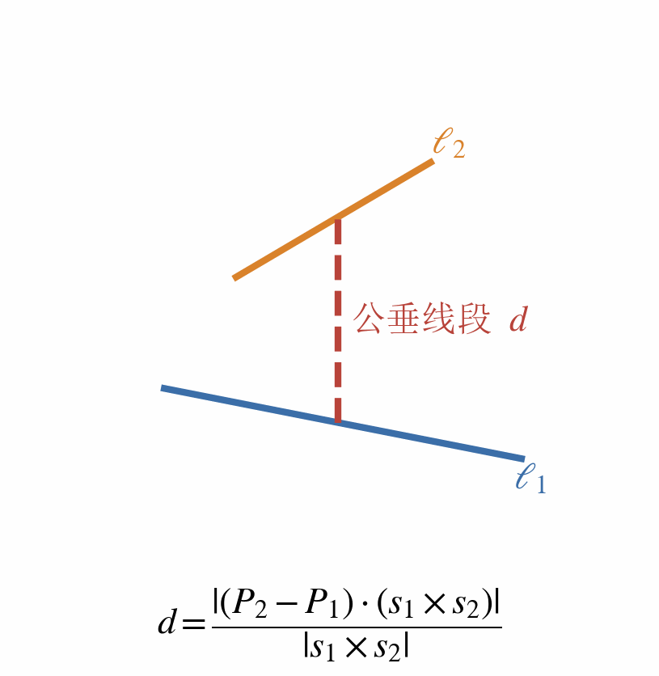

\[
d(\ell_1,\ell_2)=\frac{|(P_2-P_1)\cdot(d_1\times d_2)|}{|d_1\times d_2|}.
\]

例如 \(\ell_1=(t,0,0)\)（即 \(x\) 轴）、\(\ell_2=(0,s,1)\)，方向叉积为 \((1,0,0)\times(0,1,0)=(0,0,1)\)，基点差 \((0,0,1)\) 也在这个方向上，距离为一；距离不为零，说明两直线异面。若两直线平行，分母为零，这个公式不能使用，应改为求一条直线上某一点到另一条直线的距离。公式的分母往往直接暴露了它的适用条件，计算前应先判断分母是否可能为零。

求距离的常见情形归纳如下：

1. 点到平面直线、点到平面：代入值的绝对值除以法向量的模。
2. 平行直线之间、平行平面之间：先把方程系数化为相同，常数项之差的绝对值除以法向量的模。
3. 点到空间直线：叉积的模除以方向向量的模。
4. 异面直线之间：混合积的绝对值除以两方向叉积的模。
5. 线段、射线等有界对象：先按无界对象求垂足，再检查垂足是否在范围内（见 10.1 节）。

## 第八章 二次曲线与坐标变换

### 8.1 圆、椭圆、双曲线与抛物线

二次曲线都可以由距离关系来定义，标准方程是在适当的坐标系中把定义翻译成代数式的结果。

**圆**是到一个固定点（圆心）的距离等于定值（半径）的点的集合。圆心为 \((h,k)\)、半径为 \(R>0\) 的圆为 \((x-h)^2+(y-k)^2=R^2\)。

**椭圆**是到两个固定点（焦点）的距离之和等于常数 \(2a\) 的点的集合。把焦点放在 \((\pm c,0)\)，化简得标准式 \(x^2/a^2+y^2/b^2=1\)，其中 \(a\ge b>0\)，三个参数满足 \(c^2=a^2-b^2\)。\(a\) 称为长半轴，\(b\) 称为短半轴。

**双曲线**是到两个焦点的距离之差的绝对值等于常数 \(2a\) 的点的集合，标准式为 \(x^2/a^2-y^2/b^2=1\)，此时 \(c^2=a^2+b^2\)。

同样的字母 \(a,b,c\) 在椭圆和双曲线中满足不同的关系，不能混用。

**抛物线**是到一个焦点与到一条准线距离相等的点的集合。取焦点 \((p/2,0)\)、准线 \(x=-p/2\)，其中 \(p>0\)，由距离相等得

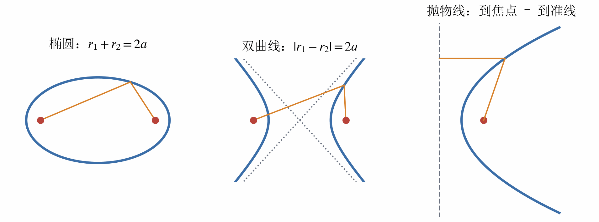

\[
\sqrt{(x-p/2)^2+y^2}=|x+p/2|.
\]

两边平方，展开后消去两边相同的 \(x^2\) 和 \(p^2/4\) 项，得到 \(y^2=2px\)。有的教材写作 \(y^2=4ax\)，这只是参数命名不同，焦点横坐标分别为 \(p/2\) 与 \(a\)。使用公式前应先确认所用的定义和参数。

**焦半径。** 曲线上一点到焦点的距离称为焦半径，在标准式下有简单的表达。椭圆上点 \((x,y)\) 到左、右焦点的距离分别为 \(a+ex\) 与 \(a-ex\)（\(e=c/a\)，见 8.3 节），两者之和正是 \(2a\)；双曲线右支上的点到左、右焦点的距离分别为 \(ex+a\) 与 \(ex-a\)，两者之差为 \(2a\)；抛物线 \(y^2=2px\) 上的点到焦点的距离为 \(x+p/2\)，就是它到准线的距离。

### 8.2 平移与旋转的作用

**例22：通过配方识别曲线。** 对 \(4x^2+9y^2-8x+18y-23=0\)，分别对同一个变量配方。\(4x^2-8x=4(x^2-2x)=4[(x-1)^2-1]\)，\(9y^2+18y=9[(y+1)^2-1]\)，所以

\[
4[(x-1)^2-1]+9[(y+1)^2-1]-23=0,
\]

整理得 \(4(x-1)^2+9(y+1)^2=4+9+23=36\)，两边除以 36：

\[
\frac{(x-1)^2}{9}+\frac{(y+1)^2}{4}=1.
\]

这是一个椭圆，中心为 \((1,-1)\)，长半轴 \(a=3\)，短半轴 \(b=2\)，\(c=\sqrt{9-4}=\sqrt5\)，焦点为 \((1\pm\sqrt5,-1)\)。配方时产生的常数（这里的 \(-4\) 和 \(-9\)）不能漏掉，否则中心可能正确而半轴长度错误。

用配方识别二次曲线的步骤是：

1. 把含 \(x\) 的项和含 \(y\) 的项分别归组，提出平方项的系数。
2. 对每组配方，记下配方产生的常数。
3. 把所有常数移到等号右边，得到 \(A'(x-h)^2+C'(y-k)^2=F\) 的形式。
4. 根据系数符号和右端判断类型：同号且与右端同号为椭圆（系数相等时为圆）；异号为双曲线（右端为零时退化为两条相交直线）；只有一个平方项为抛物线。
5. 化为标准式，读出中心（或顶点）、半轴，再求焦点等要素。

一般的二次曲线方程还含有交叉项：\(Ax^2+2Bxy+Cy^2+2Dx+2Ey+F=0\)。它的二次部分可以写成 \(r^TMr\)，其中 \(M=\begin{pmatrix}A&B\\B&C\end{pmatrix}\) 是实对称矩阵。选取 \(M\) 的正交特征向量作为新坐标轴，交叉项消失，这正是线性代数中的正交对角化。以 \(x^2+2xy+y^2=1\) 为例，令 \(u=(x+y)/\sqrt2\)、\(v=(x-y)/\sqrt2\)，左边 \((x+y)^2=2u^2\)，方程变成 \(2u^2=1\)，即 \(u=\pm1/\sqrt2\)，是两条平行直线，而不是椭圆。二次方程并不一定给出非退化的曲线，退化情形也是完整分类的一部分。

**类型判别与旋转角。** 不必真正旋转坐标，也能由系数判断曲线的类型。记 \(\delta=AC-B^2=\det M\)：

\[
\delta>0\ \text{椭圆型},\qquad \delta<0\ \text{双曲型},\qquad \delta=0\ \text{抛物型}.
\]

因为 \(\delta\) 等于 \(M\) 的两个特征值之积：同号对应椭圆，异号对应双曲线，有一个为零对应抛物线（这里说的是“型”，具体还可能退化为点、直线或空集）。上例 \(A=B=C=1\)，\(\delta=0\)，属于抛物型，退化为两条平行直线。若要消去交叉项，把坐标轴旋转角度 \(\theta\)，其中

\[
\tan2\theta=\frac{2B}{A-C}\qquad(A\ne C),
\]

当 \(A=C\) 时取 \(\theta=45^\circ\)。上例 \(A=C\)，所以旋转 \(45^\circ\)，与选取的 \(u,v\) 一致。

### 8.3 焦点、准线与离心率的统一关系

椭圆、抛物线和双曲线还可以用同一种方式定义：到焦点的距离与到准线的距离之比为常数。这个比称为离心率，记作 \(e\)。非圆的椭圆 \(0<e<1\)，抛物线 \(e=1\)，双曲线 \(e>1\)。圆可以看作椭圆在 \(e=0\) 时的极限，但这时准线跑到无穷远，有限位置的准线公式不再适用。离心率越接近零，椭圆越接近圆；越接近一，椭圆越扁。

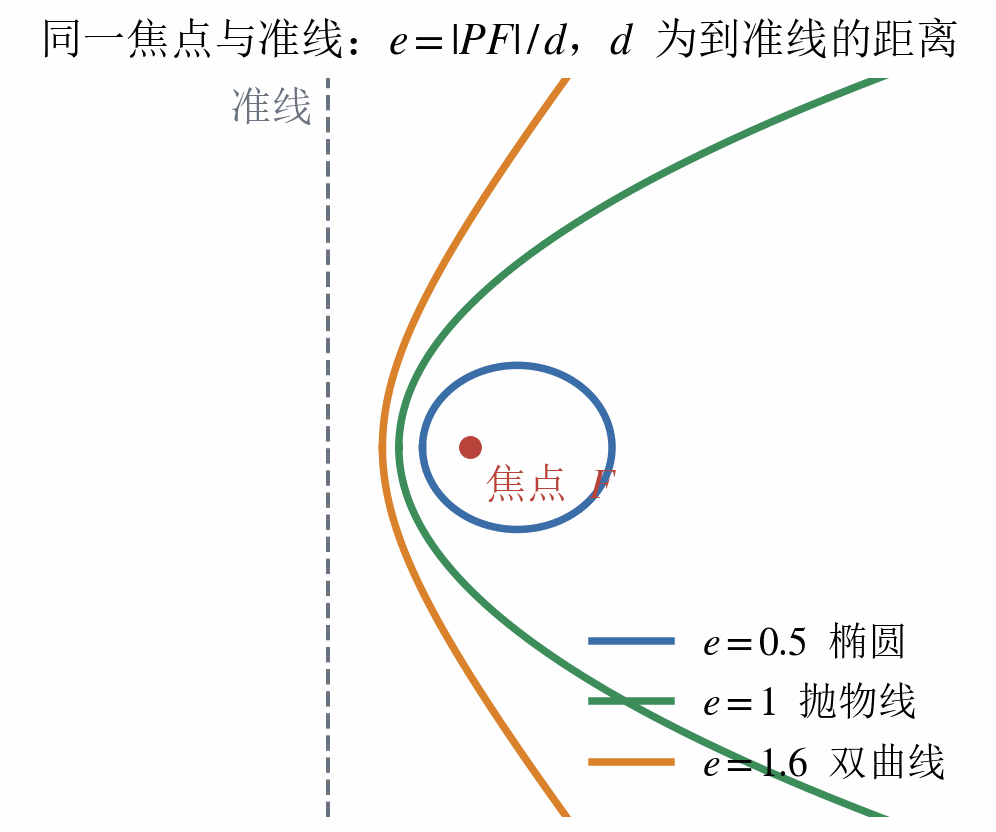

对长轴（或实轴）沿 \(x\) 轴、中心在原点的标准式，椭圆有 \(c^2=a^2-b^2\)、\(e=c/a\)；双曲线有 \(c^2=a^2+b^2\)、\(e=c/a\)。两者的焦点都是 \((\pm c,0)\)，相应的准线都可以写成

\[
x=\pm\frac{a^2}{c}=\pm\frac ae.
\]

焦点与准线按同侧的符号配对。椭圆与双曲线的这些公式形式相同，但参数约束不同。例如椭圆 \(x^2/9+y^2/4=1\) 有 \(c=\sqrt{9-4}=\sqrt5\)、\(e=\sqrt5/3\)、准线 \(x=\pm9/\sqrt5\)；双曲线 \(x^2/9-y^2/4=1\) 则有 \(c=\sqrt{9+4}=\sqrt{13}\)、\(e=\sqrt{13}/3\)、准线 \(x=\pm9/\sqrt{13}\)。只把中间的加号改成减号，就必须重新计算 \(c\)。

双曲线的渐近线可以这样得到：把标准双曲线方程两边除以 \(x^2\)，有

\[
\frac{y^2}{x^2}=\frac{b^2}{a^2}-\frac{b^2}{x^2}.
\]

当 \(|x|\) 很大时，最后一项趋于零，\(y/x\) 趋于 \(\pm b/a\)，所以两条渐近线为 \(y=\pm(b/a)x\)。把中心平移到 \((h,k)\) 后，渐近线改为 \(y-k=\pm(b/a)(x-h)\)。若标准式中带正号的是 \(y^2\) 项，实轴沿 \(y\) 轴，焦点和渐近线也要相应交换坐标，不能仍把焦点放在 \(x\) 轴上。\(a=b\) 的双曲线称为等轴双曲线，两条渐近线互相垂直，离心率为 \(\sqrt2\)。

对抛物线 \(y^2=2px\)（\(p>0\)），焦点为 \((p/2,0)\)，准线为 \(x=-p/2\)，顶点为原点，开口向右。若改为 \(y^2=-2px\)，开口向左，焦点和准线的符号同时改变；写成 \(x^2=\pm2py\) 则开口向上或向下。这些形式都可以由反射或交换坐标得到，不必把四个方向当成四条互不相关的定义。

### 8.4 参数表示与曲线切线

椭圆可以用参数表示为

\[
x=a\cos t,\qquad y=b\sin t,\qquad 0\le t<2\pi.
\]

代入标准式，左边为 \(\cos^2t+\sin^2t=1\)，所以这些点都在椭圆上。需要注意，一般椭圆中的 \(t\) 只是参数（称为离心角），并不等于位置向量与 \(x\) 轴的几何夹角；只有圆（\(a=b\)）的情形才可以这样解释。双曲线 \(x^2/a^2-y^2/b^2=1\) 的右支可以用双曲函数表示为 \(x=a\cosh t,\ y=b\sinh t\)，因为 \(\cosh^2t-\sinh^2t=1\)。抛物线 \(y^2=2px\) 可以取 \(y=pt,\ x=pt^2/2\)，\(t\) 取遍全体实数时覆盖整条抛物线。

设点 \(P_0=(x_0,y_0)\) 确实位于相应的曲线上。用隐函数求导，或者用方程的梯度作为法向量，分别得到各曲线在 \(P_0\) 处的切线：

\[
\begin{aligned}
\text{椭圆}\quad \quad &\frac{xx_0}{a^2}+\frac{yy_0}{b^2}=1,\\
\text{双曲线}\quad \quad &\frac{xx_0}{a^2}-\frac{yy_0}{b^2}=1,\\
\text{抛物线}\quad \quad &yy_0=p(x+x_0).
\end{aligned}
\]

以椭圆为例说明来历：方程 \(F(x,y)=x^2/a^2+y^2/b^2-1=0\) 的梯度为 \((2x/a^2,\ 2y/b^2)\)，它在 \(P_0\) 处垂直于切线，所以切线为 \(\frac{x_0}{a^2}(x-x_0)+\frac{y_0}{b^2}(y-y_0)=0\)；展开并利用 \(x_0^2/a^2+y_0^2/b^2=1\)，即得上式。记法是把方程中的 \(x^2\) 换成 \(xx_0\)、\(y^2\) 换成 \(yy_0\)、\(2x\) 换成 \(x+x_0\)。

例如椭圆上点 \((0,b)\) 处的切线为 \(y=b\)，点 \((a,0)\) 处的切线为 \(x=a\)，竖直切线也包含在同一个公式里。抛物线在顶点 \((0,0)\) 处的切线为 \(x=0\)。如果把不在曲线上的点随意代入这些公式，得到的直线通常有别的几何含义（称为极线），不能称作“该点处的切线”。对平移过的曲线，应先用 \(X=x-h,\ Y=y-k\) 代入标准形式，求出切线后再换回原坐标。

### 8.5 圆锥曲线的由来：平面截圆锥

椭圆、双曲线和抛物线合称圆锥曲线，因为它们都可以由一个平面去截一个圆锥面得到。设圆锥面的轴竖直，母线（过顶点、在锥面上的直线）与轴的夹角为 \(\alpha\)，截平面与轴的夹角为 \(\beta\)（\(0\le\beta\le90^\circ\)），截平面不过圆锥顶点。截线的类型由两个角的大小关系决定：

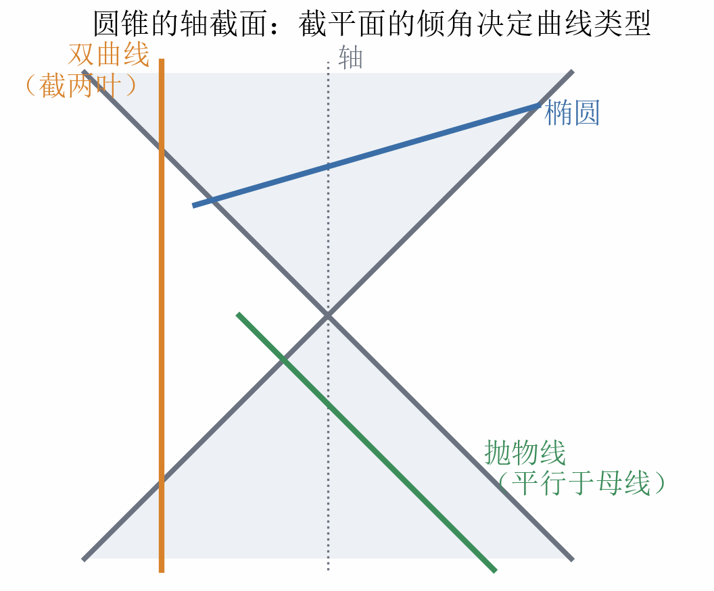

1. \(\beta=90^\circ\)，截平面垂直于轴：截线是圆。
2. \(\alpha<\beta<90^\circ\)，截平面比母线更“平”，只与圆锥的一叶相交且截线封闭：截线是椭圆。
3. \(\beta=\alpha\)，截平面平行于某一条母线：截线向一端无限延伸，是抛物线。
4. \(\beta<\alpha\)，截平面比母线更“陡”，与圆锥的上下两叶都相交：截线是双曲线，两叶各得一支。

若截平面经过顶点，得到的是退化情形：一个点、一条直线（母线）或两条相交直线，它们对应 8.2 节二次方程的退化情况。离心率与两个角的关系是 \(e=\cos\beta/\cos\alpha\)，代入上面四种情况，依次得到 \(e=0\)、\(0<e<1\)、\(e=1\)、\(e>1\)，与 8.3 节的分类完全一致。

**丹德林球与焦点性质。** 为什么平面截圆锥得到的封闭曲线恰好满足“到两焦点距离之和为常数”？比利时数学家丹德林给出了一个直观的证明。在圆锥内放入两个球，使每个球都与圆锥面相切（切点构成一个水平圆），同时与截平面相切，一个在截平面上方，一个在下方。两个球与截平面的切点记为 \(F_1,F_2\)。

设 \(P\) 是截线上任意一点。过 \(P\) 的母线与两个球的切点圆分别交于 \(A\)、\(B\)。从球外一点向球引的所有切线段长度相等，而 \(PF_1\) 与 \(PA\) 都是从 \(P\) 向上方球引的切线段，所以 \(PF_1=PA\)；同理 \(PF_2=PB\)。于是

\[
PF_1+PF_2=PA+PB=AB .
\]

\(AB\) 是两个水平切点圆之间沿母线的距离，对所有母线都相同，与 \(P\) 的位置无关。所以截线上每一点到 \(F_1,F_2\) 的距离之和都等于同一个常数，截线是以 \(F_1,F_2\) 为焦点的椭圆。对双曲线可以作同样的论证（两个球分别在圆锥的两叶中，得到距离之差为常数）；对抛物线只能放入一个球，切点给出焦点，而球的切点圆所在平面与截平面的交线就是准线。

### 8.6 圆锥曲线的极坐标方程

8.3 节的统一定义“到焦点的距离与到准线的距离之比为 \(e\)”，在以焦点为极点的极坐标中有特别简洁的形式。把焦点放在原点，准线取为 \(x=-d\)（\(d>0\)，在焦点左侧），曲线上一点的极坐标为 \((r,\theta)\)，则它到焦点的距离为 \(r\)，到准线的距离为 \(d+r\cos\theta\)。由定义 \(r=e(d+r\cos\theta)\)，解出 \(r\)：

\[
r=\frac{ed}{1-e\cos\theta}=\frac{\ell}{1-e\cos\theta},\qquad \ell=ed .
\]

这个方程对椭圆、抛物线、双曲线同时成立，只是 \(e\) 的取值不同。常数 \(\ell\) 是 \(\theta=90^\circ\) 时的 \(r\)，即过焦点且垂直于对称轴的弦的一半，称为半通径。在标准式下，椭圆和双曲线的半通径为 \(\ell=b^2/a\)，抛物线 \(y^2=2px\) 的半通径为 \(\ell=p\)。

对椭圆，分母 \(1-e\cos\theta\) 恒为正，\(r\) 在 \(\theta=\pi\) 时最小、\(\theta=0\) 时最大，分别为 \(\ell/(1+e)=a-c\) 和 \(\ell/(1-e)=a+c\)，即焦点到两个顶点的距离。对抛物线，\(\theta\to0\) 时分母趋于零，\(r\to\infty\)，曲线向右无限延伸。对双曲线，分母在 \(\cos\theta=1/e\) 时为零，这两个方向正是渐近线的方向。

这一形式在物理中很重要：行星绕太阳的轨道是以太阳为一个焦点的椭圆，用极坐标方程描述最为自然。例如取 \(e=0.5\)、\(\ell=1.5\)，则焦点到近端顶点的距离为 \(1.5/1.5=1\)，到远端顶点为 \(1.5/0.5=3\)，长轴 \(2a=4\)，\(a=2\)，\(c=1\)，\(b^2=a\ell=3\)，正是椭圆 \(x^2/4+y^2/3=1\)。

### 8.7 直线与圆锥曲线

直线与圆锥曲线的位置关系，以及交点构成的弦，是圆锥曲线计算中最常见的问题。基本方法是联立方程、消元，得到一个一元二次方程，再用判别式和根与系数的关系（韦达定理）处理，通常不必求出交点的具体坐标。

**位置关系。** 把直线 \(y=kx+m\) 代入圆锥曲线方程，消去 \(y\)，得到 \(Ax^2+Bx+C=0\)。若 \(A\ne0\)，判别式 \(\Delta=B^2-4AC\) 为正、为零、为负，分别对应两个交点、相切、没有公共点。若 \(A=0\)，方程退化为一次方程，只有一个交点，但这不是相切：对双曲线，这时直线平行于一条渐近线；对抛物线，这时直线平行于对称轴。

**弦长公式。** 设直线 \(y=kx+m\) 与曲线交于 \(A(x_1,y_1)\)、\(B(x_2,y_2)\)，由于 \(y_1-y_2=k(x_1-x_2)\)，

\[
|AB|=\sqrt{1+k^2}\,|x_1-x_2|=\sqrt{1+k^2}\,\sqrt{(x_1+x_2)^2-4x_1x_2}=\sqrt{1+\frac1{k^2}}\,|y_1-y_2| .
\]

\(x_1+x_2\) 和 \(x_1x_2\) 直接由韦达定理读出，不必解方程。若直线竖直，没有斜率，则直接用纵坐标之差。

**中点弦。** 若已知弦 \(AB\) 的中点 \(M(x_0,y_0)\)，求弦所在直线的斜率，可以用点差法。对椭圆 \(x^2/a^2+y^2/b^2=1\)，把 \(A,B\) 的坐标分别代入方程再相减：

\[
\frac{(x_1-x_2)(x_1+x_2)}{a^2}+\frac{(y_1-y_2)(y_1+y_2)}{b^2}=0 .
\]

用 \(x_1+x_2=2x_0\)、\(y_1+y_2=2y_0\)、\(k=(y_1-y_2)/(x_1-x_2)\) 代入，得到

\[
k=-\frac{b^2x_0}{a^2y_0}\qquad(\text{椭圆}),\qquad k=\frac{b^2x_0}{a^2y_0}\qquad(\text{双曲线}),\qquad k=\frac{p}{y_0}\qquad(\text{抛物线 }y^2=2px).
\]

点差法只用到“两点都在曲线上”，求出的直线必须再检验确实与曲线有两个交点；对双曲线，中点位置不当时这样的弦可能不存在。

**已知斜率的切线。** 斜率为 \(k\) 的直线与圆锥曲线相切，可以由判别式为零求出截距。结果是

\[
\text{椭圆}\quad \ y=kx\pm\sqrt{a^2k^2+b^2},\qquad
\text{双曲线}\quad \ y=kx\pm\sqrt{a^2k^2-b^2},\qquad
\text{抛物线 }y^2=2px\text{}\quad \ y=kx+\frac{p}{2k}.
\]

椭圆对任何斜率都有两条切线；双曲线只有在 \(a^2k^2>b^2\)，即 \(|k|>b/a\)（切线比渐近线更陡）时才有切线；抛物线要求 \(k\ne0\)。

**例27：过焦点的弦长。** 椭圆 \(x^2/4+y^2/3=1\) 中 \(a=2\)、\(b=\sqrt3\)、\(c=1\)，右焦点 \(F(1,0)\)。求过 \(F\)、斜率为一的弦长。直线为 \(y=x-1\)，代入椭圆并乘以 12：\(3x^2+4(x-1)^2=12\)，即 \(7x^2-8x-8=0\)。判别式 \(64+224>0\)，有两个交点。由韦达定理 \(x_1+x_2=8/7\)、\(x_1x_2=-8/7\)，所以

\[
|AB|=\sqrt{1+1}\cdot\sqrt{\frac{64}{49}+\frac{32}7}=\sqrt2\cdot\frac{12\sqrt2}7=\frac{24}7 .
\]

也可以用 8.1 节的焦半径核对：右焦点的焦半径为 \(a-ex\)，\(e=1/2\)，所以 \(|AB|=|AF|+|BF|=2a-e(x_1+x_2)=4-\frac12\cdot\frac87=\frac{24}7\)，一致。过焦点的弦用焦半径计算往往更简单。

**例28：中点弦。** 求椭圆 \(x^2/4+y^2/3=1\) 中以 \(M(1,1/2)\) 为中点的弦所在直线。先检查 \(M\) 在椭圆内部：\(1/4+1/12=1/3<1\)。由点差法，\(k=-\dfrac{3\cdot1}{4\cdot(1/2)}=-\dfrac32\)，直线为 \(y-\frac12=-\frac32(x-1)\)，即 \(y=-\frac32x+2\)。检验：代入椭圆得 \(3x^2+4(\frac94x^2-6x+4)=12\)，即 \(12x^2-24x+4=0\)，判别式 \(576-192>0\)，且 \(x_1+x_2=2\)，中点横坐标正是 1。

**例29：已知斜率的切线。** 求椭圆 \(x^2/4+y^2/3=1\) 的斜率为一的切线。由公式，\(y=x\pm\sqrt{4+3}=x\pm\sqrt7\)。检验：把 \(y=x+\sqrt7\) 代入并乘以 12，得 \(7x^2+8\sqrt7x+16=0\)，判别式 \(448-448=0\)，确实相切。

处理直线与圆锥曲线问题，一般按以下步骤：

1. 设直线方程。斜率未知时设 \(y=kx+m\)，并单独讨论斜率不存在（竖直线）的情形；过定点的直线可设为点斜式。
2. 与曲线方程联立，消去一个变量，整理成一元二次方程，注意二次项系数是否可能为零。
3. 由判别式确定相交、相切或相离的条件；有交点时写出韦达定理 \(x_1+x_2\)、\(x_1x_2\)。
4. 把所求的量（弦长、中点、斜率之积、面积等）用 \(x_1+x_2\) 和 \(x_1x_2\) 表示，代入计算。
5. 回到判别式条件，检查所得参数是否使直线与曲线确实有两个交点。

### 8.8 焦点弦、焦点三角形与光学性质

**通径与抛物线的焦点弦。** 过焦点且垂直于对称轴的弦称为通径，长度是半通径的两倍：椭圆和双曲线为 \(2b^2/a\)，抛物线 \(y^2=2px\) 为 \(2p\)。对抛物线，过焦点的任意弦 \(AB\) 有简单的性质。由焦半径公式 \(|AF|=x_1+p/2\)、\(|BF|=x_2+p/2\)，得

\[
|AB|=x_1+x_2+p,\qquad y_1y_2=-p^2,\qquad x_1x_2=\frac{p^2}4 .
\]

后两式可由联立过焦点的直线与抛物线、用韦达定理得到。例如抛物线 \(y^2=4x\)（\(p=2\)，焦点 \((1,0)\)），过焦点作斜率为一的弦 \(y=x-1\)，代入得 \(x^2-6x+1=0\)，\(x_1+x_2=6\)，所以弦长 \(|AB|=6+2=8\)；又 \(y_1y_2=(x_1-1)(x_2-1)=x_1x_2-(x_1+x_2)+1=1-6+1=-4=-p^2\)，与公式一致。

**焦点三角形。** 椭圆上一点 \(P\) 与两个焦点构成的三角形称为焦点三角形。设 \(\angle F_1PF_2=\theta\)，\(r_1=|PF_1|\)，\(r_2=|PF_2|\)。由定义 \(r_1+r_2=2a\)，由余弦定理 \((2c)^2=r_1^2+r_2^2-2r_1r_2\cos\theta=(r_1+r_2)^2-2r_1r_2(1+\cos\theta)\)，解得 \(r_1r_2=\dfrac{2b^2}{1+\cos\theta}\)，于是面积

\[
S=\frac12r_1r_2\sin\theta=\frac{b^2\sin\theta}{1+\cos\theta}=b^2\tan\frac\theta2\qquad(\text{椭圆}).
\]

对双曲线，由 \(|r_1-r_2|=2a\) 作同样的推导，得 \(r_1r_2=2b^2/(1-\cos\theta)\)，面积为 \(S=b^2\cot(\theta/2)\)。例如椭圆 \(x^2/4+y^2/3=1\) 上一点使 \(\angle F_1PF_2=60^\circ\)，则焦点三角形面积为 \(3\tan30^\circ=\sqrt3\)。由公式还可以看出，\(\theta\) 越大面积越大，而在短轴端点处 \(\theta\) 达到最大。

**光学性质。** 圆锥曲线的切线有一个重要的反射性质：

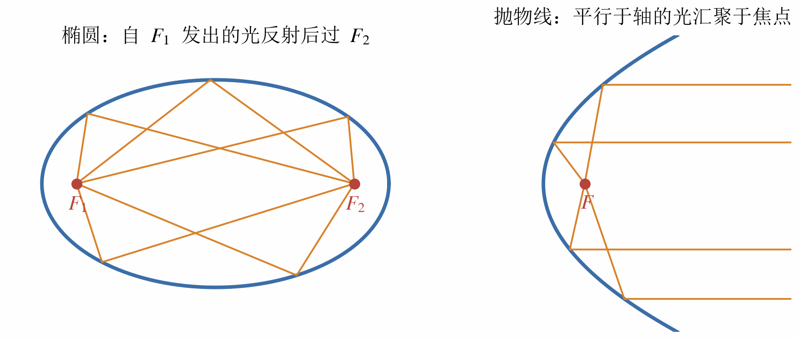

1. 椭圆：从一个焦点发出的光线，经椭圆反射后经过另一个焦点。这是因为椭圆在点 \(P\) 处的法线平分 \(\angle F_1PF_2\)。
2. 抛物线：从焦点发出的光线，经抛物线反射后平行于对称轴射出；反过来，平行于轴的光线反射后汇聚于焦点。探照灯、卫星天线和太阳灶都利用这一性质。
3. 双曲线：射向一个焦点的光线，经双曲线反射后，看起来像是从另一个焦点发出的。

以椭圆为例说明理由：若切线上有另一点 \(Q\)，则 \(Q\) 在椭圆外，\(QF_1+QF_2>2a=PF_1+PF_2\)。所以切点 \(P\) 是切线上到两焦点距离之和最小的点，按光的反射定律，最短路径满足入射角等于反射角，即 \(PF_1\)、\(PF_2\) 与切线所成的角相等。

**椭圆的面积与共轭双曲线。** 椭圆 \(x^2/a^2+y^2/b^2=1\) 可以由半径为 \(a\) 的圆沿 \(y\) 方向压缩为原来的 \(b/a\) 倍得到，面积也按同样的比例变化，所以椭圆面积为 \(\pi a^2\cdot\frac ba=\pi ab\)。双曲线 \(x^2/a^2-y^2/b^2=1\) 与 \(x^2/a^2-y^2/b^2=-1\) 称为共轭双曲线，它们有相同的渐近线 \(y=\pm(b/a)x\)，但实轴分别在 \(x\) 轴和 \(y\) 轴上。

## 第九章 坐标系、几何约束与二次曲面

### 9.1 坐标变化与几何对象

平移坐标原点只改变点的位置坐标，不改变两点之间的差向量。设新原点在旧坐标系中位于 \(a\)，同一个点的新坐标为 \(r'=r-a\)。距离只依赖差向量，所以保持不变。把旧坐标下的表达式改写成新坐标时，应把 \(r=r'+a\) 代入，而不是凭直觉在各处随意改变符号。二次曲线的配方，正是在代数上完成这种原点平移。

旋转坐标轴由正交矩阵描述。若把新基向量按列组成矩阵 \(Q\)，同一个几何向量在新旧两组坐标下满足 \(r=Qr'\)；因为 \(Q^TQ=I\)，所以 \(r'=Q^Tr\)。内积满足 \((Qr')^T(Qs')=r'^Ts'\)，说明旋转保持长度与夹角不变。正交变换还包括反射，反射的行列式为负一；只有行列式为正一的变换（旋转）才保持空间的左右手定向。点积在两类变换下都保持不变，而叉积的方向还取决于变换后的坐标系是否仍为右手系。

平面上把坐标轴逆时针旋转角 \(\theta\)，新旧坐标的关系为

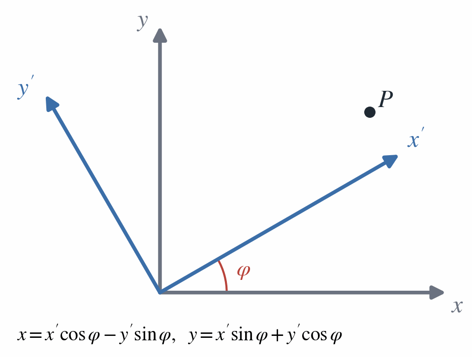

\[
x=x'\cos\theta-y'\sin\theta,\qquad y=x'\sin\theta+y'\cos\theta .
\]

8.2 节消去交叉项时，就是把这组关系代入二次方程。

**例23：旋转坐标轴消除斜方向。** 原坐标中的直线 \(y=x\)，方向为 \((1,1)\)。取新横轴的单位向量 \((1,1)/\sqrt2\)，新纵轴为 \((-1,1)/\sqrt2\)（即 \(\theta=45^\circ\)），则

\[
u=\frac{x+y}{\sqrt2},\qquad v=\frac{-x+y}{\sqrt2}.
\]

原直线上 \(x=y\)，所以 \(v=0\)，它成为新坐标系的横轴。点 \((1,0)\) 的新坐标为 \((1/\sqrt2,-1/\sqrt2)\)，长度平方仍为一。坐标的变化并没有把点移动到别处，只是改变了描述它位置的两个基方向。把“旋转物体”和“旋转坐标轴”的公式混用，是符号方向出错的常见原因：两者的旋转方向恰好相反。

### 9.2 球面、切平面与球面截线

球面是到一个定点（球心）的距离等于半径的点的集合。球心为 \(C=(a,b,c)\)、半径为 \(R>0\) 时，

\[
(x-a)^2+(y-b)^2+(z-c)^2=R^2.
\]

若给出的是展开式 \(x^2+y^2+z^2+Dx+Ey+Fz+G=0\)，可以对三个变量分别配方，得到球心 \((-D/2,-E/2,-F/2)\) 和半径平方 \(R^2=(D^2+E^2+F^2)/4-G\)。半径平方为正，才是普通的球面；为零时退化成一个点；为负时没有实点。不能只因为看到三个平方项的系数相等就断定是球面，最后这一条件不能省略。

球面上一点 \(P\) 处的切平面，法向量为半径方向 \(P-C\)，所以切平面方程为 \((P-C)\cdot(r-P)=0\)。它来自“半径垂直于切平面”的几何事实，也可以由球面方程的梯度得到。球面外的点不能直接代入这个式子，声称得到了“该点处的切平面”，因为该点根本不在球面上。

**例24：球与平面的交集。** 球心在原点、半径为三的球面，与平面 \(z=1\) 相交。联立 \(x^2+y^2+z^2=9\) 与 \(z=1\)，得 \(x^2+y^2=8\)，所以交线是位于平面 \(z=1\) 内的圆，圆心 \((0,0,1)\)，半径 \(2\sqrt2\)。更一般地，设球心到平面的距离为 \(d\)：若 \(d<R\)，截线是半径为 \(\sqrt{R^2-d^2}\) 的圆；若 \(d=R\)，平面与球面相切于一点；若 \(d>R\)，没有公共点。截圆半径公式直接来自“球心、截圆圆心、截圆上一点”构成的直角三角形，斜边是球半径。本例 \(d=1\)，\(\sqrt{9-1}=2\sqrt2\)，一致。

### 9.3 直线与球面的相交分类

把直线 \(r=P_0+td\) 代入球面方程 \(|r-C|^2=R^2\)，展开得到关于 \(t\) 的二次方程

\[
|d|^2t^2+2d\cdot(P_0-C)t+|P_0-C|^2-R^2=0.
\]

判别式为正、为零、为负，分别对应两个交点、一个切点、没有交点。因为 \(d\ne0\)，二次项系数 \(|d|^2\) 严格为正，方程不会退化成一次方程。这个判据与距离判据完全一致：球心到直线的距离小于、等于、大于半径时，直线分别是割线、切线、与球面相离。

**例25：切线条件中的参数。** 对球面 \(x^2+y^2+z^2=4\)，直线为 \(r=(0,h,0)+t(1,0,0)\)。代入得 \(t^2+h^2=4\)。当 \(|h|<2\) 时，交点为 \((\pm\sqrt{4-h^2},h,0)\)；当 \(|h|=2\) 时，只有一个公共点 \((0,h,0)\)，直线与球面相切；当 \(|h|>2\) 时，没有实交点。这里的参数分类必须同时保留正负两个临界值 \(h=\pm2\)，而不是只讨论 \(h=2\)。从距离角度看，球心到这条直线的距离恰好是 \(|h|\)，分类立刻可见。

### 9.4 柱面与旋转曲面

若一个三元方程完全不含某个坐标，这个坐标就可以自由变化，方程通常表示一个沿该坐标轴方向延伸的柱面。例如 \(x^2+y^2=R^2\) 在三维空间中是圆柱面，而不是一个圆；只有再加上 \(z=z_0\)，才得到某个水平平面内的圆。同样，\(y=x^2\) 在三维空间中是不受 \(z\) 限制的抛物柱面，而不是只位于纸面上的一条抛物线。

**旋转曲面。** 平面曲线绕一条坐标轴旋转一周得到旋转曲面。若 \(yz\) 平面内的曲线 \(f(y,z)=0\) 绕 \(z\) 轴旋转，曲面上一点到 \(z\) 轴的距离为 \(\sqrt{x^2+y^2}\)，它扮演原来 \(|y|\) 的角色，所以旋转曲面的方程为 \(f(\pm\sqrt{x^2+y^2},z)=0\)。例如直线 \(z=ky\) 绕 \(z\) 轴旋转，得到圆锥面 \(z^2=k^2(x^2+y^2)\)。

**常见二次曲面。** 主要的二次曲面及其标准方程如下（\(a,b,c>0\)）：

\[
\begin{aligned}
&\text{椭球面}\quad &&\frac{x^2}{a^2}+\frac{y^2}{b^2}+\frac{z^2}{c^2}=1,\\
&\text{单叶双曲面}\quad &&\frac{x^2}{a^2}+\frac{y^2}{b^2}-\frac{z^2}{c^2}=1,\\
&\text{双叶双曲面}\quad &&\frac{x^2}{a^2}+\frac{y^2}{b^2}-\frac{z^2}{c^2}=-1,\\
&\text{二次锥面}\quad &&\frac{x^2}{a^2}+\frac{y^2}{b^2}-\frac{z^2}{c^2}=0,\\
&\text{椭圆抛物面}\quad &&z=\frac{x^2}{a^2}+\frac{y^2}{b^2},\\
&\text{双曲抛物面}\quad &&z=\frac{x^2}{a^2}-\frac{y^2}{b^2}.
\end{aligned}
\]

判断曲面的形状，应结合截面来理解，而不是只背名称。用平行于坐标面的平面去截，观察截线是什么曲线，这种方法称为截痕法。比如 \(x^2+y^2-z^2=1\)，固定任意 \(z\)，截线都是半径为 \(\sqrt{1+z^2}\) 的圆，截面始终存在，所以曲面连成一体，是单叶双曲面。若改为 \(z^2-x^2-y^2=1\)，必须 \(|z|\ge1\) 才有截面，曲面分成上下两个互不相连的部分，便是双叶双曲面。锥面是两者之间的临界情形，在 \(z=0\) 处收缩为一个点。

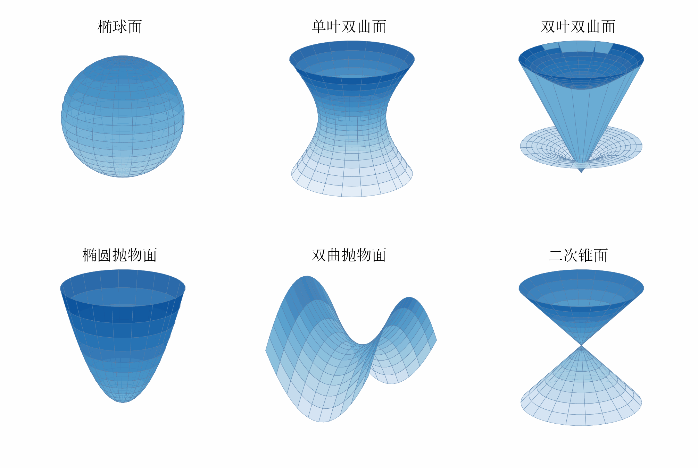

抛物面 \(z=x^2+y^2\) 的水平截面是圆，过 \(z\) 轴的竖直截面是抛物线，形状像一只碗；双曲抛物面 \(z=x^2-y^2\) 沿 \(x\) 方向向上弯、沿 \(y\) 方向向下弯，在原点附近呈马鞍形。这些截面也解释了微积分中二元函数的极值与鞍点：只沿某一条曲线看到函数上升或下降，不足以判断它在所有方向上的变化。

用截痕法判断二次曲面的步骤是：

1. 先配方，把方程化为标准形式，确定中心或顶点。
2. 数出平方项的个数和符号，对照上面的标准方程初步判断类型。
3. 分别令 \(z=h\)、\(y=h\)、\(x=h\)，观察截线是椭圆、双曲线、抛物线还是不存在。
4. 由截线随 \(h\) 的变化，判断曲面是否连成一体、向哪个方向延伸。

### 9.5 二次曲面逐类分析

9.4 节给出了各类二次曲面的标准方程和截痕法的一般步骤。本节按俄语课程“二次曲面”（поверхности второго порядка）一节的顺序，对每一类曲面逐一考察三件事：取值范围，即曲面是否有界、哪些区域没有曲面上的点；对称性，即关于原点、坐标轴和坐标平面是否对称；截线，即用平行于坐标平面的平面去截所得的曲线。对称性可以直接从方程读出：若把 \(x\) 换成 \(-x\) 方程不变，曲面关于 \(Oyz\) 平面对称；若把 \(x,y\) 同时换成 \(-x,-y\) 方程不变，曲面关于 \(Oz\) 轴对称；三个变量都只以平方出现时，曲面关于三个坐标平面、三条坐标轴和原点都对称。

**椭球面。** 方程为 \(\dfrac{x^2}{a^2}+\dfrac{y^2}{b^2}+\dfrac{z^2}{c^2}=1\)。三个平方项都非负，和为一，所以每一项都不超过一，\(|x|\le a\)、\(|y|\le b\)、\(|z|\le c\)，曲面有界。三个变量都只以平方出现，曲面同时具有中心对称、轴对称和平面对称。用平面 \(z=h\)（\(|h|<c\)）去截，移项得
\[
\frac{x^2}{a^2\left(1-\dfrac{h^2}{c^2}\right)}+\frac{y^2}{b^2\left(1-\dfrac{h^2}{c^2}\right)}=1 ,
\]
是半轴随 \(|h|\) 增大而缩小的椭圆；\(|h|=c\) 时缩成一点 \((0,0,\pm c)\)，\(|h|>c\) 时没有交点。垂直于另外两条坐标轴的截线同样是椭圆。\(a=b=c\) 时就是 9.2 节的球面。

**椭圆抛物面。** 课程采用的标准形式是
\[
\frac{x^2}{a^2}+\frac{y^2}{b^2}=2z,\qquad a>0,\ b>0 .
\]
它与 9.4 节表中的 \(z=\dfrac{x^2}{a^2}+\dfrac{y^2}{b^2}\) 只差常数因子：把 \(a,b\) 分别换成 \(\sqrt2\,a\)、\(\sqrt2\,b\) 即可互化，曲面类型相同。写成 \(2z\) 是为了与抛物线标准方程 \(x^2=2pz\) 的写法一致，这样 \(xOz\) 平面内的截线 \(x^2=2a^2z\) 的焦参数恰为 \(a^2\)。左端非负，所以 \(z\ge0\)，曲面位于 \(Oxy\) 平面上方，向上无界。\(x\)、\(y\) 只以平方出现，\(z\) 以一次方出现，所以曲面关于 \(Oxz\)、\(Oyz\) 两个坐标平面对称，关于 \(Oz\) 轴对称，但不关于原点对称。截线如下：

1. 平面 \(z=h\)（\(h>0\)）：\(\dfrac{x^2}{2a^2h}+\dfrac{y^2}{2b^2h}=1\)，椭圆，半轴 \(a\sqrt{2h}\)、\(b\sqrt{2h}\) 随高度增大；\(h=0\) 时只有原点，\(h<0\) 时没有交点。
2. 平面 \(x=h\)：\(y^2=2b^2\left(z-\dfrac{h^2}{2a^2}\right)\)，开口向上的抛物线，顶点随 \(|h|\) 增大而升高。
3. 平面 \(y=h\)：\(x^2=2a^2\left(z-\dfrac{h^2}{2b^2}\right)\)，同样是开口向上的抛物线。

曲面形如一只碗，顶点在原点。\(a=b\) 时水平截线是圆，曲面是抛物线绕 \(Oz\) 轴旋转而成的旋转抛物面。

**双曲抛物面（马鞍面）。** 标准形式为
\[
\frac{x^2}{a^2}-\frac{y^2}{b^2}=2z,\qquad a>0,\ b>0 .
\]
左端可正可负，\(z\) 可取任意实数，曲面向上、向下都无界。对称性与椭圆抛物面相同：关于 \(Oxz\)、\(Oyz\) 平面和 \(Oz\) 轴对称。截线如下：

1. 平面 \(z=h\)（\(h\ne0\)）：\(\dfrac{x^2}{2a^2h}-\dfrac{y^2}{2b^2h}=1\)，双曲线；\(h>0\) 时实轴沿 \(x\) 方向，\(h<0\) 时实轴沿 \(y\) 方向。
2. 平面 \(z=0\)：\(\left(\dfrac xa-\dfrac yb\right)\left(\dfrac xa+\dfrac yb\right)=0\)，两条相交直线，它们是上述两组双曲线共同的渐近线。
3. 平面 \(x=h\)：\(y^2=-2b^2\left(z-\dfrac{h^2}{2a^2}\right)\)，开口向下的抛物线。
4. 平面 \(y=h\)：\(x^2=2a^2\left(z+\dfrac{h^2}{2b^2}\right)\)，开口向上的抛物线。

由第 3、4 条可以看出曲面的另一种生成方式。平面 \(x=h\) 内的截线是开口向下的抛物线，形状与 \(h\) 无关，顶点 \(\left(h,0,\dfrac{h^2}{2a^2}\right)\) 恰好落在 \(xOz\) 平面内开口向上的抛物线 \(x^2=2a^2z\) 上。所以，让一条开口向下的抛物线保持形状不变，顶点沿另一条开口向上、所在平面与它垂直的抛物线平移，扫过的曲面就是双曲抛物面。原点沿 \(x\) 方向是最低点，沿 \(y\) 方向是最高点，这样的点称为鞍点。

**单叶双曲面。** 方程为 \(\dfrac{x^2}{a^2}+\dfrac{y^2}{b^2}-\dfrac{z^2}{c^2}=1\)。用平面 \(z=h\) 去截，得椭圆
\[
\frac{x^2}{a^2\left(1+\dfrac{h^2}{c^2}\right)}+\frac{y^2}{b^2\left(1+\dfrac{h^2}{c^2}\right)}=1 ,
\]
对任何 \(h\) 都存在，所以曲面连成一片。\(h=0\) 时椭圆最小，半轴为 \(a\)、\(b\)，这个椭圆称为喉椭圆（горловой эллипс）；\(|h|\) 越大，椭圆越大，曲面形如冷却塔。平面 \(x=h\) 截得 \(\dfrac{y^2}{b^2}-\dfrac{z^2}{c^2}=1-\dfrac{h^2}{a^2}\)：\(|h|\ne a\) 时为双曲线，\(|h|=a\) 时右端为零，退化为一对相交直线。平面 \(y=h\) 的情形相同。三个变量都只以平方出现，曲面关于原点、三条坐标轴和三个坐标平面都对称。

**双叶双曲面。** 课程写成
\[
\frac{z^2}{c^2}-\frac{x^2}{a^2}-\frac{y^2}{b^2}=1,\qquad a,b,c>0 ,
\]
两边乘以负一，就是 9.4 节表中右端为 \(-1\) 的形式。由 \(\dfrac{z^2}{c^2}=1+\dfrac{x^2}{a^2}+\dfrac{y^2}{b^2}\ge1\) 得 \(|z|\ge c\)，两平面 \(z=\pm c\) 之间没有曲面上的点，曲面分为上下互不相连的两叶。平面 \(z=h\) 的截线：\(|h|>c\) 时为椭圆，\(|h|=c\) 时为一点，即顶点 \((0,0,\pm c)\)，\(|h|<c\) 时没有交点。平面 \(x=h\) 截得 \(\dfrac{z^2}{c^2}-\dfrac{y^2}{b^2}=1+\dfrac{h^2}{a^2}\)，右端恒为正，所以总是双曲线，不会退化；平面 \(y=h\) 同理。对称性与单叶双曲面相同。

**二次锥面。** 方程为 \(\dfrac{x^2}{a^2}+\dfrac{y^2}{b^2}-\dfrac{z^2}{c^2}=0\)。方程是齐次的：若点 \((x,y,z)\) 在曲面上，则对任意实数 \(t\)，点 \((tx,ty,tz)\) 也在曲面上，因为各项同乘以 \(t^2\)。所以曲面由过原点的直线组成，原点称为顶点，这些直线称为母线。\(a=b\) 时是旋转锥面，即正圆锥面。

一般地，给定一点 \(P\)（顶点）和一条不过 \(P\) 的曲线 \(L\)（准线），过 \(P\) 与 \(L\) 上各点的直线 \(l\)（母线）组成的曲面称为锥面。二次锥面的方程可以由这一定义推出。取顶点为原点，准线为平面 \(z=c\)（\(c>0\)）内的椭圆 \(\dfrac{X^2}{a^2}+\dfrac{Y^2}{b^2}=1\)。设 \(M(x,y,z)\)（\(z\ne0\)）是锥面上一点，过 \(M\) 的母线与准线交于 \(N(X,Y,c)\)。\(O\)、\(M\)、\(N\) 共线，\(\overrightarrow{ON}=t\,\overrightarrow{OM}\)，比较第三个坐标得 \(t=c/z\)，所以
\[
X=\frac{cx}{z},\qquad Y=\frac{cy}{z}.
\]
代入准线方程，\(\dfrac{c^2x^2}{a^2z^2}+\dfrac{c^2y^2}{b^2z^2}=1\)，两边乘以 \(z^2/c^2\)，得 \(\dfrac{x^2}{a^2}+\dfrac{y^2}{b^2}=\dfrac{z^2}{c^2}\)，正是二次锥面的标准方程。推导中除去了 \(z=0\) 的点，而方程在 \(z=0\) 时只有原点，即顶点，所以方程恰好描述整个锥面。准线换成其他曲线时，用同样的“共线比例代入”方法可以求出相应锥面的方程。平面 \(z=h\)（\(h\ne0\)）截得椭圆，\(h=0\) 时只有顶点；平面 \(x=h\)（\(h\ne0\)）截得双曲线，\(h=0\) 时截得一对过顶点的直线 \(\dfrac yb=\pm\dfrac zc\)。8.5 节说明过，平面截圆锥所得曲线的类型由截平面与母线的关系决定，对二次锥面同样成立：

1. 截平面与所有母线都相交，只截到一叶：椭圆（包括圆）。
2. 截平面平行于一条母线：抛物线。
3. 截平面平行于两条母线，截到上下两叶：双曲线。
4. 截平面过顶点：一对相交直线，或一条直线（截平面与锥面相切），或只有顶点一点。

把单叶和双叶双曲面方程右端的 \(\pm1\) 换成零，就得到这个锥面，所以锥面是两类双曲面的分界。它称为两者的渐近锥面：离原点越远，双曲面越贴近锥面。

**柱面。** 方程中缺少某一个变量时，这个变量可以任意取值，曲面就是柱面：母线平行于所缺变量对应的坐标轴，准线是另外两个变量所在坐标平面内由同一方程表示的曲线。三种二次柱面都缺 \(z\)，母线平行于 \(Oz\) 轴：
\[
\frac{x^2}{a^2}+\frac{y^2}{b^2}=1\ (\text{椭圆柱面}),\qquad
\frac{x^2}{a^2}-\frac{y^2}{b^2}=1\ (\text{双曲柱面}),\qquad
y^2=2px\ (\text{抛物柱面}).
\]
画柱面时，先在 \(Oxy\) 平面内画出准线，再沿 \(z\) 方向无限平移。椭圆柱面在 \(a=b\) 时就是 9.4 节的圆柱面。

柱面所缺的变量不一定是 \(z\)，判断规则不变：缺哪个变量，母线就平行于哪条坐标轴。例如俄语课程大纲中写作 \(\dfrac{x^2}{a^2}-\dfrac{z^2}{b^2}=1\) 的双曲柱面缺 \(y\)，母线平行于 \(Oy\) 轴，准线是 \(Oxz\) 平面内的双曲线；\(y^2=2pz\) 的抛物柱面缺 \(x\)，母线平行于 \(Ox\) 轴，准线是 \(Oyz\) 平面内的抛物线。

**分类小结。** 不计退化情形（一点、一条直线、一对平面、空集等），实二次曲面共有九类：椭球面、单叶双曲面、双叶双曲面、二次锥面、椭圆抛物面、双曲抛物面、椭圆柱面、双曲柱面、抛物柱面。由标准方程判断类型，可以按下面的顺序：

1. 先看是否缺少变量：缺一个变量就是柱面，再按准线是椭圆、双曲线还是抛物线命名。
2. 三个变量都出现时，看是否有变量只以一次方出现：右端为 \(2z\) 的是抛物面，两个平方项同号为椭圆抛物面，异号为双曲抛物面。
3. 三个变量都以平方出现、右端为一：没有负号是椭球面，一个负号是单叶双曲面，两个负号是双叶双曲面。
4. 三个变量都以平方出现、右端为零且符号不全相同：二次锥面。

**直纹面（课程延伸）。** 由一条直线运动生成的曲面称为直纹面。柱面和锥面显然是直纹面；不太直观的是，单叶双曲面和双曲抛物面也是直纹面，而且各含两族直线。以双曲抛物面为例，把方程左端分解因式：
\[
\left(\frac xa-\frac yb\right)\left(\frac xa+\frac yb\right)=2z .
\]
对每个实数 \(\lambda\)，两个平面
\[
\frac xa-\frac yb=\lambda,\qquad \lambda\left(\frac xa+\frac yb\right)=2z
\]
的交线是一条直线。两式相乘就回到原方程，所以这条直线上的每一点都在曲面上；让 \(\lambda\) 取遍全体实数，就得到一族直线。\(\lambda=0\) 时交线是平面 \(z=0\) 内的直线 \(\dfrac xa=\dfrac yb\)。交换两个因子的角色，令 \(\dfrac xa+\dfrac yb=\mu\)、\(\mu\left(\dfrac xa-\dfrac yb\right)=2z\)，得到另一族直线。单叶双曲面可以同样处理，把方程移项分解为
\[
\left(\frac xa-\frac zc\right)\left(\frac xa+\frac zc\right)=\left(1-\frac yb\right)\left(1+\frac yb\right),
\]
对 \(\lambda\ne0\)，令 \(\dfrac xa-\dfrac zc=\lambda\left(1-\dfrac yb\right)\) 与 \(\lambda\left(\dfrac xa+\dfrac zc\right)=1+\dfrac yb\)，两式相乘再约去 \(\lambda\) 即回到原方程。冷却塔可以用笔直的钢梁搭成双曲面的形状，原因就在这里。

**讲解例：由一般方程判断二次曲面。** 判断曲面 \(x^2-4y^2+2x+8y-2z+1=0\) 的类型，并求其鞍点或顶点。

对 \(x\)、\(y\) 分别配方：\(x^2+2x=(x+1)^2-1\)，\(-4y^2+8y=-4(y^2-2y)=-4(y-1)^2+4\)。代入原方程，
\[
(x+1)^2-1-4(y-1)^2+4-2z+1=0,\qquad (x+1)^2-4(y-1)^2=2(z-2).
\]
作平移 \(X=x+1\)、\(Y=y-1\)、\(Z=z-2\)，得
\[
\frac{X^2}{1^2}-\frac{Y^2}{(1/2)^2}=2Z ,
\]
\(x\)、\(y\) 以平方出现且异号，\(z\) 只以一次方出现，所以是双曲抛物面，\(a=1\)，\(b=\tfrac12\)，鞍点（新坐标原点）在 \((-1,1,2)\)。验算：把 \((-1,1,2)\) 代入原方程，\(1-4-2+8-4+1=0\)，成立。再看截线：平面 \(y=1\) 内为 \((x+1)^2=2(z-2)\)，开口向上；平面 \(x=-1\) 内为 \(-4(y-1)^2=2(z-2)\)，开口向下；平面 \(z=2\) 截得两条直线 \(x+1=\pm2(y-1)\)。这三条截线正是马鞍面在鞍点处的特征。

## 第十章 几何解法的完整性与核验

### 10.1 方向、位置与参数范围应同时保留

直线的方向向量乘以非零常数，仍表示同一个方向；但如果参数有指定的范围，数乘之后还要同步改变范围。例如线段 \(r=P+t(Q-P)\)、\(0\le t\le1\)，若只把方向改为原来的两倍而保留同一个参数区间，就把线段延长了一倍。对于无限长的直线，参数可以取全体实数，这个问题被隐藏了；但对于线段、射线和曲线上的一段弧，参数范围直接决定点集。

**例26：线段上的最短距离。** 点 \(P=(3,1)\)，线段端点为 \(A=(0,0)\)、\(B=(2,0)\)。先按无限直线投影，参数 \(t_*=(P-A)\cdot(B-A)/|B-A|^2=6/4=1.5\)。它不在零到一的范围内，对应的垂足 \((3,0)\) 不在线段上。线段上的点到 \(P\) 的距离随 \(t\) 的变化先减后增，最小值在 \(t=1.5\) 处，而在 \([0,1]\) 上它单调减小，所以最近点是端点 \(B\)，距离为 \(|P-B|=\sqrt{1+1}=\sqrt2\)，而不是点到整条横轴的距离一。无限直线的距离公式本身是正确的，错误出在把几何对象的范围扩大了。

### 10.2 交点计算与几何存在性

联立方程得到的候选点，应当代回所有原始约束进行检验，特别是在做过平方、去分母或参数替换之后。平方可能引入不满足原来符号条件的解；除以一个表达式，可能丢掉该表达式为零时的解。这些问题不是算术上的粗心，而是变形前后的等价关系发生了改变。每做一步变形，都应辨认它是双向等价，还是只有单向的推出关系。

求两个平面的交线时，任意令一个坐标为零有时会恰好失败。例如平面 \(x=1\) 与 \(y=2\) 的交线是 \((1,2,t)\)，若尝试令 \(x=0\)，立刻得到矛盾 \(0=1\)，但这只说明所选的辅助平面 \(x=0\) 与交线平行、没有截到它。正确做法是让真正可以自由变化的坐标（这里是 \(z\)）作为参数，而不是把辅助选择的失败误判为原方程无解。

### 10.3 几何自由度不能只靠未知数个数猜测

三个坐标并不意味着三个独立的自由方向，因为约束之间可能相关，也可能互相矛盾。平面方程 \(x+y+z=1\)、\(2x+2y+2z=2\)、\(3x+3y+3z=3\) 看起来有三个，实际上只有一个独立的约束，解集仍是一个平面；若把最后一个方程的右端改为四，方程组就无解。这里应当用秩来判断，而不是按“有三个方程，所以得到一个点”来计数。

对于非线性约束，交集的维数还可能随位置改变。球面与平面通常相交成一个圆，但相切时交集退化成一个点，相离时为空集。仅凭“两个方程约束三个坐标”就断言交集必是一条曲线，会漏掉退化和不相容的情形。线性代数的维数公式有精确的前提条件，几何直观必须与代数条件相互核对。

几何解题的核验要点可以归纳为：

1. 结果代回原方程：交点、垂足、切点都要满足所有原始条件。
2. 检查垂直和平行关系：用点积为零、叉积为零或系数成比例核对。
3. 用另一种方法重算：例如距离既用公式又用垂足，夹角既用法向量又用方向向量。
4. 检查退化情形：零向量、共线点、平行导致的分母为零、二次曲线的退化。
5. 检查参数范围：线段、射线和弧段的端点是否需要单独比较。
6. 检查符号与单位：有向投影、有向面积与距离、面积的区别。

## 来源及后续联系

本册的课程主线来自《判断叉乘方向》《解析几何直线方程》《空间解析几何总结》及相关向量解释的可读文字。历史图片中的箭头朝向、板书常数和图形标记，仅凭附件占位无法重新核实；本册中每个完整列出的例题，都按所写条件独立计算。first CC 已提取的教材清单中没有单独的解析几何教材，因此本册没有声称按照某本未读过的教材逐页改写。二次曲线、二次曲面章节以及截距式、法线式、直线束与平面束、焦半径、类型判别等公式，是为补足知识体系而写的延伸内容，在此说明其性质。

向量的俄语常见写法为 вектор，法向量为 нормальный вектор，方向向量为 направляющий вектор，平面为 плоскость，直线为 прямая。以后在其他学科中遇到相关问题时，可以回到本册对应的工具：物理中的功，回到点积与投影；力矩，回到叉积的方向；势能的梯度，回到等值面的法向量；多个线性约束，回到方程组的秩与几何自由度。这些联系都建立在同一套坐标和正交分解之上。

2026-10-31增补依据 claude.ai 网页对话《直线方程的写法》：6.1节俄式典范方程分母为零的约定与“空间直线为何需要两个方程”，6.2节一般方程化典范方程例，7.1节分数交点与线面角例、过一点平行于两直线的平面例，7.2节直接联立求交点例。各例数值逐式核算并代回检验。

2026-11-12增补的9.5节依据 claude.ai 网页对话《二次曲面图形》：用户拍摄的俄语课件第5.7节“二次曲面”（定义5.13—5.16的椭圆抛物面、双曲抛物面、单叶与双叶双曲面，以及二次锥面与三种柱面两页，第一页顶部为椭球面的结尾）。课件照片与回答中的交互线框图未取回，各类曲面的截线方程按标准方程逐一重新推导。直纹面两族直线的分解、圆锥截线中过顶点的退化情形、渐近锥面以及由一般方程配方判型的讲解例为课程延伸。
