# 微积分与微分方程

极限、局部线性化、累积与变化规律

## 导读

微积分处理两类互相联系的问题。第一类是：已知一个函数，怎样描述它在某一点附近变化得多快，这引出导数；第二类是：已知一个量的变化规律，怎样恢复这个量的整体，这引出积分。极限是两者共同的基础，它把“无限接近”变成一个可以精确使用的概念。导数是函数在局部的线性变化系数，积分把许多局部的小贡献累加成整体，微分方程则把一个未知函数与它的变化率联系在一起，让我们从变化规律出发求出函数本身。

本册沿着这条依赖关系编排：先讲函数与极限，再讲导数及其应用，然后讲积分、级数和泰勒公式，最后讲多元微分、微分方程和变分。多元微分与变分放在后面，是因为它们分别要用到单变量的链式法则和分部积分。

计算时要始终注意三件事：定义域、趋近的方向、初始条件。形式相似的符号可能描述完全不同的对象：数列通项的极限不是部分和的极限，偏导数不是沿运动轨迹的总导数，满足变分方程的曲线也不一定是使泛函最小的曲线。

## 第一章 函数、图像与基本模型

### 1.1 函数由对应法则与定义域共同确定

研究变化之前，要先弄清哪些量可以变化、哪些量由它们决定。函数把定义域中的每个输入对应到唯一的输出。一个函数由两部分共同确定：对应法则（公式）和定义域。只有公式而没有定义域，并不足以确定一个函数。例如 \(x^2\) 在全体实数上不是一一对应的（\(x\) 与 \(-x\) 对应同一个值），但限制在非负半轴上就是一一对应的，能否建立反函数也随之改变。值域是函数实际取到的输出值的集合，不要与题目事先给出的可能输出范围相混淆。

建立数学模型时，自变量不一定是时间。温度可以是空间位置的函数，成本可以是产量的函数，势能可以是位移的函数。先把自变量、因变量和参数区分开，导数的含义才明确。参数在同一个模型中通常保持不变，但可以比较不同参数值对应的一族函数。例如 \(f(x)=kx\) 中，\(x\) 是变化的输入，\(k\) 是给定的斜率；如果对 \(k\) 求导，研究的已经是另一种变化。

**例题：由定义域决定能否计算。** 对 \(f(x)=\sqrt{x-1}/(x-2)\)，平方根要求 \(x\ge1\)，分母要求 \(x\ne2\)，所以定义域是 \([1,2)\cup(2,\infty)\)。在 \(x=1\) 处函数有定义，但只能从右侧研究它附近的变化；在 \(x=2\) 处函数没有定义，讨论这里的极限时也必须分别考察左右两侧的符号。定义域不是做完题后补上的一句限制，它决定了哪些趋近方式和变形有意义。

俄语课程把这一点写成正式定义。函数 \(f:A\to B\) 由三样东西给定：定义域（область определения）\(D_f\)，即使 \(y=f(x)\) 有意义的全部实数 \(x\)；值域（область значений）\(E_f\)，即函数实际取到的全部 \(y\)；以及对应法则，并且每个 \(x\) 只能对应唯一一个 \(y\)，单值性是函数定义的一部分。函数有三种常用的表示法：解析法用公式给出，如 \(y=\sqrt{x-4}\)，此时定义域需要从公式求出，这里是 \(x\ge4\)；图像法给出平面 \(Oxy\) 上点 \((x,f(x))\) 的集合；表格法列出部分 \(x\) 及对应的函数值。

**由公式求定义域。** 只给出公式时，约定定义域是使公式中每一步运算都有意义的全部实数。按函数的类型，限制条件分别是：

1. 多项式 \(a_nx^n+a_{n-1}x^{n-1}+\dots+a_0\)：没有限制，\(D=\mathbb R\)。例如 \(3x^4-2x^3+x^2-1\) 与 \(3x^2+2x+1\) 都在全体实数上有定义。
2. 分式有理函数 \(P(x)/Q(x)\)：分母不为零，\(D=\{x\mid Q(x)\ne0\}\)。例如 \(1/x\) 的定义域为 \(\mathbb R\setminus\{0\}\)。
3. 偶次根式 \(\sqrt[2k]{g(x)}\)：根号内非负，\(g(x)\ge0\)。奇次根式 \(\sqrt[2k+1]{g(x)}\) 没有额外限制，\(D_f=D_g\)，因为负数也有奇次实根。
4. 指数函数 \(a^{g(x)}\)（\(a>0\)）：指数位置可以是任意实数，\(D_f=D_g\)，例如 \(e^x\) 的定义域为 \(\mathbb R\)。
5. 对数函数 \(\log_ag(x)\)：真数严格为正，\(g(x)>0\)，不能取等号。
6. 三角函数：\(\sin x\)、\(\cos x\) 的定义域为 \(\mathbb R\)；\(\tan x=\sin x/\cos x\) 要求 \(\cos x\ne0\)，即 \(x\ne\dfrac\pi2+k\pi\)；\(\cot x=\cos x/\sin x\) 要求 \(\sin x\ne0\)，即 \(x\ne k\pi\)，\(k\in\mathbb Z\)。俄语教材把正切、余切写作 \(\operatorname{tg}x\)、\(\operatorname{ctg}x\)。
7. 反三角函数：\(\arcsin g(x)\)、\(\arccos g(x)\) 要求 \(-1\le g(x)\le1\)；\(\arctan x\) 的定义域为 \(\mathbb R\)。

公式由几种运算组合而成时，各条限制同时成立，定义域取它们的交集，前面的例题 \(\sqrt{x-1}/(x-2)\) 就是根式与分式两条限制的交集。

**讲解例：根式与对数的端点。** \(\ln(x-1)\) 要求 \(x-1>0\)，定义域为 \((1,+\infty)\)；\(\sqrt{x-1}\) 要求 \(x-1\ge0\)，定义域为 \([1,+\infty)\)。两者只差端点 \(x=1\)：对数在该点无定义，所以用开区间；根式在该点取值为零，所以用闭区间。俄语和法语教材常把开区间端点的括号反写，\(]1,+\infty[\) 即 \((1,+\infty)\)，\([1,+\infty[\) 即 \([1,+\infty)\)。

**绝对值与距离。** 求定义域、解不等式和讨论极限时，经常要处理绝对值。\(|x-a|\) 是数轴上点 \(x\) 到点 \(a\) 的距离，所以 \(|x+3|=|x-(-3)|\) 是到 \(-3\) 的距离。设 \(r>0\)，由距离的意义立即得到三条规则：

\[
\begin{aligned}
|x-a|=r&\iff x=a\pm r,\\
|x-a|\le r&\iff a-r\le x\le a+r,\\
|x-a|\ge r&\iff x\le a-r\ \text{或}\ x\ge a+r .
\end{aligned}
\]

第二条是以 \(a\) 为中心、半径为 \(r\) 的闭区间，第三条是两条射线的并。在数轴上表示时，等式只标两个实心点，\(\le\) 画两点之间的线段，\(\ge\) 画向两边延伸的两条射线，带等号时端点为实心，严格不等号时端点为空心。当右端为负数时，绝对值恒非负，\(|x-a|=r\) 与 \(|x-a|\le r\) 无解，\(|x-a|\ge r\) 对一切 \(x\) 成立；\(r=0\) 时 \(|x-a|\le0\) 只有 \(x=a\) 一个解。

**讲解例：绝对值不等式的区间形式。** 解 \(|x+3|\le2\)：这是到 \(-3\) 的距离不超过二，所以 \(-5\le x\le-1\)，区间为 \([-5,-1]\)。解 \(|x-2|\ge3\)：到 \(2\) 的距离不小于三，所以 \(x\le-1\) 或 \(x\ge5\)，区间为 \((-\infty,-1]\cup[5,+\infty)\)。验算：取 \(x=-3\)，\(|0|=0\le2\)，属于第一个解集；取 \(x=0\)，\(|-2|=2<3\)，不属于第二个解集，与区间一致。\(|x-1|\le-2\) 无解，\(|x-1|\ge-2\) 的解集是 \((-\infty,+\infty)\)。

这三条规则正是第二章极限定义中 \(|x-a|<\delta\) 与 \(|f(x)-L|<\varepsilon\) 的几何含义：前者是以 \(a\) 为中心的一个小区间，后者是以 \(L\) 为中心的一条横带。

### 1.2 图像变换与复合

若 \(g(x)=f(x-a)+b\)，则 \(g\) 的图像是把 \(f\) 的图像向右平移 \(a\)、向上平移 \(b\) 得到的。自变量内部的变化方向容易与直觉相反：新图像在 \(x=a\) 处取得原来的 \(f(0)\)，所以是向右移动，而不是向左。\(f(cx)\) 改变横向的尺度（\(c>1\) 时横向压缩），\(cf(x)\) 改变纵向的尺度，两者不能混淆。负号还会造成反射：\(f(-x)\) 关于 \(y\) 轴对称，\(-f(x)\) 关于 \(x\) 轴对称。

俄语课程把图像的基本变换归纳为平移、伸缩、对称和“对称翻倍”（раздвоение отражением）四类。下面设 \(a>0\)、\(k>0\)，每一条都以 \(y=x^2\) 或 \(y=x^2-4\) 为例：

1. \(y=f(x)+a\)：图像向上平移 \(a\)；\(f(x)-a\) 向下平移。例如 \(y=x^2-4\) 是抛物线下移四，顶点 \((0,-4)\)。
2. \(y=f(x+a)\)：图像向左平移 \(a\)；\(f(x-a)\) 向右平移。例如 \(y=(x-4)^2\) 右移四，\(y=(x+4)^2\) 左移四。
3. \(y=f(kx)\)：横向压缩为原来的 \(1/k\)。\(k>1\) 时向 \(Oy\) 轴收拢，\(0<k<1\) 时横向拉宽。
4. \(y=kf(x)\)：纵向拉伸为原来的 \(k\) 倍，与 \(x\) 轴的交点不动。例如 \(y=2(x^2-4)\) 的顶点为 \((0,-8)\)，零点仍为 \(\pm2\)。
5. \(y=f(kx+b)\)：先提出 \(k\)，写成 \(f\big(k(x+b/k)\big)\)，即先横向压缩 \(k\) 倍，再平移 \(-b/k\)。平移量是 \(b/k\) 而不是 \(b\)。
6. \(y=f(-x)\)：关于 \(Oy\) 轴翻转。例如 \((-x-4)^2=(x+4)^2\)，是 \((x-4)^2\) 的镜像。
7. \(y=-f(x)\)：关于 \(Ox\) 轴翻转。例如 \(y=-(x^2-4)\) 开口向下，顶点 \((0,4)\)。
8. \(y=|f(x)|\)：\(Ox\) 轴上方的部分保留，下方的部分翻到上方。
9. \(y=f(|x|)\)：保留 \(x\ge0\) 的右半部分，并把它对 \(Oy\) 轴镜像到左边，原来的左半部分舍去。结果总是偶函数。
10. \(|y|=f(x)\)：保留 \(f(x)\ge0\) 的上半部分，并把它对 \(Ox\) 轴镜像到下方，原来的下半部分舍去，等价于 \(y=\pm f(x)\) 且 \(f(x)\ge0\)。
11. \(|y|=|f(x)|\)：等价于 \(y=f(x)\) 或 \(y=-f(x)\)，图像是 \(y=f(x)\) 与它关于 \(Ox\) 轴的镜像合在一起。

规律是：改动括号内自变量的变换（第 2、3、5、6、9 条）作用在横向，方向与式子的符号相反；改动括号外函数值的变换（第 1、4、7、8 条）作用在纵向，方向与式子的符号一致。第 9 条和第 10 条只是“镜像”的对象不同：前者镜像右半平面，后者镜像上半平面。

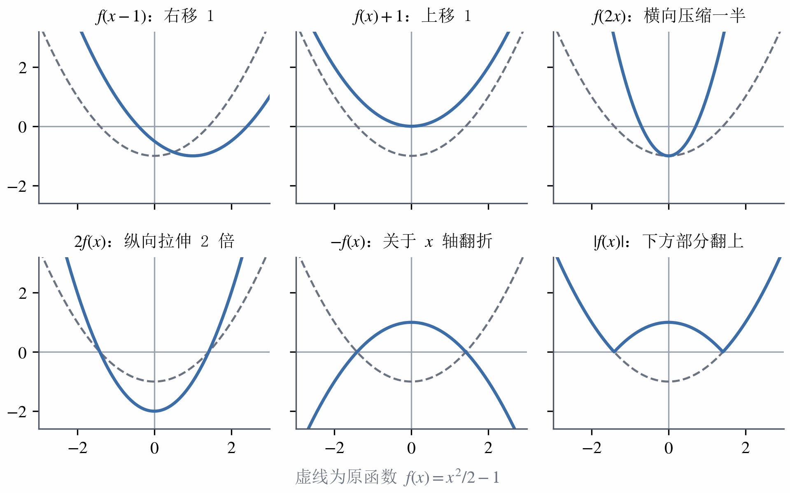

**讲解例：先提系数再平移。** \(y=(2x-4)^2=\big(2(x-2)\big)^2=4(x-2)^2\)，顶点在 \(x=2\)，开口比 \(x^2\) 窄；\(y=\left(\tfrac13x-6\right)^2=\tfrac19(x-18)^2\)，顶点在 \(x=18\)，开口变宽。若误把 \(f(2x-4)\) 当作“压缩后右移四”，顶点会错放到 \(x=4\)。再看 \(y=(2x-2)^2-4=4(x-1)^2-4\)：横向压缩二倍、右移一、下移四，顶点 \((1,-4)\)。验算：\(x=1\) 时 \((2-2)^2-4=-4\)，与顶点一致。

**讲解例：绝对值翻折的三种情形。** 由 \(f(x)=x^2-4\) 出发：\(y=|x^2-4|\) 把 \(-2<x<2\) 一段翻到上方，在原点处形成顶点为 \((0,4)\) 的驼峰。\(y=(|x|-4)^2\) 保留 \((x-4)^2\) 的右半支并镜像，得到 W 形，最低点为 \((\pm4,0)\)，在 \(x=0\) 处取局部极大值 16；而 \(y=(|x|+4)^2\) 的右半支 \((x+4)^2\) 在 \(x\ge0\) 上递增，镜像后得到 U 形，最低点为 \((0,16)\)。\(|y|=x^2-4\) 只在 \(|x|\ge2\) 处有图像，上下各一支，即 \(y=\pm(x^2-4)\)。

**讲解例：\(|x|+|y|\le1\)。** 写成 \(|y|=1-|x|\)，依次使用第 9、10 条：先画 \(y=1-x\) 在 \(x\ge0\) 的部分；按第 9 条镜像到左边，得到屋顶形折线 \(y=1-|x|\)；再按第 10 条，只保留 \(Ox\) 轴上方即 \(|x|\le1\) 的部分，并镜像到下方，得到顶点为 \((\pm1,0)\)、\((0,\pm1)\) 的正方形。判断不等式取哪一侧时，代入一个不在边界上的点：原点使 \(0+0=0\le1\) 成立，所以 \(|x|+|y|\le1\) 是包含原点的正方形内部连同边界，\(|x|+|y|\ge1\) 是外部连同边界。边界上的点满足等号，画成实线。

复合函数 \(f\circ g\)，即 \(f(g(x))\)，先执行内层的 \(g\)，再执行外层的 \(f\)。它的定义域不仅要求 \(g(x)\) 有意义，还要求 \(g(x)\) 的值落在 \(f\) 的定义域内。例如 \(\ln(1-x^2)\) 要求 \(1-x^2>0\)，定义域为 \((-1,1)\)。先看清函数的分层结构，后面求导时就能逐层乘上各层的变化率，而不是把整个公式看成无法拆开的整体。

**例题：复合顺序影响定义域。** 取 \(f(x)=\sqrt x\)、\(g(x)=x-1\)。\(f(g(x))=\sqrt{x-1}\)，要求 \(x\ge1\)；\(g(f(x))=\sqrt x-1\)，要求 \(x\ge0\)。在 \(x=1\) 处两式的值都是零，但在 \(x=4\) 处分别为 \(\sqrt3\) 和一。不能因为在某一点的值相同，就认为两个函数相同。

函数的几个基本性质在后面反复用到：若 \(f(-x)=f(x)\)，\(f\) 是偶函数，图像关于 \(y\) 轴对称；若 \(f(-x)=-f(x)\)，\(f\) 是奇函数，图像关于原点对称；若存在 \(T>0\) 使 \(f(x+T)=f(x)\) 对一切 \(x\) 成立，\(f\) 是周期函数。这些性质可以大大简化积分计算（见 4.7 节）。

奇偶性的定义包含两个条件，第一个常被遗漏：定义域必须关于原点对称，即 \(x\in D_f\) 时 \(-x\in D_f\)；在此前提下，才比较 \(f(-x)\) 与 \(f(x)\)。例如 \(\sqrt x\) 的定义域为 \([0,+\infty)\)，不关于原点对称，所以既不是奇函数也不是偶函数，不必再计算 \(f(-x)\)。验证时把 \(x\) 换成 \(-x\) 代入：\(x^2\) 与 \(\cos x\) 满足 \(f(-x)=f(x)\)，是偶函数；\(x^3\) 与 \(\sin x\) 满足 \(f(-x)=-f(x)\)，是奇函数；\(x^2+x\) 两条都不满足，是非奇非偶函数。

### 1.3 反函数、指数与对数

在一个区间上严格单调的函数，可以建立反函数。反函数把输入与输出互换，图像与原函数关于直线 \(y=x\) 对称。注意反函数 \(f^{-1}\) 不是把函数值取倒数 \(1/f\)。指数函数 \(e^x\) 在全体实数上严格递增，值域为全体正数，因此它的反函数 \(\ln x\) 只对 \(x>0\) 有定义。对数把乘法变成加法：\(\ln(ab)=\ln a+\ln b\)；但 \(\ln(a+b)\) 一般不等于 \(\ln a+\ln b\)。

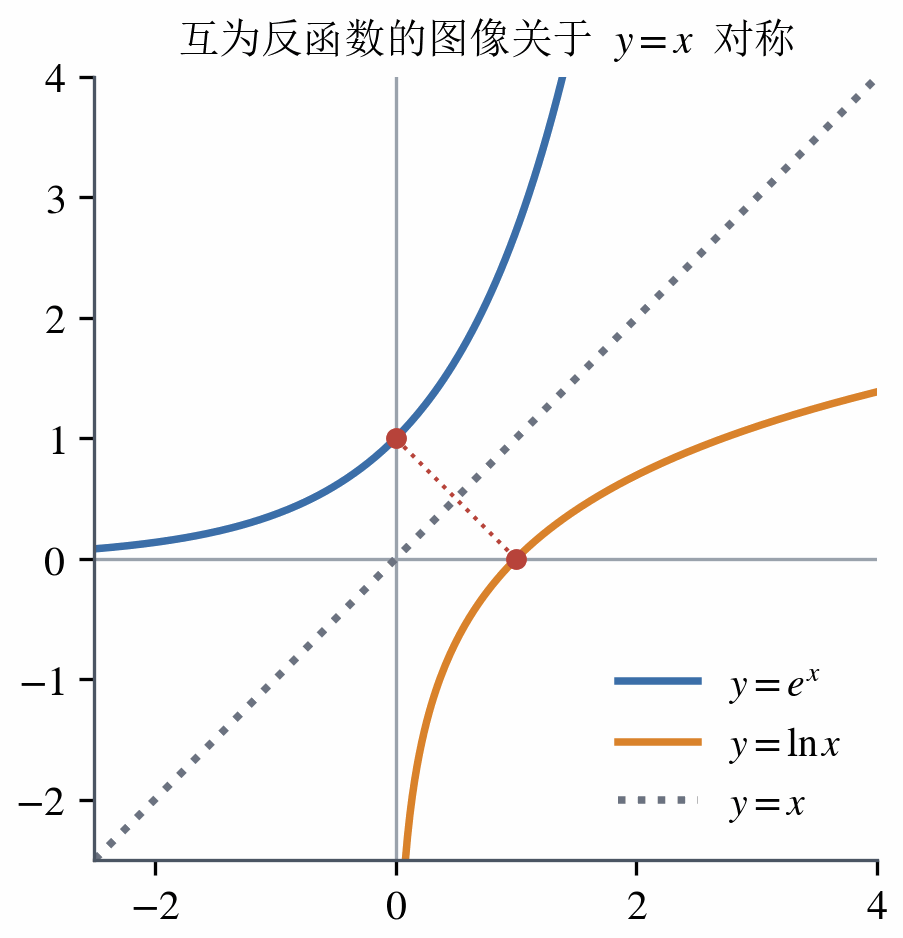

求反函数的步骤是：

1. 确认函数在所考虑的区间上严格单调，从而一一对应。
2. 从 \(y=f(x)\) 中解出 \(x\)，得到 \(x=f^{-1}(y)\)。
3. 按习惯把自变量仍记作 \(x\)，交换字母得 \(y=f^{-1}(x)\)，原函数的值域成为反函数的定义域。

例如 \(y=2^x\) 在 \(\mathbb R\) 上严格递增，两边取以二为底的对数得 \(x=\log_2y\)，交换字母得反函数 \(y=\log_2x\)，定义域为 \((0,+\infty)\)。原函数过点 \((0,1)\)，反函数过点 \((1,0)\)。两图像关于直线 \(y=x\) 对称的理由是：点 \((p,q)\) 在 \(y=f(x)\) 上，等价于 \(q=f(p)\)，也等价于 \(p=f^{-1}(q)\)，即点 \((q,p)\) 在 \(y=f^{-1}(x)\) 上；而 \((p,q)\) 与 \((q,p)\) 的连线垂直于 \(y=x\)，中点 \(\big(\tfrac{p+q}2,\tfrac{p+q}2\big)\) 落在 \(y=x\) 上，两点关于这条直线对称。

在物理模型中，指数函数的自变量应当是没有单位的数。例如衰减规律 \(e^{-t/\tau}\) 中，\(t\) 和 \(\tau\) 都以时间为单位，它们的比值才能放进指数。对数同样应当作用于无量纲的比值，如 \(\ln(x/x_0)\)。单位检查不只是书写规范，它还能帮助发现公式中漏掉的时间常数、频率或参考量。

三角函数的自变量同样应当以弧度为单位。弧度由弧长与半径之比定义，正是这种定义使得小角度时 \(\sin x\) 与 \(x\) 之比趋于一，导数公式才具有最简单的系数。如果把六十度直接当作数六十代入泰勒公式，就改变了函数输入的单位，结果完全错误。

**双曲函数。** 由指数函数组合出的双曲正弦与双曲余弦

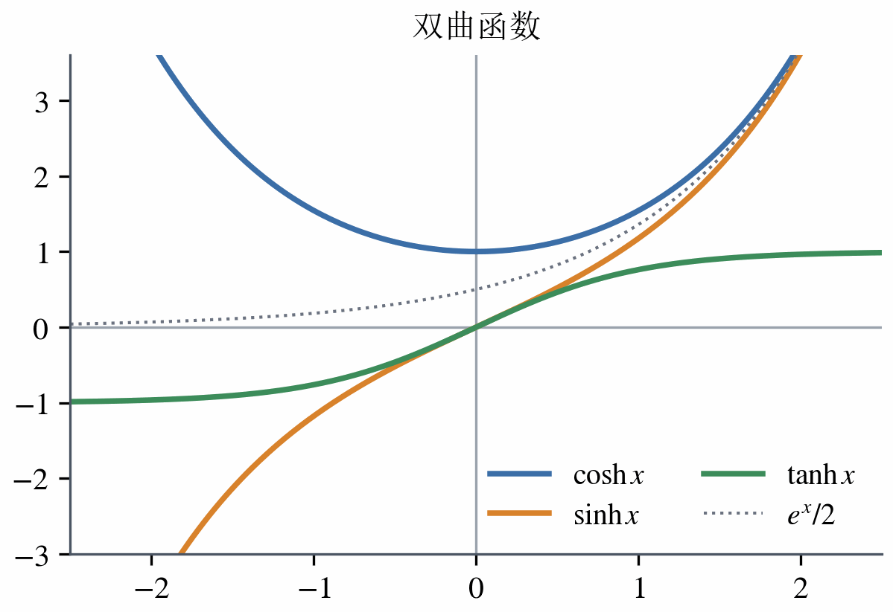

\[
\sinh x=\frac{e^x-e^{-x}}2,\qquad \cosh x=\frac{e^x+e^{-x}}2,\qquad \cosh^2x-\sinh^2x=1
\]

在悬链线、相对论和微分方程中经常出现。它们满足与三角函数相似的关系，导数为 \((\sinh x)'=\cosh x\)、\((\cosh x)'=\sinh x\)，注意第二式没有负号。

## 第二章 函数与极限

### 2.1 极限描述趋近而非到达

数列 \(a_n\) 收敛到 \(L\)，是指：任给一个正数 \(\varepsilon\)（无论多么小），都存在一个整数 \(N\)，使得当 \(n>N\) 时，\(|a_n-L|<\varepsilon\)。通俗地说，只要 \(n\) 足够大，\(a_n\) 与 \(L\) 的距离可以小于任何事先指定的误差。例如 \(a_n=1/n\)：对给定的 \(\varepsilon\)，选 \(N>1/\varepsilon\)，则 \(n>N\) 时 \(1/n<\varepsilon\)，所以极限为零。注意，对每个有限的 \(n\)，\(1/n\) 都大于零；极限为零并不要求某一项真的等于零，它描述的是趋近，而不是到达。

**数列及其表示。** 数列（последовательность）是定义在自然数集 \(\mathbb N\) 上的函数：每个序号 \(n=1,2,3,\ldots\) 对应一个数 \(a_n=f(n)\)，记作 \(\{a_n\}\)，\(a_n\) 称为通项（общий член）。因为自变量只取正整数，数列的图像不是连续曲线，而是一列孤立的点 \((n,a_n)\)。数列常用两种方式给出：

1. 通项公式：直接写出 \(a_n\) 与 \(n\) 的关系，如 \(a_n=\dfrac1n\) 给出 \(1,\tfrac12,\tfrac13,\ldots\)，\(a_n=\dfrac1{2^n}\) 给出 \(\tfrac12,\tfrac14,\tfrac18,\ldots\)。给定 \(n\) 可以立即算出第 \(n\) 项。
2. 递推公式（рекуррентная формула）：给出首项和由前一项求后一项的规则。等差数列 \(a_1=-12\)、\(a_n=a_{n-1}+5\) 依次为 \(-12,-7,-2,3,8,\ldots\)，求第 \(n\) 项要一步步推下去；对等差数列也可以化成通项 \(a_n=a_1+(n-1)d=5n-17\)，验算 \(a_4=20-17=3\)。

数列极限的定义可以用量词写成

\[
\lim_{n\to\infty}a_n=A\iff\forall\varepsilon>0\ \ \exists M>0:\quad n>M\ \Rightarrow\ |a_n-A|<\varepsilon ,
\]

即从第 \(M\) 项以后，所有的项都落在区间 \((A-\varepsilon,A+\varepsilon)\) 内。极限为有限数的数列称为收敛数列（сходящаяся），否则称为发散数列（расходящаяся）。\(a_n=n^2\) 趋于 \(+\infty\)，有时写作 \(\lim n^2=\infty\)，但 \(\infty\) 不是数，这个数列仍属发散。

**讲解例：用定义证明数列极限。** 证明 \(\displaystyle\lim_{n\to\infty}\frac n{n+1}=1\)。任取 \(\varepsilon>0\)，先化简差值：

\[
\left|\frac n{n+1}-1\right|=\left|\frac{n-(n+1)}{n+1}\right|=\frac1{n+1}.
\]

要使 \(\dfrac1{n+1}<\varepsilon\)，只需 \(n+1>\dfrac1\varepsilon\)，即 \(n>\dfrac1\varepsilon-1\)。取 \(M=\dfrac1\varepsilon\)（它大于 \(\frac1\varepsilon-1\) 且为正数），当 \(n>M\) 时不等式成立，所以极限为 1。验算：\(\varepsilon=0.01\) 时 \(M=100\)，取 \(n=101\)，\(\bigl|\tfrac{101}{102}-1\bigr|=\tfrac1{102}\approx0.0098<0.01\)。

**讲解例：有界而发散的数列。** 讨论 \(a_n=\sin\dfrac{n\pi}2\)。依次代入 \(n=1,2,3,\ldots\) 得 \(1,0,-1,0,1,0,-1,0,\ldots\)，四项一循环。假设极限 \(A\) 存在，取 \(\varepsilon=\tfrac12\)，则从某项以后所有项都满足 \(|a_n-A|<\tfrac12\)。但 1 和 \(-1\) 都会在后面无限次出现，由三角不等式

\[
2=|1-(-1)|\le|1-A|+|A-(-1)|<\frac12+\frac12=1 ,
\]

得出 \(2<1\)，矛盾，所以极限不存在。这个数列满足 \(|a_n|\le1\)，是有界的，可见有界不一定收敛。

数列极限是函数极限的特殊情形：数列 \(a_n=f(n)\) 只是把 \(f(x)\) 的自变量限制在正整数上。因此若 \(\lim_{x\to+\infty}f(x)=A\)，必有 \(\lim_{n\to\infty}f(n)=A\)；反过来不成立。例如 \(f(x)=\sin\pi x\) 在整数点上恒为零，数列极限为 0，而 \(x\to+\infty\) 时函数在 \(-1\) 与 1 之间不断振荡，函数极限不存在。

函数极限 \(\lim_{x\to a}f(x)=L\) 的含义类似，只是把“\(n\) 大于某个指标”改成“\(x\) 与 \(a\) 足够接近，但不等于 \(a\)”。因此，函数在 \(x=a\) 处的极限与 \(f(a)\) 是否有定义、等于多少无关。双侧极限存在，要求左极限与右极限都存在且相等；若函数只在 \(a\) 的一侧有定义，就应明确使用单侧极限。

**邻域与去心邻域。** 描述“足够接近”要用邻域。点 \(x_0\) 的 \(\delta\) 邻域是以 \(x_0\) 为中心、半径为 \(\delta\) 的开区间，去心 \(\delta\) 邻域（проколотая окрестность）是把中心点挖掉后剩下的部分：

\[
U_\delta(x_0)=(x_0-\delta,\ x_0+\delta)\iff|x-x_0|<\delta ,\qquad
\mathring U_\delta(x_0)=(x_0-\delta,\ x_0)\cup(x_0,\ x_0+\delta)\iff0<|x-x_0|<\delta .
\]

例如 \(x_0=3\)、\(\delta=0.1\) 时，\(U_\delta(3)=(2.9,\,3.1)\)。不等式 \(0<|x-x_0|\) 正是 \(x\ne x_0\) 的另一种写法。函数极限只关心 \(x\) 靠近 \(x_0\) 时 \(f(x)\) 的表现，不关心 \(f(x_0)\) 本身，所以定义中用的是去心邻域；\(f(x)=\dfrac{x^2-1}{x-1}\) 在 \(x=1\) 处没有定义，但在去心邻域内可以约分为 \(x+1\)，极限仍为 2（见下面的例 1）。\(\varepsilon\) 与 \(\delta\) 分工不同：\(\varepsilon\) 先给定，衡量函数值离极限多近；\(\delta\) 后找，衡量自变量离 \(x_0\) 多近，它依赖于 \(\varepsilon\)，有时写作 \(\delta(\varepsilon)\)。

**柯西定义。** 把“足够接近”写成精确的不等式，就得到函数极限的柯西定义（определение предела по Коши），也称 \(\varepsilon\)-\(\delta\) 定义：\(\lim_{x\to x_0}f(x)=a\)，当且仅当

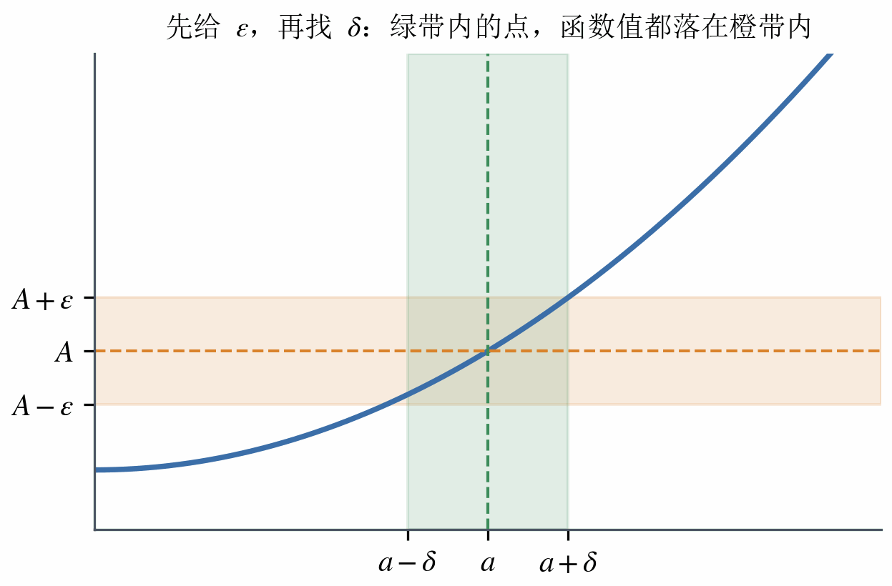

\[
\forall\varepsilon>0\ \ \exists\delta>0:\quad 0<|x-x_0|<\delta\ \Rightarrow\ |f(x)-a|<\varepsilon .
\]

符号 \(\forall\) 读作“对任意”，\(\exists\) 读作“存在”。\(\varepsilon\)（эпсилон）是允许 \(f(x)\) 偏离 \(a\) 的误差，\(\delta\)（дельта）是 \(x\) 离 \(x_0\) 应有多近。由 1.1 节的距离含义，\(|f(x)-a|<\varepsilon\) 是以 \(a\) 为中心、宽 \(2\varepsilon\) 的一条横带，\(0<|x-x_0|<\delta\) 是以 \(x_0\) 为中心、宽 \(2\delta\) 的竖带去掉中心一点。定义说：无论横带多窄，总能找到一条竖带，使函数图像在竖带内（中心点除外）的部分全部落在横带里。条件 \(0<|x-x_0|\) 排除了 \(x=x_0\) 本身，所以极限与 \(f(x_0)\) 无关。可以把它理解为一场挑战：对方任意给出 \(\varepsilon\)，我方必须回答一个可用的 \(\delta\)；只要对每个 \(\varepsilon\) 都能回答，极限就是 \(a\)。

需要这样严格的定义，是因为“越来越接近”不足以作为证明的依据。\(x\to2\) 时，\(3x-1\) 与 5 越来越接近，与 5.5 的距离也在缩小，直觉说法无法区分这两个数；定义要求误差可以任意小，5.5 在 \(\varepsilon=0.25\) 时就无法满足，只有 5 能通过。又如 \(\sin(1/x)\) 在 \(x\to0\) 时于 \(-1\) 与 1 之间无限次振荡，无论猜测哪个 \(a\)，取 \(\varepsilon=\tfrac12\) 时，任何竖带内都有使 \(\sin(1/x)=1\) 和 \(=-1\) 的点，二者不能同时落在宽为一的横带里，所以极限不存在。

**定义的符号形式与否定。** 用去心邻域，柯西定义可以完全写成逻辑符号：

\[
\Bigl[\lim_{x\to x_0}f(x)=A\Bigr]\ \equiv\ (\forall\varepsilon>0)(\exists\delta>0)\bigl(\forall x\in\mathring U_\delta(x_0)\bigr)\bigl[\,|f(x)-A|<\varepsilon\,\bigr].
\]

量词的顺序不能交换：先任给 \(\varepsilon\)，再找 \(\delta\)。要说明 \(A\) 不是极限，按逻辑学中否定量词的规则，把每个 \(\forall\) 换成 \(\exists\)、每个 \(\exists\) 换成 \(\forall\)，最后的不等式取反：

\[
\Bigl[\lim_{x\to x_0}f(x)\ne A\Bigr]\ \equiv\ (\exists\varepsilon>0)(\forall\delta>0)\bigl(\exists x\in\mathring U_\delta(x_0)\bigr)\bigl[\,|f(x)-A|\ge\varepsilon\,\bigr].
\]

读作：存在某个误差 \(\varepsilon\)，无论 \(\delta\) 取多小，邻域内总有点使 \(f(x)\) 离 \(A\) 至少 \(\varepsilon\)。上面 \(\sin(1/x)\) 与 \(\sin\frac{n\pi}2\) 的论证都是这一形式。由同样的思路可以证明极限唯一：若 \(A_1<A_2\) 都是极限，取 \(\varepsilon<\dfrac{A_2-A_1}2\)，两个极限的 \(\varepsilon\) 邻域不相交，而 \(x\) 足够接近 \(x_0\) 时 \(f(x)\) 必须同时落在两个邻域里，矛盾。

用定义证明极限的一般步骤是：

1. 化简 \(|f(x)-a|\)，设法写成 \(|x-x_0|\) 乘以某个因子。
2. 若因子是常数 \(M\)，由 \(M|x-x_0|<\varepsilon\) 解出 \(|x-x_0|<\varepsilon/M\)，取 \(\delta=\varepsilon/M\)。
3. 若因子随 \(x\) 变化，先限制 \(|x-x_0|<1\)（或别的固定数），在这个范围内给因子找一个上界 \(M\)，再取 \(\delta=\min(1,\varepsilon/M)\)。
4. 也可以直接从 \(|f(x)-a|<\varepsilon\) 解出 \(|x-x_0|\) 的范围，目标只是得到形如 \(|x-x_0|<\delta\) 的充分条件，不要求先化为一次式。

**讲解例：一次函数。** 证明 \(\lim_{x\to1}(5x-2)=3\)。\(|f(x)-a|=|5x-5|=5|x-1|\)，要使它小于 \(\varepsilon\)，只需 \(|x-1|<\varepsilon/5\)，取 \(\delta=\varepsilon/5\)。验证：\(\varepsilon=0.1\) 时 \(\delta=0.02\)，取 \(x=1.019\)，\(f(x)=3.095\)，\(|3.095-3|=0.095<0.1\)。一般地，\(f(x)=kx+b\)（\(k\ne0\)）可取 \(\delta=\varepsilon/|k|\)。\(\delta\) 不唯一，比它更小的正数同样可用；常数函数则任取 \(\delta\) 都行，因为 \(|f(x)-a|\) 恒为零。

**讲解例：开方解出 \(\delta\)。** 证明 \(\lim_{x\to0}x^2=0\)。\(|x^2-0|=|x|^2<\varepsilon\) 等价于 \(|x|<\sqrt\varepsilon\)，而 \(|x-x_0|=|x|\)，取 \(\delta=\sqrt\varepsilon\) 即可。这里没有把式子化成一次，而是直接解出了 \(|x|\) 的范围。

**讲解例：先限制范围再放缩。** 证明 \(\lim_{x\to2}x^2=4\)。分解得 \(|x^2-4|=|x-2|\cdot|x+2|\)，因子 \(|x+2|\) 随 \(x\) 变化，不能直接除掉。先约定 \(|x-2|<1\)，则 \(1<x<3\)，\(3<x+2<5\)，于是

\[
|x^2-4|<5|x-2| .
\]

只要 \(5|x-2|<\varepsilon\)，即 \(|x-2|<\varepsilon/5\)，原式就小于 \(\varepsilon\)。两个条件都要满足，取 \(\delta=\min(1,\varepsilon/5)\)。验证：\(\varepsilon=0.5\) 时 \(\delta=0.1\)，取 \(x=2.09\)，\(|2.09^2-4|=0.3681<0.5\)。这一步叫放缩，方向必须是放大：先证明一个更大的量小于 \(\varepsilon\)，原式自然也小于 \(\varepsilon\)；若把原式缩小，较小的量小于 \(\varepsilon\) 推不出原式小于 \(\varepsilon\)。上界也不必精确，\(|x+2|\) 在 4 附近，放到 5 只是使 \(\delta\) 保守一些。限制 \(|x-2|<1\) 不能省：若 \(\varepsilon=100\) 而只取 \(\delta=20\)，\(x\) 可以取到 21，此时 \(|x+2|=23\)，“小于 5”的估计就不成立了。

**例1：约去因子与补成连续函数。** 对 \(f(x)=(x^2-1)/(x-1)\)，原定义域不包含 \(x=1\)。当 \(x\ne1\) 时，把分子分解为 \((x-1)(x+1)\)，约去后得 \(f(x)=x+1\)，所以 \(\lim_{x\to1}f(x)=2\)。约分并没有让原函数在 \(x=1\) 处自动获得定义；只有另外规定 \(f(1)=2\)，才得到一个在该点连续的新函数（称为连续延拓）。这种区分在处理含参数的分式和积分中的可去间断点时同样需要。

### 2.2 连续与基本求极限方法

函数在 \(a\) 点连续，要求同时满足三条：\(f(a)\) 有定义；\(\lim_{x\to a}f(x)\) 存在；二者相等。不满足其中任何一条的点称为间断点。间断点可分为几类：极限存在但不等于函数值（或函数无定义）的称为可去间断点，如例 1；左右极限都存在但不相等的称为跳跃间断点；至少一侧极限不存在的（如趋于无穷或振荡）称为第二类间断点。

连续函数在闭区间上有两条重要性质：一定能取到最大值和最小值（最值定理），并且能取到最大值与最小值之间的每一个值（介值定理）。区间不闭合时，这些结论不一定成立，例如 \(f(x)=x\) 在开区间 \((0,1)\) 上取不到最大值。

求极限时，先看能否利用连续性直接代入。若代入后得到 \(0/0\) 或 \(\infty/\infty\)，只说明当前的形式无法判断结果，称为未定式，并不是答案。这时可以尝试因式分解、有理化（乘共轭式）、夹逼、等价无穷小替换、洛必达法则或泰勒展开。若分母趋于零而分子趋于非零的数，则不是未定式，结果是无穷大，但要检查左右两侧的符号。

**例2：有理化揭示最低阶。** 求 \(x\to0\) 时 \((\sqrt{1+x}-1)/x\) 的极限。定义域为 \(x\ge-1\)，零的两侧都有定义。分子分母同乘以共轭式 \(\sqrt{1+x}+1\)，分子变为 \((1+x)-1=x\)，得到

\[
\frac{\sqrt{1+x}-1}{x}
=\frac{1}{\sqrt{1+x}+1},\qquad x\ne0.
\]

右边在零处连续，直接代入得极限为二分之一。这个结果还说明，\(x\) 很小时 \(\sqrt{1+x}\) 比一大约 \(x/2\)，为后面的局部线性化做了准备。

**含无穷的极限运算与不定式。** 设 \(x\to x_0\) 时 \(f(x)\to\infty\)、\(g(x)\to a\)，\(a\) 为有限数。下面的式子是简写，意思是“一个趋于无穷的量与一个趋于 \(a\) 的量作运算，结果趋于什么”，并不是把 \(\infty\) 当作普通的数来计算：

\[
\infty\pm a=\infty,\qquad \infty\cdot a=\infty\ (a\ne0),\qquad \infty\cdot\infty=\infty,\qquad
\frac{\infty}{a}=\infty,\qquad \frac{a}{\infty}=0,\qquad \frac{a}{0}=\infty\ (a\ne0).
\]

同号无穷之和仍为无穷：\((+\infty)+(+\infty)=+\infty\)，\((-\infty)+(-\infty)=-\infty\)。乘除时结果的符号按通常的符号法则确定，\(a/0\) 一类还要分别看分母从哪一侧趋于零。不能确定结果的四种基本形式称为不定式（неопределённости）：

\[
\frac00,\qquad \frac\infty\infty,\qquad 0\cdot\infty,\qquad \infty-\infty ,
\]

此外还有 \(1^\infty\)、\(0^0\)、\(\infty^0\) 三种幂的形式。“不定”指单看形式，结果可以是任何值。同为 \(x\to0\) 时的 \(0/0\)，\(2x/x\to2\)，\(x^2/x\to0\)，\(x/x^2\to\infty\)，取决于分子分母谁更快趋于零；同为 \(x\to+\infty\) 时的 \(\infty-\infty\)，\((x+5)-x\to5\)，\(x^2-x\to+\infty\)。遇到不定式，需要先用约分、提出最高次项、乘共轭式等方法变形，再求极限。

**讲解例：同一函数在三个点的极限。** 设 \(f(x)=\dfrac{x-1}{x^2-x}\)。由 \(x^2-x=x(x-1)=0\) 得 \(x=0\) 或 \(x=1\)，定义域为 \(\mathbb R\setminus\{0,1\}\)。

1. \(x\to2\)：2 属于定义域，分式在此连续，直接代入得 \(\dfrac{2-1}{4-2}=\dfrac12\)。
2. \(x\to1\)：代入得 \(0/0\)。求极限时 \(x\) 只趋近于 1 而不等于 1，柯西定义中的 \(0<|x-1|\) 保证 \(x-1\ne0\)，所以可以约去：\(\dfrac{x-1}{x(x-1)}=\dfrac1x\)（\(x\ne1\)），极限为 1。
3. \(x\to0\)：化简后分子为 1，分母趋于零，属于 \(a/0\) 型，极限为无穷。按原式看符号：\(x\to0^+\) 时 \(x>0\)、\(x-1<0\)，分母 \(x(x-1)\) 是趋于零的负数，记作 \(0^-\)，分子趋于 \(-1\)，得 \(\dfrac{-1}{0^-}=+\infty\)；\(x\to0^-\) 时分母为趋于零的正数，得 \(\dfrac{-1}{0^+}=-\infty\)。这与 \(1/x\) 的左右极限一致。

\(x=0\) 与 \(x=1\) 都不在定义域内，性质却不同：\(f\) 与 \(1/x\) 只在 \(x=1\) 这一点不同，在那里留下一个“空心点”，极限有限，是可去间断点；\(x=0\) 处两侧趋于符号相反的无穷，是第二类间断点。

**讲解例：乘共轭式。** 求 \(\displaystyle\lim_{x\to3}\frac{\sqrt{x+6}-\sqrt{10x-21}}{5x-15}\)。代入得 \(\dfrac{3-3}{15-15}=\dfrac00\)。根式之差不能直接分解，分子分母同乘共轭式 \(\sqrt{x+6}+\sqrt{10x-21}\)，利用 \((\sqrt A-\sqrt B)(\sqrt A+\sqrt B)=A-B\)，分子变为 \((x+6)-(10x-21)=-9(x-3)\)，于是

\[
\frac{\sqrt{x+6}-\sqrt{10x-21}}{5x-15}
=\frac{-9(x-3)}{5(x-3)\big(\sqrt{x+6}+\sqrt{10x-21}\big)}
=\frac{-9}{5\big(\sqrt{x+6}+\sqrt{10x-21}\big)}\to\frac{-9}{5\cdot6}=-\frac3{10}.
\]

验算：取 \(x=3.001\)，分子约为 \(3.000167-3.001666=-0.001499\)，分母为 \(0.005\)，比值约 \(-0.2999\)，与 \(-0.3\) 相符。

**讲解例：分子分母各乘共轭式。** 求 \(\displaystyle\lim_{x\to3}\frac{\sqrt{12-x}-\sqrt{6+x}}{\sqrt{6+x}-3}\)，代入为 \(0/0\)。分子、分母都含根式之差，各乘自己的共轭式；为不改变分式的值，两个共轭式都要上下同乘。分子得 \((12-x)-(6+x)=-2(x-3)\)，分母得 \((6+x)-9=x-3\)，于是

\[
\frac{\sqrt{12-x}-\sqrt{6+x}}{\sqrt{6+x}-3}
=\frac{-2(x-3)}{\sqrt{12-x}+\sqrt{6+x}}\cdot\frac{\sqrt{6+x}+3}{x-3}
=\frac{-2\big(\sqrt{6+x}+3\big)}{\sqrt{12-x}+\sqrt{6+x}}\to\frac{-2\cdot6}{3+3}=-2 .
\]

同样的做法求 \(\displaystyle\lim_{x\to1}\frac{\sqrt{5-x}-2}{\sqrt{2-x}-1}\)。代入为 \(0/0\)。分子乘 \(\sqrt{5-x}+2\) 得 \((5-x)-4=1-x\)，分母乘 \(\sqrt{2-x}+1\) 得 \((2-x)-1=1-x\)，约去公因子 \(1-x\)：

\[
\frac{\sqrt{5-x}-2}{\sqrt{2-x}-1}=\frac{1-x}{\sqrt{5-x}+2}\cdot\frac{\sqrt{2-x}+1}{1-x}=\frac{\sqrt{2-x}+1}{\sqrt{5-x}+2}\to\frac{1+1}{2+2}=\frac12 .
\]

验算：\(x=0.999\) 时分子约 \(0.000250\)，分母约 \(0.000500\)，比值约 0.500。

**讲解例：\(\infty-\infty\) 型先通分。** 两个分式之差在同一点各自趋于无穷时，先通分化为一个分式，再判断类型。

1. 求 \(\displaystyle\lim_{x\to1}\Bigl(\frac1{1-x}-\frac3{1-x^3}\Bigr)\)。由 \(1-x^3=(1-x)(1+x+x^2)\)，通分得 \(\dfrac{1+x+x^2-3}{(1-x)(1+x+x^2)}\)。分子 \(x^2+x-2=(x-1)(x+2)=-(1-x)(x+2)\)，约去 \(1-x\) 得 \(-\dfrac{x+2}{1+x+x^2}\to-\dfrac33=-1\)。验算：\(x=0.999\) 时原式约为 \(-1.0007\)。
2. 若第二项分母换成 \(1-x^2\)，即求 \(\displaystyle\lim_{x\to1}\Bigl(\frac1{1-x}-\frac3{1-x^2}\Bigr)\)，通分得 \(\dfrac{(1+x)-3}{(1-x)(1+x)}=\dfrac{x-2}{(1-x)(1+x)}\)。分子趋于 \(-1\)，分母趋于 0，不再是未定式，结果为无穷：\(x\to1^-\) 时分母为正，原式趋于 \(-\infty\)；\(x\to1^+\) 时分母为负，原式趋于 \(+\infty\)，没有有限极限。若取两分母之积 \((1-x)(1-x^2)\) 为公分母，分子为 \((1-x^2)-3(1-x)=-x^2+3x-2=(1-x)(x-2)\)，一次项是 \(+3x\)，约去 \(1-x\) 后结果相同。

两题形式只差一个指数，结果完全不同：第 1 题通分后分子含有因子 \(1-x\)，可以与分母相消；第 2 题分子在 \(x=1\) 处不为零，没有可消的因子。

### 2.3 极限运算法则与夹逼的作用

若 \(\lim f\) 和 \(\lim g\) 都存在且有限，则和、差、积的极限分别等于极限的和、差、积；商的极限等于极限之商，但要求分母的极限不为零。这个条件解释了为什么直接代入得到 \(0/0\) 时不能下结论：商的运算法则的前提不满足，而不是极限一定不存在。无穷大不是普通的实数，不能参与所有代数运算，例如 \(\infty-\infty\) 没有确定的结果。比较 \((n+1)-n\) 恒为一，\(2n-n\) 趋于无穷，\(n-(n+1)\) 恒为负一，它们在形式上都是两个无穷大之差，结果却各不相同。

夹逼定理用于直接计算困难、但容易找到上下界的情形：若在 \(a\) 附近 \(g(x)\le f(x)\le h(x)\)，且 \(g\) 和 \(h\) 趋于同一个值 \(L\)，则夹在中间的 \(f\) 也趋于 \(L\)。例如 \(x^2\sin(1/x)\)：当 \(x\to0\) 时 \(\sin(1/x)\) 不断振荡、没有极限，但整个式子被夹在 \(-x^2\) 与 \(x^2\) 之间，而两者都趋于零，所以原式的极限为零。不能因为乘积中有一个因子没有极限，就断言整个乘积没有极限；也不能把这个例子误解为“零乘以任何量都趋于零”，若另一个因子无界，就需要重新比较增长速度。

**收敛数列的性质。** 设 \(\lim x_n=a\)，\(\lim y_n=b\)，\(a\)、\(b\) 为有限数。收敛数列有以下性质：

1. 唯一性：一个数列不可能收敛到两个不同的数，证明与 2.1 节函数极限的唯一性相同。
2. 有界性：收敛数列一定有界。取 \(\varepsilon=1\)，从某项 \(M\) 以后都有 \(|x_n|<|a|+1\)，前面只有有限项，取它们的绝对值与 \(|a|+1\) 中最大者即为界。逆命题不成立，2.1 节的 \(\sin\frac{n\pi}2\) 有界而发散。
3. 四则运算：\(\lim cx_n=ca\)，\(\lim(x_n\pm y_n)=a\pm b\)，\(\lim x_ny_n=ab\)；\(b\ne0\) 时 \(\lim\dfrac{x_n}{y_n}=\dfrac ab\)。前提是两个数列各自收敛。\(x_n=n\)、\(y_n=-n\) 都发散，\(x_n+y_n=0\) 却收敛，此时不能写成 \(\lim x_n+\lim y_n\)，因为 \(\infty-\infty\) 没有意义。
4. 保序性：若从某个序号起 \(x_n\le y_n\)，则 \(a\le b\)。严格不等号取极限后可能变成等号：对一切 \(n\) 有 \(0<\frac1n\)，取极限却得 \(0=0\)，所以只能由 \(x_n<y_n\) 推出 \(a\le b\)。特例：\(y_n\ge0\) 且收敛，则 \(\lim y_n\ge0\)。
5. 夹逼：若 \(x_n\le z_n\le y_n\)，且 \(\lim x_n=\lim y_n=a\)，则 \(\lim z_n=a\)。俄语课程常称为“两个警察定理”（теорема о двух милиционерах）。

例如 \(\displaystyle\lim_{n\to\infty}\frac{2n+3}n=\lim\Bigl(2+\frac3n\Bigr)=2+3\cdot0=2\)；求 \(\dfrac{3n^2+n}{2n^2-1}\) 时分子分母都发散，不能直接用商的法则，先同除以 \(n^2\) 得 \(\dfrac{3+1/n}{2-1/n^2}\to\dfrac32\)。

**不求极限值的收敛判别。** 用定义判断收敛，要先知道极限 \(A\) 是多少。下面两个准则只看数列本身。

柯西准则（критерий Коши）：数列 \(\{x_n\}\) 收敛的充分必要条件是

\[
\forall\varepsilon>0\ \ \exists N\ \ \forall n>N\ \ \forall p\in\mathbb N:\quad|x_{n+p}-x_n|<\varepsilon ,
\]

即从某项以后，任意两项之间的距离都可以任意小。满足这一条件的数列称为基本列（фундаментальная последовательность）。以调和数列 \(x_n=1+\frac12+\cdots+\frac1n\) 为例，取 \(p=n\)：

\[
x_{2n}-x_n=\frac1{n+1}+\frac1{n+2}+\cdots+\frac1{2n}\ \ge\ n\cdot\frac1{2n}=\frac12 ,
\]

右边共 \(n\) 项，每项都不小于最后一项 \(\frac1{2n}\)。对 \(\varepsilon=\frac12\)，不论 \(N\) 取多大，都有 \(n>N\) 使 \(|x_{2n}-x_n|\ge\frac12\)，柯西条件不成立，所以调和数列发散，这也就是第五章调和级数发散的原因。

单调有界准则：单调递增且有上界的数列必收敛；单调递减且有下界的数列也必收敛。直观地说，数列一直上升，又有一个上界挡着，只能越来越靠近某个数。例如 \(x_n=\frac n{n+1}\)：

\[
x_{n+1}-x_n=\frac{n+1}{n+2}-\frac n{n+1}=\frac{(n+1)^2-n(n+2)}{(n+1)(n+2)}=\frac1{(n+1)(n+2)}>0 ,
\]

单调递增，又有 \(x_n<1\)，所以收敛。这一条件是充分的，不是必要的：\(\frac{(-1)^n}n\) 不单调，却收敛到 0。

**由单调有界准则得到 \(e\)。** 考察 \(a_n=\bigl(1+\frac1n\bigr)^n\)。由二项式定理，

\[
a_n=1+n\cdot\frac1n+\frac{n(n-1)}{2!}\cdot\frac1{n^2}+\frac{n(n-1)(n-2)}{3!}\cdot\frac1{n^3}+\cdots
=1+1+\frac1{2!}\Bigl(1-\frac1n\Bigr)+\frac1{3!}\Bigl(1-\frac1n\Bigr)\Bigl(1-\frac2n\Bigr)+\cdots
\]

共 \(n+1\) 项，每项都是正数。

1. 单调递增：\(n\) 增大时，每个括号 \(1-\frac kn\) 变大，项数又多了一项，所以 \(a_{n+1}>a_n\)。
2. 有上界：把每个括号放大为 1，再用 \(k!\ge2^{k-1}\)（\(k\ge1\)），得 \(a_n<1+1+\frac12+\frac1{2^2}+\cdots+\frac1{2^{n-1}}<1+2=3\)。

所以数列收敛，它的极限定义为自然常数 \(e\approx2.718\)。再取 \(n\le x<n+1\)，把 \(\bigl(1+\frac1x\bigr)^x\) 夹在 \(\bigl(1+\frac1{n+1}\bigr)^n\) 与 \(\bigl(1+\frac1n\bigr)^{n+1}\) 之间，两端都趋于 \(e\)，由夹逼即可把结论从整数 \(n\) 推广到实数 \(x\to+\infty\)。

**两个重要极限。** 下面两个极限是推导大量公式的基础：

\[
\lim_{x\to0}\frac{\sin x}{x}=1,\qquad \lim_{n\to\infty}\left(1+\frac1n\right)^n=e .
\]

第一个可以用夹逼定理证明：在单位圆中，\(0<x<\pi/2\) 时，比较三角形与扇形的面积，得到 \(\sin x<x<\tan x\)，两边同除以 \(\sin x\) 再取倒数，得 \(\cos x<\dfrac{\sin x}x<1\)，而 \(\cos x\to1\)。第二个极限定义了自然常数 \(e\approx2.71828\)，它的一般形式是 \(\lim_{u\to0}(1+u)^{1/u}=e\)，凡遇到“\(1^\infty\)”型的未定式，都可以化成这个形式。

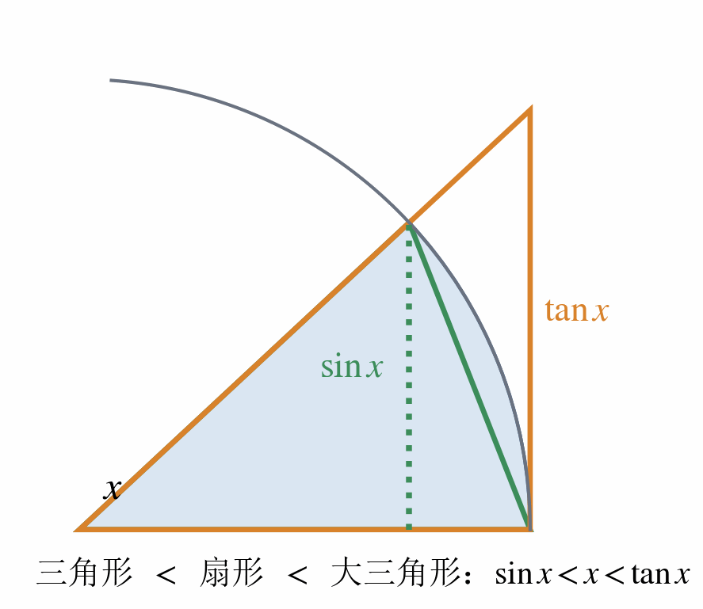

**第一个重要极限的完整推导。** 在单位圆中取圆心角 \(x\)（弧度），\(0<x<\frac\pi2\)。设 \(O\) 为圆心，\(A\) 为 \(x\) 轴上的点 \((1,0)\)，\(B\) 为圆上对应角 \(x\) 的点，过 \(A\) 作切线交 \(OB\) 的延长线于 \(C\)。三角形 \(OAB\) 底为 1、高为 \(\sin x\)；扇形 \(OAB\) 半径为 1、圆心角为 \(x\)；三角形 \(OAC\) 底为 1、高为 \(AC=\tan x\)。三者依次包含，面积满足

\[
\frac12\sin x<\frac12x<\frac12\tan x .
\]

同乘 2 后除以 \(\sin x\)（此时 \(\sin x>0\)，不等号方向不变），得 \(1<\dfrac x{\sin x}<\dfrac1{\cos x}\)；三项都为正，取倒数后不等号反向：

\[
\cos x<\frac{\sin x}x<1 .
\]

\(x\to0^+\) 时 \(\cos x\to1\)，由夹逼得右极限为 1。又 \(\dfrac{\sin(-x)}{-x}=\dfrac{-\sin x}{-x}=\dfrac{\sin x}x\)，函数是偶函数，左极限也为 1，所以双侧极限为 1。推导用到“扇形面积等于 \(\frac12x\)”，它只在弧度制下成立；若 \(x\) 以度为单位，同一极限等于 \(\frac\pi{180}\)。

由它得到几个常用推论：

\[
\lim_{x\to0}\frac{\tan x}x=\lim_{x\to0}\frac{\sin x}x\cdot\frac1{\cos x}=1\cdot1=1,\qquad
\lim_{x\to0}\frac{\sin nx}x=\lim_{x\to0}n\cdot\frac{\sin nx}{nx}=n .
\]

第二式中令 \(t=nx\)，\(x\to0\) 时 \(t\to0\)。一般地，只要 \(\alpha(x)\to0\)，就有 \(\lim\dfrac{\sin\alpha(x)}{\alpha(x)}=1\)：正弦里面是什么，分母就凑成什么。

**第二个重要极限的两种写法。** 在 \(\lim_{x\to\infty}\bigl(1+\frac1x\bigr)^x=e\) 中令 \(t=\frac1x\)，\(x\to\infty\) 时 \(t\to0\)，得到等价写法 \(\lim_{t\to0}(1+t)^{1/t}=e\)。使用时把底数写成“1 加一个趋于零的量”，指数凑成这个量的倒数：

\[
\lim_{x\to\infty}\Bigl(1+\frac3x\Bigr)^x=\lim_{x\to\infty}\Bigl[\Bigl(1+\frac3x\Bigr)^{x/3}\Bigr]^3=e^3 ,\qquad
\lim_{x\to\infty}\Bigl(1+\frac1{2x}\Bigr)^x=\lim_{x\to\infty}\Bigl[\Bigl(1+\frac1{2x}\Bigr)^{2x}\Bigr]^{1/2}=\sqrt e .
\]

**\(1^\infty\) 型的计算公式。** 设 \(u\to1\)、\(v\to\infty\)，则

\[
\lim u^v=e^{\lim(u-1)v}.
\]

推导分三步：

1. 记 \(\alpha=u-1\)，\(u\to1\) 时 \(\alpha\to0\)，于是 \(u^v=(1+\alpha)^v\)。
2. 指数先乘 \(\frac1\alpha\) 再乘 \(\alpha\)，值不变：\((1+\alpha)^v=\Bigl[(1+\alpha)^{1/\alpha}\Bigr]^{\alpha v}\)。
3. 方括号内趋于 \(e\)，外面的指数为 \(\alpha v=(u-1)v\)，所以 \(\lim u^v=e^{\lim(u-1)v}\)。

也可以取对数理解：\(u^v=e^{v\ln u}\)，而 \(u\to1\) 时 \(\ln u=\ln\bigl(1+(u-1)\bigr)\sim u-1\)，故 \(v\ln u\) 与 \((u-1)v\) 的极限相同。使用公式的前提是先确认属于 \(1^\infty\) 型：底数趋于 2 而指数趋于无穷时不能使用。若算出的指数极限为 \(+\infty\) 或 \(-\infty\)，结果分别为 \(+\infty\) 或 0。

**讲解例：\(1^\infty\) 型。** 下面各题的底数都趋于 1、指数都趋于无穷，按“先求 \(u-1\)，再求 \((u-1)v\) 的极限”计算。

1. \(\displaystyle\lim_{x\to\infty}\Bigl(1+\frac2{3x}\Bigr)^{5x}\)：\((u-1)v=\dfrac2{3x}\cdot5x=\dfrac{10}3\)，结果 \(e^{10/3}\)。用凑指数的写法，\(5x\div\frac{3x}2=\frac{10}3\)，结果相同。
2. \(\displaystyle\lim_{x\to\infty}\Bigl(\frac{1+2x}{2x}\Bigr)^{3x}\)：底数拆成 \(1+\dfrac1{2x}\)，\((u-1)v=\dfrac{3x}{2x}=\dfrac32\)，结果 \(e^{3/2}\)。
3. \(\displaystyle\lim_{x\to\infty}\Bigl(\frac x{1+x}\Bigr)^{2x}\)：\(u-1=-\dfrac1{1+x}\)，\((u-1)v=-\dfrac{2x}{1+x}\to-2\)，结果 \(e^{-2}\)。凑指数时把 \(2x\) 写成 \(2(x+1)-2\)，多出的因子 \(\bigl(1-\frac1{1+x}\bigr)^{-2}\to1\)，也得 \(e^{-2}\)。
4. \(\displaystyle\lim_{x\to\infty}\Bigl(\frac{x+1}{x+2}\Bigr)^{2x+3}\)：\(u-1=\dfrac{(x+1)-(x+2)}{x+2}=-\dfrac1{x+2}\)，\((u-1)v=-\dfrac{2x+3}{x+2}\to-2\)，结果 \(e^{-2}\)。
5. \(\displaystyle\lim_{x\to\infty}\Bigl(\sqrt[3]{\frac{2x-1}{2x+3}}\Bigr)^{1-x}=\lim_{x\to\infty}\Bigl(\frac{2x-1}{2x+3}\Bigr)^{\frac{1-x}3}\)：\(u-1=\dfrac{(2x-1)-(2x+3)}{2x+3}=-\dfrac4{2x+3}\)，\((u-1)v=\dfrac{-4(1-x)}{3(2x+3)}=\dfrac{4(x-1)}{3(2x+3)}\to\dfrac46=\dfrac23\)，结果 \(e^{2/3}\)。这里两个负号相乘为正，最容易误写成 \(e^{-2/3}\)，应先化掉负号再取极限。
6. \(\displaystyle\lim_{x\to\infty}\Bigl(\frac{x^2+3}{x^2-3}\Bigr)^{x^2}\)：\(u-1=\dfrac6{x^2-3}\)，\((u-1)v=\dfrac{6x^2}{x^2-3}\to6\)，结果 \(e^6\)。

验算第 4 题：\(x=1000\) 时 \(\bigl(\frac{1001}{1002}\bigr)^{2003}=e^{2003\ln(1001/1002)}\approx e^{-2.0000}\approx0.1353\)，与 \(e^{-2}\approx0.1353\) 一致。

**等价无穷小。** 若 \(\alpha(x)\to0\)、\(\beta(x)\to0\)，且 \(\alpha/\beta\to1\)，称 \(\alpha\) 与 \(\beta\) 是等价无穷小，记作 \(\alpha\sim\beta\)。当 \(x\to0\) 时，常用的等价关系有

\[
\sin x\sim\tan x\sim\arcsin x\sim\arctan x\sim\ln(1+x)\sim e^x-1\sim x,\qquad
1-\cos x\sim\frac{x^2}2,\qquad (1+x)^\alpha-1\sim\alpha x .
\]

它们都可以由两个重要极限或泰勒展开（第六章）得到。在乘除结构中，可以用等价无穷小替换以简化计算；但在加减结构中替换可能出错，6.2 节将说明原因。

无穷远处的有理函数，可以比较分子分母的最高次幂。例如 \((3x^2+x)/(2x^2-1)\)，分子分母同除以 \(x^2\) 后，各小项趋于零，所以在正负无穷远处都趋于 \(3/2\)。若分子次数高于分母，结果趋于无穷，但还要进一步判断它的符号与趋向，不能只写一个不带符号的“无穷”。

这种做法俗称“抓大头”，只适用于 \(x\to\infty\) 时的 \(\infty/\infty\) 型；\(x\) 趋于有限点的 \(0/0\) 型要用因式分解或乘共轭式。理由是 \(x\) 很大时最高次项远远压过其余各项，例如 \(x=1000\) 时 \(3x^2+5x+7=3000000+5000+7\)。设 \(P_n(x)=Ax^n+\cdots\)、\(Q_m(x)=Bx^m+\cdots\) 是最高次数分别为 \(n\)、\(m\) 的多项式，\(A,B\ne0\)，分子分母同除以 \(x^m\) 即得

\[
\lim_{x\to\infty}\frac{P_n(x)}{Q_m(x)}=\lim_{x\to\infty}\frac{Ax^n}{Bx^m}=
\begin{cases}
\dfrac AB, & n=m,\\[1ex]
0, & n<m,\\[1ex]
\infty, & n>m.
\end{cases}
\]

书面解答应写出“同除以最高次幂、各小项趋于零”的过程，不能只写结论。含根式时，先把根号内的最高次项提出根号：\(\sqrt{x^2}=|x|\)，在 \(x\to+\infty\) 时等于 \(x\)，在 \(x\to-\infty\) 时等于 \(-x\)，所以两个方向要分开计算。

**讲解例：根式中的最高次项。** 求 \(\displaystyle\lim_{x\to+\infty}\frac{\sqrt{4x^2+3x+2}}{3x-1}\)。根号内提出 \(4x^2\)：

\[
\sqrt{4x^2+3x+2}=\sqrt{4x^2\Big(1+\frac3{4x}+\frac1{2x^2}\Big)}=2|x|\sqrt{1+\frac3{4x}+\frac1{2x^2}} .
\]

\(x>0\) 时 \(|x|=x\)，分子分母约去 \(x\)，得 \(\dfrac{2\sqrt{1+3/(4x)+1/(2x^2)}}{3-1/x}\to\dfrac23\)。若 \(x\to-\infty\)，\(|x|=-x\)，极限为 \(-\dfrac23\)。验算：\(x=10^4\) 时原式约为 \(0.6667\)，\(x=-10^4\) 时约为 \(-0.6666\)。

**讲解例：根式与一次式之和。** 求 \(\displaystyle\lim_{x\to+\infty}\frac{3x+\sqrt{3x^2-x}}{2x+1}\)。\(x>0\) 时 \(\sqrt{3x^2-x}=x\sqrt{3-1/x}\)，分子分母都提出 \(x\)：

\[
\frac{x\big(3+\sqrt{3-1/x}\big)}{x\,(2+1/x)}\to\frac{3+\sqrt3}2\approx2.366 .
\]

\(x\to-\infty\) 时 \(\sqrt{3x^2-x}=-x\sqrt{3-1/x}\)，极限变为 \(\dfrac{3-\sqrt3}2\approx0.634\)。验算：\(x=10^4\) 时原式约为 \(2.3659\)，\(x=-10^4\) 时约为 \(0.6340\)，两个方向的结果确实不同。

**渐近线。** 极限可以用来描述函数图像在远处或间断点附近的走向。若图像上的点沿曲线趋于无穷远时，它到某条直线的距离趋于零，这条直线称为渐近线（асимптота）。渐近线分三种：

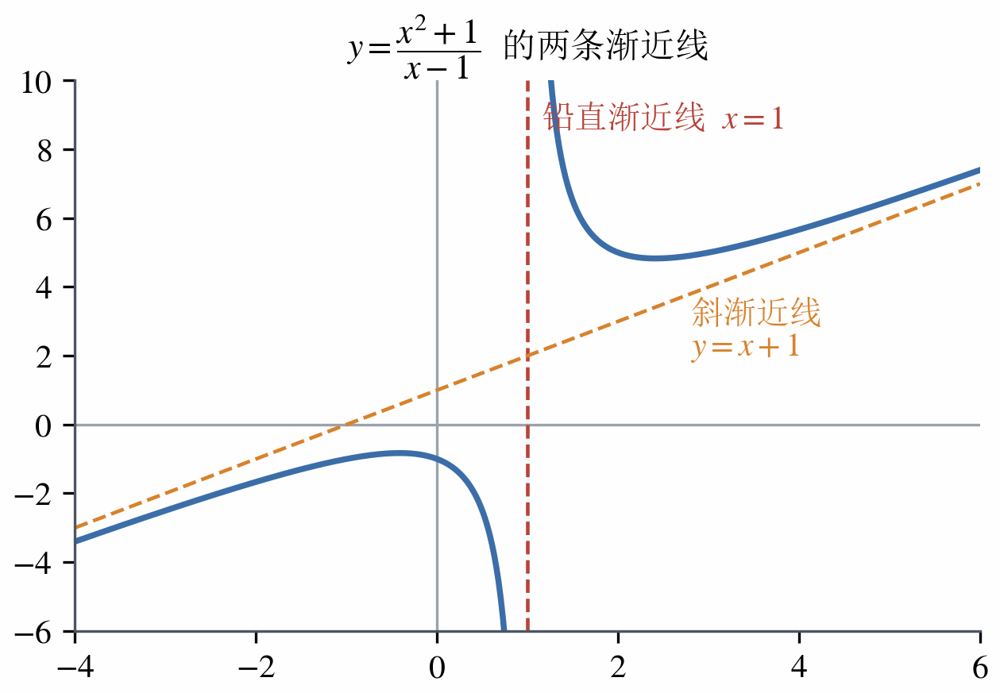

1. 垂直渐近线（вертикальная）：若在某点 \(a\) 处左极限或右极限中至少有一个为 \(\pm\infty\)，则直线 \(x=a\) 是垂直渐近线。应在分母为零的点和定义域的边界点处寻找，例如 \(\ln x\) 在 \(x=0\) 处。
2. 水平渐近线（горизонтальная）：若 \(\lim_{x\to+\infty}f(x)=b\) 或 \(\lim_{x\to-\infty}f(x)=b\)，\(b\) 为有限数，则直线 \(y=b\) 是水平渐近线。
3. 斜渐近线（наклонная）：直线 \(y=kx+b\)，其中

\[
k=\lim_{x\to\pm\infty}\frac{f(x)}x,\qquad b=\lim_{x\to\pm\infty}\bigl(f(x)-kx\bigr),
\]

要求 \(k\)、\(b\) 都存在且有限。\(k=0\) 时斜渐近线退化为水平渐近线。

斜渐近线公式的来历：若 \(f(x)-(kx+b)\to0\)，两边除以 \(x\) 得 \(\frac{f(x)}x-k-\frac bx\to0\)，而 \(\frac bx\to0\)，所以 \(k=\lim\frac{f(x)}x\)；知道 \(k\) 后，由原式直接得 \(b=\lim(f(x)-kx)\)。求渐近线的步骤是：

1. 求定义域，在间断点和定义域边界处求单侧极限，找出垂直渐近线。
2. 分别对 \(x\to+\infty\) 与 \(x\to-\infty\) 求 \(k\) 与 \(b\)，两个方向的结果可能不同，要分开计算。
3. 有理函数可用次数快速判断：分子次数不高于分母时有水平渐近线，分子次数恰好比分母高一次时有斜渐近线，高两次及以上时既无水平也无斜渐近线。

**讲解例：三类渐近线。**

1. \(f(x)=\dfrac{x-3}{x-1}\)。\(x\to1^-\) 时分子趋于 \(-2\)，分母是趋于零的负数，\(f(x)\to+\infty\)；\(x\to1^+\) 时 \(f(x)\to-\infty\)，所以 \(x=1\) 是垂直渐近线。又 \(\lim_{x\to\pm\infty}\dfrac{x-3}{x-1}=1\)，\(y=1\) 是水平渐近线。注意单侧记号写作 \(x\to1^-\)，不要写成上标在左边，否则容易误读为 \(x\to-1\)。
2. \(f(x)=\dfrac{x^2+1}x\)。\(x=0\) 是垂直渐近线。\(k=\lim\dfrac{x^2+1}{x^2}=1\)，\(b=\lim\Bigl(\dfrac{x^2+1}x-x\Bigr)=\lim\dfrac1x=0\)，斜渐近线为 \(y=x\)；两个方向结果相同。
3. \(f(x)=\dfrac1{x-2}\)。\(x=2\) 是垂直渐近线，\(x\to2^+\) 时趋于 \(+\infty\)，\(x\to2^-\) 时趋于 \(-\infty\)。求斜率时要除以 \(x\)：

\[
k=\lim_{x\to\infty}\frac{\;\dfrac1{x-2}\;}x=\lim_{x\to\infty}\frac1{x(x-2)}=0 ,
\]

而不是乘以 \(x\)；误算成 \(\dfrac x{x-2}\to1\) 就会得出错误的斜率 1。再求 \(b=\lim\dfrac1{x-2}=0\)，渐近线是 \(y=0\)，即水平渐近线，没有斜渐近线。这与次数判断一致：分子 0 次、分母 1 次。

### 2.4 洛必达法则

对 \(0/0\) 或 \(\infty/\infty\) 型的未定式，若 \(f\) 和 \(g\) 在 \(a\) 附近可导，\(g'\ne0\)，且 \(\lim f'/g'\) 存在（或为无穷），则

\[
\lim_{x\to a}\frac{f(x)}{g(x)}=\lim_{x\to a}\frac{f'(x)}{g'(x)} .
\]

注意是分子分母分别求导，而不是对整个分式用商的求导法则。它的道理可以从局部线性化理解：在 \(a\) 附近 \(f(x)\approx f'(a)(x-a)\)，\(g(x)\approx g'(a)(x-a)\)，比值约为 \(f'(a)/g'(a)\)。例如 \(\lim_{x\to0}(e^x-1-x)/x^2\) 是 \(0/0\) 型，求导一次得 \((e^x-1)/(2x)\)，仍是 \(0/0\) 型，再求导一次得 \(e^x/2\to1/2\)。

使用洛必达法则有三点要注意：

1. 每次使用前都要确认仍是 \(0/0\) 或 \(\infty/\infty\) 型，不是未定式时不能用。
2. 若 \(\lim f'/g'\) 不存在，不能推出原极限不存在，只说明这个方法失效。例如 \((x+\sin x)/x\) 在 \(x\to\infty\) 时极限为一，但求导后的 \((1+\cos x)/1\) 没有极限。
3. 其他未定式要先变形：\(0\cdot\infty\) 型写成分式；\(\infty-\infty\) 型通分；\(1^\infty\)、\(0^0\)、\(\infty^0\) 型先取对数，化为 \(0\cdot\infty\) 型。

求极限的一般步骤是：

1. 判断类型：直接代入，若得到确定的值（含无穷），就是答案。
2. 若是未定式，先做代数化简：因式分解、约分、有理化、通分。
3. 在乘除因子中用等价无穷小替换；涉及加减相消时改用泰勒展开到足够的阶。
4. 仍无法判断时，使用洛必达法则，每次使用前重新确认未定式类型。
5. 对含振荡因子的式子，考虑用夹逼定理。
6. 必要时分别求左右极限，比较是否相等。

### 2.5 连续性定理怎样帮助求解方程

介值定理保证：闭区间上的连续函数，能取到两个端点函数值之间的每一个值。特别地，若 \(f(a)f(b)<0\)（两端异号），则在 \(a\) 与 \(b\) 之间至少有一个零点，这称为零点定理。但它不保证零点唯一；要证明唯一性，还需要严格单调等额外条件。二分法正是反复保留两端异号的那一半区间，使区间长度不断减半，从而逼近零点。

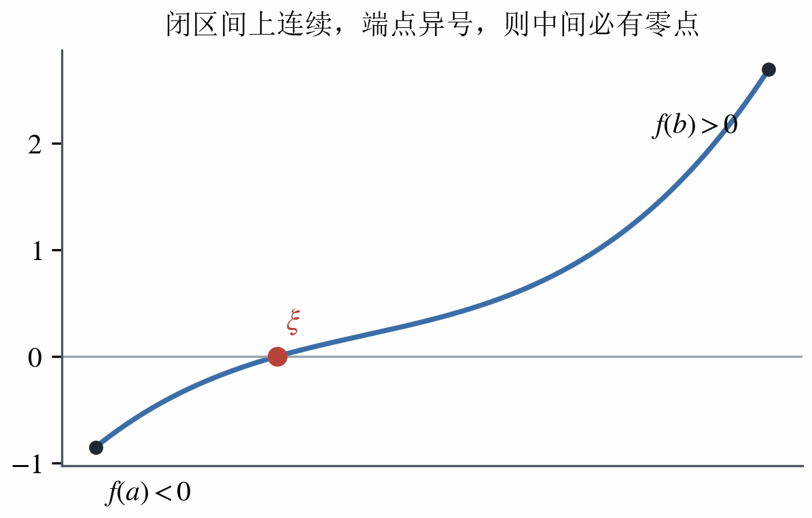

**例题：存在性与唯一性分开证明。** 对 \(f(x)=x^3+x-1\)，有 \(f(0)=-1\)、\(f(1)=1\)，由零点定理，零到一之间有根。导数 \(3x^2+1\) 处处为正，所以函数严格递增，最多只有一个根。两方面合起来，恰有一个根。若只知道两端异号，区间内可能有三个甚至更多个零点，不能把零点定理当作唯一性定理。数值逼近时，第一次取中点二分之一，函数值为 \(1/8+1/2-1=-3/8\)，为负，所以根在二分之一到一之间；再取四分之三，函数值为 \(27/64+3/4-1=11/64\)，为正，根缩小到二分之一到四分之三之间。每一步保留的都是一个确实包含根的区间。

## 第三章 导数、微分与局部线性化

### 3.1 从平均变化到瞬时变化

函数在点 \(x\) 的导数定义为

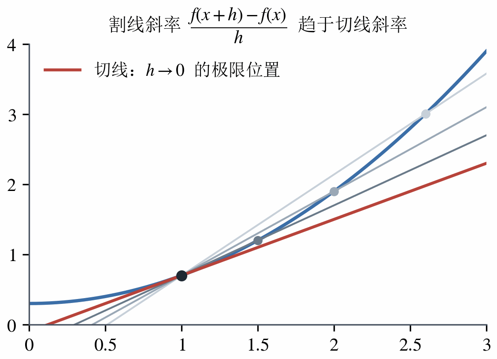

\[
f'(x)=\lim_{h\to0}\frac{f(x+h)-f(x)}h.
\]

分子除以 \(h\) 的差商，是函数在区间 \([x,x+h]\) 上的平均变化率；让 \(h\) 趋于零，若极限存在，就得到瞬时变化率。几何上，导数是曲线在该点切线的斜率；物理上，位移对时间的导数是速度。

可导一定连续，因为 \(f(x+h)-f(x)\) 可以写成差商乘以 \(h\)，差商趋于有限值而 \(h\) 趋于零，乘积趋于零。但连续不一定可导，例如 \(|x|\) 在零处连续，而左右两侧的斜率分别为负一和一，不相等，所以不可导，图像在那里有一个尖角。

**例4：从定义求平方函数导数。** 对 \(f(x)=x^2\)，有

\[
\frac{(x+h)^2-x^2}{h}=2x+h,\qquad h\ne0.
\]

令 \(h\to0\)，得到 \(f'(x)=2x\)。精确的增量为 \(\Delta f=2xh+h^2\)，其中 \(2xh\) 是关于 \(h\) 的线性部分，剩下的 \(h^2\) 与 \(h\) 相比趋于零。这就是微分表达式 \(df=f'(x)\,dx\) 的来源：微分是增量的线性主要部分，给出一阶近似，并不总等于有限的增量。由此得到常用的近似公式 \(f(x+h)\approx f(x)+f'(x)h\)，称为局部线性化。

### 3.2 运算法则与复合函数

乘积的求导法则可以这样推导：在 \(f(x+h)g(x+h)-f(x)g(x)\) 中加上再减去一个中间项 \(f(x+h)g(x)\)，把它分成 \(f(x+h)[g(x+h)-g(x)]\) 与 \(g(x)[f(x+h)-f(x)]\) 两部分，除以 \(h\) 后取极限，得到 \((fg)'=f'g+fg'\)。商的求导法则要求分母不为零；链式法则（复合函数求导）要求内外层函数在相应的点可导：

\[
\left(\frac fg\right)'=\frac{f'g-fg'}{g^2},\qquad
[f(g(x))]'=f'(g(x))g'(x).
\]

链式法则的含义是：外层对内层的变化率，乘以内层对 \(x\) 的变化率。复合多层时，就逐层相乘。

**例5：逐层求导。** 对 \(y=\ln(1+x^2)\)，外层是对数，内层是 \(1+x^2\)，所以 \(y'=\dfrac1{1+x^2}\cdot2x=\dfrac{2x}{1+x^2}\)。再用商的法则求二阶导数：\(y''=\dfrac{2(1+x^2)-2x\cdot2x}{(1+x^2)^2}=\dfrac{2(1-x^2)}{(1+x^2)^2}\)。若漏掉内层的导数 \(2x\)，会错误地得到零处斜率为一；而原函数是偶函数，图像关于 \(y\) 轴对称，零处斜率应为零，这可以用来检查结果。

**高阶导数与莱布尼茨公式。** 对导数再求导，得到二阶导数 \(f''\)，依此类推得到 \(n\) 阶导数 \(f^{(n)}\)。乘积的 \(n\) 阶导数有类似二项式展开的公式：

\[
(fg)^{(n)}=\sum_{k=0}^{n}\binom nk f^{(n-k)}g^{(k)} .
\]

例如 \((x^2e^x)^{(n)}=e^x\bigl(x^2+2nx+n(n-1)\bigr)\)，因为 \(x^2\) 求导三次后为零，和式中只剩前三项。几个常用的 \(n\) 阶导数是 \((e^{ax})^{(n)}=a^ne^{ax}\)、\((\sin x)^{(n)}=\sin(x+n\pi/2)\)、\((\cos x)^{(n)}=\cos(x+n\pi/2)\)。

**隐函数求导。** 若 \(y\) 由方程 \(F(x,y)=0\) 确定为 \(x\) 的函数，可以把 \(y\) 看成 \(x\) 的函数，对方程两边同时求导，再解出 \(y'\)。例如圆 \(x^2+y^2=R^2\) 上，在 \(y\ne0\) 的局部，求导得 \(2x+2yy'=0\)，故 \(y'=-x/y\)。在 \(y=0\) 处不能除以零，那里切线竖直，换成把 \(x\) 看作 \(y\) 的函数更合适。一般地，隐函数的导数为 \(y'=-F_x/F_y\)（\(F_y\ne0\)），见 7.3 节。

**参数方程求导。** 若曲线由 \(x=x(t)\)、\(y=y(t)\) 给出，在 \(x'(t)\ne0\) 处

\[
\frac{dy}{dx}=\frac{y'(t)}{x'(t)},\qquad
\frac{d^2y}{dx^2}=\frac{d}{dt}\!\left(\frac{dy}{dx}\right)\Big/\,x'(t) .
\]

第二式的分母容易遗漏：二阶导数是一阶导数对 \(x\) 的导数，而不是对 \(t\) 的导数。例如椭圆 \(x=a\cos t,\ y=b\sin t\)，\(dy/dx=b\cos t/(-a\sin t)=-\dfrac ba\cot t\)。

### 3.3 单调性、极值与凹凸

若在一个区间内 \(f'>0\)，函数在该区间递增；\(f'<0\) 则递减。在区间内部可导的极值点处必有 \(f'=0\)（费马定理），这样的点称为驻点。但导数为零不保证是极值点，例如 \(x^3\) 在零处导数为零，函数却一直递增地穿过原点。

判断驻点是否为极值点，有两种方法。第一判别法看导数在驻点两侧是否变号：左正右负为极大，左负右正为极小，不变号则不是极值。第二判别法看二阶导数：若 \(f'(a)=0\) 且 \(f''(a)>0\)，是局部极小；\(f''(a)<0\)，是局部极大；\(f''(a)=0\) 时无法判断，需要再分析。此外，导数不存在的点（如 \(|x|\) 在零处）也可能是极值点，不能遗漏。

**凹凸性与拐点。** 二阶导数描述曲线的弯曲方向。在区间内 \(f''>0\) 时，曲线向上弯（称为凹，下凸），切线位于曲线下方；\(f''<0\) 时向下弯（称为凸，上凸），切线位于曲线上方。曲线弯曲方向改变的点称为拐点，在拐点处 \(f''\) 变号。弯曲的程度用曲率衡量：

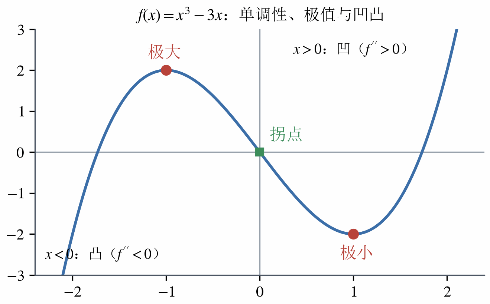

\[
\kappa=\frac{|y''|}{(1+y'^2)^{3/2}} ,
\]

它的倒数 \(1/\kappa\) 称为曲率半径，是在该点与曲线最贴合的圆的半径。例如半径为 \(R\) 的圆曲率处处为 \(1/R\)；抛物线 \(y=x^2\) 在顶点处 \(y'=0\)、\(y''=2\)，曲率为二，曲率半径为二分之一。

**例6：完整找闭区间上的最值。** 令 \(f(x)=x^3-3x\)，区间为 \([-2,2]\)。导数 \(3(x^2-1)\) 在 \(x=-1\) 和 \(x=1\) 处为零，在三个子区间上的符号依次为正、负、正。所以 \(-1\) 是局部极大点，\(1\) 是局部极小点。再计算端点和驻点处的函数值：\(f(-2)=-2\)、\(f(-1)=2\)、\(f(1)=-2\)、\(f(2)=2\)。因此全局最大值二在两个点取到，最小值负二也在两个点取到。只看驻点会漏掉同样取到最值的端点。

求闭区间 \([a,b]\) 上连续函数的最值，步骤是：

1. 求导数，找出区间内部所有驻点和导数不存在的点。
2. 计算这些点以及两个端点处的函数值。
3. 比较这些值，最大者为最大值，最小者为最小值。
4. 若区间是开的或无界的，还要考察端点附近的极限，判断最值能否取到。

### 3.4 中值定理连接局部斜率与整体变化

导数只描述一点附近的变化，而单调性涉及区间上任意两点之间的关系。把两者连接起来的是拉格朗日中值定理：若函数在闭区间 \([a,b]\) 上连续、在开区间 \((a,b)\) 内可导，则存在内部某点 \(c\)，使

\[
f(b)-f(a)=f'(c)(b-a).
\]

几何上，曲线上至少有一点的切线与连接两端点的弦平行。证明可以先研究端点等高的特殊情形，即罗尔定理：若 \(f(a)=f(b)\)，非恒定的连续函数必在区间内部取得一个高于或低于端点的极值，在那里可导就意味着导数为零。一般情形则把函数减去两端点的连线，得到一个端点等高的辅助函数，由罗尔定理推出中值定理。

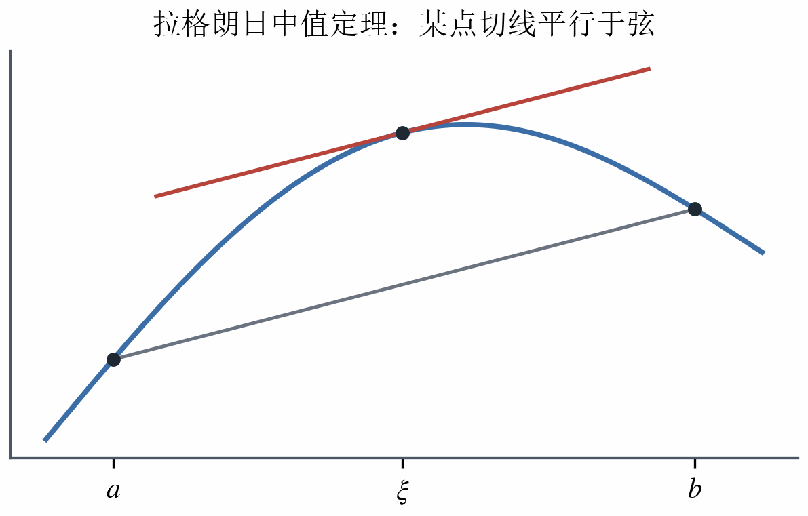

中值定理的一个推广是柯西中值定理：若 \(f,g\) 满足同样条件且 \(g'\ne0\)，则存在 \(c\) 使 \(\dfrac{f(b)-f(a)}{g(b)-g(a)}=\dfrac{f'(c)}{g'(c)}\)。2.4 节的洛必达法则正是由它证明的。

中值定理立即说明：若在一个区间内导数始终为正，任取 \(a<b\)，有 \(f(b)-f(a)=f'(c)(b-a)>0\)，所以函数严格递增；若导数始终为零，则任意两点函数值相同，函数为常数。这里必须是在一个区间上讨论。若定义域被分成互不相连的两段，即使每一点导数都为零，两段上的常数也可能不同。

**例题：误差上界来自导数控制。** 用 \(\sqrt4=2\) 估计 \(\sqrt{4.04}\)。在四到四点零四之间，平方根的导数为 \(1/(2\sqrt x)\)，不超过四分之一。由中值定理，函数的实际增量不超过 \(0.04\times\frac14=0.01\)，所以精确值在二到二点零一之间。线性近似给出二点零一；二阶导数为负，说明曲线向下弯，切线略高于曲线，近似值偏大。精确值约为二点零零九九七五，与理论预测的误差方向一致。这样的分析比只写一个近似数更能说明近似为何可靠。

### 3.5 反函数导数与对数求导

若 \(y=f(x)\) 在一点附近可逆且 \(f'(x)\ne0\)，由 \(f^{-1}(f(x))=x\) 两边求导，得到反函数的导数等于原函数导数的倒数：\((f^{-1})'(y)=1/f'(x)\)。非零的条件不能删去，否则反函数可能有竖直切线。例如 \(y=x^3\) 虽然可逆，但在零处导数为零，它的反函数 \(x^{1/3}\) 在零处没有有限的导数。

对 \(y=\arctan x\)，由 \(\tan y=x\) 两边对 \(x\) 求导，得 \((1+\tan^2y)y'=1\)，故 \(y'=1/(1+x^2)\)。这样就把反三角函数的导数化为已知的三角函数导数，它也给出了积分 \(\int dx/(1+x^2)\) 的原函数。

**例题：变量出现在指数中。** 对 \(y=x^x\)，按实函数的常用定义取 \(x>0\)，两边取对数得 \(\ln y=x\ln x\)。两边对 \(x\) 求导，得 \(y'/y=\ln x+1\)，所以 \(y'=x^x(\ln x+1)\)。不能把它当作指数固定的幂函数，写成 \(x\cdot x^{x-1}\)，因为指数本身也随 \(x\) 变化；也不能当作底数固定的指数函数。对数求导法的作用是把乘积、幂次和复合关系拆开，同时提醒我们需要保留正数的定义域。

### 3.6 最优化从模型到检验

最优化问题要先把目标量写成某个变量的函数，再确定变量的可行范围，然后求驻点、检查边界，最后判断是局部最优还是全局最优。求导只是其中的一步。若有长度必须为正、体积必须固定等限制条件，应当从一开始就写进可行范围，不能到最后才突然剔除不合条件的解。

**例题：固定周长的矩形面积。** 周长为 \(P>0\)，设一边长为 \(x\)，另一边为 \(P/2-x\)，可行范围是 \(0<x<P/2\)。面积 \(A(x)=x(P/2-x)=Px/2-x^2\)，导数 \(P/2-2x\) 在 \(x=P/4\) 处为零，二阶导数恒为负二。面积在该点左侧递增、右侧递减，最大值为 \(P^2/16\)，此时两边相等，最优形状是正方形。也可以配方直接验证全局最大：\(A=P^2/16-(x-P/4)^2\le P^2/16\)。导数法与代数法相互核对，而不是只因为导数为零就宣布取得最大值。

解最优化应用题的步骤是：

1. 明确要最大化或最小化的目标量，选定一个自变量，写出目标函数。
2. 用约束条件消去多余的变量，并写出自变量的可行范围。
3. 求驻点，并检查可行范围的端点或边界。
4. 用一阶或二阶判别法，或比较函数值，确定全局最优。
5. 回到实际问题检查答案的单位、符号和合理性。

### 3.7 基本导数与定义域

各种运算法则都需要以基本初等函数的导数为起点。在实数范围内，下面每个公式都应在函数有定义且可导的区间中使用：

\[
\begin{aligned}
(x^\alpha)'&=\alpha x^{\alpha-1} &&(x>0),\\
(e^x)'&=e^x,\qquad (a^x)'=a^x\ln a &&(a>0),\\
(\ln|x|)'&=1/x &&(x\ne0),\\
(\log_a x)'&=1/(x\ln a) &&(x>0,\ a>0,\ a\ne1),\\
(\sin x)'&=\cos x,\qquad(\cos x)'=-\sin x,\\
(\tan x)'&=1/\cos^2x &&(\cos x\ne0),\\
(\cot x)'&=-1/\sin^2x &&(\sin x\ne0),\\
(\arcsin x)'&=1/\sqrt{1-x^2} &&(|x|<1),\\
(\arccos x)'&=-1/\sqrt{1-x^2} &&(|x|<1),\\
(\arctan x)'&=1/(1+x^2).
\end{aligned}
\]

另外还有 \((\operatorname{arccot}x)'=-1/(1+x^2)\)，\((\sec x)'=\sec x\tan x\)，\((\csc x)'=-\csc x\cot x\)。

幂函数公式中的 \(x>0\) 是一般实数指数下的统一条件；整数幂或某些分数幂可以有更大的定义域，但零点处是否可导需要另行检查。例如 \(x^{1/3}\) 在负数上也有定义，但在零处没有有限的导数。所有三角函数的求导都以弧度为单位。

把基本公式与链式法则结合，可以一次得到一类函数的导数。例如在 \(u\ne0\) 的区间，\((\ln|u|)'=u'/u\)；在 \(|u|<1\) 时，\((\arcsin u)'=u'/\sqrt{1-u^2}\)。若 \(u=2x\)，则 \((\arcsin2x)'=2/\sqrt{1-4x^2}\)，定义域内部为 \(|x|<1/2\)。既不能遗漏分子上的二，也不能仍写成 \(|x|<1\)。

## 第四章 不定积分、定积分与累积

### 4.1 从有限累加到定积分

导数回答的是一个量在某时刻变化得多快；反过来，若已经知道变化率，自然要问：一段时间内这个量总共变化了多少。设流入容器的速率为 r(t)，单位为升每分钟。在很短的时间内，速率几乎不变，流入量近似等于“这一小段的速率乘以时间长度”。把这些小段的流入量加起来，就能估计总流入量。

把区间 \([a,b]\) 分成 n 段，每段长度 \(\Delta t=(b-a)/n\)，在第 i 段内任选一个时刻 \(\xi_i\)，得到累加式

\[
S_n=\sum_{i=1}^{n}r(\xi_i)\Delta t.
\]

每一项的单位都是升，而不是升每分钟。当分段不断细化，并且无论怎样选取各段内的点，累加式都趋于同一个数值时，这个数值就定义为定积分 \(\int_a^b r(t)\,dt\)。对连续函数，这个极限一定存在。积分记号中的 \(dt\) 记录被分割的自变量，上下限记录累加的范围。

取一个示范速率 \(r(t)=2t+1\)，在零到两分钟内累加。把区间等分，取各段右端点 \(t_i=2i/n\)，利用 \(1+2+\cdots+n=n(n+1)/2\)，得

\[
\begin{aligned}
S_n&=\sum_{i=1}^{n}\left(\frac{4i}{n}+1\right)\frac{2}{n}\\
&=\frac{8}{n^2}\frac{n(n+1)}2+2\\
&=6+\frac4n.
\end{aligned}
\]

当分段无限细化（\(n\to\infty\)）时，累加量趋于六升。取左端点会得到 \(6-4/n\)，两种近似从上下两个方向趋近同一个结果。这里的目的不是把 n 换成一个很大的具体数，而是弄清误差怎样随分段的细化而消失。对递增函数，取右端点的矩形面积偏大，取左端点偏小；若函数不单调，就需要逐段分析，不能沿用这个判断。

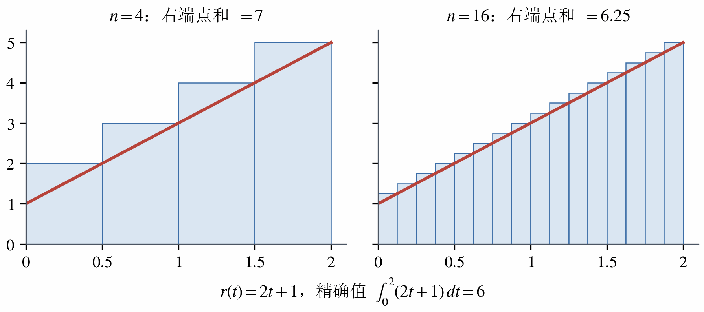

定积分允许被积函数取负值，负的贡献会从正的贡献中扣除。对速度积分得到的是位移，而不是路程。例如 \(v(t)=t-1\) 在零到两秒内，前一秒速度为负、后一秒为正，位移相互抵消，总位移为零。路程则要对速度的绝对值积分：

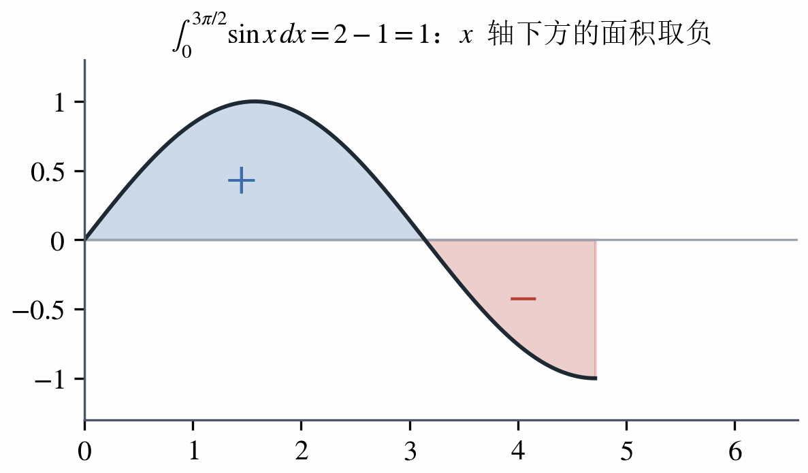

\[
\int_0^2|t-1|\,dt
=\int_0^1(1-t)\,dt+\int_1^2(t-1)\,dt=1.
\]

先找出被积函数变号的点，再分段积分，是把代数运算与几何累积联系起来的关键。同样，求两条曲线之间的面积，要用上方曲线减去下方曲线；若两条曲线在区间内交换上下位置，应先求出交点，再分段计算。

### 4.2 微积分基本定理的联系

对连续函数 f，定义累积函数（变上限积分）\(F(x)=\int_a^x f(t)\,dt\)。自变量增加 h 时，累积量只比原来多出一个宽为 h 的窄条：

\[
\frac{F(x+h)-F(x)}h
=\frac1h\int_x^{x+h}f(t)\,dt.
\]

右边是窄条上函数的平均高度。h 很小时，由连续性，窄条内的函数值都接近 f(x)，所以平均高度趋于 f(x)，即 \(F'(x)=f(x)\)。这就是微积分基本定理的第一部分：积分与求导互为逆运算。若上限是 \(x\) 的函数，由链式法则，

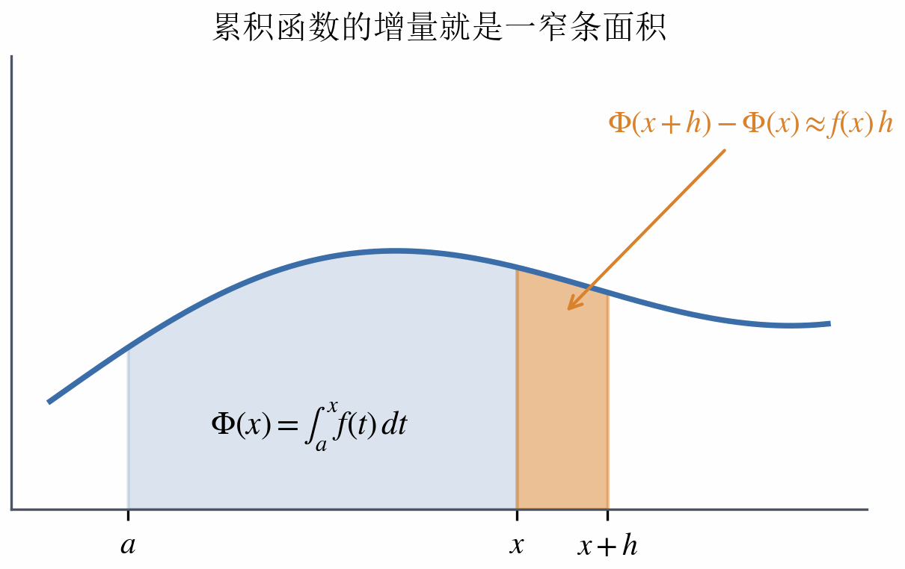

\[
\frac{d}{dx}\int_a^{g(x)}f(t)\,dt=f(g(x))\,g'(x) .
\]

基本定理的第二部分由此得到：若 G 是 f 的任一原函数（即 \(G'=f\)），则 F 与 G 的导数相同，两者只差一个常数；比较端点，得到牛顿—莱布尼茨公式 \(\int_a^b f(x)\,dx=G(b)-G(a)\)。它说明了为什么“先求原函数、再代入上下限相减”能够计算原本由极限定义的累加量。

例如上面的速率 \(2t+1\) 的一个原函数为 \(t^2+t\)，从零到两分钟的差为 \(6-0=6\)，恰好与累加极限的结果一致。原函数中的任意常数在上下限相减时抵消；但在不定积分中必须保留，因为所有相差常数的函数都有同一个导数。

### 4.3 积分计算中的结构选择

换元积分法的目的，不是让符号看起来简单，而是把复合函数的内层连同它的变化率一起换成新变量。计算 \(\int_0^1 2x e^{x^2}\,dx\) 时，令 \(u=x^2\)，则 du=2x dx，上下限同时变为零和一，所以结果为 \(\int_0^1e^u\,du=e-1\)。如果只把指数改成 u，却遗漏了 2x dx 与 du 的对应关系，就不是等价的变换。定积分换元时，上下限要随之改为新变量的值，这样就不必再换回原变量。

分部积分法来自乘积的求导法则 \((uv)'=u'v+uv'\)。两边积分并整理，得到 \(\int u\,dv=uv-\int v\,du\)。计算 \(\int_0^1xe^x\,dx\) 时，选 u=x、dv=e^x dx，求导使一次多项式的次数降低，结果为 \([xe^x]_0^1-\int_0^1e^x\,dx=e-(e-1)=1\)。如果选择反过来，新的积分反而更复杂，就应重新判断。选择 \(u\) 的一般经验是按“反三角函数、对数函数、幂函数、指数函数、三角函数”的顺序，排在前面的作为 \(u\)。

并不是所有原函数都能写成有限个初等函数的组合，例如 \(e^{-x^2}\) 的原函数。因此，会求积分并不意味着所有积分都必须化成初等表达式；可以借助定义、对称性、估计或数值方法。对积分区间无限或被积函数无界的积分，还要另外取极限检验是否收敛（见 4.8 节），不能把无穷符号当作普通的端点直接代入。

### 4.4 基本原函数与常数

求原函数可以逐项反查导数公式。在各自连续的区间内，有

\[
\begin{aligned}
\int x^\alpha\,dx&=\frac{x^{\alpha+1}}{\alpha+1}+C
 &&(\alpha\ne-1,\ x>0),\\
\int\frac{dx}{x}&=\ln|x|+C &&(x\ne0),\\
\int e^x\,dx&=e^x+C,\\
\int a^x\,dx&=\frac{a^x}{\ln a}+C
 &&(a>0,\ a\ne1),\\
\int\cos x\,dx&=\sin x+C,\qquad
\int\sin x\,dx=-\cos x+C,\\
\int\frac{dx}{\cos^2x}&=\tan x+C,\qquad
\int\frac{dx}{\sin^2x}=-\cot x+C,\\
\int\frac{dx}{1+x^2}&=\arctan x+C,\\
\int\frac{dx}{\sqrt{1-x^2}}&=\arcsin x+C &&(|x|<1).
\end{aligned}
\]

幂函数积分在更大实数定义域上的适用情况与求导相同；含三角函数分母的式子只能在避开零点的区间内使用。若被积函数的定义域不连通，各段上的原函数可以有不同的常数。例如 \(1/x\) 的定义域在正、负半轴之间断开，不能因为导数相同就要求两段的常数也相同。

带参数的公式，可以通过换元推导，而不要凭感觉猜分母。设 \(a>0\)，令 \(u=x/a\)，则 \(dx=a\,du\)，得

\[
\int\frac{dx}{a^2+x^2}
=\frac1a\arctan\frac xa+C.
\]

同理，\(\int dx/\sqrt{a^2-x^2}=\arcsin(x/a)+C\)，要求 \(|x|<a\)。两个公式中 a 的因子不同，是因为平方项和根号对缩放的反应不同。把结果求导，是最直接的检查方法。

基本积分表还应补充以下几个常用公式（\(a>0\)）：

\[
\begin{aligned}
\int\tan x\,dx&=-\ln|\cos x|+C,\qquad \int\cot x\,dx=\ln|\sin x|+C,\\
\int\frac{dx}{\cos x}&=\ln\left|\frac1{\cos x}+\tan x\right|+C,\\
\int\frac{dx}{x^2-a^2}&=\frac1{2a}\ln\left|\frac{x-a}{x+a}\right|+C,\\
\int\frac{dx}{\sqrt{x^2\pm a^2}}&=\ln\left|x+\sqrt{x^2\pm a^2}\right|+C,\\
\int\sqrt{a^2-x^2}\,dx&=\frac x2\sqrt{a^2-x^2}+\frac{a^2}2\arcsin\frac xa+C .
\end{aligned}
\]

第一式由 \(\tan x=\sin x/\cos x\) 换元 \(u=\cos x\) 得到；第四式先把被积函数拆成部分分式 \(\frac1{2a}\left(\frac1{x-a}-\frac1{x+a}\right)\)；最后一式可用三角换元 \(x=a\sin t\) 推出（见 4.6 节）。每个公式都可以用求导来验证。

### 4.5 三角结构、分部积分与递推

三角恒等式常常能把难求的积分变成基本形式。由倍角公式可以得到降幂公式：

\[
\sin^2x=\frac{1-\cos2x}{2},\qquad
\cos^2x=\frac{1+\cos2x}{2},\qquad
\sin x\cos x=\frac{\sin2x}{2}.
\]

所以 \(\int\sin^2x\,dx=x/2-\sin2x/4+C\)，而余弦平方的积分是 \(x/2+\sin2x/4+C\)。两式相加应为 x 加常数，这与 \(\sin^2x+\cos^2x=1\) 一致，可以作为检查。

由降幂公式还可以直接表示半角的正弦和余弦：

\[
\sin\frac x2=\pm\sqrt{\frac{1-\cos x}{2}},\qquad
\cos\frac x2=\pm\sqrt{\frac{1+\cos x}{2}}.
\]

正负号由 \(x/2\) 所在的象限决定，不能因为来自平方关系就擅自取正号。在分母有定义时，还可以写 \(\tan(x/2)=\sin x/(1+\cos x)=(1-\cos x)/\sin x\)；两种分式在不同的点可能失去定义，遇到零分母时应换用另一种有定义的形式，或者取极限。

分部积分可以继续推导出一族递推关系。记 \(I_n=\int x^ne^x\,dx\)（n 为正整数），取 \(u=x^n,\ dv=e^x dx\)，得到

\[
I_n=x^ne^x-nI_{n-1},\qquad I_0=e^x+C.
\]

每用一次，次数降低一，最终回到基本积分。例如

\[
\int x^2e^x dx=e^x(x^2-2x+2)+C.
\]

检验：对右边求导，\(e^x(x^2-2x+2)+e^x(2x-2)=x^2e^x\)，括号自身的导数恰好补回 \(2x-2\)，消去中间各项。递推式描述的是原函数族之间的关系，任意常数只需在最后的结果中统一保留一个。

正弦和余弦的高次幂在零到 \(\pi/2\) 上的积分也有递推关系。记 \(J_n=\int_0^{\pi/2}\sin^nx\,dx\)，分部积分可得 \(J_n=\frac{n-1}nJ_{n-2}\)，由 \(J_0=\pi/2\)、\(J_1=1\) 出发，得到沃利斯公式：

\[
\int_0^{\pi/2}\sin^nx\,dx=\int_0^{\pi/2}\cos^nx\,dx=
\begin{cases}
\dfrac{(n-1)!!}{n!!}\cdot\dfrac\pi2,& n\ \text{为偶数},\\[2mm]
\dfrac{(n-1)!!}{n!!},& n\ \text{为奇数}.
\end{cases}
\]

其中 \(n!!\) 表示与 \(n\) 同奇偶的正整数的连乘，如 \(5!!=5\cdot3\cdot1\)。例如 \(\int_0^{\pi/2}\sin^4x\,dx=\frac34\cdot\frac12\cdot\frac\pi2=\frac{3\pi}{16}\)。

### 4.6 有理函数与三角换元

**有理函数的积分。** 两个多项式之比称为有理函数，它的积分总可以化为初等函数。步骤是：

1. 若分子次数不低于分母，先做多项式除法，化为多项式加真分式（分子次数低于分母）。
2. 把分母分解为一次因式和不可约二次因式的乘积。
3. 把真分式拆成部分分式：每个一次因式 \((x-a)\) 对应 \(\frac A{x-a}\)；重因式 \((x-a)^k\) 对应 \(\frac{A_1}{x-a}+\cdots+\frac{A_k}{(x-a)^k}\)；不可约二次因式对应 \(\frac{Bx+C}{x^2+px+q}\)。
4. 用比较系数或代入特殊值求出待定系数。
5. 逐项积分：一次因式给出对数，二次因式配方后给出对数与反正切。

例如 \(\dfrac{1}{x^2-3x+2}=\dfrac1{(x-1)(x-2)}=\dfrac{A}{x-1}+\dfrac{B}{x-2}\)。两边乘以 \((x-1)(x-2)\)，得 \(1=A(x-2)+B(x-1)\)；令 \(x=1\) 得 \(A=-1\)，令 \(x=2\) 得 \(B=1\)。所以

\[
\int\frac{dx}{x^2-3x+2}=\ln|x-2|-\ln|x-1|+C=\ln\left|\frac{x-2}{x-1}\right|+C .
\]

**三角换元。** 被积函数含有二次根式时，可以用三角换元把根号去掉，依据是 \(1-\sin^2t=\cos^2t\)、\(1+\tan^2t=\sec^2t\)：

1. 含 \(\sqrt{a^2-x^2}\)：令 \(x=a\sin t\)，则 \(\sqrt{a^2-x^2}=a\cos t\)（\(|t|\le\pi/2\)）。
2. 含 \(\sqrt{a^2+x^2}\)：令 \(x=a\tan t\)，则 \(\sqrt{a^2+x^2}=a\sec t\)。
3. 含 \(\sqrt{x^2-a^2}\)：令 \(x=a\sec t\)，则 \(\sqrt{x^2-a^2}=a|\tan t|\)。

换元后求出关于 \(t\) 的积分，再借助直角三角形把 \(t\) 的三角函数换回 \(x\)。例如 \(\int_0^a\sqrt{a^2-x^2}\,dx\)，令 \(x=a\sin t\)，\(t\) 从零到 \(\pi/2\)，积分变为 \(a^2\int_0^{\pi/2}\cos^2t\,dt=\pi a^2/4\)，正是四分之一圆的面积。

**万能代换。** 对三角函数的有理式，可以令 \(t=\tan(\theta/2)\)，这时 \(\sin\theta=2t/(1+t^2)\)、\(\cos\theta=(1-t^2)/(1+t^2)\)、\(d\theta=2dt/(1+t^2)\)，积分化为 \(t\) 的有理函数。这组关系只在代换有定义的区间内使用，跨过 \(\theta=\pi\) 等奇点时必须分段，不能把这个局部参数当作覆盖整个圆的单一坐标。另外，半角公式 \(1-\cos\theta=2\sin^2(\theta/2)\) 常可用来消除分子分母中的相消。

### 4.7 定积分的性质与应用

**基本性质。** 定积分对被积函数是线性的，对区间是可加的：

\[
\int_a^b[\alpha f+\beta g]\,dx=\alpha\int_a^bf\,dx+\beta\int_a^bg\,dx,\qquad
\int_a^bf\,dx=\int_a^cf\,dx+\int_c^bf\,dx .
\]

此外，交换上下限积分变号；若在区间上 \(f\le g\)，则积分也满足 \(\int_a^bf\le\int_a^bg\)；由此有 \(\left|\int_a^bf\,dx\right|\le\int_a^b|f|\,dx\)。积分中值定理指出：若 \(f\) 在 \([a,b]\) 上连续，存在 \(\xi\) 使 \(\int_a^bf\,dx=f(\xi)(b-a)\)，即曲线下的面积等于以某个函数值为高的矩形面积，\(f(\xi)\) 称为函数在区间上的平均值。

**对称性。** 在关于原点对称的区间上，奇函数的积分为零，偶函数的积分是半区间的两倍：

\[
\int_{-a}^af(x)\,dx=
\begin{cases}0,& f\ \text{为奇函数},\\ 2\int_0^af(x)\,dx,& f\ \text{为偶函数}.\end{cases}
\]

周期为 \(T\) 的函数在任何长度为 \(T\) 的区间上积分都相等。例如 \(\int_{-1}^1x^3\cos x\,dx=0\)，不必计算。

**几何与物理应用。** 定积分的应用都遵循同一个思路：把所求的量分成许多小份，写出一小份的近似值（称为微元），再积分。常用的公式有：

\[
\begin{aligned}
&\text{两曲线间的面积}\quad && S=\int_a^b\bigl[f(x)-g(x)\bigr]dx\quad(f\ge g),\\
&\text{绕 }x\text{ 轴旋转体体积}\quad && V=\pi\int_a^b f(x)^2\,dx,\\
&\text{绕 }y\text{ 轴旋转体体积(柱壳法)}\quad && V=2\pi\int_a^b x\,f(x)\,dx\quad(a\ge0),\\
&\text{曲线弧长}\quad && s=\int_a^b\sqrt{1+f'(x)^2}\,dx,\\
&\text{函数平均值}\quad && \bar f=\frac1{b-a}\int_a^bf(x)\,dx .
\end{aligned}
\]

旋转体体积的微元是半径为 \(f(x)\)、厚度为 \(dx\) 的薄圆片，体积为 \(\pi f(x)^2dx\)；弧长的微元由勾股定理 \(ds=\sqrt{dx^2+dy^2}\) 得到。例如把 \(y=\sqrt x\)（\(0\le x\le1\)）绕 \(x\) 轴旋转，体积为 \(\pi\int_0^1x\,dx=\pi/2\)。半径为 \(R\) 的球可以看作半圆 \(y=\sqrt{R^2-x^2}\) 绕 \(x\) 轴旋转，体积为 \(\pi\int_{-R}^R(R^2-x^2)\,dx=\frac43\pi R^3\)。

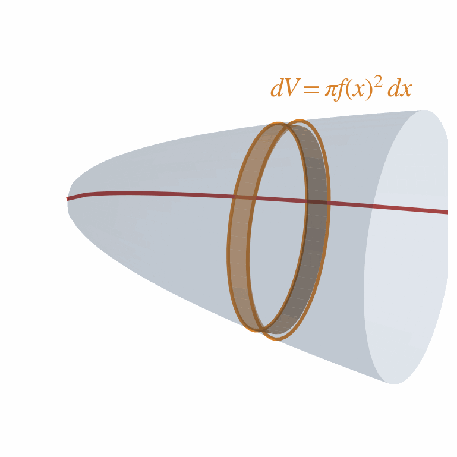

**变力做功。** 弹簧的弹力 \(F=-kx\)，从 \(x_1\) 到 \(x_2\) 做的功为

\[
W=\int_{x_1}^{x_2}-kx\,dx=-\frac{k}{2}(x_2^2-x_1^2).
\]

不能把变力取某个端点的值再乘以整个位移，除非明确是在做近似。力对位移积分得到功，力矩对时间积分得到角动量的变化，力矩对转角积分得到转动中的功。被积函数形式相似时，积分变量和单位能够区分它们。

### 4.8 反常积分

积分区间无限，或被积函数在区间内无界的积分，称为反常积分（广义积分）。它们要用极限来定义：

\[
\int_a^{\infty}f(x)\,dx=\lim_{b\to\infty}\int_a^bf(x)\,dx,\qquad
\int_0^1f(x)\,dx=\lim_{\varepsilon\to0^+}\int_\varepsilon^1f(x)\,dx\quad(f\ \text{在 }0\ \text{附近无界}).
\]

极限存在且有限时称积分收敛，否则发散。最重要的基准是 \(1/x^p\)：

\[
\int_1^\infty\frac{dx}{x^p}\ \text{在}\ p>1\ \text{时收敛,\ 等于}\ \frac1{p-1};\qquad
\int_0^1\frac{dx}{x^p}\ \text{在}\ p<1\ \text{时收敛,\ 等于}\ \frac1{1-p}.
\]

两者的条件恰好相反：在无穷远处，函数要衰减得足够快（\(p>1\)）面积才有限；在零附近，函数要增长得不太快（\(p<1\)）面积才有限。\(p=1\) 时两者都发散，因为原函数是 \(\ln x\)。判断其他反常积分时，常与这个基准比较：若 \(0\le f\le g\) 且 \(\int g\) 收敛，则 \(\int f\) 收敛。例如 \(\int_1^\infty\frac{dx}{x^2+1}\le\int_1^\infty\frac{dx}{x^2}\)，所以收敛（实际值为 \(\pi/4\)）。

## 第五章 数列与无穷级数

### 5.1 级数收敛是部分和收敛

对无穷级数 \(\sum_{n=1}^{\infty}a_n\)，先定义前 \(N\) 项的部分和 \(S_N=\sum_{n=1}^Na_n\)。只有当部分和数列 \(S_N\) 收敛到一个有限值时，才说级数收敛，这个值就是级数的和。由 \(a_N=S_N-S_{N-1}\) 可知，级数收敛时必有通项 \(a_N\to0\)。但反过来不成立：通项趋于零的级数可能发散，因为许多很小的项仍可能累积成无界的和。所以“通项趋于零”只是收敛的必要条件，常用于判断发散：通项不趋于零，级数一定发散。

**例3：调和级数与几何级数。** 调和级数 \(\sum1/n\) 的各项趋于零，但把它分组：

\[
1+\frac12+\left(\frac13+\frac14\right)
+\left(\frac15+\cdots+\frac18\right)+\cdots.
\]

从 \(2^{k-1}+1\) 到 \(2^k\) 的一组共有 \(2^{k-1}\) 项，每一项都至少为 \(1/2^k\)，所以每组的和至少为二分之一。组数可以无限多，部分和无界，因此调和级数发散。

几何级数的有限和 \(S_N=1+q+\cdots+q^N\)，乘以 \(q\) 后相减，得 \(S_N-qS_N=1-q^{N+1}\)。若 \(|q|<1\)，\(q^{N+1}\to0\)，所以和为 \(1/(1-q)\)。若 \(q=1\)，部分和线性增长；\(q=-1\) 时部分和在零和一之间来回；\(|q|>1\) 时通项甚至不趋于零。这些情况下级数都不收敛。

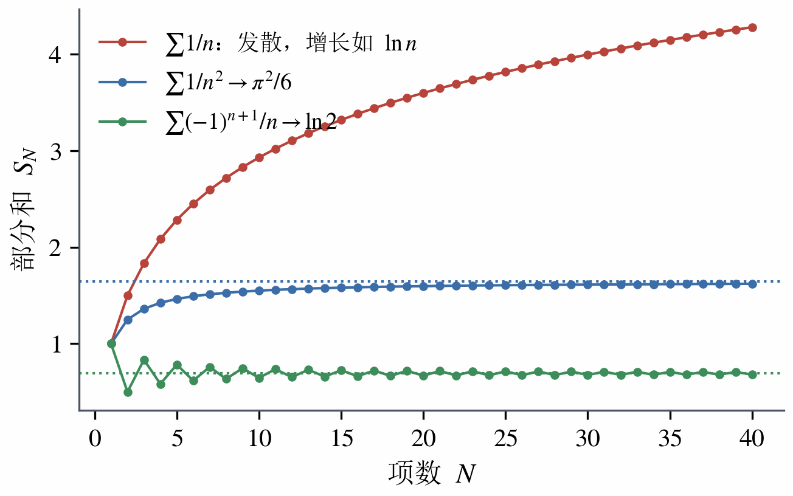

### 5.2 正项级数的判别法

对各项非负的正项级数，部分和单调递增，所以只要部分和有上界，级数就收敛。由此得到比较判别法：若 \(0\le a_n\le b_n\)，且 \(\sum b_n\) 收敛，则 \(\sum a_n\) 收敛；反之若 \(\sum a_n\) 发散，则 \(\sum b_n\) 发散。常用的比较基准是 p 级数 \(\sum1/n^p\)：它在 \(p>1\) 时收敛，\(p\le1\) 时发散。这个结论可以由积分判别法得到：\(x^{-p}\) 在正半轴上递减，把级数各项看作宽为一的矩形面积，与曲线下的面积比较，级数与反常积分 \(\int_1^\infty x^{-p}dx\) 同时收敛或发散（见 4.8 节）。

例如 \(1/(n^2+n)\le1/n^2\)，所以 \(\sum1/(n^2+n)\) 收敛。还可以把它拆成 \(1/n-1/(n+1)\)，部分和中间各项相消，等于 \(1-1/(N+1)\)，极限恰为一。

比较时，比较的极限形式往往更方便：若 \(a_n,b_n>0\) 且 \(\lim a_n/b_n=c\)，\(0<c<\infty\)，则两个级数同时收敛或同时发散。例如 \(\sum\frac{1}{n^2-n+5}\) 与 \(\sum\frac1{n^2}\) 的比值趋于一，所以收敛。

**比值判别法与根值判别法。** 设 \(\lim|a_{n+1}/a_n|=q\) 或 \(\lim\sqrt[n]{|a_n|}=q\)。若 \(q<1\)，级数绝对收敛；若 \(q>1\)，级数发散；若 \(q=1\)，判别法失效，不能作结论。例如 \(1/n\) 与 \(1/n^2\) 的比值极限都是一，结局却一个发散、一个收敛。比值判别法适用于含阶乘和指数的项，如 \(\sum n!/n^n\)：比值为 \((n/(n+1))^n\to1/e<1\)，所以收敛。根值判别法适用于含 \(n\) 次幂的项，如 \(\sum(n/(2n+1))^n\)：\(n\) 次根趋于 \(1/2<1\)，所以收敛。

判断级数敛散性的一般顺序是：

1. 检查通项是否趋于零；不趋于零则发散。
2. 若是几何级数或 p 级数，直接用已知结论。
3. 正项级数：含阶乘、指数时用比值判别法；含 \(n\) 次幂时用根值判别法；通项是代数式时，与 p 级数作比较或用比较的极限形式。
4. 交错级数：先看绝对值级数是否收敛；若不收敛，再用莱布尼茨判别法判断是否条件收敛。
5. 能拆项相消或求出部分和时，直接求部分和的极限。

### 5.3 交错级数、绝对收敛与端点

若 \(b_n\ge0\) 从某项起单调递减且趋于零，则交错级数 \(\sum(-1)^{n-1}b_n\) 收敛，这称为莱布尼茨判别法；并且只取前 N 项时，余下部分的绝对值不超过下一项 \(b_{N+1}\)。理由是相邻的正负项互相抵消，偶数项部分和与奇数项部分和分别从两侧夹逼同一个极限。若只知道各项符号交替，却没有“趋于零且递减”的条件，不能直接使用这个判别法。

\(\sum(-1)^{n-1}/n\) 收敛，但它的绝对值级数 \(\sum1/n\) 发散，这种情况称为条件收敛；\(\sum(-1)^{n-1}/n^2\) 的绝对值级数也收敛，称为绝对收敛。绝对收敛的级数可以任意改变各项的次序而和不变；条件收敛的级数则不能随意调换无穷多项的次序，否则和可能改变。

幂级数 \(\sum c_n(x-a)^n\) 是否收敛，随 x 的取值而变。存在一个收敛半径 \(R\)：当 \(|x-a|<R\) 时绝对收敛，当 \(|x-a|>R\) 时发散；R 可以为零，也可以为无穷大。收敛半径常用比值法求出：若 \(\lim|c_{n+1}/c_n|=\rho\)，则 \(R=1/\rho\)。在 \(|x-a|=R\) 的两个端点，必须逐个代回原级数检查。例如

\[
\sum_{n=1}^{\infty}\frac{x^n}{n}
\]

的比值极限为 \(|x|\)，所以收敛半径为一。\(x=1\) 时为发散的调和级数，\(x=-1\) 时为收敛的交错调和级数，所以收敛区间为 \([-1,1)\)。在收敛区间内部可以逐项求导或逐项积分，收敛半径不变，但端点的收敛性要重新检验。这个讲法的次序参照了 [OpenStax《微积分》第二卷 6.1](https://openstax.org/books/calculus-volume-2/pages/6-1-power-series-and-functions) 与 [6.2](https://openstax.org/books/calculus-volume-2/pages/6-2-properties-of-power-series)，例子在本册中独立展开。

## 第六章 泰勒公式与高阶极限

### 6.1 阶数来自误差要求

导数给出的是一阶近似，用一条直线逼近函数。若需要更高的精度，可以用多项式来逼近：在 \(a\) 附近，足够光滑的函数可以写成

\[
f(a+h)=\sum_{k=0}^{m}\frac{f^{(k)}(a)}{k!}h^k+o(h^m).
\]

多项式的系数这样选取，是为了让多项式在 \(a\) 点的各阶导数（直到 \(m\) 阶）都与函数相同。记号 \(o(h^m)\) 表示一个比 \(h^m\) 更高阶的小量，即 \(o(h^m)/h^m\to0\)。另一个记号 \(O(h^m)\) 只保证它的绝对值不超过常数乘以 \(|h|^m\)，除以 \(h^m\) 后不一定趋于零。例如计算分母为四阶无穷小的极限时，必须知道分子展开中的四阶系数，并把余项控制为比四阶更高的阶。

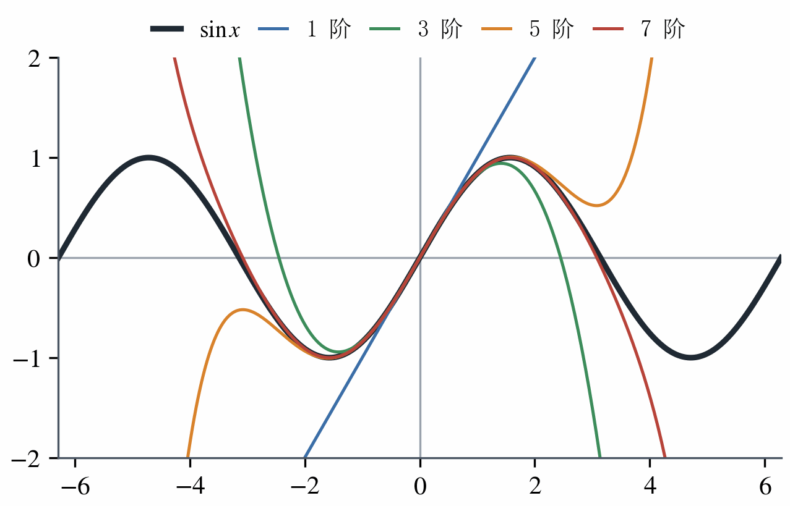

在零点附近（\(a=0\)，这时称为麦克劳林公式）常用的展开有

\[
e^x=1+x+\frac{x^2}{2}+\frac{x^3}{6}+O(x^4),
\]

\[
\sin x=x-\frac{x^3}{6}+O(x^5),\quad
\cos x=1-\frac{x^2}{2}+\frac{x^4}{24}+O(x^6),
\]

\[
\ln(1+x)=x-\frac{x^2}{2}+\frac{x^3}{3}-\frac{x^4}{4}+O(x^5).
\]

三角函数的展开以弧度为单位。若自变量用角度，导数和展开系数都要乘上相应的单位换算因子。2.3 节的等价无穷小都可以从这些展开的第一项读出。

### 6.2 等价替换与相消

\(f\sim g\) 表示两者之比趋于一。在乘除结构中，若各个表达式都有定义，通常可以用等价量替换。但在加减结构中，最低阶的项可能相互抵消，这时替换会出错。例如 \(\sin x\sim x\)，但不能因此把 \(\sin x-x\) 直接替换成零；实际上 \(\sin x-x\) 的第一个非零项是 \(-x^3/6\)，所以 \((\sin x-x)/x^3\to-1/6\)。规则是：加减运算中出现相消时，要用泰勒展开到第一个不被抵消的阶数。

**例7：复合对数的四阶展开。** 令

\[
L=\lim_{x\to0}\frac{\ln(1+x+x^2)-x-ax^2-bx^3}{x^4}.
\]

在零附近，对数的真数为正。设 \(u=x+x^2\)，则

\[
u^2=x^2+2x^3+x^4,
\quad u^3=x^3+3x^4+O(x^5),
\quad u^4=x^4+O(x^5).
\]

代入 \(\ln(1+u)=u-u^2/2+u^3/3-u^4/4+O(u^5)\)，按 \(x\) 的次数整理系数：一次项为一；二次项为 \(1-1/2=1/2\)；三次项为 \(-1+1/3=-2/3\)；四次项为 \(-1/2+1-1/4=1/4\)。所以

\[
\ln(1+x+x^2)=x+\frac12x^2-\frac23x^3+\frac14x^4+O(x^5).
\]

要使极限有限，分子中二次和三次项必须被消去，所以 \(a=1/2\)、\(b=-2/3\)，此时 \(L=1/4\)。展开到几阶由分母的阶数和相消的程度决定，不能一律只保留前两项。

### 6.3 从有限展开到误差与常用函数族

有限阶的泰勒公式只描述点附近的误差，并不自动保证无穷项的泰勒级数等于原函数。在具有足够阶连续导数、且下一阶导数有界的区间中，拉格朗日余项给出误差的具体大小：

\[
R_m(x)=\frac{f^{(m+1)}(\xi)}{(m+1)!}(x-a)^{m+1},
\qquad
|R_m(x)|\le\frac{M|x-a|^{m+1}}{(m+1)!},
\]

其中 \(\xi\) 在 a 与 x 之间，M 是这一段上第 \(m+1\) 阶导数绝对值的上界。例如用 \(1+x+x^2/2\) 估计 \(e^{0.1}\)，取 \(M=e^{0.1}<1.106\)，误差小于 \(1.106\times(0.1)^3/6<0.000185\)。只说“后面都是高阶项”并没有给出这样的数值保证。

除了指数、正弦、余弦和对数的展开，另外几组常用的展开是

\[
\begin{aligned}
\frac1{1-x}&=1+x+x^2+x^3+O(x^4),\\
(1+x)^\alpha
&=1+\alpha x+\frac{\alpha(\alpha-1)}2x^2
+\frac{\alpha(\alpha-1)(\alpha-2)}6x^3+O(x^4),\\
\arctan x&=x-\frac{x^3}{3}+\frac{x^5}{5}+O(x^7).
\end{aligned}
\]

这些都是 \(x\to0\) 时的局部展开；一般实数指数的第二式在零附近要求 \(1+x>0\)。例如 \(\alpha=1/2\) 得到平方根的展开 \(\sqrt{1+x}=1+x/2-x^2/8+\cdots\)，\(\alpha=-1\) 得到 \(1/(1+x)\) 的交错幂级数。把自变量换成 u 时，必须同时检查 \(u\to0\) 和需要保留的阶数。若 \(u=x^2\)，u 的三次就是 x 的六次，不能仍按三阶处理。

把这些展开写成无穷级数，并标出它们等于原函数的范围：

\[
\begin{aligned}
e^x&=\sum_{n=0}^\infty\frac{x^n}{n!},\quad \sin x=\sum_{n=0}^\infty\frac{(-1)^nx^{2n+1}}{(2n+1)!},\quad \cos x=\sum_{n=0}^\infty\frac{(-1)^nx^{2n}}{(2n)!}\quad(x\in\mathbb R),\\
\frac1{1-x}&=\sum_{n=0}^\infty x^n,\quad \ln(1+x)=\sum_{n=1}^\infty\frac{(-1)^{n-1}x^n}{n}\quad(\text{前者 }|x|<1,\ \text{后者 }-1<x\le1).
\end{aligned}
\]

由第二行的对数级数取 \(x=1\)，得到 \(1-\frac12+\frac13-\cdots=\ln2\)，这正是 5.3 节的交错调和级数的和。

## 第七章 多元微分、梯度与总导数

### 7.1 偏导与可微

多元函数 \(U(x,y,z)\) 依赖几个变量。偏导数 \(U_x\)（也写作 \(\partial U/\partial x\)）是固定其余变量、只让 \(x\) 变化时的变化率，计算时把其他变量当作常数。可微则要求更强的条件：总的增量存在一个统一的一阶线性近似

\[
\Delta U=U_x\Delta x+U_y\Delta y+U_z\Delta z+o(|\Delta r|).
\]

线性部分称为全微分，记作 \(dU=U_x\,dx+U_y\,dy+U_z\,dz\)，可以用来做近似计算和误差估计。仅仅各个偏导数存在，并不能保证可微；偏导数在附近连续，是可微的一个常用充分条件。若二阶混合偏导数连续，它们与求导次序无关：\(U_{xy}=U_{yx}\)。

梯度把各个偏导数组成一个向量 \(\nabla U=(U_x,U_y,U_z)\)，而不是把三个数直接相加。沿单位方向 \(e\) 的方向导数，在可微的条件下等于 \(\nabla U\cdot e\)。由点积的性质，方向导数在梯度方向上取得最大值 \(|\nabla U|\)，在相反方向上取得最小值 \(-|\nabla U|\)。所以梯度指向函数增长最快的方向。在等值面（\(U\) 取常数的曲面）上沿切向移动时，函数值不变，切向的方向导数为零，因此梯度垂直于等值面；但在梯度为零的点，不能据此确定唯一的法方向。

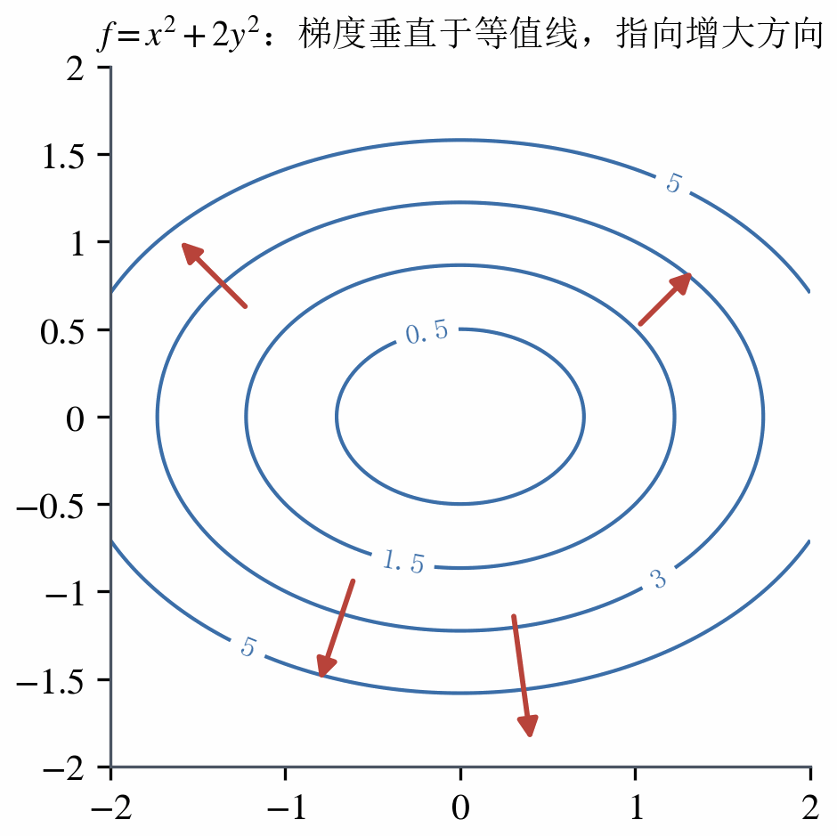

**例10：沿轨迹的变化率。** 对 \(U=x^2+2y^2+3z^2\)，在点 \((1,1,1)\) 处梯度为 \((2x,4y,6z)=(2,4,6)\)。若运动速度为 \(v=(5,0,0)\)，由链式法则，\(dU/dt=\nabla U\cdot v=10\)；若速度改为 \((0,5,0)\)，结果为二十。梯度相同，实际的变化率仍随运动方向而变。

### 7.2 多元复合函数的链式法则

若 \(z=f(u,v)\)，而 \(u,v\) 又都是 \(x,y\) 的函数，则

\[
\frac{\partial z}{\partial x}=\frac{\partial f}{\partial u}\frac{\partial u}{\partial x}+\frac{\partial f}{\partial v}\frac{\partial v}{\partial x},\qquad
\frac{\partial z}{\partial y}=\frac{\partial f}{\partial u}\frac{\partial u}{\partial y}+\frac{\partial f}{\partial v}\frac{\partial v}{\partial y}.
\]

记忆方法是：从 \(z\) 到 \(x\) 的每一条路径（\(z\to u\to x\) 和 \(z\to v\to x\)）贡献一项，各项是沿路径的偏导数之积，再把各路径相加。

若 \(U=U(r,t)\) 除了通过位置 \(r\) 依赖时间外，还直接含有时间，则沿运动轨迹的变化率为

\[
\frac{dU}{dt}=\frac{\partial U}{\partial t}+\nabla U\cdot\dot r.
\]

第一项是在固定位置观察到的、场本身随时间的变化；第二项是因为位置在移动、采样到不同点的数值而产生的变化。例如 \(U(x,t)=tx^2\)，沿轨迹 \(x=t\) 运动，直接代入得 \(U=t^3\)，导数为 \(3t^2\)。按链式法则，\(U_t=x^2=t^2\)，\(U_x\dot x=2tx\cdot1=2t^2\)，两项相加为 \(3t^2\)，结果一致。只算偏导数会遗漏位置移动带来的变化；而把所有偏导数直接相加，又会遗漏各变量自身的变化率。

### 7.3 隐函数的导数

若方程 \(F(x,y)=0\) 在某点附近确定了 \(y\) 是 \(x\) 的函数，对方程沿这条曲线求全导数，得 \(F_x+F_y\,y'=0\)，所以

\[
\frac{dy}{dx}=-\frac{F_x}{F_y}\qquad(F_y\ne0).
\]

条件 \(F_y\ne0\) 是隐函数存在定理的核心：它保证在该点附近，方程确实能唯一确定一个可导的函数 \(y(x)\)。三个变量的方程 \(F(x,y,z)=0\) 确定 \(z(x,y)\) 时，类似地有 \(z_x=-F_x/F_z\)、\(z_y=-F_y/F_z\)。例如圆 \(F=x^2+y^2-R^2\)，\(y'=-2x/(2y)=-x/y\)，与 3.2 节的结果一致。

### 7.4 多元函数的极值

二元函数 \(f(x,y)\) 在可微的极值点处，两个偏导数都为零：\(f_x=f_y=0\)，这样的点称为驻点。判断驻点的类型，要看二阶偏导数。记 \(A=f_{xx}\)、\(B=f_{xy}\)、\(C=f_{yy}\)（在驻点处取值），则

\[
AC-B^2>0,\ A>0\ \Rightarrow\ \text{极小};\qquad AC-B^2>0,\ A<0\ \Rightarrow\ \text{极大};\qquad AC-B^2<0\ \Rightarrow\ \text{鞍点}.
\]

\(AC-B^2=0\) 时需要另外分析。这个判别式正是二阶偏导数组成的对称矩阵（黑塞矩阵）的行列式，与《线性代数》中二次型正定的顺序主子式判别法完全一致。例如 \(f=x^2+xy+y^2-3x\)：由 \(f_x=2x+y-3=0\)、\(f_y=x+2y=0\) 解得驻点 \((2,-1)\)；\(A=2,B=1,C=2\)，\(AC-B^2=3>0\) 且 \(A>0\)，所以是极小点，极小值为 \(f(2,-1)=4-2+1-6=-3\)。

**条件极值与拉格朗日乘数法。** 在约束 \(g(x,y)=0\) 下求 \(f(x,y)\) 的极值，可以构造拉格朗日函数 \(\mathcal L=f-\lambda g\)，令它对各变量的偏导数都为零：

\[
f_x=\lambda g_x,\qquad f_y=\lambda g_y,\qquad g(x,y)=0 .
\]

前两式的几何意义是 \(\nabla f\parallel\nabla g\)：在约束曲线上的极值点处，\(f\) 的等值线与约束曲线相切。如果两者不相切，沿约束曲线移动还能使 \(f\) 继续增大或减小。例如在周长约束 \(x+y=P/2\) 下最大化矩形面积 \(f=xy\)：\(y=\lambda\)、\(x=\lambda\)，所以 \(x=y=P/4\)，与 3.6 节的结论一致。

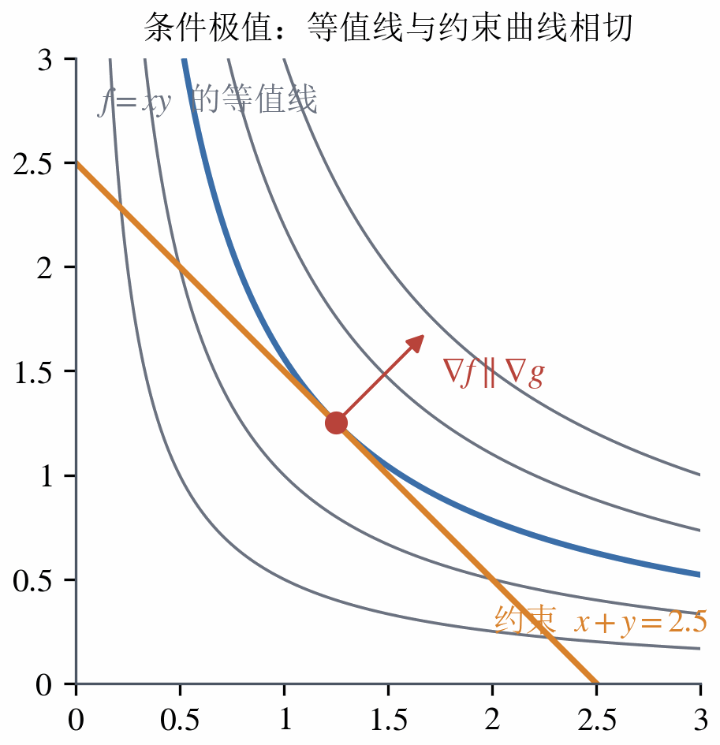

求多元函数极值的步骤是：

1. 无约束时，解方程组 \(f_x=0,\ f_y=0\) 求出驻点。
2. 对每个驻点计算 \(A,B,C\)，用判别式判断是极大、极小还是鞍点。
3. 有约束时，用拉格朗日乘数法列出方程组，求出可能的极值点。
4. 在有界闭区域上求最值时，还要比较边界上的极值，取全部候选点中的最大和最小者。

## 第八章 一阶微分方程

### 8.1 可分离方程与初值

微分方程是含有未知函数及其导数的方程，未知量是一个函数，而不是一个数。方程中出现的最高阶导数的阶数，称为方程的阶。初始条件给出未知函数（或它的导数）在某一点的值，用来从无穷多个解中选出一个。

形如 \(y'=g(t)h(y)\) 的方程称为可分离变量方程。在 \(h(y)\ne0\) 的区间内，把含 \(y\) 的部分移到一边、含 \(t\) 的部分移到另一边，两边积分得 \(\int dy/h(y)=\int g(t)dt+C\)。但要注意，除以 \(h(y)\) 时已经假定它不为零；使 \(h(y)=0\) 的常数函数 \(y=y_0\) 也是方程的解（称为平衡解），必须另行检查，否则会漏解。

例如 \(y'=y\)：在 \(y\ne0\) 时分离变量积分，得 \(\ln|y|=t+C\)，整理为 \(y=Ke^t\)（\(K=\pm e^C\ne0\)）。补上 \(K=0\)，才把零解 \(y=0\) 也包括进来。给定 \(y(0)=3\)，得 \(K=3\)。初始条件是从函数族中选出一条曲线，不能省去常数而声称得到了全部解。

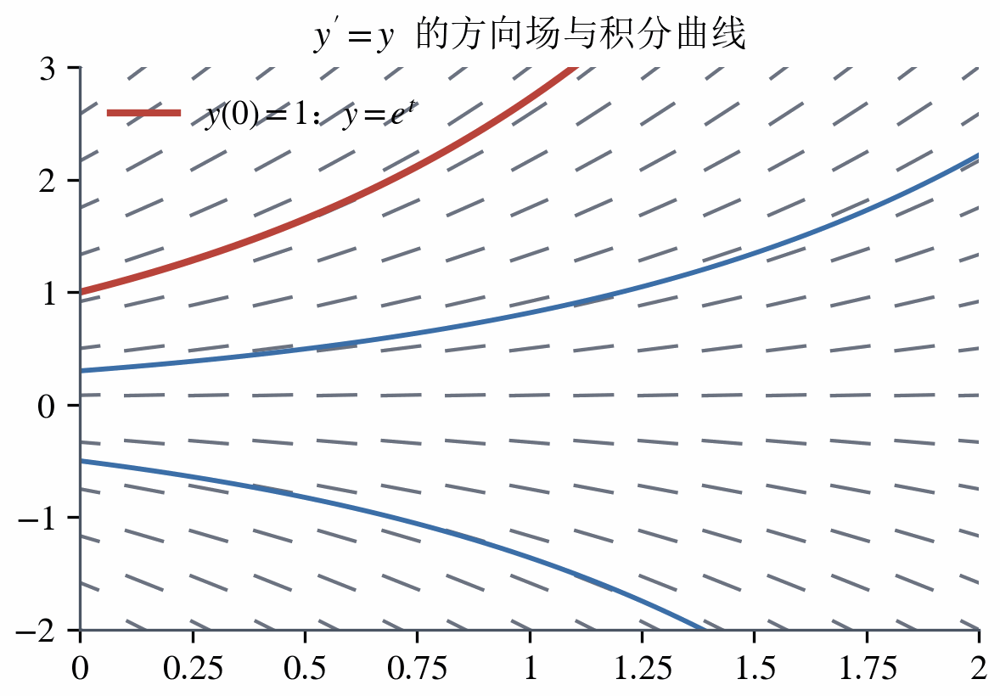

**齐次方程。** 形如 \(y'=f(y/x)\) 的方程（右边只依赖 \(y/x\)），令 \(u=y/x\)，则 \(y=xu\)、\(y'=u+xu'\)，方程化为 \(xu'=f(u)-u\)，这是关于 \(u\) 的可分离方程。例如 \(y'=1+y/x\)：令 \(u=y/x\)，得 \(xu'=1\)，\(u=\ln|x|+C\)，所以 \(y=x(\ln|x|+C)\)。

### 8.2 线性方程的积分因子

形如 \(y'+a(t)y=b(t)\) 的方程称为一阶线性方程，因为 \(y\) 和 \(y'\) 都以一次方出现。在系数连续的区间内，取积分因子

\[
\mu(t)=e^{\int a(t)dt}.
\]

因为 \(\mu'=a\mu\)，方程两边乘以 \(\mu\) 后，左边恰好成为乘积的导数：\(\mu y'+a\mu y=(\mu y)'\)。于是 \((\mu y)'=\mu b\)，两边积分得

\[
y=\frac{\int\mu b\,dt+C}{\mu}.
\]

用于初值问题时，更方便的写法是

\[
y(t)=e^{-\int_{t_0}^{t}a(s)ds}
\left[y_0+\int_{t_0}^{t}e^{\int_{t_0}^{\tau}a(s)ds}b(\tau)d\tau\right].
\]

**例11：含非恒定输入的初值问题。** 解 \(y'+2y=4t\)、\(y(0)=1\)。可以用积分因子，也可以先猜特解：设 \(y_p=At+B\)，代入得 \(A+2(At+B)=4t\)，即 \(2At+(A+2B)=4t\)，比较系数得 \(A=2,B=-1\)。对应齐次方程 \(y'+2y=0\) 的解为 \(Ce^{-2t}\)，所以通解为 \(y=2t-1+Ce^{-2t}\)。由初值 \(y(0)=-1+C=1\) 得 \(C=2\)，最终 \(y=2t-1+2e^{-2t}\)。检验：\(y'=2-4e^{-2t}\)，\(y'+2y=2-4e^{-2t}+4t-2+4e^{-2t}=4t\)，且 \(y(0)=1\)，两个条件都满足。

**伯努利方程。** 形如 \(y'+a(t)y=b(t)y^n\)（\(n\ne0,1\)）的方程不是线性的，但令 \(z=y^{1-n}\)，则 \(z'=(1-n)y^{-n}y'\)，方程两边乘以 \((1-n)y^{-n}\)，化为关于 \(z\) 的线性方程 \(z'+(1-n)a(t)z=(1-n)b(t)\)，再用积分因子求解。

**例：** 解 \(y'+y=y^2\)。这里 \(n=2\)，令 \(z=y^{-1}\)，方程化为 \(z'-z=-1\)，解得 \(z=1+Ce^t\)，所以 \(y=1/(1+Ce^t)\)。另外 \(y=0\) 也是解（在两边乘以 \(y^{-2}\) 时被除掉了）。

解一阶微分方程，先判断类型：

1. 能写成 \(y'=g(t)h(y)\)：可分离变量，并检查平衡解。
2. 右边只依赖 \(y/x\)：齐次方程，令 \(u=y/x\)。
3. 形如 \(y'+a(t)y=b(t)\)：线性方程，用积分因子。
4. 形如 \(y'+a(t)y=b(t)y^n\)：伯努利方程，令 \(z=y^{1-n}\) 化为线性方程。
5. 求出通解后，代入初始条件确定常数，并把解代回原方程检验。

### 8.3 RC 电路的暂态与稳态

串联 RC 电路中，电容上的电荷 \(q\) 满足 \(Rq'+q/C=E(t)\)，其中电流是 \(q'\)，\(E(t)\) 是电源电压。设 \(R,C>0\)，令 \(a=1/(RC)\)（\(RC\) 称为时间常数），电源为正弦电压 \(E_0\sin\omega t\)，方程化为

\[
q'+aq=b\sin\omega t,\qquad b=E_0/R.
\]

由于输入是正弦函数，猜测特解也是同频率的正弦与余弦的组合：设 \(q_p=A\sin\omega t+B\cos\omega t\)。代入后分别比较 \(\sin\omega t\) 和 \(\cos\omega t\) 的系数，得 \(aA-\omega B=b\)、\(\omega A+aB=0\)，解得

\[
q_p=\frac{b}{a^2+\omega^2}(a\sin\omega t-\omega\cos\omega t),
\quad q=Ke^{-at}+q_p.
\]

若 \(q(0)=q_0\)，代入得 \(K=q_0+b\omega/(a^2+\omega^2)\)。解由两部分组成：指数项随时间衰减，反映初始状态的影响，称为暂态；周期项是持续的输入留下的响应，称为稳态。经过几个时间常数后，只剩稳态部分。“特解加齐次通解”能给出全部解，是因为任意两个非齐次方程的解之差满足齐次方程；这依赖于方程的线性，不能推广到一般的非线性方程。

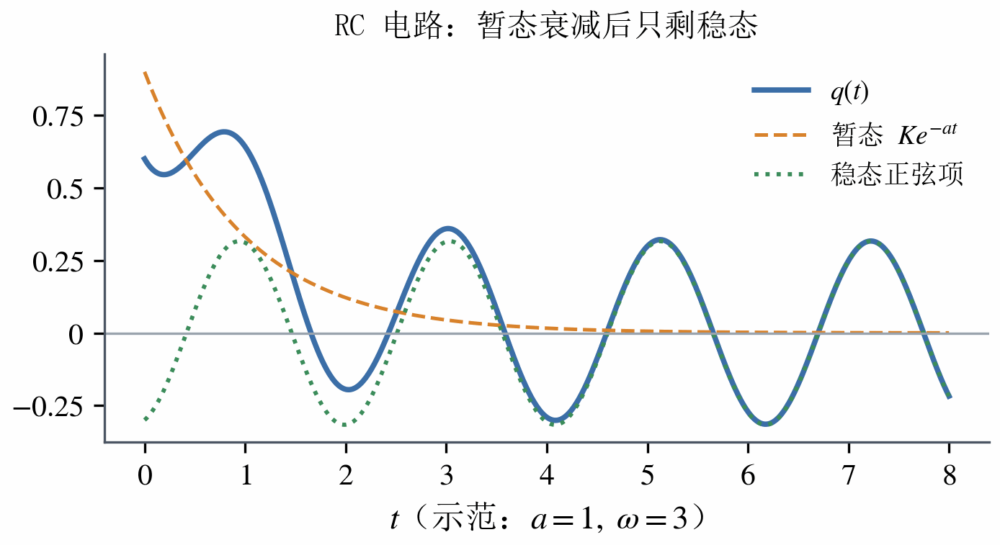

## 第九章 二阶线性方程与小振动

### 9.1 常系数齐次方程

对常系数齐次方程 \(y''+py'+qy=0\)，猜测解的形式为 \(e^{rt}\)。代入后，每一项都含有因子 \(e^{rt}\)，约去得到特征方程 \(r^2+pr+q=0\)。根据特征根的情况，通解有三种形式：

\[
\begin{aligned}
&\text{两个不同实根 }r_1\ne r_2:&& y=C_1e^{r_1t}+C_2e^{r_2t},\\
&\text{重根 }r:&& y=(C_1+C_2t)e^{rt},\\
&\text{共轭复根 }\alpha\pm i\beta:&& y=e^{\alpha t}(C_1\cos\beta t+C_2\sin\beta t).
\end{aligned}
\]

重根时只有一个指数解，第二个独立解是 \(te^{rt}\)，可以代入验证。复根时，由欧拉公式 \(e^{i\beta t}=\cos\beta t+i\sin\beta t\)，复指数解的实部与虚部分别给出两个实数解。二阶方程的通解含两个任意常数，通常需要两个独立的初始条件（如 \(y(0)\) 和 \(y'(0)\)）才能确定。

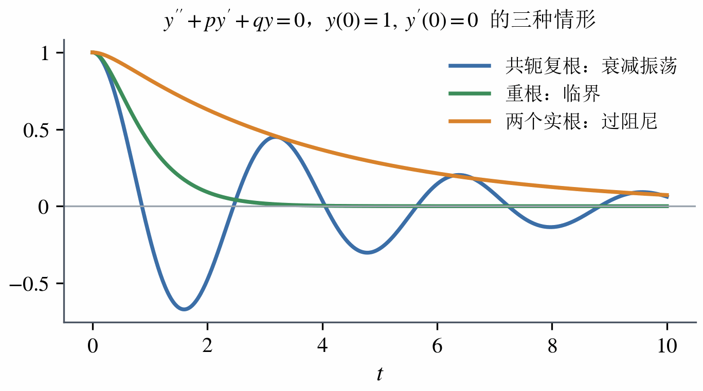

**例12：阻尼振动的初始条件。** 解 \(y''+2y'+5y=0\)、\(y(0)=1\)、\(y'(0)=0\)。特征方程 \(r^2+2r+5=0\) 的根为 \(r=-1\pm2i\)，所以 \(y=e^{-t}(A\cos2t+B\sin2t)\)。由 \(y(0)=1\) 得 \(A=1\)；求导后令 \(t=0\)，得 \(y'(0)=-A+2B=0\)，所以 \(B=1/2\)。于是 \(y=e^{-t}(\cos2t+\tfrac12\sin2t)\)。振幅按指数包络 \(e^{-t}\) 衰减，振荡的角频率为二。不能把无阻尼时的角频率 \(\sqrt5\) 当作实际的阻尼振荡频率。

### 9.2 常系数非齐次方程

对非齐次方程 \(y''+py'+qy=f(t)\)，通解等于对应齐次方程的通解加上一个特解。当右边 \(f(t)\) 是多项式、指数函数、正弦余弦或它们的乘积时，可以用待定系数法猜出特解的形式：

1. \(f(t)=P_m(t)e^{\lambda t}\)（\(P_m\) 是 \(m\) 次多项式）：设特解 \(y_p=t^kQ_m(t)e^{\lambda t}\)，\(Q_m\) 是待定系数的 \(m\) 次多项式。
2. \(f(t)=e^{\alpha t}(P\cos\beta t+Q\sin\beta t)\)：设特解 \(y_p=t^ke^{\alpha t}(A\cos\beta t+B\sin\beta t)\)，即使 \(f\) 中只有正弦或只有余弦，也要两项都设。
3. 指数 \(k\) 等于 \(\lambda\)（或 \(\alpha+i\beta\)）作为特征根的重数：不是特征根时 \(k=0\)，是单根时 \(k=1\)，是重根时 \(k=2\)。

第 3 条是关键。若外加输入的形式恰好是齐次方程的解，按普通形式设出的特解代入后左边为零，无法与右边匹配，必须乘以 \(t\)。物理上，这对应共振：用系统的固有频率去驱动无阻尼系统，振幅随时间线性增长。

**例：共振。** 解 \(y''+y=\sin t\)。特征根为 \(\pm i\)，而 \(\sin t\) 对应 \(\alpha+i\beta=i\) 正是单根，所以设 \(y_p=t(A\cos t+B\sin t)\)。代入计算得 \(y_p''+y_p=-2A\sin t+2B\cos t\)，与 \(\sin t\) 比较得 \(A=-1/2\)、\(B=0\)。特解为 \(y_p=-\frac t2\cos t\)，振幅随 \(t\) 线性增长。通解为 \(y=C_1\cos t+C_2\sin t-\frac t2\cos t\)。

解二阶常系数线性方程的步骤是：

1. 写出特征方程，求特征根，写出齐次方程的通解。
2. 若方程非齐次，按右边的形式设出特解，注意与特征根比较确定 \(t^k\) 的因子。
3. 把特解代入方程，比较系数，求出待定系数。
4. 写出通解 = 齐次通解 + 特解。
5. 由两个初始条件确定两个常数，并把结果代回原方程检验。

### 9.3 平衡点附近的小振动

势能的平衡点附近也会出现这类方程。若 \(U'(x_0)=0\)、\(U''(x_0)>0\)，令 \(\xi=x-x_0\) 表示偏离平衡位置的位移，泰勒展开给出 \(U\approx U(x_0)+U''(x_0)\xi^2/2\)，即平衡点附近的势能近似为抛物线。由牛顿第二定律 \(m\xi''=-U'\)，得 \(\xi''+\omega_0^2\xi=0\)，其中 \(\omega_0^2=U''(x_0)/m\)。这是简谐振动方程，解为正弦振荡。例如弹簧势能 \(U=kx^2/2\)，得到 \(\omega_0=\sqrt{k/m}\)。若 \(U''(x_0)<0\)，平衡点是不稳定的，偏离会指数增长。若二阶导数为零，二阶近似失去判断能力：\(x^4\) 在零处取最小值、是稳定的，\(-x^4\) 在零处取最大值、是不稳定的，不能用同一个“二阶导数为零”的结论概括两者。

## 第十章 变分与欧拉—拉格朗日方程

### 10.1 从变量变化到函数变化

普通函数把一个数映为一个数；泛函则把一整条函数曲线映为一个数，例如

\[
J[y]=\int_{t_1}^{t_2}F(t,y,y')dt.
\]

曲线的长度、物体运动的作用量都是这样的泛函。变分法研究哪条曲线使泛函取得极值，相当于把“求函数的极值点”推广为“求泛函的极值曲线”。

比较一条曲线 \(y\) 与它附近的曲线 \(y_\varepsilon=y+\varepsilon\eta\)，其中 \(\eta\) 是任意的扰动函数，\(\varepsilon\) 是一个小参数。在固定的区间上，把 \(dJ[y_\varepsilon]/d\varepsilon\) 在 \(\varepsilon=0\) 处的值定义为一阶变分，它相当于普通函数的导数。对足够光滑的函数，展开并交换求导与积分的次序，得到

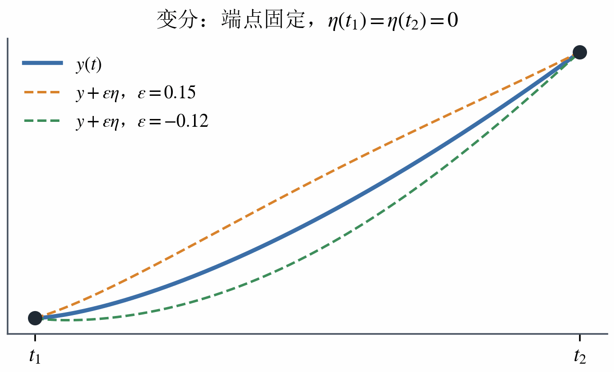

\[
\delta J=\int_{t_1}^{t_2}(F_y\eta+F_{y'}\eta')dt
=[F_{y'}\eta]_{t_1}^{t_2}
+\int_{t_1}^{t_2}\left(F_y-\frac{d}{dt}F_{y'}\right)\eta dt.
\]

第二个等号用了分部积分，目的是把 \(\eta'\) 变成 \(\eta\)，这样被积式中只剩一个任意函数 \(\eta\)，它的系数才能单独判定。若端点固定，则 \(\eta(t_1)=\eta(t_2)=0\)，边界项为零。要使 \(\delta J=0\) 对一切 \(\eta\) 成立，括号中的式子必须恒为零，于是使泛函取驻值的曲线满足欧拉—拉格朗日方程

\[
\frac{d}{dt}F_{y'}-F_y=0.
\]

当 \(F\) 不显含 \(t\) 时，方程有一个首次积分（别尔特拉米恒等式）：\(F-y'F_{y'}=\text{常数}\)，它把二阶方程降为一阶，在求最速降线、悬链线等问题时很有用。

### 10.2 端点条件与驻值的含义

若端点的时间固定，但末端的函数值可以自由变化，则 \(\eta(t_2)\) 可以任意取值，边界项为零就要求 \(F_{y'}(t_2)=0\)，这称为自然边界条件。若端点的时间也可以变化，就必须连同积分区间的变化一起计算，不能继续沿用这个简单的形式。对拉格朗日量 \(L\)，沿满足运动方程的曲线，移动端点时边界变分可以写成 \([p\,\delta q-H\,\delta t]\)，其中 \(p=L_{\dot q}\) 是广义动量，\(H=p\dot q-L\) 是能量函数。这里的 \(\delta q\) 是端点位置的总变化，要与固定时刻下曲线本身的变化区分开。

**例13：完整比较驻值和最小值。** 对 \(J[y]=\tfrac12\int_0^1(y')^2dt\)，固定 \(y(0)=0,y(1)=1\)。这里 \(F=\frac12(y')^2\)，\(F_y=0\)，\(F_{y'}=y'\)，欧拉—拉格朗日方程为 \(y''=0\)，结合端点条件得 \(y=t\)。这只是驻值曲线，还需要检查它是否真的最小。任取端点相同的曲线 \(y=t+\eta\)（\(\eta(0)=\eta(1)=0\)），则

\[
J[t+\eta]=\frac12\int_0^1(1+2\eta'+(\eta')^2)dt
=\frac12+\frac12\int_0^1(\eta')^2dt\ge\frac12.
\]

中间的线性项积分为 \(\eta(1)-\eta(0)=0\)，所以这个驻值确实是全局最小值。对一般的泛函，这一步的非负性不一定成立，欧拉—拉格朗日方程只是取极值的必要条件，不是充分条件。

在端点时间和端点位置都固定的力学问题中，给拉格朗日量 \(L\) 加上一个全导数 \(dG(q,t)/dt\)，作用量只增加 \(G\) 在两个端点的差值，这是一个常数，所以变分不变，运动方程也不变。但若端点是自由的，这个端点差可能影响自然边界条件。因此“可以删去全导数项”有明确的前提条件，不能理解为在任何场合都可以任意删项。

## 来源与范围

本册的实际课程依据为《求极限》《线代与微积分练习》《解释梯度概念》《正切半角公式》《翻译数学模型内容》以及变分、势能和电路相关的可读会话。first CC 现有清单中没有独立的数学分析教材；费曼讲义和朗道《力学》在本册中用于提供物理应用的背景，不表示已通读这些数学原著。另核对了 OpenStax Calculus Volume 1 第一章的函数先修结构，以及 5.1 节从有限分割累加到面积近似的展开顺序（https://openstax.org/books/calculus-volume-1/pages/1-introduction 与 https://openstax.org/books/calculus-volume-1/pages/5-1-approximating-areas）。这里只借鉴了教学顺序，正文和例题都是独立编写的。本册的数学推导按课程主题和连续的学科结构展开；为保证知识体系完整而补充的内容包括极限定义、重要极限与等价无穷小、洛必达法则、导数应用与凹凸性、积分方法与积分表、有理函数积分、定积分的性质与应用、反常积分、级数判别法、多元函数极值与拉格朗日乘数法、伯努利方程和二阶非齐次方程等。

俄语术语包括 предел（极限）、производная（导数）、интеграл（积分）、градиент（梯度）、дифференциальное уравнение（微分方程）。本册为继续学习物理与控制提供所需的基础，没有把多重积分、完整的向量分析、偏微分方程或严格的变分法当作已经覆盖的内容。
