# 大学物理

运动、守恒与刚体的数学描述

## 1. 运动的描述与理想化

一颗球从桌边滚落，可以先求球心的轨迹，也可以研究它在桌面上的滚动，还可以研究落地时的变形。这三个问题研究同一物体，却需要不同模型。求球心轨迹时，球的尺寸可以略去；研究滚动时，半径和质量分布必须保留；研究碰撞力时，又不能把接触过程完全压缩为一个瞬间。模型不是对物体永久不变的分类，而是为回答具体问题保留必要的性质。

质点的位置由参考系中的位置矢量 \(\mathbf r(t)\) 描述，速度和加速度定义为

\[
\mathbf v=\frac{d\mathbf r}{dt},\qquad \mathbf a=\frac{d\mathbf v}{dt}.
\]

速度是矢量，速率 \(v=|\mathbf v|\) 是非负标量。坐标速度可以为负，负号只表示沿所选轴的反方向运动。一个瞬间速度为零，不能推出加速度为零。例如竖直上抛的最高点，位置变化率为零，重力仍在改变速度。

本册采用国际单位制。长度、质量、时间分别用米、千克、秒；角度默认用弧度。以地面为原点、向上为正，忽略阻力的竖直抛运动满足

\[
\ddot y=-g,\qquad \dot y=v_0-gt,\qquad y=h_0+v_0t-\frac12gt^2.
\]

当 \(h_0=5\,\mathrm m\)、\(v_0=0\)、\(g=9.8\,\mathrm{m/s^2}\) 时，落地条件是 \(y=0\)，所以 \(t_f=\sqrt{2h_0/g}\approx1.01\,\mathrm s\)，落地坐标速度为 \(-\sqrt{2gh_0}\approx-9.90\,\mathrm{m/s}\)。若改取向下为正，初始坐标、速度分量与重力分量必须一起转换，不能只删去方程中的一个负号。

加速度不是常量而依赖速度时，要从定义 \(a=dv/dt\) 分离变量。**讲解例：与速度平方成正比的阻力。** 质点沿 \(x\) 轴以初速 \(v_0>0\) 从原点出发，加速度 \(a_x=-kv^2\)（\(k>0\)），求 \(v(t)\) 与 \(x(t)\)。由 \(dv/dt=-kv^2\) 得 \(dv/v^2=-k\,dt\)，从 \(0\) 积到 \(t\)：
\[
\frac1v-\frac1{v_0}=kt,\qquad v(t)=\frac{v_0}{1+kv_0t}.
\]
再积分一次，令 \(u=1+kv_0t\)，\(du=kv_0\,dt\)，上下限由 \(1\) 到 \(1+kv_0t\)：
\[
x(t)=\int_0^t\frac{v_0\,dt'}{1+kv_0t'}=\frac1k\int_1^{1+kv_0t}\frac{du}{u}=\frac1k\ln(1+kv_0t).
\]
对结果求导回到 \(v(t)\)，且 \(x(0)=0\)，可作检验。速度趋于零而路程按对数无限增长，说明这种阻力使物体不断减速却不在有限时间内停下。若题目写成 \(a_x=+kv^2\)，同样的步骤给出 \(v=v_0/(1-kv_0t)\)、\(x=-\frac1k\ln(1-kv_0t)\)，只在 \(t<1/(kv_0)\) 内有意义，速度在有限时刻发散，这样的“加速度”只能是题设，不对应真实阻力。读题时先确认符号，再决定积分结果是否有物理边界。

对于受约束系统，描述位置所需的独立变量可以少于三个。固定长度的平面单摆只需一个角度；可水平移动的支座和其上的摆通常需要一个水平位置和一个角度。独立坐标的数目叫自由度。位置只确定构型；还要给出速度，才能结合运动定律确定后续运动。这一区别是从运动学走向状态方程的起点。

俄语 координата、скорость、ускорение 分别对应坐标、速度、加速度；система отсчёта 是参考系。读题时，表示研究对象、参考系和正方向的语句与公式同样重要。

**匀变速直线运动的公式组。** 加速度 \(a\) 恒定时，由 \(a=dv/dt\) 和 \(v=dx/dt\) 依次积分，得到

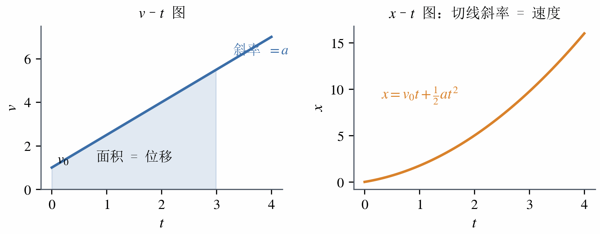

\[
v=v_0+at,\qquad x=x_0+v_0t+\frac12at^2,\qquad v^2-v_0^2=2a(x-x_0),\qquad x-x_0=\frac{v_0+v}2\,t .
\]

四个公式中只有两个是独立的，后两个由前两个消去 \(t\) 或 \(a\) 得到。每个公式都含四个量，已知其中三个就能求出第四个。第三式不含时间，适合不关心时间的问题；第四式说明匀变速运动的平均速度等于初末速度的平均值，这一点只对匀变速运动成立。自由落体取 \(a=-g\)（向上为正），就回到本节开头的公式。

解运动学问题的一般步骤是：

1. 确定研究对象和参考系，规定坐标原点和正方向。
2. 写出已知量的符号和数值，注意与正方向相反的量取负号。
3. 判断运动类型：匀速、匀变速，还是加速度随时间、速度或位置变化。
4. 匀变速时选用不含未知无关量的公式；加速度变化时，从定义 \(a=dv/dt\)、\(a=v\,dv/dx\) 出发分离变量积分。
5. 求出结果后检查单位、符号，并用特殊情形（如 \(t=0\)、\(a=0\)）核对。

## 2. 曲线运动与运动的合成

物体沿圆周运动时，速度方向始终沿切线。即使速率不变，速度矢量仍在改变，因此有加速度。设单位切向量为 \(\mathbf e_\tau\)，指向曲率中心的单位法向量为 \(\mathbf e_n\)，轨迹曲率半径为 \(R\)。把 \(\mathbf v=v\mathbf e_\tau\) 求导，得到

\[
\mathbf a=\frac{dv}{dt}\mathbf e_\tau+\frac{v^2}{R}\mathbf e_n.
\]

切向分量改变速率，法向分量改变方向。它们互相垂直，总加速度的大小是平方和开方，不能直接相加。对圆周运动，\(v=R\omega\)、\(a_\tau=R\alpha\)、\(a_n=R\omega^2\)，其中半径固定。

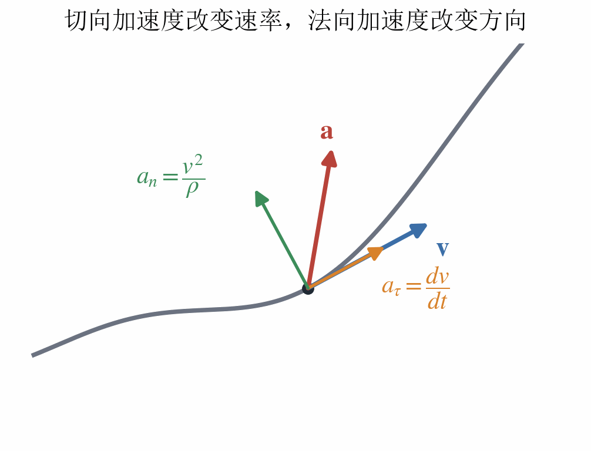

单位向量长度不变，并不意味着它的导数为零。由 \(\mathbf e_\tau\cdot\mathbf e_\tau=1\) 求导，只能得到 \(\mathbf e_\tau\cdot d\mathbf e_\tau/ds=0\)，所以导数垂直原切线。沿轨迹走过弧长 \(ds\)，切线转过 \(d\psi\)，曲率定义给出 \(d\psi=ds/R\)。两个相邻单位切向量的差的大小在极限下为 \(d\psi\)，方向朝向曲率中心，因此

\[
\frac{d\mathbf e_\tau}{ds}=\frac1R\mathbf e_n,
\qquad \frac{d\mathbf e_\tau}{dt}=\frac vR\mathbf e_n.
\]

这不是把切向量直接换成法向量，而是在求切向量的变化率。乘法法则中的第二项没有被删去，它正是法向加速度的来源。只有直线运动、基向量在所用参考系中固定等具体条件，才有相应方向导数为零。

对平面极坐标，也能把这一问题看得更清楚。位置写成 \(\mathbf r=r\mathbf e_r\)，径向和切向基随角度一起旋转，故 \(\dot{\mathbf e}_r=\dot\theta\mathbf e_\theta\)、\(\dot{\mathbf e}_\theta=-\dot\theta\mathbf e_r\)。连续用乘法法则可得

\[
\mathbf v=\dot r\mathbf e_r+r\dot\theta\mathbf e_\theta,
\qquad
\mathbf a=(\ddot r-r\dot\theta^2)\mathbf e_r
+(r\ddot\theta+2\dot r\dot\theta)\mathbf e_\theta.
\]

圆周运动半径固定时，才令 \(\dot r=\ddot r=0\)。若先把一般曲线运动的径向速度删掉，再称之为“圆周公式的推导”，就把约束条件藏到了运算之中。极坐标径向单位向量朝外，而圆周运动的法向单位向量朝内，所以两种写法的径向符号相反，实际加速度方向相同。

例如质量 \(m\) 的物体沿固定半径 \(R\) 的圆周运动，法向加速度给为 \(a_n=\beta t^2\)，\(t\geq0\)、\(\beta>0\)。从 \(v^2/R=\beta t^2\) 可得速率 \(v=t\sqrt{\beta R}\)，继而 \(a_\tau=\sqrt{\beta R}\)。力的瞬时功率是点积，所以

\[
P=\mathbf F\cdot\mathbf v=ma_\tau v=m\beta Rt.
\]

法向力没有沿速度方向的分量，因此不做功。若从零时刻开始计时，平均功率为 \(\overline P=m\beta Rt/2\)。这里 \(\beta\) 的单位为 \(\mathrm{m/s^4}\)，最终功率单位为瓦。把法向加速度代入 \(P=mav\) 会错误地把垂直分量当成沿速度的分量。

参考系转动时，速度合成还要计入坐标轴本身的运动。设运动参考系原点速度为 \(\mathbf V_O\)，角速度为 \(\boldsymbol\omega\)，则

\[
\mathbf v_I=\mathbf V_O+\mathbf v_{\rm rel}+\boldsymbol\omega\times\mathbf r.
\]

圆心静止的木马以 \(1.5\,\mathrm{rad/s}\) 转动，在半径 \(2\,\mathrm m\) 处，木马本身的切向速度大小为 \(3\,\mathrm{m/s}\)。若物体相对木马同向跑动，速率为 \(2\,\mathrm{m/s}\)，地面观察者看到 \(5\,\mathrm{m/s}\)；反向跑动时看到 \(1\,\mathrm{m/s}\)。固定在木马上的物体相对木马速度为零。只有切向共线时才能把矢量合成简写成速率加减，一般情况必须保留方向。

**抛体运动。** 忽略空气阻力，抛出的物体只受重力，加速度恒为竖直向下的 \(g\)。把运动分解为水平和竖直两个方向：水平方向不受力，做匀速运动；竖直方向做匀变速运动，两者用同一个时间联系起来。从地面以初速 \(v_0\)、仰角 \(\theta\) 抛出，取抛出点为原点，

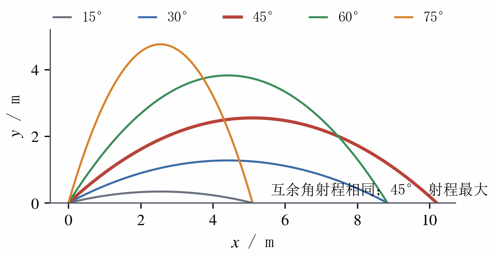

\[
x=v_0\cos\theta\cdot t,\qquad y=v_0\sin\theta\cdot t-\frac12gt^2,\qquad
y=x\tan\theta-\frac{g\,x^2}{2v_0^2\cos^2\theta}.
\]

最后一式由前两式消去 \(t\) 得到，说明轨迹是开口向下的抛物线。令 \(y=0\) 得飞行时间，令竖直速度为零得最高点，于是

\[
T=\frac{2v_0\sin\theta}g,\qquad H=\frac{v_0^2\sin^2\theta}{2g},\qquad R=\frac{v_0^2\sin2\theta}g .
\]

射程 \(R\) 在 \(\theta=45^\circ\) 时最大，为 \(v_0^2/g\)；互余的两个仰角（如 \(30^\circ\) 与 \(60^\circ\)）射程相同，但高仰角飞得更高、更久。例如 \(v_0=20\,\mathrm{m/s}\)、\(\theta=30^\circ\)、\(g=9.8\,\mathrm{m/s^2}\)，得 \(T\approx2.04\,\mathrm s\)、\(H\approx5.10\,\mathrm m\)、\(R\approx35.3\,\mathrm m\)。这些公式只适用于落点与抛出点等高的情形；落点更低（如从高台抛出）时，要回到分量方程重新求解，第 6 章滑道平抛的例子就是这样处理的。

### 2.1 选择参考系：相对运动、追及与最近距离

运动参考系只平动、且速度 \(\mathbf V\) 恒定时，上式退化为伽利略速度变换 \(\mathbf v=\mathbf v'+\mathbf V\)。两个这样的参考系都是惯性系，同一段时间间隔在两者中相同。许多匀速运动问题在地面系里需要列好几段路程，换到合适的参考系后只剩一段。选参考系的原则是：让尽可能多的物体静止，或让所求的量在新参考系里变成一个几何量。

**讲解例（伊罗多夫 1.1 型）。** 汽艇顺流而下，在 \(A\) 点超过一只木筏；经过时间 \(\tau\) 后掉头，以相同的发动机工况返航，在 \(A\) 点下游距离 \(l\) 处与木筏相遇。求水流速度 \(u\)。

在地面系中要分别写顺流速率 \(v+u\) 和逆流速率 \(v-u\)，未知数较多。改用随水流平动的参考系：木筏静止，汽艇相对水的速率在往返两段相同，离开木筏 \(\tau\) 后掉头，回到木筏也需 \(\tau\)。因此从超越到相遇共经过 \(2\tau\)，而这段时间木筏随水漂过了 \(l\)：

\[
u=\frac{l}{2\tau}.
\]

取 \(\tau=1.0\,\mathrm h\)、\(l=6.0\,\mathrm{km}\)，得 \(u=3.0\,\mathrm{km/h}\)。结果与汽艇本身的速率无关，这正是换参考系后才看得出的结构。“发动机工况相同”是关键条件：它保证汽艇相对水的速率在往返中一样。

求两质点的最近距离，也有两条等价的路线。设两质点沿两条互相垂直的直线、以恒定速率 \(v_1,v_2\) 驶向交点 \(O\)，\(t=0\) 时离 \(O\) 分别为 \(l_1,l_2\)。直接写距离平方

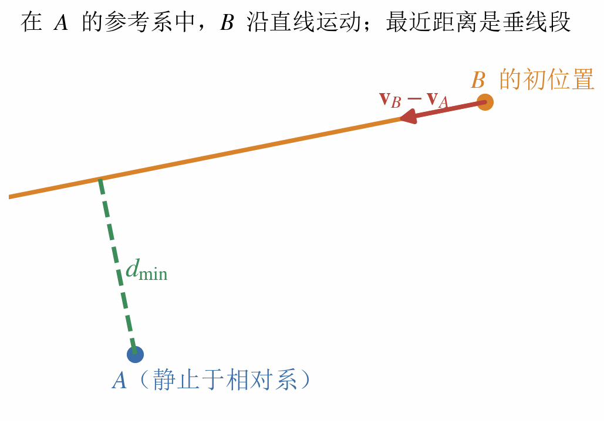

\[
d^2(t)=(l_1-v_1t)^2+(l_2-v_2t)^2 .
\]

令 \(d(d^2)/dt=-2v_1(l_1-v_1t)-2v_2(l_2-v_2t)=0\)，得

\[
t_0=\frac{l_1v_1+l_2v_2}{v_1^2+v_2^2},\qquad
d_{\min}=\frac{|l_1v_2-l_2v_1|}{\sqrt{v_1^2+v_2^2}} .
\]

对距离平方求极值与对距离求极值等价，因为 \(d\geq0\) 时平方是单调函数，这样可以避开根号求导。第二条路线是换到质点 1 的参考系：质点 2 以相对速度 \(\mathbf v_2-\mathbf v_1\) 沿一条直线运动，最近距离就是质点 1 到这条直线的距离。两种做法给出同一结果；后者不需要求导，还说明当 \(l_1v_2=l_2v_1\) 时相对运动直线恰好通过质点 1，两者会相撞。

追及问题中，追者的方向随时间改变，轨迹往往很复杂，但所求的时间不一定需要轨迹。设边长 \(a\) 的正三角形三个顶点上各有一质点，以相同的恒定速率 \(v\) 运动，第一点始终朝向第二点，第二点朝向第三点，第三点朝向第一点。由对称性，三点在任一时刻仍构成正三角形，只是边长缩短、整体旋转。考察边 12 的缩短速率：质点 1 沿该边以 \(v\) 靠近；质点 2 的速度沿边 23，与边 12 的延长方向成 \(60^\circ\) 角，在边 12 方向的分量 \(v\cos60^\circ=v/2\) 也使距离缩短。于是边长以恒定速率 \(3v/2\) 减小，相遇时间

\[
t=\frac{a}{3v/2}=\frac{2a}{3v}.
\]

若目标沿直线匀速运动，可以用两个积分关系消去未知的方向角。设追者 \(A\) 以速率 \(v\) 始终指向 \(B\)，\(B\) 以速率 \(u<v\) 沿直线运动，起初 \(\mathbf v\perp\mathbf u\)、两者相距 \(l\)；记 \(\alpha\) 为 \(\mathbf v\) 与 \(\mathbf u\) 的夹角。距离的变化率为 \(dr/dt=-v+u\cos\alpha\)，从开始到相遇积分得 \(l=vt-u\int_0^t\cos\alpha\,dt\)。另一方面，起初和相遇时两者沿 \(\mathbf u\) 方向的坐标都相同，所以沿该方向的位移相等：\(v\int_0^t\cos\alpha\,dt=ut\)。两式消去积分，

\[
t=\frac{vl}{v^2-u^2}.
\]

条件 \(u<v\) 保证结果为正；\(u\to v\) 时时间趋于无穷，追者永远追不上。这里的技巧是寻找在整个过程中都能积分的关系，而不是先求曲线轨迹。

## 3. 力与约束

在惯性系中，对质量不变的质点，合外力满足 \(\sum\mathbf F=m\mathbf a\)。实际受力图上画重力、接触力和弹力等相互作用。“向心力”只是径向合力的名称，不应在这些力之外再画一根向心力。作用力与反作用力作用在不同物体上，也不能在同一个物体的方程中相消。

近地面重力大小约为 \(mg\)。理想弹簧在线性弹性范围内有 \(F_x=-kx\)。滑动摩擦的常用模型为 \(f_k=\mu_kN\)，方向反对相对滑动；静摩擦满足 \(|f_s|\leq\mu_sN\)，其实际大小由维持约束所需的力决定。静摩擦并非始终等于最大值。

取固定斜面向下为正，倾角为 \(\theta\)。物体法向平衡给出 \(N=mg\cos\theta\)。若要静止，需要向上的静摩擦 \(f_s=mg\sin\theta\)，因此必须满足 \(\tan\theta\leq\mu_s\)。若已向下滑动，则

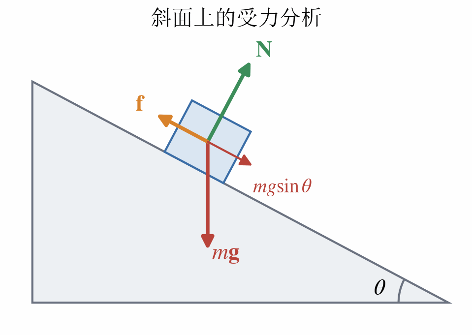

\[
a=g(\sin\theta-\mu_k\cos\theta).
\]

算得负加速度，只表示向下的速度减小，并不表示摩擦应改向下。摩擦方向由相对滑动方向判断，加速度由合力判断，这是两个步骤。

俄语 сила тяжести 是重力，реакция опоры 是支持力。вес 在许多俄语课程中指物体对支承或悬挂的作用力。自由落体仍受重力，却可能处于失重状态；这两个说法没有矛盾。

连接体的加速度关系来自几何约束，不是由质量大小直接猜出。以跨过固定滑轮的不可伸长绳为例，两端向下位置记为 \(y_1,y_2\)，绳长条件是 \(y_1+y_2=\text{常量}\)。先求一次导数得 \(\dot y_1+\dot y_2=0\)，再求导才得 \(\ddot y_1+\ddot y_2=0\)。两端加速度大小相等、方向相反，是这一特定绳长关系的结果。动滑轮由两段绳支承时，长度式中滑轮位置可能出现两次，便会产生二倍关系；应先写长度，不能把固定滑轮结论直接搬过去。

若滑轮和绳均理想、质量忽略，滑轮两侧张力大小相同。设 \(m_2>m_1\)，以第二物体向下、第一物体向上为各自正方向，则两者的加速度数值同为 \(a\)，受力方程是

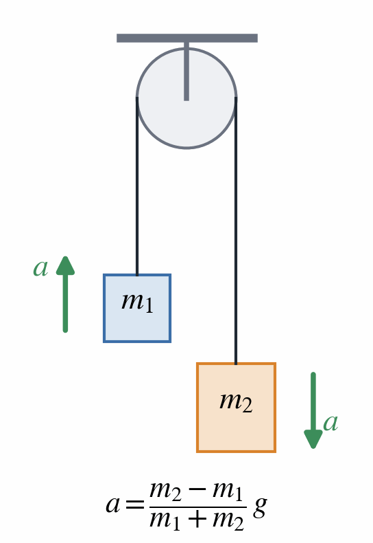

\[
m_2g-T=m_2a,\qquad T-m_1g=m_1a.
\]

相加消去内张力，得 \(a=(m_2-m_1)g/(m_1+m_2)\)，代回得 \(T=2m_1m_2g/(m_1+m_2)\)。两个方程采用不同的坐标正向，却共享同一个非负加速度大小；如果两个坐标都取向下，就必须使用一正一负的加速度分量。

若滑轮转动惯量为 \(I\)、半径为 \(R\)，绳不打滑，绳与轴承损耗忽略，两侧张力一般不相等。转矩方程 \((T_2-T_1)R=I\alpha\)，约束 \(a=R\alpha\)，与两物体方程联立得到

\[
a=\frac{(m_2-m_1)g}{m_1+m_2+I/R^2}.
\]

分母多出的量具有质量单位，反映滑轮也要获得转动动能。先前理想滑轮的结果是 \(I\to0\) 的极限。这个例子把绳长约束、平动受力和刚体转动连接起来，也说明题目若未给清楚滑轮是否有质量，不能擅自假定两侧张力相等。求解中消去张力是代数操作，不表示绳上没有作用力。

用牛顿定律解题的步骤可以归纳为：

1. 选定研究对象，必要时把连接体拆成几个物体分别研究（隔离法），或者看成一个整体（整体法）。
2. 画受力图，只画实际作用在该物体上的力，每个力都要能说出施力物体。
3. 对每个物体选坐标轴，通常让一个轴沿加速度方向。
4. 列出各方向的牛顿第二定律方程，再补充约束关系（绳长、不打滑、接触）和摩擦条件。
5. 联立求解，检查结果的符号和极限情形，例如某个质量趋于零或无穷时是否合理。

**非惯性系与惯性力。** 牛顿第二定律只在惯性系中成立。若在一个以加速度 \(\mathbf a_0\) 平动的参考系中描述运动，为了形式上仍能使用 \(\sum\mathbf F=m\mathbf a'\)，需要给每个物体加上一个惯性力：

\[
\mathbf F_{\text{惯}}=-m\mathbf a_0 .
\]

惯性力没有施力物体，也没有反作用力，它只是把参考系的加速度移到方程的力一侧的结果。例如在以加速度 \(a\) 向上运动的电梯里，人感到的“视重”为 \(N=m(g+a)\)；电梯以 \(g\) 自由下落时 \(N=0\)，人处于完全失重状态。

在以角速度 \(\boldsymbol\omega\) 匀速转动的参考系中，惯性力有两项：

\[
\mathbf F_{\text{离心}}=m\omega^2\mathbf r_\perp,\qquad \mathbf F_{\text{科}}=-2m\,\boldsymbol\omega\times\mathbf v' .
\]

离心力沿垂直于转轴的方向指向外侧，\(\mathbf r_\perp\) 是物体到转轴的垂直位移；科里奥利力只作用在相对转动参考系运动（速度为 \(\mathbf v'\)）的物体上，方向垂直于相对速度。地球自转使赤道处的有效重力加速度比两极小约 \(\omega^2R\approx(7.29\times10^{-5})^2\times6.37\times10^6\approx0.034\,\mathrm{m/s^2}\)；北半球运动的物体受科里奥利力向右偏，这解释了气旋的旋转方向。在惯性系中分析时，不存在离心力，圆周运动所需的向心加速度完全由真实的力提供；两种描述不能混用，即不能在惯性系的受力图中再画一个离心力。

**惯性力与引力的等效原理。** 惯性力 \(-m\mathbf a_0\) 与重力 \(m\mathbf g\) 有一个共同特点：都与物体的质量成正比，因而给一切物体相同的加速度。设想一个没有窗户的密闭舱。若舱在远离天体的空间中以加速度 \(a_0=g\) 向“上”加速，舱内的人松手放开一个球，球相对舱以 \(g\) 落向地板，弹簧秤上的物体读数为 \(mg\)；若舱静止在地面上，看到的现象完全相同。反过来，舱在引力场中自由下落时，舱内一切物体都处于失重状态，如同在没有引力的惯性系中一样。舱内的力学实验无法区分“均匀引力场”与“参考系的加速度”，这一结论称为等效原理。它成立的根据是引力质量（决定引力大小的质量）与惯性质量（决定加速度难易的质量）相等，卫星实验对二者相对差异的检验精度已达 \(10^{-15}\) 量级。等效原理只在局部成立：真实引力场在大范围内不均匀，例如地球周围的引力指向地心，两只相距很远、自由下落的球会彼此靠近，而均匀加速的参考系产生不出这种效应。爱因斯坦以等效原理为出发点建立了广义相对论，第 14 章讨论的狭义相对论只处理惯性系。

## 4. 功与能量的记账

把物体升高，或压缩弹簧，之后可以通过下降或回复把作用传递给别的物体。这提示我们：只记录速度并不够，还需要记录构型所对应的能量。重力势能和弹性势能不是额外的力，而是描述相应相互作用的另一种方式。

力做功定义为沿真实路径的积分：

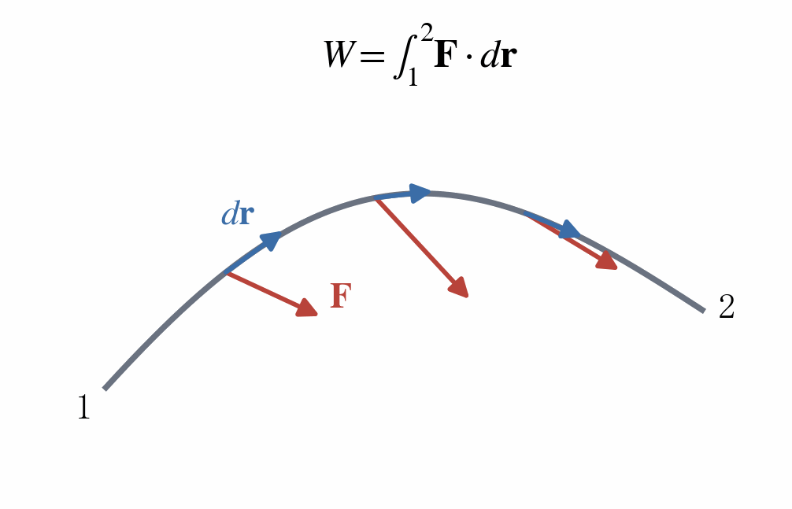

\[
W=\int_{\mathcal C}\mathbf F\cdot d\mathbf r,
\qquad K_2-K_1=W_{\rm total},\qquad K=\frac12mv^2.
\]

若力的功只依赖始末位置，可定义势能，使 \(W_c=-\Delta U\)，因此一维 \(F_x=-dU/dx\)。向上坐标下重力势能为 \(mgy\)，弹簧势能为 \(kx^2/2\)。势能零点任意，但同一推导中必须一致。分离出非保守力后有

\[
\Delta(K+U)=W_{\rm nc}.
\]

能量守恒要求把可能储能的部分纳入账本；机械能守恒则还要求没有机械能转化为内能等其他形式。系统动量守恒并不保证机械能守恒。

质量 \(m\) 的滑块以速度 \(v\) 滑上初始静止、质量 \(M\) 的木板。假定地面水平外力可忽略，滑块不滑出，最终二者共速。水平动量守恒先给 \(V=mv/(m+M)\)。初末动能相减得到

\[
Q=\frac12mv^2-\frac12(m+M)V^2
=\frac12\frac{mM}{m+M}v^2.
\]

\(Q>0\) 是机械能减少的大小，相应摩擦总功为 \(-Q\)。摩擦对滑块做负功，对木板却可以做正功。内力大小相等、方向相反，其作用点位移并不相同，所以内力总功不必为零。只用“内部力相消”判断能量，是把动量账本误用到了功的账本上。

**保守力、势能与功率。** 一个力是保守力，等价于以下任何一条：它做的功只与始末位置有关；沿任意闭合路径做功为零；它可以写成势能的负梯度

\[
\mathbf F=-\nabla U=-\left(\frac{\partial U}{\partial x},\frac{\partial U}{\partial y},\frac{\partial U}{\partial z}\right).
\]

重力、弹簧弹力、万有引力和静电力都是保守力；摩擦力和空气阻力不是，它们做的功与路径长短有关。常用的势能有三种：重力势能 \(mgh\)（近地面）、弹性势能 \(\frac12kx^2\)、万有引力势能 \(-GMm/r\)（以无穷远为零点，见 9.6 节）。力做功的快慢用功率描述：

\[
P=\frac{dW}{dt}=\mathbf F\cdot\mathbf v,\qquad \overline P=\frac Wt .
\]

例如汽车以恒定功率行驶时，牵引力 \(F=P/v\)，速度越大牵引力越小，当牵引力降到等于阻力时速度达到最大值 \(v_{\max}=P/f\)。

用能量方法解题的步骤是：

1. 选定系统，明确哪些物体包括在内，哪些力是系统内力、哪些是外力。
2. 选定初末两个状态，写出各状态的动能和势能（注意势能零点前后一致）。
3. 判断哪些力做功：保守内力的功已计入势能；非保守力（摩擦、外加拉力等）的功单独计算。
4. 列出 \(\Delta(K+U)=W_{\rm nc}\)；若 \(W_{\rm nc}=0\)，就是机械能守恒。
5. 能量方程只有一个，若未知量多于一个，再结合动量守恒或牛顿定律。能量方法不涉及方向，求力的方向和时间仍需用其他方法。

## 5. 动量与碰撞

动量为 \(\mathbf p=m\mathbf v\)，冲量为 \(\mathbf J=\int\mathbf Fdt\)，二者由 \(\Delta\mathbf p=\mathbf J\) 联系。短时碰撞中，重力依然存在，但其冲量可能远小于碰撞冲量；在相应方向才能近似使用系统动量守恒。俄语 импульс тела 是动量，импульс силы 是冲量。

完全弹性正碰还保持总动能。取球一初速度方向为正，球二初始静止：

\[
m_1v_0=m_1v_1+m_2v_2,
\qquad m_1v_0^2=m_1v_1^2+m_2v_2^2.
\]

第一式给 \(m_1(v_0-v_1)=m_2v_2\)，第二式利用平方差分解。对实际发生速度改变的分支相除，可得 \(v_0+v_1=v_2\)。再代回去：

\[
v_1=\frac{m_1-m_2}{m_1+m_2}v_0,
\qquad v_2=\frac{2m_1}{m_1+m_2}v_0.
\]

设质量比 \(x=m_2/m_1\)，球二所得动量与初始动量之比、所得动能与初始动能之比分别为

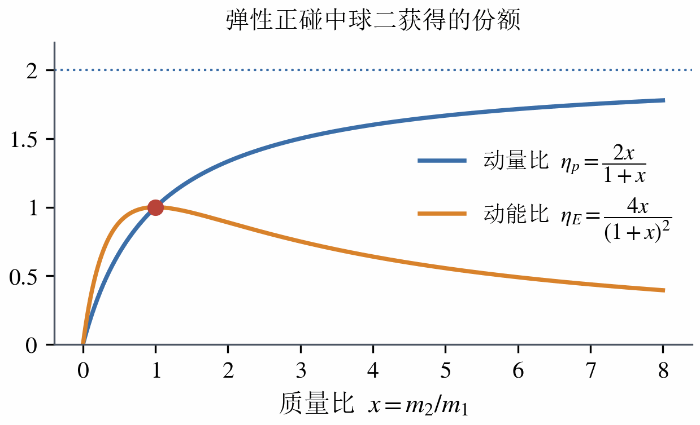

\[
\eta_p=\frac{2x}{1+x},\qquad \eta_E=\frac{4x}{(1+x)^2}.
\]

求导得到 \(\eta_p'=2/(1+x)^2>0\)，而 \(\eta_E'=4(1-x)/(1+x)^3\)。动量比例随质量比增加，没有在有限质量比处取得最大值，上确界为 2；动能比例在 \(x=1\) 处最大，等于 1。例如 \(x=3\)，球一反弹速度为 \(-v_0/2\)，球二速度为 \(v_0/2\)，此时 \(\eta_p=1.5\)、\(\eta_E=0.75\)。球一带负向动量，因而球二正向动量可以大于初始值，而能量并未增加。

完全非弹性碰撞指碰后共速，不能再加动能守恒条件。恢复系数是法线方向的相对分离速度与相对接近速度之比；固定地面的特殊情形才能写 \(v^+=-ev^-\)。如果第二个物体也运动，应使用两物体的相对速度。

### 5.1 两物体均运动时的统一正碰公式

把球二初始静止的限制放开。取同一条直线为坐标轴，两球碰前速度为 \(u_1,u_2\)，碰后为 \(v_1,v_2\)，质量均为正，且取正在接近的情形 \(u_1>u_2\)。系统外冲量可忽略时，动量守恒；恢复系数给出第二条关系：

\[
m_1v_1+m_2v_2=m_1u_1+m_2u_2,\qquad
v_2-v_1=e(u_1-u_2).
\]

第二式比较分离速度与接近速度。在普通被动碰撞模型中 \(0\le e\le1\)，但它不是额外的动能守恒条件。由第二式代入第一式，逐一求出

\[
\begin{aligned}
v_1&=\frac{(m_1-em_2)u_1+(1+e)m_2u_2}{m_1+m_2},\\
v_2&=\frac{(1+e)m_1u_1+(m_2-em_1)u_2}{m_1+m_2}.
\end{aligned}
\]

令 \(e=1,u_2=0\)，正好回到前面的弹性公式；令 \(e=0\)，两球共速，速度为总动量除总质量。两个等质量小球的完全弹性正碰会交换速度，无需第二球初始静止。恢复系数是接触模型参数，不能仅凭“碰后分开”就宣布 e=1。

损失的动能也能用同一组量表示。定义质心速度
\(V=(m_1u_1+m_2u_2)/(m_1+m_2)\)、约化质量
\(\mu=m_1m_2/(m_1+m_2)\)。把各速度分成质心速度与相对速度，可直接展开得到
\[
K=\frac12(m_1+m_2)V^2+\frac12\mu(u_1-u_2)^2.
\]
动量守恒使 V 不变，碰后相对速度绝对值变成原来的 e 倍，所以
\[
K_{\rm before}-K_{\rm after}
=\frac12\mu(1-e^2)(u_1-u_2)^2.
\]
因此 e=1 时无损失，e=0 时相对运动的动能全部转为形变、热等内部能量。总能量仍可守恒，损失的是所建机械模型中的平动动能。

**讲解例。** 取 \(m_1=1\,\mathrm{kg}\)、\(m_2=2\,\mathrm{kg}\)、\(u_1=3\,\mathrm{m/s}\)、\(u_2=0\)、e=0.5。代入得 \(v_1=0,\ v_2=1.5\,\mathrm{m/s}\)。碰前动量三、碰后仍三，单位均为千克米每秒；碰前动能 4.5 焦耳，碰后 2.25 焦耳。约化质量为 \(2/3\,\mathrm{kg}\)，损失公式给出同样的 2.25 焦耳。

斜碰时，只能对接触法线方向使用恢复系数。若接触光滑、切向冲量可忽略，切向速度分量另行保持；有摩擦或旋转耦合时还需切向冲量及角动量方程，不能把上面的一维式直接施用于速度矢量的每个方向。

### 5.2 变质量物体：火箭与连续装载

火箭喷气、平台车接沙时，所研究物体的质量随时间变化。此时不能把 \(\mathbf F=m\mathbf a\) 改写成 \(\mathbf F=d(m\mathbf v)/dt\) 了事，因为后者对不同的系统划分会给出不同结果。正确做法是对一个质量不变的系统用动量定理。设时刻 \(t\) 物体质量 \(m\)、速度 \(\mathbf v\)；在 \(dt\) 内有质量 \(dm\) 并入（\(dm<0\) 表示喷出），这部分物质并入前（或喷出后）相对物体的速度为 \(\mathbf u\)。取“物体加上这一小块物质”为系统，外力为 \(\mathbf F\)：

\[
(m+dm)(\mathbf v+d\mathbf v)-\bigl[m\mathbf v+dm(\mathbf v+\mathbf u)\bigr]=\mathbf F\,dt .
\]

略去二阶小量 \(dm\,d\mathbf v\)，得到变质量物体的运动方程（俄语文献常称密歇尔斯基方程，уравнение Мещерского）：

\[
m\frac{d\mathbf v}{dt}=\mathbf F+\frac{dm}{dt}\mathbf u .
\]

右端第二项叫反推力。它只依赖相对速度 \(\mathbf u\)，因此与参考系选择无关；若错用 \(d(m\mathbf v)/dt=\mathbf F\)，结果会随参考系速度改变，这本身就说明那个式子不具普遍性。只有当并入物质原来静止（\(\mathbf u=-\mathbf v\)）时，方程才恰好化为 \(d(m\mathbf v)/dt=\mathbf F\)。

**讲解例 1：火箭。** 火箭在没有外力时由静止开始喷气，气体相对火箭以恒定速率 \(u\) 向后喷出，初始质量 \(m_0\)。取运动方向为正，\(\mathbf u\) 的分量为 \(-u\)，方程为 \(m\,dv=-u\,dm\)。分离变量从 \(m_0\) 积分到 \(m\)：

\[
v=u\ln\frac{m_0}{m}.
\]

这是齐奥尔科夫斯基公式。末速度只取决于喷气速度和质量比，与燃料喷出的快慢无关。若火箭在均匀重力场中竖直起飞，方程多一项 \(-mg\)，即 \(m\,dv=-u\,dm-mg\,dt\)，积分得 \(v=u\ln(m_0/m)-gt\)。这时喷得越慢，重力作用时间越长，同样的燃料得到的速度越小。起飞还要求初始推力 \(u|dm/dt|>m_0g\)，否则火箭不能离开发射台。

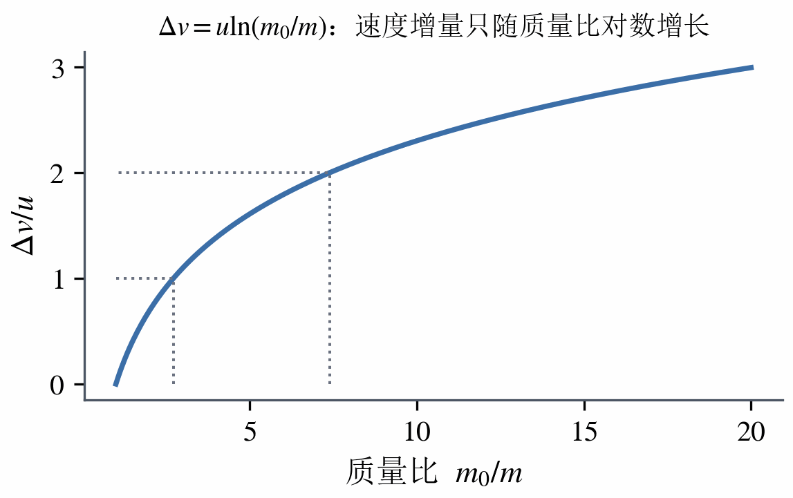

**讲解例 2：连续装沙的平台车。** 质量 \(m_0\) 的平台车在光滑水平面上由静止开始，在恒力 \(F\) 作用下运动；固定料斗以恒定速率 \(\mu\)（千克每秒）向车上落沙。落下的沙水平速度为零，相对车的速度 \(\mathbf u=-\mathbf v\)，方程化为 \(d(mv)/dt=F\)，其中 \(m=m_0+\mu t\)。由初值 \(v(0)=0\)，

\[
v=\frac{Ft}{m_0+\mu t},\qquad a=\frac{dv}{dt}=\frac{Fm_0}{(m_0+\mu t)^2}.
\]

\(t\to\infty\) 时 \(v\to F/\mu\)：推力最终全部用于把新落下的沙加速到车速。若改为沙从车底漏出，漏出的沙相对车速度为零，\(\mathbf u=0\)，方程就是普通的 \(m\,d\mathbf v/dt=\mathbf F\)，只是 \(m\) 随时间减小。两种情形质量都在变化，力学方程却不同，区别全在于 \(\mathbf u\)。

## 6. 分阶段过程与圆周约束

子弹嵌入摆块后一起上升，碰撞与上升的时间尺度和物理机制不同。设子弹质量 \(m\)、摆块质量 \(M\)、绳长 \(l\)、最大偏角 \(\theta\)，碰撞时绳竖直。忽略水平外力冲量，有 \(mu=(M+m)V\)。上升阶段忽略阻力，有

\[
\frac12(M+m)V^2=(M+m)gl(1-\cos\theta).
\]

因此子弹初速为 \(u=(M+m)\sqrt{2gl(1-\cos\theta)}/m\)。碰撞时动能损失，所以不能把子弹初动能直接等于摆块上升的势能。近似 \(M+m\approx M\) 必须以 \(m\ll M\) 为前提。

另一个需要额外边界条件的过程是细绳竖直圆周。球从最低点出发，要完整绕行，不仅能量要够，还要保证绳不松。最高点以向下为径向正：

\[
mg+T=\frac{mv_{\rm top}^2}{l},\qquad T\geq0.
\]

临界时 \(T=0\)，故 \(v_{\rm top}^2=gl\)。从最低点升高 \(2l\) 并应用能量守恒：

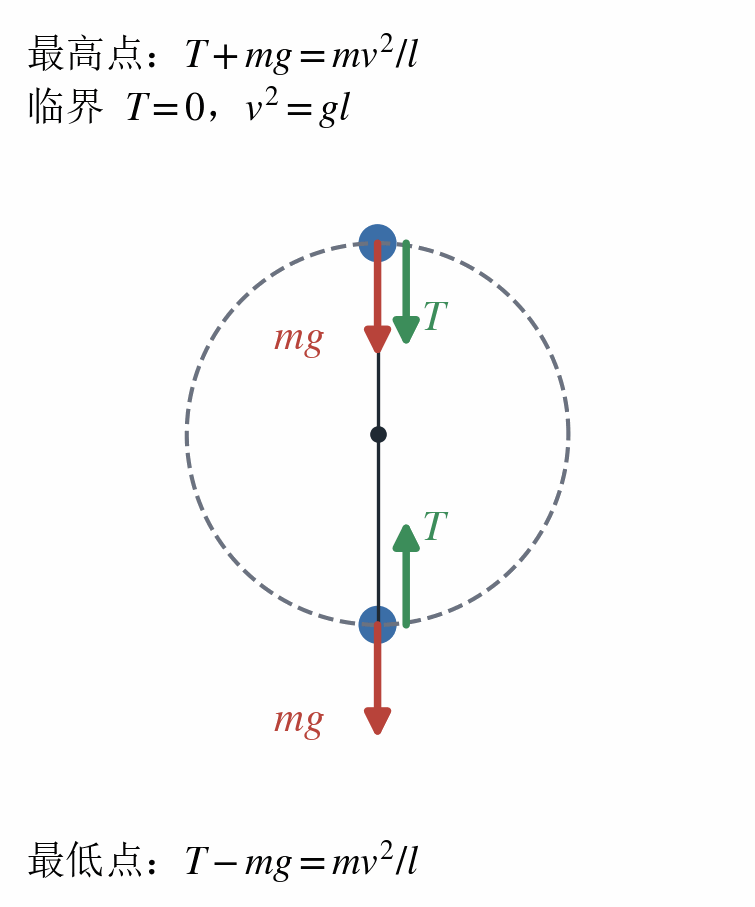

\[
\frac12mv_0^2=2mgl+\frac12mgl,
\qquad v_{0,\min}=\sqrt{5gl}.
\]

到水平位置时速度平方为 \(3gl\)，重力在径向没有分量，张力为 \(3mg\)。只要求“能到达最高点”会漏掉绳张力非负这一约束。若连接物为可推可拉的刚性杆，边界条件不同，不可照搬细绳的启动速度。

**讲解例：滑道末端的平抛射程。** 物体从高 \(H\) 处由静止沿光滑滑道滑下，在高 \(h\)（\(0<h<H\)）的平台边缘水平飞出，问 \(h\) 取多少时落地点最远。滑行阶段只有重力做功，机械能守恒给出离台速度 \(v=\sqrt{2g(H-h)}\)；平抛阶段竖直方向从静止下落 \(h\)，由 \(\tfrac12gt^2=h\) 得 \(t=\sqrt{2h/g}\)，下落时间要开平方，不能把 \(t\) 与 \(h\) 写成正比。水平射程
\[
s=vt=\sqrt{2g(H-h)}\cdot\sqrt{\frac{2h}{g}}=2\sqrt{h(H-h)} .
\]
\(g\) 已约去，射程与重力加速度无关。根号内 \(h(H-h)\) 是开口向下的二次函数，在 \(h=H/2\) 处取最大值 \(H^2/4\)，所以 \(s_{\max}=H\)。两个阶段的分工很清楚：前一段用能量求速度，后一段用运动学求时间；平台越高，飞行时间越长，但离台速度越小，最优值是二者的折中。

## 7. 从转角到力矩

一扇门在铰链处几乎不移动，门边却走过较长弧线。刚体绕固定轴转动时，各点转角相同，线速度却与到轴的距离有关。取轴为 \(z\) 轴，平面内一点坐标为 \((x,y)\)。微小转角 \(d\varphi\) 引起

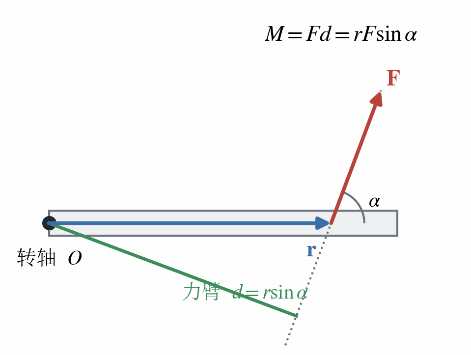

\[
dx=-y\,d\varphi,\qquad dy=x\,d\varphi.
\]

除以时间得 \(v_x=-\omega y\)、\(v_y=\omega x\)，所以速率为 \(v=\omega r_\perp\)。力在该点所做微功为

\[
dW=F_xdx+F_ydy=(xF_y-yF_x)d\varphi.
\]

括号中的量定义为轴向力矩 \(\tau_z\)。于是 \(dW=\tau_zd\varphi\)、\(P=\tau_z\omega\)。力矩并非由平动类比随意起名，而是从实际作用点的位移和做功自然出现。力臂是转轴到力作用线的垂直距离，不是必然等于作用点到转轴的距离。

矢量式也可从有限小转角的极限建立。设固定轴方向不变，时间 \(\Delta t\) 内的转角矢量为 \(\Delta\boldsymbol\varphi\)，则旋转的几何展开是

\[
\Delta\mathbf r=\Delta\boldsymbol\varphi\times\mathbf r(t)
+O(|\Delta\boldsymbol\varphi|^2).
\]

若角速度有限，\(\Delta\boldsymbol\varphi=\boldsymbol\omega\Delta t+O(\Delta t^2)\)。两边除以 \(\Delta t\) 并取极限，二阶项变为随 \(\Delta t\) 消失的量，得到 \(\mathbf v=\boldsymbol\omega\times\mathbf r\)。不要把含微分的几何关系当作普通有限函数乘积，再形式化地制造一个没有清楚极限意义的附加项。能略去的是除以时间后仍趋零的高阶增量，而不是所有含微小符号的项。

对已经得到的有限量关系求时间导数，乘法法则必须完整保留：

\[
\mathbf a=\boldsymbol\alpha\times\mathbf r+
\boldsymbol\omega\times\mathbf v
=\boldsymbol\alpha\times\mathbf r+
\boldsymbol\omega\times(\boldsymbol\omega\times\mathbf r).
\]

第二项并不消失，它给出向轴的法向加速度。由微小增量求极限，与对速度公式求导，是两种运算阶段；若把前一阶段省略高阶项的理由套到后一阶段，就会把真正的向心加速度错误删掉。

定轴转动的运动学与直线运动一一对应：\(\omega=d\varphi/dt\)，\(\alpha=d\omega/dt\)。已知 \(\varphi(t)\) 就逐次求导；已知 \(\alpha(t)\) 就逐次积分并代入初值。若角加速度给成角速度或转角的函数，就要分离变量。对转角的情形，用链式法则

\[
\alpha=\frac{d\omega}{dt}=\frac{d\omega}{d\varphi}\frac{d\varphi}{dt}=\omega\frac{d\omega}{d\varphi},
\]

它与直线运动中的 \(a=v\,dv/dx\) 同形。

**讲解例 1。** 刚体减速转动，角加速度大小与 \(\sqrt\omega\) 成正比，初角速度 \(\omega_0\)。求从开始到停止整个过程的平均角速度。写 \(d\omega/dt=-k\sqrt\omega\)（\(k>0\)）。对时间分离变量，\(\int_{\omega_0}^{0}\omega^{-1/2}d\omega=-kt_0\)，得停转时间 \(t_0=2\sqrt{\omega_0}/k\)，是有限值。对转角用上面的链式法则，\(\omega\,d\omega/d\varphi=-k\sqrt\omega\)，即 \(d\varphi=-\sqrt\omega\,d\omega/k\)，积分得总转角 \(\varphi_0=2\omega_0^{3/2}/(3k)\)。平均角速度按定义是总转角除以总时间：

\[
\langle\omega\rangle=\frac{\varphi_0}{t_0}=\frac{\omega_0}{3}.
\]

它不等于 \((\omega_0+0)/2\)。初末值的算术平均只适用于角速度随时间线性变化，也就是匀变速转动。

**讲解例 2。** 若角速度随转角线性减小，\(\omega=\omega_0-a\varphi\)，且 \(\varphi(0)=0\)。由 \(d\varphi/(\omega_0-a\varphi)=dt\) 积分得

\[
\varphi=\frac{\omega_0}{a}\bigl(1-e^{-at}\bigr),\qquad \omega=\omega_0e^{-at}.
\]

转角趋于有限极限 \(\omega_0/a\)，却在任何有限时间内都达不到。又若刚体由静止开始、角加速度为 \(\alpha=\alpha_0\cos\varphi\)，则 \(\omega\,d\omega=\alpha_0\cos\varphi\,d\varphi\)，积分得 \(\omega^2=2\alpha_0\sin\varphi\)。只有 \(\sin\varphi\geq0\) 时有实数解，刚体在 \(0\leq\varphi\leq\pi\) 之间往复摆动。这一结果与“已知力随位置变化，用能量积分求速度”的做法完全对应。

角速度是矢量，绕相交轴的转动可以按矢量合成。两个刚体分别绕互相垂直、相交于一点的固定轴以恒定角速度 \(\boldsymbol\omega_1,\boldsymbol\omega_2\) 转动。物体 1 相对物体 2 的角速度是 \(\boldsymbol\omega=\boldsymbol\omega_1-\boldsymbol\omega_2\)，大小为 \(\sqrt{\omega_1^2+\omega_2^2}\)。在物体 2 的参考系中，\(\boldsymbol\omega_2\) 不变，而固定在实验室中的矢量 \(\boldsymbol\omega_1\) 以角速度 \(-\boldsymbol\omega_2\) 转动，所以相对角加速度为

\[
\boldsymbol\alpha_{\rm rel}=\frac{d\boldsymbol\omega_1}{dt}\Big|_2=-\boldsymbol\omega_2\times\boldsymbol\omega_1=\boldsymbol\omega_1\times\boldsymbol\omega_2,
\qquad \alpha_{\rm rel}=\omega_1\omega_2 .
\]

两个角速度都恒定，相对角加速度却不为零，因为相对角速度的方向在转动。取 \(\omega_1=3.0\,\mathrm{rad/s}\)、\(\omega_2=4.0\,\mathrm{rad/s}\)，得相对角速度 \(5.0\,\mathrm{rad/s}\)、相对角加速度 \(12\,\mathrm{rad/s^2}\)。有限转角不能这样相加，它们不满足交换律；能按矢量合成的是角速度这种无穷小转角的变化率。

对连续刚体，把所有质量元的动能相加：

\[
K=\frac12\int v^2dm
=\frac12\omega^2\int r_\perp^2dm
=\frac12I\omega^2,
\qquad I=\int r_\perp^2dm.
\]

这定义了转动惯量，单位为 \(\mathrm{kg\,m^2}\)。同一物体换轴，\(r_\perp\) 就改变，所以惯量也改变。力矩单位虽然与功同为 \(\mathrm{N\,m}\)，二者物理意义仍不同，不能因为量纲相同就互相替换。

## 8. 连续物体的转动惯量

均匀细杆可用线密度 \(dm=(m/l)dx\)。杆从 \(x=0\) 到 \(l\)，绕端点垂直杆的轴：

\[
I=\frac ml\int_0^l x^2dx=\frac13ml^2.
\]

均匀矩形薄板在 \(xy\) 平面，边长为 \(a,b\)，一顶点为原点，绕该顶点垂直板面的轴，面密度为 \(\sigma=m/(ab)\)。此时 \(r_\perp^2=x^2+y^2\)，从而

\[
I=\sigma\int_0^a\int_0^b(x^2+y^2)\,dy\,dx
=\frac13m(a^2+b^2).
\]

薄板只意味着厚度方向的质量分布可以略去，并不意味着平面内只需考虑一个坐标。

均匀实心球绕直径的惯量可沿该轴切成圆盘。高度 \(z\) 的圆盘半径 \(a=\sqrt{R^2-z^2}\)，质量 \(dm=\rho\pi a^2dz\)，圆盘惯量为 \(dm\,a^2/2\)，所以

\[
I=\frac{\rho\pi}{2}\int_{-R}^{R}(R^2-z^2)^2dz
=\frac{\rho\pi}{2}\left(2R^5-\frac43R^5+\frac25R^5\right)
=\frac{8\pi\rho R^5}{15}=\frac25mR^2.
\]

最后用了 \(m=4\pi\rho R^3/3\)。圆盘公式中的一半来自盘内质量的径向分布；若把盘的全部质量当成外缘圆环，就会算大。

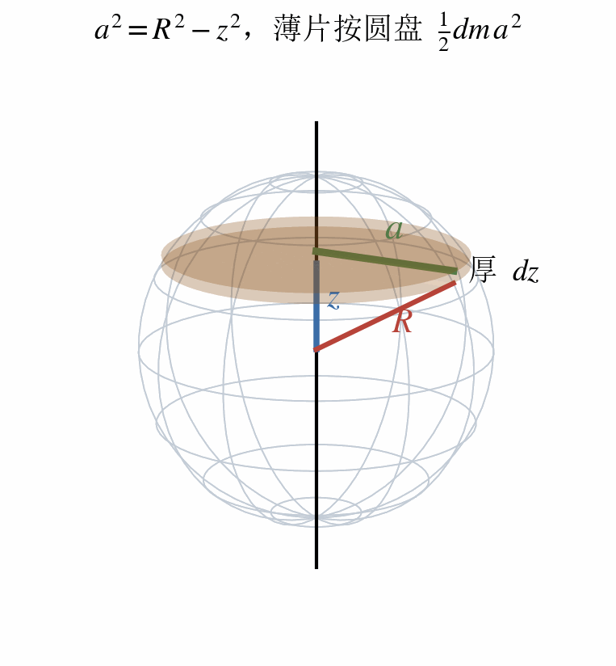

也可先求薄球壳。半径 \(r\) 的球面上，极角 \(\theta\) 处窄带的周长为 \(2\pi r\sin\theta\)，球面弧宽为 \(r\,d\theta\)，距转轴为 \(r\sin\theta\)。壳质量为 \(m_s\) 时：

\[
I_s=\frac{m_sr^2}{2}\int_0^\pi\sin^3\theta\,d\theta
=\frac23m_sr^2.
\]

再用径向厚度 \(dr\) 的球壳叠加，\(dm=4\pi\rho r^2dr\)，得到同样的实心球结果。\(dr\)、\(r\,d\theta\)、\(r\sin\theta\) 分别是径向厚度、球面弧宽和距轴长度，不能互换。

挖空的物体有两条常用路线：直接按薄层积分，或把它补成实心体再相减。均匀空心圆盘质量为 \(M\)，内外半径为 \(R_1,R_2\)，绕过中心且垂直盘面的轴转动。面密度为

\[
\sigma=\frac{M}{\pi(R_2^2-R_1^2)}.
\]

取半径 \(r\)、宽 \(dr\) 的细圆环，\(dm=\sigma\,2\pi r\,dr\)，环上各点到轴的距离都是 \(r\)，所以

\[
I=\int_{R_1}^{R_2}r^2\,\sigma\,2\pi r\,dr=\frac{\pi\sigma}{2}\left(R_2^4-R_1^4\right).
\]

用 \(R_2^4-R_1^4=(R_2^2-R_1^2)(R_2^2+R_1^2)\) 代回面密度，得

\[
I_{\text{环}}=\frac12M\left(R_1^2+R_2^2\right).
\]

相减法得到同一结果：半径 \(R_2\) 的实心盘惯量为 \(\tfrac12(\sigma\pi R_2^2)R_2^2\)，减去半径 \(R_1\) 的实心盘 \(\tfrac12(\sigma\pi R_1^2)R_1^2\)。两块实心盘的质量都不是 \(M\)，只有先用同一密度表示，再相减，最后换回 \(M\)，才不会把质量用错。令 \(R_1=0\) 得实心盘 \(\tfrac12MR_2^2\)；令 \(R_1\to R_2\) 得细圆环 \(MR^2\)。

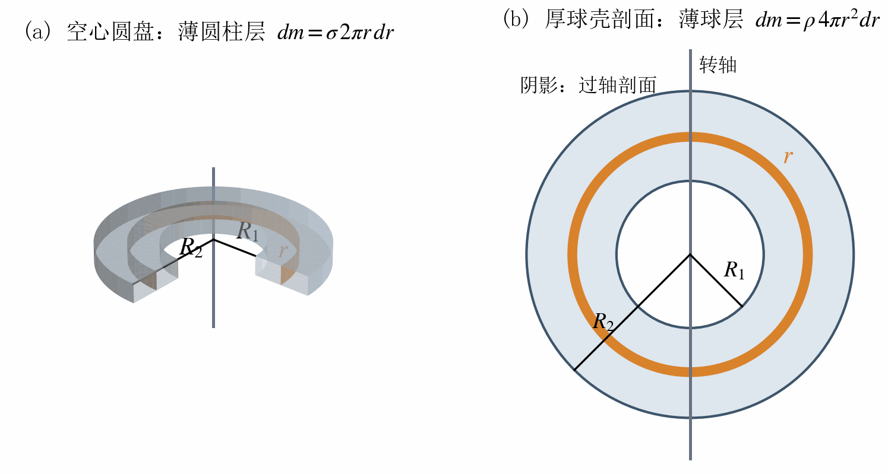

均匀厚球壳质量为 \(M\)，内外半径为 \(R_1,R_2\)，绕过球心的轴转动。体密度为

\[
\rho=\frac{M}{\frac43\pi\left(R_2^3-R_1^3\right)}=\frac{3M}{4\pi\left(R_2^3-R_1^3\right)}.
\]

相减法用上面的实心球结果 \(I=\tfrac{8}{15}\pi\rho R^5\)：

\[
I=\frac{8\pi\rho}{15}\left(R_2^5-R_1^5\right),\qquad
I_{\text{壳}}=\frac25M\,\frac{R_2^5-R_1^5}{R_2^3-R_1^3}.
\]

系数来自 \(\tfrac{8\pi}{15}\cdot\tfrac{3}{4\pi}=\tfrac25\)。量纲检验可以立即发现抄写错误：分子五次方除以分母三次方，剩下长度的平方；若把分母写成二次方，结果就不再是转动惯量的单位。

第二条路线利用对称性，不需要任何现成公式。一点 \((x,y,z)\) 到 \(x,y,z\) 三根轴的距离平方分别为 \(y^2+z^2\)、\(x^2+z^2\)、\(x^2+y^2\)，三者之和恒为 \(2r^2\)。对任何物体都有

\[
I_x+I_y+I_z=2\int r^2\,dm .
\]

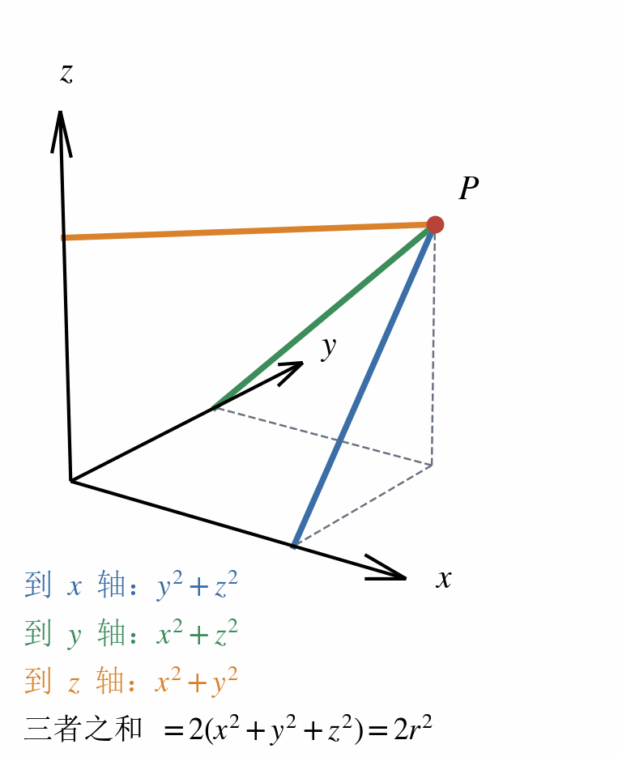

这一等式本身不需要对称；但球壳关于球心完全对称，三根轴的惯量相等，于是 \(I=\tfrac23\int r^2dm\)。用薄球层 \(dm=4\pi\rho r^2dr\)，

\[
I=\frac23\int_{R_1}^{R_2}r^2\cdot4\pi\rho r^2\,dr=\frac{8\pi\rho}{15}\left(R_2^5-R_1^5\right).
\]

把全部质量放在同一半径 \(R\) 上，同一关系直接给出薄球壳 \(\tfrac23MR^2\)。

第三条路线是球坐标直接积分。点 \(P\) 用 \((r,\theta,\varphi)\) 描述：\(r\) 是到球心的距离，\(\theta\) 是与转轴 \(z\) 的夹角，\(\varphi\) 是绕轴转过的角度。\(P\) 到转轴的距离为 \(r\sin\theta\)。让三个坐标各增加一点，得到一个小盒子：沿半径方向边长 \(dr\)；\(\theta\) 变化时，点在半径 \(r\) 的大圆上走过弧长 \(r\,d\theta\)；\(\varphi\) 变化时，点绕轴走的是半径 \(r\sin\theta\) 的水平小圆，弧长 \(r\sin\theta\,d\varphi\)。三边相乘，

\[
dV=r^2\sin\theta\,dr\,d\theta\,d\varphi .
\]

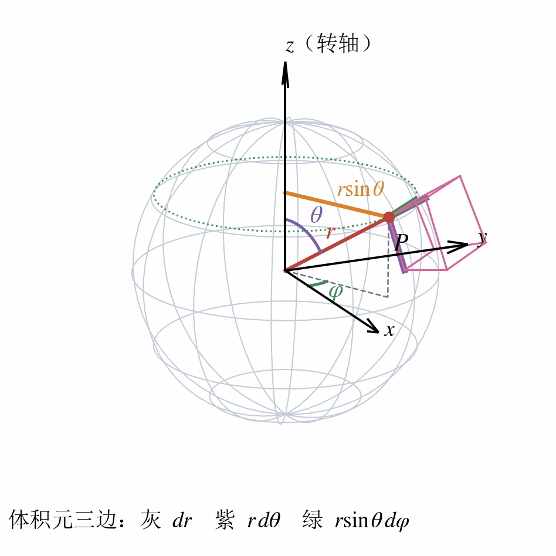

靠近两极时 \(\sin\theta\) 很小，小盒子变窄，这正是体积元中 \(\sin\theta\) 的几何含义。转动惯量是距离平方与质量之积的总和：

\[
I=\int(r\sin\theta)^2\,\rho\,r^2\sin\theta\,dr\,d\theta\,d\varphi
=\rho\int_0^{2\pi}d\varphi\int_0^{\pi}\sin^3\theta\,d\theta\int_{R_1}^{R_2}r^4\,dr .
\]

被积函数是只含 \(r\)、只含 \(\theta\) 两部分的乘积，积分限又都是常数，所以能拆成三个积分相乘。\(\varphi\) 积分为 \(2\pi\)，\(r\) 积分为 \((R_2^5-R_1^5)/5\)。\(\theta\) 积分先写 \(\sin^3\theta=(1-\cos^2\theta)\sin\theta\)，令 \(u=\cos\theta\)，\(du=-\sin\theta\,d\theta\)，\(\theta=0\) 对应 \(u=1\)，\(\theta=\pi\) 对应 \(u=-1\)：

\[
\int_0^{\pi}\sin^3\theta\,d\theta=\int_{1}^{-1}(1-u^2)(-du)=\int_{-1}^{1}(1-u^2)\,du=\left[u-\frac{u^3}{3}\right]_{-1}^{1}=\frac43 .
\]

三者相乘，\(2\pi\cdot\tfrac43\cdot\tfrac15=\tfrac{8\pi}{15}\)，又回到同一式子。三条路线各有用处：相减法只需记住实心球；对称法最快，并顺带证明薄球壳公式；球坐标法最直接，也适用于没有完全球对称、只能逐点积分的情形。

结果还应检查极限。令 \(R_1=0\)，得实心球 \(\tfrac25MR_2^2\)。令 \(R_1\to R_2=R\)，分子分母都趋于零，先约去公因式 \(R_2-R_1\)：

\[
\frac{R_2^5-R_1^5}{R_2^3-R_1^3}=\frac{R_2^4+R_2^3R_1+R_2^2R_1^2+R_2R_1^3+R_1^4}{R_2^2+R_2R_1+R_1^2}\to\frac{5R^4}{3R^2},
\]

于是 \(I\to\tfrac25\cdot\tfrac53MR^2=\tfrac23MR^2\)，与薄球壳一致。

为比较体积与惯量，定义一个辅助体：在每个 \(z\in[-R,R]\) 处，截面为外半径 \(R\)、内半径 \(|z|\) 的圆环。其截面积与球的截面积相同，因此逐层质量相同；但质量离轴更远，惯量是

\[
I_{\rm aux}=\frac{\rho\pi}{2}\int_{-R}^R(R^2-z^2)(R^2+z^2)dz
=\frac{4\pi\rho R^5}{5}.
\]

球与它的惯量比为 \(2/3\)，这是比较积分的结果，不是体积比的直接后果。若改成半径 \(R\)、高 \(2R\) 的完整圆柱，球的质量比为 \(2/3\)，惯量比却为 \(8/15\)。辅助体的定义必须固定；仅看到教材中某个比例，不能在球、圆柱和挖去双锥的辅助体之间随意换质量。

## 9. 质心、平行轴与角动量

质心定义为 \(\mathbf R_C=\int\mathbf rdm/m\)。以质心为原点时 \(\int\mathbf r'dm=0\)，这表示质量加权的一阶矩为零，并非每个坐标都为零，也不要求左右质量相等。

把质心轴平移 \((a,b)\)，新轴仍与原轴平行，距离平方展开为 \((x-a)^2+(y-b)^2\)。积分中的交叉项是 \(-2a\int xdm-2b\int ydm\)，因质心定义而消失，得到

\[
I=I_C+md^2,\qquad d^2=a^2+b^2.
\]

例如实心球绕切线轴的惯量为 \(2mR^2/5+mR^2=7mR^2/5\)。定理要求一根轴过质心，不能在任意两条平行轴间直接加上 \(md^2\)。

### 9.1 垂直轴定理与平面图形的对称

平行轴定理连接两根平行的轴；垂直轴定理连接同一点处三根互相垂直的轴，但只适用于薄板。薄板放在 \(xy\) 平面内，板上各点 \(z=0\)，点 \((x,y,0)\) 到 \(x\) 轴、\(y\) 轴、\(z\) 轴的距离平方分别为 \(y^2\)、\(x^2\)、\(x^2+y^2\)。逐点乘 \(dm\) 后求和，

\[
I_z=\int(x^2+y^2)\,dm=I_x+I_y .
\]

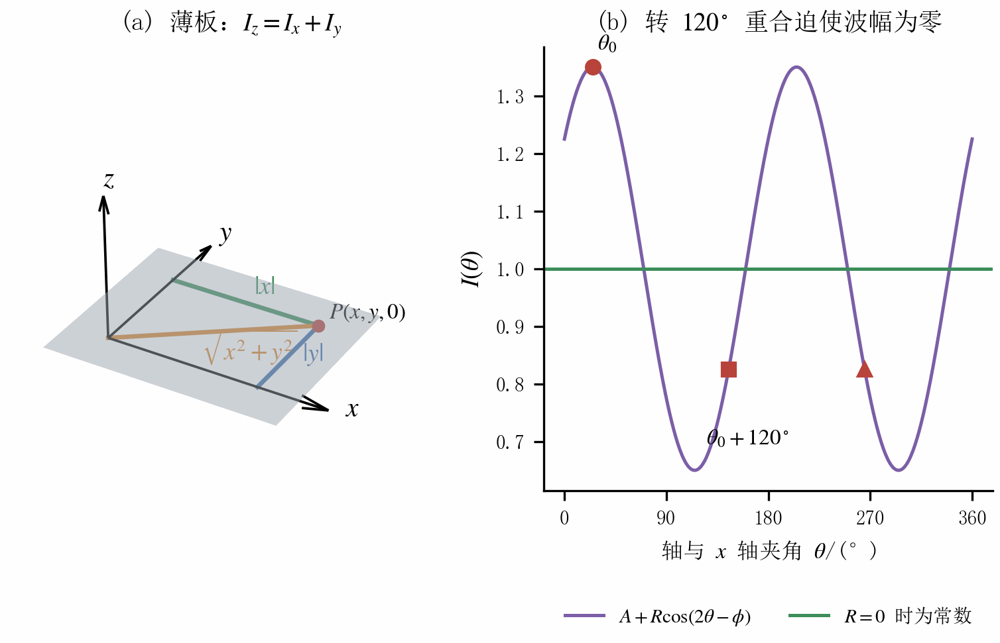

有厚度时，到 \(x\) 轴的距离平方变成 \(y^2+z^2\)，等式不再成立。实心球三根轴都是 \(\tfrac25MR^2\)，显然不满足 \(I_z=I_x+I_y\)；对三维物体只能用上一节的 \(I_x+I_y+I_z=2\int r^2dm\)。

面内轴往往难算，垂直轴往往易算。若 \(I_x=I_y\)，则 \(I_x=I_y=\tfrac12I_z\)。圆盘绕直径为 \(\tfrac14MR^2\)，细圆环绕直径为 \(\tfrac12MR^2\)，都由此得到。

什么时候能断定 \(I_x=I_y\)？取面内过中心、与 \(x\) 轴夹角为 \(\theta\) 的轴，方向为 \((\cos\theta,\sin\theta)\)。点 \((x,y)\) 到它的距离为 \(|x\sin\theta-y\cos\theta|\)。记 \(S_x=\int x^2dm\)、\(S_y=\int y^2dm\)、\(S_{xy}=\int xy\,dm\)，展开平方并用倍角公式，

\[
I(\theta)=S_x\sin^2\theta+S_y\cos^2\theta-2S_{xy}\sin\theta\cos\theta
=\frac{S_x+S_y}{2}+\frac{S_y-S_x}{2}\cos2\theta-S_{xy}\sin2\theta .
\]

后两项总可合成 \(R\cos(2\theta-\phi)\)，其中 \(R=\sqrt{B^2+C^2}\)、\(B,C\) 是两项的系数，所以 \(I(\theta)=A+R\cos(2\theta-\phi)\)。出现 \(2\theta\) 是因为 \(\theta\) 与 \(\theta+180^\circ\) 是同一条直线。若 \(R\neq0\)，这条曲线的最小正周期就是 \(180^\circ\)，任何周期都是 \(180^\circ\) 的整数倍。

正三角形绕中心转 \(120^\circ\) 与自身重合，\(I(\theta)\) 必须以 \(120^\circ\) 为周期，而 \(120^\circ\) 不是 \(180^\circ\) 的整数倍，只能 \(R=0\)。也可直接看最大值：设 \(I(\theta_0)=A+R\)，则 \(I(\theta_0+120^\circ)=A+R\cos240^\circ=A-\tfrac R2\)，对称性要求二者相等，得 \(R=0\)。此时面内过中心的所有轴惯量都相同。正方形转 \(90^\circ\) 重合，同样推出 \(R=0\)。长方形只在转 \(180^\circ\) 时重合，这不提供新条件，所以沿长边和沿短边的惯量可以不同。一般地，只要平面图形转过一个不是 \(180^\circ\) 整数倍的角度后能与自身重合，过该中心的面内各轴惯量就都相等。

**讲解例 1：矩形薄板。** 边长 \(a\times b\)、质量 \(M\) 的均匀薄板，求过中心的三根主轴惯量。取面内过中心、平行于边 \(b\) 的轴，把板切成平行于轴的细条，宽 \(dx\)、长 \(b\)，细条上各点到轴的距离都是 \(|x|\)，\(dm=\dfrac{M}{ab}\,b\,dx=\dfrac Ma\,dx\)，于是
\[
I_{\parallel b}=\int_{-a/2}^{a/2}x^2\frac Ma\,dx=\frac1{12}Ma^2 .
\]
这正是细杆的积分，结果与 \(b\) 无关：沿轴方向挪动质量不改变它到轴的距离。同理 \(I_{\parallel a}=\tfrac1{12}Mb^2\)。由垂直轴定理，垂直板面的中心轴
\[
I_z=\frac1{12}M(a^2+b^2),
\]
正方形时为 \(\tfrac16Ma^2\)。以一条长 \(b\) 的边为轴，用平行轴定理移动 \(a/2\)，得 \(\tfrac1{12}Ma^2+\tfrac14Ma^2=\tfrac13Ma^2\)。

**讲解例 2：三角形薄板，轴平行于底边。** 底边 \(b\)、高 \(h\)、质量 \(M\)，面密度 \(\sigma=2M/(bh)\)。先取过顶点、平行于底边的轴最方便。距顶点 \(y\) 处平行于底边的细条，由相似三角形长为 \(by/h\)，\(dm=\sigma\dfrac{b}{h}y\,dy=\dfrac{2M}{h^2}y\,dy\)，\(b\) 被约去，于是
\[
I_{\text{顶}}=\frac{2M}{h^2}\int_0^h y^3\,dy=\frac12Mh^2 .
\]
质心在中线上距顶点 \(2h/3\)。平行轴定理只能在质心轴与其他轴之间使用，所以先移到质心：
\[
I_C=\frac12Mh^2-M\Bigl(\frac{2h}3\Bigr)^2=\frac1{18}Mh^2,
\qquad
I_{\text{底}}=\frac1{18}Mh^2+M\Bigl(\frac h3\Bigr)^2=\frac16Mh^2 .
\]
若直接从顶点轴加上 \(Mh^2\) 去求底边轴，会得出错误的 \(\tfrac32Mh^2\)。底边结果也可直接积分核对：细条到底边距离为 \(h-y\)，\(\dfrac{2M}{h^2}\displaystyle\int_0^h(h-y)^2y\,dy=\dfrac{2M}{h^2}\cdot\dfrac{h^4}{12}=\dfrac16Mh^2\)。三个结果只含高 \(h\)，与底边长和三角形是否等腰都无关，因为细条平行于轴左右滑动时，到轴的距离不变。

**讲解例 3：任意三角形板，过质心垂直板面。** 底边放在 \(x\) 轴上、中点为原点，两端 \((\mp b/2,0)\)，顶点 \((k,h)\)，\(k\) 是顶点相对底边中点的水平偏移。质心 \(G=(k/3,\,h/3)\)。由垂直轴定理 \(I_G=I_{x'}+I_{y'}\)，其中 \(x'\)、\(y'\) 是过 \(G\) 的面内轴，\(x'\) 平行于底边，由上例 \(I_{x'}=\tfrac1{18}Mh^2\)。求 \(I_{y'}\) 时仍取平行于底边的细条，记 \(t=y/h\)：细条长 \(\ell=b(1-t)\)，中点横坐标 \(x_m=kt\)，质量 \(dm=\sigma\ell h\,dt\)。每根细条是一根细杆，绕 \(y'\) 轴的惯量等于绕自身中点的 \(\tfrac1{12}\ell^2dm\) 加上平移项 \((x_m-k/3)^2dm\)：
\[
I_{y'}=\frac{\sigma b^3h}{12}\int_0^1(1-t)^3dt+\sigma bhk^2\int_0^1(1-t)\Bigl(t-\frac13\Bigr)^2dt
=\frac{Mb^2}{24}+\frac{Mk^2}{18},
\]
两个积分分别为 \(\tfrac14\) 与 \(\tfrac1{36}\)，并用了 \(\sigma bh=2M\)。另两边满足 \(c_{1,2}^2=(k\pm b/2)^2+h^2\)，三边平方和为 \(\tfrac32b^2+2k^2+2h^2\)，除以 36 正好是 \(I_{x'}+I_{y'}\)。因此
\[
I_G=\frac1{36}M(a^2+b^2+c^2),
\]
\(a,b,c\) 为三边长，结果对三边对称，不依赖哪条边被选作底边。正三角形得 \(\tfrac1{12}Ma^2\)，与 9.2 节分成四个小三角形的算法一致；绕顶点垂直板面，顶点到中心距离 \(a/\sqrt3\)，得 \(\tfrac1{12}Ma^2+\tfrac13Ma^2=\tfrac5{12}Ma^2\)。直角边为 \(a,b\) 的直角三角形，斜边平方为 \(a^2+b^2\)，过质心为 \(\tfrac1{18}M(a^2+b^2)\)；质心距直角顶点的平方为 \((a^2+b^2)/9\)，过直角顶点为 \(\tfrac16M(a^2+b^2)\)。

### 9.2 自相似图形的转动惯量

量纲决定了形状固定的均匀物体，惯量只能写成 \(I=c\,Ma^2\)，\(c\) 是只由形状和轴的位置决定的纯数。若一个图形由若干个缩小的自身组成，这个比例关系配合平行轴定理，就能写出关于 \(c\) 的方程。

实心正三角形先作检验。连三边中点把它分成四个边长 \(a/2\)、质量 \(M/4\) 的小正三角形，中间一个倒置。对过中心 \(G\)、垂直纸面的轴，记 \(I_\perp=k\,Ma^2\)。正三角形中心到顶点的距离是高的三分之二，即 \(a/\sqrt3\)；角上小三角形的中心到同一顶点为 \(a/(2\sqrt3)\)，于是它到 \(G\) 的距离 \(d=a/(2\sqrt3)\)，\(d^2=a^2/12\)。中间那份中心就在 \(G\)。四份相加，

\[
k\,Ma^2=4\cdot k\cdot\frac M4\left(\frac a2\right)^2+3\cdot\frac M4\cdot\frac{a^2}{12},
\qquad k=\frac k4+\frac1{16},\qquad k=\frac1{12}.
\]

这正是实心正三角形的已知结果。由上一小节的 \(120^\circ\) 对称，面内过中心各轴都等于 \(\tfrac12I_\perp=\tfrac1{24}Ma^2\)。

谢尔宾斯基三角形由反复操作得到：连中点分成四份，挖去中间一份，再对剩下每一份重复同样的操作，无限进行下去。第一次挖空后，中间区域永远是空的，全部质量都在三个角里；以后的每一次操作都只在某个角的内部进行，而且与对整体所做的操作完全相同，只是尺寸减半。因此无限次之后，每个角恰好是边长 \(a/2\) 的完整谢尔宾斯基三角形。图形的一部分放大后与整体完全相同，这称为自相似。三份只在中点处相接，不重叠，也不遗漏任何质量，惯量可以直接相加。这里的“质量均匀”指三份平分总质量，每份 \(M/3\)；剩余部分的面积趋于零，不能再用面密度描述。

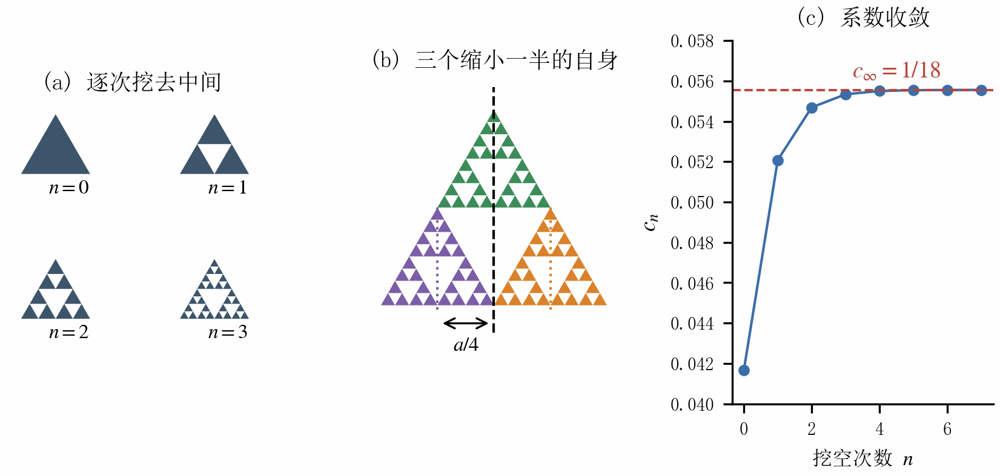

求绕竖直对称轴（过顶点与中心）的惯量 \(I=c\,Ma^2\)。上面一份自身的对称轴就是这根轴；左下、右下两份各占底边的一半，它们的对称轴离大轴 \(a/4\)。每份绕自身对称轴的惯量为 \(c\cdot\tfrac M3\left(\tfrac a2\right)^2=\tfrac{c}{12}Ma^2\)，由平行轴定理，

\[
c\,Ma^2=3\cdot\frac{c}{12}Ma^2+2\cdot\frac M3\left(\frac a4\right)^2
=\frac c4Ma^2+\frac1{24}Ma^2 ,
\]

解得 \(\tfrac34c=\tfrac1{24}\)，\(c=\tfrac1{18}\)，即 \(I=\tfrac1{18}Ma^2\)。

也可先算垂直纸面的轴。三份中心到 \(G\) 的距离都是 \(a/(2\sqrt3)\)，

\[
k\,Ma^2=3\left[k\cdot\frac M3\left(\frac a2\right)^2+\frac M3\cdot\frac{a^2}{12}\right]
=\frac k4Ma^2+\frac1{12}Ma^2,\qquad k=\frac19 .
\]

再由垂直轴定理与 \(120^\circ\) 对称，面内轴为 \(\tfrac12\cdot\tfrac19Ma^2=\tfrac1{18}Ma^2\)，两种算法一致。谢尔宾斯基三角形的惯量大于实心三角形的 \(\tfrac1{24}Ma^2\)，因为中间被挖空，同样的质量分布得更靠外。

上面的方程把小份与整体的 \(c\) 当作同一个数，这只在无限次挖空时成立。只挖 \(n\) 次时，三个小份各只挖了 \(n-1\) 次，与整体形状不同。严格做法是记挖 \(n\) 次后的系数为 \(c_n\)，\(c_0=\tfrac1{24}\) 是实心三角形，同样的分解给出递推

\[
c_{n+1}=\frac{c_n}{4}+\frac1{24}.
\]

两边减去 \(\tfrac1{18}\)，常数项 \(\tfrac1{24}-\tfrac1{18}=-\tfrac1{72}=-\tfrac14\cdot\tfrac1{18}\)，于是

\[
c_{n+1}-\frac1{18}=\frac14\left(c_n-\frac1{18}\right),\qquad
c_n=\frac1{18}-\frac1{72}\left(\frac14\right)^n .
\]

前几项为 \(\tfrac1{24},\tfrac5{96},\tfrac{21}{384},\tfrac{85}{1536},\ldots\)，数值 \(0.0417,0.0521,0.0547,0.0553\)，每挖一次，与 \(\tfrac1{18}\approx0.0556\) 的差距缩为四分之一。\(n\to\infty\) 时 \(c_n\to\tfrac1{18}\)。直接解方程 \(c=\tfrac c4+\tfrac1{24}\)，就是在递推中令 \(c_{n+1}=c_n\) 求不动点；它成立需要两个前提：自相似严格成立，以及极限存在。收缩因子 \(\tfrac14\) 来自份数、质量比与长度比平方的乘积 \(3\times\tfrac13\times\left(\tfrac12\right)^2\)，小于一，所以序列一定收敛。

第三种看法是逐层累加。挖 \(n\) 次后图形是 \(3^n\) 个实心小三角形，每个质量 \(M/3^n\)、边长 \(a/2^n\)。第 \(k\) 层有 \(2\cdot3^{k-1}\) 份需要相对上一级的轴平移 \(a/2^{k+1}\)，该层平移贡献为

\[
2\cdot3^{k-1}\cdot\frac{M}{3^k}\cdot\frac{a^2}{4^{k+1}}=\frac1{24}\left(\frac14\right)^{k-1}Ma^2 .
\]

最底层小三角形绕各自对称轴的惯量合计 \(\tfrac1{24}\left(\tfrac14\right)^nMa^2\)。因此

\[
I_n=\frac1{24}\left(\frac14\right)^nMa^2+\frac{Ma^2}{24}\sum_{k=1}^{n}\left(\frac14\right)^{k-1}.
\]

\(n\to\infty\) 时第一项趋于零：小块越来越小，自身转动的贡献消失，只剩位置的贡献。第二项是公比 \(\tfrac14\) 的等比级数，和为 \(\tfrac43\)，得 \(I=\tfrac{Ma^2}{24}\cdot\tfrac43=\tfrac1{18}Ma^2\)。代 \(n=1\) 得 \(\tfrac1{96}+\tfrac1{24}=\tfrac5{96}\)，与递推一致。

谢尔宾斯基地毯把正方形分成九份，挖去中间一份，对其余八份无限重复。它由八个边长 \(a/3\)、质量 \(M/8\) 的自身组成。以过中心且平行于一边的面内轴为轴 1，以过中心垂直纸面的轴为轴 2。

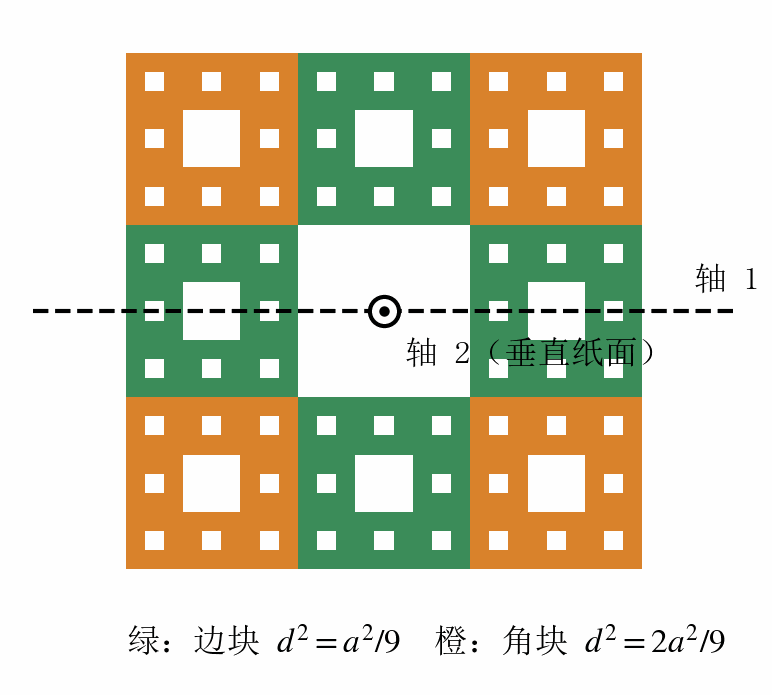

对轴 1，上下两行共六份的中心离轴 \(a/3\)，中间一行两份在轴上。设 \(I_1=c_1Ma^2\)，

\[
c_1=8\cdot c_1\cdot\frac18\cdot\frac19+\frac18\cdot6\cdot\frac19
=\frac{c_1}9+\frac1{12},\qquad c_1=\frac3{32}.
\]

对轴 2，四个边块中心离轴 \(d^2=a^2/9\)，四个角块 \(d^2=2a^2/9\)。设 \(I_2=c_2Ma^2\)，

\[
c_2=\frac{c_2}9+\frac18\left(4\cdot\frac19+4\cdot\frac29\right)=\frac{c_2}9+\frac16,\qquad c_2=\frac3{16}.
\]

正方形转 \(90^\circ\) 重合，面内各轴相等，垂直轴定理要求 \(I_2=2I_1\)，即 \(\tfrac3{16}=2\cdot\tfrac3{32}\)，两条独立的计算相互印证。实心正方形对应的值为 \(\tfrac1{12}\approx0.083\) 与 \(\tfrac16\approx0.167\)，地毯为 \(\tfrac3{32}\approx0.094\) 与 \(\tfrac3{16}\approx0.188\)，挖空同样使惯量增大。收缩因子为 \(8\times\tfrac18\times\left(\tfrac13\right)^2=\tfrac19\)，所以直接解方程同样合法。实心正方形本身也可看作四个缩小一半的自身，由 \(k=\tfrac k4+\tfrac18\) 得到垂直轴 \(\tfrac16Ma^2\)；实心图形的小份拼满整体，自相似图形则每次丢弃一部分，质量越来越偏向外侧。

### 9.3 角动量与定轴转动

角动量和力矩的矢量定义为 \(\mathbf L=\mathbf r\times\mathbf p\)、\(\boldsymbol\tau=\mathbf r\times\mathbf F\)。在惯性系中对固定参考点，\(d\mathbf L/dt=\boldsymbol\tau_{\rm ext}\)。定轴刚体的轴向关系为

\[
L_z=I_z\omega,\qquad \tau_z=I_z\alpha,
\]

第二式还要求惯量不随时间变化。一般三维转动需要惯量张量，\(\mathbf L\) 未必平行于 \(\boldsymbol\omega\)；标量比例式不能当作一般矢量关系。

角动量不沿转轴的情形，可用两个质点明确算出，而不依赖图的倾斜印象。设两个相同质量 \(m\) 的质点在刚性杆上，其位置分别为 \((a,0,b)\) 与 \((-a,0,-b)\)，整体绕固定 \(z\) 轴以角速度 \(\omega\) 转动。在所取瞬间，两点速度为 \((0,\omega a,0)\) 和 \((0,-\omega a,0)\)。逐一作叉乘并相加，得到

\[
\mathbf L=(-2mab\omega,0,2ma^2\omega).
\]

只要 \(a,b\) 均非零，就有横向分量，所以总角动量不平行于 \(z\) 轴。另一方面轴向分量仍满足 \(L_z=I_z\omega\)，其中 \(I_z=2ma^2\)。标量轴向公式正确，与完整矢量不平行完全可以同时成立。维持这样的定轴转动，轴承一般还需提供改变角动量方向的力矩；没有轴向加速，不代表全部外力矩都为零。

若 \(I=0.20\,\mathrm{kg\,m^2}\)，恒力矩 \(0.60\,\mathrm{N\,m}\) 使圆盘从静止转过 \(4\,\mathrm{rad}\)，则 \(\alpha=3\,\mathrm{rad/s^2}\)，做功为 \(2.4\,\mathrm J\)，从 \(I\omega^2/2=W\) 得 \(\omega=\sqrt{24}\,\mathrm{rad/s}\)。变力矩必须积分 \(\int\tau_zd\varphi\)。从 \(dK=I\omega d\omega\) 反向积分得到 \(K=I\omega^2/2+C\)，只有规定静止时动能为零才令 \(C=0\)。

例：质量 \(M\)、半径 \(R\) 的均匀实心圆柱可绕固定水平轴 \(O\) 无摩擦转动，柱面上紧绕轻绳，绳端挂质量 \(m\) 的重物，\(t=0\) 时由静止释放。求圆柱角速度和系统动能随时间的变化。

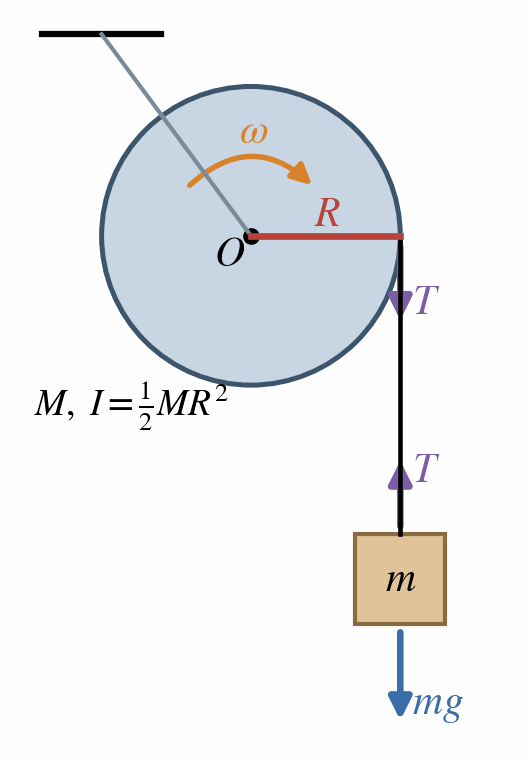

分开列方程时，取向下为重物的正方向。重物 \(ma=mg-T\)；绳拉力作用在柱边，力臂为 \(R\)，圆柱 \(\tfrac12MR^2\alpha=TR\)；绳不打滑，\(a=\alpha R\)。由后两式 \(T=\tfrac12Ma\)，代入第一式，

\[
a=\frac{2mg}{2m+M},\qquad \alpha=\frac{2mg}{(2m+M)R},\qquad \omega=\alpha t=\frac{2mg\,t}{(M+2m)R}.
\]

也可以把圆柱和重物取为一个系统，对固定轴 \(O\) 用角动量定理。绳拉力成为内力；轴的支持力和圆柱重力都过 \(O\)，力矩为零；外力矩只有重物重力 \(mgR\)。重物沿竖直线运动，这条线离 \(O\) 的距离为 \(R\)，所以它对 \(O\) 的角动量为 \(mvR=mR^2\omega\)。系统角动量为

\[
L=\frac12MR^2\omega+mR^2\omega=\left(\frac M2+m\right)R^2\omega .
\]

由 \(dL/dt=mgR\) 且初值为零，\(L=mgRt\)，直接得到同一个 \(\omega\)，不需要求绳拉力。

系统动能为 \(E_k=\tfrac12mv^2+\tfrac12I\omega^2\)，用 \(v=\omega R\) 统一成 \(\omega\)，

\[
E_k=\frac14(M+2m)R^2\omega^2=\frac{m^2g^2t^2}{M+2m}.
\]

检验：重物下降 \(h=\tfrac12at^2=\tfrac{mg\,t^2}{2m+M}\)，重力做功 \(mgh\) 正是上式，动能全部来自重力势能。

**平动与定轴转动的对应。** 至此，定轴转动的各个量和规律都已出现，它们与质点平动一一对应，只需把位移换成转角、质量换成转动惯量、力换成力矩：

| 平动 | 定轴转动 |
|---|---|
| 位移 \(x\) | 转角 \(\varphi\) |
| 速度 \(v=dx/dt\) | 角速度 \(\omega=d\varphi/dt\) |
| 加速度 \(a=dv/dt\) | 角加速度 \(\alpha=d\omega/dt\) |
| 质量 \(m\) | 转动惯量 \(I=\int r^2dm\) |
| 力 \(F\) | 力矩 \(M=Fr\sin\theta\) |
| 牛顿第二定律 \(F=ma\) | 转动定律 \(M=I\alpha\) |
| 动量 \(p=mv\) | 角动量 \(L=I\omega\) |
| \(F=dp/dt\) | \(M=dL/dt\) |
| 冲量 \(\int F\,dt=\Delta p\) | 角冲量 \(\int M\,dt=\Delta L\) |
| 动能 \(\frac12mv^2\) | 转动动能 \(\frac12I\omega^2\) |
| 功 \(\int F\,dx\) | 功 \(\int M\,d\varphi\) |
| 功率 \(Fv\) | 功率 \(M\omega\) |

对应关系便于记忆，但两者并不完全相同：质量是物体的固有性质，转动惯量却与转轴的位置有关（平行轴定理）；角动量守恒的条件是对所选转轴的合外力矩为零，而不是合外力为零。刚体既平动又转动时，总动能为 \(\frac12mv_C^2+\frac12I_C\omega^2\)，其中下标 \(C\) 表示质心。

### 9.4 角动量守恒、冲击与打击中心

对固定轴的外力矩为零时，\(L_z=\sum I_i\omega_i\) 守恒。系统内部若有摩擦，机械能可以减少，角动量仍守恒。两个水平圆盘绕同一竖直轴自由转动，惯量 \(I_1,I_2\)，角速度 \(\omega_1,\omega_2\)。上盘落到下盘上，摩擦使二者最终一起转动。由角动量守恒，

\[
\omega=\frac{I_1\omega_1+I_2\omega_2}{I_1+I_2},\qquad
W_{\rm fr}=-\frac{I_1I_2}{2(I_1+I_2)}(\omega_1-\omega_2)^2 .
\]

摩擦功的形式与 5.1 节完全非弹性碰撞的动能损失相同：惯量代替质量，\(I_1I_2/(I_1+I_2)\) 相当于约化质量，角速度之差相当于相对速度。

站在转盘边缘的人走动，也是内力改变各部分转动而总角动量不变的情形。设人质量 \(m_1\)、视为质点，圆盘质量 \(m_2\)、半径 \(R\)，可绕中心竖直轴自由转动，起初都静止。人相对圆盘沿边缘走过角度 \(\varphi'\)，圆盘相对地面转过 \(\varphi\)，则人相对地面的角速度是 \(\dot\varphi'+\dot\varphi\)。角动量守恒给出

\[
m_1R^2(\dot\varphi'+\dot\varphi)+\frac12m_2R^2\dot\varphi=0
\quad\Longrightarrow\quad
\varphi=-\frac{2m_1}{2m_1+m_2}\varphi'.
\]

对时间积分时，各转角都从零开始，所以速度关系直接变为转角关系，不需要知道人怎样走。负号表示圆盘反向转动。容易出错的地方是把人的角速度写成 \(\dot\varphi'\)：角动量必须用相对惯性系的速度计算。

碰撞或打击时间极短，力很大，常用冲量处理。光滑水平面上一根均匀杆质量 \(m\)、长 \(l\)，在一端受到与杆垂直的水平冲量 \(J\)。光滑面不提供水平冲量，杆是自由的。质心按动量定理运动，绕质心按角动量定理转动：

\[
mv_C=J,\qquad \frac{ml^2}{12}\omega=J\frac l2
\quad\Longrightarrow\quad
v_C=\frac Jm,\ \ \omega=\frac{6J}{ml}.
\]

**讲解例 1。** 取 \(m=5.0\,\mathrm{kg}\)、\(l=0.90\,\mathrm m\)、\(J=3.0\,\mathrm{N\,s}\)。则 \(v_C=0.60\,\mathrm{m/s}\)、\(\omega=4.0\,\mathrm{rad/s}\)。转一整圈用时 \(2\pi/\omega\)，期间质心移动 \(s=v_C\cdot2\pi/\omega=\pi l/3\approx0.94\,\mathrm m\)，这一结果与冲量大小和杆的质量都无关。打击后动能

\[
K=\frac{mv_C^2}{2}+\frac{I_C\omega^2}{2}=\frac{J^2}{2m}+\frac{3J^2}{2m}=\frac{2J^2}{m}=3.6\,\mathrm J .
\]

同样的冲量打在质心时，杆只平动，动能仅 \(J^2/(2m)\)。打在端点时，转动动能是平动动能的三倍。

若杆的上端被固定轴支持，情况就不同了：打击时轴本身可以提供冲击力，杆的动量不再守恒。竖直悬挂的均匀杆质量 \(M\)、长 \(l\)，可绕上端转动；质量 \(m\ll M\) 的子弹水平射入并嵌在下端，杆随后偏转最大角 \(\alpha\)。

**讲解例 2。** 打击过程中，轴的作用力过转轴，对轴的力矩为零，所以对轴的角动量守恒；由 \(m\ll M\)，杆加子弹的惯量取 \(Ml^2/3\)：\(mvl=\tfrac13Ml^2\omega\)。随后上摆过程机械能守恒，\(\tfrac12\cdot\tfrac13Ml^2\omega^2=Mg\tfrac l2(1-\cos\alpha)\)，即 \(\omega^2=6g\sin^2(\alpha/2)/l\)。合起来，

\[
v=\frac Mm\sqrt{\frac{2gl}{3}}\,\sin\frac\alpha2 .
\]

打击前系统动量为 \(mv\)，打击后为杆质心动量 \(M\omega l/2\)。由 \(M\omega l=3mv\)，后者为 \(3mv/2\)，动量增加了 \(mv/2\)。增加的部分来自轴对杆向前的冲击力。这说明“碰撞前后系统动量守恒”只有在外冲量可忽略时才成立，有固定轴时应该首选对轴的角动量守恒。

若子弹打在离轴 \(x\) 处，要求轴上不出现冲击力，就要同时满足 \(mvx=\tfrac13Ml^2\omega\) 和 \(mv=M\omega l/2\)，相除得 \(x=2l/3\)。这一点叫打击中心。用球棒、锤子击打时，打在打击中心附近手上几乎不受冲击，就是这个原因。打击中心的位置一般是 \(x=I_O/(m_{\rm body}\,d_C)\)，其中 \(I_O\) 是物体对轴的惯量，\(d_C\) 是质心到轴的距离；对均匀杆 \(I_O=Ml^2/3\)、\(d_C=l/2\)，正好得 \(2l/3\)。

**茹科夫斯基凳。** 课堂上演示角动量守恒的常用装置是茹科夫斯基凳（скамья Жуковского）：一个转轴竖直、轴承摩擦极小的转凳。人坐在凳上，重力和支持力都平行于转轴，对轴的力矩为零，轴承的摩擦力矩可以忽略，所以由人、凳和手持物体组成的系统，对竖直轴的角动量守恒。人体的动作只是内力，不能改变系统的总角动量，只能改变它在各部分之间的分配。

实验一（系统为学生与哑铃）：学生双手各握一个哑铃，平伸手臂，让凳子转起来，再把手臂收到胸前。哑铃离轴变近，系统的转动惯量由 \(I_1\) 减为 \(I_2\)，由 \(I_1\omega_1=I_2\omega_2\)，
\[
\omega_2=\frac{I_1}{I_2}\,\omega_1>\omega_1 ,
\]
转速加快。花样滑冰运动员收拢手臂后越转越快，是同一原理。角动量不变时，转动动能 \(K=\dfrac{L^2}{2I}\) 与转动惯量成反比，
\[
\frac{K_2}{K_1}=\frac{I_1}{I_2}>1 ,
\]
动能增加了。增加的能量来自学生收臂时所做的功：哑铃做圆周运动需要向心力，把它沿半径拉向转轴时，手的拉力与哑铃的径向位移同向，做正功。这与本节开头两盘摩擦耦合的情形相对照：那里角动量守恒而机械能减少，这里角动量守恒而机械能增加。角动量守恒并不意味着机械能守恒，内力既可以消耗机械能，也可以做正功。

实验二的课件板书后半被遮挡，这里按该装置的典型演示补写，属课程延伸。学生坐在静止的凳上，手持一个绕竖直轴高速转动的车轮，车轮的角动量为 \(L_0\)，方向向上。学生把车轮翻转 \(180^\circ\)，车轮的角动量变为 \(-L_0\)。系统起初的总角动量为 \(L_0\)，所以人和凳必须获得 \(2L_0\) 的角动量，朝车轮原来的转动方向转起来：
\[
I\omega=L_0-(-L_0)=2L_0,\qquad \omega=\frac{2I_{\text{轮}}\,\omega_{\text{轮}}}{I},
\]
其中 \(I\) 是人与凳对竖直轴的转动惯量。若只把车轮转过 \(90^\circ\)，使其转轴变为水平，车轮的角动量在竖直方向的分量变为零，人和凳获得 \(L_0\) 的角动量。

**讲解例 3：茹科夫斯基凳的两个实验（示范数据）。** (1) 学生连同凳子和平伸的哑铃，对轴的转动惯量 \(I_1=6.0\,\mathrm{kg\cdot m^2}\)，角速度 \(\omega_1=1.0\,\mathrm{rad/s}\)；收臂后 \(I_2=2.0\,\mathrm{kg\cdot m^2}\)。求收臂后的角速度和学生做的功。(2) 学生连同凳子的转动惯量 \(I=5.0\,\mathrm{kg\cdot m^2}\)，起初静止，手持车轮 \(I_{\text{轮}}=0.20\,\mathrm{kg\cdot m^2}\)，以 \(\omega_{\text{轮}}=20\,\mathrm{rad/s}\) 绕竖直轴转动。学生把车轮翻转 \(180^\circ\)，求凳子的角速度。

(1) 由角动量守恒，\(\omega_2=\dfrac{6.0}{2.0}\times1.0\,\mathrm{rad/s}=3.0\,\mathrm{rad/s}\)。收臂前后的动能为 \(K_1=\tfrac12\times6.0\times1.0^2\,\mathrm J=3.0\,\mathrm J\)，\(K_2=\tfrac12\times2.0\times3.0^2\,\mathrm J=9.0\,\mathrm J\)，学生做功 \(W=K_2-K_1=6.0\,\mathrm J\)。验算：\(K_2/K_1=3=I_1/I_2\)，与上面的比例关系一致。

(2) 车轮的角动量 \(L_0=0.20\times20\,\mathrm{kg\cdot m^2/s}=4.0\,\mathrm{kg\cdot m^2/s}\)，凳子的角速度 \(\omega=2L_0/I=8.0/5.0\,\mathrm{rad/s}=1.6\,\mathrm{rad/s}\)，方向与车轮原来的转向相同。验算：末态总角动量为 \(5.0\times1.6+0.20\times(-20)=8.0-4.0=4.0\,\mathrm{kg\cdot m^2/s}\)，等于初值 \(L_0\)。

### 9.5 角动量方向的变化：转杆张角与陀螺进动

9.3 节已经指出，定轴转动时 \(\mathbf L\) 未必沿转轴，维持转动需要轴承提供力矩。反过来，若轴不受约束，力矩就会改变 \(\mathbf L\) 的方向。

均匀细杆长 \(l\)，上端用垂直于杆的水平轴铰接，整个装置绕过铰点的竖直轴以恒定角速度 \(\omega\) 匀速旋转，摩擦忽略。求杆与竖直线的夹角 \(\vartheta\)。在随装置转动的参考系中，杆静止，受重力和惯性离心力，二者对铰点的力矩平衡。距铰点 \(s\) 处的质元 \(dm=(m/l)ds\) 受离心力 \(dm\,\omega^2s\sin\vartheta\)，水平方向，力臂为 \(s\cos\vartheta\)；重力的合力矩为 \(mg(l/2)\sin\vartheta\)。于是

\[
\int_0^l\frac ml\omega^2s^2\sin\vartheta\cos\vartheta\,ds=mg\frac l2\sin\vartheta
\quad\Longrightarrow\quad
\cos\vartheta=\frac{3g}{2\omega^2l}\ \ (\vartheta\neq0).
\]

\(\vartheta=0\) 总是平衡解。只有 \(\omega^2>3g/(2l)\) 时右端小于 1，才出现张开的解，此时竖直位置变得不稳定。离心力沿杆不均匀分布，所以不能把它当作作用在质心上的一个力，否则会得到错误的 \(\cos\vartheta=2g/(\omega^2l)\)。

快速自转的陀螺倾斜放在支点上，重力对支点的力矩并不使它倒下，而使其轴绕竖直线缓慢转动，这叫进动。设陀螺质量 \(m\)，对称轴的惯量 \(I\)，自转角速度 \(\omega\)，支点到质心的距离 \(l\)，轴与竖直线夹角 \(\vartheta\)。当自转远快于进动时，近似取 \(\mathbf L\approx I\boldsymbol\omega\) 沿对称轴。重力矩 \(\boldsymbol\tau=\mathbf r_C\times m\mathbf g\) 水平且垂直于 \(\mathbf L\)，大小为 \(mgl\sin\vartheta\)，它只改变 \(\mathbf L\) 的方向。\(\mathbf L\) 的水平分量 \(I\omega\sin\vartheta\) 以进动角速度 \(\omega'\) 转动，其变化率为 \(\omega'I\omega\sin\vartheta\)。令它等于力矩，

\[
\omega'=\frac{mgl}{I\omega},\qquad \boldsymbol\omega'\times\mathbf L=\boldsymbol\tau .
\]

进动角速度与倾角无关，自转越快，进动越慢。

**讲解例 3。** 取 \(m=0.50\,\mathrm{kg}\)、\(I=2.0\times10^{-3}\,\mathrm{kg\,m^2}\)、\(\omega=350\,\mathrm{rad/s}\)、\(l=0.10\,\mathrm m\)、\(\vartheta=30^\circ\)。进动角速度 \(\omega'=0.49/0.70=0.70\,\mathrm{rad/s}\)，比自转慢五百倍，近似成立。质心以 \(\omega'\) 绕竖直线做半径 \(l\sin\vartheta\) 的圆周运动，所需向心力只能来自支点的水平反力：

\[
F=m\omega'^2l\sin\vartheta\approx1.2\times10^{-2}\,\mathrm N,
\]

方向水平指向进动轴。支点的竖直反力近似等于 \(mg\)。俄语 прецессия 是进动，волчок 是陀螺，гироскоп 是陀螺仪。

### 9.6 万有引力与行星运动

角动量守恒最重要的应用之一是行星运动。牛顿万有引力定律指出，任何两个质点之间都存在相互吸引的力，大小与两者质量之积成正比，与距离的平方成反比：

\[
F=\frac{GMm}{r^2},\qquad G\approx6.674\times10^{-11}\,\mathrm{N\cdot m^2/kg^2}.
\]

对质量均匀分布的球体，球外的引力等于全部质量集中在球心时的引力。在地球表面，引力近似等于重力，所以 \(mg=GMm/R^2\)，即 \(GM=gR^2\)，这个关系常用来代替 \(G\) 和地球质量 \(M\)。离地心越远，重力加速度按 \(g(r)=GM/r^2\) 减小。

万有引力是保守力，以无穷远处为势能零点，引力势能为

\[
U=-\frac{GMm}r .
\]

势能为负，表示要把物体移到无穷远需要外界做功。在地面附近 \(r=R+h\)、\(h\ll R\) 时，\(U(R+h)-U(R)\approx GMmh/R^2=mgh\)，回到近地面的重力势能公式。

**圆轨道。** 卫星绕中心天体做半径为 \(r\) 的匀速圆周运动，引力提供向心力，\(GMm/r^2=mv^2/r\)，得到

\[
v=\sqrt{\frac{GM}r},\qquad T=\frac{2\pi r}v=2\pi\sqrt{\frac{r^3}{GM}},\qquad E=\frac12mv^2-\frac{GMm}r=-\frac{GMm}{2r}.
\]

轨道越高，速度越小、周期越长、总能量越大（负得越少）。从低轨道变到高轨道，需要先加速，但到达高轨道后速度反而变小，这是因为动能的一部分转化成了势能。

**三个宇宙速度。** 贴近地面做圆周运动所需的速度称为第一宇宙速度：\(v_1=\sqrt{gR}\approx7.9\,\mathrm{km/s}\)。物体摆脱地球引力所需的最小发射速度称为第二宇宙速度（逃逸速度），由动能等于势能的绝对值，\(\frac12mv^2=GMm/R\)，得 \(v_2=\sqrt{2GM/R}=\sqrt2\,v_1\approx11.2\,\mathrm{km/s}\)。摆脱太阳引力还需要第三宇宙速度，约 \(16.7\,\mathrm{km/s}\)。

**开普勒三定律。** 开普勒从行星观测数据中总结出三条规律，牛顿用万有引力定律对它们作出了解释：

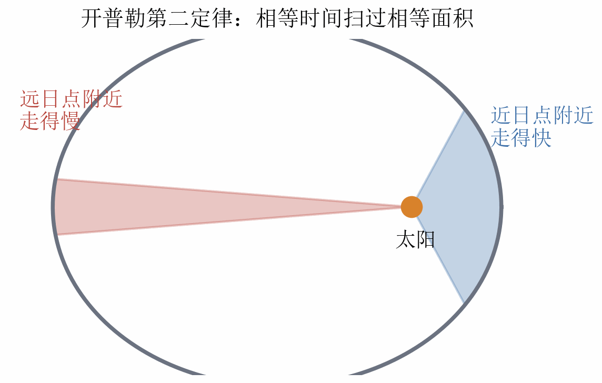

1. 轨道定律：行星沿椭圆轨道运动，太阳位于椭圆的一个焦点上。这是平方反比的引力的结果，轨道方程正是《解析几何》8.6 节的极坐标统一方程。
2. 面积定律：行星与太阳的连线在相等的时间内扫过相等的面积。引力指向太阳，对太阳的力矩为零，角动量 \(L=mr^2\dot\theta\) 守恒，而扫过面积的速率 \(dA/dt=\frac12r^2\dot\theta=L/(2m)\) 为常数，所以行星在近日点运动得快、在远日点运动得慢。
3. 周期定律：行星公转周期的平方与轨道半长轴的立方成正比，\(T^2/a^3=4\pi^2/(GM)\)，对绕同一中心天体的所有行星都相同。圆轨道时 \(a=r\)，就是上面周期公式的平方。

**例：地球同步卫星的高度。** 同步卫星的周期等于地球自转周期 \(T\approx86164\,\mathrm s\)（一个恒星日）。由周期公式，\(r^3=GMT^2/(4\pi^2)\)，取 \(GM\approx3.986\times10^{14}\,\mathrm{m^3/s^2}\)，得 \(r\approx4.22\times10^7\,\mathrm m\)，减去地球半径 \(6.37\times10^6\,\mathrm m\)，高度约为 \(3.58\times10^7\,\mathrm m\)，即约三万六千千米。所有同步卫星都必须在赤道上空的这一高度上。

## 10. 平面运动与纯滚动

刚体各质量元速度可分解为质心速度与相对质心转动速度。动能展开中的交叉项含有 \(\int\mathbf r'dm=0\)，因此

\[
K=\frac12mV_C^2+\frac12I_C\omega^2.
\]

两项分别描述质心移动和相对质心运动，不会重复计算。固定平面上纯滚动的接触点瞬时速度为零，故 \(V_C=\omega R\)。顶部点速率为 \(2V_C\)，接触点为零，质心为 \(V_C\)，三者不能都含糊叫作“球的速度”。

均匀实心圆柱从静止沿斜面滚下高度 \(h\)，\(I_C=mR^2/2\)。忽略滚动阻力，静摩擦作用点瞬时不动，所以

\[
mgh=\frac12mV_C^2+\frac14mV_C^2,
\qquad V_C=\sqrt{\frac{4gh}{3}}.
\]

若还要求摩擦，沿斜面列 \(ma=mg\sin\theta-f\)，绕质心列 \(fR=I_Ca/R\)，得到 \(a=2g\sin\theta/3\)、\(f=mg\sin\theta/3\)，方向向上。纯滚动成立还要求 \(f\leq\mu_smg\cos\theta\)，即 \(\mu_s\geq\tan\theta/3\)。不足时应重新建立滑动与转动模型。静摩擦不做功的结论限定于这里固定、理想刚性平面的约束，运动传送带等情形应另作检查。

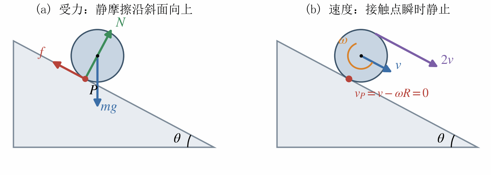

把惯量写成 \(I_C=\kappa mR^2\)，\(\kappa\) 只取决于质量分布。同样三条方程 \(ma=mg\sin\theta-f\)、\(I_C\alpha=fR\)、\(a=\alpha R\) 给出

\[
f=\frac{I_C}{R^2}a=\kappa ma,\qquad a=\frac{g\sin\theta}{1+\kappa},\qquad f=\frac{\kappa}{1+\kappa}mg\sin\theta .
\]

摩擦力为何沿斜面向上：重力和支持力都过质心，不产生对质心的力矩，能使球转起来的只有静摩擦力，它必须提供与滚动方向一致的力矩。实心球 \(\kappa=\tfrac25\)，得 \(a=\tfrac57g\sin\theta\)、\(f=\tfrac27mg\sin\theta\)。纯滚动要求 \(f\le\mu N=\mu mg\cos\theta\)，即

\[
\mu\ge\frac27\tan\theta .
\]

能量法求加速度更快：下滑距离 \(s\) 时 \(mgs\sin\theta=\tfrac12mv^2+\tfrac12\cdot\tfrac25mR^2\cdot\tfrac{v^2}{R^2}=\tfrac7{10}mv^2\)，与 \(v^2=2as\) 对比得同一 \(a\)。但能量式中没有 \(f\)，求不出所需的摩擦系数。能量式里没有摩擦力，并不是因为摩擦力不存在。力的功率看作用点的速度，接触点 \(v_P=v-\omega R=0\)，所以静摩擦的总功率为零。分开看，它对平动做负功 \(-fs\)，通过力矩 \(fR\) 和转角 \(s/R\) 对转动做正功 \(+fs\)，合计为零。摩擦力的作用是把能量从平动搬到转动。对实心球，\(f=\tfrac27mg\sin\theta\)、\(h=s\sin\theta\)，平动动能为 \(mgh-fs=\tfrac57mgh\)，转动动能为 \(fs=\tfrac27mgh\)。若没有摩擦，球不会转起来，转动动能一项就为零。

比较质量同为 \(M\)、外半径同为 \(R_2\) 的实心球与厚球壳从同一斜面纯滚动滚下。接触点在外表面，\(\kappa=I_C/(MR_2^2)\)。厚球壳的 \(\kappa\) 更大：要证

\[
\frac25M\,\frac{R_2^5-R_1^5}{R_2^3-R_1^3}>\frac25MR_2^2 ,
\]

两边约去 \(\tfrac25M\)，乘正数 \(R_2^3-R_1^3\)，得 \(R_2^5-R_1^5>R_2^5-R_2^2R_1^3\)，即 \(R_2^2R_1^3>R_1^5\)，也就是 \(R_2^2>R_1^2\)，对 \(0<R_1<R_2\) 成立。由 \(a=g\sin\theta/(1+\kappa)\)，厚球壳加速度更小，实心球先到底。从能量看，下降同样高度获得同样的总动能 \(Mgh\)，平动所占份额为 \(1/(1+\kappa)\)。实心球为 \(\tfrac57\approx71\%\)；\(R_1=R_2/2\) 的厚球壳 \(\kappa=\tfrac25\cdot\tfrac{31/32}{7/8}=\tfrac{31}{70}\)，平动份额 \(\tfrac{70}{101}\approx69\%\)；薄球壳 \(\kappa=\tfrac23\)，只剩 \(60\%\)，\(a=\tfrac35g\sin\theta\)。质量相同、外半径相同时，质量越靠外，滚得越慢；这一结论与质量、半径的具体数值无关。

纯滚动还可在某一瞬间把接触点当作速度为零的点来计算动能。由平行轴定理 \(I_P=I_C+mR^2\)，故 \(K=I_P\omega^2/2\) 与质心分解完全相同。但接触点通常随时间更换，不能仅因它瞬时速度为零，就把它视为始终固定的转轴，并无条件写关于该点的简单力矩方程。动能的瞬时表示与动力学中参考点如何运动，是两件不同的事。求角动量变化时，先确认选点固定还是运动，再使用适用的定理，能避免由一个正确的能量等式推出错误的受力方程。

纯滚动轮缘上一点的加速度，换一个参考系最容易求。轮心以恒定速度 \(v\) 运动时，随轮心平动的参考系仍是惯性系。在其中轮缘点做匀速圆周运动，所以加速度大小为 \(v^2/R\)，方向始终指向轮心。接触点也不例外：它的速度为零，加速度却是 \(v^2/R\)，方向向上。速度为零的点仍可有加速度，这就是瞬时转轴不能当作固定轴的另一种表现。

**讲解例 1。** 半径 \(R=0.50\,\mathrm m\) 的轮子以 \(v=1.00\,\mathrm{m/s}\) 在水平面上纯滚动。轮缘点的加速度为 \(v^2/R=2.0\,\mathrm{m/s^2}\)。再求该点相继两次接触地面之间走过的路程。以接触点为瞬时转轴，轮缘点到接触点的距离为 \(2R\sin(\varphi/2)\)，其中 \(\varphi\) 是该点从上次着地起转过的角度，所以速率 \(v_A=2v\sin(\varphi/2)\)。又 \(dt=R\,d\varphi/v\)，路程元 \(ds=v_A\,dt=2R\sin(\varphi/2)\,d\varphi\)：

\[
s=\int_0^{2\pi}2R\sin\frac\varphi2\,d\varphi=8R=4.0\,\mathrm m .
\]

这就是摆线一拱的长度。同一段时间内轮心只前进了 \(2\pi R\approx3.1\,\mathrm m\)。

纯滚动并不总是一开始就成立。把一个绕自身轴以 \(\omega_0\) 旋转的均匀实心圆柱（质量 \(m\)、半径 \(R\)）侧面着地放到水平面上，起初质心静止而接触点在滑动，滑动摩擦力 \(kmg\) 向前推动质心，同时减慢转动，直到 \(v=\omega R\) 时进入纯滚动。

**讲解例 2。** 求进入纯滚动后的速度、打滑持续时间和摩擦力做的总功，摩擦系数为 \(k\)。逐一列平动和转动方程当然可以，但更快的方法是对地面上一个固定点取角动量。摩擦力沿地面作用，力臂为零；重力和支持力大小相等，都沿过接触点的竖直线，力矩相互抵消。因此对地面上任一固定点的角动量守恒。起初质心静止，角动量只有自转部分 \(I\omega_0\)；最终角动量为 \(I\omega+mvR\)。令 \(I=mR^2/2\)、\(v=\omega R\)：

\[
\frac12mR^2\omega_0=\frac12mR^2\omega+mR^2\omega
\quad\Longrightarrow\quad
v=\frac{\omega_0R}{3}.
\]

这一结果与摩擦系数无关，摩擦系数只影响达到纯滚动所需的时间。质心加速度 \(a=kg\)，故打滑时间 \(t=v/(kg)=\omega_0R/(3kg)\)。摩擦力的总功等于动能变化：

\[
W=\frac34mv^2-\frac14mR^2\omega_0^2=\frac1{12}mR^2\omega_0^2-\frac14mR^2\omega_0^2=-\frac16mR^2\omega_0^2 .
\]

初始转动动能有三分之二在打滑中耗散为热。这里的摩擦是滑动摩擦，接触点有相对滑动，所以它做功不为零；与前面纯滚动中静摩擦总功为零的结论并不矛盾。

## 11. 平衡与小振动

势能曲线的平衡点满足 \(U'(x_0)=0\)。在附近令 \(\xi=x-x_0\)，展开到二阶：\(U=U(x_0)+U''(x_0)\xi^2/2+\cdots\)。若 \(U''(x_0)>0\)，线性回复力是 \(-U''(x_0)\xi\)，因此

\[
\ddot\xi+\omega_0^2\xi=0,\qquad \omega_0=\sqrt{U''(x_0)/m}.
\]

若二阶导数为负，偏离会扩大；若为零，必须研究更高阶项。单凭斜率为零不能判断稳定。

取 \(U=-ax^2+bx^4\)，\(a,b>0\)。平衡点为 \(x=0\) 及 \(x=\pm\sqrt{a/(2b)}\)。二阶导数为 \(-2a+12bx^2\)，故中心点不稳定，左右两点稳定，稳定点附近角频率为 \(2\sqrt{a/m}\)。这里 \(a\) 的单位是 \(\mathrm{J/m^2}\)，\(b\) 是 \(\mathrm{J/m^4}\)。

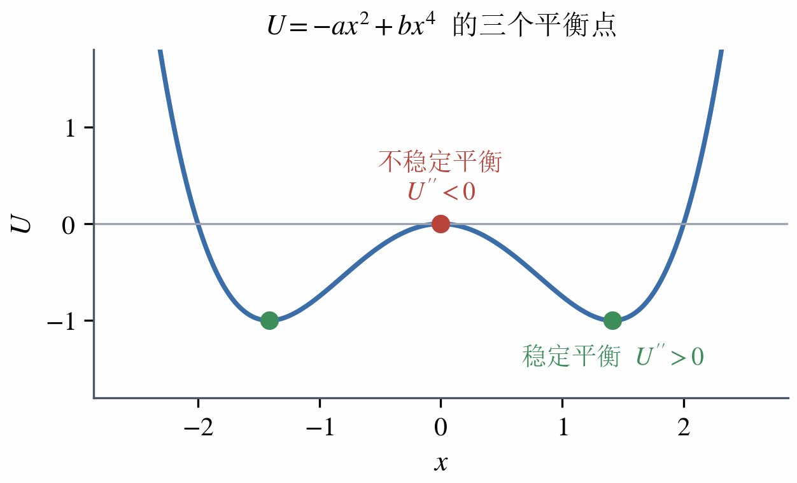

单摆精确方程是 \(\ddot\theta+(g/l)\sin\theta=0\)，只有小振幅近似 \(\sin\theta\approx\theta\) 时，周期才为 \(2\pi\sqrt{l/g}\)。圆锥摆则有恒定倾角，球沿水平圆周运动。绳张力记 \(T_s\)，有 \(T_s\cos\theta=mg\)、\(T_s\sin\theta=m\omega^2l\sin\theta\)。对非零倾角得到

\[
\omega^2=\frac{g}{l\cos\theta},\qquad T_{\rm period}=2\pi\sqrt{\frac{l\cos\theta}{g}}.
\]

这不是单摆往复振动的精确周期，零倾角时也不能把原式中除去的 \(\sin\theta\) 当成非零。

### 11.1 简谐运动的一组等价描述

小振动方程 \(\ddot\xi+\omega_0^2\xi=0\) 已给出动力学，初值决定振幅和相位。若 \(\xi(0)=\xi_0,\ \dot\xi(0)=v_0\)，则
\[
\xi(t)=\xi_0\cos\omega_0t+\frac{v_0}{\omega_0}\sin\omega_0t.
\]
它也可写成 \(A\cos(\omega_0t+\varphi)\)，其中
\[
A=\sqrt{\xi_0^2+(v_0/\omega_0)^2},\quad
A\cos\varphi=\xi_0,\quad
-A\omega_0\sin\varphi=v_0.
\]
只用一个反正切求相位可能丢失象限，应结合正弦、余弦的符号确定。周期 \(T=2\pi/\omega_0\)，频率 \(f=1/T\)，二者与角频率的单位和数值均不同。

求导得速度和加速度，消去相位得到
\[
v^2=\omega_0^2(A^2-\xi^2),\qquad
a=-\omega_0^2\xi.
\]
速度最大值 \(A\omega_0\) 出现在平衡位置，加速度最大绝对值 \(A\omega_0^2\) 出现在两端。平方的速度式没有方向信息，同一位置可分别向左、向右通过，求 v 时必须依据运动阶段取符号。

对弹簧 \(k=m\omega_0^2\)，机械能为
\[
E=\frac12mv^2+\frac12k\xi^2=\frac12kA^2.
\]
初值式、相位式、速度位置式和能量式描述同一理想运动：前两式适合找时刻，第三式适合找指定位置的速率，能量式适合比较振幅。引入阻尼后能量不再恒定，这组固定振幅关系不能原样沿用。

转动小振动也具有同一结构。若角位移很小且回复力矩约为 \(-\kappa\theta\)，则 \(I\ddot\theta+\kappa\theta=0\)，角频率为 \(\sqrt{\kappa/I}\)。复摆的质心距悬轴 d，惯量为 \(I_O\)，重力矩线性化为 \(-mgd\theta\)，于是周期为 \(2\pi\sqrt{I_O/(mgd)}\)。当质量集中于距悬点 l 处时，\(I_O=ml^2,d=l\)，才还原成小振幅单摆公式。

### 11.2 由能量积分还原运动过程

能量式没有时间，仍能用来求时间规律。取位移 \(\xi\) 从平衡位置量起，弹簧质量忽略，系统无摩擦、无外力做功，且 \(k>0,m>0\)。当振幅为 \(A>0\) 时，端点速度为零，因而
\[
\frac12m\dot\xi^2+\frac12k\xi^2=\frac12kA^2,
\qquad \dot\xi=\pm\omega_0\sqrt{A^2-\xi^2},
\qquad \omega_0=\sqrt{k/m}.
\]
开平方出现的正负号对应运动方向。它在一次单调运动中固定，到转折点后改变，不能在积分中随意切换。若质点在 \(t=0\) 从右端 \(\xi=A\) 静止释放，随后向左运动，在 \(0<t<\pi/\omega_0\) 上必须取负号：
\[
\frac{d\xi}{\sqrt{A^2-\xi^2}}=-\omega_0\,dt.
\]
令 \(u=\xi/A\)。因为 \(A>0\)，有 \(d\xi=A\,du\)、\(\sqrt{A^2-\xi^2}=A\sqrt{1-u^2}\)，故左边化为 \(du/\sqrt{1-u^2}\)，原函数是 \(\arcsin u\)。从端点起积分须理解为端点处的收敛瑕积分，得到
\[
\arcsin\frac{\xi}{A}-\frac{\pi}{2}=-\omega_0t,
\qquad
\xi=A\sin\left(\frac\pi2-\omega_0t\right)=A\cos\omega_0t.
\]
这条反正弦等式只覆盖从右端到左端的半个周期。反正弦的主值在 \([-\pi/2,\pi/2]\)，所以不能把 \(\arcsin(\xi/A)=\pi/2-\omega_0t\) 当作任意时刻都成立的等式。到达左端后速度转为正，再按相应方向积分；各段在位置和速度上衔接，合起来仍是余弦运动。等价地，可以把所得余弦函数代回二阶运动方程并核对初值，从而确认它在整个时间轴上的延拓。

若初始位置只是某个 \(\xi_0\)，而 \(v_0\ne0\)，则 \(\xi_0\) 不等于振幅，必须先由 \(A^2=\xi_0^2+v_0^2/\omega_0^2\) 确定能量。课上有时用 \(x_0\) 表示释放端点，另一些地方却用它表示平衡位置或初始位置；符号的含义需要先明确，不能仅因下标相同就混用。

更一般地，一维保守系统满足 \(m\dot x^2/2+U(x)=E\)，允许运动的区域为 \(U(x)\le E\)。若相邻两个简单转折点是 \(x_-,x_+\)，且其间 \(E>U(x)\)、往返时间有限，则一次完整振动的周期为
\[
T=\sqrt{2m}\int_{x_-}^{x_+}\frac{dx}{\sqrt{E-U(x)}}.
\]
根号中的非负条件决定运动范围，积分前的因子包含来回两个过程。代入 \(U=kx^2/2\)、\(E=kA^2/2\)，并用 \(\int_{-A}^{A}dx/\sqrt{A^2-x^2}=\pi\)，才得到 \(T=2\pi\sqrt{m/k}\)。一般势能的周期可能随能量或振幅改变，不能把理想二次势的等时性推广到所有往复运动。

### 11.3 动能、势能与相位的对应

记 \(\theta=\omega_0t+\varphi\)，由 \(\xi=A\cos\theta\) 得 \(v=-A\omega_0\sin\theta\)。以平衡位置的势能为零，二者的能量为
\[
\begin{aligned}
E_p&=E\cos^2\theta=\frac E2(1+\cos2\theta),\\
E_k&=E\sin^2\theta=\frac E2(1-\cos2\theta),
\qquad E=\frac12kA^2.
\end{aligned}
\]
两项始终非负，且相加为常量。位移过半个周期后变号，能量却恢复原值，因此非零振动的动能和势能变化周期为 \(T/2\)，对应角频率 \(2\omega_0\)。这不表示质点在半个周期内已经回到同一运动状态。势能对位移的图像是抛物线，对时间的图像是余弦平方；横轴不同，图像形状也不同。

动能与势能相等要求 \(\cos^2\theta=\sin^2\theta=1/2\)，因而
\[
|\xi|=\frac{A}{\sqrt2},\qquad
|v|=\frac{A\omega_0}{\sqrt2},\qquad
\theta=\frac\pi4+n\frac\pi2\quad(n\in\mathbb Z).
\]
一个周期内共有四个这样的时刻，不能只凭平方后的关系认定位置为正或速度为正。对任意一整周期取时间平均，\(\cos^2\theta\) 与 \(\sin^2\theta\) 的平均均为一半，于是 \(\langle E_p\rangle=\langle E_k\rangle=E/2\)。这是周期平均相等，两个能量在大多数瞬间并不相等。

**完整示例。** 以下参数用于教学演示：\(m=0.20\,\mathrm{kg}\)、\(k=5.0\,\mathrm{N/m}\)，质点从右端 \(A=0.10\,\mathrm m\) 静止释放。计算得 \(\omega_0=5.0\,\mathrm{s^{-1}}\)、\(T=2\pi/5\,\mathrm s\)、\(E=0.025\,\mathrm J\)。第一次到达 \(\xi=A/2\) 时仍向左，故 \(\cos(5t)=1/2\)，取这一运动阶段内的 \(t=\pi/15\,\mathrm s\)，而不是任取余弦的全部反解。速度为 \(-\sqrt3 A\omega_0/2=-0.433\,\mathrm{m/s}\)，势能为 \(E/4=0.00625\,\mathrm J\)，动能为 \(3E/4=0.01875\,\mathrm J\)，两者之和回到总能量。第一次能量相等则更早发生在 \(t=\pi/20\,\mathrm s\)，位置为 \(A/\sqrt2\)。

能量还给出相平面中的曲线：
\[
\frac{\xi^2}{A^2}+\frac{v^2}{A^2\omega_0^2}=1.
\]
这是以位移、速度为坐标的椭圆，不是质点在真实空间中走过的轨迹。右端 \((A,0)\) 的加速度为负，运动随即进入 \(v<0\) 的下半平面；这个方向信息再次说明，仅有椭圆方程还不足以表达时间演化的方向。

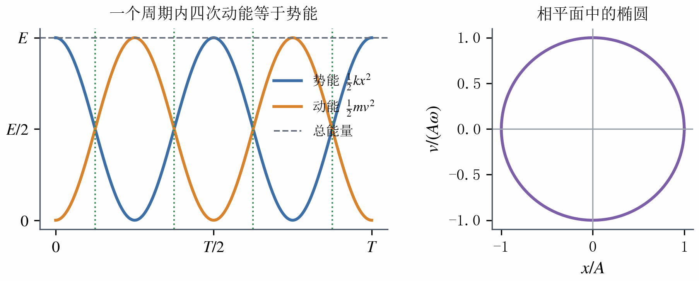

### 11.4 平衡位置的移动与等效弹簧

竖直悬挂的弹簧中，取自然长度处为 \(y=0\)，向下为正。若弹簧始终在线性工作范围内，则
\[
m\ddot y=mg-ky,\qquad
y_{\rm eq}=\frac{mg}{k}.
\]
令 \(\xi=y-y_{\rm eq}\)，便得到 \(m\ddot\xi=-k\xi\)。恒定重力移动了平衡位置，却没有改变这个理想模型的固有角频率。把弹性势能和重力势能一起配方，也得到
\[
U(y)=\frac12ky^2-mgy
=\frac12k(y-y_{\rm eq})^2-\frac{m^2g^2}{2k}.
\]
相对最低势能计算振动能量时，才可直接使用 \(E=kA^2/2\)。若从弹簧自然长度处静止释放，则 \(\xi(0)=-mg/k\)，振幅为 \(mg/k\)，最低点伸长为 \(2mg/k\)。这里的伸长、相对平衡位置的位移和振幅是三个不同量。

多根理想轻弹簧可先化为等效劲度系数。并联时各根伸长相同，回复力相加，故 \(k_{\rm eq}=k_1+k_2\)。串联且中间连接点质量忽略时，两根承受相同拉力 F，总伸长为 \(F/k_1+F/k_2\)，所以
\[
\frac1{k_{\rm eq}}=\frac1{k_1}+\frac1{k_2},\qquad
k_{\rm eq}=\frac{k_1k_2}{k_1+k_2},\qquad
\omega_0=\sqrt{k_{\rm eq}/m}.
\]
公式依赖上述约束和轻弹簧假设。若连接点也有不可忽略的质量，系统通常有多个自由度，不能仍把整个系统当作只有一个频率的单质点振子。

### 11.5 阻尼振动

前四节的振子没有能量损失，振幅永远不变。实际物体在空气或液体中运动时，还受到介质的黏滞阻力。速度不大时，这种阻力与速度成正比、方向相反，写作
\[
F_r=-r\,\frac{dx}{dt},
\]
其中 \(r>0\) 是阻力系数，单位为 \(\mathrm{kg/s}\)。它与桌面上的干摩擦 \(F_{\rm тр}=\mu N\) 不同：干摩擦大小近似不变，方向随运动方向翻转，方程在每次换向时都要分段处理；黏滞阻力随速度连续变化，方程始终是线性的。俄语课上把劲度系数记作 \(\kappa\)，本节沿用这一记号，它就是前面的 \(k\)。

**运动方程。** 竖直悬挂时，按 11.4 节以平衡位置为原点，重力与弹簧的初始伸长相互抵消。这一步对阻尼方程同样成立：从自然长度量起的坐标 \(X\) 满足 \(m\ddot X=mg-\kappa X-r\dot X\)，令 \(x=X-mg/\kappa\)，常数平移不改变一、二阶导数，\(mg\) 与 \(\kappa\cdot mg/\kappa\) 恰好抵消。恒力只决定物体最后停在哪里，不影响振动方式；干摩擦方向会变，不能这样一次消去。于是
\[
m\frac{d^2x}{dt^2}=-\kappa x-r\frac{dx}{dt}.
\]
两边除以 \(m\)，记
\[
\omega_0^2=\frac{\kappa}{m},\qquad 2\beta=\frac{r}{m},
\]
得到阻尼振动的标准方程
\[
\frac{d^2x}{dt^2}+2\beta\frac{dx}{dt}+\omega_0^2x=0.
\]
\(\omega_0\) 仍是无阻尼时的固有角频率；\(\beta\) 称为阻尼系数（коэффициент затухания），单位为 \(\mathrm{s^{-1}}\)。取 \(2\beta\) 而非 \(\beta\) 作系数，是为了让后面的结果不出现分数。

**用指数因子化为简谐方程。** 课上的解法不直接套特征方程，而是换一个变量，把衰减部分分离出去。令
\[
y=e^{\beta t}x .
\]
逐次求导：
\[
\frac{dy}{dt}=\beta e^{\beta t}x+e^{\beta t}\frac{dx}{dt},\qquad
\frac{d^2y}{dt^2}=\beta^2e^{\beta t}x+2\beta e^{\beta t}\frac{dx}{dt}+e^{\beta t}\frac{d^2x}{dt^2}.
\qquad(**)
\]
另一方面，把原方程乘以恒正的 \(e^{\beta t}\)，得
\[
e^{\beta t}\frac{d^2x}{dt^2}+2\beta e^{\beta t}\frac{dx}{dt}+\omega_0^2y=0.
\qquad(*)
\]
把 (*) 与 (**) 左右分别相加。(*) 的左边整体等于零，相加等于在 (**) 两边同加零，等式仍成立；这样做的目的，是让 \(e^{\beta t}\ddot x\) 与 \(2\beta e^{\beta t}\dot x\) 在两边同时出现，从而可以划去。剩下
\[
\frac{d^2y}{dt^2}+\omega_0^2y=\beta^2y,\qquad
\frac{d^2y}{dt^2}+(\omega_0^2-\beta^2)y=0 .
\]
也可以把 (*) 移项为 \(e^{\beta t}\ddot x+2\beta e^{\beta t}\dot x=-\omega_0^2y\) 再代入 (**)，结果相同。若把新变量取成 \(\omega_0^2e^{\beta t}x\)，推导同样成立，只是多带一个无用的常数因子。

**弱阻尼的解。** 当 \(\beta<\omega_0\) 时，记
\[
\omega_1^2=\omega_0^2-\beta^2 ,
\]
\(y\) 满足的正是 11.1 节的简谐方程。验证余弦解：若 \(y=y_0\cos\omega_1t\)，则 \(\dot y=-y_0\omega_1\sin\omega_1t\)，\(\ddot y=-\omega_1^2y\)，代入为零。二阶导数等于自身乘负常数，这一性质只有正弦、余弦的组合具备；指数函数两次求导符号不变，多项式求导后次数降低，都不满足。一般解是 \(y=A_0\cos(\omega_1t+\varphi)\)，换回原变量，
\[
x(t)=A_0e^{-\beta t}\cos(\omega_1t+\varphi),\qquad
\omega_1=\sqrt{\omega_0^2-\beta^2}.
\]
余弦负责往复，指数因子使振幅 \(A(t)=A_0e^{-\beta t}\) 单调减小。因为 \(|\cos|\le1\)，曲线始终夹在两条包络线 \(\pm A_0e^{-\beta t}\) 之间，并在余弦等于 \(\pm1\) 的时刻与包络线相切。严格说这时的运动不再是周期运动，但相邻两次同向过平衡位置的时间间隔恒为
\[
T=\frac{2\pi}{\omega_1}=\frac{2\pi}{\sqrt{\omega_0^2-\beta^2}},
\]
习惯上仍称为周期（условный период）。由于 \(\omega_1<\omega_0\)，有阻尼时振动略微变慢。

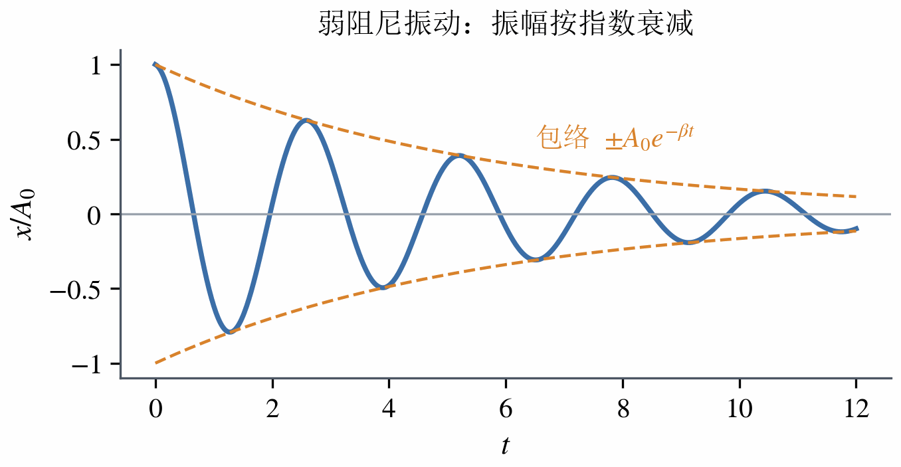

取 \(\varphi=0\) 时 \(x(0)=A_0\)，但初速度并不为零：对乘积求导，
\[
\frac{dx}{dt}=-A_0e^{-\beta t}\left(\omega_1\sin\omega_1t+\beta\cos\omega_1t\right),
\]
\(t=0\) 时为 \(-\beta A_0\)。与 11.1 节不同，从端点静止释放时初相不是零，需由两个初值重新求 \(A_0\) 与 \(\varphi\)。

**速度的合成形式。** 括号中两项可用辅助角合成。由 \(\omega_1^2+\beta^2=\omega_0^2\)，三个量构成以 \(\omega_0\) 为斜边的直角三角形。令
\[
\omega_1=\omega_0\cos\psi,\qquad \beta=\omega_0\sin\psi,\qquad
\psi=\operatorname{arctg}\frac{\beta}{\omega_1}\in\left(0,\frac\pi2\right),
\]
则 \(\omega_1\sin\omega_1t+\beta\cos\omega_1t=\omega_0\sin(\omega_1t+\psi)\)，于是
\[
\frac{dx}{dt}=-A_0\omega_0e^{-\beta t}\sin(\omega_1t+\psi)
=A_0\omega_0e^{-\beta t}\cos\left(\omega_1t+\psi+\frac\pi2\right).
\]
速度振幅的系数是斜边 \(\omega_0\)，不是 \(\omega_0^2\)；改写成余弦时必须同时加上 \(\pi/2\) 并去掉负号。用 \(t=0\) 检验：两种写法都给出 \(-A_0\omega_0\sin\psi=-\beta A_0\)，与直接求导一致。没有阻尼时 \(\psi=0\)，回到 \(\dot x=-A_0\omega_0\sin\omega_0t\)。阻尼越大，速度相对位移多出的相位 \(\psi\) 越大。

**衰减快慢的三个量。** 振幅降为初值的 \(1/e\)（约 37%）所需的时间称为弛豫时间（время релаксации）：
\[
A(\tau)=A_0e^{-\beta\tau}=\frac{A_0}{e}\quad\Longrightarrow\quad \tau=\frac1\beta .
\]
相隔一个周期的两个振幅之比为
\[
\frac{A(t)}{A(t+T)}=\frac{A_0e^{-\beta t}}{A_0e^{-\beta(t+T)}}=e^{\beta T},
\]
与起点 \(t\) 无关：无论从哪一个峰量起，每过一个周期振幅都缩小同一倍数。它的自然对数称为对数衰减率（логарифмический декремент затухания）：
\[
\lambda=\ln\frac{A(t)}{A(t+T)}=\beta T=\frac{T}{\tau}.
\]
于是 \(1/\lambda=\tau/T=N_e\)，即振幅降到 \(1/e\) 之前完成的振动次数。实验中直接读相邻峰值求 \(\lambda\)，再由周期得到 \(\beta\)，比测阻力系数本身容易。

第三个量是品质因数（добротность）：
\[
Q=\frac{\pi}{\lambda}=\pi N_e .
\]
取 \(\pi\) 的理由来自能量。振动能量正比于振幅平方，一个周期后变为原来的 \(e^{-2\lambda}\) 倍。\(\lambda\ll1\) 时 \(e^{-2\lambda}\approx1-2\lambda\)，每周期损失的能量比例 \(\Delta E/E\approx2\lambda\)，所以
\[
Q=\frac{\pi}{\lambda}\approx2\pi\frac{E}{\Delta E},
\]
即 \(2\pi\) 乘以储存能量与每周期耗散能量之比。弱阻尼时 \(T\approx2\pi/\omega_0\)，又有 \(Q\approx\omega_0/(2\beta)\)。这两个近似式都只在 \(\beta\ll\omega_0\) 时成立；阻尼较大时 \(Q=\pi/\lambda\) 仍可作定义，但能量解释不再精确。作为数量级，空气中的单摆 \(Q\) 约为几百，石英晶体振子可达 \(10^5\) 以上。

**三种阻尼情形（课程延伸）。** 上面的解要求 \(\beta<\omega_0\)。若 \(\beta>\omega_0\)，\(y\) 的方程变为 \(\ddot y-\gamma^2y=0\)，\(\gamma=\sqrt{\beta^2-\omega_0^2}\)，解是 \(e^{\pm\gamma t}\) 的组合，
\[
x=C_1e^{-(\beta-\gamma)t}+C_2e^{-(\beta+\gamma)t},
\]
两项都衰减，物体不再往复，最多越过平衡位置一次，称为过阻尼或非周期运动，俄语为 апериодический режим。若 \(\beta=\omega_0\)，\(y\) 满足 \(\ddot y=0\)，故 \(y=C_1+C_2t\)，\(x=(C_1+C_2t)e^{-\beta t}\)，称为临界阻尼。这与微积分与微分方程册中特征根为一对复根、两个实根和二重根的三种情形一一对应，自动控制册的阻尼比 \(\zeta=\beta/\omega_0\) 也是同一个量。

直观上容易以为阻尼越大回得越快，其实不然。过阻尼时衰减较慢的一项指数为 \(\beta-\gamma\)，当 \(\beta\gg\omega_0\) 时
\[
\beta-\sqrt{\beta^2-\omega_0^2}\approx\frac{\omega_0^2}{2\beta},
\]
\(\beta\) 越大反而越小，物体像在蜂蜜中一样缓慢爬回平衡位置。在不发生振荡的前提下回到平衡位置最快的是临界阻尼，仪表指针和车门闭门器常按接近临界阻尼设计。

**完整示例（教学演示数据）。** 设 \(m=0.50\,\mathrm{kg}\)，\(\kappa=200\,\mathrm{N/m}\)，\(r=0.40\,\mathrm{kg/s}\)。则 \(\omega_0=\sqrt{200/0.50}=20\,\mathrm{s^{-1}}\)，\(\beta=r/(2m)=0.40\,\mathrm{s^{-1}}\)，属弱阻尼。\(\omega_1=\sqrt{400-0.16}\approx19.996\,\mathrm{s^{-1}}\)，与 \(\omega_0\) 只差万分之二，周期 \(T\approx0.3142\,\mathrm s\)。弛豫时间 \(\tau=2.5\,\mathrm s\)，对数衰减率 \(\lambda=\beta T\approx0.1257\)，\(N_e=1/\lambda\approx7.96\)，\(Q=\pi/\lambda\approx25.0\)，与 \(\omega_0/(2\beta)=25\) 吻合。十个周期后振幅剩下 \(e^{-10\lambda}\approx0.285\)，即约 28.5%；能量剩下这个数的平方，约 8.1%。

### 11.6 受迫振动与共振

阻尼使自由振动终将停止。若要维持振动，必须由外界持续做功。设一个以角速度 \(\omega\) 匀速转动的轮子通过连杆周期性地推拉物体，外力为 \(F=F_m\cos(\omega t-\varphi_0)\)。牛顿第二定律在 11.5 节的基础上只多出这一项：
\[
m\frac{d^2x}{dt^2}=-\kappa x-r\frac{dx}{dt}+F_m\cos(\omega t-\varphi_0).
\]
除以 \(m\)，记 \(f_m=F_m/m\)，得受迫振动（вынужденные колебания）方程
\[
\frac{d^2x}{dt^2}+2\beta\frac{dx}{dt}+\omega_0^2x=f_m\cos(\omega t-\varphi_0).
\]
这里有两个不同的角频率：\(\omega_0\) 由弹簧和质量决定，是系统自身的固有频率；\(\omega\) 由外界的驱动决定。

**解的分解。** 把左边记为 \(L[x]=\ddot x+2\beta\dot x+\omega_0^2x\)。它对 \(x\) 是线性的，所以 \(L[x_1+x_2]=L[x_1]+L[x_2]\)。令 \(x=x_1+x_2\)，其中
\[
L[x_1]=0,\qquad L[x_2]=f_m\cos(\omega t-\varphi_0),
\]
二者之和就满足原方程。\(x_1\) 正是 11.5 节的阻尼自由振动，含因子 \(e^{-\beta t}\)，经过几个弛豫时间 \(\tau=1/\beta\) 后可以忽略；开始阶段两部分叠加，运动看起来不规则，之后只剩 \(x_2\)，称为稳态受迫振动。稳态与初始条件无关，初始条件只影响已经衰减掉的 \(x_1\)。

**稳态振幅与相位。** 外力以 \(\omega\) 周期变化，稳态时物体被带动，也应以同一 \(\omega\) 振动，只是振幅和相位待定。设
\[
x_2=a\cos(\omega t-\varphi),\qquad \alpha=\omega t-\varphi .
\]
求导得 \(\dot x_2=-a\omega\sin\alpha\)，\(\ddot x_2=-a\omega^2\cos\alpha\)。代入并除以 \(a\)：
\[
(\omega_0^2-\omega^2)\cos\alpha-2\beta\omega\sin\alpha=\frac{f_m}{a}\cos(\omega t-\varphi_0).
\]
记 \(A=\omega_0^2-\omega^2\)，\(B=-2\beta\omega\)，左边是 \(A\cos\alpha+B\sin\alpha\)。按辅助角公式，以 \(A,B\) 为直角边、\(\sqrt{A^2+B^2}\) 为斜边，取角 \(\delta\) 使
\[
\cos\delta=\frac{A}{\sqrt{A^2+B^2}},\qquad \sin\delta=\frac{-B}{\sqrt{A^2+B^2}},
\]
则
\[
A\cos\alpha+B\sin\alpha=\sqrt{A^2+B^2}\,(\cos\delta\cos\alpha-\sin\delta\sin\alpha)=\sqrt{A^2+B^2}\cos(\alpha+\delta).
\]
方程两边都化为“振幅乘余弦”，对一切 \(t\) 相等，振幅和相位必须分别相等：
\[
\sqrt{A^2+B^2}=\frac{f_m}{a},\qquad -\varphi+\delta=-\varphi_0 .
\]
由此
\[
a=\frac{f_m}{\sqrt{(\omega_0^2-\omega^2)^2+4\beta^2\omega^2}},\qquad
\operatorname{tg}(\varphi-\varphi_0)=\frac{2\beta\omega}{\omega_0^2-\omega^2}.
\]
\(\delta=\varphi-\varphi_0\) 是位移落后于外力的相位。由于 \(\sin\delta=2\beta\omega/\sqrt{A^2+B^2}>0\)，\(\delta\) 必在 \((0,\pi)\) 内；当 \(\omega>\omega_0\) 时正切的分母为负，\(\delta\) 落在 \((\pi/2,\pi)\)，不能直接取反正切的主值。等价的做法是比较 \(\cos\alpha\)、\(\sin\alpha\) 的系数，得到 \(a(\omega_0^2-\omega^2)=f_m\cos\delta\) 与 \(2\beta\omega a=f_m\sin\delta\)，两式平方相加即得振幅，相除即得相位。

**三个频率区段。** \(\omega\to0\) 时 \(a\to f_m/\omega_0^2=F_m/\kappa\)，就是恒力下的静态伸长，\(\delta\to0\)，物体与外力同步；共振曲线因此不从零出发。\(\omega=\omega_0\) 时 \(a=f_m/(2\beta\omega_0)\)，\(\delta=\pi/2\)，位移比外力落后四分之一周期，速度则与外力同相，外力在整个周期内都做正功。\(\omega\gg\omega_0\) 时分母中的 \(\omega^4\) 占主导，\(a\approx f_m/\omega^2\to0\)，\(\delta\to\pi\)，外力换向太快，物体来不及跟随，且与外力反相。

**共振频率。** 振幅最大即分母最小。令 \(D=(\omega_0^2-\omega^2)^2+4\beta^2\omega^2\)，\(a=f_mD^{-1/2}\)，由链式法则
\[
\frac{da}{d\omega}=-\frac{f_m}{2D^{3/2}}\cdot\frac{dD}{d\omega},\qquad
\frac{dD}{d\omega}=2(\omega_0^2-\omega^2)(-2\omega)+8\beta^2\omega
=4\omega\left[2\beta^2-(\omega_0^2-\omega^2)\right].
\]
分母恒正，只需分子为零。一个根是 \(\omega=0\)，对应曲线左端的水平切线，不是峰。另一个由方括号为零给出：
\[
\omega_{\text{рез}}=\sqrt{\omega_0^2-2\beta^2}.
\]
也可令 \(u=\omega^2\)，对二次函数 \(D(u)\) 求最小值，结果相同。代回得
\[
D_{\min}=4\beta^4+4\beta^2(\omega_0^2-2\beta^2)=4\beta^2(\omega_0^2-\beta^2),\qquad
a_{\max}=\frac{f_m}{2\beta\sqrt{\omega_0^2-\beta^2}}.
\]
共振（резонанс）频率略低于 \(\omega_0\)，阻尼越大偏离越多；它也不等于自由阻尼振动的 \(\omega_1=\sqrt{\omega_0^2-\beta^2}\)。三者满足 \(\omega_{\text{рез}}<\omega_1<\omega_0\)，弱阻尼时差别可以忽略。若 \(2\beta^2\ge\omega_0^2\)，即 \(\beta\ge\omega_0/\sqrt2\)，方括号在 \(\omega>0\) 上不再为零，振幅从静态值起单调减小，曲线没有共振峰。弱阻尼时
\[
a_{\max}\approx\frac{f_m}{2\beta\omega_0}=\frac{\omega_0}{2\beta}\cdot\frac{f_m}{\omega_0^2}=Q\cdot\frac{F_m}{\kappa},
\]
共振振幅约为静态位移的 \(Q\) 倍。

**共振曲线的宽度。** 能量正比于 \(a^2\)。振幅降到 \(a_{\max}/\sqrt2\approx0.707\,a_{\max}\) 时，能量为峰值的一半，这两个频率称为半功率点，共振曲线的宽度（ширина резонансной кривой）定义为二者之差 \(\Delta\omega\)。弱阻尼时只需考虑 \(\omega\) 接近 \(\omega_0\) 的区域，用
\[
\omega_0^2-\omega^2=(\omega_0-\omega)(\omega_0+\omega)\approx2\omega_0(\omega_0-\omega),\qquad 4\beta^2\omega^2\approx4\beta^2\omega_0^2,
\]
得 \(D\approx4\omega_0^2\left[(\omega_0-\omega)^2+\beta^2\right]\)，峰值处 \(D\approx4\omega_0^2\beta^2\)。振幅降为 \(1/\sqrt2\) 等价于 \(D\) 加倍，即 \((\omega_0-\omega)^2=\beta^2\)，两侧各偏 \(\beta\)，所以
\[
\Delta\omega=2\beta,\qquad Q=\frac{\omega_0}{\Delta\omega}\quad(\beta\ll\omega_0).
\]
近似式中用到了 \(\omega+\omega_0\approx2\omega_0\)，阻尼较大、峰很宽时不再准确。至此品质因数有四种写法：
\[
Q=\frac{\pi}{\lambda}=\frac{\pi}{\beta T}\approx\frac{\omega_0}{2\beta}\approx\frac{\omega_0}{\Delta\omega}.
\]
前两式从时间上描述自由振动衰减得多慢，后两式从频率上描述共振峰有多窄。同一系统衰减越慢，共振峰就越高越窄；收音机选台利用的正是高 \(Q\) 回路只对很窄频带有强响应。

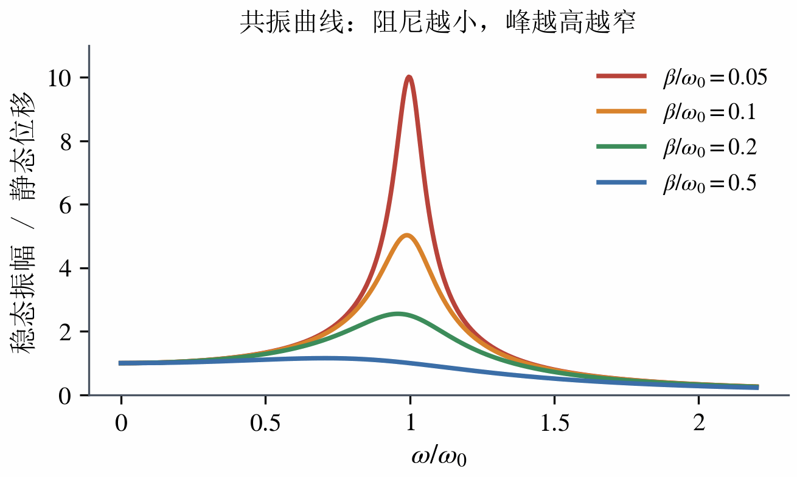

**完整示例（续用 11.5 节的教学演示数据）。** 在 \(m=0.50\,\mathrm{kg}\)、\(\kappa=200\,\mathrm{N/m}\)、\(r=0.40\,\mathrm{kg/s}\) 的振子上施加 \(F_m=1.0\,\mathrm N\) 的周期力，\(f_m=2.0\,\mathrm{m/s^2}\)。静态位移 \(F_m/\kappa=5.0\,\mathrm{mm}\)。共振频率 \(\omega_{\text{рез}}=\sqrt{400-0.32}\approx19.992\,\mathrm{s^{-1}}\)，最大振幅
\[
a_{\max}=\frac{2.0}{2\times0.40\times19.996}\approx0.125\,\mathrm m,
\]
约为静态位移的 25 倍，与 \(Q\approx25\) 一致。共振宽度 \(\Delta\omega=2\beta=0.80\,\mathrm{s^{-1}}\)，\(\omega_0/\Delta\omega=25\)。若改用 \(\omega=40\,\mathrm{s^{-1}}\) 驱动，\(D=(400-1600)^2+4\times0.16\times1600=1\,441\,024\)，\(a=2.0/1200.4\approx1.67\,\mathrm{mm}\)，小于静态位移；\(\operatorname{tg}\delta=32/(-1200)\)，按 \(\delta\in(\pi/2,\pi)\) 取 \(\delta=\pi-0.0267\approx3.115\,\mathrm{rad}\)，位移几乎与外力反相。

## 12. 广义坐标与拉格朗日方程

约束系统中，直接逐个求约束力可能冗长。若先用独立广义坐标写出各点位置，再求动能和势能，就能在同一形式下处理不同几何结构。对保守系统，\(L=T-U\)，运动方程为

\[
\frac{d}{dt}\frac{\partial L}{\partial\dot q_i}-\frac{\partial L}{\partial q_i}=0.
\]

该方程可由固定端点的作用量驻值推出。令 \(S=\int_{t_1}^{t_2}Ldt\)，\(q\) 有微小变化 \(\delta q\)，端点变化为零。对 \(\delta S\) 中含 \(\delta\dot q\) 的项分部积分，边界项消失，余下积分的系数必须为零，便得到上式。所谓最小作用量原理更准确地说是驻值原理，并非每一条实际轨迹都对应全局最小值。

设质量 \(m_1\) 的支座在光滑水平面上移动，坐标为 \(x\)，质量 \(m_2\) 的摆球以长 \(l\) 悬挂，摆角 \(\varphi\) 从竖直向下量起。向上为纵轴正向，则球的位置为 \(x_2=x+l\sin\varphi\)、\(y_2=-l\cos\varphi\)，因此

\[
v_2^2=\dot x^2+2l\dot x\dot\varphi\cos\varphi+l^2\dot\varphi^2.
\]

交叉项来自两个速度的点积，不能因坐标独立而删去。势能取 \(-m_2gl\cos\varphi\)，则

\[
L=\frac12(m_1+m_2)\dot x^2+m_2l\dot x\dot\varphi\cos\varphi
+\frac12m_2l^2\dot\varphi^2+m_2gl\cos\varphi.
\]

因 \(L\) 不显含 \(x\)，其共轭动量 \((m_1+m_2)\dot x+m_2l\dot\varphi\cos\varphi\) 为常量，正是水平总动量。两个运动方程为

\[
(m_1+m_2)\ddot x+m_2l(\ddot\varphi\cos\varphi-\dot\varphi^2\sin\varphi)=0,
\]

\[
l\ddot\varphi+\ddot x\cos\varphi+g\sin\varphi=0.
\]

第二式中含 \(\dot x\dot\varphi\sin\varphi\) 的两项在正确求导后相消。小振幅时线性化并消去 \(\ddot x\)，得到角频率平方 \(g(m_1+m_2)/(m_1l)\)，说明活动支点不能当成固定支点。

若给拉格朗日量增加 \(dF(q,t)/dt\)，作用量只增加端点差 \(F(q_2,t_2)-F(q_1,t_1)\)。固定端点下该差的变分为零，因而运动方程不变。此结论要求加入的是全时间导数；随意加一个普通位置函数通常会改变力和轨迹。有非保守作用时，应在拉格朗日方程右端加入相应广义力。

变分与时间微分有不同含义。\(\dot q\) 是同一条轨迹沿时间的变化率，\(\delta q\) 是在同一时刻比较两条邻近候选轨迹的差。设 \(q_\varepsilon=q+\varepsilon\eta(t)\)，其中 \(\eta(t_1)=\eta(t_2)=0\)。对参数 \(\varepsilon\) 求导并在零处取值：

\[
\delta S=\int_{t_1}^{t_2}\left(L_q\eta+L_{\dot q}\dot\eta\right)dt
=\left[L_{\dot q}\eta\right]_{t_1}^{t_2}
+\int_{t_1}^{t_2}\left(L_q-\frac d{dt}L_{\dot q}\right)\eta\,dt.
\]

边界项为零，是因为端点构型固定，绝不是因为端点的速度必须为零。端点处的 \(L_{\dot q}\) 可以非零。由于区间内部的 \(\eta\) 可以自由选择，积分对所有这种变化都为零，才推出欧拉—拉格朗日方程。这个论证说明，边界条件与中间的积分运算共同决定结果，不能把“积分等于零”一般地理解为被积函数逐点为零。

以单摆为例，\(T=ml^2\dot\theta^2/2\)、\(U=mgl(1-\cos\theta)\)。对角速度求偏导先得到 \(ml^2\dot\theta\)，再作时间导数得到 \(ml^2\ddot\theta\)；对角度求偏导得到 \(-mgl\sin\theta\)，因此精确方程是 \(ml^2\ddot\theta+mgl\sin\theta=0\)。这里求偏导时把 \(\theta\) 与 \(\dot\theta\) 视为拉格朗日函数的独立自变量，最后再代回真实轨迹；这与它们沿轨迹由时间导数联系并不冲突。

对理想约束做了坐标消元，约束力常不必显式出现，但不表示约束力不存在。若还要求绳张力，应在求得运动后返回牛顿径向方程；若消元的约束可能失效，例如细绳松弛，应检查约束力是否满足其物理限制，并在必要时改换模型。分析力学的简洁并不免除对模型边界的判断。

外场模型还涉及研究对象的缩小。设封闭系统由 \(A,B\) 两部分组成，\(L=T_A+T_B-U(q_A,q_B)\)。若 \(B\) 的运动被当作已知函数 \(q_B(t)\)，只研究 \(A\)，则相互作用变成 \(U(q_A,t)\)，而 \(T_B\) 只是已知的时间函数，不含正在变分的 \(q_A,\dot q_A\)，不会进入 \(A\) 的欧拉—拉格朗日方程。因此可写 \(L_A=T_A-U(q_A,t)\)。这里不是说外部装置没有能量，而是其能量不参与当前待求坐标的变分；装置若需由未知反馈共同决定，就不能擅自把它当作已知外场。

双摆使动能交叉项的几何来源更加明确。固定悬点，杆长 \(l_1,l_2\)，两角均从竖直向下量起，向上为纵轴正向。第一球位置是 \((l_1\sin\varphi_1,-l_1\cos\varphi_1)\)，第二球位置为它再加 \((l_2\sin\varphi_2,-l_2\cos\varphi_2)\)。第二球的速度平方展开后，交叉系数含 \(\cos\varphi_1\cos\varphi_2+\sin\varphi_1\sin\varphi_2\)，即两相对速度方向夹角的余弦。于是

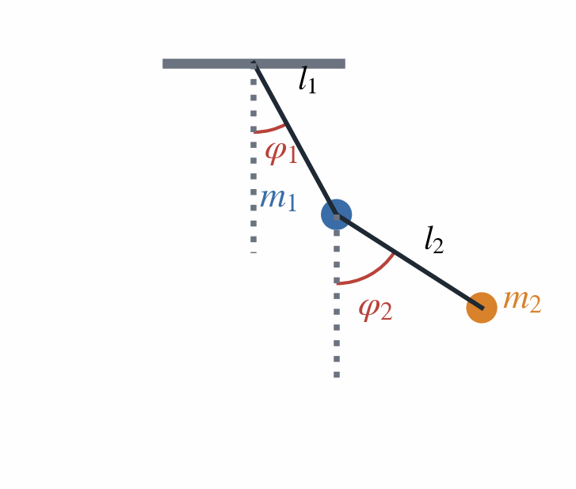

\[
L=\frac12(m_1+m_2)l_1^2\dot\varphi_1^2+
\frac12m_2l_2^2\dot\varphi_2^2+
m_2l_1l_2\cos(\varphi_1-\varphi_2)\dot\varphi_1\dot\varphi_2
+(m_1+m_2)gl_1\cos\varphi_1+m_2gl_2\cos\varphi_2.
\]

若两杆瞬时平行，余弦为一，交叉项最大；若两相对速度垂直，余弦为零。独立角坐标不保证速度方向垂直，所以不能以“两个自由度不同”为由删掉交叉项。令 \(\Delta=\varphi_1-\varphi_2\)，求导后得到完整运动方程：

\[
(m_1+m_2)l_1^2\ddot\varphi_1+m_2l_1l_2\cos\Delta\,\ddot\varphi_2
+m_2l_1l_2\sin\Delta\,\dot\varphi_2^2+(m_1+m_2)gl_1\sin\varphi_1=0,
\]

\[
m_2l_2^2\ddot\varphi_2+m_2l_1l_2\cos\Delta\,\ddot\varphi_1
-m_2l_1l_2\sin\Delta\,\dot\varphi_1^2+m_2gl_2\sin\varphi_2=0.
\]

对运动悬点，可直接展示全导数怎样化简。设悬点的已知坐标为 \(x_0(t),y_0(t)\)，摆球坐标为 \(x=x_0+l\sin\varphi\)、\(y=y_0-l\cos\varphi\)。展开动能，依赖角速度的交叉项是

\[
ml\dot\varphi(\dot x_0\cos\varphi+\dot y_0\sin\varphi)
=\frac d{dt}[ml(\dot x_0\sin\varphi-\dot y_0\cos\varphi)]
-ml\ddot x_0\sin\varphi+ml\ddot y_0\cos\varphi.
\]

丢去纯时间项和这个明确写出的全导数后，有等价的

\[
L_{eq}=\frac12ml^2\dot\varphi^2-ml\ddot x_0\sin\varphi
+ml\ddot y_0\cos\varphi+mgl\cos\varphi.
\]

因此运动方程是 \(l\ddot\varphi+\ddot x_0\cos\varphi+(g+\ddot y_0)\sin\varphi=0\)。水平振动 \(x_0=a\cos\gamma t,y_0=0\) 时，约化拉格朗日量多出 \(mla\gamma^2\cos\gamma t\sin\varphi\)；竖直振动 \(y_0=a\cos\gamma t\) 时，则多出 \(-mla\gamma^2\cos\gamma t\cos\varphi\)。这里纵轴向上；若教材的悬点坐标向下为正，相应的竖直项符号会改变，不能只对照末式正负判断谁对谁错。

再取 \(x_0=a\cos\gamma t,y_0=a\sin\gamma t\)，悬点沿竖直圆周运动，组合项为 \(mla\gamma^2\sin(\varphi-\gamma t)\)。这说明交叉速度项化成外部加速度项后并没有丢失外部驱动，反而更清楚地显示哪种悬点加速度促使摆动。

还有一类系统既绕轴转动又改变形状。明确规定一个理想机构：顶点固定，两侧各有质量 \(m_1\)，距竖直轴 \(a\sin\theta\)、高度 \(-a\cos\theta\)；下端质量 \(m_2\) 在轴上，高度 \(-2a\cos\theta\)；两侧方位角按已知 \(\Omega t\) 转动，杆质量忽略。这些几何关系就是模型定义，不依赖缺失原图。

每个侧球的形变速度大小为 \(a\dot\theta\)，绕轴速度为 \(a\Omega\sin\theta\)，两者垂直，故速度平方相加。下球无绕轴速度，竖直速度为 \(2a\sin\theta\dot\theta\)。总拉格朗日量为

\[
L=a^2(m_1+2m_2\sin^2\theta)\dot\theta^2
+m_1a^2\Omega^2\sin^2\theta+2ag(m_1+m_2)\cos\theta.
\]

旋转项来自真实的切向速度，不是凭空增加一个能量。在形状恒定的非零角平衡下，\(\partial L/\partial\theta=0\)，得到 \(\cos\theta=g(m_1+m_2)/(m_1a\Omega^2)\)，还需右端不超过一、几何约束允许该角度。因 \(\Omega\) 由外部装置维持，装置可交换能量，不能把约化系统的普通机械能直接宣称为封闭系统守恒量。

## 13. 热学基础与气体中的声速

热学沿用能量记账，但系统内部还有大量微观自由度。采用系统吸热为正、气体对外做功为正的约定，第一定律为 \(\Delta U=Q-W\)。理想气体有 \(pV=nRT\)，温度用开尔文；固定自由度、热容近似不变时 \(U=nC_VT\)。准静态边界功为 \(\int p\,dV\)，不可逆过程中还应区分气体压强和外界压强。

一摩尔理想气体在 \(300\,\mathrm K\) 下可逆等温膨胀到两倍体积，内能不变，而 \(W=RT\ln2\approx1.73\,\mathrm{kJ}\)，所以必须吸收同样的热量。若改为绝热，则 \(Q=0\)，对外做功使内能降低，温度通常下降。可逆绝热关系 \(pV^\gamma=\text{常量}\) 还需要热容比近似不变，不能把绝热与等温混同。这里的 \(\gamma\) 是热容比 \(C_p/C_V\)，与第 14 章的洛伦兹因子 \(\gamma_v\) 只是字母相近。

热容比还决定气体中的声速。声波中的压缩和膨胀快到来不及与周围交换热量，按绝热过程处理，声速为 \(v=\sqrt{\gamma RT/M}\)，\(M\) 是摩尔质量。分子有 \(i\) 个自由度时 \(C_V=\tfrac i2R\)、\(C_p=C_V+R\)，故 \(\gamma=C_p/C_V=(i+2)/i\)；空气主要由双原子分子组成，\(i=5\)，\(\gamma=7/5=1.4\)，\(293\,\mathrm K\) 时 \(v\approx343\,\mathrm{m/s}\)。反过来测出声速即可求 \(\gamma=v^2M/(RT)\)，《概率统计与实验数据处理》册第 9.3 节用箱体谐振实验完整展开这一测量。上面用到的平衡态、状态方程与等值过程，13.1 节先从概念上建立起来，13.2 节再给出它们的分子解释。13.3、13.4 节讨论第一、第二定律和熵；13.5、13.6 节用统计方法给出分子的速率分布和在外力场中的分布，13.7 节说明熵的统计意义，13.8 节转向必须考虑分子大小和分子力的实际气体与相变。

### 13.1 热力学系统、平衡态与理想气体状态方程

力学把物体简化为质点或绝对刚体（俄文缩写 АТТ），不考虑内部结构与内部运动。物体处于不同聚集态（агрегатное состояние：固态、液态、气态、等离子态）并相互作用时，这种简化不再够用，必须考虑大量原子、分子的运动。分子之间的作用力在较远距离上表现为吸引，在很近距离上表现为排斥，二者都来源于电磁相互作用；有的课件把远程吸引归于引力，这不准确，引力在分子尺度上小到可以忽略。吸引力倾向于把粒子束缚在一起，热运动的动能倾向于把它们分开，二者谁占优势决定了物质处于哪种聚集态：温度低时动能小，物质为固态；温度升高，粒子间的联系减弱，物质依次变为液态和气态。

由大量粒子组成的系统称为宏观系统。能与外界、并在内部各部分之间交换能量的一组宏观物体，称为热力学系统（термодинамическая система）。研究多粒子系统（система многих частиц）有三种方法：

1. 动力学方法：列出每个粒子的运动方程。\(N\) 个粒子需要 \(3N\) 个坐标和 \(3N\) 个速度分量，共 \(6N\) 个量；一立方厘米空气中约有 \(10^{19}\) 个分子，初始数据既无法测定也无法代入求解，而且分子碰撞极其频繁，个别粒子的状态信息很快就失去意义。这一方法对多粒子系统不可行。
2. 统计方法：在动力学的基础上用概率论研究大量粒子的平均值与分布，得到的是统计规律，如 13.2 节由分子碰撞导出的压强公式。
3. 热力学方法：不涉及内部结构，只用描述系统整体的宏观参量（压强 \(p\)、体积 \(V\)、温度 \(T\)），以能量守恒等普遍定律为基础，如 13.3 节的第一定律。

**平衡态与平衡过程。** 若系统的全部状态参量保持不变，而且这种不变是自发维持的，不依靠外界干预，这个状态称为平衡态（равновесное состояние）。任其自然的孤立系统总会趋向平衡态，趋向所需的特征时间称为弛豫时间。系统从一个状态变到另一个状态称为热力学过程。若过程中每一个中间状态都是平衡态，过程称为平衡过程，也称准静态过程。

“平衡态不变”与“过程中状态在变”并不矛盾，关键在于过程进行得足够缓慢。设气缸中气体的活塞上堆着细沙，每次取走一粒，气体只膨胀极小的一点，随即重新达到压强、温度处处均匀的平衡态；再取走一粒，又到达下一个平衡态。整个过程可以看成一连串平衡态依次排列，在任何一步停止取沙，系统都会停留在当时的状态，这正符合平衡态的定义。反之，若猛然拉开活塞，靠近活塞处的气体变稀，远处的气体还来不及响应，各处压强不同，系统没有确定的 \(p\)。判断过程能否看作平衡过程的条件是
\[
\tau_{\text{过程}}\gg\tau_{\text{弛豫}} ,
\]
即过程持续的时间远大于系统恢复平衡所需的时间。严格的平衡过程是理想化，现实中只能无限接近。\(p\)—\(V\) 图上的每一点代表一个平衡态，所以只有平衡过程才能画成连续曲线，非平衡过程的中间状态没有确定的 \(p,V,T\)，在图上画不出来。俄语课件把平衡过程与可逆过程（обратимый процесс）当作同义词：可逆过程能反向进行，并依次经过与正向相同的各个状态。严格地说，可逆还要求没有摩擦等耗散，准静态是可逆的必要条件而非充分条件；13.4 节讨论熵时用的正是这一区别。

**理想气体。** 理想气体是由有质量、无大小、彼此间无相互作用的质点组成的气体模型。更准确的两个条件是：分子本身的体积远小于气体占据的体积；分子相互作用的作用半径远小于分子间的平均距离。两条说的都是气体足够稀薄。常温常压下的普通气体近似满足，压强很高或温度很低时偏离明显。

**温标。** 常用温标以一个大气压下水的冰点和沸点为基准：

| 温标 | 冰点 | 沸点 | 与摄氏温度 \(t\) 的换算 |
|---|---|---|---|
| 摄氏温标 | \(0\,^\circ\mathrm C\) | \(100\,^\circ\mathrm C\) | — |
| 热力学温标（开尔文） | \(273.15\,\mathrm K\) | \(373.15\,\mathrm K\) | \(T=t+273.15\) |
| 华氏温标 | \(32\,^\circ\mathrm F\) | \(212\,^\circ\mathrm F\) | \(t_F=\tfrac95t+32\) |
| 列氏温标 | \(0\,^\circ\mathrm R\) | \(80\,^\circ\mathrm R\) | \(t_R=0.8\,t\) |

有的课件把沸点误印为 73.15 K，由 \(273.15+100\) 即可发现。气体定律中的温度一律用开尔文。

**门捷列夫—克拉佩龙方程。** 实验发现，常温、大气压下的氧气、氮气等气体近似满足
\[
\frac{pV}{T}=b=\text{常量},
\]
\(b\) 与气体的质量成正比，气体越稀薄，关系越准确。写出比例系数，就得到理想气体状态方程，俄语教材称为门捷列夫—克拉佩龙方程（уравнение Менделеева—Клапейрона，1874 年）：
\[
pV=\frac mM\,RT=\nu RT,\qquad \nu=\frac mM,\qquad R\approx8.31\,\mathrm{J/(mol\cdot K)} ,
\]
其中 \(\nu\) 是物质的量（本章其余各节记作 \(n\)），\(M\) 是摩尔质量，即一摩尔物质的质量。俄语课件指出，压强不超过一个大气压时，实际气体的 \(pV/(\nu RT)\) 与一的偏差不超过百分之一。

摩尔是计数单位，不是质量单位。旧定义是：一摩尔物质所含结构单元（原子或分子）的数目，等于 \(12\,\mathrm g\) 碳-12 所含的原子数；自 2019 年起，国际单位制直接规定阿伏伽德罗常数
\[
N_A=6.02214076\times10^{23}\,\mathrm{mol}^{-1},
\]
一摩尔就是含 \(N_A\) 个结构单元的物质的量。\(N_A\) 的单位是 \(\mathrm{mol}^{-1}\)。摩尔质量按化学式把相对原子质量相加，例如乙醇 \(\mathrm{C_2H_5OH}\) 含 2 个碳、6 个氢（\(\mathrm C_2\mathrm H_5\) 中 5 个、\(\mathrm{OH}\) 中 1 个）、1 个氧，
\[
M=2\times12+6\times1+1\times16=46\,\mathrm{g/mol}=0.046\,\mathrm{kg/mol}.
\]

**阿伏伽德罗定律。** 由状态方程，一摩尔气体的体积 \(V_m=RT/p\) 只取决于 \(T\) 和 \(p\)，与气体种类无关：相同温度和压强下，一摩尔任何（理想）气体所占体积相同。标准状况（нормальные условия）取 \(T_0=273.15\,\mathrm K\)、\(p_0=1\,\mathrm{atm}=1.013\times10^5\,\mathrm{Pa}\)，
\[
V_m=\frac{RT_0}{p_0}=\frac{8.31\times273.15}{1.013\times10^5}\,\mathrm{m^3/mol}\approx22.4\times10^{-3}\,\mathrm{m^3/mol}=22.4\,\mathrm{L/mol}.
\]
若把压强粗取为 \(10^5\,\mathrm{Pa}\)，算得的是 \(0.0227\,\mathrm{m^3}\)，即 \(22.7\,\mathrm L\)；课件中“\(p_0=10^5\,\mathrm{Pa}\) 得 22.4 L”的写法在数值上不自洽，22.4 L 对应的是 \(1.013\times10^5\,\mathrm{Pa}\)。

**等值过程。** 固定一定量气体的某个参量，由状态方程立即得到三条实验定律：

1. 等温过程（\(T\) 不变）：\(pV=\) 常量，玻意耳—马略特定律，常量与 \(T\) 成正比。
2. 等容过程（изохорический，\(V\) 不变）：\(p/T=\) 常量，常量与 \(1/V\) 成正比。
3. 等压过程（изобарический，\(p\) 不变）：\(V/T=\) 常量，常量与 \(1/p\) 成正比。

俄语课件把等容规律称为查理定律、等压规律称为盖-吕萨克定律；也有教材把两个名称反过来用，或都归于盖-吕萨克，阅读时以公式为准。由 \(p=\dfrac{\nu R}{V}T\) 和 \(V=\dfrac{\nu R}{p}T\) 可见，\(p\)—\(T\) 图上的等容线与 \(V\)—\(T\) 图上的等压线都是过原点的直线，斜率分别为 \(\nu R/V\) 与 \(\nu R/p\)。所以等容线中体积越大的那条越平，\(V_2>V_1\) 的直线位于下方；等压线中压强越大的越平。靠近原点的一段通常画成虚线：温度很低时实际气体液化，不再遵守理想气体定律，这一段只是外推。各直线外推后交于 \(T=0\)，这正是引出绝对零度概念的历史途径之一。

**状态方程的密度形式。** 把 \(pV=\dfrac mM RT\) 两边同除以 \(V\)，记密度 \(\rho=m/V\)，得
\[
p=\frac{\rho RT}{M},\qquad \rho=\frac{pM}{RT}.
\]
同一种气体在两个状态下的密度之比为
\[
\frac{\rho}{\rho_0}=\frac{p}{p_0}\cdot\frac{T_0}{T}.
\]
所以只要知道某个参考状态（例如标准状况）下的密度 \(\rho_0\)，不必知道摩尔质量，就能求出任意状态下的密度；反过来，由 \(\rho_0\) 也能得到组合量 \(M/(RT_0)=\rho_0/p_0\)，它常常在题目中整体出现。例如空气 \(M=0.029\,\mathrm{kg/mol}\)，标准状况下 \(\rho_0=\dfrac{1.013\times10^5\times0.029}{8.31\times273}\,\mathrm{kg/m^3}\approx1.29\,\mathrm{kg/m^3}\)。

**混合气体与道尔顿分压定律。** 几种彼此不发生化学反应的理想气体装在同一容器中，每种气体的分子都充满整个容器，并且与其他种类的分子没有相互作用。因此第 \(i\) 种气体单独占据整个容器时产生的压强，即分压（парциальное давление），为
\[
p_i=\frac{\nu_iRT}{V},
\]
混合气体的总压强等于各分压之和：
\[
p=\sum_i p_i=\frac{\left(\sum_i\nu_i\right)RT}{V}.
\]
这就是道尔顿定律（закон Дальтона）。它说明混合气体整体仍满足状态方程，只要把物质的量换成总物质的量 \(\nu=\sum\nu_i\)。若要把混合气体当作一种“平均气体”写成 \(pV=\dfrac m{\bar M}RT\)，平均摩尔质量必须定义为总质量除以总物质的量：
\[
\bar M=\frac{\sum_i m_i}{\sum_i\nu_i}=\frac{\sum_i m_i}{\sum_i m_i/M_i}.
\]
它不是各摩尔质量的简单算术平均。只有各成分物质的量相等时，二者才碰巧相同；一般地，\(\bar M\) 等于以摩尔分数 \(x_i=\nu_i/\nu\) 为权的加权平均 \(\sum x_iM_i\)。空气按摩尔分数约含 78% 氮、21% 氧、1% 氩，\(\bar M\approx0.78\times28+0.21\times32+0.01\times40\approx29\,\mathrm{g/mol}\)，这就是上面所用的空气摩尔质量。各分压之比等于摩尔分数之比，\(p_i=x_ip\)。

用状态方程解题时，可以按下面的顺序检查：

1. 确定研究对象是哪一部分气体，质量（物质的量）在过程中是否改变；放气、漏气、两容器连通时，要对每一部分或对总量分别列方程。
2. 列出不变的量（体积、温度或物质的量），再对初、末状态各写一个状态方程，相除或相减消去未知常数。
3. 温度一律换成开尔文；压强和体积只出现在比值中时，可以保留 atm、L 等非国际单位，否则换成 Pa、\(\mathrm{m^3}\)。
4. 遇到阀门、活塞等限制条件，先假设限制不起作用算出结果，再判断这一假设是否成立。
5. 解出的体积、压强、温度必须为正，负根没有物理意义，应当舍去。

**讲解例 1：等温放气（伊罗多夫 2.1 型）。** 容积 \(V=30\,\mathrm L\) 的容器中装有 \(0\,^\circ\mathrm C\) 的理想气体。放出一部分气体后，温度不变，压强降低了 \(\Delta p=0.78\,\mathrm{atm}\)。该气体在标准状况下的密度 \(\rho_0=1.3\,\mathrm{g/L}\)，求放出气体的质量。

放气前后体积和温度相同，只有压强和质量改变。分别写出状态方程：
\[
p_1V=\frac{m_1}{M}RT,\qquad p_2V=\frac{m_2}{M}RT .
\]
两式相减，
\[
\Delta p\,V=\frac{\Delta m}{M}RT,\qquad \Delta m=\frac{M}{RT}\,\Delta p\,V .
\]
题目没有给出摩尔质量，但 \(T=273\,\mathrm K\) 恰为标准状况温度，由密度形式 \(M/(RT_0)=\rho_0/p_0\)，于是
\[
\Delta m=\rho_0V\frac{\Delta p}{p_0}=1.3\,\mathrm{g/L}\times30\,\mathrm L\times\frac{0.78\,\mathrm{atm}}{1\,\mathrm{atm}}\approx30\,\mathrm g .
\]
验算：标准状况下 \(30\,\mathrm L\) 这种气体的质量为 \(\rho_0V=39\,\mathrm g\)，即同温下每 \(1\,\mathrm{atm}\) 压强对应 \(39\,\mathrm g\)；压强降低 0.78 个大气压，放出 \(39\times0.78\approx30\,\mathrm g\)，结果一致。若温度不是 \(T_0\)，结果应乘以 \(T_0/T\)。

**讲解例 2：带限压阀门的两个容器（伊罗多夫 2.2 型）。** 两个相同的容器由带阀门的细管相连，阀门只在两侧压强差达到 \(\Delta p_{\text{阀}}=1.10\,\mathrm{atm}\) 时才让气体通过。起初一个容器 A 中有理想气体，\(t_1=27\,^\circ\mathrm C\)，\(p_1=1.00\,\mathrm{atm}\)，另一个容器 B 为真空。把两个容器都加热到 \(t_2=107\,^\circ\mathrm C\)，求 B 中气体的压强。

温度换成开尔文：\(T_1=300\,\mathrm K\)，\(T_2=380\,\mathrm K\)。先假设阀门始终不打开，A 等容加热，
\[
p'=p_1\frac{T_2}{T_1}=1.00\times\frac{380}{300}\,\mathrm{atm}=\frac{19}{15}\,\mathrm{atm}\approx1.27\,\mathrm{atm}.
\]
它与真空的压强差大于 \(1.10\,\mathrm{atm}\)，假设不成立，阀门会打开。加热过程中气体一旦流动，就使压强差维持在开启值；最终状态下阀门恰好关闭，所以
\[
p_A-p_B=1.10\,\mathrm{atm}.
\]
另一个条件来自气体总量守恒。两容器体积相同、温度相同，由 \(p_i=\nu_iRT_2/V\)，压强之和与总物质的量成正比，等于全部气体留在一个容器中时的压强：
\[
p_A+p_B=\frac{19}{15}\,\mathrm{atm}.
\]
两式相减，
\[
2p_B=\frac{19}{15}-\frac{11}{10}=\frac{38-33}{30}=\frac16,\qquad p_B=\frac1{12}\,\mathrm{atm}\approx0.08\,\mathrm{atm},
\]
同时 \(p_A=\dfrac{71}{60}\,\mathrm{atm}\approx1.18\,\mathrm{atm}\)。验算：\(p_A-p_B=\dfrac{66}{60}=1.10\,\mathrm{atm}\)，\(p_A+p_B=\dfrac{76}{60}=\dfrac{19}{15}\,\mathrm{atm}\)，两个条件都满足。若忽略阀门的开启压强差，把气体平均分到两个容器，会得到 \(p_B=\dfrac{19}{30}\,\mathrm{atm}\)；这只适用于连通管始终畅通的情形，本题中气体只流到压强差降为开启值为止。

**讲解例 3：混合气体的密度（伊罗多夫 2.5 型）。** 容器中有 \(m_1=7.0\,\mathrm g\) 氮气与 \(m_2=11\,\mathrm g\) 二氧化碳的混合气体，\(T=290\,\mathrm K\)，\(p=1.0\,\mathrm{atm}\)，均视为理想气体，求混合气体的密度。

氮气 \(M_1=28\,\mathrm{g/mol}\)，\(\nu_1=7.0/28=0.25\,\mathrm{mol}\)；二氧化碳 \(M_2=44\,\mathrm{g/mol}\)，\(\nu_2=11/44=0.25\,\mathrm{mol}\)。总质量 \(18\,\mathrm g\)，总物质的量 \(0.50\,\mathrm{mol}\)，平均摩尔质量 \(\bar M=36\,\mathrm{g/mol}=0.036\,\mathrm{kg/mol}\)。由密度形式，
\[
\rho=\frac{p\bar M}{RT}=\frac{p\,(m_1+m_2)}{RT\left(\dfrac{m_1}{M_1}+\dfrac{m_2}{M_2}\right)}=\frac{1.013\times10^5\times0.036}{8.31\times290}\,\mathrm{kg/m^3}\approx1.5\,\mathrm{kg/m^3}.
\]
验算：用道尔顿定律先求容器体积，\(V=\nu RT/p=\dfrac{0.50\times8.31\times290}{1.013\times10^5}\,\mathrm{m^3}\approx1.19\times10^{-2}\,\mathrm{m^3}\)，\(\rho=m/V=0.018/0.0119\approx1.5\,\mathrm{kg/m^3}\)，两种算法一致。两种气体的分压各为 \(0.5\,\mathrm{atm}\)。本题中物质的量恰好相等，所以 \((28+44)/2=36\) 也碰巧正确；若把氮气改为 \(14\,\mathrm g\)，\(\bar M=25/0.75\approx33.3\,\mathrm{g/mol}\)，不再等于算术平均。

**讲解例 4：活塞式抽气机的抽气次数（伊罗多夫 2.8 型）。** 用活塞式抽气机给容积 \(V\) 的容器抽气，每个循环抽气机吸入体积 \(\Delta V\)。过程看作等温，问经过多少个循环，容器中的压强减小为原来的 \(1/\eta\)。俄语“уменьшится в \(\eta\) раз”的意思是缩小为 \(1/\eta\)，不是减少 \(\eta\)。

一个循环中，活塞拉开，容器中的气体等温膨胀到 \(V+\Delta V\)；然后阀门关闭，抽气机把 \(\Delta V\) 中的气体排出，容器中留下体积 \(V\)、压强 \(p_{k+1}\) 的气体。对留下和排出的全部气体用玻意耳定律：
\[
p_kV=p_{k+1}(V+\Delta V),\qquad p_{k+1}=p_k\frac{V}{V+\Delta V}.
\]
每个循环压强乘以同一个小于 1 的因子，是等比数列，\(n\) 个循环后
\[
p_n=p_0\left(\frac{V}{V+\Delta V}\right)^n .
\]
令 \(p_n=p_0/\eta\)，取倒数再取对数：
\[
\eta=\left(1+\frac{\Delta V}{V}\right)^n,\qquad n=\frac{\ln\eta}{\ln\left(1+\dfrac{\Delta V}{V}\right)} .
\]
\(n\) 应取不小于该值的最小整数。取示范数据 \(V=10\,\mathrm L\)、\(\Delta V=1\,\mathrm L\)、\(\eta=100\)，得 \(n=\ln100/\ln1.1=4.605/0.0953\approx48.3\)，需要 49 个循环。若误认为每次抽走同样多的气体，写成压强线性减少，结果会与 \(\eta\) 的意义相矛盾：抽气机每次吸入的体积相同，但容器中的气体越来越稀，每次抽走的质量越来越少，压强按比例下降而不是按固定量下降。当 \(\Delta V\ll V\) 时，\(\ln(1+\Delta V/V)\approx\Delta V/V\)，
\[
n\approx\frac{V}{\Delta V}\ln\eta ,
\]
示范数据给出 46，与精确值相差约 5%，\(\Delta V/V\) 越小越准确。

把同一思路推广到连续抽气（课程延伸，对应伊罗多夫 2.9 型）：设抽气机的抽速为 \(C\)，即单位时间吸入的体积（按当时容器中的压强计）。在 \(dt\) 内吸入体积 \(C\,dt\)，相当于上式中的 \(\Delta V\to C\,dt\)，于是 \(p+dp=p\,V/(V+C\,dt)\)，保留一阶小量得
\[
V\frac{dp}{dt}=-Cp,\qquad p(t)=p_0e^{-Ct/V},\qquad t_\eta=\frac VC\ln\eta .
\]
压强随时间指数下降，\(V/C\) 是特征时间；离散结果 \(n\Delta V\approx V\ln\eta\) 正是 \(Ct_\eta=V\ln\eta\) 的对应形式。

**讲解例 5：给定过程中的最高温度（伊罗多夫 2.11 型）。** 1 摩尔理想气体经历压强随体积变化的过程 \(p=p_0-\alpha V^2\)，\(p_0\)、\(\alpha\) 为正常数，求过程中气体的最高温度。

由 \(pV=RT\) 把温度写成体积的函数：
\[
T(V)=\frac{pV}{R}=\frac{p_0V-\alpha V^3}{R}.
\]
求导并令其为零：
\[
\frac{dT}{dV}=\frac{p_0-3\alpha V^2}{R}=0,\qquad V^*=\sqrt{\frac{p_0}{3\alpha}} .
\]
方程 \(V^2=p_0/(3\alpha)\) 还有负根，但体积不可能为负，代入后 \(T<0\) 也违背绝对温度非负，应舍去。整个过程的物理范围是 \(V>0\)、\(p>0\)，即 \(0<V<\sqrt{p_0/\alpha}\)。在此范围内 \(V<V^*\) 时导数为正，\(V>V^*\) 时为负（或由 \(d^2T/dV^2=-6\alpha V/R<0\)），所以 \(V^*\) 处取最大值。此时 \(p^*=p_0-\dfrac{p_0}{3}=\dfrac23p_0\)，
\[
T_{\max}=\frac{p^*V^*}{R}=\frac{2p_0}{3R}\sqrt{\frac{p_0}{3\alpha}} .
\]
几何上，温度最高的点是过程曲线与等温线 \(pV=\text{const}\) 相切的点。对 \(\nu\) 摩尔气体，把 \(R\) 换成 \(\nu R\)。同类过程 \(p=p_0e^{-\beta V}\)（\(\beta>0\)）做法相同：\(T=p_0Ve^{-\beta V}/R\)，\(dT/dV=p_0e^{-\beta V}(1-\beta V)/R=0\) 给出 \(V^*=1/\beta\)，\(T_{\max}=\dfrac{p_0}{e\beta R}\)。验算前一结果的量纲：\(\alpha\) 的单位是 \(\mathrm{Pa/m^6}\)，\(\sqrt{p_0/\alpha}\) 的单位是 \(\mathrm{m^3}\)，\(p_0\cdot\mathrm{m^3}/R\) 的单位是开尔文，正确。

**讲解例 6：一杯水中的分子有多少（数量级估算）。** 把一杯 \(200\,\mathrm{mL}\) 水中的每个分子都做上标记，倒入海洋，待它均匀混合到全部海水中后，在任意地方再舀一杯 \(200\,\mathrm{mL}\)，其中大约有多少个标记分子？

一杯水质量 \(200\,\mathrm g\)，水的摩尔质量 \(18\,\mathrm{g/mol}\)，分子数
\[
N=\frac mMN_A=\frac{200}{18}\times6.02\times10^{23}\approx6.7\times10^{24}.
\]
海洋总体积按估计值取 \(1.3\times10^9\,\mathrm{km^3}=1.3\times10^{21}\,\mathrm L\)。均匀混合后，标记分子按体积比例分布，再舀的一杯占海洋的 \(0.2/(1.3\times10^{21})\approx1.5\times10^{-22}\)，所以
\[
N'\approx6.7\times10^{24}\times1.5\times10^{-22}\approx1\times10^3 .
\]
约有一千个标记分子。海洋是一杯水的约 \(10^{22}\) 倍，而一杯水中的分子数约为 \(10^{25}\)，比这个倍数还大三个数量级。这一估算表明阿伏伽德罗常数之大：宏观的稀释比例远不足以把分子“冲淡到没有”。海洋体积本身只是估计值，结果的意义在数量级。

**讲解例 7：给定过程中的最低压强。** 一摩尔理想气体经历温度随摩尔体积变化的过程 \(T=T_0+\alpha V_m^2\)，\(T_0\)、\(\alpha\) 为正常数。求过程中可能的最低压强，并说明 \(p\)—\(V\) 图的形状。

为书写简洁，把 \(V_m\) 记作 \(V\)。由一摩尔气体的状态方程 \(pV=RT\)，把压强写成体积的函数：
\[
p(V)=\frac{RT}{V}=R\left(\frac{T_0}{V}+\alpha V\right).
\]
求导并令其为零：
\[
\frac{dp}{dV}=R\left(-\frac{T_0}{V^2}+\alpha\right)=0,\qquad V^*=\sqrt{\frac{T_0}{\alpha}} .
\]
负根没有物理意义，已舍去。二阶导数 \(d^2p/dV^2=2RT_0/V^3>0\)，所以 \(V^*\) 处取最小值。代回得
\[
p_{\min}=R\left(\sqrt{\alpha T_0}+\sqrt{\alpha T_0}\right)=2R\sqrt{\alpha T_0} ,
\]
此时温度 \(T=T_0+\alpha\cdot\dfrac{T_0}{\alpha}=2T_0\)。验算：由算术—几何平均不等式，\(\dfrac{T_0}{V}+\alpha V\ge2\sqrt{\dfrac{T_0}{V}\cdot\alpha V}=2\sqrt{\alpha T_0}\)，等号在 \(T_0/V=\alpha V\)，即 \(V=V^*\) 时成立，与求导结果一致。量纲检验：\(\alpha V^2\) 的单位是开尔文，\(\alpha\) 的单位为 \(\mathrm{K\cdot mol^2/m^6}\)，\(R\sqrt{\alpha T_0}\) 的单位为 \(\mathrm{J/(mol\cdot K)}\cdot\mathrm{K\cdot mol/m^3}=\mathrm{J/m^3}=\mathrm{Pa}\)，正确。

曲线的形状由两项的相对大小决定。\(V\to0\) 时第一项占优，\(p\approx RT_0/V\)，曲线像等温线一样趋于无穷；随 \(V\) 增大压强下降，在 \(V^*\) 处达到最低点；此后第二项占优，压强上升，\(V\) 很大时曲线贴近过原点的直线 \(p=R\alpha V\)，这条直线是曲线的渐近线。整条曲线先降后升，呈勾形。本题与讲解例 5 互为对照：那里给定压强随体积的变化求温度的极值，这里给定温度随体积的变化求压强的极值，做法都是先用状态方程把所求量写成单变量函数，再求导。

### 13.2 气体动理论与能量均分

分子动理论从三条基本观点出发：物质由大量分子、原子组成；分子永不停息地做无规则运动，没有优势方向；理想气体的分子之间除碰撞外没有相互作用，分子本身的尺寸远小于分子间距离。分子有多大，可以由宏观数据估计。一摩尔水的质量为 \(18\,\mathrm g\)，体积约 \(18\,\mathrm{cm^3}=1.8\times10^{-5}\,\mathrm{m^3}\)，液态水中分子紧密排列，每个分子占据的体积为
\[
V_1=\frac{V_m}{N_A}=\frac{1.8\times10^{-5}}{6.02\times10^{23}}\,\mathrm{m^3}\approx3.0\times10^{-29}\,\mathrm{m^3},\qquad d\approx\sqrt[3]{V_1}\approx3\times10^{-10}\,\mathrm m ,
\]
即分子线度约为几埃（埃的符号为 Å，以物理学家埃格斯特朗命名，\(1\,\mathring{\mathrm A}=10^{-10}\,\mathrm m=0.1\,\mathrm{nm}\)，\(1\,\mathring{\mathrm A}^3=10^{-24}\,\mathrm{cm^3}\)）。以埃为单位更直观：\(V_1=3\times10^{-23}\,\mathrm{cm^3}=30\,\mathring{\mathrm A}^3\)，开立方约 \(3\,\mathring{\mathrm A}\)。标准状况下气体的摩尔体积是液态水的一千多倍，分子间平均距离约为分子线度的十倍，理想气体模型由此得到支持。

理想气体的压强来自大量分子对器壁的碰撞。设单位体积内有 \(n\) 个质量为 \(m\) 的分子，一个分子以速度分量 \(v_x\) 撞击垂直于 \(x\) 轴的器壁并弹回，动量改变 \(2mv_x\)；把所有分子的贡献加起来，并利用三个方向的对称性 \(\overline{v_x^2}=\frac13\overline{v^2}\)，得到

\[
p=\frac13nm\overline{v^2}=\frac23n\,\bar\varepsilon_k,\qquad \bar\varepsilon_k=\frac12m\overline{v^2}.
\]

状态方程也可以按分子个数改写。\(N\) 个分子相当于 \(\nu=N/N_A\) 摩尔，\(N_A\approx6.02\times10^{23}\,\mathrm{mol^{-1}}\) 为阿伏伽德罗常数（下标 A 取自 Avogadro），代入 \(pV=\nu RT\) 并两边除以 \(V\)，
\[
p=\frac NV\cdot\frac R{N_A}\cdot T=nkT,
\]
其中 \(n=N/V\) 为分子数密度，\(k=R/N_A\) 可理解为摊到每个分子上的气体常量。式中不再出现摩尔，直接以分子个数表述，这正是分子动理论的视角。

由 \(n=p/(kT)\) 还能估计分子之间的平均距离。设想把体积 \(V\) 平均分给 \(N\) 个分子，每个分子占一个边长为 \(l\) 的小立方体，\(l^3=V/N=1/n\)，所以

\[
l=\sqrt[3]{\frac VN}=\frac1{\sqrt[3]n},
\]

它只取决于数密度，与所取体积大小无关。

**讲解例：高真空中的分子数与间距。** 现代真空泵可以把室温下的压强降到 \(p=4\times10^{-10}\,\mathrm{Pa}\)，求 \(1\,\mathrm{cm^3}\) 中的分子数与分子间的平均距离（伊罗多夫习题 2.66）。取 \(T\approx300\,\mathrm K\)：

\[
n=\frac p{kT}=\frac{4\times10^{-10}}{1.38\times10^{-23}\times300}\approx9.7\times10^{10}\,\mathrm{m^{-3}} .
\]

\(1\,\mathrm{cm^3}=10^{-6}\,\mathrm{m^3}\)，故 \(N=nV\approx9.7\times10^{4}\approx1\times10^5\) 个；\(l=n^{-1/3}\approx(9.7\times10^{10})^{-1/3}\approx2\times10^{-4}\,\mathrm m=0.2\,\mathrm{mm}\)。即使在这样的高真空中，一立方厘米里仍有约十万个分子，但它们的间距已比分子线度（几埃）大六个数量级。

**讲解例：部分离解的气体。** 容积 \(V=5.0\,\mathrm L\) 的容器中有质量 \(m=1.40\,\mathrm g\) 的氮气，温度 \(T=1800\,\mathrm K\)，此时有 \(\eta=30\%\) 的分子离解为原子，求压强（伊罗多夫习题 2.67）。状态方程中的 \(\nu\) 是粒子的总摩尔数，离解改变了粒子数：

1. 离解前：氮分子 N₂ 的摩尔质量 \(M=28\,\mathrm{g/mol}\)（不是氮原子的 14），\(\nu_1=m/M=1.40/28=0.050\,\mathrm{mol}\)。
2. 离解后：未离解的分子 \(\nu_1(1-\eta)\)，每个离解的分子变成两个原子，得 \(2\nu_1\eta\)，总量 \(\nu_2=\nu_1(1-\eta)+2\nu_1\eta=\nu_1(1+\eta)=0.065\,\mathrm{mol}\)。
3. 由 \(pV=\nu_2RT\)，体积换成 \(5.0\times10^{-3}\,\mathrm{m^3}\)：

\[
p=\frac{(1+\eta)mRT}{MV}=\frac{0.065\times8.31\times1800}{5.0\times10^{-3}}\approx1.9\times10^5\,\mathrm{Pa}.
\]

不必经过 \(N_A\) 与 \(k\)，因为 \(N_Ak=R\)。结果约为 1.9 个大气压；若忽略离解，压强会少算 30%。

与理想气体状态方程 \(p=nkT\)（\(k=R/N_A\approx1.38\times10^{-23}\,\mathrm{J/K}\) 为玻尔兹曼常数）比较，得到温度的微观意义：

\[
\bar\varepsilon_k=\frac32kT,\qquad v_{\rm rms}=\sqrt{\overline{v^2}}=\sqrt{\frac{3kT}m}=\sqrt{\frac{3RT}M}.
\]

温度是分子平均平动动能的量度。例如 \(300\,\mathrm K\) 的氮气（\(M=0.028\,\mathrm{kg/mol}\)），方均根速率约为 \(\sqrt{3\times8.314\times300/0.028}\approx517\,\mathrm{m/s}\)。

**能量均分定理。** 在温度 \(T\) 的平衡态下，分子的每一个自由度（每一个平方项）平均分得 \(\frac12kT\) 的能量。单原子分子只有三个平动自由度，\(i=3\)；刚性双原子分子再加两个转动自由度，\(i=5\)；刚性多原子分子 \(i=6\)。于是 \(n\) 摩尔理想气体的内能和摩尔热容为

\[
U=\frac i2nRT,\qquad C_V=\frac i2R,\qquad C_p=C_V+R,\qquad \gamma=\frac{C_p}{C_V}=\frac{i+2}i .
\]

\(C_p-C_V=R\) 称为迈耶公式：定压加热时气体还要对外做功，所以比定容加热多吸收热量。理想气体的内能只取决于温度，这是后面计算各种过程的关键。

温度与能量之间的换算也常用到。令 \(kT\) 等于某一能量，就得到与该能量相当的温度，俄语课件称为“能量温度”。例如 \(kT=1\,\mathrm{eV}\) 对应
\[
T=\frac{1.602\times10^{-19}\,\mathrm J}{1.381\times10^{-23}\,\mathrm{J/K}}\approx1.16\times10^4\,\mathrm K ,
\]
而室温 \(300\,\mathrm K\) 对应 \(kT\approx0.026\,\mathrm{eV}\)。

**自由度与振动能量。** 物体的自由度数是确定其位置所需的最少独立坐标数。质点有 3 个自由度；双原子分子若两原子间距可以改变，共有 6 个自由度，其中平动 3 个、转动 2 个（绕两原子连线的转动可以忽略）、振动 1 个；非线性三原子分子有 9 个，平动、转动、振动各 3 个。三个平动方向完全平权，由 \(\bar\varepsilon_k=\tfrac32kT\) 可知每个平动自由度平均分得 \(\tfrac12kT\)，均分定理把这一结论推广到转动。振动的情形不同：做简谐振动的原子除动能外还有弹性势能，第 11.3 节已经说明二者的时间平均值相等，所以每个振动自由度平均分得 \(\tfrac12kT\) 的动能和同样多的势能，共 \(kT\)。把能量计入的有效自由度数写成
\[
i=i_{\text{平}}+i_{\text{转}}+2i_{\text{振}},\qquad \bar\varepsilon=\frac i2kT .
\]
理想气体分子之间没有势能，\(N\) 个分子的内能 \(U=N\bar\varepsilon=\tfrac i2\nu RT\)，摩尔热容 \(C_V=\tfrac i2R\)。常见情形如下：

| 分子类型 | 平动 | 转动 | 振动 | \(i\) | \(C_V\) | \(\gamma=(i+2)/i\) |
|---|---|---|---|---|---|---|
| 单原子 | 3 | 0 | 0 | 3 | \(\tfrac32R\) | \(5/3\approx1.67\) |
| 刚性双原子 | 3 | 2 | 0 | 5 | \(\tfrac52R\) | \(7/5=1.40\) |
| 弹性双原子 | 3 | 2 | 1 | 7 | \(\tfrac72R\) | \(9/7\approx1.29\) |
| 刚性非线性三原子 | 3 | 3 | 0 | 6 | \(3R\) | \(4/3\approx1.33\) |

**经典热容理论的局限。** 按经典理论，理想气体的热容与温度无关。单原子气体和接近标准状况的多数双原子气体与实验符合得很好，但也有明显偏差：氯气 \(\mathrm{Cl_2}\) 常温下 \(C_V\approx\tfrac62R\)，介于刚性与弹性之间；三原子气体不符合的情形比符合的还多。氢气最典型：低温时 \(C_V\approx\tfrac32R\)，像没有内部运动的质点；室温时 \(\tfrac52R\)，像刚性哑铃，在平动之外还有转动；温度很高时趋于 \(\tfrac72R\)，原子间的振动也参与进来。仿佛随着温度升高，转动、振动自由度依次被“打开”。这种转变不是在某一确定温度突然发生，而是在一个温度区间内逐渐完成：某一温度只是使部分分子有可能进入新的运动方式，温度越高，进入的分子越多，热容曲线因而平滑上升。经典理论解释不了这种温度依赖。量子力学指出，转动、振动的能量只能取分立值，当 \(kT\) 远小于相邻能级差时，该自由度几乎得不到能量，好像被“冻结”。

**晶体的热容。** 晶体最简单的模型是规则的晶格，原子只在结点附近做热振动。每个原子有 3 个振动自由度，平均能量 \(3kT\)，一摩尔晶体的内能 \(U_m=3N_AkT=3RT\)，摩尔热容
\[
C=3R\approx25\,\mathrm{J/(mol\cdot K)} .
\]
这就是杜隆—珀蒂定律：固态元素的比热容与摩尔质量的乘积近似相同。例如铜的 \(M=0.0635\,\mathrm{kg/mol}\)，由定律得比热容 \(c=3R/M\approx24.9/0.0635\approx392\,\mathrm{J/(kg\cdot K)}\)，实测约 \(385\,\mathrm{J/(kg\cdot K)}\)，相差不到百分之二。但在低温下晶体热容随温度降低而趋于零，金刚石等硬晶体在室温下就明显小于 \(3R\)，原因同样在于原子的振动服从量子规律。

### 13.3 热力学第一定律与四种基本过程

热力学第一定律 \(\Delta U=Q-W\) 是能量守恒在热现象中的表述（\(Q\) 为系统吸收的热量，\(W\) 为系统对外做的功）。对理想气体的准静态过程，\(W=\int p\,dV\)，在 \(p\)—\(V\) 图上就是过程曲线下的面积。

**微分形式：状态量与过程量。** 对无限小的过程，第一定律写成
\[
\delta Q=dU+\delta W,\qquad \delta W=p\,dV .
\]
俄语课件把功记作 \(A\)，写成 \(\delta Q=dU+\delta A\)，内容相同。式中内能的微小变化用 \(d\)，热量和功的微小量用 \(\delta\)，记号上的区别反映了物理上的区别。内能是状态量（функция состояния）：状态一旦确定，\(U\) 就有确定的值；系统从状态 1 变到状态 2，不论经过什么路径，\(\Delta U=U_2-U_1\) 都相同，数学上 \(dU\) 是某个函数的全微分。热量和功则是过程量：它们描述过程中传递的能量，系统并不“拥有”多少热量或多少功，因而不存在 \(Q_2-Q_1\) 这样的写法；\(\delta Q\)、\(\delta W\) 只表示一小份热量和一小份功，不是任何函数的微分。

功与路径有关，在 \(p\)—\(V\) 图上可以直接看出。设气体从状态 \(1\,(p_1,V_1)\) 变到状态 \(2\,(p_2,V_2)\)，\(p_2<p_1\)，\(V_2>V_1\)，比较两条路径：

1. 先在 \(p_1\) 下等压膨胀到 \(V_2\)，再等容降压到 \(p_2\)：\(W_{\mathrm I}=p_1(V_2-V_1)\)。
2. 先等容降压到 \(p_2\)，再在 \(p_2\) 下等压膨胀到 \(V_2\)：\(W_{\mathrm{II}}=p_2(V_2-V_1)\)。

两条路径的 \(\Delta U\) 相同，而 \(W_{\mathrm I}>W_{\mathrm{II}}\)。由 \(Q=\Delta U+W\)，两条路径吸收的热量也不同，差值 \(Q_{\mathrm I}-Q_{\mathrm{II}}=(p_1-p_2)(V_2-V_1)\) 正是两条路径所围矩形的面积。这就像登山：海拔的变化只取决于起点和终点，走过的路程却取决于所选的路线。

有三个外形相近的符号需要分清。\(\delta\) 是小写希腊字母 delta，在这里表示过程量的微小量，\(\delta Q\) 读作元热量，\(\delta W\) 读作元功。\(\partial\) 是偏导数符号，书写时从上方向左弯下，表示多元函数对其中一个变量求导、其余变量保持不变。有的教材把过程量的微小量写成 \(\bar dQ\)、\(\bar dW\)（在 d 上加一横），意义与 \(\delta Q\)、\(\delta W\) 相同。所以 \(\delta Q\) 恰恰表示“它不是某个函数的微分”，不能理解为对 \(Q\) 求偏导。热量和功都以焦耳为单位，旧单位卡与焦耳的换算是 \(1\,\mathrm{cal}\approx4.18\,\mathrm J\)。

**热容与 \(C_V\) 的推导。** 系统温度升高一度所吸收的热量称为热容（теплоёмкость），一摩尔物质的热容称为摩尔热容：
\[
C=\frac{\delta Q}{dT}\qquad(1\ \mathrm{mol}).
\]
由于 \(\delta Q\) 与过程有关，热容也与过程有关，必须说明是在什么条件下加热的。13.2 节由能量均分给出了 \(C_V=\tfrac i2R\) 与 \(C_p=C_V+R\)，下面从第一定律出发推导定容热容与迈耶公式，并指出哪一步用到了理想气体的特殊性质。以下先对一摩尔气体讨论。推导 \(C_V\) 的步骤是：

1. 等容过程 \(dV=0\)，气体不做功，\(\delta W=p\,dV=0\)，第一定律化为 \(\delta Q=dU\)：吸收的热量全部用来增加内能。
2. 一般物质的内能是温度和体积的二元函数 \(U(T,V)\)，全微分为 \(dU=\left(\dfrac{\partial U}{\partial T}\right)_VdT+\left(\dfrac{\partial U}{\partial V}\right)_TdV\)；等容时第二项为零。
3. 于是 \(C_V=\dfrac{\delta Q}{dT}=\left(\dfrac{\partial U}{\partial T}\right)_V\)，这是定容热容的普遍定义。
4. 对理想气体再用焦耳定律：内能只与温度有关，\(\left(\dfrac{\partial U}{\partial V}\right)_T=0\)，\(U\) 成为单变量函数，偏导数就是普通导数，\(C_V=\dfrac{dU}{dT}\)。
5. 把 \(C_V\) 看作常量积分，并取 \(T=0\) 时 \(U=0\)，得一摩尔理想气体的内能 \(U=C_VT\)。

第 2 步中的全微分可以用地形来理解。山坡的海拔 \(h(x,y)\) 取决于东西方向的位置 \(x\) 和南北方向的位置 \(y\)，向东走一小步 \(dx\)、向北走一小步 \(dy\)，海拔的总变化等于两部分之和：
\[
dh=\frac{\partial h}{\partial x}\,dx+\frac{\partial h}{\partial y}\,dy .
\]
内能的全微分同理：第一项是温度变化引起的部分，第二项是体积变化引起的部分。偏导数右下角的下标表示求导时保持不变的量，\(\left(\partial U/\partial T\right)_V\) 就是体积不变时内能随温度的变化率。第 4 步相当于山坡在南北方向完全平坦，海拔只是 \(x\) 的函数，此时 \(\partial h/\partial x\) 与 \(dh/dx\) 是一回事。

既然理想气体的内能与体积无关，似乎可以一开始就写 \(C_V=dU/dT\)，把偏导数省去。教材保留偏导数有两个理由。第一，\(C_V=\left(\partial U/\partial T\right)_V\) 是对任何物质都成立的普遍定义；实际气体、液体和固体的分子之间有相互作用势能，内能随体积改变，偏导数不能省略，13.8 节的范德瓦耳斯气体就是这样。第二，“内能与体积无关”不是数学推论，而是实验事实：焦耳让气体向真空自由膨胀，体积改变而温度不变，说明理想气体的内能不依赖体积。写出偏导数，就把这一步物理输入明确标了出来：
\[
C_V=\left(\frac{\partial U}{\partial T}\right)_V\ \xrightarrow{\ \text{焦耳定律}\ }\ C_V=\frac{dU}{dT}.
\]
左式适用于任何物质，右式只适用于理想气体。解理想气体的题目时，可以直接使用 \(dU=C_V\,dT\)。

\(C_V\) 是摩尔热容，单位为 \(\mathrm{J/(mol\cdot K)}\)，\(U=C_VT\) 是一摩尔气体的内能。内能是可加量，\(\nu=m/M\) 摩尔气体的内能是一摩尔的 \(\nu\) 倍：
\[
U=\frac mM\,C_VT,\qquad dU=\frac mM\,C_V\,dT .
\]
由于理想气体的内能只取决于温度，\(dU=\nu C_V\,dT\) 对任何过程都成立，并不限于等容过程。下表中各过程的内能变化都写成 \(nC_V\Delta T\)，原因就在这里。

**迈耶公式的推导。** 等压过程中体积随温度改变，气体要对外做功，第一定律为 \(\delta Q=dU+p\,dV\)。由热容的定义，
\[
C_p=\frac{\delta Q}{dT}=\frac{dU}{dT}+p\left(\frac{\partial V}{\partial T}\right)_p .
\]
第一项对理想气体就是 \(C_V\)。第二项中，体积一般是温度和压强的函数，等压时压强固定，体积随温度的变化率正是保持 \(p\) 不变对 \(T\) 的偏导数。由一摩尔气体的状态方程，
\[
V=\frac{RT}{p}=\frac Rp\cdot T .
\]
\(R\) 是常数，等压过程中 \(p\) 也不变，\(R/p\) 整体是一个常数，\(V\) 与 \(T\) 成正比。按一元函数求导的规则 \(\dfrac{d}{dx}(kx)=k\)，
\[
\left(\frac{\partial V}{\partial T}\right)_p=\frac Rp,\qquad p\left(\frac{\partial V}{\partial T}\right)_p=R,\qquad C_p=C_V+R .
\]
求偏导数的规则就是把指定变量以外的量都当作常数，再照常求导。例如设 \(R/p=3\)，则 \(V=3T\)，对 \(T\) 求导得 3。迈耶公式中的 \(R\) 有明确的物理意义：升高同样一度，两种过程的内能增量都是 \(C_V\)，但等压时气体还要膨胀对外做功，一摩尔气体做的功为 \(p\,\Delta V=R\,\Delta T\)，每升高一度正好是 \(R\)。所以等压加热比等容加热多吸收热量。

四种基本过程的计算归纳如下：

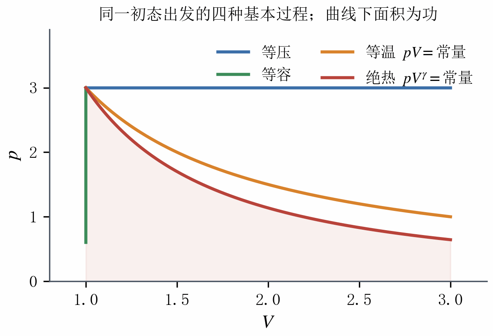

| 过程及其特征 | 对外做功 \(W\) | 吸收热量 \(Q\) | 内能变化 \(\Delta U\) |
|---|---|---|---|
| 等容：\(V\) 不变，\(p/T\) 不变 | \(0\) | \(nC_V\Delta T\) | \(nC_V\Delta T\) |
| 等压：\(p\) 不变，\(V/T\) 不变 | \(p\Delta V=nR\Delta T\) | \(nC_p\Delta T\) | \(nC_V\Delta T\) |
| 等温：\(T\) 不变，\(pV\) 不变 | \(nRT\ln(V_2/V_1)\) | 等于 \(W\) | \(0\) |
| 绝热：\(Q=0\)，\(pV^\gamma\) 不变 | \((p_1V_1-p_2V_2)/(\gamma-1)\) | \(0\) | \(-W\) |

绝热过程还可以写成 \(TV^{\gamma-1}=\) 常量，或 \(p^{\gamma-1}T^{-\gamma}=\) 常量。由于 \(\gamma>1\)，在 \(p\)—\(V\) 图上绝热线比等温线更陡：绝热膨胀时，气体对外做功全部来自内能，温度下降，压强比等温膨胀下降得更快。

表中的功是气体对外做的功。题目问外力做的功时，要另外列出作用在活塞上的全部力，不能直接套用。

**讲解例：对抗大气缓慢提起活塞。** 竖直气缸中，无重活塞下方封有 1 mol 理想气体，温度为 \(T\)，活塞上方与大气相通。不计摩擦，缓慢向上提起活塞，使气体等温膨胀到原体积的 \(n\) 倍，求外力做的功（伊罗多夫习题 2.34）。

1. 初态：活塞无重，气体压强等于大气压 \(p_0\)，\(p_0V_0=RT\)。
2. 受力：活塞缓慢移动，每一时刻都受力平衡。向下有大气压力 \(p_0S\)，向上有气体压力 \(pS\) 和拉力 \(F\)，故 \(F=(p_0-p)S\)。膨胀时 \(p<p_0\)，确实需要向上拉。
3. 积分：活塞上移 \(dx\) 时 \(dV=S\,dx\)，

\[
A=\int F\,dx=\int_{V_0}^{nV_0}(p_0-p)\,dV=p_0(n-1)V_0-\int_{V_0}^{nV_0}\frac{RT}V\,dV=RT\,(n-1-\ln n).
\]

从能量看，活塞无重且缓慢移动，动能不变，作用在它上面的各力做功之和为零：气体做正功 \(RT\ln n\)（即表中等温过程的功），大气做负功 \(p_0\Delta V=(n-1)RT\)，差额由外力补上，\(A=(n-1)RT-RT\ln n\)。气体压强一直低于大气压，自己推不开大气，所以外力做正功；\(n>1\) 时 \(n-1>\ln n\)，结果确实为正。若活塞上方是真空，外力的功为 \(-RT\ln n\)，此时外力是在向下拦住活塞。示范数据：\(T=300\,\mathrm K\)、\(n=2\) 时，\(A=8.31\times300\times(1-0.693)\approx765\,\mathrm J\)。

用第一定律分析过程的步骤是：

1. 判断过程类型，确定哪个状态参量保持不变。
2. 用状态方程 \(pV=nRT\) 求出各状态的未知参量。
3. 由 \(\Delta U=nC_V\Delta T\) 计算内能变化（对理想气体的任何过程都成立）。
4. 按过程计算功 \(W\)（或由 \(p\)—\(V\) 图面积求出）。
5. 由 \(Q=\Delta U+W\) 求热量，并注意符号：吸热为正，对外做功为正。

**泊松方程的推导。** 表中绝热过程的方程 \(pV^\gamma=\) 常量称为泊松方程（уравнение Пуассона），\(\gamma=C_p/C_V\) 称为绝热指数。对 \(n\) 摩尔理想气体，推导步骤如下：

1. 绝热即 \(\delta Q=0\)，又 \(dU=nC_V\,dT\)、\(\delta W=p\,dV\)，代入第一定律得 \(0=nC_V\,dT+p\,dV\)。
2. 用状态方程 \(p=nRT/V\) 消去 \(p\)：\(nC_V\,dT+\dfrac{nRT}{V}\,dV=0\)。
3. 两边同除以 \(nT\)，使 \(T\) 与 \(V\) 分离：\(C_V\dfrac{dT}{T}+R\dfrac{dV}{V}=0\)。
4. 利用 \(\displaystyle\int\frac{dx}{x}=\ln x\) 积分：\(C_V\ln T+R\ln V=\) 常量，两边除以 \(C_V\) 得 \(\ln T+\dfrac R{C_V}\ln V=\) 常量。
5. 由迈耶公式 \(R=C_p-C_V\)，\(\dfrac R{C_V}=\dfrac{C_p-C_V}{C_V}=\gamma-1\)。
6. 合并对数：\(\ln T+(\gamma-1)\ln V=\ln\left(TV^{\gamma-1}\right)=\) 常量，对数为常量，真数也为常量，即 \(TV^{\gamma-1}=\) 常量。
7. 由状态方程 \(T=\dfrac{pV}{nR}\)，\(T\) 与 \(pV\) 成正比，代入得 \(pV\cdot V^{\gamma-1}=pV^\gamma=\) 常量。

若改把 \(V\) 与 \(T/p\) 成正比的关系代入 \(TV^{\gamma-1}=\) 常量，得 \(T^\gamma p^{1-\gamma}=\) 常量，即上文的 \(p^{\gamma-1}T^{-\gamma}=\) 常量。三种形式等价，按题目给出的变量选用。

**绝热过程的功。** 绝热时 \(Q=0\)，由第一定律 \(W=-\Delta U\)，气体对外做的功全部来自内能的减少：
\[
W=nC_V(T_1-T_2)=\frac{C_V}{R}\,(nRT_1-nRT_2)=\frac{p_1V_1-p_2V_2}{\gamma-1},
\]
其中用到了 \(nRT=pV\) 与 \(\dfrac{C_V}{R}=\dfrac1{\gamma-1}\)。也可以直接对 \(p\,dV\) 积分来验证。由泊松方程 \(p=p_1V_1^\gamma V^{-\gamma}\)，
\[
W=\int_{V_1}^{V_2}p_1V_1^{\gamma}V^{-\gamma}\,dV=\frac{p_1V_1^{\gamma}\left(V_2^{1-\gamma}-V_1^{1-\gamma}\right)}{1-\gamma}=\frac{p_2V_2-p_1V_1}{1-\gamma},
\]
最后一步用到 \(p_1V_1^\gamma V_2^{1-\gamma}=p_2V_2^\gamma V_2^{1-\gamma}=p_2V_2\)。两种算法结果相同。取示范数据：一摩尔刚性双原子气体（\(\gamma=1.4\)，\(C_V=\tfrac52R\approx20.8\,\mathrm{J/(mol\cdot K)}\)）从 \(T_1=300\,\mathrm K\) 绝热压缩到体积的一半，由 \(TV^{\gamma-1}=\) 常量，\(T_2=300\times2^{0.4}\approx396\,\mathrm K\)，\(W=C_V(T_1-T_2)\approx20.8\times(-96)\approx-2.0\,\mathrm{kJ}\)。功为负，表示外界对气体做功约 \(2.0\,\mathrm{kJ}\)，全部转化为内能，使温度升高约 \(96\,\mathrm K\)。

**任意过程的摩尔热容。** 迈耶公式的推导可以推广到任意准静态过程。对一摩尔理想气体，
\[
C=\frac{\delta Q}{dT}=\frac{dU+p\,dV}{dT}=C_V+p\,\frac{dV}{dT},
\]
其中 \(dV/dT\) 沿所讨论的过程计算。第一项是升温所增加的内能，对任何过程都等于 \(C_V\)；第二项是对外做功的部分，由过程方程决定，所以热容随过程而异。几种基本过程的摩尔热容为：

| 过程 | 特点 | 摩尔热容 |
|---|---|---|
| 等容 | \(dV=0\) | \(C_V\) |
| 等压 | \(dV/dT=R/p\) | \(C_p=C_V+R\) |
| 等温 | \(dT=0\) 而 \(\delta Q\ne0\) | 无穷大 |
| 绝热 | \(\delta Q=0\) 而 \(dT\ne0\) | \(0\) |

\(C_V\) 和 \(C_p\) 只是两个最常用的特例。一般过程的热容还可以为负：若气体膨胀时对外做的功多于吸收的热量，就会吸热而温度下降。

**讲解例：指数过程的摩尔热容。** 一摩尔理想气体沿 \(p=p_0e^{\alpha V}\) 变化，\(p_0\)、\(\alpha\) 为常数，求该过程的摩尔热容 \(C\)。

由状态方程把温度写成体积的函数，\(T=\dfrac{pV}{R}=\dfrac{p_0Ve^{\alpha V}}{R}\)。按乘积求导法则对 \(V\) 求导，
\[
\frac{dT}{dV}=\frac{p_0e^{\alpha V}(1+\alpha V)}{R},\qquad
p\,\frac{dV}{dT}=p_0e^{\alpha V}\cdot\frac{R}{p_0e^{\alpha V}(1+\alpha V)}=\frac{R}{1+\alpha V}.
\]
代入通用公式，
\[
C=C_V+\frac{R}{1+\alpha V}.
\]
验算：令 \(\alpha=0\)，过程化为等压过程 \(p=p_0\)，结果为 \(C_V+R=C_p\)，与迈耶公式一致。这个热容不是常数，而是随体积变化。若 \(\alpha<0\)，在 \(V=-1/\alpha\) 处 \(dT/dV=0\)，过程曲线与等温线相切，热容趋于无穷大；越过这一点后 \(1+\alpha V<0\)，热容小于 \(C_V\)，并可以为负。

**多方过程。** 摩尔热容 \(C\) 保持为常数的准静态过程称为多方过程（политропический процесс）。四种基本过程都是它的特例，下面由第一定律和状态方程求它的过程方程。推导步骤是：

1. 对一摩尔理想气体，第一定律给出 \(C\,dT=C_V\,dT+p\,dV\)，即 \((C-C_V)\,dT=p\,dV\)。
2. 对状态方程 \(pV=RT\) 两边求微分，得 \(p\,dV+V\,dp=R\,dT\)，于是 \(dT=\dfrac{p\,dV+V\,dp}{R}\)。
3. 代入第 1 步消去 \(dT\)：\((C-C_V)(p\,dV+V\,dp)=R\,p\,dV\)。
4. 用迈耶公式把 \(R\) 换成 \(C_p-C_V\)，把含 \(p\,dV\) 的项移到左边，方括号内化简后得到 \((C-C_V)\,V\,dp+(C-C_p)\,p\,dV=0\)。
5. 设 \(C\ne C_V\)，两边除以 \(C-C_V\)，得 \(V\,dp+n\,p\,dV=0\)，其中 \(n=\dfrac{C-C_p}{C-C_V}\) 称为多方指数。
6. 两边除以 \(pV\) 分离变量，\(\dfrac{dp}p+n\dfrac{dV}V=0\)；\(C\) 为常数，\(n\) 也为常数，积分得 \(\ln p+n\ln V=\) 常量。

于是多方过程的方程为
\[
pV^{\,n}=\text{常量},\qquad n=\frac{C-C_p}{C-C_V}.
\]
第 4 步方括号内的化简是 \((C-C_V)-(C_p-C_V)=C-C_p\)。四种基本过程对应的多方指数如下：

1. 绝热过程 \(C=0\)：\(n=\dfrac{-C_p}{-C_V}=\gamma\)，回到泊松方程 \(pV^\gamma=\) 常量。
2. 等温过程 \(C\to\infty\)：分子、分母都由 \(C\) 主导，\(n\to1\)，得 \(pV=\) 常量。
3. 等压过程 \(C=C_p\)：分子为零，\(n=0\)，得 \(p=\) 常量。
4. 等容过程 \(C=C_V\)：分母为零，\(n\to\infty\)。把方程两边开 \(n\) 次方，\(p^{1/n}V=\) 常量；\(p\) 是有限的正数，\(n\to\infty\) 时 \(p^{1/n}\to1\)，于是 \(V=\) 常量。这也说明了第 5 步为什么必须单独排除 \(C=C_V\)。

验算：取 \(C=C_p\)，按任意过程热容公式 \(C=C_V+p\,dV/dT\) 应有 \(p\,dV/dT=R\)，这正是等压过程的结果，与 \(n=0\) 一致。

### 13.4 热机、卡诺循环与熵

工作物质经过一系列过程回到原来状态，称为循环。循环一周内能不变，所以对外做的净功等于净吸热。热机从高温热源吸热 \(Q_1\)，对外做功 \(W\)，向低温热源放热 \(Q_2\)，效率为

\[
\eta=\frac W{Q_1}=1-\frac{Q_2}{Q_1}.
\]

卡诺循环由两个等温过程和两个绝热过程组成，只与温度为 \(T_1\) 和 \(T_2\) 的两个热源交换热量。利用等温过程的热量公式和绝热过程的体积关系，可以证明 \(Q_2/Q_1=T_2/T_1\)，所以卡诺热机的效率和卡诺制冷机的制冷系数为

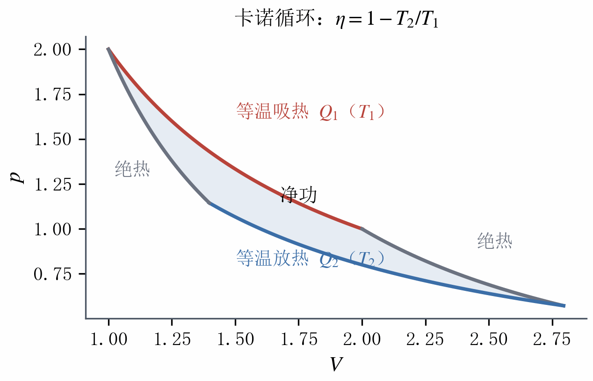

\[
\eta_C=1-\frac{T_2}{T_1},\qquad \varepsilon_C=\frac{Q_2}{W}=\frac{T_2}{T_1-T_2}.
\]

**循环的方向与效率公式的来历。** 在 \(p\)—\(V\) 图上，循环是一条闭合曲线。设膨胀过程 \(1\to2\) 沿上方曲线进行，\(V_2>V_1\)，状态 1 在左、状态 2 在右：上方曲线从左向右走，气体膨胀、吸热 \(Q_+\)、对外做正功；下方曲线从右向左走，气体被压缩、放热 \(Q_-\)、做负功。整个循环顺时针进行，净功等于闭合曲线所围的面积，为正，这是热机；若循环逆时针进行，净功为负，那是制冷机。走完一圈内能回到原值，\(\Delta U=0\)，吸热与放热之差全部变成功，\(W=Q_+-|Q_-|\)。效率定义为得到的功与吸收的热量之比，
\[
\eta=\frac{W}{Q_+}=\frac{Q_+-|Q_-|}{Q_+}=1-\frac{|Q_-|}{Q_+}.
\]
热机必须向低温热源放热，\(|Q_-|>0\)，所以总有 \(\eta<1\)。上式中的 \(Q_2\) 就是这里的 \(|Q_-|\)。

**卡诺效率的推导。** 设一摩尔理想气体依次经过：\(1\to2\) 在 \(T_1\) 下等温膨胀，\(2\to3\) 绝热膨胀降温到 \(T_2\)，\(3\to4\) 在 \(T_2\) 下等温压缩，\(4\to1\) 绝热压缩回到 \(T_1\)。推导步骤是：

1. 等温段内能不变，吸收的热量全部变成功：\(Q_1=\displaystyle\int_{V_1}^{V_2}\frac{RT_1}{V}\,dV=RT_1\ln\frac{V_2}{V_1}\)。同理，\(3\to4\) 为压缩，放热 \(Q_2=RT_2\ln\dfrac{V_3}{V_4}\)。
2. 绝热段 \(Q=0\)，功全部来自内能：\(W_{23}=-\Delta U=C_V(T_1-T_2)\)；\(4\to1\) 段温度从 \(T_2\) 升回 \(T_1\)，外界对气体做功同样是 \(C_V(T_1-T_2)\)，两段的功恰好抵消。这里出现 \(C_V\) 并不表示绝热段的热容是 \(C_V\)（绝热过程的热容为零），而是因为理想气体在任何过程中都有 \(dU=C_V\,dT\)，\(C_V\) 在这里是内能对温度的导数。
3. 把泊松方程写成 \(TV^{\gamma-1}=\) 常量，分别用于两条绝热线：\(T_1V_2^{\gamma-1}=T_2V_3^{\gamma-1}\)（\(2\to3\)），\(T_1V_1^{\gamma-1}=T_2V_4^{\gamma-1}\)（\(4\to1\)）。
4. 两式相除，\(T_1\)、\(T_2\) 都约去：\(\left(\dfrac{V_2}{V_1}\right)^{\gamma-1}=\left(\dfrac{V_3}{V_4}\right)^{\gamma-1}\)，所以 \(\dfrac{V_2}{V_1}=\dfrac{V_3}{V_4}\)。
5. 代入效率公式，两个对数相等而约去：\(\eta=1-\dfrac{RT_2\ln(V_3/V_4)}{RT_1\ln(V_2/V_1)}=1-\dfrac{T_2}{T_1}\)。

卡诺热机的效率只由两个热源的温度决定，与工作物质的量无关。示范数据：在沸水温度 \(T_1=373\,\mathrm K\) 与室温 \(T_2=293\,\mathrm K\) 之间工作，\(\eta=1-\dfrac{293}{373}=\dfrac{80}{373}\approx21\%\)。温度必须用开尔文；若误用摄氏温度，会得出 \(1-20/100=80\%\) 的错误结果。

卡诺定理指出，工作在相同两个热源之间的一切热机，效率都不超过卡诺热机，所以 \(\eta_C\) 是热机效率的上限。例如在 \(500\,\mathrm K\) 与 \(300\,\mathrm K\) 之间工作的热机，效率不可能超过 \(1-300/500=40\%\)。要提高效率，应提高高温热源温度或降低低温热源温度，而效率永远达不到百分之百。

热力学第二定律有两种等价的表述：不可能从单一热源吸热使之完全变为功而不产生其他影响（开尔文表述）；热量不可能自发地从低温物体传到高温物体（克劳修斯表述）。它的定量形式用熵来表达。熵的变化定义为可逆过程中吸收的热量与温度之比的积分：

\[
dS=\frac{\delta Q_{\rm rev}}T,\qquad \Delta S=\int\frac{\delta Q_{\rm rev}}T .
\]

熵是状态函数，变化量只取决于始末状态。例如理想气体等温膨胀，\(\Delta S=nR\ln(V_2/V_1)\)；可逆绝热过程 \(\Delta S=0\)。熵增加原理指出：孤立系统的熵永不减少，可逆过程不变，不可逆过程增加，\(\Delta S\ge0\)。它给出了自然过程进行的方向：热量从高温传到低温、气体自由膨胀、摩擦生热，都是孤立系统熵增加的过程。

**克劳修斯等式：熵为什么是状态函数。** 上面直接给出了熵的定义，它的根据来自卡诺循环。把热量一律按“系统吸收为正”计号，卡诺循环在高温热源处吸热 \(Q_1>0\)，在低温热源处吸热 \(Q_2'=-Q_2<0\)，由 \(Q_2/Q_1=T_2/T_1\) 得
\[
\frac{Q_1}{T_1}+\frac{Q_2'}{T_2}=0 .
\]
热量与温度之比称为热温比（俄语 приведённая теплота，缩写 ПКТ）。任意一个可逆循环都可以用大量绝热线切割成许多细小的卡诺循环，相邻小循环公共的绝热段一来一回，功和热互相抵消，各小循环的热温比之和为零。取极限得到克劳修斯等式
\[
\oint\frac{\delta Q}{T}=0\qquad(\text{可逆循环}).
\]
在可逆循环上任取两个状态 1 和 2，把循环分成支路 I（\(1\to2\)）和支路 II（\(2\to1\)）。由等式，
\[
\int_{1\,(\mathrm I)}^{2}\frac{\delta Q}{T}+\int_{2\,(\mathrm{II})}^{1}\frac{\delta Q}{T}=0
\quad\Longrightarrow\quad
\int_{1\,(\mathrm I)}^{2}\frac{\delta Q}{T}=\int_{1\,(\mathrm{II})}^{2}\frac{\delta Q}{T},
\]
第二步利用了可逆过程反向进行时每一段的热量变号。可见系统可逆地获得的热温比与路径无关，只由始末状态决定，于是它可以写成某个状态函数的增量，这个函数就是熵 \(S\)。

**闭合回路积分。** 积分号中间带小圆圈的 \(\oint\) 表示沿闭合路径积分，即起点与终点重合的积分。在热力学中，这条路径就是 \(p\)—\(V\) 图上的一个循环：从某一状态出发，绕行一周回到原状态，把沿途每一小步的量加起来。状态函数与过程量在闭合回路上的表现截然不同：

1. 状态函数绕行一周积分为零。内能只取决于状态，回到起点时也回到原值，\(\oint dU=U_1-U_1=0\)。这如同绕山一圈回到原地，海拔的总变化为零。
2. 过程量绕行一周一般不为零。\(\oint\delta W=\oint p\,dV\) 等于循环曲线所围的面积，就是循环的净功；如同绕山一圈走过的路程不为零。
3. 判别准则：对任意闭合回路都有 \(\oint dX=0\)，当且仅当 \(X\) 是状态函数。

克劳修斯等式说明可逆过程的 \(\delta Q/T\) 满足第 3 条，因此它对应一个状态函数，这就是上面引入熵的数学根据。

**理想气体在各过程中的熵变。** 由第一定律，可逆过程中 \(\delta Q=dU+p\,dV=nC_V\,dT+p\,dV\)，除以 \(T\) 并利用 \(p/T=nR/V\)，
\[
dS=nC_V\frac{dT}{T}+nR\frac{dV}{V},\qquad
\Delta S=nC_V\ln\frac{T_2}{T_1}+nR\ln\frac{V_2}{V_1}.
\]
这一结果只依赖始末状态，对理想气体的任何过程都可以用来计算熵变。几种特殊情形是：

1. 可逆绝热过程：\(\delta Q=0\)，\(\Delta S=0\)，所以可逆绝热过程又称等熵过程。
2. 等容过程：\(\Delta S=nC_V\ln(T_2/T_1)\)，温度越高，熵越大。
3. 等温过程：\(\Delta S=nR\ln(V_2/V_1)\)，膨胀时熵增加。
4. 等压过程：\(V_2/V_1=T_2/T_1\)，\(\Delta S=n(C_V+R)\ln(T_2/T_1)=nC_p\ln(T_2/T_1)\)。
5. 卡诺循环：工作物质回到原状态，\(\Delta S=0\)；两次等温过程的熵变 \(Q_1/T_1\) 与 \(Q_2'/T_2\) 恰好抵消。

**克劳修斯不等式与第二定律的数学表达。** 工作在两热源之间的不可逆热机效率低于卡诺热机，\(1+Q_2'/Q_1<1-T_2/T_1\)，整理得 \(Q_1/T_1+Q_2'/T_2<0\)。整理的步骤是：

1. 两边消去 1，得 \(Q_2'/Q_1<-T_2/T_1\)，即 \(|Q_2|/Q_1>T_2/T_1\)（两边同乘 \(-1\)，不等号反向）。
2. 两边同乘正数 \(Q_1/T_2\)，不等号方向不变：\(|Q_2|/T_2>Q_1/T_1\)。
3. 按“系统吸热为正”的约定，\(Q_2'=-|Q_2|\)，移项即得 \(Q_1/T_1+Q_2'/T_2<0\)。吸热和放热由此可以用同一个式子表示。

若热机可逆，各步都取等号，回到克劳修斯等式。一般循环中工作物质的温度连续变化，可以设想它依次与无数个温度为 \(T_i\) 的热源各交换一小份热量 \(\delta Q_i\)，把 \(\sum_i\delta Q_i/T_i\) 的求和取极限，就成为闭合回路积分。推广到任意不可逆循环，
\[
\oint\frac{\delta Q}{T}<0\qquad(\text{不可逆循环}).
\]
设循环由不可逆过程 \(1\to2\) 与可逆过程 \(2\to1\) 组成，后者的热温比积分等于 \(S_1-S_2\)，代入不等式得 \(S_2-S_1>\int_1^2\delta Q/T\)。与可逆情形合写，就是第二定律的数学表达式
\[
dS\ge\frac{\delta Q}{T},
\]
等号对可逆过程成立，这里的 \(T\) 是供热热源的温度。对绝热孤立系统 \(\delta Q=0\)，于是 \(dS\ge0\)：系统中的不可逆过程使熵增加，可逆过程使熵不变，这正是前面的熵增加原理。孤立系统最终达到的稳定平衡态，以熵取最大值为特征。第二定律揭示了自然界的一种基本不对称：一切自发过程都是单向进行的。

**可逆过程与不可逆过程的判别。** 上面的推导中，“一段不可逆、一段可逆”是指一个循环由两段过程拼成：去程 \(1\to2\) 是我们关心的不可逆过程，回程 \(2\to1\) 是另找的一条可逆路径。只要循环中有一段不可逆，整个循环就不可逆，克劳修斯不等式取严格的小于号。可逆过程是这样一种过程：让它反向进行，系统和外界都能完全复原。它必须同时满足下列条件：

1. 准静态：过程无限缓慢，每一步都处于平衡态，在 \(p\)—\(V\) 图上能画成连续曲线。
2. 无耗散：没有摩擦、黏滞、电流通过电阻发热等把功转变为热的效应。
3. 传热只在无穷小温差下进行：系统温度与热源温度始终只差 \(dT\)。

只要过程由某种有限的差推动，它就是不可逆的。常见的不可逆来源有：

- 有限压强差：气体向真空自由膨胀，突然撤去活塞上的重物。
- 有限温差传热：冷水倒入热水，或下面例题中打开阀门使不同温度的气体混合。
- 摩擦和黏滞：摩擦生热，搅拌液体。
- 扩散与混合：两种不同的气体相互混合。
- 化学反应，电流通过电阻。

判断时可以问两个问题：过程能否在 \(p\)—\(V\) 图上画成曲线？自由膨胀的中间状态不是平衡态，压强无法定义，图上只能标出初态和终态两点。反向进行能否使系统和外界都复原？冷水和热水混合后不会自行分成一冷一热。需要注意三点：

1. 教材中的等温、等容、等压、绝热和多方过程，默认指它们的可逆形式。
2. 若只用一个高温热源给气体等容加热，系统与热源间有有限温差，过程不可逆；要使它可逆，必须让系统依次接触一系列温度逐渐升高、相邻只差无穷小的热源。
3. 准静态不一定可逆：活塞缓慢移动而有摩擦，过程仍不可逆。

卡诺循环的四段（两条等温线、两条绝热线）全部可逆：吸热和放热都在等温段进行，气体温度始终等于热源温度，没有有限温差传热；另两段不与外界换热。所以卡诺循环整体可逆，\(\oint\delta Q/T=Q_1/T_1-|Q_2|/T_2=0\)，四段熵变依次为 \(+Q_1/T_1\)、\(0\)、\(-|Q_2|/T_2\)、\(0\)，一个循环后工作物质的熵回到原值。现实中的过程都不可逆，可逆过程是理想化的极限，它的价值在于便于计算，并给出比较的标准，卡诺效率就是这样的上限。

计算不可逆过程的熵变时，不能直接对实际过程积分 \(\delta Q/T\)，因为实际过程中的热温比积分小于熵变。正确的做法是：

1. 确定系统的初态和终态（必要时由能量守恒求出终态温度）。
2. 设计一个连接同样始末状态的可逆过程，为此可以给系统接上加热器或冷却器，系统不再封闭也没有关系。
3. 沿可逆过程计算 \(\int\delta Q_{\rm rev}/T\)，或直接套用理想气体熵变公式。
4. 系统由几部分组成时，熵是可加量，分别计算后相加。

**讲解例：气体向真空自由膨胀。** 绝热容器被隔板分成相等的两半，一半装有 \(n\) 摩尔理想气体，另一半为真空。抽去隔板后，气体充满整个容器，求熵变。

气体向真空膨胀不对外做功，\(W=0\)；容器绝热，\(Q=0\)；所以 \(\Delta U=0\)，理想气体的温度不变。实际过程中 \(\int\delta Q/T=0\)，但它是不可逆过程，熵变不能这样求。连接相同始末状态的可逆过程是等温膨胀：给气体接上温度为 \(T\) 的热源，让它缓慢推动活塞，体积由 \(V\) 变到 \(2V\)，
\[
\Delta S=nR\ln\frac{2V}{V}=nR\ln2 .
\]
一摩尔气体 \(\Delta S=8.31\times0.693\approx5.76\,\mathrm{J/K}>0\)。验算：系统孤立而熵增加，与熵增加原理一致；在绝热外壳中，气体不会自发地重新聚到一半，逆过程不能发生。

用可逆路径代替不可逆过程，只能用来计算状态函数的变化（熵、内能等），不能用来计算热量和功。以本例对比：

| 量 | 真实的自由膨胀 | 替代的可逆等温膨胀 |
|---|---|---|
| 熵变 \(\Delta S\) | \(nR\ln2\) | \(nR\ln2\) |
| 吸热 \(Q\) | \(0\) | \(nRT\ln2\) |
| 对外做功 \(W\) | \(0\) | \(nRT\ln2\) |

熵变相同，热量和功却完全不同。替代路径只是计算工具，并不表示真实过程这样发生。真实过程中 \(\int\delta Q/T=0<\Delta S\)，正是不可逆过程的特征；若误用替代路径的热量计算 \(\int\delta Q/T\)，就会得出取等号的错误结论。

**讲解例：两容器中气体混合后的熵变**（伊罗多夫习题 2.153）。两个相同的绝热容器由带阀门的细管相连，每个容器中各有 1 摩尔同种理想气体，摩尔定容热容为 \(C_V\)，温度分别为 \(T_1\) 和 \(T_2\)。打开阀门，求系统达到平衡后的熵变。

整个系统绝热且不对外做功，内能守恒：\(C_VT_1+C_VT_2=2C_VT\)，终态温度 \(T=(T_1+T_2)/2\)。终态时 2 摩尔气体占据体积 \(2V\)，每摩尔仍对应体积 \(V\)；两部分是同种气体，混合本身不产生附加熵，体积因素的贡献为零。把不可逆过程换成可逆过程：左边的气体接加热器（或冷却器）等容地由 \(T_1\) 变到 \(T\)，右边的气体等容地由 \(T_2\) 变到 \(T\)。熵是可加量，
\[
\Delta S=C_V\ln\frac{T}{T_1}+C_V\ln\frac{T}{T_2}=C_V\ln\frac{(T_1+T_2)^2}{4T_1T_2}.
\]
由算术—几何平均不等式 \((T_1+T_2)^2\ge4T_1T_2\)，所以 \(\Delta S\ge0\)，只有 \(T_1=T_2\) 时为零，与熵增加原理一致。也可以利用恒等式 \((T_1+T_2)^2=4T_1T_2+(T_1-T_2)^2\) 把结果写成
\[
\Delta S=C_V\ln\Bigl[1+\frac{(T_1-T_2)^2}{4T_1T_2}\Bigr]\ge0,
\]
方括号内的数不小于 1，非负性一目了然。之所以能把真实的不可逆混合换成两段可逆的等容过程，是因为熵只取决于始末状态：两边是同种气体且终态均匀，终态可以看成每个容器仍是 1 摩尔、体积 \(V\)，只是温度变为 \(T\)，唯一变化的状态参量是温度，等容路径正好连接相同的始末状态。示范数据：双原子气体 \(C_V=\tfrac52R\approx20.8\,\mathrm{J/(mol\cdot K)}\)，\(T_1=300\,\mathrm K\)，\(T_2=400\,\mathrm K\)，则 \(T=350\,\mathrm K\)，\(\Delta S=20.8\ln\dfrac{350^2}{4\times300\times400}=20.8\ln1.0208\approx0.43\,\mathrm{J/K}\)。

**能斯特定理（热力学第三定律）。** 熵的定义只确定熵的变化，熵本身还差一个任意常数。能斯特定理指出：当物体温度趋于绝对零度时，其熵趋于零（更一般地说，趋于一个与体积、压强等参量无关的常量，可以取为零）。于是这个任意常数等于零，熵有了绝对值。由此还有两个推论。第一，热容在低温下必须趋于零，否则 \(S=\int_0^T C\,dT/T\) 在下限发散；理想气体公式中的 \(nC_V\ln T\) 在 \(T\to0\) 时发散，说明经典的恒定热容在低温下不再成立，这与前面热容的量子解释一致。第二，绝对零度不能通过有限次操作达到。

**热力学平衡的稳定性。** 力学中的平衡分为稳定、不稳定和随遇三种。热力学平衡同样有稳定与否的问题，判据由勒夏特列—布劳恩原理给出（勒夏特列，1884 年；布劳恩，1887 年；它可以看成电磁感应中楞次定律的推广）：若系统处于稳定平衡，外界作用在系统中引起的任何过程，其方向总是力图削弱这一外界作用所造成的变化。对绝热孤立系统，稳定性的判据是熵：熵取最大值的状态是热力学稳定的。

例如，绝热容器被可自由移动的隔板分成相等的两半，两侧各有 1 摩尔同种气体，温度相同，体积都是 \(V\)。设某次涨落（随机偏离）使隔板向右移动，左侧体积变为 \(V+\Delta V\)，右侧变为 \(V-\Delta V\)。按等温可逆过程估算熵变：
\[
\Delta S=R\ln\frac{V+\Delta V}{V}+R\ln\frac{V-\Delta V}{V}=R\ln\Bigl[1-\Bigl(\frac{\Delta V}{V}\Bigr)^2\Bigr]<0 .
\]
偏离使熵减小，说明原来的状态熵最大，是稳定的。从力的角度看也一样：左侧压强变小，右侧压强变大，系统中出现把隔板推回中央的力。

### 13.5 统计方法与麦克斯韦速率分布

13.2 节只用到了分子速度的平均值。要知道有多少分子快、多少分子慢，就需要速度的分布规律，这要用到概率论的语言。概率论的系统讲述见《概率统计与实验数据处理》册，这里只整理统计物理所需的部分。

**概率与分布函数。** 考察体积 \(V\) 中的一个气体分子，问它何时出现在其中一小部分 \(V_0\) 里。由于碰撞不规则、结果无法预言，这个问题不能精确回答，分子的位置是随机变量。设在 \(N\) 次观测中第 \(i\) 种结果出现 \(N_i\) 次，\(N_i/N\) 是相对频率，观测次数无限增加时它的极限就是该结果的概率：
\[
P_i=\lim_{N\to\infty}\frac{N_i}{N},\qquad \sum_iP_i=1 .
\]
复合事件的概率由两条基本定理计算：

1. 加法定理：两个互斥事件（不能同时发生）中出现其一的概率等于二者概率之和，\(P(i\ \text{或}\ k)=P_i+P_k\)。例如掷一颗骰子得 5 或 6 的概率为 \(\tfrac16+\tfrac16=\tfrac13\)；从 52 张牌中抽到任一张皇后的概率为 \(4\times\tfrac1{52}=\tfrac1{13}\)。俄语课件写作“独立事件”，严格说加法定理要求的是互斥。
2. 乘法定理：若第一个事件的结果丝毫不影响第二个事件，两事件独立，同时发生的概率等于二者概率之积，\(P(i\ \text{和}\ k)=P_iP_k\)。例如连掷两次都得 6 的概率为 \(\tfrac16\times\tfrac16=\tfrac1{36}\)。从一副牌中不放回地连抽 4 张都是 A，后一次抽牌受前面结果影响，要用条件概率逐次相乘：\(\tfrac4{52}\cdot\tfrac3{51}\cdot\tfrac2{50}\cdot\tfrac1{49}=\tfrac1{270725}\)。

已知离散量 \(x\) 各取值的概率，平均值为 \(\langle x\rangle=\sum_ix_iP_i\)。分子速度一类的量连续变化，把取值范围分成小区间：区间要足够大，使落入的次数 \(N_i\gg1\)，涨落不显著；又要足够小，以便细致刻画分布。比值 \(\Delta P/\Delta x\) 在区间足够小时与区间大小无关，令 \(\Delta x\to0\)，得到分布函数（概率密度）
\[
f(x)=\frac{dP}{dx},\qquad \int f(x)\,dx=1,\qquad \langle x\rangle=\int xf(x)\,dx,\qquad \langle\varphi(x)\rangle=\int\varphi(x)f(x)\,dx .
\]
\(f(x)\,dx\) 是随机变量落在 \(x\) 到 \(x+dx\) 之间的概率。实验 1.01 中时间间隔的直方图，正是分布函数的实验近似。

**速度空间与麦克斯韦分布。** 以分子速度的三个投影 \(v_x,v_y,v_z\) 为坐标轴，构成速度空间。每个分子的速度对应其中一个点，称为代表点。碰撞不断改变各点的位置，但平衡态下点的总体分布保持不变；所有运动方向平权，分布关于原点球对称，代表点的密度只取决于速度大小 \(v\)。麦克斯韦（1859 年）求得速度投影 \(v_x\) 的分布函数
\[
\varphi(v_x)=\Bigl(\frac{m}{2\pi kT}\Bigr)^{1/2}\exp\Bigl(-\frac{mv_x^2}{2kT}\Bigr),
\]
它是以零为中心的正态分布。三个投影相互独立，由乘法定理，速度空间中的概率密度为
\[
f(\mathbf v)=\varphi(v_x)\varphi(v_y)\varphi(v_z)=\Bigl(\frac{m}{2\pi kT}\Bigr)^{3/2}\exp\Bigl(-\frac{mv^2}{2kT}\Bigr).
\]
速率在 \(v\) 到 \(v+dv\) 之间的分子，对应速度空间中内外半径为 \(v\) 与 \(v+dv\) 的球壳层，其体积为 \(4\pi v^2dv\)，层内各点概率密度相同。由加法定理，落入该层的概率为 \(f(\mathbf v)\cdot4\pi v^2dv\)，于是速率分布函数为
\[
F(v)=\frac{dP}{dv}=4\pi\Bigl(\frac{m}{2\pi kT}\Bigr)^{3/2}v^2\exp\Bigl(-\frac{mv^2}{2kT}\Bigr).
\]
这就是麦克斯韦速率分布律。速率很小时 \(F\propto v^2\)，从零开始增长；速率很大时指数因子使它迅速趋于零，所以曲线不对称，右侧拖着一条长尾。

**归一化与泊松积分。** 记 \(\alpha=m/(2kT)\)。计算中要用到泊松积分及由它导出的两个积分：
\[
\int_0^\infty e^{-\alpha x^2}dx=\frac12\sqrt{\frac\pi\alpha},\qquad
\int_0^\infty x^2e^{-\alpha x^2}dx=\frac{\sqrt\pi}{4}\alpha^{-3/2},\qquad
\int_0^\infty x^3e^{-\alpha x^2}dx=\frac1{2\alpha^2}.
\]
第二式由第一式两边对 \(\alpha\) 求导再变号得到，第三式令 \(u=x^2\) 换元即得。用第二式验证归一化：
\[
\int_0^\infty F(v)\,dv=4\pi\Bigl(\frac\alpha\pi\Bigr)^{3/2}\cdot\frac{\sqrt\pi}{4}\alpha^{-3/2}=1 .
\]

**三种特征速率。** 最概然速率 \(v_p\)（俄文下标 вер）对应分布函数的极大值。由
\[
\frac{d}{dv}\bigl(v^2e^{-\alpha v^2}\bigr)=2v\,(1-\alpha v^2)\,e^{-\alpha v^2}=0
\]
得 \(v^2=1/\alpha\)。平均速率由定义和第三个积分求出，方均根速率即 13.2 节的结果：
\[
v_p=\sqrt{\frac{2kT}{m}}=\sqrt{\frac{2RT}{M}},\qquad
\langle v\rangle=4\pi\Bigl(\frac\alpha\pi\Bigr)^{3/2}\frac1{2\alpha^2}=\sqrt{\frac{8kT}{\pi m}}=\sqrt{\frac{8RT}{\pi M}},\qquad
v_{\rm rms}=\sqrt{\frac{3kT}{m}}=\sqrt{\frac{3RT}{M}} .
\]
三者之比 \(v_p:\langle v\rangle:v_{\rm rms}=\sqrt2:\sqrt{8/\pi}:\sqrt3\approx1:1.13:1.22\)，由小到大依次为最概然、平均、方均根，俄语课件按缩写 вер、ср、кв 的顺序记忆。把 \(v_p\) 代回分布函数，极大值为
\[
F(v_p)=\frac{4}{e\sqrt\pi\,v_p}\propto\sqrt{\frac mT}.
\]
温度升高时，峰的位置右移、高度降低，曲线变得平坦，而曲线下的面积始终为 1；分子质量增大时变化正好相反。计算表明，约 70% 的分子速率落在 \(0.5v_p\) 到 \(1.5v_p\) 之间。

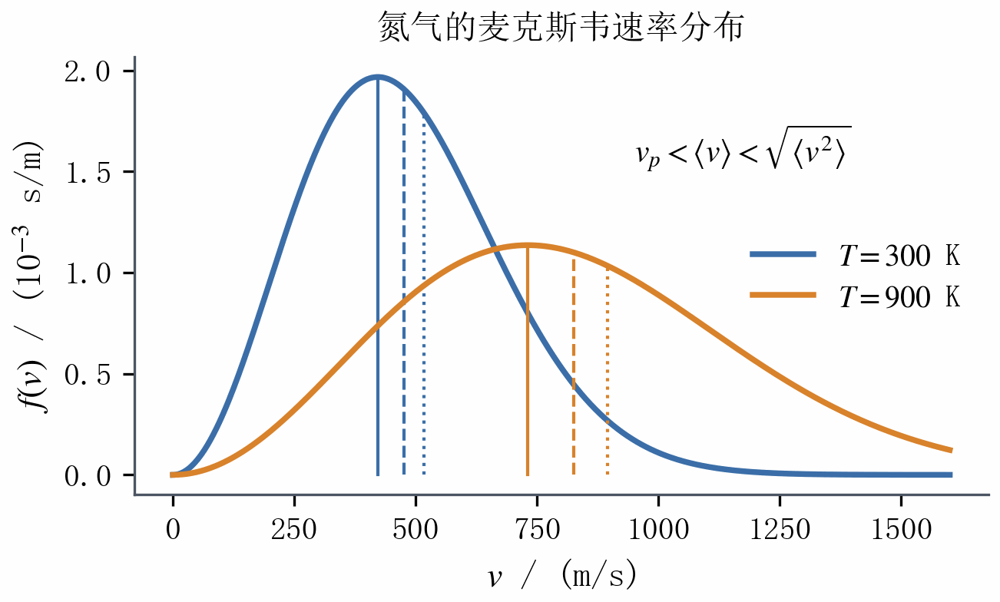

“最概然”指出现概率最大，即曲线峰顶对应的速率，并不是三者中数值最大的；它恰恰最小。分布不对称，右侧拖着一条高速尾巴：少数很快的分子把平均速率拉到峰值右边，方均根先平方再平均，大速率的权重更大，被拉得更远。这与收入分布中多数人的收入（众数）低于平均收入是同一道理。

**讲解例：由速率之差求温度。** 求温度 \(T\)，使氢气分子的方均根速率比最概然速率大 \(\Delta v=400\,\mathrm{m/s}\)（伊罗多夫习题 2.94a）。由 \(v_{\rm rms}-v_p=\sqrt{\dfrac{kT}m}\,(\sqrt3-\sqrt2)=\Delta v\) 解出

\[
T=\frac{m\,\Delta v^2}{k(\sqrt3-\sqrt2)^2}=\frac{M\,\Delta v^2}{R(\sqrt3-\sqrt2)^2}=\frac{2\times10^{-3}\times400^2}{8.31\times(1.732-1.414)^2}\approx3.8\times10^2\,\mathrm K .
\]

取 \(M=2.016\,\mathrm{g/mol}\) 时得 384 K。

**讲解例：分布函数的数值。** 求 \(300\,\mathrm K\) 的氧气中，麦克斯韦速率分布函数在 \(v=300\,\mathrm{m/s}\) 处的值。利用 \(\dfrac m{kT}=\dfrac M{RT}=\dfrac{0.032}{8.31\times300}\approx1.28\times10^{-5}\,\mathrm{s^2/m^2}\)：

\[
F(v)=4\pi\Bigl(\frac M{2\pi RT}\Bigr)^{3/2}v^2e^{-\frac{Mv^2}{2RT}},\qquad
\frac{Mv^2}{2RT}=\frac{1.28\times10^{-5}\times300^2}2\approx0.577 ,
\]

代入得 \(F(300)\approx3.30\times10^{-3}\times e^{-0.577}\approx1.85\times10^{-3}\,\mathrm{s/m}\)。\(F(v)\) 是概率密度，单位为 s/m，不是纯数：它表示在 300 m/s 附近每 1 m/s 的速率区间内约有 0.19% 的分子。同一气体在 100 K、300 K、500 K 时的最概然速率 \(\sqrt{2RT/M}\) 分别约为 228、395、510 m/s，温度越高峰越靠右、越低平，这个值就是 300 K 那条曲线在 \(v=300\,\mathrm{m/s}\) 处的高度。

**讲解例：氧气分子的特征速率。** 求 \(300\,\mathrm K\) 时氧气（\(M=0.032\,\mathrm{kg/mol}\)）分子的三种特征速率。
\[
v_p=\sqrt{\frac{2\times8.31\times300}{0.032}}\approx395\,\mathrm{m/s},\qquad
\langle v\rangle=\sqrt{\frac{8\times8.31\times300}{\pi\times0.032}}\approx445\,\mathrm{m/s},\qquad
v_{\rm rms}=\sqrt{\frac{3\times8.31\times300}{0.032}}\approx483\,\mathrm{m/s}.
\]
验算：\(445/395\approx1.13\)，\(483/395\approx1.22\)，与上面的比例一致。分子速率达到每秒几百米，打开的香水气味却传得很慢，原因是分子在空气中频繁碰撞，常温常压下两次碰撞间只走约 \(10^{-7}\,\mathrm m\)，运动方向不断改变，只能缓慢地扩散。气体中的声速 \(v_s=\sqrt{\gamma RT/M}\) 与分子速率同一数量级而略小：空气中 \(v_s/v_{\rm rms}=\sqrt{\gamma/3}\approx0.68\)，因为声波正是靠分子运动传递压缩与稀疏的。蒸发也可以由分布解释：碟中的水只有速率足够大的分子能挣脱液面，留下的分子平均动能变小，液体因而冷却。

**按动能的分布。** 由 \(\varepsilon=\tfrac12mv^2\)，\(d\varepsilon=mv\,dv\)，\(v^2dv=\sqrt{2\varepsilon/m}\,d\varepsilon/m\)，代入速率分布并整理得
\[
F(\varepsilon)=\frac{2}{\sqrt\pi}(kT)^{-3/2}\sqrt\varepsilon\,e^{-\varepsilon/kT} .
\]
由它可以求出 \(\langle\varepsilon\rangle=\tfrac32kT\)，与能量均分一致。最概然动能由 \(\dfrac{d}{d\varepsilon}\bigl(\sqrt\varepsilon\,e^{-\varepsilon/kT}\bigr)=0\) 得 \(\varepsilon_p=\tfrac12kT\)，并不等于最概然速率对应的动能 \(\tfrac12mv_p^2=kT\)：变量换了，概率密度要乘以 \(dv/d\varepsilon\)，极大值的位置随之改变。

在统计方法中，问“有多少分子的速率恰好等于 \(v_p\)”是没有意义的，答案是零。分布函数在一点的值是概率密度而不是概率，只能讨论速率落在某一区间内的分子数。

**施特恩实验。** 1920 年施特恩直接测量了分子速率。两个同轴圆筒可以一起转动，轴线上是镀银的铂丝，整个装置抽成真空。铂丝通电加热，银原子蒸发出来，穿过内筒上平行于轴的狭缝，飞到外筒内壁上沉积。圆筒静止时，银原子沉积在狭缝正对的位置；圆筒以角速度 \(\omega\) 转动时，原子飞越两筒间距 \(R-r\) 需要时间 \(t=(R-r)/v\)，在这段时间内外筒转过弧长 \(s=\omega Rt\)，沉积条纹相应偏移，所以
\[
v=\frac{\omega R(R-r)}{s} .
\]
速率不同的原子落在不同位置，条纹被展宽，沉积层厚度的分布反映了速率分布。示范数据：\(R=0.10\,\mathrm m\)，\(r=0.01\,\mathrm m\)，转速 50 转每秒（\(\omega\approx314\,\mathrm{rad/s}\)），偏移 \(s=6.0\,\mathrm{mm}\)，得 \(v=314\times0.10\times0.09/0.006\approx471\,\mathrm{m/s}\)。实验测得的平均速率与按铂丝温度计算的理论值相符，验证了麦克斯韦分布。

### 13.6 重力场中的气体：气压公式与玻尔兹曼分布

**气压公式。** 讨论地球大气中压强随高度的变化，并假定大气温度与高度无关。在高度 \(z\) 处取一薄层空气，截面积 \(S\)、厚度 \(dz\)。它受下方空气向上的压力 \(pS\)、上方空气向下的压力 \((p+dp)S\) 和重力 \(\rho gS\,dz\)，处于平衡，竖直方向的投影给出
\[
pS-(p+dp)S-\rho gS\,dz=0\quad\Longrightarrow\quad dp=-\rho g\,dz .
\]
\(dz>0\) 时 \(dp<0\)，越往上压强越小。由状态方程把密度用压强表示，\(\rho=pM/(RT)\)，得到
\[
\frac{dp}{p}=-\frac{Mg}{RT}\,dz .
\]
以地面 \(z=0\) 处 \(p=p_0\) 为初始条件积分，得到气压公式
\[
p=p_0\exp\Bigl(-\frac{Mgz}{RT}\Bigr)=p_0e^{-z/H},\qquad H=\frac{RT}{Mg}.
\]
\(H\) 是压强减小到 \(1/e\) 的高度。对空气，\(M=0.029\,\mathrm{kg/mol}\)，\(T=273\,\mathrm K\)，\(H=\dfrac{8.31\times273}{0.029\times9.81}\approx8.0\times10^3\,\mathrm m\)。在海拔 \(3000\,\mathrm m\) 处，\(p\approx p_0e^{-3000/8000}\approx0.69\,p_0\)，空气稀薄，所以在高山上呼吸困难。与地球半径相比，大气层只是一层很薄的膜。温度越低，\(H\) 越小，曲线越陡。按高度刻度的气压计就是高度计。混合气体中每种成分按自己的摩尔质量各自分布；氡的 \(M=0.222\,\mathrm{kg/mol}\)，\(H\) 只有约 \(1\,\mathrm{km}\)，所以这种重气体容易积聚在地下室里。

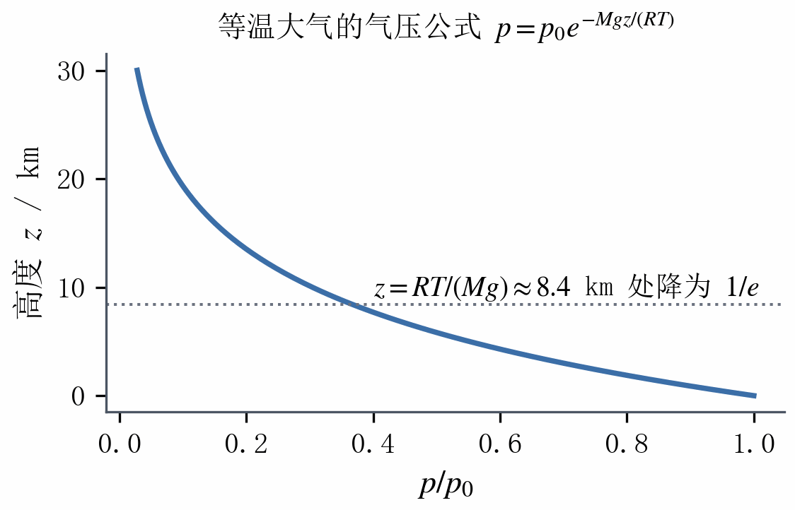

**玻尔兹曼分布。** 没有外力场时，平衡态气体的分子数密度处处相同。在重力场中，没有热运动，分子会全部落到地面；有热运动，分子又会均匀散开。两种因素共同作用，建立起数密度随高度变化的平衡。利用 \(p=nkT\) 和 \(M/R=m_0/k\)（\(m_0\) 为一个分子的质量），气压公式改写为
\[
n=n_0\exp\Bigl(-\frac{m_0gz}{kT}\Bigr)=n_0\exp\Bigl(-\frac{U}{kT}\Bigr),
\]
其中 \(U=m_0gz\) 是分子在重力场中的势能，\(n_0\) 是 \(U=0\) 处的数密度。玻尔兹曼证明，这一形式对任意势场都成立，称为玻尔兹曼分布：势能越高的位置，粒子越少，减少的快慢由 \(U\) 与 \(kT\) 之比决定。与麦克斯韦分布合起来，分子按总能量 \(\tfrac12mv^2+U\) 分布，称为麦克斯韦—玻尔兹曼分布。

玻尔兹曼又把公式推广到能量取分立值的系统。原子的内部能量只能取一组分立值 \(E_1,E_2,\dots\)，处于能量为 \(E_i\) 的状态的粒子数和概率为
\[
N_i=A\,e^{-E_i/kT},\qquad N=\sum_iN_i,\qquad P_i=\frac{N_i}N=\frac{e^{-E_i/kT}}{\sum_je^{-E_j/kT}} .
\]
后一式的分母保证 \(\sum P_i=1\)，这一形式称为吉布斯正则分布（1901 年）。

**讲解例：氢原子的激发。** 按玻尔模型（1913 年），氢原子基态能量 \(E_1=-13.6\,\mathrm{eV}\)，第一激发态 \(E_2=-3.4\,\mathrm{eV}\)，能级差 \(10.2\,\mathrm{eV}\)。不计能级简并时，两能级上原子数之比为 \(N_2/N_1=e^{-(E_2-E_1)/kT}\)。室温下 \(kT\approx0.026\,\mathrm{eV}\)，指数约为 \(-390\)，\(N_2/N_1\sim10^{-170}\)，实际上全部原子都在基态；在 \(10^4\,\mathrm K\) 的恒星大气中 \(kT\approx0.86\,\mathrm{eV}\)，\(N_2/N_1=e^{-11.8}\approx7\times10^{-6}\)。若计入简并度（第二能级的状态数是第一能级的 4 倍），比值再乘以 4。

### 13.7 熵的统计意义

**宏观态与微观态。** 用压强、温度、体积等宏观量确定的物体状态称为宏观态；详细给出每个分子状态的描述称为微观态。同一个宏观态可以由许多不同的微观态实现，下面用一个简单例子找出二者的联系。

设 \(N\) 个可以编号的粒子分布在容器的左右两半中。每个粒子落入左半的概率为 \(p_0=\tfrac12\)，落入右半的概率也是 \(\tfrac12\)，各粒子的位置相互独立。指定哪些粒子在左、哪些在右，就确定了一个微观态，由乘法定理，它的概率为
\[
P_{\text{微}}=\Bigl(\frac12\Bigr)^N ,
\]
微观态总数为 \(2^N\)。宏观态只关心左半有几个粒子。同一半内的粒子互相交换会给出新的微观态，宏观态却不变，所以“左半 \(n\) 个、右半 \(N-n\) 个”这个宏观态可以由
\[
\Omega(n)=\frac{N!}{n!\,(N-n)!}
\]
个微观态实现。\(\Omega\) 称为该宏观态的统计权重，也称热力学概率。宏观态的概率为
\[
P_{\text{宏}}=\Omega\,P_{\text{微}}=\frac{N!}{n!\,(N-n)!}\Bigl(\frac12\Bigr)^N .
\]
以 4 个粒子为例，\(n=0,1,2,3,4\) 时的统计权重依次为 \(1,4,6,4,1\)，共 16 个微观态。两边各 2 个的宏观态概率为 \(6/16=0.375\)，全部聚在左边的概率只有 \(1/16\)。粒子数增大时差距急剧拉大：\(N=100\) 时，全部粒子聚在同一半（左或右）的概率为 \(2\times2^{-100}\approx1.6\times10^{-30}\)。若取的不是一半而是体积 \(V\) 中的一部分 \(V_0\)，\(p_0=V_0/V\)，则
\[
P(n)=\frac{N!}{n!\,(N-n)!}\,p_0^{\,n}(1-p_0)^{N-n},
\]
这就是二项分布。它的标准差为 \(\sqrt{Np_0(1-p_0)}\)，相对涨落与 \(1/\sqrt N\) 同数量级；宏观体积中 \(N\sim10^{20}\)，相对涨落约 \(10^{-10}\)，宏观上根本察觉不到。

由此得到三条结论：

1. 宏观态的概率与它的统计权重成正比。
2. 平衡态是统计权重最大的宏观态。
3. 任何不可逆过程，其逆过程都不是绝对不可能，而是概率小到实际上不会发生。

**玻尔兹曼熵。** 两个状态的能量、温度、体积、粒子数可以都相同，却一个是平衡态、一个不是，要区分它们需要一个反映状态概率的量。直接用统计权重不方便：第一，它是极其巨大的数；第二，更重要的是它不具有可加性。把系统分成两个几乎没有相互作用的子系统，统计权重分别为 \(\Omega_1\) 和 \(\Omega_2\)，第一个子系统的每个微观态都可以与第二个子系统的每个微观态组合，所以整个系统 \(\Omega=\Omega_1\Omega_2\)，而不是 \(\Omega_1+\Omega_2\)。取对数后 \(\ln\Omega=\ln\Omega_1+\ln\Omega_2\) 变成可加量。于是定义
\[
S=k\ln\Omega ,
\]
单位为 J/K，这就是玻尔兹曼熵。俄语参考书写作 \(S=k\ln P\)，其中 \(P\) 指热力学概率即统计权重，而不是归一化的数学概率。

这个定义与 13.4 节的热力学熵一致。以13.4 节自由膨胀的例子验算：膨胀后每个分子可以处在两倍的体积中，每个分子可选的位置数加倍，\(N\) 个分子的统计权重变为原来的 \(2^N\) 倍，
\[
\Delta S=k\ln2^N=Nk\ln2=nR\ln2 ,
\]
与热力学方法的结果完全相同。熵增加原理由此获得统计解释：孤立系统总是从统计权重小的状态走向统计权重大的状态，熵是多粒子系统无序程度的量度。能斯特定理也随之好理解：\(T\to0\) 时系统处于唯一的基态，\(\Omega=1\)，\(S=0\)。

### 13.8 实际气体与相变

理想气体忽略了分子本身的体积和分子间的作用力。描述时必须考虑这两点的气体称为实际气体。本节先说明分子力的来源，再建立范德瓦耳斯方程，用它解释等温线、液化与相变。

**分子间的作用力。** 分子间的势能 \(E_p\) 随中心距离 \(r\) 的变化常用伦纳德-琼斯势描述：
\[
E_p(r)=4\varepsilon\Bigl[\Bigl(\frac\sigma r\Bigr)^{12}-\Bigl(\frac\sigma r\Bigr)^6\Bigr].
\]
第二项对应远距离的吸引，称为范德瓦耳斯力，本质是电的：氦等非极性分子靠电子云的瞬时极化相互吸引，水等极性分子还有固有偶极的取向作用。第一项对应近距离迅速增大的排斥，是量子交换作用的结果。势能在 \(r_0=2^{1/6}\sigma\) 处取极小值 \(-\varepsilon\)，\(r>r_0\) 时为引力，\(r<r_0\) 时为斥力。设第二个分子从无穷远处以动能 \(E_1\) 飞向静止的第一个分子（无穷远处 \(E_p=0\)），接近时势能减小、动能增大，在 \(r_0\) 处动能最大，此后急剧减小；当 \(E_p\) 升到 \(E_1\) 时分子停下，然后沿原路返回。

理想气体方程何时失效，可以作数量级估计。分子有效直径 \(d\sim10^{-10}\,\mathrm m\)，一个分子的体积 \(\sim10^{-30}\,\mathrm{m^3}\)；标准状况下一立方米气体约有 \(3\times10^{25}\) 个分子，自身体积合计只有 \(10^{-5}\)—\(10^{-4}\,\mathrm{m^3}\)，不到总体积的万分之一，理想气体方程很好用。若压缩到 5000 个大气压，按玻意耳定律体积只剩 \(2\times10^{-4}\,\mathrm{m^3}\)，与分子自身的体积可以相比，理想气体方程不再适用。

**范德瓦耳斯方程。** 描述实际气体的方程很多，最简单而又能抓住要点的是范德瓦耳斯方程。对一摩尔气体（摩尔体积 \(V_m\)）和 \(\nu\) 摩尔气体（体积 \(V\)）分别为
\[
\Bigl(p+\frac{a}{V_m^2}\Bigr)(V_m-b)=RT,\qquad
\Bigl(p+\frac{\nu^2a}{V^2}\Bigr)(V-\nu b)=\nu RT ,
\]
其中 \(p\) 是实际气体对器壁的压强，\(a\)、\(b\) 是随气体而异的常量。两个修正项的意义如下。

1. 修正量 \(b\)：分子本身占据体积，容器中能供分子自由运动的空间要扣除这一部分。两个直径为 \(d\) 的分子中心不能接近到 \(d\) 以内，一对分子的禁区是半径 \(d\) 的球，体积为单个分子体积的 8 倍，平均到每个分子是 4 倍，所以 \(b\) 等于一摩尔分子自身体积的 4 倍。常见气体的 \(b\) 为 \(10^{-5}\)—\(10^{-4}\,\mathrm{m^3/mol}\)。
2. 修正项 \(a/V_m^2\)：分子间有引力。靠近器壁的分子受到内部分子向内的拉力，撞击器壁时速度变小，器壁上的压强比没有引力时小，气体仿佛被自己压缩。这一附加的分子内压强既正比于撞击器壁的分子数，又正比于拉它的分子数，因而与数密度的平方即 \(1/V_m^2\) 成正比。常见气体的 \(a\) 为 \(10^{-2}\)—\(10^{-1}\,\mathrm{Pa\cdot m^6/mol^2}\)。

例如氮气 \(a=0.137\,\mathrm{Pa\cdot m^6/mol^2}\)、\(b=3.87\times10^{-5}\,\mathrm{m^3/mol}\)，二氧化碳 \(a=0.364\,\mathrm{Pa\cdot m^6/mol^2}\)、\(b=4.27\times10^{-5}\,\mathrm{m^3/mol}\)。

**讲解例：范德瓦耳斯修正有多大。** 1 摩尔二氧化碳在 \(300\,\mathrm K\) 下装在 \(1\,\mathrm L\) 的容器中，分别按理想气体和范德瓦耳斯方程求压强。

理想气体：\(p=\dfrac{RT}{V}=\dfrac{8.31\times300}{1.0\times10^{-3}}\approx2.49\times10^6\,\mathrm{Pa}\)。范德瓦耳斯方程：
\[
p=\frac{RT}{V_m-b}-\frac{a}{V_m^2}=\frac{2493}{9.57\times10^{-4}}-\frac{0.364}{1.0\times10^{-6}}\approx2.60\times10^6-0.36\times10^6=2.24\times10^6\,\mathrm{Pa}.
\]
体积修正使压强增大约 4%，引力修正使压强减小约 14%，净结果比理想气体小约 10%。在这样的密度下，理想气体模型已明显偏离。

**实际气体的等温线与临界点。** 把一摩尔气体的范德瓦耳斯方程展开，得到关于 \(V_m\) 的三次方程
\[
pV_m^3-(pb+RT)V_m^2+aV_m-ab=0 .
\]
对给定的 \(p\) 和 \(T\)，它有一个或三个实根，即 \(p\)—\(V\) 图上的水平线与等温线交于一点或三点。温度很高时，\(RT/(V_m-b)\) 项占优势，略去其余修正，等温线接近玻意耳—马略特双曲线。温度降低，等温线出现先降、后升、再降的波浪段。两种情形的分界是一条只有拐点的等温线，对应的温度称为临界温度 \(T_k\)，拐点称为临界点。在临界点三个根合而为一，三次方程应写成 \((V_m-V_k)^3=0\)，即
\[
V_m^3-3V_kV_m^2+3V_k^2V_m-V_k^3=0 .
\]
与原方程两边除以 \(p_k\) 后的各项系数比较：
\[
3V_k=b+\frac{RT_k}{p_k},\qquad 3V_k^2=\frac a{p_k},\qquad V_k^3=\frac{ab}{p_k}.
\]
第三式除以第二式得 \(V_k=3b\)；代回第二式得 \(p_k=a/(27b^2)\)；由第一式 \(RT_k/p_k=8b\)，得 \(T_k=8a/(27Rb)\)。于是
\[
V_k=3b,\qquad p_k=\frac{a}{27b^2},\qquad T_k=\frac{8a}{27Rb}.
\]
这里的 \(V_k\) 是临界摩尔体积；气体的总体积与所取质量有关，单说“临界体积”没有确定值。以二氧化碳验算：\(T_k=\dfrac{8\times0.364}{27\times8.31\times4.27\times10^{-5}}\approx304\,\mathrm K\)，与实测的 \(304.1\,\mathrm K\) 相符。

临界温度以下，范德瓦耳斯等温线上压强随体积增大而增大的一段（\(dp/dV>0\)）不可能实现：体积增大时压强应当减小，否则任何微小扰动都会被放大。实际测得的等温线在这里是一段水平线。从气态区等温压缩：到达点 \(D\) 时开始凝结，此后系统分成气、液两个物理上均匀的部分，压强保持不变，液体越来越多；到达点 \(E\) 时气体全部变成液体；此后再压缩的是液体，等温线变得很陡。水平段的高度可以由麦克斯韦等面积法则确定：水平线与波浪曲线围成的上下两块面积相等（课程延伸）。把各温度下水平段的端点连起来，得到一条钟形曲线，称为双节线（共存线），线下方是气液共存区，顶点就是临界点。

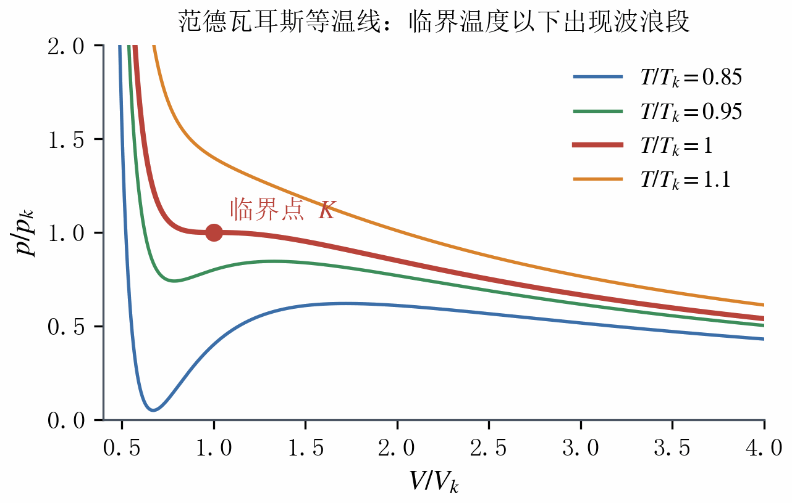

波浪段中靠近两端的部分仍可短暂实现，称为亚稳态：靠近气态一侧的是过冷（过饱和）蒸气，靠近液态一侧的是过热液体。它们遇到扰动就转入稳定状态。威尔逊云室利用过饱和蒸气，带电粒子留下的离子成为凝结核，显出一串雾滴径迹；气泡室利用过热液体，粒子径迹上产生一串气泡。

温度高于 \(T_k\) 的气体，无论怎样等温压缩都不能液化。几种物质的临界温度：水 \(647\,\mathrm K\)，二氧化碳 \(304\,\mathrm K\)，乙醚约 \(467\,\mathrm K\)，氢 \(33\,\mathrm K\)，氦 \(5.2\,\mathrm K\)（课件中水写作 674 K、乙醚写作 450 K，以手册值为准）。演示实验中把液态乙醚封在耐压玻璃管内等容加热，接近临界温度时液面变平、变模糊，最后消失，气液不再可分；冷却时整管先出现乳白色的临界乳光，液面再重新出现。

**范德瓦耳斯气体的内能。** 实际气体的内能包括分子热运动的动能和分子相互作用的势能。由能量均分定理，动能只由温度决定。若把分子看成刚性球，斥力只在相碰时出现，不对应势能，势能全部来自引力，可以宏观地计算：气体膨胀 \(dV\) 时要反抗分子内压强 \(p_i=\nu^2a/V^2\) 做功 \(p_i\,dV\)，这部分功转化为相互作用势能。取 \(V\to\infty\) 时势能为零，
\[
U_p=-\int_V^\infty\frac{\nu^2a}{V'^2}\,dV'=-\frac{\nu^2a}{V},\qquad
U=\nu C_VT-\frac{\nu^2a}{V}.
\]
一摩尔时 \(U=C_VT-a/V_m\)。范德瓦耳斯气体的内能比同温度的理想气体小。

**讲解例：实际气体向真空膨胀会降温。** 1 摩尔二氧化碳在绝热容器中由 \(V_1=1\,\mathrm L\) 向真空膨胀到 \(V_2=2\,\mathrm L\)，取 \(C_V\approx28.5\,\mathrm{J/(mol\cdot K)}\)（示范数据），求温度变化。

过程中 \(Q=0\)、\(W=0\)，内能不变：\(C_VT_1-a/V_1=C_VT_2-a/V_2\)，所以
\[
T_2-T_1=-\frac a{C_V}\Bigl(\frac1{V_1}-\frac1{V_2}\Bigr)=-\frac{0.364}{28.5}\times(1000-500)\approx-6.4\,\mathrm K .
\]
\(V_2>V_1\) 时 \(\Delta T<0\)：气体反抗分子引力做功，消耗了热运动的动能，实际气体自由膨胀后冷却，这与理想气体温度不变不同。

**实际气体的绝热方程。** 可逆绝热过程中，由第一定律和范德瓦耳斯方程，
\[
\delta Q=C_VdT+\frac a{V_m^2}dV_m+p\,dV_m=C_VdT+\frac{RT}{V_m-b}dV_m=0 .
\]
两边除以 \(T\)，积分得 \(C_V\ln T+R\ln(V_m-b)=\) 常量，即
\[
T\,(V_m-b)^{R/C_V}=\text{常量}.
\]
当 \(b=0\) 且 \(R/C_V=\gamma-1\) 时，它回到理想气体的泊松方程 \(TV^{\gamma-1}=\) 常量。

**焦耳—汤姆孙效应。** 让气体在绝热条件下经节流塞（丝绸、棉絮或石棉做成的多孔塞，或一个阀门）从高压 \(p_1\) 一侧定常地流向低压 \(p_2\) 一侧，测量两侧的温度。设一定量气体通过节流塞前后的体积为 \(V_1\)、\(V_2\)，左侧推动它的外界做功 \(p_1V_1\)，它推动右侧的气体做功 \(p_2V_2\)，又没有热交换，所以 \(U_2-U_1=p_1V_1-p_2V_2\)，即
\[
U_1+p_1V_1=U_2+p_2V_2,\qquad H=U+pV\ \text{保持不变}.
\]
节流过程中守恒的是焓 \(H\)，而不是内能。压强差不大时的温度变化称为微分效应，压强差达到上百个大气压时称为积分效应。气体膨胀后冷却称为正效应，变热称为负效应。每种气体有一个转变温度：实验温度低于它时为正效应，高于它时为负效应。对范德瓦耳斯气体，低压下的转变温度近似为 \(2a/(Rb)=\tfrac{27}4T_k\)。氮气的转变温度远高于室温，室温节流时冷却；氢的转变温度约 \(200\,\mathrm K\)，氦约 \(40\,\mathrm K\)，室温节流时反而变热。理想气体的焓只与温度有关，节流前后温度不变，不出现这一效应。

**气体的液化。** 要使气体液化，必须先把它冷到临界温度以下再等温压缩。由此得到液氮（常压沸点 \(77\,\mathrm K\)），盛在杜瓦发明的双层真空保温瓶中。1898 年杜瓦先把氢预冷到转变温度以下，再利用焦耳—汤姆孙效应得到液氢；1908 年卡末林-昂内斯在莱顿大学得到液氦，液氦在标准大气压下的沸点为 \(4.2\,\mathrm K\)。

**相与相变。** 物质的一种热力学平衡态，若在物理性质上不同于同一物质的其他可能平衡态，称为一个相。固、液、气三种聚集态就是三个相，它们之间的转变有熔化与凝固（结晶）、汽化与凝结、升华与凝华。同一种固体还可以有不同的晶型，称为同质多晶现象：碳有石墨、金刚石、富勒烯等形态；碘化汞加热到约 \(127\,^\circ\mathrm C\) 时由红色变为黄色；白锡在低于 \(13.2\,^\circ\mathrm C\) 时会缓慢转变为粉末状的灰锡，低温下转变明显加快，称为“锡疫”。

相变分为两类：

1. 第一类相变：伴有相变潜热，密度（比体积）和熵发生跃变，\(\Delta S=L/T\)。熔化、汽化、升华和多数晶型转变属于这一类。
2. 第二类相变：没有潜热，体积和熵连续变化，而热容等量发生跃变。例如铁磁体在居里点转变为顺磁体，铁电体（俄文 сегнетоэлектрик）转变为普通电介质，液氦在 \(2.17\,\mathrm K\) 转变为超流氦（超流性由卡皮察于 1938 年发现）。

**相图。** 在 \(p\)—\(T\) 平面上，升华线、汽化线和熔化线把平面分成固、液、气三个区域，这样的图称为状态图（相图）。线上的点表示两相平衡，三条线交于一点，三相只能在这一点共存，称为三相点。汽化线终止于临界点，越过临界点，气液之间不再有明显界线。水的三相点为 \(T=273.16\,\mathrm K\)、\(p\approx611\,\mathrm{Pa}\)（约 \(4.6\,\mathrm{mmHg}\)），标准大气压（\(760\,\mathrm{mmHg}\)）远高于它，所以常压加热时水按冰—水—蒸汽的通常路径变化。二氧化碳的三相点压强约 \(5.1\,\mathrm{atm}\)，高于大气压，常压下固态二氧化碳不经液态直接升华（约 \(195\,\mathrm K\)），这就是用来冷藏冰淇淋的干冰。

两相平衡线的斜率由克拉珀龙—克劳修斯方程给出（课程延伸）：
\[
\frac{dp}{dT}=\frac{L}{T\,(v_2-v_1)},
\]
\(L\) 是单位质量的相变潜热，\(v_1\)、\(v_2\) 是相变前后的比体积。一般物质熔化时体积增大，熔化线斜率为正；水结冰时体积增大，液相密度大于固相，\(v_{\text{液}}<v_{\text{固}}\)，熔化线斜率为负，压强增大使冰的熔点降低。按数据估算：\(v_{\text{液}}=1.000\times10^{-3}\,\mathrm{m^3/kg}\)，\(v_{\text{固}}=1.091\times10^{-3}\,\mathrm{m^3/kg}\)，\(L=3.34\times10^5\,\mathrm{J/kg}\)，
\[
\frac{dT}{dp}=\frac{T\,(v_{\text{液}}-v_{\text{固}})}{L}=\frac{273\times(-9.1\times10^{-5})}{3.34\times10^5}\approx-7.4\times10^{-8}\,\mathrm{K/Pa},
\]
即每增加一个大气压，熔点降低约 \(0.0075\,\mathrm K\)。挂重物的细线压在冰块上，线下的冰熔化，线穿过后上方的水又重新冻结，线能穿冰而过、冰块不断，这就是复冰现象。滑冰时冰刀下的压力熔化只是次要因素，摩擦生热和冰面的表层预熔作用更大。水在 \(4\,^\circ\mathrm C\) 时密度最大，冬天湖底保持约 \(4\,^\circ\mathrm C\)，湖水不会冻到底，鱼得以存活。沸点随外压降低而降低：按气压公式，压强降到约 \(0.47\,p_0\)、水在 \(80\,^\circ\mathrm C\) 沸腾的高度约为 \(8\,\mathrm{km}\times\ln(1/0.47)\approx6\,\mathrm{km}\)。

**液体与饱和蒸气的平衡。** 与自己的液体处于热力学平衡的蒸气称为饱和蒸气，此时蒸气与液体温度相同，蒸发速率与凝结速率相等。饱和蒸气压只取决于温度，与体积无关：等温压缩饱和蒸气，只会使更多蒸气凝结，压强不变，这正是等温线上的水平段。水在 \(100\,^\circ\mathrm C\) 时饱和蒸气压为 \(1\,\mathrm{atm}\)，所以常压下水在 \(100\,^\circ\mathrm C\) 沸腾。

描述空气潮湿程度有三个量：

1. 绝对湿度：每立方米空气中所含水蒸气的质量，即水蒸气的密度 \(\rho_v\)。
2. 相对湿度：\(\varphi=\rho_v/\rho_{\text{饱}}(T)\)，即绝对湿度与同温度下饱和水蒸气密度之比，常用百分数表示。
3. 露点：空气等压冷却时，所含水蒸气在平的水面上方恰好达到饱和的温度。

**讲解例：由露点求相对湿度。** 室温 \(20\,^\circ\mathrm C\)，测得露点为 \(11\,^\circ\mathrm C\)，求相对湿度。已知饱和水蒸气压 \(p_{\text{饱}}(20\,^\circ\mathrm C)=2.34\,\mathrm{kPa}\)，\(p_{\text{饱}}(11\,^\circ\mathrm C)=1.31\,\mathrm{kPa}\)。

露点时水蒸气恰好饱和，所以室内水蒸气的分压等于 \(11\,^\circ\mathrm C\) 时的饱和蒸气压。由状态方程，密度 \(\rho=pM/(RT)\)：
\[
\rho_v=\frac{1310\times0.018}{8.31\times293}\approx9.7\times10^{-3}\,\mathrm{kg/m^3},\qquad
\rho_{\text{饱}}(20\,^\circ\mathrm C)=\frac{2340\times0.018}{8.31\times293}\approx1.73\times10^{-2}\,\mathrm{kg/m^3},
\]
\(\varphi=9.7/17.3\approx56\%\)。在同一温度下比较，密度之比等于分压之比，\(1.31/2.34\approx0.56\)，结果一致。冬天呼出的白气，正是口中温暖而接近饱和的空气遇冷降到露点以下，水蒸气凝成细小水滴。干湿球湿度计利用湿球表面蒸发吸热：空气越干燥，蒸发越快，两支温度计的示数差越大，查表即得相对湿度。

## 14. 狭义相对论力学

前面各章的运动学都默认一件事：时间对所有观察者相同，速度按矢量直接相加。第 2.1 节换参考系时写 \(\mathbf v=\mathbf v'+\mathbf u\)，就是这种伽利略变换的结果。速度远小于光速时它足够准确；速度接近光速时，实验给出的结论与之矛盾。本章先说明矛盾从哪里来，再由两条公设推出新的时空变换，然后按牛顿力学的次序重建动量、力和能量，最后用守恒量处理碰撞与衰变。为避免与第 11 章的阻尼系数和第 13 章的热容比混淆，洛伦兹因子记为

\[
\gamma_v=\frac1{\sqrt{1-v^2/c^2}}\ \ge1 ,
\]

\(v=0.6c\) 时 \(\gamma_v=1.25\)，\(v=0.8c\) 时 \(5/3\)，\(v=0.995c\) 时约 \(10.0\)。低速时 \(\gamma_v\approx1+\dfrac{v^2}{2c^2}\)。

### 14.1 两条公设与光速不变的实验依据

狭义相对论建立在两条公设上。相对性原理：物理定律在一切惯性系中形式相同，不能靠惯性系内部的任何实验判断它“绝对地”是否在运动。光速不变原理：真空中的光速在一切惯性系中都等于 \(c\)，与光源和观察者的运动无关。第一条是力学中早已承认的伽利略相对性原理向电磁现象的推广；第二条与伽利略速度合成直接冲突，它的依据首先是下面的实验。

**迈克耳孙实验。** 十九世纪设想光在“以太”中以 \(c\) 传播。若地球以 \(v\) 相对以太运动，光相对仪器的速度就应随方向改变。迈克耳孙干涉仪用半透镜把一束光分成两束，分别沿两条长 \(L\) 的臂到达反射镜再返回，在观察筒中干涉；补偿板让两束光穿过相同厚度的玻璃。设一臂平行于 \(v\)，另一臂与之垂直。

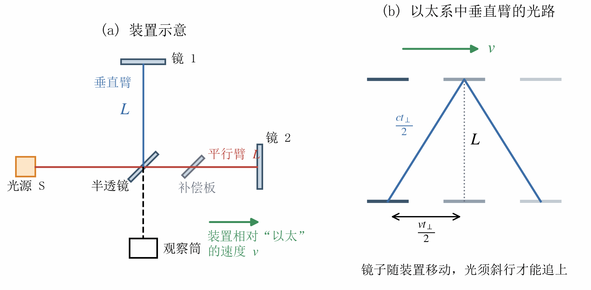

平行臂上，去程光迎着“以太风”，相对仪器的速度为 \(c-v\)，回程为 \(c+v\)：
\[
t_\parallel=\frac{L}{c-v}+\frac{L}{c+v}=\frac{2Lc}{c^2-v^2}=\frac{2L}{c}\cdot\frac1{1-v^2/c^2}.
\]
垂直臂上，在以太系中看，光必须斜着走才能追上随仪器移动的镜子，像小船横渡流动的河。单程用时 \(t_\perp/2\)，光走的斜边 \(ct_\perp/2\)、镜子平移 \(vt_\perp/2\)、臂长 \(L\) 构成直角三角形：
\[
\Bigl(\frac{ct_\perp}2\Bigr)^2=L^2+\Bigl(\frac{vt_\perp}2\Bigr)^2
\quad\Longrightarrow\quad
t_\perp=\frac{2L}{\sqrt{c^2-v^2}}=\frac{2L}{c}\cdot\frac1{\sqrt{1-v^2/c^2}}.
\]
\(v\ll c\) 时用 \((1-x)^{-1}\approx1+x\)、\((1-x)^{-1/2}\approx1+x/2\)，\(x=v^2/c^2\)：
\[
\Delta t=t_\parallel-t_\perp\approx\frac{2L}{c}\Bigl(1+\frac{v^2}{c^2}\Bigr)-\frac{2L}{c}\Bigl(1+\frac{v^2}{2c^2}\Bigr)=\frac Lc\cdot\frac{v^2}{c^2}.
\]
这个差太小，无法直接计时，但可以看干涉条纹。把整台仪器转 \(90^\circ\)，两臂角色互换，时间差变号，总变化 \(2\Delta t\)，对应光程差 \(2Lv^2/c^2\)，条纹应移动
\[
\Delta N=\frac{2L}{\lambda}\cdot\frac{v^2}{c^2}.
\]
地球公转速度约 \(3\times10^4\,\mathrm{m/s}\)，\(v^2/c^2=10^{-8}\)。1881 年的装置 \(L\approx1.2\,\mathrm m\)、\(\lambda\approx6\times10^{-7}\,\mathrm m\)，预期 \(\Delta N\approx0.04\)；1887 年迈克耳孙与莫雷用多次反射把有效臂长增至约 \(11\,\mathrm m\)，预期约 \(0.4\) 条，仪器能分辨约 \(0.01\) 条，实际观察到的移动却远小于预期，可视为零。

结论是：光在各方向上相对观察者的速度都等于 \(c\)，与地球的运动无关，“以太风”不存在。这成为狭义相对论第二公设“真空中光速在一切惯性系中相同”的实验基础。要注意它检验的是光速与观察者运动无关；实验中光源与仪器一起运动，并不直接检验“光速与光源运动无关”，后者另有双星观测等依据，讲义或笔记把两句话混写时应加以区分。

理论上也有线索。麦克斯韦方程组给出电磁波在真空中的速率
\[
c=\frac1{\sqrt{\mu_0\varepsilon_0}},
\]
式中只有真空磁导率与真空电容率两个常数，不含观察者的速度。再加上相对性原理，每个惯性系中的观察者用同样的方程都算出同一个 \(c\)。光速不变是作为公设接受的实验事实，不是由更基本的原理推导出来的；由它出发，本章依次得到同时性的相对性、时间延缓、长度收缩、新的速度合成、速度上限 \(c\)、相对论动量与质能关系，以及时空间隔的不变性。

### 14.2 时间延缓与固有时

设想一只光钟：两面相距 \(L\) 的平行镜，光在其间往返一次记为一拍。在与钟相对静止的参考系中，一拍的时间是
\[
\Delta t_0=\frac{2L}c .
\]
观察者 A 看到钟以速度 \(v\) 沿垂直于镜面连线的方向运动。光从下镜到上镜用时 \(\Delta t/2\)，其间钟平移 \(v\Delta t/2\)；垂直于运动方向的尺寸不变，镜距仍为 \(L\)；由第二公设，光在 A 的参考系中速率仍是 \(c\)，走过斜边 \(c\Delta t/2\)。勾股定理给出
\[
L^2+\Bigl(\frac{v\Delta t}2\Bigr)^2=\Bigl(\frac{c\Delta t}2\Bigr)^2
\quad\Longrightarrow\quad
\Bigl(\frac{\Delta t}2\Bigr)^2(c^2-v^2)=L^2,
\]
\[
\Delta t=\frac{2L}{\sqrt{c^2-v^2}}=\frac{2L}{c\sqrt{1-v^2/c^2}}=\frac{\Delta t_0}{\sqrt{1-v^2/c^2}}=\gamma_v\,\Delta t_0 .
\]

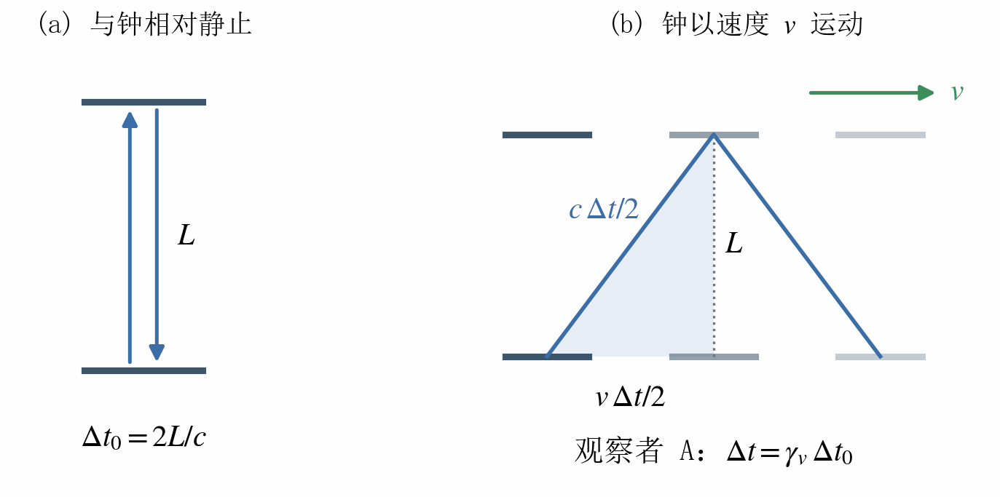

\(\gamma_v>1\)，A 测得的一拍比钟自身的一拍长：运动的钟走得慢。\(\Delta t_0\) 是同一地点发生的两个事件之间、由与之相对静止的钟测得的时间，即固有时（собственное время），它在所有惯性系测得的值中最短。这一推导与迈克耳孙实验的垂直臂是同一个直角三角形，区别在于这里把“光速在每个惯性系都是 \(c\)”当作前提，而不是假设光对以太有固定速度。例如以 \(0.6c\) 匀速经过实验室的时钟自身走过 \(4\,\mathrm s\)，实验室测得 \(\gamma_v\times4\,\mathrm s=5\,\mathrm s\)。

**讲解例：大气中的 μ 子。** 宇宙线在约十几千米高空产生 μ 子，它在自身静止系中的平均寿命 \(\tau_0=2.2\,\mu\mathrm s\)。若不考虑相对论，以 \(v=0.995c\) 运动的 μ 子在一个平均寿命内只能走 \(v\tau_0\approx0.995\times3.0\times10^8\times2.2\times10^{-6}\approx657\,\mathrm m\)，绝大多数到不了地面。实际上地面能测到大量 μ 子。在地面系中，它的寿命被延长为 \(\gamma_v\tau_0\approx10.0\times2.2\,\mu\mathrm s=22\,\mu\mathrm s\)，平均飞行距离约 \(6.6\,\mathrm{km}\)。同一现象在 μ 子自身的参考系中看，它的寿命仍是 \(2.2\,\mu\mathrm s\)，但迎面而来的大气层厚度沿运动方向缩短为原来的 \(1/\gamma_v\)，见 14.3 节的长度收缩。两种描述对“能否到达地面”给出相同结论，这正是相对性原理的要求。

### 14.3 洛伦兹变换与同时性的相对性

时间延缓只处理了“同一地点的两个事件”。要处理任意事件，需要把一个惯性系中的坐标 \((x,y,z,t)\) 换算到另一个惯性系。设惯性系 \(S'\) 相对 \(S\) 以速度 \(v\) 沿 \(x\) 轴运动，\(t=t'=0\) 时两原点重合。

**推导。** 匀速运动在两个惯性系中都应表现为匀速运动，所以变换是线性的；垂直于运动方向的坐标不变，\(y'=y\)、\(z'=z\)，这在光钟推导中已经用过。\(S'\) 的原点 \(x'=0\) 在 \(S\) 中位于 \(x=vt\)，故可设 \(x'=a(x-vt)\)；反过来 \(S\) 的原点在 \(S'\) 中以 \(-v\) 运动，由两系的对称性，同一个系数给出 \(x=a(x'+vt')\)。现在 \(t=0\) 时从原点沿 \(x\) 方向发出一个光信号。按光速不变，它在 \(S\) 中满足 \(x=ct\)，在 \(S'\) 中满足 \(x'=ct'\)。代入两式：
\[
ct'=a(c-v)t,\qquad ct=a(c+v)t' .
\]
两式相乘，消去 \(tt'\)，得 \(c^2=a^2(c^2-v^2)\)，即 \(a=\gamma_v\)。再把 \(x'=\gamma_v(x-vt)\) 代入 \(x=\gamma_v(x'+vt')\) 解出 \(t'\)，并用 \(1-\gamma_v^{-2}=v^2/c^2\)：
\[
x'=\gamma_v(x-vt),\qquad y'=y,\qquad z'=z,\qquad t'=\gamma_v\Bigl(t-\frac{vx}{c^2}\Bigr).
\]
这就是洛伦兹变换（преобразования Лоренца）。逆变换只需把 \(v\) 换成 \(-v\)：\(x=\gamma_v(x'+vt')\)，\(t=\gamma_v(t'+vx'/c^2)\)。\(v\ll c\) 时 \(\gamma_v\to1\)、\(vx/c^2\to0\)，退回伽利略变换 \(x'=x-vt\)、\(t'=t\)。新的内容集中在 \(t'\) 的表达式中：一个参考系中的时间读数与另一个参考系中的位置有关。

变换中带撇与不带撇的量，是两套观测者对同一事件 \(P\) 的记录：\((x,t)\) 由 \(S\) 中布置并对好的尺和钟测得，\((x',t')\) 由 \(S'\) 中自己的尺和钟测得，\(t'\) 是 \(S'\) 中位于事件发生处的那只钟的读数。带撇的量并不是“相对静止参考系”而言的。\(S'\) 中的观测者感觉不到自己在运动，在他看来自己静止、\(S\) 以 \(-v\) 运动，自己的钟和尺一切正常；“静止系”和“运动系”只是为区分两个惯性系取的名字，没有绝对静止的参考系，所以正变换与逆变换形式相同，只差 \(v\) 的符号。\(t'\) 与 \(t\) 不同有两个来源：因子 \(\gamma_v\) 对应时间延缓，\(-vx/c^2\) 一项对应下面的同时性的相对性。还要区分 \(v\)（两参考系之间的相对速度）与物体的速度：\(x\) 与 \(x'\) 是同一个点在两套坐标中的读数，变换式中出现的只是参考系的速度。

对两个事件取差，得到在实际问题中最常用的形式：
\[
\Delta x'=\gamma_v(\Delta x-v\Delta t),\qquad \Delta t'=\gamma_v\Bigl(\Delta t-\frac{v\,\Delta x}{c^2}\Bigr).
\]

**同时性的相对性。** 若两事件在 \(S\) 中同时（\(\Delta t=0\)）但不同地点（\(\Delta x\ne0\)），则 \(\Delta t'=-\gamma_v v\Delta x/c^2\ne0\)，在 \(S'\) 中并不同时。设一列火车以 \(v\) 向右行驶，车厢正中点亮一盏灯。在车上看，光以 \(c\) 同时到达前后两端。在地面上看，光仍以 \(c\) 向两边传播，但车尾迎着光运动、车头背着光运动，光先到车尾、后到车头。两种说法都对，“同时”只在指明参考系后才有意义。只有同一地点的两个事件，同时与否才与参考系无关。

这一点在时空图上一目了然。以 \(x\) 为横轴、\(ct\) 为纵轴画出 \(S\) 中的事件，光线是 \(45^\circ\) 斜线。由洛伦兹变换，\(S'\) 的时间轴 \(x'=0\) 即 \(x=vt\)，是斜率为 \(c/v\) 的直线；空间轴 \(t'=0\) 即 \(ct=(v/c)x\)，斜率为 \(v/c\)。两条轴关于光线对称地向它靠拢，\(v\to c\) 时都贴到光线上。\(S'\) 中“同时”的事件位于平行于 \(x'\) 轴的直线上，而 \(S\) 中同时的事件位于水平线上，二者不是同一组线。

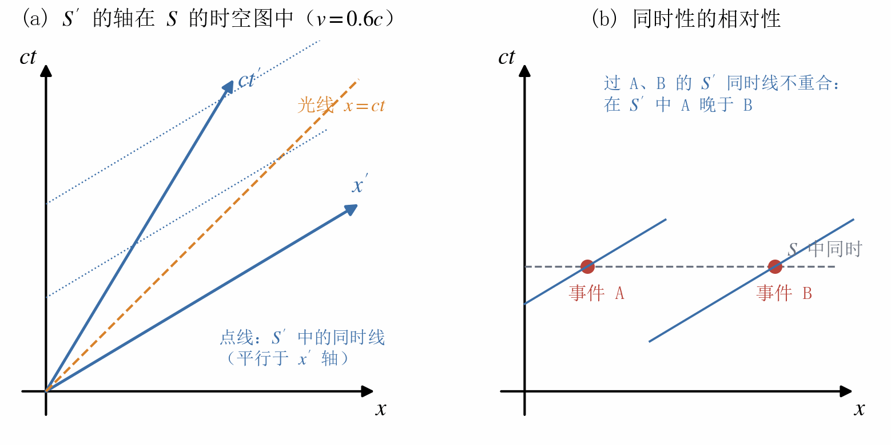

**由变换重新得到时间延缓。** 钟静止在 \(S'\) 中，两次读数发生在同一地点，\(\Delta x'=0\)。由逆变换 \(\Delta t=\gamma_v(\Delta t'+v\Delta x'/c^2)=\gamma_v\Delta t'\)，与光钟结果相同。

**长度收缩。** 一根尺静止在 \(S'\) 中沿 \(x'\) 轴放置，静止长度（固有长度）\(L_0=\Delta x'\)。在 \(S\) 中测它的长度，必须同时记下两端的位置，即 \(\Delta t=0\)。由 \(\Delta x'=\gamma_v(\Delta x-v\Delta t)=\gamma_v\Delta x\)，
\[
L=\Delta x=\frac{L_0}{\gamma_v}=L_0\sqrt{1-v^2/c^2}.
\]
运动的尺沿运动方向缩短，垂直方向不变。“同时记录两端”这一条件不能省略：两端读数若不同时，测得的根本不是长度。也正因为 \(S\) 中同时的两次读数在 \(S'\) 中不同时，两个观察者都可以说对方的尺变短，并不矛盾。

**讲解例：车库与长杆。** 固有长度 \(5\,\mathrm m\) 的杆以 \(0.6c\) 驶入固有长度 \(4\,\mathrm m\) 的车库。在车库系中，杆长 \(5/1.25=4\,\mathrm m\)，可以恰好完全进入；在杆的参考系中，车库只有 \(4/1.25=3.2\,\mathrm m\)，装不下。矛盾的根源是“杆的两端同时在库内”这一判断依赖参考系。在车库系中，杆尾进门与杆头到达后墙两件事同时发生，间距 \(\Delta x=4\,\mathrm m\)；换到杆的参考系，二者时间差为 \(\Delta t'=-\gamma_vv\Delta x/c^2=-1.25\times0.6\times4/c\approx-1.0\times10^{-8}\,\mathrm s\)，杆头先到后墙，杆尾后进门，所以杆系中从未出现“整根杆都在库内”的时刻。两种描述对每个具体事件发生与否的判断相同。

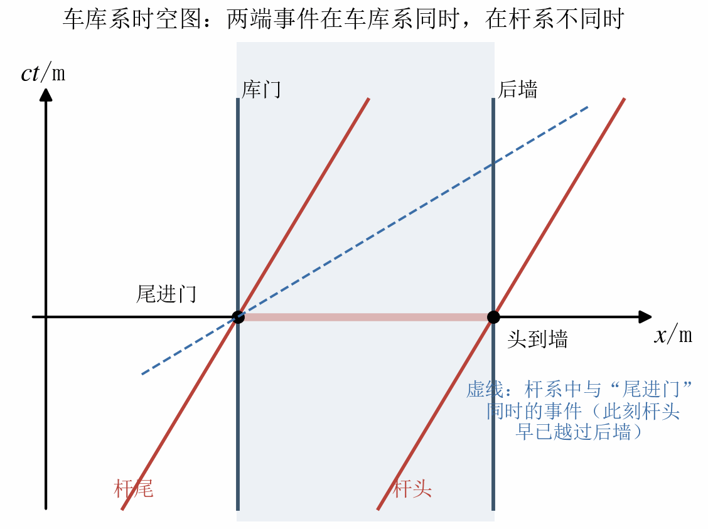

### 14.4 时空间隔与因果次序

在普通空间中转动坐标轴，两点的坐标会变，距离平方 \(\Delta x^2+\Delta y^2+\Delta z^2\) 不变。洛伦兹变换中也有一个不变量。对沿 \(x\) 方向分开的两个事件，用差值形式代入：
\[
c^2\Delta t'^2-\Delta x'^2=\gamma_v^2\Bigl[\Bigl(c\Delta t-\frac vc\Delta x\Bigr)^2-(\Delta x-v\Delta t)^2\Bigr]
=\gamma_v^2\Bigl(1-\frac{v^2}{c^2}\Bigr)\bigl(c^2\Delta t^2-\Delta x^2\bigr)=c^2\Delta t^2-\Delta x^2 .
\]
展开时交叉项 \(-2v\Delta t\Delta x\) 两两抵消。连同不变的 \(y,z\)，定义两事件的时空间隔（интервал）
\[
\Delta s^2=c^2\Delta t^2-\Delta x^2-\Delta y^2-\Delta z^2 ,
\]
它在一切惯性系中取同一值。这与费曼讲义第 17 章“时空间隔”的讲法一致：时间和空间单独都会随参考系改变，组合起来的间隔才是“实在”的量。

间隔的符号把事件对分为三类。\(\Delta s^2>0\) 为类时间隔，存在一个惯性系使两事件发生在同一地点，该系中的时间差就是固有时 \(\Delta\tau=\Delta s/c=\Delta t\sqrt{1-v^2/c^2}\)，这给出时间延缓的又一推导；这样两个事件的先后次序在一切惯性系中相同，前者可以影响后者。\(\Delta s^2<0\) 为类空间隔，存在惯性系使两事件同时，不同惯性系中先后次序甚至可以颠倒；但联系它们需要超光速信号，所以次序颠倒不破坏因果关系。\(\Delta s^2=0\) 为类光间隔，两事件能由一个光信号连接。上面车库例中的两个事件间距 \(4\,\mathrm m\)、在车库系中同时，是类空的，因此在杆系中次序可以不同。

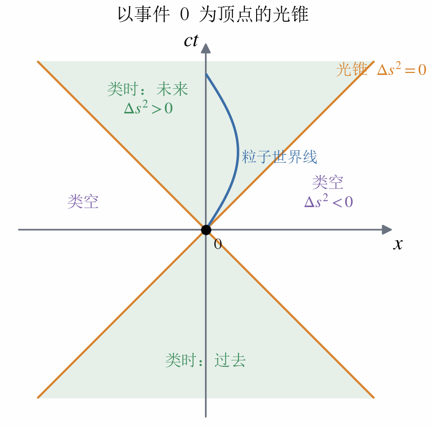

### 14.5 速度合成

物体在 \(S\) 中的速度为 \(u_x=dx/dt\)，在 \(S'\) 中为 \(u_x'=dx'/dt'\)。对洛伦兹变换取微分，\(dx'=\gamma_v(dx-v\,dt)\)、\(dt'=\gamma_v(dt-v\,dx/c^2)\)，相除并分子分母同除以 \(dt\)：
\[
u_x'=\frac{u_x-v}{1-vu_x/c^2},\qquad
u_y'=\frac{u_y}{\gamma_v\,(1-vu_x/c^2)},\qquad
u_z'=\frac{u_z}{\gamma_v\,(1-vu_x/c^2)} .
\]
反过来由 \(S'\) 中的速度求 \(S\) 中的速度，把 \(v\) 换成 \(-v\)：\(u_x=(u_x'+v)/(1+vu_x'/c^2)\)。分母是相对论的修正，\(vu_x\ll c^2\) 时退回 \(u_x'=u_x-v\)。

检验光速不变：令 \(u_x=c\)，得 \(u_x'=(c-v)/(1-v/c)=c\)，光在 \(S'\) 中仍以 \(c\) 传播。两个小于 \(c\) 的速度合成后也不会超过 \(c\)：若 \(|u_x'|<c\)、\(|v|<c\)，则
\[
c-u_x=\frac{(c-u_x')(c-v)}{c+vu_x'/c}>0 .
\]
**讲解例。** 飞船以 \(0.6c\) 飞离地面，向前以相对飞船 \(0.6c\) 的速度发射探测器。地面测得探测器速度为 \((0.6+0.6)c/(1+0.36)\approx0.882c\)，而不是 \(1.2c\)。若改为向后发射，地面速度为 \((0.6-0.6)c/(1-0.36)=0\)，探测器相对地面静止，此时分母不改变结果。

横向分量也要修正，因为两个参考系的时间流逝不同。一个在 \(S'\) 中只沿 \(y'\) 方向以 \(w\) 运动的物体（\(u_x'=0\)），在 \(S\) 中的竖直速度为 \(u_y=w/\gamma_v=w\sqrt{1-v^2/c^2}\)。下一节的动量推导要用到这个结果。

### 14.6 相对论动量与力

速度的合成规则变了，\(\mathbf p=m\mathbf v\) 在洛伦兹变换下不再守恒。我们希望保留动量守恒，并要求新的动量在低速时回到 \(m\mathbf v\)，方向沿速度。费曼讲义第 16 章用一次掠射碰撞确定它的形式，思路如下。

两个完全相同、静止质量为 \(m\) 的小球作弹性掠碰。取一个参考系 \(S'\)，在其中小球 A 只沿竖直方向以很小的速率 \(w\) 运动，碰后竖直速度反向；小球 B 以很大的水平速度 \(u\) 运动，同时有竖直分量。由对称性，在随 B 一起水平运动的参考系中，B 只以 \(w\) 竖直运动、碰后反向，情形与 A 在 \(S'\) 中完全相同。按上一节的横向速度变换，在 \(S'\) 中 B 的竖直速度为 \(w\sqrt{1-u^2/c^2}\)。设动量写成 \(p=m_v v\)，\(m_v\) 是待定的、只与速率有关的系数。碰撞前后竖直方向动量守恒，两球的竖直速度都反向，所以要求它们的竖直动量大小相等：
\[
m_{w}\,w=m_{u'}\,w\sqrt{1-u^2/c^2},
\]
其中 \(u'=\sqrt{u^2+w^2(1-u^2/c^2)}\) 是 B 的合速率。令 \(w\to0\)，\(m_w\to m\)，\(u'\to u\)，得 \(m_u=m/\sqrt{1-u^2/c^2}\)。因此
\[
\mathbf p=\gamma_v\,m\mathbf v=\frac{m\mathbf v}{\sqrt{1-v^2/c^2}} .
\]
这里 \(m\) 是物体静止时测得的质量，在一切惯性系中相同，称为静止质量或不变质量。旧的教材（包括费曼讲义）常把 \(\gamma_vm\) 叫作“相对论质量”，说质量随速度增大；本册始终用不随速度改变的 \(m\)，把 \(\gamma_v\) 写进动量和能量的表达式，二者描述的是同一组公式。

在“相对论质量”的说法下，\(\gamma_vm\) 是在物体以速度 \(v\) 运动的那个参考系中测得的值，与观测者有关；静止质量 \(m\) 在与物体相对静止的参考系中测得，所有观测者算出的都相同。常有人疑惑：质量乘了 \(\gamma\)，速度又经过变换，动量是否被修正了两次？并不会。速度变换回答的是“同一物体在另一个参考系中速度是多少”，是两套记录之间的换算，并不给速度乘修正因子。一旦选定参考系，就只用该参考系中测得的物体速度 \(v\) 计算 \(\gamma_v\) 与 \(\mathbf p\)，因子 \(\gamma_v\) 只出现一次，而且 \(\gamma_v\) 中的 \(v\) 是物体相对观测者的速度，不是参考系之间的速度。例如物体静止在 \(S'\) 中，\(S'\) 相对 \(S\) 以 \(0.6c\) 运动：在 \(S'\) 中 \(p'=0\)；在 \(S\) 中物体速度为 \(0.6c\)，\(\gamma_v=1.25\)，\(p=1.25\times m\times0.6c=0.75\,mc\)。两个参考系中都只乘了一次 \(\gamma_v\)。

**力。** 牛顿第二定律保留为动量的变化率
\[
\mathbf F=\frac{d\mathbf p}{dt}=\frac{d}{dt}\bigl(\gamma_vm\mathbf v\bigr),
\]
这正是 5.2 节变质量问题中已经强调过的写法。与 \(m\mathbf a\) 不同的是 \(\gamma_v\) 本身随速率变化。由 \(\dfrac{d}{dv}(\gamma_vv)=\gamma_v^3\)，可以分两种情况：力与速度平行时只改变速率，\(F=\gamma_v^3ma\)；力与速度垂直时只改变方向，\(\gamma_v\) 不变，\(F=\gamma_vma\)。所以一般情况下力与加速度不同向，“质量”也不能用一个数概括。

**讲解例 1：恒力加速。** 静止质点受沿 \(x\) 方向的恒力 \(F\)。由 \(dp/dt=F\) 得 \(p=Ft\)，再由 \(p=\gamma_vmv\) 解出速度：
\[
v(t)=\frac{Ft/m}{\sqrt{1+(Ft/mc)^2}} .
\]
\(t\) 较小时 \(v\approx Ft/m\)，就是牛顿结果；\(t\to\infty\) 时 \(v\to c\)。动量可以无限增长，速度却有上限。要达到 \(0.99c\)，需要 \(\gamma_vv/c=7.02\)，即 \(t=7.02\,mc/F\)，是牛顿力学所需时间 \(0.99\,mc/F\) 的七倍多。

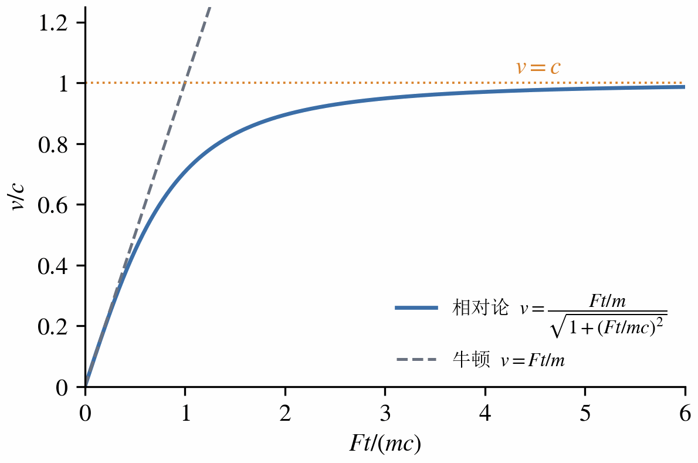

**讲解例 2：磁场中的圆周运动。** 电荷 \(q\) 以速率 \(v\) 垂直进入匀强磁场 \(B\)，洛伦兹力 \(qvB\) 垂直于速度，速率不变，\(\gamma_v\) 为常量。向心方程 \(qvB=\gamma_vmv^2/R\) 给出
\[
R=\frac{\gamma_vmv}{qB}=\frac{p}{qB}.
\]
半径正比于相对论动量。粒子探测器正是用径迹曲率测动量；同一磁场下高速电子的径迹比按 \(mv\) 预计的平直，回旋频率 \(qB/(\gamma_vm)\) 随能量增大而降低，这也是普通回旋加速器加速到相对论能量后失去同步的原因。

### 14.7 能量、质能关系与能量—动量关系

仍按第 4 章的办法，用功定义动能的增量。沿运动方向的力做功 \(dT=F\,dx=\dfrac{dp}{dt}\,v\,dt=v\,dp\)。由 \(dp=d(\gamma_vmv)=\gamma_v^3m\,dv\)，而
\[
d\bigl(\gamma_vmc^2\bigr)=mc^2\cdot\gamma_v^3\frac{v}{c^2}\,dv=\gamma_v^3mv\,dv=v\,dp ,
\]
两者相同。从静止开始积分，
\[
T=\gamma_vmc^2-mc^2=(\gamma_v-1)\,mc^2 .
\]
把 \(\gamma_v\) 展开，\(T=\dfrac12mv^2+\dfrac38\dfrac{mv^4}{c^2}+\cdots\)，第一项就是牛顿动能，第二项是最低阶修正。\(v=0.1c\) 时修正约为主项的 \(0.75\%\)，所以日常速度下牛顿公式足够准确。

动能写成两项之差，提示把 \(E=\gamma_vmc^2\) 看作总能量，\(E_0=mc^2\) 为静止能量。静止能量并非数学上的常数项，而是可以转化的能量：在 14.8 节的完全非弹性碰撞中，动能变成静止能量；在核反应中，静止质量的减少以动能或辐射放出。**讲解例：氘核的结合能。** 质子与中子的静止能量分别为 \(938.272\,\mathrm{MeV}\) 和 \(939.565\,\mathrm{MeV}\)，二者之和为 \(1877.837\,\mathrm{MeV}\)；氘核为 \(1875.613\,\mathrm{MeV}\)。差值 \(2.224\,\mathrm{MeV}\) 就是把氘核拆开所需的结合能，也是质子俘获中子形成氘核时放出的 γ 光子的能量。束缚体系的质量小于各组成部分质量之和。

**能量与动量的关系。** 由 \(E=\gamma_vmc^2\)、\(p=\gamma_vmv\)，
\[
E^2-p^2c^2=\gamma_v^2m^2c^4\Bigl(1-\frac{v^2}{c^2}\Bigr)=m^2c^4,\qquad
\frac vc=\frac{pc}E .
\]
左边在任何惯性系中都相同，与 14.4 节的间隔类似：\(E/c\) 与 \(\mathbf p\) 组成的四维动量，其“长度”就是 \(mc\)。对一个粒子组，总能量与总动量也满足 \(E_{\rm tot}^2-p_{\rm tot}^2c^2=M^2c^4\)，\(M\) 称为体系的不变质量，它在总动量为零的参考系（质心系）中等于 \(E_{\rm tot}/c^2\)。静止质量为零的粒子只能有 \(E=pc\)、\(v=c\)，光子就是这样；它没有静止参考系。

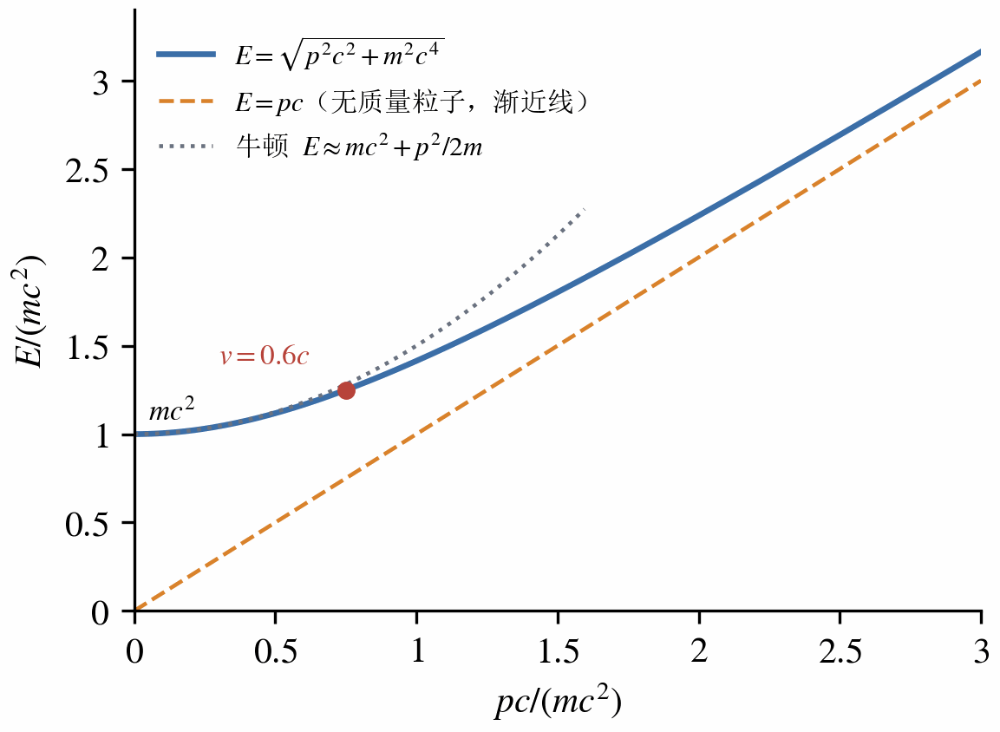

**讲解例：以 \(0.6c\) 运动的粒子。** \(\gamma_v=1.25\)，\(E=1.25mc^2\)，\(T=0.25mc^2\)，\(p=0.75mc\)。检验 \(E^2-p^2c^2=(1.5625-0.5625)m^2c^4=m^2c^4\)，\(pc/E=0.6\)。按牛顿公式动能只有 \(0.18mc^2\)，相对论动能比它多约四成。

**贝尔托齐实验：速度的极限。** 1964 年贝尔托齐直接测量了电子的速度与动能。脉冲控制的栅极放出一小团电子，经加速获得动能 \(T\)；电子飞过长 \(L=8.4\,\mathrm m\) 的真空管，途经探针和末端铝靶时示波器各记一次信号，间隔即飞行时间 \(t\)，于是 \(v=L/t\)。动能用量热法独立测定：电子把能量变成铝靶的热，热电偶测出总热量 \(Q\)，再由收集的电荷算出电子数 \(N\)，得 \(T=Q/N\)。

经典力学预言 \(v^2=2T/m\)，\(v^2\) 随 \(T\) 线性增长，可以超过 \(c^2\)。相对论中 \(T=(\gamma_v-1)mc^2\)，解出
\[
\gamma_v=1+\frac T{mc^2},\qquad v^2=c^2\Biggl[1-\frac1{\bigl(1+T/(mc^2)\bigr)^2}\Biggr],
\]
\(T\to\infty\) 时 \(v^2\to c^2\) 而永远达不到。电子 \(mc^2=0.511\,\mathrm{MeV}\)，取 \(T=0.5\,\mathrm{MeV}\)：\(\gamma_v\approx1.98\)，\(v/c=\sqrt{1-1/1.98^2}\approx0.86\)；经典公式却给出 \(v^2/c^2=2T/(mc^2)\approx1.96\)，\(v\approx1.4c\)。实验测得飞行时间约 \(3.2\times10^{-8}\,\mathrm s\)，\(v\approx8.4/(3.2\times10^{-8})\approx2.6\times10^8\,\mathrm{m/s}\approx0.87c\)，与相对论一致。继续增大能量到数兆电子伏，速度只是越来越接近 \(c\)，多给的能量体现为 \(\gamma_v\) 的增长。\(T=mv^2/2\) 只是 \(v\ll c\) 时的近似。

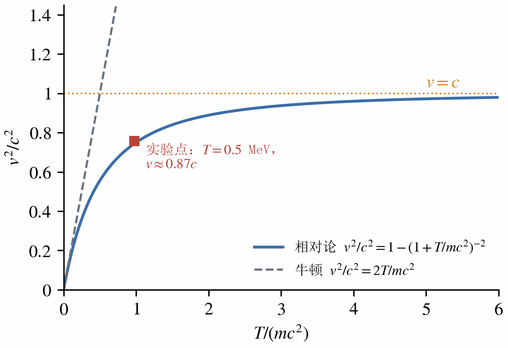

### 14.8 碰撞与衰变：守恒量与不变质量

相对论碰撞中，总动量与总能量（含静止能量）都守恒；动能一般不守恒，静止质量之和也不一定守恒。计算时两个技巧最常用：一是先在动量为零的参考系中分析，二是利用 \(E^2-p^2c^2\) 在各参考系中相同。

**讲解例 1：完全非弹性碰撞。** 两个静止质量为 \(m\) 的粒子以 \(0.6c\) 相向运动，碰后粘成一体。总动量为零，合体静止；能量守恒给出 \(Mc^2=2\gamma_vmc^2=2.5mc^2\)，所以 \(M=2.5m>2m\)。原来的动能 \(0.5mc^2\) 并没有消失，而是成为合体的静止能量，例如内能。在牛顿力学中这部分能量记为“损失的动能变成热”，质量不变；相对论中热能本身对应质量，只是日常情况下太小而测不出。

**讲解例 2：二体衰变。** 静止的 π⁺ 介子衰变为 μ⁺ 子和中微子，π⁺ 与 μ⁺ 的静止能量分别为 \(139.57\,\mathrm{MeV}\)、\(105.66\,\mathrm{MeV}\)，中微子质量可略去。衰变前动量为零，两产物动量等大反向，记为 \(p\)；中微子能量为 \(pc\)。能量守恒：\(E_\mu+pc=m_\pi c^2\)。把 \(E_\mu=m_\pi c^2-pc\) 平方并代入 \(E_\mu^2=p^2c^2+m_\mu^2c^4\)，\(p^2c^2\) 项相消：
\[
pc=\frac{(m_\pi^2-m_\mu^2)c^2}{2m_\pi}=\frac{139.57^2-105.66^2}{2\times139.57}\,\mathrm{MeV}\approx29.8\,\mathrm{MeV}.
\]
μ⁺ 子的动能 \(T_\mu=m_\pi c^2-pc-m_\mu c^2\approx4.1\,\mathrm{MeV}\)。两体衰变的产物能量是确定值，这是实验上区分二体与三体衰变的依据。

**讲解例 3：反应阈能。** 用质子轰击静止的质子，产生反质子：\(p+p\to p+p+p+\bar p\)。入射质子至少需要多大动能？在质心系中，产物刚好全部静止时所需能量最少，此时体系的不变质量为 \(4m\)。实验室中入射质子能量 \(E_1\)、动量 \(p_1\)，靶质子能量 \(mc^2\)，按不变质量写出
\[
(E_1+mc^2)^2-p_1^2c^2=(4mc^2)^2 .
\]
用 \(E_1^2-p_1^2c^2=m^2c^4\) 化简，得 \(2m^2c^4+2E_1mc^2=16m^2c^4\)，\(E_1=7mc^2\)，阈动能 \(T=6mc^2\approx5.6\,\mathrm{GeV}\)。若按“只需提供两个新粒子的静止能量 \(2mc^2\)”估计，会低估三倍：入射粒子的很大一部分能量必须用于保持体系的总动量，变成产物整体运动的动能，无法转化为新粒子。正因为如此，对撞机让两束能量相同的粒子相向对撞，总动量为零，质心系就是实验室系，全部能量都可用于产生新粒子。

## 15. 阅读依据

本册将可读对话中的圆周功率、碰撞效率、弹道摆、球壳与实心球惯量、辅助体比较、平行轴交叉项、滚动、圆锥摆、拉格朗日方法组织为先修链。标题为《解释磁学公式》的会话，正文实际是刚体力学，按正文归类。

实际阅读的原书片段包括费曼第一卷书页34—35、189—190，以及朗道《力学》书页1—3。前者从能量的完整记账及转动中作用点的位移展开概念，后者先区分构型与状态，再以固定端点变分导出运动方程。本册据此把力矩放在微小位移与功之后，把广义坐标放在约束和自由度之后，而不把公式当作彼此孤立的结论。上述页码是实际核读范围，不表示已经逐页读完两本书。原图缺失的记录不用于恢复无法确认的几何细节；本册例子的坐标、假设和数据均在正文重新给出。

2026-10-17增补另实际视觉阅读first CC朗道《力学》本地PDF第38、73—74页：一维运动先由守恒能量分离变量，自由振动先在稳定平衡位置展开势能，再引入正弦、余弦解与振幅、相位，最后联系能量。第11.2—11.4节按这一概念衔接独立展开，另补积分分支和竖直弹簧等课程延伸；不照搬书中习题。

2026-10-22增补的第11.5、11.6节依据 claude.ai 网页对话中一节大学物理课的连续板书转述（俄式记号 κ、r、β；用“乘指数因子再相加划项”的方法解阻尼方程，用辅助角公式求受迫振动的振幅与相位，再求共振频率与共振宽度）。板书照片未取回，推导按转述逐步重新核算。转述中的速度合成式写成余弦且系数为 ω₀²，本册按求导结果写成正弦、系数为 ω₀ 的形式，并给出加 π/2 后的等价余弦式。三种阻尼情形、相位象限和示例数据属课程延伸；本轮未核读 first CC 参考书中阻尼与受迫振动的对应章节。

2026-10-26增补的第2.1、5.2节，第7章变角加速度与角速度合成部分，第9.4、9.5节及第10章末两例，依据 Claude 桌面会话《Irodov physics problems: uniform/rotational motion》。用户为准备一道“匀速运动、转动运动与转动惯量”考题，要求按伊罗多夫《普通物理习题集》（1988 年第 2 版俄文扫描本）§1.1 运动学、§1.3 动量与能量、§1.5 刚体动力学整理题型与解法。本册只吸收其中的方法和概念：换参考系、积分关系消元、密歇尔斯基方程、\(\alpha=\omega\,d\omega/d\varphi\)、相对角加速度、打击中心、进动和打滑转纯滚动。讲解例按原题题意重新叙述并逐式重算，不照抄原书俄语题干，也不附原书答案；原书题号仅在小节中标为“伊罗多夫某题型”。该会话的独立讲义另存于 first CC/irodov，未并入本册；伊罗多夫原书只经会话核读上述三节，本轮维护未重新逐页核对扫描件。

2026-10-28增补依据 claude.ai 网页对话《答案》《T是什么》《光钟推导时间延缓》《迈克耳孙干涉实验推导》，以及《实验报告撰写指导》中的声速原理部分：第1章速度依赖加速度的分离变量例、第6章滑道平抛射程例、9.1节矩形板与三角形板惯量三例、第13章声速与热容比一段及第14章（原13.1节）中迈克耳孙实验、光钟与贝尔托齐实验各段。各例按题意重新叙述并逐式重算，讲义照片未取回，迈克耳孙与贝尔托齐实验的装置参数据回答转述（1881年臂长约1.2 m、1887年约11 m、贝尔托齐管长8.4 m），本轮未对照原始文献核实。原回答中“迈克耳孙实验说明光速与光源运动无关”的讲义表述，按物理内容改为“与观察者运动无关”并说明区别。《推导被吞了》中受迫振动共振频率、峰值、通带与品质因数的推导已在11.6节完整覆盖，未重复写入。

2026-10-28第二次增补依据用户在维护会话中的直接要求“相对论力学对知识进行补充”，属课程延伸。原第13章中的相对论短段与13.1节扩展为独立的第14章“狭义相对论力学”，原第14章顺延为第15章，第13章改名为“热学基础与气体中的声速”。新增内容按“公设与实验依据 → 时间延缓 → 洛伦兹变换、同时性与长度收缩 → 时空间隔 → 速度合成 → 动量与力 → 能量与能量—动量关系 → 碰撞与衰变”的先修次序展开，讲授次序参照费曼第一卷第15—17章：实际视觉阅读了first CC本地中文版PDF第179、186、194—195、201页（书页158、165、173—174、180），即洛伦兹变换的引入、相对论动力学、由掠射碰撞确定动量形式和时空间隔几节，不表示已通读这三章。洛伦兹变换由线性、对称性和光信号推出，速度合成由微分得到，动能由功的积分得到，均为本册独立推导；μ子、车库与长杆、恒力加速、磁场中的圆周运动、氘核结合能、π介子衰变和反质子阈能各例的数据与计算由本册给出，粒子静止能量取常用表值。本册采用不随速度改变的静止质量，并说明了费曼讲义“相对论质量”说法与之的对应。

2026-10-31增补依据 claude.ai 网页对话《相对论中的动量修正》：14.1节麦克斯韦方程组给出的 c 与光速不变推论，14.3节带撇量的含义，14.6节“动量不重复修正”的说明与数值例；新增13.1节依据同一对话中俄语热力学第10讲课件的翻译讲解（研究多粒子系统的三种方法、平衡态与平衡过程、理想气体、温标、门捷列夫—克拉佩龙方程、摩尔、阿伏伽德罗定律、等值过程），原13.1—13.3节顺延为13.2—13.4节。课件中沸点 73.15 K、N_A 单位与 22.4 L 对应压强三处问题已在正文说明。

2026-11-01增补依据 Claude 桌面会话《Physics Kozlovskiy translation and cleanup》：用户请求把物理课讲义《Физика Козловский 1-й сем》（第一学期力学与分子物理，手写讲稿扫描件）译成中文。本册据其译文的章节次序与讲法补写：第3章惯性力与引力的等效原理；13.2节分子大小估计、能量温度、振动自由度计 \(kT\)、经典热容理论的局限与杜隆—珀蒂定律；13.4节克劳修斯等式与不等式、各过程熵变、不可逆过程熵变的计算步骤、自由膨胀与伊罗多夫 2.153 两例、能斯特定理、勒夏特列—布劳恩原理；新增13.5—13.8节（概率与分布函数、麦克斯韦速率分布与施特恩实验，气压公式与玻尔兹曼分布，统计权重与玻尔兹曼熵，范德瓦耳斯方程、临界点、实际气体内能、焦耳—汤姆孙效应、相变、相图与饱和蒸气）。讲义中的公式为手写图片，译文未转写，正文公式按标准教材重新推导；讲义中水与乙醚的临界温度、液氦获得年份、“加法定理用于独立事件”等处按手册与概率论定义改正；麦克斯韦等面积法则与克拉珀龙—克劳修斯方程为课程延伸。正态分布与置信区间部分已由《概率统计与实验数据处理》册覆盖，不在本册重复。

2026-11-03增补依据 claude.ai 网页对话《翻译2.1》：用户翻译并求解伊罗多夫《普通物理习题集》§2.1 理想气体状态方程一组习题（2.1、2.2、2.5、2.8、2.11 及一道分子数估算板书题）。本册在13.1节末补写状态方程的密度形式、混合气体与道尔顿分压定律、平均摩尔质量，以及等温放气、限压阀门、混合气体密度、活塞抽气、过程最高温度、分子数估算六个讲解例；其中用户自算的两个错误结果（阀门题按平均分配得 19/30 atm、抽气题按线性减少列式）已在相应例题中说明错误原因。连续抽气的指数规律、\(p=p_0e^{-\beta V}\) 过程的最高温度与空气平均摩尔质量为课程延伸。题干按题意重新叙述，原题照片未取回；海洋体积为估计值。同日的《分形三角形转动惯量推导》与9.2节、第2章已有内容一致，未重复写入。

2026-11-12增补依据 claude.ai 网页对话《对话内容询问》：用户逐张拍摄热学课黑板与课件提问。13.1节末补写讲解例 7（\(T=T_0+\alpha V_m^2\) 过程的最低压强）；13.3节补写第一定律的微分形式与状态量、过程量之分（\(d\) 与 \(\delta\)、\(\partial\) 的区别），由偏导数与焦耳定律推导 \(C_V\)、内能 \(U=\frac mM C_VT\)，迈耶公式的推导，泊松方程与绝热功的推导，任意过程摩尔热容与 \(p=p_0e^{\alpha V}\) 过程的讲解例；9.4节末补写茹科夫斯基凳（课堂演示）的两个实验与讲解例 3。课件照片未取回，推导按回答转述逐式重新核算；路径比较的矩形面积、绝热功的积分验算与示范数据、热容可为负、茹科夫斯基凳实验二（板书被遮挡）与收臂做功的解释为课程延伸。等值过程与道尔顿定律已在13.1节覆盖，未重复写入。
