# 概率统计与实验数据处理

概率模型、样本推断与测量结果的表达

## 导读

同一时间间隔重复测量，读数通常并不完全相同。数据处理的任务不只是计算平均数，还要辨认波动来自哪里，说明平均值代表什么，判断理论模型与测量是否相容，并把结果的可靠程度表达清楚。概率论从给定模型推算事件的可能性，统计学从有限数据反过来认识模型，测量学则把仪器、操作和物理关系一同纳入结果评估。本册先分别建立这三层概念，再把它们用于时间测量和声学谐振。

课程会话保留了实验1.01的一些汇总量，例如测量次数五十、平均值约六点九六秒、平方偏差和约三点二二平方秒。这些是历史文字中的汇总记录，不等于本次重新读取并核对了完整五十项原始数据。下文需要这些量时均说明使用层级；新编数据只用于说明方法。

## 第一章 数据、总体与研究设计

### 1.1 一行记录代表什么

在使用概率模型之前，应先确定数据的基本单位。一次计时、一个被调查者、一段声学信号都可以成为观测单位，每个单位记录的量称为变量。时间、长度属于数值变量，仪器型号、操作人员类别属于分类变量。编号虽然写成数字，通常只起标识作用；把编号求平均没有物理意义。一个规范记录应同时保留数值、单位、采集条件和发生顺序，否则后续发现漂移时将缺少判断依据。

总体是研究希望讨论的全部对象，样本是实际观察到的部分。总体参数如真实均值、总体方差通常未知，样本统计量如平均值、样本标准差由当前数据计算。即使样本统计量算得非常精确，也不等于总体参数已经精确知道；从有限样本走向总体，还需要抽样机制或实验模型作桥梁。

同一操作人员在同一天重复计时五十次，能够说明该条件下的读数波动，却未必代表所有人员、所有仪器和所有日期。研究问题越宽，样本覆盖也应相应扩大。这个范围问题先于任何公式：复杂的统计方法不能自动修复根本没有观察到的对象。

### 1.2 随机抽样、随机分组与偏差

随机抽样让总体中的单位按明确概率进入样本，主要支持总体代表性；随机分组把已有对象分配到不同处理，主要帮助比较处理效果并减少混杂。这两种随机化目的不同。便利样本容易采集，却可能系统性遗漏某些人或状态；随机分组也不能使一个偏狭样本自动代表整个总体。

在实验中比较两种计时方法，如果第一种全部在上午由甲操作，第二种全部在下午由乙操作，那么方法、时段和人员同时改变。即使两组均值不同，也难以确定原因来自方法本身。可以让同一人员交替使用两种方法，或随机安排顺序，并把人员作为分组因素。合理设计能在数据生成阶段减少歧义，后期计算只是把设计的效果量化。

**例题：配对设计与独立设计的差别。** 两台仪器分别测量同一组三个物体，读数为甲 \(10.1,20.1,30.1\)，乙 \(10.0,20.0,30.0\)。若把两列当成互不相关的两组，物体本身从十到三十的变化会造成很大组内离散。按物体配对相减，差值为 \(0.1,0.1,0.1\)，直接突出两仪器之间稳定的相对偏移。示例中差值没有散布是教学简化，真实实验仍需评估分辨率与共同校准等影响。配对不是任意把两个数放在一起，而是它们共享明确的物理对象或条件。

### 1.3 先看分布，再决定摘要量

均值对极端值敏感，中位数是排序后中间位置，通常更能抵抗少数极端观测。四分位距描述中间一半数据的跨度，标准差则利用全部读数偏差。不同摘要量回答不同问题，不能只因某一个数“更好看”就选择它。

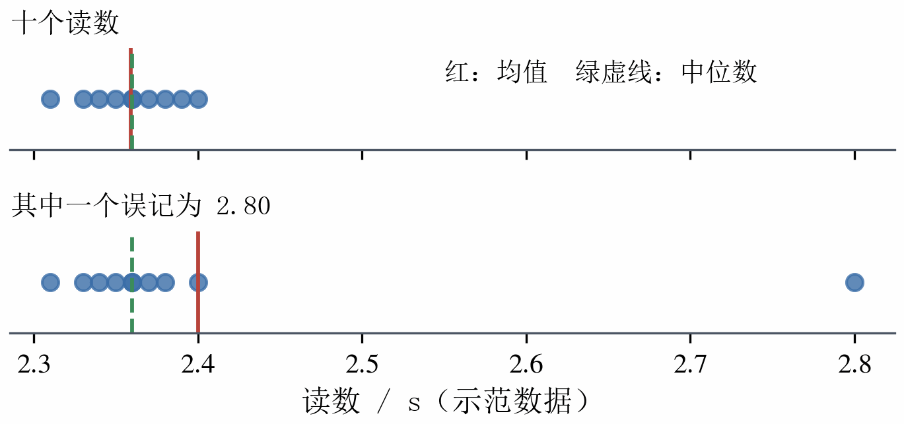

**例题：一个大读数怎样改变中心。** 数据为 \(1,1,2,2,14\)，总和二十，均值四，中位数二。把十四改成三，均值降为一点八，中位数仍为二。若十四是正常的长等待时间，它可能正是总体尾部的重要信息，不能随意删除；若它来自已记录的量程切换故障，则可说明排除依据。描述性统计应帮助识别结构，不能替代对数据产生过程的解释。

记录顺序也提供信息。十个值绕同一中心上下波动，与十个值从小到大缓慢上升，可能具有相近的均值和标准差，却对应不同机制。后一种提示漂移或预热过程，直接用独立同分布模型可能低估不确定度。因此保留时间顺序和实验日志，是把描述统计接到概率模型的必要准备。

## 第二章 随机事件、概率与条件信息

### 2.1 样本空间与事件

随机试验的所有可能结果组成样本空间，事件是其中的一部分。概率满足非负性、全集概率为一和互不相容事件的可列可加性。由此得到补事件概率 \(P(A^c)=1-P(A)\)，以及

\[
P(A\cup B)=P(A)+P(B)-P(A\cap B).
\]

减去交集是因为同时属于两事件的结果被重复计算。频率是实际重复试验中事件出现的次数除以总次数，概率是模型中的量。样本频率会波动，不能要求每一组有限数据都精确等于理论概率。

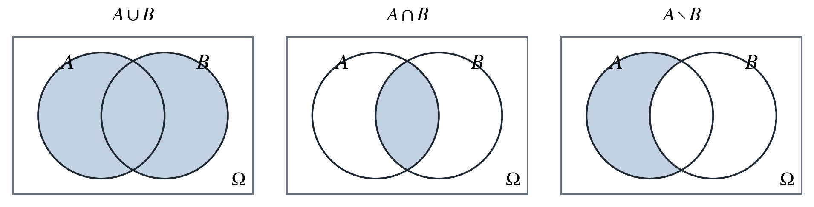

若样本空间有限且基本结果等可能，概率可按“有利结果数除以总数”计算。等可能是条件，不是看到几个选项就能默认。人工计时的不同读数一般不等可能，不能把读数区间的个数直接当成概率分母。

**例1：有限概率与重复计数。** 掷一枚理想骰子，令 \(A\) 为偶数，\(B\) 为大于三的数。\(A=\{2,4,6\}\)、\(B=\{4,5,6\}\)，交集是 \(\{4,6\}\)。所以 \(P(A\cup B)=3/6+3/6-2/6=4/6\)。直接把两个二分之一相加会得到一，错误在于把四和六各计了两次。

**计数的基本公式。** 在等可能模型中，概率等于有利结果数除以总结果数，所以常常需要计数。基本的计数原理有两条：完成一件事若分几个步骤，每步分别有 \(m_1,m_2,\ldots\) 种方法，总方法数为乘积 \(m_1m_2\cdots\)（乘法原理）；若分几类互不重叠的情形，总数为各类之和（加法原理）。由乘法原理得到排列数与组合数：

\[
A_n^k=\frac{n!}{(n-k)!},\qquad C_n^k=\binom nk=\frac{n!}{k!\,(n-k)!}.
\]

\(A_n^k\) 是从 \(n\) 个不同对象中取出 \(k\) 个并排成一列的方法数，次序不同算不同的排法；\(C_n^k\) 是只取出、不排序的方法数，每一种取法对应 \(k!\) 种排法，所以 \(C_n^k=A_n^k/k!\)。判断用排列还是组合，只看结果中的次序是否重要。例如从五个球中取两个，若记录先后则有 \(A_5^2=20\) 种结果，若只关心取到哪两个则有 \(C_5^2=10\) 种。

加法公式还可以推广到三个事件：

\[
P(A\cup B\cup C)=P(A)+P(B)+P(C)-P(AB)-P(AC)-P(BC)+P(ABC).
\]

两两交集被减去后，三者共同的部分被多减了一次，需要加回。“至少一个”类型的问题，用补事件往往更简单：\(P(\text{至少一个发生})=1-P(\text{一个也不发生})\)。

计算概率的一般步骤是：

1. 明确试验和样本空间，判断各基本结果是否等可能。
2. 把所求事件用和、交、补等运算表示出来。
3. 若是等可能模型，用排列组合分别数出有利结果数和总数。
4. 若事件之间有条件关系或独立性，用乘法公式、全概率公式或独立性计算。
5. 检查结果在零到一之间，并用补事件或另一种方法核对。

### 2.2 条件概率与独立性

在 \(P(B)>0\) 时，已知 \(B\) 发生后的条件概率是

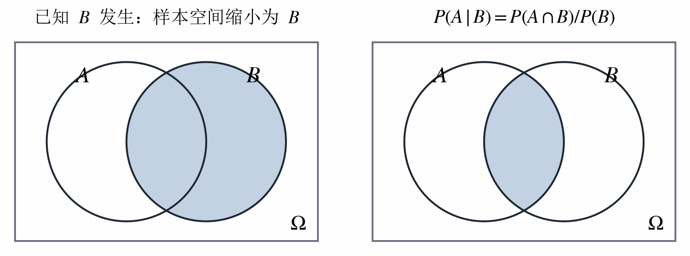

\[
P(A\mid B)=\frac{P(A\cap B)}{P(B)}.
\]

独立意味着 \(P(A\cap B)=P(A)P(B)\)，即知道其中一件事不改变另一件事的概率。独立与互斥不同：两个概率都为正的互斥事件不可能独立，因为它们的交集概率为零，而概率乘积为正。

实验中连续两次读数可能因疲劳、温度漂移或同一基准校准而相关。因此“重复了很多次”不自动等于“获得很多个独立观测”。这将影响均值方差和不确定度公式。

**例2：条件信息改变基准。** 袋中有三个红球、两个白球，不放回依次取两个球。第一次取红的概率为 \(3/5\)，在它已发生后，第二次取红概率为 \(2/4\)，所以两次均红的概率为 \(3/10\)。若放回并充分混合，第二次的条件概率仍为 \(3/5\)，两次均红概率变成 \(9/25\)。区别不是计算技巧，而是抽样机制是否改变了后续分布。

把条件概率的定义改写，就得到乘法公式：

\[
P(A\cap B)=P(B)\,P(A\mid B)=P(A)\,P(B\mid A),\qquad
P(A_1A_2\cdots A_n)=P(A_1)P(A_2\mid A_1)\cdots P(A_n\mid A_1\cdots A_{n-1}).
\]

上例中两次均红的概率 \(\frac35\cdot\frac24\) 正是这个公式。多个事件相互独立，要求其中任意几个事件同时发生的概率都等于各自概率之积；仅仅两两独立是不够的。若 \(n\) 个事件相互独立，至少一个发生的概率为 \(1-\prod(1-P(A_i))\)。例如每次触发失败的概率为百分之十，独立重复三次，至少成功一次的概率为 \(1-0.1^3=0.999\)。

### 全概率与贝叶斯公式

条件概率不仅能从已知原因推算结果，也能在观察结果后重新判断可能原因。设互斥事件 \(B_1,\ldots,B_m\) 覆盖全部可能情况，且各概率为正。事件 A 可以分成互不重叠的 \(A\cap B_i\)，所以

\[
P(A)=\sum_{i=1}^{m}P(A\mid B_i)P(B_i).
\]

右边每项先描述某一种情况发生的概率，再描述该情况下 A 出现的比例。用条件概率定义把交集倒过来写，就得到

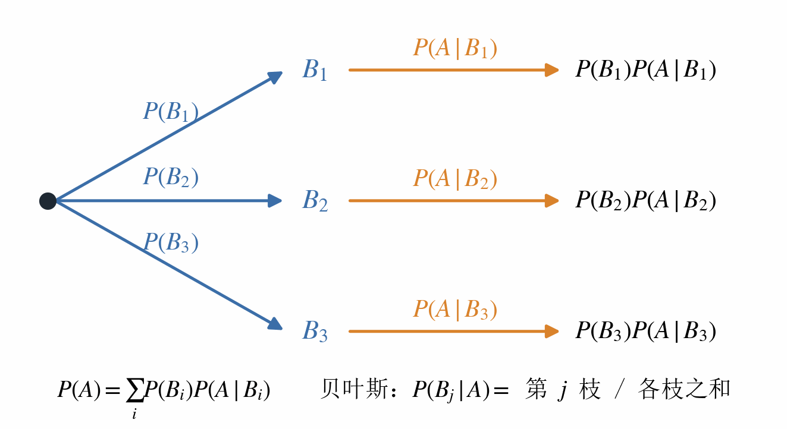

\[
P(B_j\mid A)=\frac{P(A\mid B_j)P(B_j)}{\sum_iP(A\mid B_i)P(B_i)}.
\]

分子是既来自第 j 种情况又出现 A 的概率，分母是所有情况下出现 A 的总概率。两者所用的基准不同，不能把 \(P(A\mid B_j)\) 直接当成 \(P(B_j\mid A)\)。

考虑一个示范生产问题：一号生产线供应六成产品，次品率百分之一；二号线供应四成，次品率百分之三。随机抽到的产品为次品的概率为 \(0.6\times0.01+0.4\times0.03=0.018\)。已知抽到的是次品，它来自二号线的概率为 \(0.012/0.018=2/3\)。二号线次品率为百分之三，并不意味着已知次品时来自二号线的概率也是百分之三。后一个问题还必须把产量占比和另一条线的贡献纳入。

这个模型要求抽样方式与所给产量占比相符，且次品率适用于所讨论的生产条件。若抽样者刻意每条线各取同样数量，抽样总体的比例已经改变，应使用新的基准重算。

## 第三章 随机变量、分布与密度

### 3.1 从事件到数值

随机变量把每个试验结果对应为一个数。离散随机变量用概率质量函数 \(p_k=P(X=x_k)\) 描述，满足 \(p_k\ge0\)、\(\sum p_k=1\)。连续随机变量常用概率密度 \(p(x)\) 描述，区间概率为

\[
P(a<X<b)=\int_a^bp(x)dx,
\quad p(x)\ge0,\quad\int_{-\infty}^{\infty}p(x)dx=1.
\]

分布函数 \(F(x)=P(X\le x)\) 对离散和连续情况都适用。存在密度时，\(F(x)=\int_{-\infty}^xp(t)dt\)。分布函数的值是概率，必须介于零和一；密度的值是单位长度上的概率浓度，可以大于一。

连续分布在单个点的概率为零，因为零宽度区间的面积为零。这不表示“该测量值不可能出现”，而是任何精确实数点的概率均为零；真实仪器的显示值通常对应一个有限宽度的舍入区间。

### 3.2 频数、频率与频率密度

样本数为 \(N\)，第 \(j\) 组频数为 \(n_j\)，频率为 \(f_j=n_j/N\)，组宽为 \(\Delta_j\)。密度直方图高度为

\[
h_j=\frac{n_j}{N\Delta_j},\qquad
h_j\Delta_j=f_j,\qquad\sum_jh_j\Delta_j=1.
\]

频数是次数，频率无单位，若测量量用秒，则频率密度的单位是每秒。组宽不同时，柱高不能用频数或频率直接比较，必须除以各自组宽，否则宽组天然容纳更多读数，会制造虚假的分布峰。

**例3：不等宽组的直方图。** 一百次观测分在两个相邻区间，第一组宽零点一秒，有三十次；第二组宽零点二秒，有七十次。两组频率分别为零点三、零点七，密度分别为三每秒、三点五每秒。柱高之和为六点五每秒，没有“必须等于一”的含义；面积之和是 \(3\times0.1+3.5\times0.2=1\)，才满足归一化。

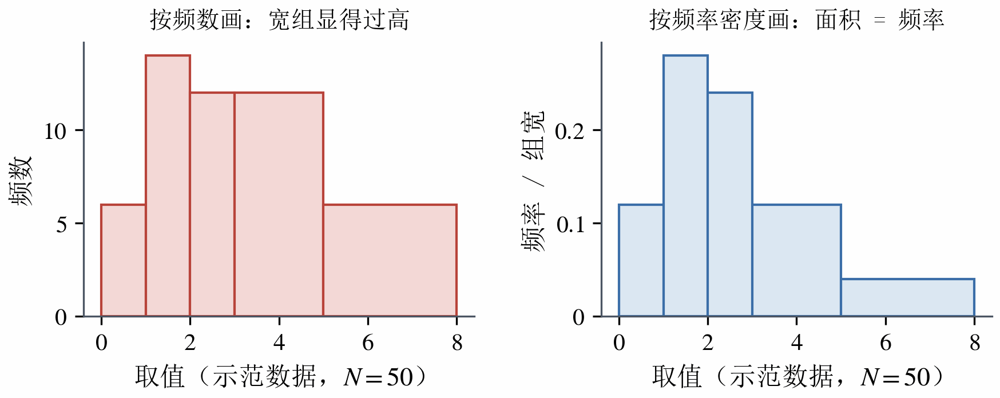

分组前应规定边界，例如全部左闭右开，仅最后一组包含右端点。边界规则一致能避免重复计数。组宽过小会产生许多空柱，过大则掩盖结构；分组改变的是显示方式，不改变原始数据，分析时应保留原始记录。

### 分布函数与密度的联系

不论随机变量离散还是连续，都可以用 \(F(x)=P(X\le x)\) 统一描述分布。F 单调不减，从负无穷处的零趋向正无穷处的一；离散概率在图像上表现为跳跃，跳跃高度就是该点的概率。连续密度则通过积分累积成分布函数：\(F(x)=\int_{-\infty}^{x}p(t)dt\)。在可求导处，\(F'(x)=p(x)\)。

例如 X 在区间 \([0,2]\) 上均匀分布，密度在区间内为二分之一，区间外为零；F 在 x<0 时为零，零到二之间为 x/2，x>2 时为一。因此 \(P(0.5<X\le1.5)=F(1.5)-F(0.5)=1/2\)。这同时解释了为何连续模型中单个点概率为零：积分区间的宽度为零，而不是密度必须在该点为零。

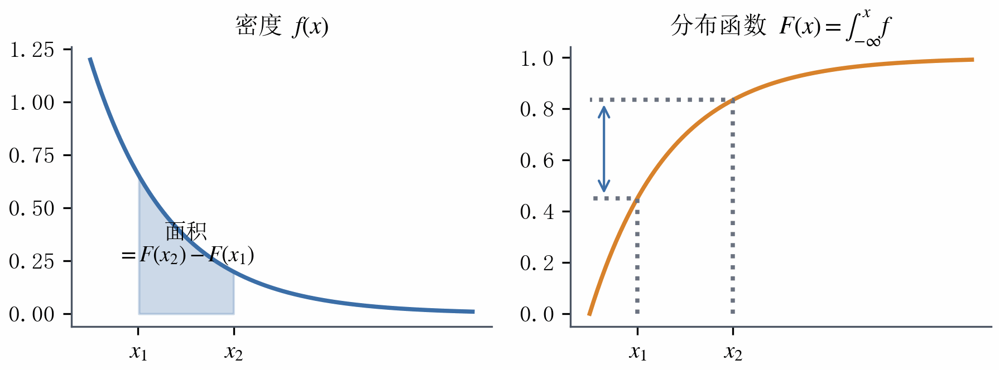

若把单位从秒改成毫秒，数值区间扩大一千倍，密度高度相应缩小，区间概率保持不变。密度携带自变量单位的倒数，不能把密度的数值直接称为某点“发生的概率”。后面的直方图与正态曲线比较必须保持横轴单位和面积归一化一致。

### 3.4 从试验机制选择常见分布

一次试验只有成功和失败两种结果时，令成功取一、失败取零，得到伯努利变量。成功概率为 p，故 \(P(X=1)=p,\ P(X=0)=1-p\)。独立重复 n 次、每次 p 不变时，成功总次数服从二项分布：
\[
P(X=k)=\binom nkp^k(1-p)^{n-k},\qquad k=0,\ldots,n.
\]
组合数计数成功发生位置的不同安排，乘积给出每种安排的概率。固定试验次数、独立、相同成功概率是这个模型的条件。例如三次独立触发，每次成功率0.9，恰有两次成功的概率为 \(3(0.9)^2(0.1)=0.243\)，至少一次失败为 \(1-(0.9)^3=0.271\)。

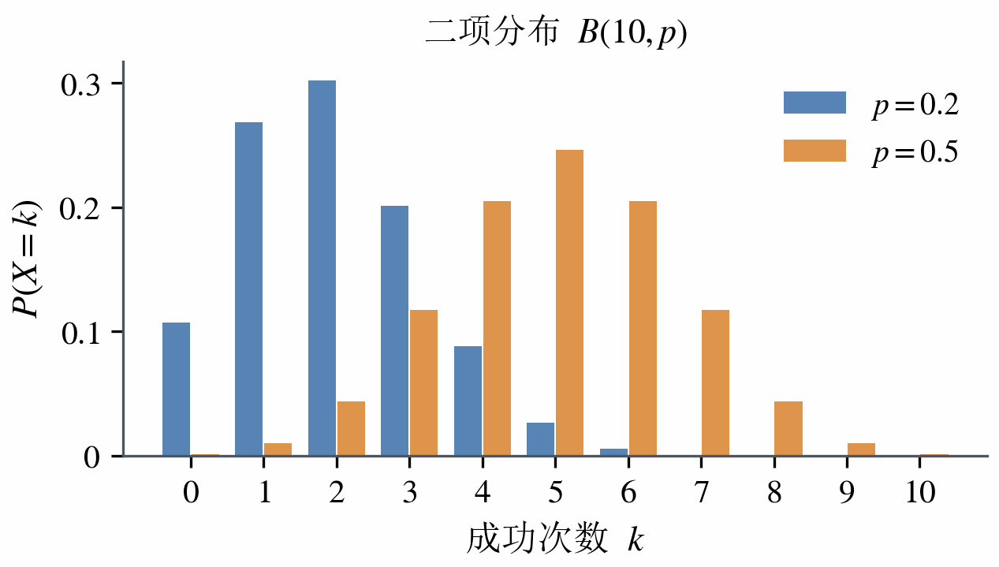

若任务是固定时段中出现多少次稀疏事件，可以考虑泊松分布：
\[
P(N=k)=e^{-\lambda}\frac{\lambda^k}{k!},
\qquad k=0,1,\ldots,\quad\lambda>0.
\]
参数 \(\lambda\) 是该段的平均次数。若来自恒定速率 \(\nu\) 的泊松过程，长度 t 的时段取 \(\lambda=\nu t\)；独立增量与稳定速率等假设要由机制支持，不能只因数据是计数就选泊松。[OpenStax 的泊松分布节](https://openstax.org/books/introductory-statistics-2e/pages/4-6-poisson-distribution) 以固定区间的事件次数引入本模型。本册把它与固定 n 的二项模型并列，以区分“固定试验数”与“固定观察时长”。

连续变量中，区间 \([a,b]\)、a<b 上的均匀分布具有密度 \(f(x)=1/(b-a)\)，区间外为零。对 \(a\le c<d\le b\)，有 \(P(c\le X\le d)=(d-c)/(b-a)\)。等概率的是等长区间，不是单个实数点；连续变量每一个点的概率仍为零。这也解释了 [均匀分布](https://openstax.org/books/introductory-statistics-2e/pages/5-2-the-uniform-distribution) 为何常用来表达有限区间内缺乏进一步位置信息的理想模型。

在恒定速率泊松过程中，下一个事件的等待时间 T 满足
\[
P(T>t)=P(N(t)=0)=e^{-\nu t},\qquad t\ge0.
\]
所以 \(F_T(t)=1-e^{-\nu t}\)、\(f_T(t)=\nu e^{-\nu t}\)，t<0 时密度为零。这是参数为速率 \(\nu>0\) 的指数分布。它的无记忆性质由
\(P(T>s+t\mid T>s)=e^{-\nu(s+t)}/e^{-\nu s}=e^{-\nu t}\)
直接得到。次数与等待时间是同一过程的两个观察对象，不能把泊松概率函数当成等待时间密度；这一联系可参看 [指数分布节](https://openstax.org/books/introductory-statistics-2e/pages/5-3-the-exponential-distribution)。具有老化或磨损机制的寿命不一定无记忆。

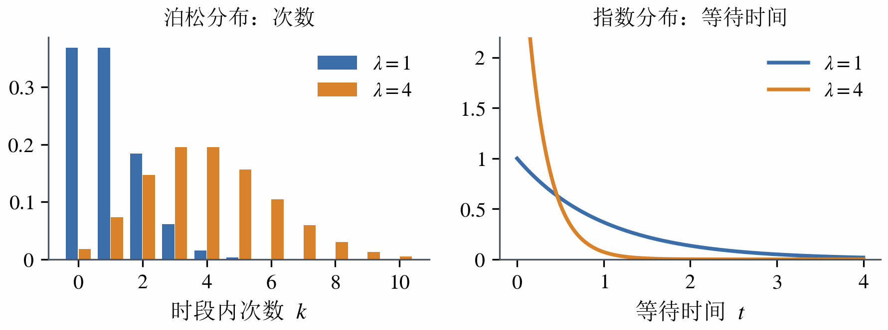

**讲解例。** 假设事件独立到达、速率每分钟二次。半分钟平均次数为一，期间没有事件的概率为 \(e^{-1}\)；等价地，从现在起等待超过半分钟的概率也是 \(e^{-1}\)。两个数相等来自所设过程，不表示“事件次数”与“等待分钟数”具有相同单位或同一分布。

**另外几种常见的离散分布。** 独立重复伯努利试验，直到第一次成功所需的次数 \(X\) 服从几何分布；从含 \(M\) 件次品的 \(N\) 件产品中不放回地取 \(n\) 件，其中次品数 \(X\) 服从超几何分布：

\[
P(X=k)=(1-p)^{k-1}p\quad(k=1,2,\ldots),\qquad
P(X=k)=\frac{\binom Mk\binom{N-M}{n-k}}{\binom Nn}.
\]

几何分布与指数分布一样具有无记忆性，是它的离散版本。超几何分布与二项分布的区别在于抽样是否放回：不放回时各次抽取不独立；但当总数 \(N\) 远大于抽取数 \(n\) 时，放回与否几乎没有差别，超几何分布可以用 \(p=M/N\) 的二项分布近似。

**泊松近似。** 当 \(n\) 很大、\(p\) 很小而 \(np=\lambda\) 适中时，二项分布可以用泊松分布近似：\(\binom nkp^k(1-p)^{n-k}\approx e^{-\lambda}\lambda^k/k!\)。例如一千件产品、次品率千分之二，恰有一件次品的概率，二项公式为 \(1000\times0.002\times0.998^{999}\approx0.27067\)，泊松近似 \(\lambda=2\) 给出 \(2e^{-2}\approx0.27067\)，前五位有效数字都相同。

选择分布模型的思路可以归纳为：

1. 固定次数的独立重复试验，问成功几次：二项分布；不放回抽样时用超几何分布。
2. 独立重复直到第一次成功，问需要几次：几何分布。
3. 固定时长或区域内稀疏事件的个数：泊松分布。
4. 有限区间内没有其他位置信息：均匀分布。
5. 恒定速率过程中的等待时间：指数分布。
6. 许多独立小影响叠加的测量值或平均值：正态分布（需检查条件，见 4.3 节）。

## 第四章 数学期望、方差与正态分布

### 4.1 中心与分散程度

数学期望是按概率加权的平均，离散情形为 \(E(X)=\sum x_kp_k\)，连续情形为 \(E(X)=\int xp(x)dx\)，要求相应可积。方差定义为

\[
\operatorname{Var}(X)=E[(X-\mu)^2]=E(X^2)-[E(X)]^2.
\]

标准差为方差平方根，与原量同单位。减去均值后再平方，可以防止正负偏差互相抵消。期望的线性性不要求独立，但方差相加一般需要协方差为零。

**例4：同均值不代表同分布。** 随机变量 \(X\) 以相同概率取负一和一，\(Y\) 则始终为零。二者期望均为零，但 \(\operatorname{Var}(X)=1\)、\(\operatorname{Var}(Y)=0\)。因此只报告平均值会抹掉离散程度。又如 \(Z=3X+2\)，则 \(E(Z)=2\)、\(\operatorname{Var}(Z)=9\)，平移改变中心不改变分散，放大三倍使方差放大九倍。

期望与方差的常用性质归纳如下（\(a,b,c\) 为常数）：

\[
\begin{aligned}
&E(c)=c,\qquad E(aX+b)=aE(X)+b,\qquad E(X+Y)=E(X)+E(Y),\\
&\operatorname{Var}(c)=0,\qquad \operatorname{Var}(aX+b)=a^2\operatorname{Var}(X),\\
&X,Y\ \text{独立时}\quad E(XY)=E(X)E(Y),\qquad \operatorname{Var}(X\pm Y)=\operatorname{Var}(X)+\operatorname{Var}(Y).
\end{aligned}
\]

注意差的方差也是两方差相加，而不是相减：两个独立的误差相减，不确定性并不会抵消。随机变量函数的期望可以直接按原分布计算，不必先求新变量的分布：离散时 \(E[g(X)]=\sum g(x_k)p_k\)，连续时 \(E[g(X)]=\int g(x)p(x)\,dx\)。

### 4.2 正态曲线与标准化

正态密度为

\[
p(x)=\frac1{\sigma\sqrt{2\pi}}
\exp\left[-\frac{(x-\mu)^2}{2\sigma^2}\right],\qquad\sigma>0.
\]

\(\mu\) 控制中心，\(\sigma\) 控制宽度。峰值位于 \(x=\mu\)，为 \(1/(\sigma\sqrt{2\pi})\)。宽度变窄时峰值升高，总面积保持一，所以峰值大于一并无矛盾。令 \(Z=(X-\mu)/\sigma\)，可把所有正态分布转换为标准正态分布。区间概率化为

\[
P(a\le X\le b)=\Phi\left(\frac{b-\mu}{\sigma}\right)-
\Phi\left(\frac{a-\mu}{\sigma}\right).
\]

其中 \(\Phi\) 是标准正态分布函数。常见的中心一区间、二区间、三区间覆盖率约为 \(0.6827,0.9545,0.9973\)。这些是模型概率，样本计数不必恰好符合这些比例。后一个数说明正态变量几乎不会偏离均值三个标准差以上，称为“三西格玛规则”，常用来初步识别可疑的异常读数。

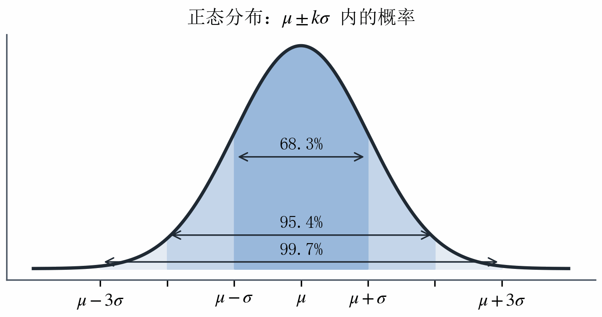

标准正态分布函数的几个性质在查表时要用到：\(\Phi(0)=0.5\)；由对称性 \(\Phi(-z)=1-\Phi(z)\)，所以表中只需列出正的 \(z\)；中心区间的概率 \(P(|Z|\le z)=2\Phi(z)-1\)。常用的分位数有 \(\Phi(1.645)\approx0.95\)、\(\Phi(1.96)\approx0.975\)、\(\Phi(2.576)\approx0.995\)，分别对应中心概率九成、九成五、九成九的区间半宽。正态分布还有一个重要性质：相互独立的正态变量的线性组合仍服从正态分布，均值和方差按 4.4 节的公式计算。

**二项分布的正态近似。** 当 \(n\) 较大、\(np\) 与 \(n(1-p)\) 都不太小（常用经验是都大于五）时，二项分布近似为均值 \(np\)、方差 \(np(1-p)\) 的正态分布。由于二项变量只取整数，用连续分布近似时要做连续性修正，把整数 \(k\) 看成区间 \([k-0.5,k+0.5]\)：

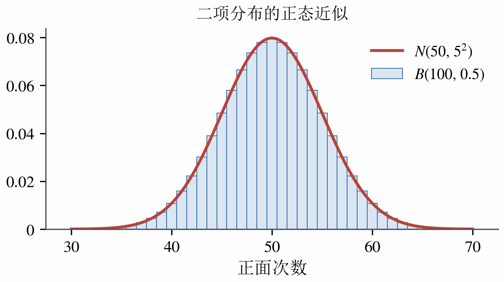

\[
P(a\le X\le b)\approx\Phi\left(\frac{b+0.5-np}{\sqrt{np(1-p)}}\right)-\Phi\left(\frac{a-0.5-np}{\sqrt{np(1-p)}}\right).
\]

例如掷一百次均匀硬币，正面在四十五到五十五次之间的概率：均值五十，标准差五，近似为 \(\Phi(5.5/5)-\Phi(-5.5/5)=2\Phi(1.1)-1\approx0.729\)。若不做修正，得到 \(2\Phi(1)-1\approx0.683\)，明显偏小。

**例5：用历史汇总量演示理论密度。** 暂以会话记录中的 \(N=50\)、\(\bar t=6.96\,\mathrm s\)、\(Q=\sum(t_i-\bar t)^2=3.22\,\mathrm{s^2}\) 为已给定汇总量。若描绘拟合正态曲线采用分母 \(N\)，则

\[
\hat\sigma=\sqrt{3.22/50}\approx0.2538\,\mathrm s,
\quad p(6.96)\approx1.572\,\mathrm{s^{-1}}.
\]

取组中点 \(6.90\,\mathrm s\)，其标准化差约为负零点二三六，代入指数得密度约 \(1.529\,\mathrm{s^{-1}}\)。组宽若为零点二秒，中点矩形近似给出该组理论概率约零点三零六。它是理论曲线的近似面积，不是从原始数据数出的频率，也不是精确积分。离中心较远或组宽较大时，中点近似可能不够准确。

### 4.3 正态近似的条件

许多独立小影响叠加时常出现接近正态的分布，但这一经验不能代替对实验机制的检查。若观测有明显偏斜、截断、混合了不同操作方式，或存在缓慢漂移，正态模型可能不合适。直方图近似钟形只是证据之一，样本少时形状会很不稳定。

中心极限定理主要讨论适当条件下样本均值的分布趋于正态，并不说原始观测分布会因样本数增加而变正态。例如重复掷骰子得到的单次点数始终离散均匀，但许多次点数的平均值分布可以近似钟形。区分原始量和均值，是使用置信区间前的重要一步。

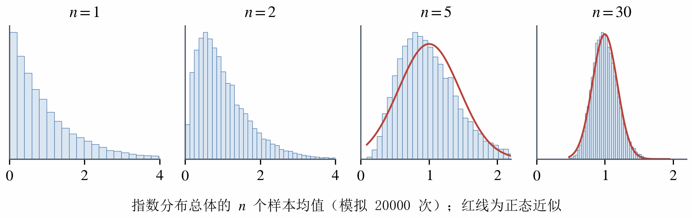

**切比雪夫不等式与大数定律。** 即使不知道分布的具体形式，只要方差有限，也能估计偏离均值的概率。切比雪夫不等式给出

\[
P\bigl(|X-\mu|\ge k\sigma\bigr)\le\frac1{k^2}\qquad(k>0).
\]

例如任何分布偏离均值两个标准差以上的概率都不超过四分之一。这个上界对所有分布都成立，所以比较保守：正态分布的实际值只有约零点零四五五。把它用于样本均值 \(\bar X\)（方差为 \(\sigma^2/n\)），得到对任意 \(\varepsilon>0\)，

\[
P\bigl(|\bar X-\mu|\ge\varepsilon\bigr)\le\frac{\sigma^2}{n\varepsilon^2}\to0\qquad(n\to\infty).
\]

这就是大数定律：独立重复测量的平均值随次数增加而趋于真实均值，频率也趋于概率。它为“多次测量取平均”提供了理论依据，但前提是各次测量独立且没有共同的系统偏移（见 5.2 节）。中心极限定理则进一步说明了 \(\bar X\) 在大样本下的分布形状：

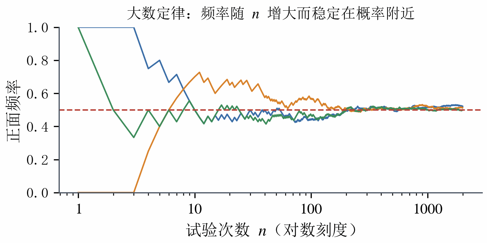

\[
\frac{\bar X-\mu}{\sigma/\sqrt n}\ \text{近似服从标准正态分布}\qquad(n\ \text{较大}).
\]

### 4.4 线性组合、协方差与常见矩

只要期望存在，线性性给出 \(E(aX+bY+c)=aE(X)+bE(Y)+c\)，不要求 X、Y 独立。若二阶矩有限，定义
\[
\operatorname{Cov}(X,Y)=E[(X-EX)(Y-EY)]=E(XY)-E(X)E(Y).
\]
展开平方可得
\[
\operatorname{Var}(aX+bY)
=a^2\operatorname{Var}(X)+b^2\operatorname{Var}(Y)
+2ab\operatorname{Cov}(X,Y).
\]
取 b=−1 时，相关项变为负号，所以同向波动可能在差值中抵消。独立足以保证协方差为零，零协方差一般推不出独立。例如 X 在 \(\{-1,0,1\}\) 等概率取值、\(Y=X^2\)，则 \(EX=E(XY)=0\)，协方差为零；但 Y 明确由 X 决定，二者不独立。

当两者标准差均正，相关系数为
\(\rho=\operatorname{Cov}(X,Y)/(\sigma_X\sigma_Y)\)，由柯西不等式得 \(|\rho|\le1\)。它描述线性关联，不能涵盖全部非线性依赖，也不能从相关直接推断因果。

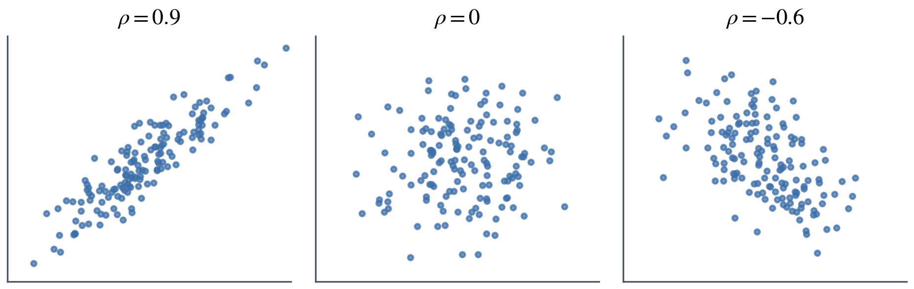

前一章分布的均值与方差可以由定义推导成相互联系的一组结果：
\[
\begin{aligned}
X\sim\mathrm{Bernoulli}(p):\quad& EX=p,\quad \operatorname{Var}X=p(1-p),\\
X\sim\mathrm{Bin}(n,p):\quad& EX=np,\quad \operatorname{Var}X=np(1-p),\\
N\sim\mathrm{Poisson}(\lambda):\quad& EN=\lambda,\quad\operatorname{Var}N=\lambda,\\
X\sim U(a,b):\quad& EX=(a+b)/2,\quad\operatorname{Var}X=(b-a)^2/12,\\
T\sim\mathrm{Exp}(\nu):\quad& ET=1/\nu,\quad\operatorname{Var}T=1/\nu^2.
\end{aligned}
\]

伯努利变量有 \(X^2=X\)，所以方差立刻为 \(p-p^2\)；二项变量是 n 个独立伯努利变量之和，于是均值与方差分别相加。泊松变量把求和下标平移可得 \(EN=\lambda,\ E[N(N-1)]=\lambda^2\)，再用 \(N^2=N(N-1)+N\) 得方差。均匀模型把 \(\int_a^b x\,dx/(b-a)\) 与二次矩相减；指数模型对 \(\int_0^\infty t\nu e^{-\nu t}dt\) 分部积分，再算二次矩，可得 \(ET=1/\nu,\ E(T^2)=2/\nu^2\)。这些推导同时检查了参数含义：速率越高，平均等待越短。

例如二项次数 n=3、p=0.9 的均值2.7、方差0.27；样本比例 X/3 的均值0.9、方差0.03。把次数改成比例时，方差除以九，不能只除以三。

## 第五章 样本均值与样本方差

### 5.1 描述数据与估计总体

给定样本 \(x_1,\ldots,x_N\)，样本均值为 \(\bar x=\sum x_i/N\)。偏差之和为零，\(\sum(x_i-\bar x)=0\)。平方偏差和记为 \(Q\)，常见两种量为

\[
v_N=\frac QN,\qquad s^2=\frac Q{N-1}.
\]

前者是这批数据的经验方差，也是在正态模型下估计方差的一种常用方法；后者在独立同分布、有限方差条件下是总体方差的无偏估计。教材对“分散度”“样本方差”的命名并不完全一致，必须看公式里的分母，不能只看名称。

分母为何少一？恒等式给出

\[
\sum(x_i-\bar x)^2=\sum(x_i-\mu)^2-N(\bar x-\mu)^2.
\]

取期望，右侧第一项为 \(N\sigma^2\)，第二项为 \(N\operatorname{Var}(\bar x)=\sigma^2\)，故 \(E(Q)=(N-1)\sigma^2\)。估计中心时使用了数据自身的信息，剩余偏差只有 \(N-1\) 个独立自由度。

**例6：五个读数的完整计算。** 示例读数为 \(1.0,1.1,0.9,1.0,1.0\,\mathrm s\)。均值为一秒，偏差为零、正零点一、负零点一、零、零，平方和为零点零二平方秒。因此经验方差为零点零零四平方秒，无偏样本方差为零点零零五平方秒，样本标准差约零点零七零七秒。差别不是计算错误，而是两种量的定义不同。

### 5.2 单次读数与均值的分散

独立同分布且总体方差为 \(\sigma^2\) 时，

\[
\operatorname{Var}(\bar X)=\frac1{N^2}\sum_i\operatorname{Var}(X_i)=\frac{\sigma^2}{N}.
\]

因此均值标准误差常估计为 \(s/\sqrt N\)。样本标准差 \(s\) 描述单次读数的波动，均值标准误差描述重复取同样大小样本时均值的波动，两者对象不同。样本量增为四倍，均值标准误差理想情况下缩小一半，单次读数的标准差不因公式而缩小。

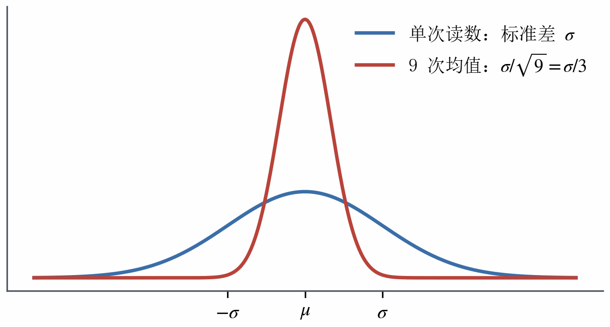

若读数之间有相关性，方差还包含 \(2\sum_{i<j}\operatorname{Cov}(X_i,X_j)/N^2\)。正相关会削弱平均的降噪作用。例如每次读数都包含同一个未知零点偏移，偏移不会被取平均消去。实验设计中穿插校准、随机化测量顺序、记录环境参数，往往比单纯增加次数更能解决这类问题。

### 5.3 抽样分布与正态近似

在独立、有限方差的同分布抽样中，样本均值不仅有期望 \(\mu\)、方差 \(\sigma^2/n\)，标准化后的分布还在大样本下趋近标准正态。这是均值区间估计的理论桥梁。它描述许多次重新取样后“均值会怎样变化”，不是说当前样本中的每个读数围绕均值的形状都相同。

若原始变量是重尾分布，极端值对平均影响很大，正态近似需要谨慎；若方差本来不存在，经典有限方差形式的中心极限定理不能直接使用。所谓“大于三十就一定可以”不是普遍定理。样本量是否足够，应结合偏斜程度、异常值机制与推断对象判断。小样本正态总体的Student结论是精确抽样结果，大样本非正态总体的近似推断则还依赖近似质量，这两种理由应分开说明。

### 5.4 点估计：矩估计与最大似然估计

用样本去估计总体参数的一个具体数值，称为点估计。前面用样本均值估计总体均值、用 \(s^2\) 估计总体方差，都是点估计。有两种系统的构造方法。

**矩估计法**：令样本矩等于总体矩，解出参数。例如指数分布的均值为 \(1/\nu\)，令 \(\bar x=1/\nu\)，得 \(\hat\nu=1/\bar x\)；均匀分布 \(U(0,\theta)\) 的均值为 \(\theta/2\)，得 \(\hat\theta=2\bar x\)。

**最大似然估计法**：把已经观察到的数据代入分布，看作参数的函数（称为似然函数），选使这批数据出现的可能性最大的参数值。对独立样本，似然函数是各观测密度（或概率）的乘积，通常取对数后再求导：

\[
L(\theta)=\prod_{i=1}^np(x_i;\theta),\qquad \frac{d}{d\theta}\ln L(\theta)=0 .
\]

例如伯努利试验 \(n\) 次中成功 \(k\) 次，\(\ln L=k\ln p+(n-k)\ln(1-p)\)，求导令零得 \(\hat p=k/n\)，就是成功的频率。正态分布的最大似然估计为 \(\hat\mu=\bar x\)、\(\hat\sigma^2=Q/N\)，后者正是 5.1 节分母为 \(N\) 的经验方差，它略偏小，所以实际报告时常改用 \(s^2\)。

评价估计量的好坏有三个标准：无偏性（估计量的期望等于真值）、有效性（方差越小越好）、一致性（样本量增大时趋于真值）。

## 第六章 均值的区间估计与区间计数

### 6.1 Student 系数来自抽样分布

若观测独立且来自正态总体、总体方差未知，则统计量

\[
T=\frac{\bar X-\mu}{S/\sqrt N}
\]

服从自由度 \(\nu=N-1\) 的 t 分布。设中心覆盖概率为 \(P\)，取 \(t_*\) 满足 \(P(-t_*\le T\le t_*)=P\)，均值区间为

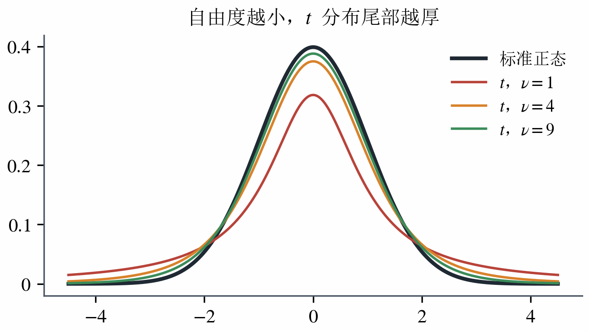

\[
\bar x\pm t_*\frac{s}{\sqrt N},\qquad
t_*=F_\nu^{-1}\left(\frac{1+P}{2}\right).
\]

有些教材用 \(\alpha\) 表示置信概率，有些用 \(\alpha\) 表示尾部总概率，二者相差一个补事件。查表时必须看表头究竟是“中心概率”“单尾概率”还是“累计概率”。自由度为四十九不等于测量次数四十九；测量五十次时自由度才是四十九。

**例7：从汇总记录得到随机区间。** 仍使用 \(Q=3.22\)、\(N=50\)，有

\[
s=\sqrt{3.22/49}\approx0.25635\,\mathrm s,
\quad u_A=\frac{s}{\sqrt{50}}\approx0.03625\,\mathrm s.
\]

中心概率为 \(0.90\) 时，历史会话给出的 \(t_{49}\) 系数约为 \(1.6766\)，相乘得随机区间半宽约 \(0.06077\,\mathrm s\)。因此在所用正态独立模型和汇总量成立时，可写 \((6.960\pm0.061)\,\mathrm s\)，并注明中心置信概率九成、这里只计随机部分。若提高置信概率，系数变大，区间更宽；不是测量因而更精密，而是要求覆盖更有把握。

频率学置信区间的意思是：按此方法反复取样构造区间，长期有约定比例覆盖同一个固定真值。本次区间算出后端点固定，不能不加说明地把它解释成真值自身在区间里随机游走。

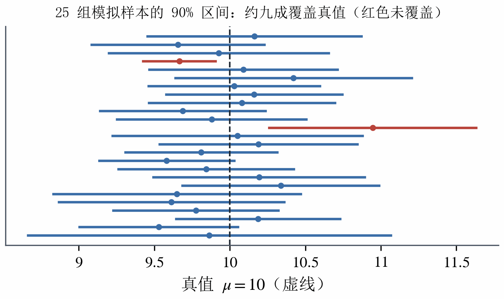

**其他常用的区间估计。** 若总体方差 \(\sigma^2\) 已知（例如由长期校准得到），或样本量很大，可以用正态分位数代替 Student 系数；对比例 \(p\) 的估计，在样本量较大时用正态近似：

\[
\bar x\pm z_*\frac{\sigma}{\sqrt N},\qquad
\hat p\pm z_*\sqrt{\frac{\hat p(1-\hat p)}N},\qquad z_*=\Phi^{-1}\!\left(\frac{1+P}2\right).
\]

九成五的中心概率对应 \(z_*\approx1.96\)。由第一式还可以反推需要的样本量：要使区间半宽不超过 \(E\)，需 \(N\ge(z_*\sigma/E)^2\)。例如 \(\sigma=0.25\,\mathrm s\)，希望九成五区间半宽不超过 \(0.05\,\mathrm s\)，需要 \(N\ge(1.96\times0.25/0.05)^2\approx96.04\)，即至少九十七次。半宽与 \(\sqrt N\) 成反比，精度提高一倍需要四倍的测量次数。

求均值区间估计的步骤是：

1. 检查测量是否独立、是否近似正态（或样本量是否足够大）。
2. 计算样本均值 \(\bar x\) 和样本标准差 \(s\)（分母 \(N-1\)）。
3. 计算均值的标准误差 \(s/\sqrt N\)。
4. 按规定的置信概率和自由度 \(N-1\) 查出 Student 系数 \(t_*\)；方差已知或样本很大时改用 \(z_*\)。
5. 写出 \(\bar x\pm t_*s/\sqrt N\)，注明置信概率和单位，并说明只包含随机部分还是已合成仪器分量。

### 6.3 假设检验的基本思路

区间估计回答“参数大约是多少”；假设检验回答“数据是否与某个具体的说法相容”。例如：测得的平均周期是否与理论值 \(6.90\,\mathrm s\) 一致？两种计时方法是否有差别？

检验的逻辑类似反证法。先提出一个原假设 \(H_0\)（通常是“没有差别”，如 \(\mu=\mu_0\)），以及备择假设 \(H_1\)（如 \(\mu\ne\mu_0\)）。在 \(H_0\) 成立的前提下，计算一个检验统计量，看实际数据在这个前提下是否“过于罕见”。若罕见到概率低于事先规定的显著性水平 \(\alpha\)（常取零点零五），就拒绝 \(H_0\)；否则不拒绝。对正态总体均值的检验，统计量为

\[
t=\frac{\bar x-\mu_0}{s/\sqrt N},
\]

在 \(H_0\) 下服从自由度 \(N-1\) 的 t 分布。若 \(|t|\) 超过中心概率 \(1-\alpha\) 对应的 Student 系数，就拒绝 \(H_0\)。p 值是在 \(H_0\) 成立时得到至少与实际一样极端的结果的概率，p 值小于 \(\alpha\) 与上面的判断等价。

检验可能犯两类错误：\(H_0\) 实际成立却被拒绝，称为第一类错误，其概率就是 \(\alpha\)；\(H_0\) 实际不成立却没有被拒绝，称为第二类错误。样本量越大，第二类错误的概率越小，检验越能发现真实存在的小差别。

**例：平均值与理论值的比较。** 用前面的汇总量 \(N=50\)、\(\bar t=6.96\,\mathrm s\)、\(s/\sqrt N\approx0.03625\,\mathrm s\)，检验 \(H_0:\mu=6.90\,\mathrm s\)（示范用的理论值）。\(t=(6.96-6.90)/0.03625\approx1.66\)。自由度四十九、中心概率九成五的 Student 系数约为二点零一，\(1.66<2.01\)，所以在 \(\alpha=0.05\) 水平下不拒绝 \(H_0\)，数据与理论值相容。注意“不拒绝”不等于“证明了 \(H_0\) 成立”，只说明现有数据不足以显示差别。还可以对照：若用九成的系数 \(1.68\)，\(1.66\) 仍略小于它。

假设检验的步骤是：

1. 根据问题写出原假设 \(H_0\) 与备择假设 \(H_1\)，确定是双侧还是单侧检验。
2. 事先选定显著性水平 \(\alpha\)。
3. 选择检验统计量，确认它在 \(H_0\) 下的分布（t 分布、正态分布等）及所需条件。
4. 由样本计算统计量的值，或计算 p 值。
5. 与临界值比较（或比较 p 值与 \(\alpha\)），作出拒绝或不拒绝的结论，并用实际问题的语言解释。

检验结果是否“显著”与差别是否“重要”是两回事：样本量很大时，物理上微不足道的差别也可能显著；报告时应同时给出差别的大小和区间估计。

### 6.2 区间内次数与理论概率

实验表中的 \(N_{12}\) 往往表示落在边界 \(t_1,t_2\) 之间的实际测量次数，下标指两个边界，不是“第十二次测量”。\(N_{12}/N\) 是样本频率，\(P_{12}\) 是理论区间概率。只有拿到原始数据并明确边界是否包含端点，才能逐项统计 \(N_{12}\)。均值和平方偏差和并不能唯一决定区间计数。

**例8：完整展示一次小样本计数。** 教学数据为 \(0,1,1,2,3,3,4,6\)，总数八。取区间 \([1,3]\)，逐项计数得到五个值，故频数为五、频率为 \(5/8\)。若改成左闭右开 \([1,3)\)，两个等于三的数被排除，频数变三。边界变化产生的差别完全来自定义，不应在最后为了更接近理论比例而调整边界。

历史会话曾报告五十次数据在一、二、三倍标准差区间内的次数为三十八、四十七、四十九，但当前汇总文本不足以重新核对这些次数。本册不把它们作为已复核原始实验结果，更不由正态理论比例倒推整数次数。理论比例与观测频率的差异也不应被一句“满意吻合”草率结论覆盖；应结合样本量、分组方式和误差机制讨论。

## 第七章 测量误差与不确定度

### 7.1 两种概念的对象不同

测量误差是测得值与参考真值之差，包含符号。真值通常未知，所以实际误差也通常未知。不确定度是依据数据、仪器信息和模型，对结果可能分散程度的量化评估。它不能直接等同于已经知道的真实误差。

随机影响使重复读数波动，系统影响使读数整体偏移；同一来源有时同时产生两种效果。A类评定主要使用统计方法，B类评定使用校准证书、分辨率和经验界限等其他信息，这与“随机误差、系统误差”的分类并非完全一一对应。一个校准修正值可以先修正读数，修正本身的不确定度仍应保留。

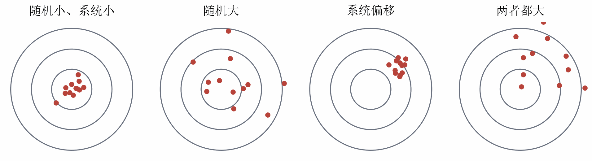

仪器分辨率、最大允许误差、校准给出的扩展不确定度和标准不确定度含义不同。平方和合成要求先把各分量转成相同层级的标准不确定度，不能把一种百分之九十九区间半宽与另一种标准差直接相加后称为标准不确定度。

### 7.2 常见仪器模型与合成

若仅知道未知偏移在 \([-a,a]\) 内且可合理用均匀分布描述，标准不确定度是 \(a/\sqrt3\)。数字分辨率为 \(d\) 且舍入误差均匀分布于 \([-d/2,d/2]\) 时，标准不确定度为 \(d/\sqrt{12}\)。这两个分母来自不同区间宽度，不能只记一个根号三到处套用。

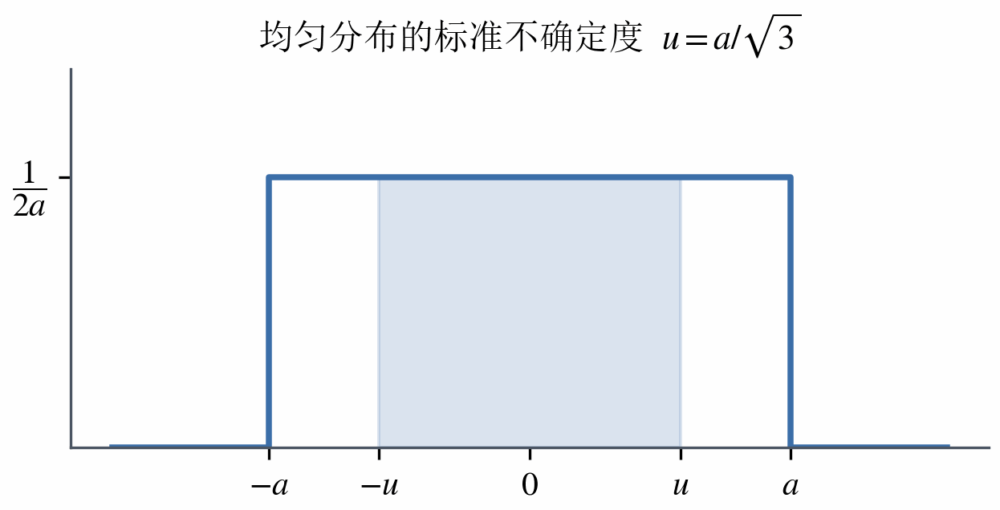

**例9：标准层级的合成。** 假设重复测量均值的 A类标准不确定度为零点零三六二五秒，仪器偏移界限为正负零点零一秒，独立且采用矩形模型。仪器标准分量为 \(0.01/\sqrt3\approx0.00577\,\mathrm s\)，故

\[
u_c=\sqrt{0.03625^2+0.00577^2}\approx0.03671\,\mathrm s.
\]

若选覆盖因子 \(k=2\)，扩展不确定度为约零点零七三四秒。把这个结果写成约九成置信的Student区间并不严谨，因为覆盖因子、分布假设和自由度处理不同。需要哪一种报告方式，要根据实验的明确规定选择。

评定一个直接测量结果的不确定度，可以按以下步骤：

1. 列出所有可能的影响来源：读数的随机波动、仪器分辨率、仪器允许误差、环境、操作等。
2. 对重复测量的随机部分作 A 类评定：\(u_A=s/\sqrt N\)。
3. 对其他来源作 B 类评定：由给出的界限 \(a\) 和假定的分布换算成标准不确定度，例如均匀分布为 \(a/\sqrt3\)，分辨率为 \(d/\sqrt{12}\)。
4. 确认各分量独立后，按平方和合成 \(u_c=\sqrt{u_A^2+u_{B1}^2+\cdots}\)。
5. 需要时乘以覆盖因子得到扩展不确定度，报告时注明 \(k\) 值或置信概率。

### 7.3 课程规定算法与一般测量学的区别

Lab_1_01 的本地历史正文记录了“秒表仪器误差取零点零一秒”，并记录课程把随机置信半宽与该仪器数值按平方和合成为“总误差”。若按这个课程约定，上一章九成概率的随机半宽约零点零六零七七秒，合成数为

\[
\Delta_{\mathrm{course}}=
\sqrt{0.06077^2+0.01^2}\approx0.06159\,\mathrm s.
\]

它复现的是课程所用计算约定，不能直接与上一节所有分量都标准化的 \(u_c\) 混称。当前审读依据是历史可读正文，并未在本次逐页复核实验PDF，因此对“指导书第几项”的定位不作新的独立确认。写课程实验报告时可遵循指定符号与算法，同时在理解上保留“区间半宽”和“标准不确定度”的区别。

## 第八章 间接测量与相关性

### 8.1 一阶传播公式的来源

设目标量 \(y=f(x_1,\ldots,x_m)\)。在输入波动较小且函数足够平滑时，一阶展开为 \(\delta y\approx\sum_i c_i\delta x_i\)，灵敏度系数 \(c_i=\partial f/\partial x_i\)。平方取期望得到

\[
u_y^2\approx\sum_i c_i^2u_i^2+
2\sum_{i<j}c_ic_j\operatorname{Cov}(x_i,x_j).
\]

独立输入的协方差为零，才简化为各贡献平方和。相关系数 \(\rho_{ij}\) 与协方差关系为 \(\operatorname{Cov}(x_i,x_j)=\rho_{ij}u_iu_j\)。输入非独立时，相关项既可能增加，也可能减少输出不确定度。

**例10：乘积的相对不确定度。** 对 \(y=ab\)，偏导为 \(b,a\)。若输入独立且不为零，得到 \((u_y/y)^2\approx(u_a/a)^2+(u_b/b)^2\)。若 \(a=2.00\pm0.02\)、\(b=3.00\pm0.03\)，这里正负后均指标准不确定度，则 \(y=6.00\)，相对标准不确定度为 \(\sqrt{0.01^2+0.01^2}\)，故 \(u_y\approx0.085\)。直接把两个百分之一相加得到百分之二，是一种保守界限相加思路，不是独立随机标准分量的方差合成。

对独立输入，几种常见函数形式的传播公式归纳如下：

\[
\begin{aligned}
&y=a\pm b: && u_y=\sqrt{u_a^2+u_b^2},\\
&y=ab\ \text{或}\ y=a/b: && \frac{u_y}{|y|}=\sqrt{\left(\frac{u_a}a\right)^2+\left(\frac{u_b}b\right)^2},\\
&y=ka^n: && \frac{u_y}{|y|}=|n|\frac{u_a}{|a|},\\
&y=ka^mb^n: && \frac{u_y}{|y|}=\sqrt{m^2\left(\frac{u_a}a\right)^2+n^2\left(\frac{u_b}b\right)^2},\\
&y=\ln a: && u_y=\frac{u_a}{|a|}.
\end{aligned}
\]

规律是：加减时绝对不确定度按平方和合成，乘除和幂次时相对不确定度按平方和合成，幂次的指数作为放大系数。所以测量中指数大的量最需要精确。例如单摆 \(g=4\pi^2L/T^2\)，周期以平方出现，周期的相对不确定度对 \(g\) 的贡献要乘以二。第 9.3 节求绝热指数时 \(\gamma\propto v^2/T\) 也是同样的道理。

计算间接测量不确定度的步骤是：

1. 写出目标量与各直接测量量的函数关系。
2. 求出每个直接测量量的标准不确定度。
3. 对每个输入求偏导数（灵敏度系数）；乘除幂次形式可以直接用相对不确定度公式。
4. 确认输入是否独立；若有公共偏移或相关，加入协方差项。
5. 合成得到 \(u_y\)，并检查哪个分量贡献最大，作为改进实验的依据。

### 8.2 差值、公共偏移与线性化边界

若同一把尺的零点偏移 \(b\) 同时加在两次位置上，\(L_2^{\mathrm{obs}}=L_2+b\)、\(L_1^{\mathrm{obs}}=L_1+b\)，相减后公共偏移精确抵消。若错误把两个偏移当独立量，会高估差值的不确定度。相反，若两次读数都受同一比例因子误差，差值仍会继承比例误差，不能因为做了差就宣布所有系统影响消失。

传播公式是一阶近似。分母接近零、相对波动很大或函数强非线性时，输出可能明显偏斜，单一标准差不足以描述。此时可根据输入分布用数值抽样传播或直接建立区间模型，但应保留分布、相关性和样本生成的假设，不能把软件给出的位数当作模型准确度。

## 第九章 直线拟合与声学谐振测量

### 9.1 最小二乘直线的推导

若模型为 \(y_i=\alpha+\beta x_i+\varepsilon_i\)，且误差主要在 \(y\) 方向、各点方差近似相等，则普通最小二乘最小化残差平方和 \(S=\sum(y_i-\alpha-\beta x_i)^2\)。分别对参数求偏导并令零，得到正规方程，整理为

\[
\hat\beta=\frac{\sum(x_i-\bar x)(y_i-\bar y)}{\sum(x_i-\bar x)^2},
\qquad\hat\alpha=\bar y-\hat\beta\bar x.
\]

要求横坐标不全部相同，否则分母为零，无法辨识斜率。残差是测量与拟合值之差，不等于真实测量误差，因为真实模型参数未知。不同点标准不确定度不同时应考虑加权拟合，横纵坐标都有显著误差时普通公式也可能不适合。

拟合的好坏和参数的不确定度也有公式。记 \(S_{xx}=\sum(x_i-\bar x)^2\)、\(S_{yy}=\sum(y_i-\bar y)^2\)、\(S_{xy}=\sum(x_i-\bar x)(y_i-\bar y)\)，则

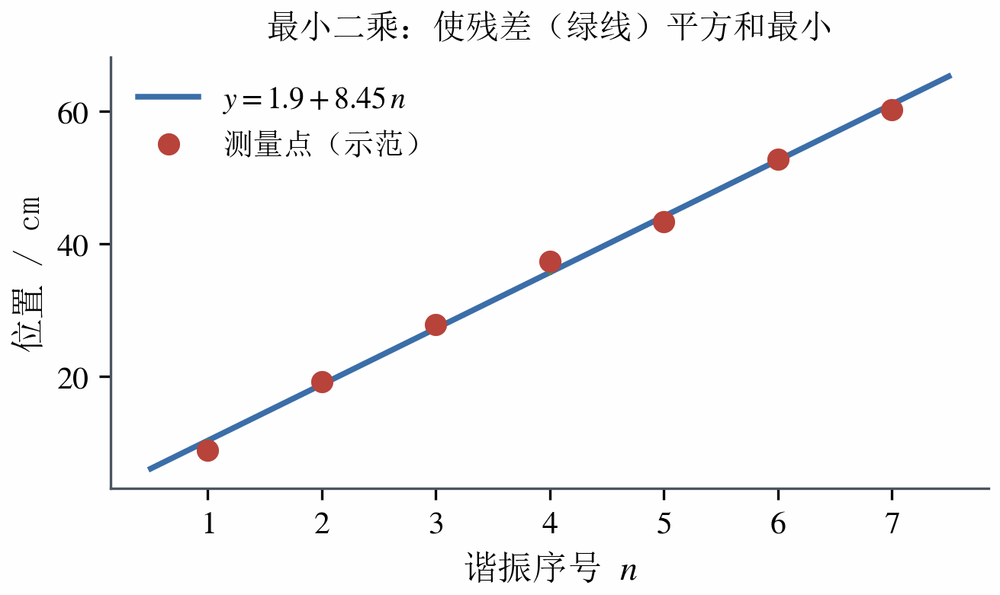

\[
r=\frac{S_{xy}}{\sqrt{S_{xx}S_{yy}}},\qquad
s=\sqrt{\frac{\sum(y_i-\hat\alpha-\hat\beta x_i)^2}{n-2}},\qquad
u_{\hat\beta}=\frac{s}{\sqrt{S_{xx}}},\qquad
u_{\hat\alpha}=s\sqrt{\frac1n+\frac{\bar x^2}{S_{xx}}}.
\]

相关系数 \(r\) 在负一到一之间，绝对值越接近一，数据越接近一条直线；\(r^2\) 称为决定系数，表示 \(y\) 的总波动中能由直线解释的比例。\(s\) 是残差的标准差，分母为 \(n-2\)，因为拟合用掉了两个参数（与 5.1 节样本方差分母减一的道理相同）。斜率的不确定度随横坐标的分散程度 \(S_{xx}\) 增大而减小，所以实验设计时应让自变量取值尽量分散，并覆盖整个关心的范围。\(r\) 接近一只说明线性关系强，不能证明模型正确，也不能代替对残差的检查：残差若呈现规律性的弯曲，说明直线模型本身不合适。

**例11：从谐振序号拟合长度。** 教学数据为序号 \(m=0,1,2,3\)，谐振长度依次 \(0.10,0.27,0.44,0.61\,\mathrm m\)。\(\bar m=1.5\)、\(\bar L=0.355\,\mathrm m\)，各长度严格满足 \(L=0.10+0.17m\)，代入斜率公式也得 \(0.17\,\mathrm m\)。斜率代表每增加一个模态，长度增加零点一七米；截距包含起始位置和端部效应信息，不应在没有物理理由时强制设为零。本例完美共线是为展示计算，不代表真实测量没有残差或不确定度。

### 9.2 从相邻谐振位置得到声速

波速、频率和波长满足 \(c=f\lambda\)。若固定频率，比较边界类型相同的连续谐振模态，长度增加一个半波时再次谐振，即 \(\Delta L=\lambda/2\)，故

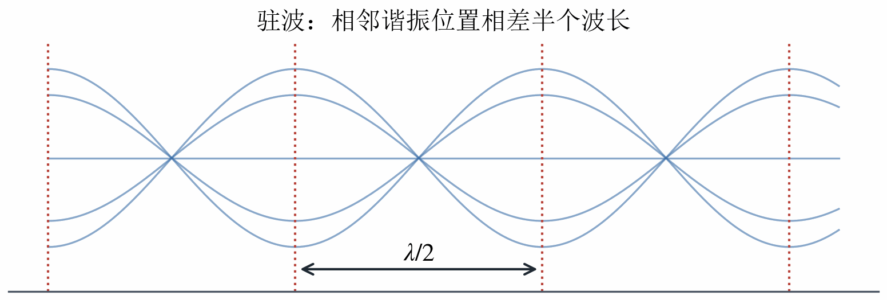

\[
c=2f\Delta L.
\]

同类型端部修正常在差值中近似抵消，但这需要它在各模态间变化较小。若换用频率扫描、不同开闭端条件或非相邻模态，必须重新辨认模态关系，不能只见“谐振”就套用二倍长度差公式。

**例12：声速与不确定度。** 取教学参数 \(f=1000\,\mathrm{Hz}\)、\(\Delta L=0.170\,\mathrm m\)，得 \(c=340\,\mathrm{m/s}\)。若 \(u_f=1\,\mathrm{Hz}\)、\(u_{\Delta L}=0.001\,\mathrm m\) 且独立，则

\[
u_c=\sqrt{(2\Delta L)^2u_f^2+(2f)^2u_{\Delta L}^2}
=\sqrt{0.34^2+2^2}\approx2.03\,\mathrm{m/s}.
\]

长度差贡献约二米每秒，频率贡献约零点三四米每秒，前者占主要部分。因此若要改善结果，优先提高长度定位精度比单纯换更精确的频率计更有效。若长度差由两个独立位置相减，且各位置标准不确定度为零点零零一米，那么差值不确定度应为 \(\sqrt2\times0.001\) 米，不能仍填零点零零一米。

### 9.3 矩形箱体的谐振模式与绝热指数

上一节固定频率、移动边界；另一种做法是固定一个长方体木箱，扫描扬声器频率，用箱内麦克风和毫伏表记录信号幅度 \(U(f)\)。箱壁是刚性的，贴壁空气不能沿法向移动，每个方向都必须容纳整数个半波长。一维时 \(l=n\lambda/2\)，结合 \(v=\lambda f\) 得 \(f=nv/(2l)\)。三维时三个方向各有一个整数 \(n_x,n_y,n_z\)（不全为零），波数分量 \(k_x=\pi n_x/l_x\) 等，总波数满足 \(k^2=k_x^2+k_y^2+k_z^2\)，再由 \(f=vk/(2\pi)\)：

\[
f_{n_xn_yn_z}=\frac v2\sqrt{\Bigl(\frac{n_x}{l_x}\Bigr)^2+\Bigl(\frac{n_y}{l_y}\Bigr)^2+\Bigl(\frac{n_z}{l_z}\Bigr)^2}.
\]

记号 \((n_xn_yn_z)\) 称为模式（мода）。\((010)\) 表示沿 \(y\) 方向一个半波、另两个方向空气没有驻波结构；\((200)\) 表示沿 \(x\) 方向两个半波；\((101)\) 表示沿 \(x\) 与 \(z\) 各一个半波。每个模式对应一种驻波形状和一个谐振频率。

**数据处理的步骤。** 一是由估计的声速算出范围内全部模式的理论频率；二是把测得的每个峰与理论频率配对，即识别谐振（идентификация резонансов）；三是把公式反解为

\[
v=\frac{2f}{\sqrt{(n_x/l_x)^2+(n_y/l_y)^2+(n_z/l_z)^2}},
\]

每个已识别的峰给出一个声速值，取平均并按 Student 系数求区间；四是由 \(\gamma=\bar v^{\,2}M/(RT)\) 求空气的绝热指数（推导见《大学物理》第 13 章），并与双原子气体的 \(1.40\) 比较。

**讲解例：一次课堂测量的处理。** 以下数据据一次实验报告会话转述，原始记录未在本册核对。箱体 \(l_x=0.500\,\mathrm m\)、\(l_y=0.350\,\mathrm m\)、\(l_z=0.200\,\mathrm m\)，室温 \(T=296.15\,\mathrm K\)，\(M=0.029\,\mathrm{kg/mol}\)。理论声速 \(v_{\text{теор}}=\sqrt{1.4\times8.31\times296.15/0.029}\approx344.7\,\mathrm{m/s}\)，\(v/2=172.35\,\mathrm{m/s}\)。300—1000 Hz 内按 20 Hz 步长扫描，在 \((010)\) 峰附近又以 5 Hz 步长细测，最高点在 505 Hz。

| 测得峰 / Hz | 理论值 / Hz | 模式 | \(\sqrt{\cdots}\) / m⁻¹ | \(v\) / (m/s) |
|---|---|---|---|---|
| 505 | 492 | (010) | 2.857 | 353.5 |
| 620 | 601 | (110) | 3.488 | 355.6 |
| 680 | 689 | (200) | 4.000 | 340.0 |
| 840 | 847 | (210) | 4.916 | 341.8 |
| 940 | 928 | (101) | 5.385 | 349.1 |
| 1000 | 993 | (011) | 5.759 | 347.3 |

识别时要选理论值最近、且差距小于扫描步长的模式。840 Hz 附近有 \((210)\) 的 847 Hz 和 \((001)\) 的 862 Hz，后者相差 22 Hz，已超过 20 Hz 步长，所以应识别为 \((210)\)；若误认成 \((001)\)，这一点算出 \(1680/5=336\,\mathrm{m/s}\)，成为最离群的值。\((100)\) 的 345 Hz 处峰不明显，860—920 Hz 信号偏高可解释为 \((001)\) 与 \((101)\) 两峰重叠，这些未单独成峰的模式不进入平均。同一个峰在求声速和求品质因数时应取同一频率：细测已表明 \((010)\) 峰在 505 Hz，两处都用 505 Hz，而不是一处用粗扫的 500 Hz、一处用 505 Hz。

六个值的平均 \(\bar v=2087.3/6\approx347.9\,\mathrm{m/s}\)，偏差平方和约 192，

\[
S=\sqrt{\frac{192}{6-1}}\approx6.2\,\mathrm{m/s},\qquad
S_{\bar v}=\frac{S}{\sqrt6}\approx2.5\,\mathrm{m/s},\qquad
\Delta v=t_{0.95;6}\,S_{\bar v}=2.57\times2.5\approx6.5\,\mathrm{m/s}.
\]

Student 系数随测量次数变化（\(P=0.95\)）：\(n=3,4,5,6,7,10,\infty\) 时依次约为 \(4.30,3.18,2.78,2.57,2.45,2.26,1.96\)。表按自由度 \(n-1\) 编排时，查的是 \(n-1\) 那一行，结果相同。只用五个峰的人应取 2.78，用六个峰取 2.57，二者各自正确；点越少，样本标准差越不可靠，系数越大，区间越宽。

结果 \(v=(348\pm7)\,\mathrm{m/s}\)（\(P=0.95\)），与理论值 \(344.7\,\mathrm{m/s}\) 在区间内一致。绝热指数 \(\gamma=347.9^2\times0.029/(8.31\times296.15)\approx1.43\)。由 \(\gamma\propto v^2/T\)，对 \(\ln\gamma=2\ln v-\ln T+\text{常数}\) 用 8.1 节的一阶传播公式，相对不确定度为

\[
\varepsilon_\gamma=\sqrt{(2\varepsilon_v)^2+\varepsilon_T^2}=\sqrt{(2\times1.9\%)^2+(0.34\%)^2}\approx3.8\%,
\]

其中 \(\varepsilon_T=1\,\mathrm K/296.15\,\mathrm K\)；\(\Delta\gamma\approx0.05\)，\(\gamma=1.43\pm0.05\) 与 \(1.40\) 一致。\(v\) 以平方进入，其相对误差要乘 2；温度计误差 \(\pm1\) K 必须与仪器表中填写的值一致。

**由峰宽求品质因数。** 品质因数 \(Q=f_{\text{рез}}/\Delta f\)，\(\Delta f\) 是幅度不小于 \(A_{\max}/\sqrt2\) 的频率宽度（《大学物理》11.6 节）。应选一个孤立的峰；与相邻模式重叠的峰被展宽，会低估 \(Q\)。细测数据中 \((010)\) 峰为：

| f / Hz | 480 | 485 | 490 | 495 | 500 | 505 | 510 | 515 |
|---|---|---|---|---|---|---|---|---|
| U / mV | 1.4 | 2.4 | 3.6 | 5.8 | 12 | 13.2 | 9 | 6.6 |

\(A_{1/2}=13.2/\sqrt2\approx9.33\,\mathrm{mV}\)。在跨过该高度的相邻两点之间线性插值：

\[
f_1=495+5\cdot\frac{9.33-5.8}{12-5.8}\approx497.8\,\mathrm{Hz},\qquad
f_2=505+5\cdot\frac{13.2-9.33}{13.2-9}\approx509.6\,\mathrm{Hz},
\]

\(\Delta f\approx11.8\,\mathrm{Hz}\)，\(Q=505/11.8\approx43\)。谐振频率的误差取半个步长 2.5 Hz，插值后宽度误差估为约 1 Hz，\(\varepsilon_Q=\sqrt{(2.5/505)^2+(1/11.8)^2}\approx8.5\%\)，\(Q=43\pm4\)。宽度的误差远大于峰位的误差，主导了结果。若只有 20 Hz 步长的数据，整个峰宽只占一个步长，两端插值各有数赫兹误差，\(Q\) 的相对误差可达三分之一。因此要使 \(Q\) 的误差最小，应在孤立峰附近缩小频率步长，使峰内有足够多的点。只用频率计的读数精度（零点几赫兹）估计 \(\Delta Q\)，忽略了步长造成的插值误差，会严重低估不确定度。

画图时，全范围曲线与细测点可以画在同一张图上，用不同记号区分步长，在各峰旁标注模式，在峰值的 \(1/\sqrt2\) 高度画水平线标出 \(\Delta f\)；横轴比例较粗时 \(\Delta f\) 在图上只有几毫米，数值以插值计算为准，图只作示意。

## 第十章 结果表达与实验论证

### 10.1 有效数字服从测量信息

中间计算应保留足够位数，最后统一舍入。报告不确定度常保留一到两位有效数字，估计值保留到与不确定度相同的小数位。具体课程规定优先，但不能一边写不确定度零点零三，一边给结果保留六位无意义小数。单位必须附在整个结果上，最好写成 \((x\pm U)\,\mathrm{unit}\)，并说明 \(U\) 是标准不确定度、扩展不确定度还是某置信水平的区间半宽。

例如声速计算可以报告为 \(c=(340.0\pm2.0)\,\mathrm{m/s}\)，注明正负后为合成标准不确定度；若写成覆盖因子二的扩展结果，半宽约为四点一米每秒，不能仍沿用原半宽。更多位数不会增加实验证据，只会使表达与误差尺度脱节。

### 10.2 理论比较要共同考虑不确定度

若两个独立结果估计同一量，差值标准不确定度为 \(\sqrt{u_1^2+u_2^2}\)。差值与该尺度相比有多大，比只看相对偏差更能反映一致性。理论值也可能依赖温度、边界近似和材料参数，不能把理论模型当作没有任何条件的绝对真值。一次结果相近不证明所有假设正确，一次不一致也不应立刻删去“不好看”的点。

发现离群值，应先检查抄录、量程、操作事件与设备状态，保留原始记录及处理理由。单凭它拉大标准差而删除，会系统性低估不确定度。若确有可识别故障，例如触发失败，应说明排除依据；否则可用稳健方法作补充分析，并比较结论是否受该点控制。

### 10.3 实验报告中的证据链

完整报告应先说明测量对象与物理关系，再说明仪器、步骤和原始数据，随后给出处理公式及适用条件，最后报告数值、不确定度和解释。数据表和理论曲线的角色不同：数据表记录发生了什么，曲线表达所用模型，二者的差异才是分析对象。不能先决定“实验成功”，再寻找支持该句的数字。

一份实验报告的数据处理部分，可以按以下顺序组织：

1. 实验目的与所依据的物理关系，写明要测的量和计算公式。
2. 装置、仪器及其量程、分辨率和允许误差。
3. 原始数据表，保留单位、测量顺序和测量条件。
4. 数据处理：写出公式，给出一个完整的计算示例，再列出全部结果。
5. 不确定度评定：A 类、B 类分量及合成，间接测量量按传播公式计算。
6. 最终结果：写成 \((x\pm U)\) 加单位的形式，注明 \(U\) 的含义（标准不确定度或某置信概率的区间）。
7. 结论与分析：与理论值或参考值比较，判断是否在不确定度范围内一致，并讨论主要误差来源和改进方法。

俄语报告常见标题为 Цель работы（目的）、Ход работы（过程）、Обработка результатов（数据处理）、Выводы и анализ результатов（结论与分析）。教师评语栏不是学生的结论栏，不能代替教师填写。实验结论应指出量值、可信程度、与模型的一致性和主要限制，而不是只写“掌握了方法”。

新增结构参照 [OpenIntro Statistics 官方课程目录](https://www.openintro.org/book/os/) 中数据、概率、分布、推断与回归的推进次序，并对照其官方关联教材 [Introduction to Modern Statistics，第13章抽样分布与标准误差](https://openintro-ims.netlify.app/foundations-mathematical.html) 和 [第19章单总体均值推断](https://openintro-ims.netlify.app/inference-one-mean.html) 的概念安排。实际阅读范围是网页目录及这些相关正文，不是完整通读全书；本册算例与推导为独立编写。

## 资料依据与尚未核实的内容

本册的直接依据包括《计算频率p》《解释N12含义》、本地 Lab_1_01 翻译与报告会话、Lab_1_07 声学谐振资料关联记录。这里区分可读正文与附件占位：前者能确认当时讨论了哪些定义、公式和汇总量，后者不能独立确认原始图像的全部数字。本册没有把旧会话中对原图的推断升级成新的原始证据。2026-10-28 增补的 9.3 节依据 claude.ai 网页对话《实验报告撰写指导》与《仪器使用操作图解》：Lab_1_07 实为长方体箱体的三维谐振，不同于 9.2 节的管内一维谐振。表中数据据会话对照片的转述，照片本身未取回；会话中出现过一份他人报告把 840 Hz 识别为 (001) 的错误，本册把它作为识别规则的反例，而不复述该报告。

当前 first CC 提取教材清单中没有独立概率统计教材，不能声称参照了某本统计书的完整章节。开头的概率基础、条件概率、方差推导和拟合章节，是为把实验数据处理接到规范知识体系而补写。全部新增数值例子均完整解出；历史汇总量的演示始终依赖其记录准确这一前提。完整五十项原始计时数据、原表的精确分组边界、当次仪器证书和声学装置边界类型仍需原始材料才能最终核对。

结构补充参照：OpenStax Introductory Statistics 2e 第3章概率与第8章置信区间的章节推进（https://openstax.org/books/introductory-statistics-2e/pages/3-introduction 和 https://openstax.org/books/introductory-statistics-2e/pages/8-introduction）。贝叶斯与分布函数例子由本册独立构造。
