# 逻辑学

命题语言、等价变换、规范形式与正规推演

## 1. 逻辑对象与形式语言

逻辑学首先研究推理形式：当前提全部成立时，结论是否仍可能不成立。它并不直接保证前提符合事实，也不把现实中的因果关系缩减成一个箭头。阅读本册需要区分三个层次：一句自然语言陈述表达什么；把它翻译成什么公式；对这个公式采用什么计算或推演规则。三个层次混淆，往往会出现“计算没错，但回答的不是原问题”的情况。

命题是在给定语境下能够判断真假的陈述。例如“整数二是偶数”是真命题，“整数二是奇数”是假命题；假命题仍然是命题。“请打开门”是命令，没有真值；“这个数大于三”在没有交代“这个数”指什么时，尚不能确定一个封闭命题。“明天下雨”即使我们现在不知道真假，也不因此失去命题资格：不知道真值与没有真值是不同问题。

为了把形式与内容分开，以 \(p,q,r\) 表示原子命题，用联结词构成复合公式。公式是按照形成规则产生的符号串：原子命题是公式；若 \(A,B\) 是公式，则 \(\neg A\)、\((A\land B)\)、\((A\lor B)\)、\((A\to B)\) 也是公式。这里大写字母可以代表复杂公式，规则并不限于单个原子命题。括号表示运算结构，删除括号前必须确认约定的优先级。本册采用的常见约定是：否定 \(\neg\) 优先级最高，其次是合取 \(\land\)，再次是析取 \(\lor\)，然后是蕴含 \(\to\)，等价 \(\leftrightarrow\) 最低。例如 \(\neg p\land q\to r\) 读作 \(((\neg p)\land q)\to r\)。连写的蕴含习惯上从右向左结合，\(p\to q\to r\) 读作 \(p\to(q\to r)\)；为避免误解，连写蕴含时最好保留括号。

**讲解例：否定的作用范围。** “不是甲参加或者乙参加”有两种可能读法。若表示“甲不参加，或者乙参加”，写成 \(\neg p\lor q\)；若表示“并非有人参加”，写成 \(\neg(p\lor q)\)。在甲不参加、乙参加的情形，第一式真，第二式假。因此先确定否定管到哪里，再做代数化简；任何化简技巧都不能修补最初翻译中的歧义。

## 2. 联结词与真值语义

否定 \(\neg p\) 交换真假。合取 \(p\land q\) 要求两者都真。析取 \(p\lor q\) 表示至少一个真，包括两者都真的情形。异或 \(p\oplus q\) 则要求恰好一个真。日常汉语的“或者”有时带排他意味，形式逻辑默认的析取没有这个限制；若要表达二选一，必须另加条件。

蕴含 \(p\to q\) 只在前件真、后件假时为假。因此四种输入依次为 \((0,0),(0,1),(1,0),(1,1)\) 时，它的输出依次是 \(1,1,0,1\)。这一规定称为实质蕴含。它不要求前件在时间上先发生，也不要求前件是后件的原因。

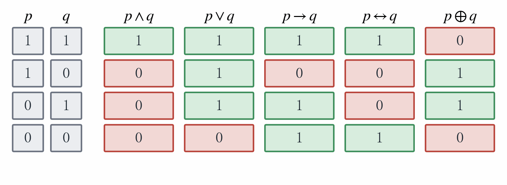

\[
p\to q\equiv\neg p\lor q.
\]

右边为假，必须同时满足 \(\neg p=0\) 和 \(q=0\)，即 \(p=1,q=0\)，恰好与左边唯一的假情形一致。这给出了等价式的完整语义依据，而不只是把它当成需要背诵的符号替换。

**讲解例：充分条件与必要条件。** 设 \(p\) 表示“一个整数能被四整除”，\(q\) 表示“它是偶数”。命题 \(p\to q\) 为真，说明能被四整除是偶数的充分条件，偶数是能被四整除的必要条件。取整数六可知 \(q\to p\) 为假。充分的意思是“有它就够”，必要的意思是“没有它不行”，都不表示两个条件完全相同。只有两个方向同时成立，才有 \(p\leftrightarrow q\)。

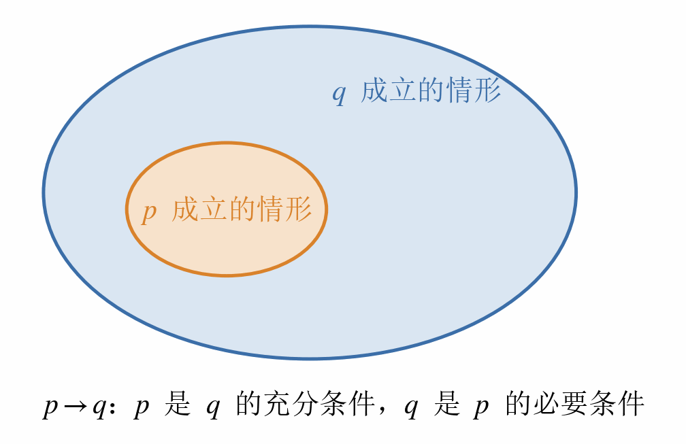

等价联结词 \(p\leftrightarrow q\) 在两者真值相同时为真，可展开为 \((p\to q)\land(q\to p)\)。因此证明充要条件通常分两个方向；只证其中一个方向，不能声称已经证明等价。

## 3. 恒真、可满足与逻辑后承

赋值是为每个原子命题指定一个真值。一条含 \(n\) 个不同原子命题的公式有 \(2^n\) 种赋值。真值表应列齐这些输入，再从最内层子公式向外计算。漏掉一行，可能恰好漏掉唯一反例。由于每一行的输出都可以独立地取零或一，\(n\) 个变量一共可以构成 \(2^{2^n}\) 个不同的真值函数：一个变量有四个（恒零、恒一、原样、取反），两个变量有十六个，与、或、异或、蕴含、与非等都是其中之一。

列真值表的步骤是：

1. 找出公式中全部不同的原子命题，设有 \(n\) 个，确定一个固定的排列顺序。
2. 按二进制计数的顺序列出 \(2^n\) 行赋值，例如三个变量从 000 到 111，保证不重不漏。
3. 按公式的结构，从最内层的子公式开始，每个子公式单独列一列。
4. 逐层向外计算，最后一列是整个公式的真值。
5. 根据最后一列判断：全为一是恒真式，全为零是矛盾式，至少有一个一就是可满足式。

恒真式在每个赋值下都真，例如 \(p\lor\neg p\)。矛盾式在每个赋值下都假，例如 \(p\land\neg p\)。可满足式至少在一个赋值下为真；偶然式既有真的赋值，也有假的赋值。不要把“这次给定输入下为真”误当成“永远为真”。

写 \(\Gamma\models C\) 表示语义后承：所有使前提集合 \(\Gamma\) 中各公式都真的赋值，也使结论 \(C\) 真。检验无效推理只需找到一个“前提全真、结论假”的反赋值；检验有效推理则必须排除全部反赋值。

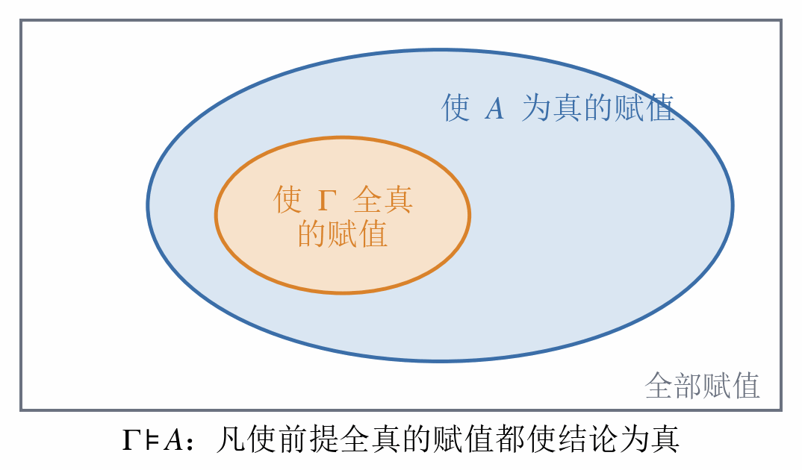

**讲解例：肯定后件的反例。** 从 \(p\to q\) 与 \(q\) 推出 \(p\)，看似符合某些日常经验，却不是有效形式。取 \(p=0,q=1\)，蕴含真，第二前提真，结论假，于是推理被否定。相反，从 \(p\to q\) 与 \(p\) 推出 \(q\) 是有效的，因为若结论 \(q=0\)，第二前提迫使 \(p=1\)，从而第一前提变假，不能出现前提全真的反例。

对于有限前提 \(A_1,\ldots,A_k\)，推理有效等价于下面的公式为恒真式：

\[
(A_1\land\cdots\land A_k)\to C.
\]

这个联系把“推理是否正确”转化为“一个公式是否恒真”，也连接了下一节的等价变换方法。

## 4. 等价变换与布尔代数

公式 \(A\equiv B\) 表示两式在每个赋值下真值相同。这里的等价符号是在讨论两个公式的语义关系；而 \(A\leftrightarrow B\) 是形式语言内部的一条公式。初学时可以相互联系，但不应混淆讨论层级。

常用的等价规则可以全部列出如下，其中 \(1\) 表示恒真，\(0\) 表示恒假。每一条都可以用真值表逐行核对：

\[
\begin{aligned}
&\text{双重否定} && \neg\neg A\equiv A,\\
&\text{交换律} && A\land B\equiv B\land A,\quad A\lor B\equiv B\lor A,\\
&\text{结合律} && (A\land B)\land C\equiv A\land(B\land C),\quad (A\lor B)\lor C\equiv A\lor(B\lor C),\\
&\text{幂等律} && A\land A\equiv A,\quad A\lor A\equiv A,\\
&\text{吸收律} && A\land(A\lor B)\equiv A,\quad A\lor(A\land B)\equiv A,\\
&\text{同一律} && A\land1\equiv A,\quad A\lor0\equiv A,\\
&\text{零律} && A\land0\equiv0,\quad A\lor1\equiv1,\\
&\text{排中律与矛盾律} && A\lor\neg A\equiv1,\quad A\land\neg A\equiv0,\\
&\text{蕴含等值式} && A\to B\equiv\neg A\lor B,\quad A\leftrightarrow B\equiv(A\to B)\land(B\to A),\\
&\text{逆否律} && A\to B\equiv\neg B\to\neg A,\\
&\text{输出律} && (A\land B)\to C\equiv A\to(B\to C).
\end{aligned}
\]

这些规则大多成对出现：把一条只含 \(\land,\lor,\neg,0,1\) 的规则中的合取与析取互换、零与一互换，得到的仍是一条正确的规则，这称为对偶原理。输出律说明“两个条件同时成立就推出结论”等于“在第一个条件下，第二个条件推出结论”，它是 7 节可以逐个假设前提再做蕴含引入的依据。布尔代数中有两条分配律：合取对析取分配，析取也对合取分配。

\[
A\land(B\lor C)\equiv(A\land B)\lor(A\land C),
\]
\[
A\lor(B\land C)\equiv(A\lor B)\land(A\lor C).
\]

第二条不能凭普通数的加乘直觉拒绝。布尔运算的对象和规则与实数运算不同；把逻辑或写成加号只是记号约定，不能据此使用普通加法的一切性质。

德摩根律的作用是把一个整体否定移向内部，同时交换联结词：

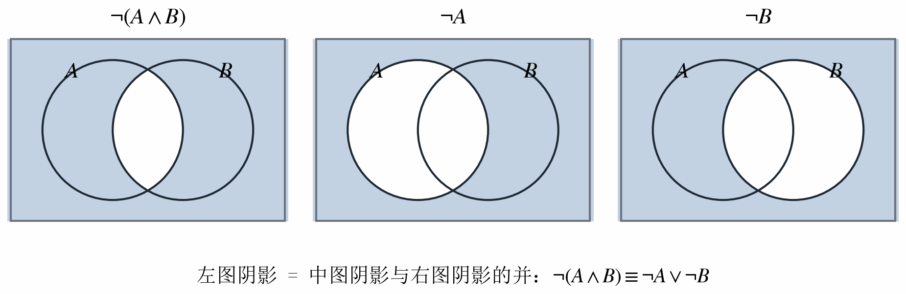

\[
\neg(A\land B)\equiv\neg A\lor\neg B,
\qquad \neg(A\lor B)\equiv\neg A\land\neg B.
\]

**讲解例：带蕴含的完整化简。** 化简 \(\neg(p\to q)\lor(p\land q)\)。先消去蕴含，再把否定推进括号：

\[
\begin{aligned}
\neg(p\to q)\lor(p\land q)
&\equiv\neg(\neg p\lor q)\lor(p\land q)\\
&\equiv(p\land\neg q)\lor(p\land q)\\
&\equiv p\land(\neg q\lor q)\\
&\equiv p\land 1\\
&\equiv p.
\end{aligned}
\]

第三行用分配律逆向提取共同因子；第四行用排中律；最后用恒等律。这个过程说明，等价替换可以发生在大公式的子公式中，前提是被替换部分确实在全部赋值下等价。

逆否关系也可直接推导：\(\neg q\to\neg p\equiv q\lor\neg p\equiv\neg p\lor q\equiv p\to q\)。逆命题交换前后件，否命题分别否定前后件，它们彼此等价，却一般不与原命题等价。

### 4.1 等价关系的局部检查

把一个公式变短，不一定是证明的唯一目标。有时需要把它改写成能接入指定电路的形式，有时需要便于归结的形式，有时需要看出前提是否互相冲突。每次变换之前应先确定目标，再选择保持等价的规则。若目标是消去蕴含，可先替换箭头；若目标是把否定推进到变量，则先消去箭头与等价联结词，再使用德摩根律。顺序合理能避免刚展开一层又不得不重新组合。

考虑公式 \((p\to q)\land(p\to\neg q)\)。消去箭头得到 \((\neg p\lor q)\land(\neg p\lor\neg q)\)，再由分配律逆向变为 \(\neg p\lor(q\land\neg q)\)，最终为 \(\neg p\)。它说明两个条件句可以同时为真，但只能在前件不成立时同时为真。这与“它们一个说是、一个说不是，所以一定矛盾”的直觉不同：冲突发生在假设前件为真的情况下，两个条件句自身还留下前件为假的赋值。

若再补充前提 \(p\)，整个合取就成为 \(p\land\neg p\)，不可满足。这展示了前提集合的一致性问题：增加前提可能排除剩余模型，直到不再有任何赋值。一个结论恰好与真实事实相符，也不能让不一致的论证自动变得可靠。

### 4.2 条件句组合的同类等价式

蕴含消去后，可以系统地推出条件句的组合关系，而不必每次重新列真值表。例如
\[
\begin{aligned}
A\to(B\land C)
&\equiv(A\to B)\land(A\to C),\\
(A\lor B)\to C
&\equiv(A\to C)\land(B\to C).
\end{aligned}
\]
第一式消去箭头后为 \(\neg A\lor(B\land C)\)，由分配律得到
\((\neg A\lor B)\land(\neg A\lor C)\)。第二式先用德摩根律，把 \(\neg(A\lor B)\lor C\) 改为 \((\neg A\land\neg B)\lor C\)，再分配。前者要求同一条件保证两个结果，后者要求两种充分条件各自都保证结果。

如果原式改为 \(A\to(B\lor C)\)，则等价于 \((A\to B)\lor(A\to C)\)，而不是两个条件句的合取。取 A、B 真、C 假，原式为真，错误合取却为假。相似地，\((A\land B)\to C\) 等价于 \((A\to C)\lor(B\to C)\)。这些变化来自否定作用于前件时会交换联结词，不能把箭头两侧当成普通乘法分配。

等价与异或也成对出现：
\[
\begin{aligned}
A\leftrightarrow B&\equiv(A\land B)\lor(\neg A\land\neg B),\\
A\oplus B&\equiv(A\land\neg B)\lor(\neg A\land B),\\
\neg(A\leftrightarrow B)&\equiv A\oplus B.
\end{aligned}
\]
相同与不同覆盖了全部四种真值组合，因此互为否定。证明“两个条件不等价”只需要一组真值使它们不同；证明某个现实对象中两个条件恰好同真，却不足以证明普遍等价。

## 5. 析取范式、合取范式与完全范式

文字是变量或变量的否定。若干文字的合取称为合取项；若干合取项的析取称为析取范式，简称 DNF，俄语为 дизъюнктивная нормальная форма，缩写 ДНФ。若干文字的析取称为析取项；若干析取项的合取称为合取范式，简称 CNF，俄语缩写 КНФ。单个文字也可当作只有一项的合取或析取。

例如 \((a\land\neg b)\lor c\) 是 DNF；\((a\lor b)\land(\neg a\lor c)\) 是 CNF。DNF 内部有 AND 是定义所允许的，名称指最外层怎样连接各项，并不是只准使用 OR。

完全析取范式中，每个合取项包含所有指定变量，每个恰出现一次。由真值表中输出为一的行构造：输入为一的变量写原变量，输入为零的变量写否定。这一合取项只在对应那一行取一，因此把全部这些项作或，恰好重建函数。

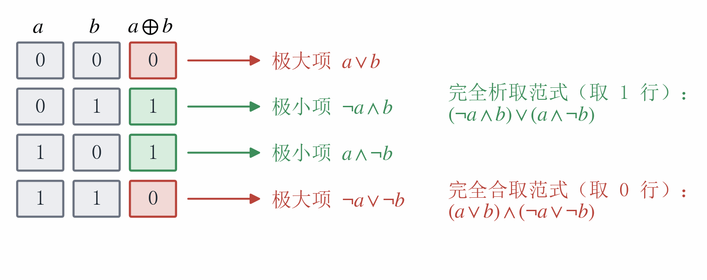

完全合取范式由输出为零的行构造。要让一个析取项只在指定行取零，输入为零的变量写原变量，输入为一的变量写否定。然后把各析取项作与，恰好排除全部零行。两种构造的符号选择相反，是由“合取项要在该行真”和“析取项要在该行假”决定的。

**讲解例：异或的两种完全范式。** \(p\oplus q\) 的一行是 \(01,10\)，所以

\[
p\oplus q\equiv(\neg p\land q)\lor(p\land\neg q).
\]

零行是 \(00,11\)。第一行对应析取项 \(p\lor q\)，第二行对应 \(\neg p\lor\neg q\)，故

\[
p\oplus q\equiv(p\lor q)\land(\neg p\lor\neg q).
\]

例如输入 \(01\) 时，两个括号都真；输入 \(11\) 时，第二括号假。逐行代入有助于理解构造，而不是把“零取反、一不取反”之类不注明范式的口诀混用。

完全范式以变量顺序和项的排序约定为前提具有规范性，但通常不最简。\(a\lor(a\land b)\equiv a\) 就说明冗余项可以消去。若函数恒假，完全 DNF 没有真行；若函数恒真，完全 CNF 没有假行，可以采用空析取为零、空合取为一的约定，或直接写常量，需与课堂约定一致。

### 5.1 用等价规则构造范式

从真值表构造完全范式适用于变量较少的情形，行数随变量个数指数增长。另一条路线是对公式本身做等价变换。先消去蕴含和等价，再把否定推进到原子命题，得到否定范式；之后选择分配方向，构造 DNF 或 CNF。两种方向不能混用目标，否则式子会不断展开又合并。

例如要把 \(p\to(q\land r)\) 改成 CNF，先得 \(\neg p\lor(q\land r)\)，再用析取对合取的分配律，得 \((\neg p\lor q)\land(\neg p\lor r)\)。这表明“若 p，则 q 和 r”同时要求两个条件句。若要求 DNF，\(\neg p\lor(q\land r)\) 本身已经符合结构，不必为追求式子更长而继续展开。

再看 \(p\lor(\neg p\land q)\)。分配得 \((p\lor\neg p)\land(p\lor q)\)，恒真项消去后为 \(p\lor q\)。若误把它化成 q，就漏掉了 p 真而 q 假的情况。精简规则的可信度来自全部赋值，不来自把符号看起来相反的部分任意删掉。

把 DNF 补成完全 DNF 时，可以在缺少变量的合取项里乘入 \(r\lor\neg r\)。例如相对变量集 \(p,q,r\)，项 \(p\land q\) 可写成 \((p\land q\land r)\lor(p\land q\land\neg r)\)。新项把原先不受限制的 r 分成两个可能，并没有增加额外限制。若不先声明变量集，“完全”一词就缺少参照对象。

用等价变换求范式的步骤归纳为：

1. 用 \(A\to B\equiv\neg A\lor B\) 和 \(A\leftrightarrow B\equiv(\neg A\lor B)\land(A\lor\neg B)\) 消去蕴含与等价。
2. 用德摩根律和双重否定，把否定号推进到每个原子命题前面，得到否定范式。
3. 求 DNF 时，用合取对析取的分配律展开；求 CNF 时，用析取对合取的分配律展开。
4. 用幂等律、吸收律、排中律、矛盾律删去重复项、恒真项和恒假项。
5. 若要求完全范式，对缺少变量的项补入 \(r\lor\neg r\)（DNF）或 \(r\land\neg r\)（CNF）再展开；也可以直接从真值表构造。
6. 任选几组赋值代入原式和结果，核对真值是否相同。

## 6. 逻辑基与函数完备性

逻辑基规定允许使用哪些运算符，范式规定表达式的结构，它们解决不同问题。集合 \(\{\lor,\neg\}\) 能表示任意布尔函数，因为它可以先构造合取，再表达完全 DNF：

\[
A\land B\equiv\neg(\neg A\lor\neg B).
\]

能表示所有有限变量布尔函数的运算集合称为函数完备集。仅有 OR 而没有 NOT，不能表示否定函数；因此不能把“析取基”理解成“只使用或且什么都能做”。

**讲解例：把课堂表达式写进析取基。** 已有

\[
y=(a\land\neg b\land c)\lor(a\land b\land\neg c).
\]

它已经是 DNF，但含有合取。若要求只用 OR 与 NOT，第一项变成 \(\neg(\neg a\lor b\lor\neg c)\)，第二项变成 \(\neg(\neg a\lor\neg b\lor c)\)。所以

\[
y=\neg(\neg a\lor b\lor\neg c)\lor\neg(\neg a\lor\neg b\lor c).
\]

内层的 \(b\) 是原先 \(\neg b\) 再否定得到的，双重否定消去；不能把所有变量一律加一个横线而忽略原来的否定。

与非 \(A\uparrow B=\neg(A\land B)\) 也能单独构成完备基。先用 \(A\uparrow A=\neg A\) 得到否定；再对一次与非结果取反得到 AND；最后由德摩根律得到 OR。或非同理。数字电路可以因此使用同一种门组成复杂电路，形式逻辑中的等价式在这里成为实现依据。

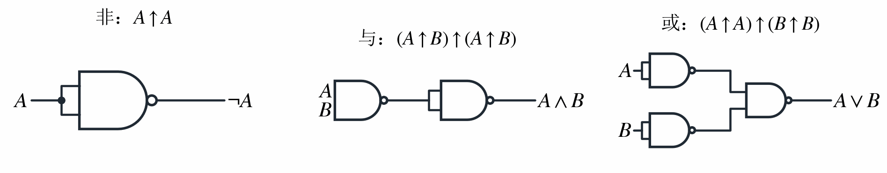

用与非表示三种基本运算的具体公式为

\[
\neg A\equiv A\uparrow A,\qquad A\land B\equiv(A\uparrow B)\uparrow(A\uparrow B),\qquad A\lor B\equiv(A\uparrow A)\uparrow(B\uparrow B).
\]

最后一式由德摩根律 \(A\lor B\equiv\neg(\neg A\land\neg B)\) 得到。常见运算集合是否完备可以归纳为：

1. 完备：\(\{\neg,\land,\lor\}\)、\(\{\neg,\land\}\)、\(\{\neg,\lor\}\)、\(\{\neg,\to\}\)、\(\{\uparrow\}\)、\(\{\downarrow\}\)。
2. 不完备：\(\{\land,\lor\}\)，它们只能构成单调函数，输入从零变一时输出不会从一变零，所以表达不了否定；\(\{\land,\lor,\to,\leftrightarrow\}\) 也不完备，因为当所有输入都为一时，这些运算的结果都为一，无法得到恒假或否定。

判断一个集合完备，只要用它表示出某个已知的完备集合（如 \(\{\neg,\land\}\)）；判断不完备，则要找出它构成的所有函数都具有的某个性质，而否定不具有这个性质。

## 7. 自然演绎与假设的管理

真值表给出语义检验，正规推演给出从前提到结论的规则化路径。写 \(\Gamma\vdash C\) 表示在指定演绎系统中可从前提推导出结论。推导的每行应注明来源；用尚未证明的结论支持它自己，构成循环论证。

合取消去允许由 \(A\land B\) 得到任一分量；合取引入允许由 \(A,B\) 得到 \(A\land B\)。蕴含消去即假言推理：由 \(A\to B,A\) 得到 \(B\)。蕴含引入需要暂时假设 \(A\)，在该假设下导出 \(B\)，然后解除该假设，得到 \(A\to B\)。解除假设不是删掉不喜欢的前提，而是一条有明确作用域的规则。

**正规推演例：蕴含的传递。** 前提为 \(p\to q\) 与 \(q\to r\)，证明 \(p\to r\)。

1. \(p\to q\)：前提。
2. \(q\to r\)：前提。
3. 暂设 \(p\)：为蕴含引入开启子推导。
4. 得 \(q\)：由第 1、3 行用蕴含消去。
5. 得 \(r\)：由第 2、4 行用蕴含消去。
6. 得 \(p\to r\)：解除第 3 行的假设，用蕴含引入。

第六行的结论不再以 \(p\) 实际为真为条件，它说明“如果 \(p\) 则 \(r\)”。前两条原始前提仍未解除，因此不能把这段推导误写成无前提的 \(p\to r\) 恒真。

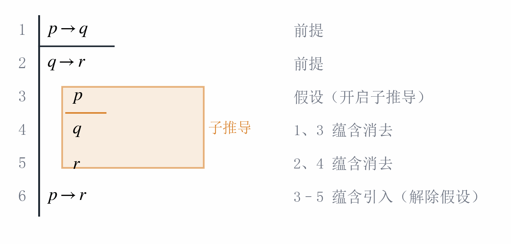

**正规推演例：分类讨论。** 由 \(p\lor q\)、\(p\to r\)、\(q\to r\) 推出 \(r\)。先暂设 \(p\)，结合第二前提得到 \(r\)；再独立暂设 \(q\)，结合第三前提得到 \(r\)。原析取保证两种情况至少一种发生，两支都导向同一结论，故解除两支假设并用析取消去得到 \(r\)。不能由 \(p\lor q\) 直接选 \(p\) 当作事实，那会把“至少一个”偷换成“第一个”。

否定引入则暂设 \(A\)，若导出矛盾 \(\bot\)，可解除假设并得 \(\neg A\)。在经典逻辑中还可使用反证法和双重否定消去；如果课程改用直觉主义逻辑，这些规则的地位需另行说明。本册采用经典逻辑。

自然演绎中各联结词的引入规则与消去规则归纳如下（方括号表示需要暂设、之后解除的假设）：

| 联结词 | 引入规则 | 消去规则 |
|---|---|---|
| \(\land\) | 由 \(A\) 与 \(B\) 得 \(A\land B\) | 由 \(A\land B\) 得 \(A\)，也得 \(B\) |
| \(\lor\) | 由 \(A\) 得 \(A\lor B\)，也由 \(B\) 得 \(A\lor B\) | 由 \(A\lor B\)、\([A]\cdots C\)、\([B]\cdots C\) 得 \(C\) |
| \(\to\) | 由 \([A]\cdots B\) 得 \(A\to B\) | 由 \(A\to B\) 与 \(A\) 得 \(B\) |
| \(\neg\) | 由 \([A]\cdots\bot\) 得 \(\neg A\) | 由 \(A\) 与 \(\neg A\) 得 \(\bot\) |
| \(\neg\neg\) | 由 \(A\) 得 \(\neg\neg A\) | 由 \(\neg\neg A\) 得 \(A\)（经典逻辑） |

引入规则说明怎样证明含某个联结词的公式，消去规则说明怎样使用它。构造推演时的一般策略是：

1. 从结论的形式出发反推：结论是蕴含，就暂设前件、目标改为后件；结论是合取，就分别证明两个分量；结论是否定，就暂设被否定的公式，目标改为导出矛盾。
2. 从前提出发正推：有合取就拆开；有蕴含且前件已知就用假言推理；有析取就分情况讨论。
3. 两个方向在中间会合后，按顺序写出推演，每行注明依据和所用的行号。
4. 检查所有暂设的假设都已在适当的位置解除。

### 7.1 归结与反驳证明

要证明前提推出结论，也可把前提与结论的否定放在一起，证明它们不能同时满足。命题归结法常将公式写成 CNF，把每个析取项看作一个子句。由 \(A\lor p\) 和 \(B\lor\neg p\)，可以推出归结子句 \(A\lor B\)。若后者假，则 A、B 都假；前两个子句分别迫使 p 真、p 假，不能同时满足，因此规则保持逻辑后承。

这里的 A、B 可以表示若干文字的析取，也可以没有其他文字。由单文字子句 p 与 \(\neg p\) 归结，得到没有文字的空子句，表示矛盾。空子句与空的子句集合不同：前者一个也无法满足，后者没有任何约束，可以满足。符号看似都很“空”，语义却相反。

**归结例：证明传递推理。** 前提 \(p\to q\)、\(q\to r\)，目标 \(p\to r\)。加入目标否定 \(\neg(p\to r)\)，得到子句 \(\neg p\lor q\)、\(\neg q\lor r\)、p、\(\neg r\)。由 p 与第一子句得 q；由 q 与第二子句得 r；由 r 与 \(\neg r\) 得空子句。故加入目标否定不可满足，原目标由前提成立。

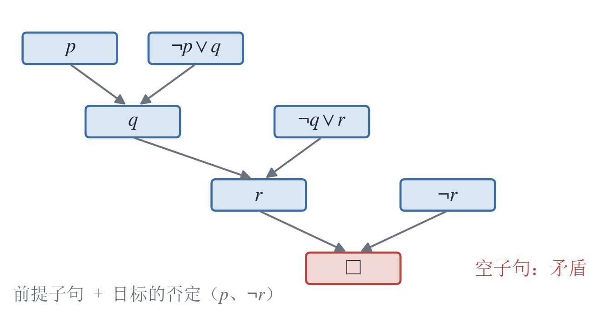

归结每次删除的是两条子句中相反的一个文字，再合并其余部分，不是把同一子句中的 \(p\lor\neg p\) 当作矛盾。后者是恒真句，可以从合取的子句集中忽略；\(p\land\neg p\) 才是直接冲突。这与“或至少一个真、与要求全真”的最初定义完全相连。

用归结法证明 \(\Gamma\models C\) 的步骤是：

1. 把全部前提和结论的否定 \(\neg C\) 放在一起。
2. 把它们分别化成合取范式，拆成子句的集合（每个析取项是一个子句）。
3. 反复选取两个含有一对互补文字的子句，作归结，把新子句加入集合。
4. 若得到空子句，说明集合不可满足，原推理有效。
5. 若再也产生不出新子句而仍没有空子句，说明集合可满足，原推理无效，并可以从中读出反例赋值。

### 7.2 常用推理规则与二难推理

课堂上常把有效的推理形式写成分式：横线上方是前提，下方是结论。下列八条规则都可以用第 3 节的标准检验：把“前提的合取蕴含结论”写成一个公式，它是恒真式，规则就有效。

| 编号 | 前提 | 结论 | 名称 |
|---|---|---|---|
| 1 | \(P\to Q\)，\(P\) | \(Q\) | 肯定前件式，модус поненс（modus ponens） |
| 2 | \(P\to Q\)，\(\neg Q\) | \(\neg P\) | 否定后件式，модус толленс（modus tollens） |
| 3 | \(P\lor Q\)，\(\neg P\) | \(Q\) | 选言三段论，дизъюнктивный силлогизм |
| 4 | \(P\to Q\)，\(Q\to R\) | \(P\to R\) | 假言三段论，гипотетический силлогизм |
| 5 | \(P\oplus Q\)，\(P\) | \(\neg Q\) | 排斥选言推理，разделительный силлогизм |
| 6 | \(P\to Q\)，\(R\to Q\)，\(P\lor R\) | \(Q\) | 简单二难，простая дилемма |
| 7 | \(P\to Q\)，\(R\to S\)，\(P\lor R\) | \(Q\lor S\) | 构造式二难，конструктивная дилемма |
| 8 | \(P\to Q\)，\(R\to S\)，\(\neg Q\lor\neg S\) | \(\neg P\lor\neg R\) | 破坏式二难，деструктивная дилемма |

肯定前件式即 7 节的蕴含消去。否定后件式说明：若 \(P\) 成立则 \(Q\) 必成立，现在 \(Q\) 不成立，所以 \(P\) 不可能成立。它是反证法（доказательство от противного）的依据：要否定一个假设，只需由它推出一个已知为假的结果。假言三段论表达的是蕴含的传递性（транзитивность импликации），7 节已用正规推演证明。

第 3 条与第 5 条的差别在于“或”的含义。普通析取 \(P\lor Q\) 允许两者同真，因此只能由否定一个推出另一个；由 \(P\lor Q\) 与 \(P\) 推出 \(\neg Q\) 是无效的，取 \(P=Q=1\) 即得反例。异或 \(P\oplus Q\) 要求恰有一个为真，所以还可以反向使用：肯定一个就否定另一个。

三条二难推理都从一个析取前提出发作分类讨论。第 6 条两种情况导致同一结果，结论确定为 \(Q\)；7 节的“分类讨论”例正是这一形式。第 7 条两种情况导致不同结果，只能断言两个结果至少有一个成立，相当于在每个分支上分别使用规则 1。第 8 条是它的对偶：已知 \(Q\)、\(S\) 至少一个不成立；若 \(\neg Q\)，由规则 2 得 \(\neg P\)；若 \(\neg S\)，由规则 2 得 \(\neg R\)；所以 \(\neg P\lor\neg R\)。构造式二难是肯定前件式的双份形式，破坏式二难是否定后件式的双份形式。

与这些规则外形相近的两种推理是谬误。肯定后件：由 \(P\to Q\) 与 \(Q\) 推 \(P\)，第 3 节已给出反例。否定前件：由 \(P\to Q\) 与 \(\neg P\) 推 \(\neg Q\)，取 \(P=0,Q=1\)，两个前提都真而结论假。蕴含式只在“前件真、后件假”时为假；前件为假时，无论后件取什么，蕴含式都为真，因此否定前件不能限制后件。

### 7.3 推理有效性的三种检验方法

第 3 节把有效推理定义为“不存在前提全真而结论假的赋值”。改写成可满足性的语言，就得到下面的判定准则：

\[
F_1,F_2,\ldots,F_k\models R
\quad\Longleftrightarrow\quad
F_1\land F_2\land\cdots\land F_k\land\neg R\ \text{不可满足}.
\]

课堂板书的俄语表述是 R является следствием \(F_1,\ldots,F_k\)（R 是这些前提的推论），而 \(F_1\,\&\,\cdots\,\&\,F_k\,\&\,\neg R\) — не выполнима（不可满足）。左边说每个使前提全真的赋值都使 \(R\) 真；右边说不存在使前提全真且 \(R\) 假的赋值，两者是同一件事的两种说法。7.1 节的归结证明就是在子句形式下检验右边。

检验一个具体推理可以用三种方法：套用推理规则、代数化简、列真值表。下面用两道课堂题对照。变量按板书记作 \(\mathrm{Ck}\)、\(\mathrm{Cn}\)、\(Y\) 与 \(X\)、\(M\)，各代表一个原子命题。

**讲解例一：结论成立。** 前提为

\[
F_1:\ \neg\mathrm{Ck}\to\neg Y,\qquad
F_2:\ \neg\mathrm{Cn}\to\neg\mathrm{Ck},\qquad
F_3:\ Y,
\]

待检验的结论为 \(R:\ \mathrm{Cn}\)。

用推理规则。\(F_2\) 的后件正是 \(F_1\) 的前件，首尾相接，由规则 4 得 \(\neg\mathrm{Cn}\to\neg Y\)。\(F_3\) 断言 \(Y\)，即 \(\neg Y\) 为假，后件被否定，由规则 2 得 \(\neg\neg\mathrm{Cn}\)，即 \(\mathrm{Cn}\)。写成编号推演：

1. \(\neg\mathrm{Cn}\to\neg Y\)：由 \(F_2\)、\(F_1\)，规则 4。
2. \(\neg\neg\mathrm{Cn}\)：由第 1 行与 \(F_3\)，规则 2。
3. \(\mathrm{Cn}\)：双重否定。

用代数化简。先用 \(a\to b\equiv\neg a\lor b\) 消去箭头：\(F_1\equiv\mathrm{Ck}\lor\neg Y\)，\(F_2\equiv\mathrm{Cn}\lor\neg\mathrm{Ck}\)。按布尔代数习惯，把“与”写成相邻并列的乘积，再用分配律展开：

\[
\begin{aligned}
F_1F_2F_3
&=(\mathrm{Ck}\lor\neg Y)(\mathrm{Cn}\lor\neg\mathrm{Ck})\,Y\\
&=(\mathrm{Ck}\,\mathrm{Cn}\lor\mathrm{Ck}\,\neg\mathrm{Ck}\lor\neg Y\,\mathrm{Cn}\lor\neg Y\,\neg\mathrm{Ck})\,Y\\
&=\mathrm{Ck}\,\mathrm{Cn}\,Y\lor\mathrm{Ck}\,\neg\mathrm{Ck}\,Y\lor\neg Y\,\mathrm{Cn}\,Y\lor\neg Y\,\neg\mathrm{Ck}\,Y\\
&=\mathrm{Ck}\,\mathrm{Cn}\,Y.
\end{aligned}
\]

后三项各含一对互补文字（\(\mathrm{Ck}\,\neg\mathrm{Ck}\) 或 \(\neg Y\,Y\)），由 \(A\land\neg A\equiv0\) 都为零。也可以先乘 \(Y\)：\((\mathrm{Ck}\lor\neg Y)Y=\mathrm{Ck}\,Y\)，再乘第二个括号，得到同样结果；展开次序不影响答案。三个前提同时为真，等价于 \(\mathrm{Ck}\,\mathrm{Cn}\,Y\) 为真，即三个变量都为 1，此时 \(\mathrm{Cn}=1\)。按判定准则，\(\mathrm{Ck}\,\mathrm{Cn}\,Y\,\neg\mathrm{Cn}\) 含互补文字，恒为零，不可满足，所以结论成立。

用真值表。三个变量共 \(2^3=8\) 行：

| \(\mathrm{Ck}\) | \(\mathrm{Cn}\) | \(Y\) | \(F_1\) | \(F_2\) | \(F_3\) | \(R\) |
|---|---|---|---|---|---|---|
| 1 | 1 | 1 | 1 | 1 | 1 | 1 |
| 1 | 1 | 0 | 1 | 1 | 0 | 1 |
| 1 | 0 | 1 | 1 | 0 | 1 | 0 |
| 1 | 0 | 0 | 1 | 0 | 0 | 0 |
| 0 | 1 | 1 | 0 | 1 | 1 | 1 |
| 0 | 1 | 0 | 1 | 1 | 0 | 1 |
| 0 | 0 | 1 | 0 | 1 | 1 | 0 |
| 0 | 0 | 0 | 1 | 1 | 0 | 0 |

\(F_1\) 只在 \(\mathrm{Ck}=0,Y=1\) 时为假，\(F_2\) 只在 \(\mathrm{Cn}=0,\mathrm{Ck}=1\) 时为假。只看三个前提全为 1 的行，只有第一行，而这一行 \(R=1\)，所以没有反例。若把三个前提的合取单独列一列，它也只在第一行为 1，与代数结果 \(\mathrm{Ck}\,\mathrm{Cn}\,Y\) 一致；这一列与结论列 \(R=\mathrm{Cn}\) 是两回事，抄写时不要混淆。

**讲解例二：结论不成立。** 前提为

\[
F_1:\ X\to M,\qquad
F_2:\ \neg M\to\neg X,\qquad
F_3:\ \neg X,
\]

待检验的结论为 \(R:\ \neg M\)。

用推理规则。\(F_2\) 是 \(F_1\) 的逆否命题，两者等价，没有提供新信息。已知 \(\neg X\) 只是否定了 \(F_1\) 的前件，上表八条规则没有一条能由此得到关于 \(M\) 的结论，这正是否定前件的谬误。

用代数化简。\(F_1\equiv\neg X\lor M\)，\(F_2\equiv M\lor\neg X\)，两者相同。

\[
\begin{aligned}
F_1F_2F_3
&=(\neg X\lor M)(\neg X\lor M)\,\neg X\\
&=(\neg X\lor M)\,\neg X\\
&=\neg X\,\neg X\lor M\,\neg X\\
&=\neg X\lor\neg X\,M\\
&=\neg X.
\end{aligned}
\]

第二行用幂等律 \(A\land A\equiv A\)，第四行同样用它把 \(\neg X\,\neg X\) 写成 \(\neg X\)，最后一行用吸收律 \(A\lor AB\equiv A\)：只要 \(\neg X\) 为真，整式已真，后一项多余。幂等律可以逐值核对：\(\neg X=0\) 时 \(0\cdot0=0\)，\(\neg X=1\) 时 \(1\cdot1=1\)。这里的“乘”是合取，不是数的乘法，所以不会出现 \(a^2\) 这样的新量；析取也有同样的规律 \(A\lor A\equiv A\)。

全部前提合起来只等价于 \(\neg X\)，其中不含 \(M\)，前提对 \(M\) 没有任何约束。按判定准则，\(\neg X\land\neg R=\neg X\,M\) 在 \(X=0,M=1\) 时为真，可满足，所以推理无效。

用真值表：

| \(X\) | \(M\) | \(F_1\) | \(F_2\) | \(F_3\) | \(R\) |
|---|---|---|---|---|---|
| 1 | 1 | 1 | 1 | 0 | 0 |
| 1 | 0 | 0 | 0 | 0 | 1 |
| 0 | 1 | 1 | 1 | 1 | 0 |
| 0 | 0 | 1 | 1 | 1 | 1 |

前提全真的有第三、四两行，其中第三行 \(R=0\)，就是反例：\(X\) 假、\(M\) 真时，三个前提都成立而结论不成立。

三种方法各有适用范围。推理规则最快，但要求看出该用哪条规则，而且找不到规则并不等于推理无效，无效性仍需反例确认。代数化简不依赖技巧，按“消去箭头、展开、删去含互补文字的项”机械进行，结果还能直接读出前提允许哪些赋值。真值表最机械也最可靠，但 \(n\) 个变量需要 \(2^n\) 行，变量稍多就不实用。

## 8. 谓词、论域与量词

命题逻辑不分析“所有学生”内部的对象关系。谓词逻辑引入论域、个体变量、谓词和量词。\(P(x)\) 是含变量的性质表达式；给定变量赋值后才确定真假。\(\forall xP(x)\) 表示论域内每个对象都满足，\(\exists xP(x)\) 表示至少一个满足。

论域必须先声明。\(\forall x\exists y(y>x)\) 在实数论域为真，在带通常顺序的非空有限集合中为假，因为这样的集合有最大元，而最大元没有更大的域内元素。公式自身没有替读者决定论域。量词能约束变量，其作用域内的对应出现称为约束出现；未受量词约束的出现称为自由出现。同一个字母在不同作用域中的角色也可能不同。

**讲解例：量词次序。** 在整数中，\(\forall x\exists y(y=x+1)\) 表示每一个输入都有相应的后继，\(y\) 可以依赖 \(x\)。而 \(\exists y\forall x(y=x+1)\) 要求同一个整数同时是所有整数的后继。代入 \(x=0\) 要求 \(y=1\)，代入 \(x=1\) 要求 \(y=2\)，两者不能同时满足，故后式假。顺序差异对应的是见证能否随对象改变。

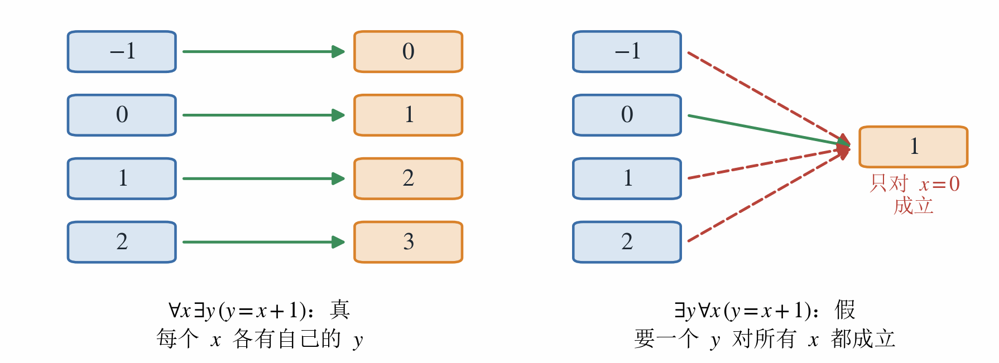

否定量词时必须交换量词并否定内部命题：

\[
\neg\forall xP(x)\equiv\exists x\neg P(x),\qquad
\neg\exists xP(x)\equiv\forall x\neg P(x).
\]

否定一个含多个量词的公式，可以按以下步骤逐层进行：

1. 把否定号放在整个公式最前面。
2. 每遇到一个量词，把它从全称换成存在、或从存在换成全称，否定号向内移动一层。
3. 否定号到达不含量词的部分后，用德摩根律和 \(\neg(A\to B)\equiv A\land\neg B\) 继续推进到原子公式。
4. 把结果翻译回自然语言，检查意思是否确实与原句相反。

“每个人都喜欢至少一本书”写为 \(\forall x\exists yL(x,y)\)，其中人的论域与书的论域已分别限定。逐层否定得 \(\exists x\forall y\neg L(x,y)\)：至少一个人对每一本书都不喜欢。它不等于“每个人都不喜欢任何书”，后者把存在一个人换成了所有人。

### 8.1 受限量词与条件的安放

“所有学生会说俄语”若论域只包含学生，可写成全称俄语能力谓词；若论域为所有人，则必须把学生身份写进公式。设 S 表示学生、R 表示会说俄语，正确形式为 \(\forall x(S(x)\to R(x))\)。对不是学生的人，公式没有要求他们会俄语，这由蕴含前件为假时真来实现。

“至少有一个学生会说俄语”则为 \(\exists x(S(x)\land R(x))\)。存在见证必须同时满足身份与能力。若错写成 \(\exists x(S(x)\to R(x))\)，只要存在一个不是学生的人，这个蕴含便为真，即使没有任何学生会俄语，也满足了错误公式。因此受限全称用蕴含，受限存在用合取，是语义要求，不是任选的书写习惯。

否定“所有学生会说俄语”，先交换全称与存在，再否定蕴含，逐步得到

\[
\neg\forall x(S(x)\to R(x))
\equiv\exists x\neg(\neg S(x)\lor R(x))
\equiv\exists x(S(x)\land\neg R(x)).
\]

结果说至少一个学生不会俄语。否定“至少一个学生会俄语”，则得到 \(\forall x(S(x)\to\neg R(x))\)，即没有学生会俄语。两种否定的强度不同；“不是所有”允许部分会，不能替换成“全都不会”。

把自然语言翻译成谓词公式，可以按以下步骤：

1. 确定论域，并找出句子中的个体、性质和关系，分别用常量、一元谓词和多元谓词表示。
2. 找出量化词：“所有、每个、任何”对应 \(\forall\)，“有、存在、至少一个”对应 \(\exists\)，“没有”可译为 \(\neg\exists\) 或 \(\forall\cdots\neg\)。
3. 全称句的限定条件用蕴含连接，\(\forall x(S(x)\to\cdots)\)；存在句的限定条件用合取连接，\(\exists x(S(x)\land\cdots)\)。
4. 有多个量词时，按句意确定先后次序，判断后面的对象能否随前面的对象而变。
5. 用一个具体的小模型代入检验：公式的真假是否与原句的意思一致。

在空的学生群体中，受限全称为真，受限存在为假。因为全称只要求不存在学生反例，而存在句要求交出一个学生见证。这又回到三段论中的存在预设，说明空类问题不是某一道题的特殊陷阱，而是量词语义的一贯结果。

### 8.2 量词分配的成立范围

量词与联结词的配合有固定边界：
\[
\begin{aligned}
\forall x(P(x)\land Q(x))
&\equiv(\forall xP(x))\land(\forall xQ(x)),\\
\exists x(P(x)\lor Q(x))
&\equiv(\exists xP(x))\lor(\exists xQ(x)).
\end{aligned}
\]
第一式两侧都要求每个对象同时满足两种性质；第二式只需找到一个满足至少一种性质的对象。其余两种组合不能照抄分配律。

例如论域 \(\{1,2\}\)，P 只在一成立、Q 只在二成立。每个对象都满足 P 或 Q，所以 \(\forall x(P\lor Q)\) 真；但没有哪一种性质对所有对象成立，故 \((\forall xP)\lor(\forall xQ)\) 假。同一个模型还使 \((\exists xP)\land(\exists xQ)\) 真，却使 \(\exists x(P\land Q)\) 假。前者允许两个不同见证，后者要求同一个见证兼具两种性质。

于是保留下来的单向推理为
\[
\begin{aligned}
(\forall xP)\lor(\forall xQ)&\ \models\ \forall x(P\lor Q),\\
\exists x(P\land Q)&\ \models\ (\exists xP)\land(\exists xQ).
\end{aligned}
\]
把一个方向升级成等价，必须另有理由。连续两个全称量词可以交换，连续两个存在量词也可以交换；混合量词次序的一般变化仍受上一节的见证依赖约束。

若 A 中没有 x 的自由出现，可把它看作与所枚举对象无关的条件。例如在非空论域中，\(\forall x(A\lor P(x))\equiv A\lor\forall xP(x)\)。自由变量条件不能省略；若 A 实际也含 x，就回到刚才已经给出反例的错误分配。

对不含 x 自由出现的 A，量词进出括号的全部规则为（论域非空）：

\[
\begin{aligned}
&\forall x(A\land P(x))\equiv A\land\forall xP(x), && \exists x(A\land P(x))\equiv A\land\exists xP(x),\\
&\forall x(A\lor P(x))\equiv A\lor\forall xP(x), && \exists x(A\lor P(x))\equiv A\lor\exists xP(x),\\
&\forall x(A\to P(x))\equiv A\to\forall xP(x), && \forall x(P(x)\to A)\equiv\exists xP(x)\to A .
\end{aligned}
\]

最后一式需要特别注意：量词从蕴含的前件移出时，全称变成存在。理由是 \(P(x)\to A\equiv\neg P(x)\lor A\)，而 \(\forall x\neg P(x)\equiv\neg\exists xP(x)\)。例如“对任何人，如果他迟到，会议就推迟”等价于“如果有人迟到，会议就推迟”。

利用这些规则（必要时先给约束变量改名），任何谓词公式都可以等价地化成所有量词都在最前面的形式，称为前束范式，例如 \(\forall x\exists y(\cdots)\)，后面的部分不含量词。前束范式便于比较量词的次序和进行机械化的推理。

### 8.3 逐层选择与多重量词

判断混合量词，先按从左到右的顺序说明每一步允许使用哪些已知对象。在 \(\forall x\exists y\,R(x,y)\) 中，先给任意 x，再寻找与它相配的 y；不同 x 可以配不同 y。在 \(\exists y\forall x\,R(x,y)\) 中，必须先选定一个 y，之后无论 x 怎样改变，这个 y 都不能换。后一句承诺更强。

用有限模型把区别完全展开。令 x、y 的论域均为 \(\{1,2\}\)，关系 \(R(x,y)\) 为 \(y=x\)。对第一句，x 为一时选 y 为一，x 为二时选 y 为二，两个全称情形都找到见证，所以公式真。对第二句，候选 y 只有一和二：固定 y 为一会被 x 为二推翻，固定 y 为二会被 x 为一推翻。所有候选都失败，公式假。这里已经穷尽有限论域，结论不依赖“似乎找不到”的直觉。

整数后继关系也遵循同一过程：对每个整数 x，取 \(y=x+1\) 就证明 \(\forall x\exists y(y=x+1)\)；若要求同一个 y 对所有 x 成立，取两个不同 x 即出现矛盾。前一个证明给出了一个随输入变化的选择规则，后一个命题却要求常量见证，不能把规则 \(x\mapsto x+1\) 当成一个固定整数。

增加一层量词后，依赖限制仍然逐层生效。例如在实数中比较
\[
\forall x\,\exists y\,\forall z\;(y=z-x),
\qquad
\forall x\,\forall z\,\exists y\;(y=z-x).
\]
左式选 y 时只知道 x，之后必须用同一个 y 应付所有 z；固定 x 后分别取 z 为零和一，就要求 y 同时等于 \(-x\) 和 \(1-x\)，故为假。右式先给出 x 与 z，再令 \(y=z-x\)，允许 y 同时依赖两个对象，故为真。把 \(\exists y\) 移过 \(\forall z\) 改变了允许的依赖关系，不能以“每个变量最后都出现了”为由交换。

反驳全称句只需给出一个反例，反驳存在句却需排除全部候选。相应地，在非空论域中
\[
\exists y\forall x\,R(x,y)\ \models\ \forall x\exists y\,R(x,y),
\]
因为前提中的统一见证对每个 x 都可继续使用；有限模型已说明逆向不成立。理解这一方向后，再进行量词否定和形式推演，就能分清一次有效的见证复用与未经证明的见证统一。

## 9. 量词推演、三段论与存在条件

全称消去允许从 \(\forall xP(x)\) 得到一个指定对象的 \(P(a)\)。存在引入允许从 \(P(a)\) 得到 \(\exists xP(x)\)。相反方向都需要额外条件：一个对象满足性质不能证明所有对象满足；知道有某对象满足，也不能说预先指定的对象就是那个见证。

**正规推演例：全称关系与存在见证。** 已知“所有学生都学习逻辑”和“至少有一个学生”，证明“至少有一个人学习逻辑”。形式化为 \(\forall x(S(x)\to L(x))\) 与 \(\exists xS(x)\)。为存在消去引入一个新符号 \(a\)，只在子推导中假设 \(S(a)\)；由全称消去得 \(S(a)\to L(a)\)；再得 \(L(a)\)；由存在引入得 \(\exists xL(x)\)。结论不含新符号 \(a\)，于是可解除见证假设，完成存在消去。新符号不能偷偷代表某个已知特殊人物，否则会把“存在某人”误换成“就是这个人”。

全称引入要求所用对象任意，不能依赖它的特殊性质或未解除的特殊假设。证明“任取整数 \(a\)，\(a+0=a\)”再推广到全体整数是合理路径；挑选 \(a=0\) 验算后推广则无效。

四条量词规则的使用条件可以归纳为：

1. 全称消去：由 \(\forall xP(x)\) 可以得到任何具体对象 \(a\) 的 \(P(a)\)，没有限制。
2. 全称引入：由 \(P(a)\) 得到 \(\forall xP(x)\)，要求 \(a\) 是任意选取的，不出现在任何未解除的假设或前提中。
3. 存在引入：由 \(P(a)\) 得到 \(\exists xP(x)\)，没有限制。
4. 存在消去：由 \(\exists xP(x)\) 引入一个全新的符号 \(a\) 暂设 \(P(a)\)，推出的结论中不能再含 \(a\)，然后才能解除这个暂设。

传统三段论中的“所有 A 是 B，所有 B 是 C，所以所有 A 是 C”可按任取对象、两次蕴含消去、再全称引入证明。但“所有 A 是 B，所以有些 A 是 B”在现代逻辑中不成立，除非另外知道 A 非空。若 A 没有成员，前面的全称句仍可以为真，却没有对象可作存在见证。这个空类问题解释了传统语句与现代量词表示之间为什么需要注明存在预设。

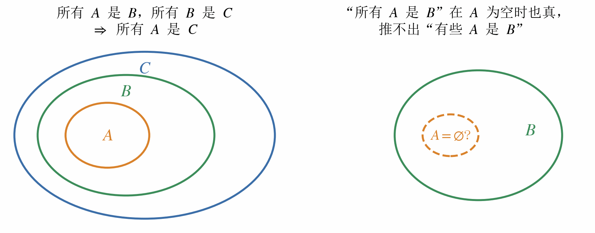

### 9.1 变量代换与见证依赖

量词中的变量字母本身通常不重要，重要的是哪些出现由同一个量词约束。\(\forall xP(x)\) 与 \(\forall tP(t)\) 表达相同内容，只要更名时保持绑定关系，不把原本自由的变量意外绑住。这个操作类似在程序中安全地更改局部变量名，名称可变，作用域关系不能变。

考虑 \(\forall x\exists y(y>x)\)。若把内层 y 草率改成 x，得到 \(\forall x\exists x(x>x)\)，内层量词遮蔽了外层变量，两处 x 都被近处量词约束，公式不再表示原关系。安全更名应改成一个未发生冲突的新字母，如 \(\forall x\exists z(z>x)\)。这类错误不是算错不等式，而是变量捕获改变了命题。

从 \(\forall xP(x)\) 得到 \(P(t)\) 时，还必须保证代入项 t 的自由变量不会被原公式内部量词捕获。例如把含某个自由变量的项代入复杂公式之前，可以先将内部约束变量换成全新字母，再进行代换。初学阶段即使只处理简单常量见证，也应养成注明作用域的习惯，避免在复杂量词题中依赖视觉上同名就相同的直觉。

存在见证的依赖还关系到量词次序。在“每个学生有一位导师”的子推导中，为任意学生 a 引入的导师 b 可以依赖 a；不能把这个 b 移到整个推导外，声称“存在同一位导师指导所有学生”。先取学生再取导师和先取导师再遍历学生，是两种不同的承诺。推演规则对新符号的限制，正是在形式上阻止这种未经证明的跨越。

另一方面，“存在一个人指导所有学生”可以推出“每个学生都有一位导师”：先从前提中取同一个见证 b，对任意学生 a 使用其性质，再引入存在导师并对学生全称化。反方向一般不成立。用一个班有两名学生、分别由不同导师指导且无共同导师的情境，就能构成反例。量词推演既可以给出成立方向的证明，也可以与模型反例配合排除错误方向。

## 10. 证明方法与计算实现的衔接

等价变换关注每一步保持真值函数不变；自然演绎关注在当前假设下哪些结论可推出；真值表负责直接枚举有限赋值。它们可交叉验证，但不能混用操作目标。把 \(p\lor q\) 等价改成 \(p\) 是错误的，然而在额外前提 \(\neg q\) 下推出 \(p\) 却是有效的：后者依赖条件，不是无条件等价。

在 C 语言中，`!`、`&&`、`||`先把操作数作为零或非零的真假判断，逻辑结果为零或一。`&`、`|`、`^`则逐位处理整数表示。例如 `2 && 4` 为一，因为两者非零；`2 & 4` 为零，因为二进制 `010` 和 `100` 没有同时为一的位。这不是逻辑规则互相矛盾，而是输入对象和运算定义不同。

短路求值又增加了程序执行层面的含义。数学上 \(A\land B\) 与 \(B\land A\) 等价；程序中 `p != NULL && *p > 0` 先检查地址再解引用，交换顺序可能在空指针时产生错误。逻辑真值等价不能自动保证带副作用或带执行前提的程序片段可以任意交换。

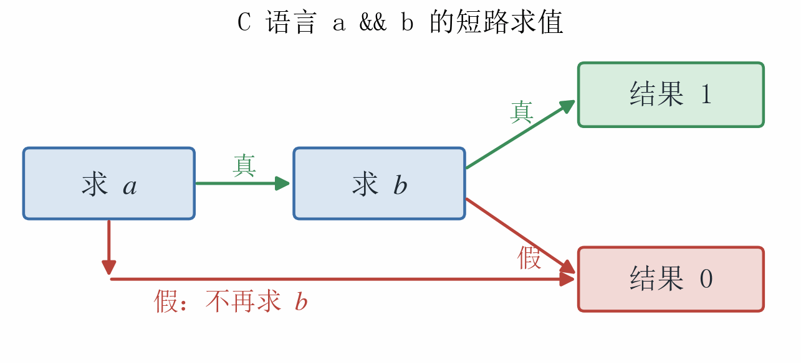

本册依据可读对话正文中的蕴含、括号歧义、逻辑基与范式辨析、量词内容整理，增加的正规推演和教学算例均为解释体系而编写。原白板图片在部分导出记录中只有附件占位，不能据旧助手的猜测断言原图标题或全部符号。先修关系为：联结词语义支持等价与范式，等价支持逻辑基，假设管理支持量词推演；数字电路册继续讨论这些布尔函数的物理实现。

