# 计算机科学基础

信息表示、算法正确性与计算模型

## 1. 信息、符号与编码

屏幕上的字母 A、变量中的整数六十五和一条处理器指令，都可以由二进制位表示。但相同的位串并不自带相同含义：`01000001` 按无符号整数解释为六十五，在 ASCII 字符编码中对应 A；若作为某种指令的一部分，还需要具体指令集和上下文。区分“物理载体、符号表示、解释规则”，是理解计算机的第一步。

比特取零或一，\(n\) 个比特共有 \(2^n\) 种不同组合。这个结论可由乘法计数原理得到：第一位两种选择，每一种再配第二位的两种选择，依次相乘。组合数说明可区分多少状态，并不规定这些状态分别代表什么。要编码至少一百种对象，六位只有六十四种不够，七位有一百二十八种才够；多出的编码可以保留或表示其他信息。

字节在常见现代设备上为八比特。C 语言中一个字节由 `char` 的存储单位定义，`sizeof(char)` 恒为一，具体位数由 `CHAR_BIT` 给出。因此阅读语言规范时要区分“八位字节的常见机器”和“语言对所有实现的要求”。同理，写成四个字节的整数不自动说明有符号性、字节序或编码方案。

**容量分析。** 一幅一百乘一百像素的图像，若每像素使用二十四位且不计头部、压缩和对齐，像素数据为 \(100\times100\times24=240000\) 比特，即三万字节。图像尺寸、每像素位数和文件大小分别对应不同层次。压缩文件可能小得多，也可能增加其他数据，不能仅从像素数断言实际文件恰有三万字节。

### 1.1 信号、数据、信息与知识

计算机接收和处理的首先是有物理实现的信号及其编码。温度传感器把环境温度转成电信号，转换电路产生数值，程序依据单位、标定关系和采样时刻解释这个数值。比如记录“25”，尚未说明它是摄氏温度、人数还是某个编号；加入测量对象、单位和时刻后，这组数据才在特定任务中提供清楚的信息。

在这一操作性区分中，信号是承载和传递变化的物理过程，数据是按规则记录的符号或数值，信息是这些记录在给定解释与任务中表达的内容，知识则进一步涉及经组织、理解和验证的关系。四者有联系，边界也随学科而异，不宜写成所有领域通用的唯一哲学定义。一个位串可以被准确传送，却因接收者缺少编码规则而无法理解；理解了句子，也不等于句中断言已被事实证明。

传递过程可以按信源、编码、信道、接收和解释来分析。信源产生待表达的内容，编码把它组织成可传的信号，信道提供传输媒介，接收端按约定恢复符号并解释。储存可看作跨时间保存记录，通信强调跨位置传递记录；两者都依赖物理载体和读写规则。文件被复制后通常仍保留原文件，因此信息复制不能简单套用一个物体从甲处搬到乙处的数量变化。

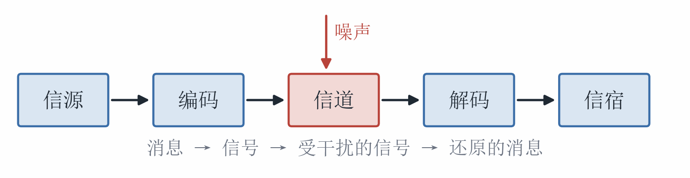

不同接收端能提取什么，取决于测量灵敏度、编码和处理方法。例如同一份俄语文本，识字者和不懂俄语者对语义的理解不同，但后者仍可能判断字母数量、版面和重复模式。这说明“无法理解语义”不能无条件加强成“完全没有得到任何形式的信息”。讨论原教材的概括性语言时，需要注明正在谈语义、信号还是测量。

### 1.2 连续、离散与信息处理的层次

物理信号可以随时间连续变化，计算机通常在若干采样时刻记录它，再用有限编码表示每个样本。采样把时间位置离散化，量化把幅值划入有限档位，这两个步骤并非同一件事。一个离散时间序列在数学模型中仍可具有连续的幅值；只有再规定有限数值编码，才成为有限精度的数据表示。

**采集过程示例。** 假设温度每秒记录一次，并按最近的 \(0.1\,^{\circ}\mathrm C\) 舍入。采样间隔是一秒，量化间隔是 \(0.1\,^{\circ}\mathrm C\)。理想舍入产生的量化误差绝对值不超过 \(0.05\,^{\circ}\mathrm C\)，但这不包含传感器标定误差和环境变化。提高小数位数不能恢复两次采样之间未测量的过程，加快采样也不能自动提高传感器准确度。文件压缩、传输和显示是后续步骤，还应与最初的信息采集分开。

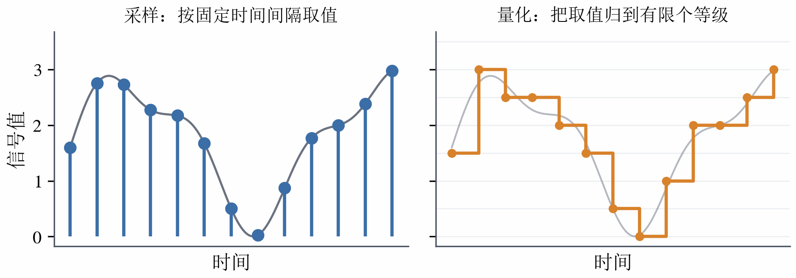

信息处理在实际系统中相互衔接：采集产生记录，表示规定编码，存储维持可读性，传输连接设备，检索和运算组织数据，解释与验证形成可用结论。温控系统最后还将测量结果与目标比较，生成加热控制量。课本所说的认识功能、交际功能和管理功能，可分别在从数据获得认识、在主体间通信、依据反馈调节行为中找到实例；它们可以同时出现在一个系统中，不是互斥的三种数据格式。

### 1.3 信息技术、信息资源与社会信息化

上一节从单个系统看信息处理的各个环节，本节转到社会层面。俄语课程课文（Акулов、Медведев 2006，第18—22页）用物质生产作对照来说明信息技术。物质技术的主要组成部分是准备原料和材料、生产物质产品、把产品销售给消费者；信息技术中充当原始材料的是信息，最终产品也是信息，但已是关于对象、过程或现象状态的、在质上全新的信息。相应地，信息技术的组成部分是：

1. 收集数据（原始信息）。
2. 处理数据。
3. 得到结果信息。
4. 把结果信息传递给使用者。

这与 1.2 节“采集、表示、存储、传输、运算、解释”的链条一致，只是课文把它压缩成从输入到输出的四步。

**信息资源。** 课文把信息资源定义为信息系统中现有的、已脱离其创造者并供社会使用的全部信息。它分为被动形式（书籍、期刊文章、专利、数据库等）与主动形式（模型、算法、设计方案、程序等）。课文强调信息资源与物质、自然资源不同，在使用中不会耗尽：随着社会发展和信息消费的增长，其储量不减反增，并在应用中不断修正错误、使参数更精确。课文引用的说法是：两人交换各自的一个苹果，各人仍只有一个苹果；交换各自的一个想法，每人就有了两个想法。这一对比说明复制信息不会使原件减少，与 1.1 节关于文件复制的讨论相同；但存储、整理、校验信息仍要消耗物质与人力，“取之不尽”是就信息内容可复制、可共享而言的。

**信息化与计算机化。** 保障社会向以信息为重要资源的阶段过渡的过程称为信息化（информатизация）。其必然性在于：对任何规模的组织，仅靠工业社会传统的物质、自然、劳动、财政、能源资源已不足以正常运转，还必须知道如何最有效地利用这些资源，并掌握有关技术的信息。信息化的基础技术组成部分是计算机化，即发展和推广能迅速得到信息处理结果并积累信息的计算机；其科学基础是信息学（информатика），它的任务是为解决信息化问题创造新的信息技术和系统。

课文按载体和工具把信息技术的历史分为四代：

1. 最古老的一代：刻在岩石上、写在桦树皮上的记录。
2. 纸质时代：与十五世纪中叶印刷机的发明相联系。
3. 无纸的电子时代：始于二十世纪中叶电子计算机的出现。
4. 新信息技术：自二十世纪八十年代中期起，与个人计算机和电信设备的普及相联系。

**信息技术的负面影响。** 信息技术渗透到社会生活的各个领域，包括作出重大决策的领域，课文列出它可能带来的四类问题：

1. 计算机越来越多地用于控制工艺过程（如武器系统、核反应堆），这些过程一旦超出规定界限，可能造成重大事故乃至大规模灾难。
2. 计算机的大规模使用扩大了侵犯公民权利和自由的可能，如建立个人档案、窃听电话、未经授权阅读电子邮件、监控存款、计算机监视。
3. 侵犯著作权和所有权的危险增加，首先是软件产品：许多用户和机构通过非法复制获得软件，这在法律上等同于盗窃。
4. 信息也可能成为社会紧张的来源：生产自动化彻底改变工艺，使职业种类更替、人员减少，而并非所有人都能轻松掌握新职业或找到新工作。

课文的结论是，解决信息化问题时必须考虑这些负面方面，它们也应当成为现代信息学的研究对象。这些是课文在 2006 年给出的概括，具体技术与法律状况应结合当前情况另行查证。课文的俄语句型分析见《俄语》册第 10.5 节。

**信息学的结构。** 同一课程的后续课文《Структура информатики и её связь с другими науками》（信息学的结构及其与其他科学的联系）把现代信息学分为三个组成部分，每一部分都可以看作相对独立的学科：

1. 理论信息学（теоретическая информатика）：研究信息与信息过程的结构和一般性质，制定构建信息技术设备和信息技术的一般原理。它以数学方法为基础，包括算法与自动机理论、信息论、编码理论、数理逻辑、形式语言与文法理论、运筹学等分支。本册第 6—13 章讲的算法、自动机与图灵机就属于这一部分。
2. 信息化手段（средства информатизации，分技术手段与程序手段）：研究计算设备以及数据处理、传输系统的构建原理，以及软件系统的开发问题。程序手段包括系统软件、编程技术工具和应用程序包。
3. 信息系统与技术（информационные системы и технологии）：研究信息流的分析、优化及其在复杂系统中的结构化，制定在这些系统中实现信息过程的原理；具体涉及数据的输入输出、收集、存储、传输和处理，文档制作、编程、设计、建模、教学、诊断、对象与过程的管理，信息检索系统和信息安全。信息技术有时也称计算机技术或应用信息学。

computer 一词的本义是“计算者”，俄语对应为 вычислитель 或 ЭВМ（электронная вычислительная машина，电子计算机）。计算机的技术手段即硬件，英语称 hardware，字面义为“硬的制品”；程序手段即软件，英语称 software，字面义为“软的制品”，指计算机所用全部程序的总和以及创建和应用这些程序的活动领域。这个词强调软件可以修改、适应和发展，而硬件一经制成，结构基本固定。

课文还介绍了信息学研究中一个较新的方向，即社会信息学（социальная информатика）。它研究信息在社会中流动的规律和形式，研究现代社会中出现的信息、心理和社会经济问题及其解决方法。

**信息学与其他学科的联系。** 课文把信息学看作产生于若干基础学科和应用学科交叉点上的综合性学科。所谓基础科学，是指其基本概念具有一般科学性、被许多其他科学和活动领域使用的科学。信息学通过不同的环节与各学科相联系：

- 通过信息学说和认识论，与哲学和心理学相联系。
- 通过数学建模理论、离散数学、数理逻辑和算法理论，与数学相联系。
- 通过形式语言和符号系统学说，与语言学相联系。
- 通过信息论和控制理论，与控制论相联系（控制理论见《自动控制与仿真》册）。
- 通过计算机和信息系统的物质（硬件）部分，与物理、化学、电子学和无线电技术相联系（数字电路见《数字电子技术基础》册）。

课文的结论是，信息学是社会信息化的科学基础：计算机技术能力的提高、信息网络的发展和新信息技术的创造都以它为依据，并给生产、科学、教育、医学等各个领域带来巨大变化。这篇课文的提纲写法和形动词分析见《俄语》册第 10.3 节与第 10 章“形动词的四种形式”一段。

## 2. 位置记数法与进制转换

十进制中的三百零五表示 \(3\times10^2+0\times10+5\)。以 \(b\) 为基数的整数表示也遵循同一结构：

\[
(a_ka_{k-1}\cdots a_0)_b=\sum_{j=0}^k a_jb^j,
\qquad 0\le a_j<b.
\]

二进制只用零和一，十六进制用零至九与 A 至 F。十六进制的一个数字对应四个二进制位，是因为 \(16=2^4\)，并不是因为计算机天生按十六进制计算。十六进制主要让长位串更便于阅读。

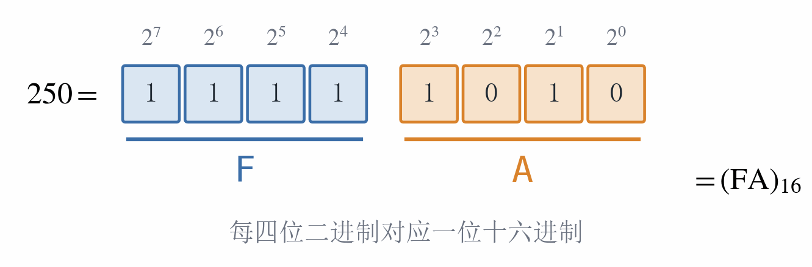

**位权展开。** \((101101)_2\) 等于 \(1\times32+0\times16+1\times8+1\times4+0\times2+1=45\)。若把左侧分组补齐为 `0010 1101`，两组分别为二和十三，得到 \((2D)_{16}\)。补在最左侧的零不改变非负整数的值，补在最右侧则会乘以二的某次幂，不能混淆。

十进制整数转为基 \(b\) 可以反复做带余除法。由 \(N=bq+r\) 可知余数 \(r\) 是最低位，商 \(q\) 包含剩余高位。对商继续同样操作，逐次得到由低到高的数字。

**完整转换。** 二百五十五除以十六，商十五余十五；十五再除十六，商零余十五。两次余数都是 F，按相反顺序组合为 FF。四十五除二的余数依次为一、零、一、一、零、一，反向读为 `101101`。反向不是任意约定，而是第一次得到最低位这一除法结构的结果。C 语言册中的递归进制输出，正是先处理商再输出当前余数，以恢复高位到低位的顺序。

小数部分则反复乘基数。例如 \(0.625\times2=1.25\)，取整数位一；\(0.25\times2=0.5\)，取零；\(0.5\times2=1\)，取一，故 \((0.625)_{10}=(0.101)_2\)。有些十进制有限小数在二进制中无限循环，因此浮点计算通常需要近似表示。

## 3. 整数编码、溢出与解释类型

八位无符号整数按普通二进制位权表示零至二百五十五，共二百五十六个数。若要在同样的八位中同时表示负数，就必须重新分配编码。补码的一种解释是最高位权为 \(-2^7\)，其余位权仍为 \(2^6\) 至 \(2^0\)，范围为负一百二十八至正一百二十七。

**补码分析。** 位串 `11111101` 按无符号整数为二百五十三，按八位补码为 \(-128+64+32+16+8+4+1=-3\)。从正三 `00000011` 出发，逐位取反得 `11111100`，再加一得 `11111101`，也能构造负三。这里改变的是编码解释，不是位串具有两个彼此矛盾的数值。

补码加法可以利用同一套二进制加法电路。`00000101` 与 `11111101` 相加，舍去第九位进位后得到 `00000010`，与五加负三等于二一致。但位宽有限，结果可能超出可表示范围。例如八位补码的一百二十七加一得到位串 `10000000`，按补码解释为负一百二十八，这提示发生了有符号范围溢出。

数学整数没有固定上限，机器整数有。理论中证明 \((a+b)-b=a\)，并不能自动保证在某种程序类型中先计算 `a+b` 安全。尤其 C 语言的无符号运算按模数规则处理，而有符号溢出不能直接视作所有实现都保证的回绕。算法、表示、语言语义必须分别检查。

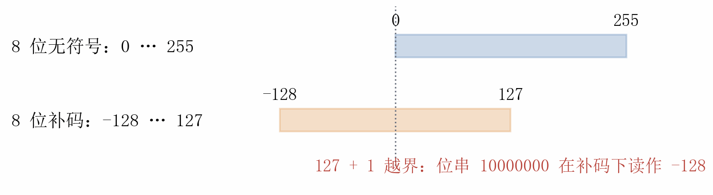

字节序说明多字节对象的各字节按何种顺序存储，不改变一个整数的抽象数值。数字十三的十六进制文本“0D”、内存中的一个字节和字符 `'D'` 的编码是三件不同的事。把打印出来的样子当作内存里逐字符存放的内容，会导致对指针与文件格式的误解。

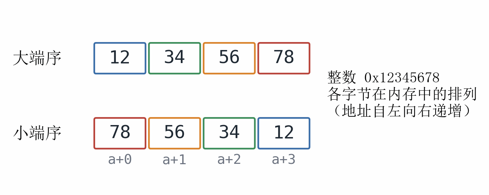

## 4. 字符、文本与近似数

字符编码把抽象字符与编号、字节序列联系起来。ASCII 适合其有限字符集合，不能直接覆盖全部汉字和俄文字母。Unicode 规定字符码点体系，UTF-8 则是一种把码点编码为字节序列的方式。码点、字节数、屏幕上的字形数量可能不同，因此“一个字符总是一字节”不能作为一般文本处理规则。

在常见 C 字符串中，末尾的零字节 `\0` 表示结束，它与数字字符 `'0'` 不同；后者在 ASCII 中有自己的非零编码。字符串函数按结束标志处理数据，而不是根据肉眼看到多少个文字。若一个俄语字母在所用编码中占多个字节，按字节截断可能切开编码序列。这是信息表示规则影响程序行为的具体例子。

浮点数以有限位记录符号、指数和有效数字，类似科学记数法。它能覆盖很大范围，却不能精确表示任意实数。十进制零点一在二进制中通常不是有限展开，存入二进制浮点格式时须舍入；若多次运算，误差还可能传播。这里的误差首先来自表示方式，不必归因于程序把加法规则执行错了。

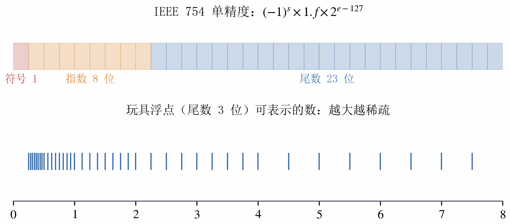

**舍入机制的简化演示。** 假设一种玩具十进制浮点格式只保留三位有效数字，数一千可写作 \(1.00\times10^3\)，加一的精确结果为 \(1.001\times10^3\)，按该精度舍入仍为 \(1.00\times10^3\)。于是计算结果与一千相同。这个例子不冒充实际格式的参数，而是说明数量级差异过大时，小增量可能丢失。数值计算册中的误差与条件分析可在这一表示基础上继续展开。

## 5. 存储程序计算机的组成

处理器执行指令，运行内存保存当前使用的指令、数据及中间状态，长期存储设备保存文件，输入输出设备连接外部信息。存储程序思想把指令也编码存入存储器，处理器按规定的取指、译码和执行过程改变机器状态。程序与数据在物理上都可以是位串，其作用由当前执行上下文决定。

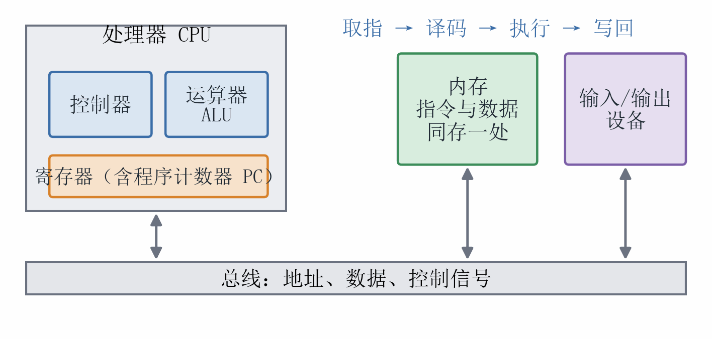

**一次赋值的层次。** 源程序写 `x = x + 1`，语言层面表示读取变量旧值、加一、再存回。实现层面可能包含从某地址加载、在寄存器中运算、写回内存等操作，具体指令因编译器和体系结构而异。不能凭一条 C 语句断言必然只有一条机器指令，也不能把变量名当作存储器自然存在的标签。

正在运行的程序频繁访问的数据通常位于寄存器、缓存或运行内存等层次；保存后的文件可以位于 SSD、硬盘等长期存储。历史科技俄语句子中的 информация хранится в оперативной памяти 只是在讲运行内存场景，不表示凡出现“存储”就必须选择内存。

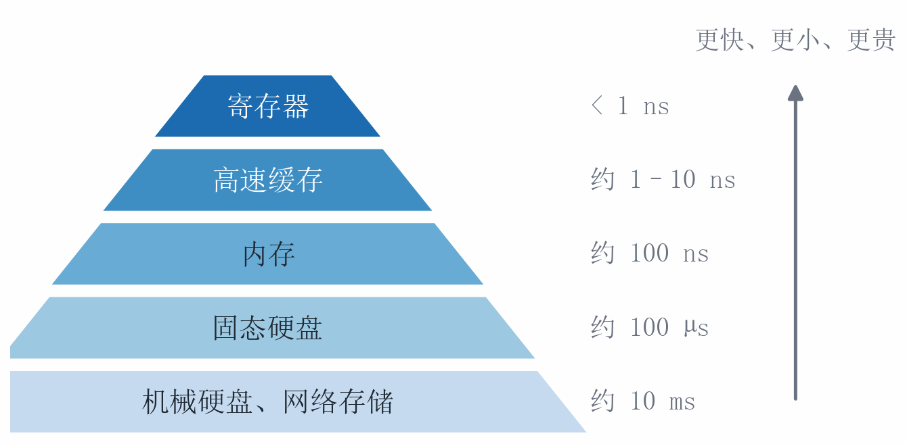

机器字长、地址宽度、指令集和操作系统的位数具有联系，却不是可任意互换的标签。课堂板书中的 x86/x64 是体系结构相关记号，不能因其中有字母 x 就识别成异或表达式。研究程序执行时，应先明确正在讨论源语言、机器指令还是硬件电路。

## 6. 问题规格、算法与程序

给出一个有限数列，求其中最大值。这个问题需要先限定输入非空，否则“最大值”没有定义；还要说明允许哪些数、如何比较、输出什么。问题规格刻画合法输入与正确输出的关系，算法给出求解方法，程序则把算法落实为某种语言和运行环境中的操作。

求最大值的算法可先令当前最大值等于首元素，再逐个读其余元素，遇到更大的便替换。它不是“每个数都取最大”这种循环定义，而是一组可执行的步骤。若输入允许为空，算法必须额外返回失败标志或采用其他明示约定，不能偷偷用零作答案，因为全负数列的最大值并非零。

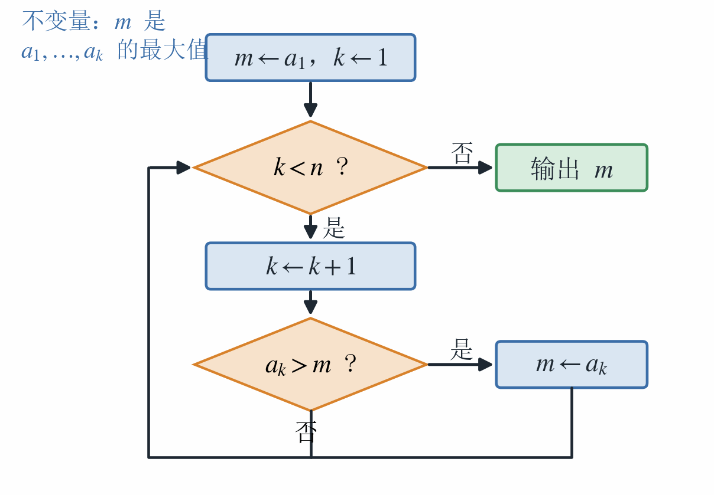

**执行追踪。** 对数列 \((-4,-9,-2,-7)\)，初始最大值为负四；比较负九后仍为负四；比较负二后更新为负二；比较负七后保持负二，最终输出负二。若初值错误设成零，则所有比较都不会更新，输出不存在于数列中的零。这个反例揭示的不是循环次数问题，而是初始条件不满足算法所需含义。

同一算法可以用 C、俄语伪代码或流程图描述，一个程序也可以同时包含多个算法以及输入输出、错误处理和资源管理代码。算法正确不能替代数组边界、数据类型和接口条件的检查。理论上的任意精度整数运算在 C 的固定宽度类型中实现时，还需要考虑溢出。

## 7. 循环不变量与终止性

最大值算法为何对所有非空有限数列都正确，不能只靠演示几组输入。处理完前 \(k\) 个元素时，当前值应等于这 \(k\) 个元素的最大值，这就是循环不变量。它说明循环运行中始终维持的数学关系。

初始化时 \(k=1\)，当前值为首元素，关系成立。假设处理完前 \(k\) 个时成立，下一步比较当前最大值与第 \(k+1\) 个：若新数更大则替换，否则不动，两种情况都使新当前值等于前 \(k+1\) 个的最大值。归纳后，当全部 \(n\) 个元素处理完，当前值就是全体最大值。这三个部分依次为初始化、保持和结束时结论。

部分正确性表示“如果算法终止，输出满足规格”；全正确性还要求在每个合法输入上终止。最大值算法每次少一个未处理元素，未处理数量是非负整数并严格减少，因此有限步后必然结束。这个递减量称为终止度量或变式，不要与每次保持不变的不变量混淆。

**欧几里得算法。** 对正整数 \(a,b\)，反复把 \((a,b)\) 更新为 \((b,a\bmod b)\)，直到第二分量为零。其正确性来自 \(\gcd(a,b)=\gcd(b,a-qb)\)：能同时整除 \(a,b\) 的数也能整除余数；反过来能整除 \(b\) 与余数的数也能整除 \(a=qb+r\)。共同因子集合没有改变。

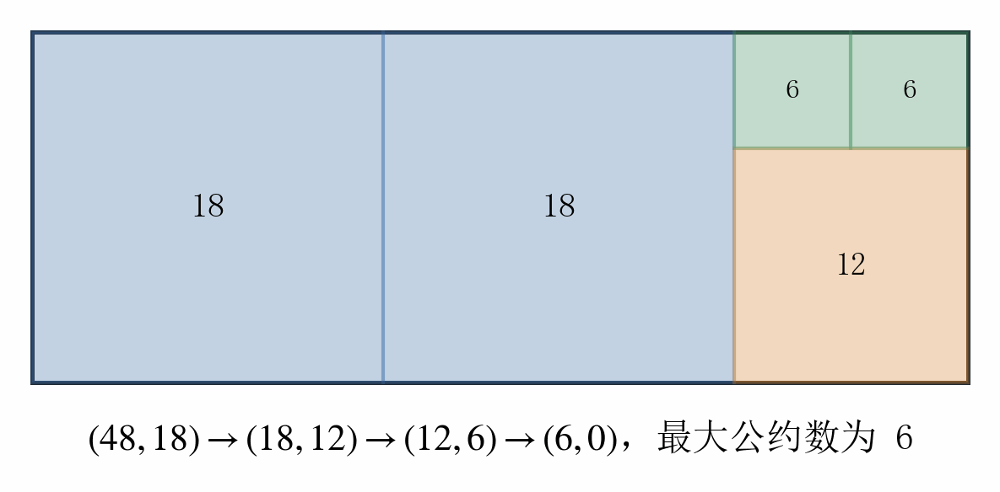

例如 \((48,18)\to(18,12)\to(12,6)\to(6,0)\)，输出六。余数始终小于正除数，因此第二分量严格下降直到零，保证终止。这里“最大公约数保持不变”是不变量，“正的第二分量下降”是终止依据，两者分别承担不同的证明任务。

## 8. 时间与空间复杂度

最大值扫描比较 \(n-1\) 次，额外只需一个当前最大值和少数索引，时间随输入长度线性增长，额外空间可为常数。复杂度讨论输入规模增大时资源怎样增长，而不是预测某台机器必定耗时多少秒。

选择排序每轮在剩余部分找极值，比较次数为

\[
(n-1)+(n-2)+\cdots+1=\frac{n(n-1)}2.
\]

因此其通常实现的比较时间为 \(O(n^2)\)。写两个循环并不自动证明平方复杂度，要看每层循环次数、相互依赖以及循环体成本。若内层每轮只做固定三次操作，即使外观嵌套，总时间也可能线性。

大 O 表示渐近上界，不是精确相等；还应区分最好、最坏和平均情况。二分查找每次将有序候选区间约减半，经过 \(k\) 次后剩余约 \(n/2^k\)，令其降到一可得 \(k\) 约为 \(\log_2n\)。但它要求能按序比较，并对访问方式有条件；未排序数据不能直接照搬这种查找过程。

可计算性问是否存在满足要求的算法，复杂度问算法需要多少资源。存在指数时间算法的问题仍是可计算问题，实际大规模求解却可能困难。换更快机器会改变常数成本，不能自动消除随规模增长的差异。

按步数随问题规模（размерность задачи）\(N\) 增长的快慢，算法分为多项式型（\(N,\ N^2,\ N^3,\ldots\)）与指数型（如 \(2^N\)）。设机器每秒执行 \(10^9\) 步：

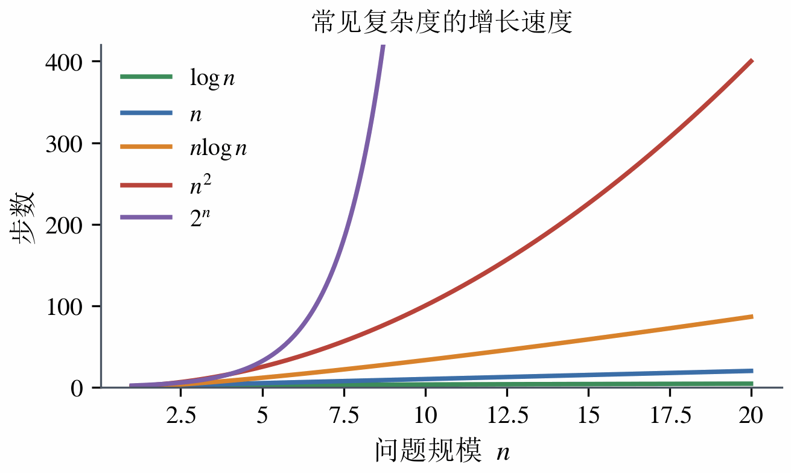

| \(N\) | \(N^2\) 步 | \(2^N\) 步 | \(2^N\) 步所需时间 |
|---|---|---|---|
| 10 | 100 | 1024 | 约 \(10^{-6}\) 秒 |
| 20 | 400 | 约 \(1.0\times10^6\) | 约 0.001 秒 |
| 50 | 2500 | 约 \(1.1\times10^{15}\) | 约 13 天 |
| 100 | \(10^4\) | 约 \(1.3\times10^{30}\) | 约 \(4\times10^{13}\) 年 |

\(N\) 从 50 增到 100，多项式算法的步数只增为四倍，指数算法却从 13 天变成宇宙年龄（约 \(1.4\times10^{10}\) 年）的数千倍。于是问题可以分成三个层次：有多项式算法的，能解且快；只知道指数算法的，原则上能解，规模稍大就无法实际完成；不可解的（нерешаемые задачи），根本不存在算法，如第 13 节的停机问题。

## 9. 状态、字母表与有限自动机

售货设备收到一枚硬币时，是否出货取决于此前积累了多少金额。若只看当前输入而完全不保留过去，就不能正确决定动作。状态把与未来有关的历史压缩成一个有限标记，不需要保存全部过去事件。

形式语言研究符号串。字母表 \(\Sigma\) 是有限符号集合，\(\Sigma^*\) 是全部有限串的集合，包括空串 \(\varepsilon\)。语言是 \(\Sigma^*\) 的一个子集。自动机读完一个串后接受还是拒绝，就在判断该串是否属于所识别语言。

确定有限自动机定义为

\[
M=(Q,\Sigma,\delta,q_0,F),\qquad
\delta:Q\times\Sigma\to Q.
\]

\(Q\) 为有限状态集合，\(q_0\) 为初态，\(F\subseteq Q\) 为接受状态集合，\(\delta\) 指定当前状态和当前输入如何决定下一状态。标准 DFA 的转移应对每对状态与符号都有定义；若图上省略某些箭头，须说明它们进入拒绝陷阱状态等约定。

控制设备的状态机还可能输出“开门、锁门、显示错误”等动作；用于语言识别的五元组只规定接受性，不能把它与所有工业控制模型完全等同。二者共享状态转换思想，但建模目标不同。

### 9.1 带输出的有限自动机：米利型与摩尔型

本节在识别器之外给出另一种有限自动机：它不在读完整个串之后才回答“接受”或“拒绝”，而是每读一个输入符号就立即给出一个输出符号。售货机、闸机、交通信号灯和数字电路中的控制器都属于这一类。俄语课程称有限自动机为 конечный автомат（缩写 КА），本节的写法按俄语课程习惯，用 \(S\) 表示状态集合，用 \(X\)、\(Y\) 表示输入和输出字母表。

**结构。** 带输出的自动机可以画成两个部件。组合部分 \(F\) 根据当前输入和当前状态，同时算出输出与下一状态；存储器 \(M\)（memory）保存当前状态，并把它反馈给 \(F\)。没有 \(M\) 的部件只是普通函数 \(Y=F(X)\)，相同输入永远得到相同输出；有了 \(M\)，相同输入在不同状态下可以得到不同输出，这正是“记忆”的作用。

**形式定义。** 带输出的有限自动机是六元组

\[
\text{КА}=\langle S,\ s_0,\ X,\ Y,\ \delta,\ \lambda\rangle ,
\]

\[
\delta:S\times X\to S,\qquad \lambda:S\times X\to Y .
\]

各符号含义如下：

- \(S\)：有限的状态集合；
- \(s_0\in S\)：初始状态，图上用一根没有起点的短箭头指向它；
- \(X\)：输入字母表，\(Y\)：输出字母表，二者都是有限集合；
- \(\delta\)：转移函数，\(s'=\delta(s,x)\) 是在状态 \(s\) 收到输入 \(x\) 后进入的下一状态；
- \(\lambda\)：输出函数，给出这一步对外产生的输出。

输出函数有两种形式。若输出同时取决于状态和输入，\(\lambda:S\times X\to Y\)，称为米利型自动机（автомат Мили，Mealy）；若输出只取决于当前状态，\(\lambda:S\to Y\)，称为摩尔型自动机（автомат Мура，Moore）。米利型的输出写在转移箭头上，输入一变，输出可以在同一步立即改变；摩尔型的输出写在状态圆圈里，要等进入新状态后才改变。《数字电子技术基础》册第 11 章同步时序电路中的“输出只由当前状态决定”与“还依赖当前输入”的两类结构，正对应这两种模型。

**状态与输出的区别。** 状态是自动机内部保存的信息，外部观察者看不到；输出是自动机对外做出的动作，外部可以看到。以一台只收 1 元硬币、饮料售价 3 元的售货机为例（示范模型），状态取“已收 0 元”“已收 1 元”“已收 2 元”三个，输入只有“投 1 元”一种：

| 投币次序 | 投币前的状态 | 输出 | 投币后的状态 |
|---|---|---|---|
| 1 | 已收 0 元 | 无 | 已收 1 元 |
| 2 | 已收 1 元 | 无 | 已收 2 元 |
| 3 | 已收 2 元 | 出饮料 | 已收 0 元 |

第 1 次与第 2 次投币，输入相同，外部看到的输出也相同（都没有反应），但内部状态不同；第 3 次输入仍然相同，却得到了不同的输出，原因正是机器“记得”已经收了 2 元。可见每一步同时发生两件事：对外由 \(\lambda\) 产生输出，对内由 \(\delta\) 更新状态。状态图上，状态画在圆圈里，米利型的输出写在箭头上斜线之后。

**箭头的读法。** 米利型状态图的每条箭头标注为“输入/输出”。箭头 \(s\xrightarrow{\;x/y\;}s'\) 读作：在状态 \(s\) 收到输入 \(x\)，输出 \(y\)，然后进入 \(s'\)。它等价于两个等式：

\[
\delta(s,x)=s',\qquad \lambda(s,x)=y .
\]

括号中永远是“当前状态，输入”。查 \(\delta\) 时看箭头指向哪个状态，查 \(\lambda\) 时看斜线后面写的输出。自环（箭头回到出发状态）表示状态不变，但这一步照样可以产生输出。

**确定性与完全定义。** 一张米利型状态图要能作为机器运行，必须满足：

1. 确定性：同一状态在同一输入下至多有一条出边。若有两条，\(\delta(s,x)\) 就不是一个确定的状态，这样的图描述的是非确定自动机（недетерминированный автомат）。
2. 完全定义：每个状态对每个输入至少有一条出边。若某格没有定义，称为部分定义的自动机（частично определённый автомат），运行到该处时机器不知道该做什么。

两条合起来就是：转移表和输出表的每一格恰好填一个值。检查时逐个状态、逐个输入符号核对出边，共需核对 \(|S|\cdot|X|\) 格。注意两条出边即使输出相同（例如都输出 \(y_2\)），也不能消除非确定性，因为下一状态仍不唯一。

**讲解例 1：读图、检查并改正一张状态图。** 课堂上的自动机取 \(S=\{s_0,s_1,s_2\}\)，输入字母表 \(X=\{2,5\}\)（可以设想为只收 2 卢布和 5 卢布两种硬币），输出字母表 \(Y=\{y_0,\dots,y_5\}\)，输出只用符号表示，不规定具体动作。最初画出的图含以下箭头：

\[
s_0\xrightarrow{2/y_1}s_1,\quad s_0\xrightarrow{5/y_0}s_0,\quad s_1\xrightarrow{2/y_3}s_1,\quad s_1\xrightarrow{5/y_2}s_0,
\]

\[
s_1\xrightarrow{5/y_2}s_2,\quad s_2\xrightarrow{5/y_4}s_2,\quad s_2\xrightarrow{5/y_5}s_0 .
\]

按上面的检查方法逐格核对：

1. \(s_0\)：读 2 有一条出边，读 5 有一条出边，合格。
2. \(s_1\)：读 2 有一条出边；读 5 有两条，分别到 \(s_0\) 和 \(s_2\)，不确定。两条的输出都是 \(y_2\)，从输出也分不出走了哪条。
3. \(s_2\)：读 5 有两条出边（自环与到 \(s_0\)），不确定；读 2 没有出边，部分定义。

改正后的图去掉 \(s_1\xrightarrow{5}s_0\) 与 \(s_2\) 的自环，并补上 \(s_2\xrightarrow{2}s_1\)。板书上这条新箭头的输出没有写出，下面取尚未使用的 \(y_4\) 作示范。转移表与输出表为

| \(\delta(s,x)\) | \(x=2\) | \(x=5\) |
|---|---|---|
| \(s_0\) | \(s_1\) | \(s_0\) |
| \(s_1\) | \(s_1\) | \(s_2\) |
| \(s_2\) | \(s_1\) | \(s_0\) |

| \(\lambda(s,x)\) | \(x=2\) | \(x=5\) |
|---|---|---|
| \(s_0\) | \(y_1\) | \(y_0\) |
| \(s_1\) | \(y_3\) | \(y_2\) |
| \(s_2\) | \(y_4\)（示范） | \(y_5\) |

六格各有唯一的值，自动机是确定的且完全定义。从 \(s_0\) 出发输入序列 \(2,2,5,5\)：

\[
s_0\xrightarrow{2/y_1}s_1\xrightarrow{2/y_3}s_1\xrightarrow{5/y_2}s_2\xrightarrow{5/y_5}s_0 ,
\]

输出序列为 \(y_1,y_3,y_2,y_5\)，最终回到 \(s_0\)。验算：每一步都只用到表中的一格，且四步的下一状态与上一步的目标状态首尾相接。

**讲解例 2：状态要记住足够的信息。** 交通信号灯只有一种输入 \(t\)，表示“时间到”。若只设红、黄、绿三个状态，按红—黄—绿—黄—红的顺序循环，则黄灯有两条输入都为 \(t\) 的出边，一条去绿、一条去红。机器停在黄灯时不知道下一步该变哪种颜色，因为它没有记住自己是从红灯还是从绿灯过来的。

改正的办法是把黄灯拆成两个状态：\(\text{ж}_1\) 表示红灯之后的黄灯，\(\text{ж}_2\) 表示绿灯之后的黄灯（ж 即 жёлтый，红为 кр，绿为 з）：

\[
\text{кр}\xrightarrow{t}\text{ж}_1\xrightarrow{t}\text{з}\xrightarrow{t}\text{ж}_2\xrightarrow{t}\text{кр}.
\]

现在每个状态读 \(t\) 只有一条出边，自动机是确定的。两个黄灯状态对外显示相同（摩尔型的输出都是“亮黄灯”），内部保存的信息却不同。这说明状态不等于外部看到的样子，而是机器为决定以后行为所需保存的信息；两个状态应否合并，要看它们对今后所有输入序列的反应是否完全相同，而不是看当前输出是否相同。

**为什么必须有限。** 自动机的状态数必须有限，“有限自动机”的名称即由此而来。状态有限，转移表与输出表就只有有限多格，可以写完、存入存储器并由电路实现。若要售货机记住“出厂以来一共收了多少钱”，所需状态为 0、1、2、3……元，无穷多个，这就超出了有限自动机的能力。第 11 章将用语言 \(\{a^nb^n\}\) 严格说明这一边界。

**米利型与摩尔型的互相转换。** 两种自动机的表达能力相同，可以互相转换，代价是状态数可能改变。

1. 摩尔型改为米利型：状态和箭头都不动，把每条箭头所指向的那个状态的输出，写到这条箭头上。交通灯的摩尔型中 \(\lambda(\text{кр})=\) 红、\(\lambda(\text{ж}_1)=\lambda(\text{ж}_2)=\) 黄、\(\lambda(\text{з})=\) 绿，改为米利型后四条箭头依次为 \(\text{кр}\xrightarrow{t/\text{黄}}\text{ж}_1\xrightarrow{t/\text{绿}}\text{з}\xrightarrow{t/\text{黄}}\text{ж}_2\xrightarrow{t/\text{红}}\text{кр}\)。黄灯仍要拆成两个：输入只有一种 \(t\)，状态必须记住下一步变红还是变绿，所以这一例中米利型也省不下状态，最少仍是 4 个。
2. 米利型改为摩尔型：检查每个状态，看指向它的箭头上一共带有几种不同的输出；有几种就把它拆成几个状态，每个新状态只写一种输出，从它们出发的箭头与原状态相同。由此，摩尔型的状态数不超过“米利型状态数乘以输出种类数”。

两者在时间上相差一步：米利型在走箭头的那一刻就给出输出，摩尔型要先进入新状态，输出才出现，比米利型晚一拍。所以米利型能对输入立即响应，摩尔型适合描述“在某个状态期间持续保持”的输出，如灯一直亮着。

**讲解例 3：售货机由米利型改为摩尔型。** 饮料售价 10 元，只收 5 元硬币，输入为“投 5 元”和“退币”（示范模型）。米利型只需两个状态：

| 当前状态 | 投 5 元 | 退币 |
|---|---|---|
| 0 元 | 5 元，输出“无” | 0 元，输出“无” |
| 5 元 | 0 元，输出“出货” | 0 元，输出“退钱” |

指向“0 元”的箭头带有三种输出（无、出货、退钱），一个状态只能写一种输出，于是把“0 元”拆成 A（无）、B（出货）、C（退钱）三个；指向“5 元”的箭头都是“无”，不必拆，记为 D。A、B、C 余额都是 0 元，从它们出发的箭头完全相同：

| 摩尔型状态 | 输出 | 投 5 元 | 退币 |
|---|---|---|---|
| A（0 元） | 无 | D | A |
| B（0 元） | 出货 | D | A |
| C（0 元） | 退钱 | D | A |
| D（5 元） | 无 | B | C |

状态由 2 个变为 4 个，不超过 \(2\times3=6\) 的上界。验算：从 A 出发投两次 5 元，经 D 进入 B，B 的输出是出货，与米利型“5 元时投币输出出货”一致；从 D 退币进入 C，输出退钱，也一致。区别只在出货发生在进入 B 之后，比米利型晚一拍。

### 9.2 有限自动机的实现：状态编码、流程图与命令表

同一台自动机可以用状态图、表格、电路、流程图或命令表表示，它们描述的是同一组 \(\delta\)、\(\lambda\)。

**状态编码。** 存储器只能保存 0 和 1，因此要给每个状态分配一个二进制码，例如

\[
s_0\to 00,\qquad s_1\to 01,\qquad s_2\to 10 .
\]

\(n\) 位二进制码有 \(2^n\) 种组合，要区分 \(|S|\) 个状态需 \(2^n\ge |S|\)，取紧凑编码所需的最少位数为

\[
n=\lceil\log_2|S|\rceil .
\]

三个状态时 \(\log_2 3\approx1.58\)，向上取整得 \(n=2\)，码 \(11\) 不用。用触发器实现时，组合部分 \(F\) 读入这两位和当前输入，算出新的两位与输出，再写回存储器；具体电路设计见《数字电子技术基础》册第 11 章。若把讲解例 1 的运行 \(s_0\to s_1\to s_2\) 逐步记下，存储器中依次出现 \(00\)、\(01\)、\(10\)。

**流程图实现。** 在程序流程图（блок-схема）中，每个状态画成一个由“读入下一个输入”（Next）和“判断输入是什么”（菱形 \(x=?\)）组成的块，开始框 Begin 指向初始状态的块。状态图中的每条箭头 \(s\xrightarrow{x/y}s'\) 按以下规则改画：

1. 从状态 \(s\) 的判断菱形引出一条分支，标上输入 \(x\)；
2. 在分支上放一个输出框 \(y\)；
3. 分支接到状态 \(s'\) 的块；若 \(s'=s\)（自环），就回到本块的 Next。

这样，程序执行到哪个块，就表示自动机处在哪个状态，不必另设变量保存状态：程序的执行位置本身就是存储器 \(M\)。以讲解例 1 为例，\(s_0\) 的块中，读到 2 时经输出框 \(y_1\) 转到 \(s_1\) 的块，读到 5 时经输出框 \(y_0\) 回到 \(s_0\) 的 Next。

**命令表实现。** 把每条箭头写成一条命令

\[
(s,\ x)\ \to\ (s',\ y),\qquad\text{即}\qquad (s,\ x)\ \to\ \bigl(\delta(s,x),\ \lambda(s,x)\bigr).
\]

左边是条件“当前状态，输入”，右边是动作“新状态，输出”。确定且完全定义的自动机恰有 \(|S|\cdot|X|\) 条命令，每个条件出现且只出现一次。讲解例 1 有 \(3\times2=6\) 条：

1. \((s_0,2)\to(s_1,y_1)\)
2. \((s_0,5)\to(s_0,y_0)\)
3. \((s_1,2)\to(s_1,y_3)\)
4. \((s_1,5)\to(s_2,y_2)\)
5. \((s_2,2)\to(s_1,y_4)\)（输出为示范）
6. \((s_2,5)\to(s_0,y_5)\)

运行时，执行器保存当前状态，每读入一个符号就在表中找到左边相符的那一条，输出右边的 \(y\)，并把当前状态改为右边的 \(s'\)。命令表与转移表、输出表包含的信息完全相同，只是把两张表的同一格合写在一行；它也是在程序中用二维数组或 switch 语句实现自动机的直接依据。状态数有限，命令条数才有限，这与 9.1 节末尾“状态数必须有限”的要求是同一回事。

**转换器的纸带模型。** 带输出的有限自动机也可以画成读写两条纸带：上面的输入带写着输入符号串，读头只能读、只能向右，一格一格读下去；中间的控制器（КА упр-е）就是前面的状态图或命令表；下面的输出带只能写，每读一个输入就写下一个输出。此时转移与输出常合写成一个函数

\[
\delta:\ S\times X\to S\times Y ,\qquad (s,\ x)\to(s',\ y),
\]

自动机记作 \(\langle S,\ s_0,\ X,\ Y,\ \delta\rangle\)，与前面的六元组含义相同，这正是米利型。输入字母表与输出字母表可以不同，例如读字母 \(a,b,c,d,e\)、写数字 0、1；也允许 \(X=Y\)。只给出命令 \((s_0,a)\to(s_1,1)\) 与 \((s_1,c)\to(s_1,0)\) 的程序是不完整的：有 2 个状态、5 个输入字母时完全定义需要 \(2\times5=10\) 条命令，输入带以 \(b\) 开头时，机器在 \(s_0\) 读到 \(b\) 就找不到命令。第二条命令的起点与终点都是 \(s_1\)，在图上画成自环。

对“读一个、写一个”的米利型，一条纸带也够用：读当前格、在同一格写上输出、右移。画成两条带是为了保留原始输入便于对照、允许输出长度与输入长度不同（摩尔型开始时还先输出一次 \(\lambda(s_0)\)），并使输入、输出两个字母表互不混杂。关键限制在于读头只向右：写下的符号以后再也读不到，纸带不能充当额外的记忆。

**有限自动机执行的是什么。** 命令表规定了每种情况下的动作，机器只是照表执行，所以有限自动机执行的是一个算法或一类算法。输入只有一种时（交通灯只有 \(t\)），每次运行的路线完全相同，执行的是一个算法；输入有多种时，同一张命令表对不同输入序列走出不同路线、给出不同输出（售货机连投两次出货，投一次再退币则退钱），执行的是一类算法。闸机（турникет）、电梯、洗衣机的程序、密码锁、自动门都可以用这种有限个状态加输入信号的模型描述。

## 10. 有限自动机的构造与正确性

考虑识别二进制串中一的个数为偶数的语言。只需要区分“至今偶数个一”和“至今奇数个一”，设状态为 E、O。空串含零个一，因此初态 E，也是接受状态；读零不改变奇偶性，读一交换 E 与 O。

转移规则为 \(\delta(E,0)=E\)、\(\delta(E,1)=O\)、\(\delta(O,0)=O\)、\(\delta(O,1)=E\)。这些规则覆盖两个状态与两个输入的全部组合。

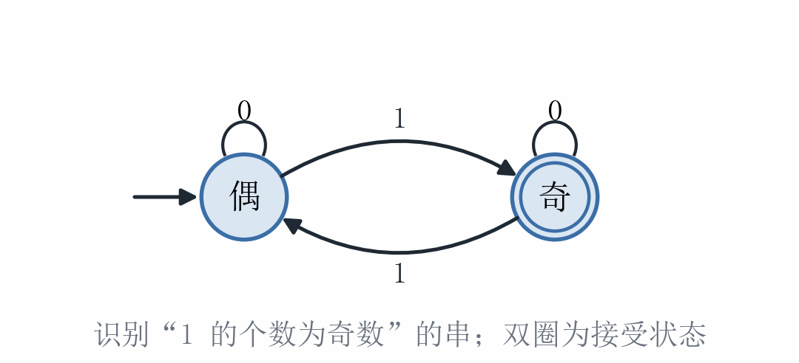

**完整运行。** 输入 `1011`，从 E 读第一个一到 O；读零仍在 O；读第二个一回 E；读第三个一到 O。读完停在非接受态，故拒绝。输入 `1100` 则经过 E、O、E、E、E，最终接受。空串不读任何输入，留在 E，也被接受。

证明与循环不变量完全相通：处理任何前缀后，状态 E 当且仅当该前缀含偶数个一。空前缀满足；追加零保持数量，追加一改变奇偶，转移恰好维持这一意义。因此读完整串时接受与题意严格一致。只画一张状态图而不解释状态含义，容易得到看似合理却无法证明的设计。

再考虑识别以 `01` 结尾的串。可用三个状态：S 表示尚无有用后缀，A 表示末尾是零，B 表示末尾为零一并接受。S 读零到 A、读一留 S；A 读零留 A、读一到 B；B 读零到 A、读一到 S。状态不是简单记录“已经看到过零一”，因为题目要求结尾而非中间出现。`011` 先到 B，又读一回 S，最终拒绝，正好体现这一区别。

### 10.1 非确定转移与模拟

非确定有限自动机允许在同一状态读同一符号时有多个后继，也可以按所用定义允许不消耗输入的空转移。它接受一个串，意味着至少存在一条完整运行路径在读完该串后到达接受态，并不要求所有路径都接受。这里的“非确定”是数学定义，不是设备随机出故障，也不必用概率来解释。

可以用一个状态集合记录当前所有可能状态：每读一个符号，分别求各可能状态的后继，再合并成新的集合；含有接受状态的集合就是接受集合状态。若原自动机有有限个状态，其状态子集也只有有限多个，因此可以构造等价 DFA。非确定有限自动机可能让描述更简洁，却没有突破有限自动机能够识别的语言范围。

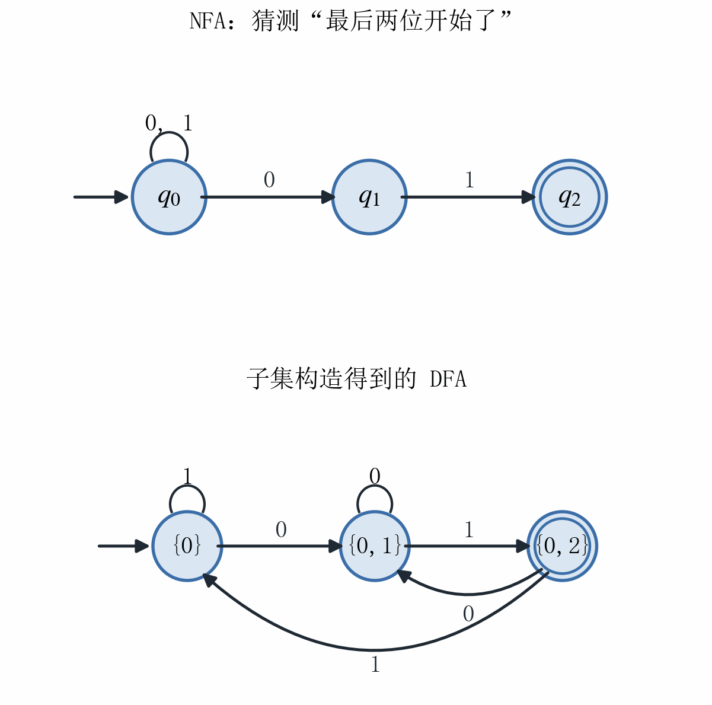

这也说明“分支更多”不自动等于“能解决更强的问题”。比较计算模型能力，需要证明它们能否互相模拟，或找出一方可识别、另一方不可识别的语言，不能只凭图面复杂程度判断。

### 10.2 子集构造、空转移与状态数上界

设 NFA 有 n 个状态，模拟状态是其可能状态的子集，因此最多有 \(2^n\) 个候选子集；这只是上界，许多子集不可达，不必全部建立。空集合也有明确含义：当前没有任何可能运行。此后再读符号仍为空，可作为 DFA 的拒绝陷阱状态。

若允许 \(\varepsilon\) 转移，先定义 \(\operatorname{cl}_\varepsilon(S)\) 为从 S 中各状态出发、经过零次或多次空转移可达的全部状态。初始子集为 \(\operatorname{cl}_\varepsilon(\{q_0\})\)。读符号 a 后更新为
\[
S'=\operatorname{cl}_\varepsilon
\left(\bigcup_{q\in S}\delta(q,a)\right).
\]
由于进入这一步之前 S 已经闭包化，先把所有读 a 的后继并起来，再补空转移闭包即可。新子集与原接受集合相交非空时接受；“全部状态都是接受态”是另一种更强的要求，不符合 NFA 的存在一条接受路径语义。

正确性可沿输入长度归纳：初始子集正是读空串可达的状态；每次更新保留且仅保留读完新前缀的所有可能状态。因此最终子集含接受态，恰等价于原 NFA 有一条读完整串的接受路径。状态数上界与语言能力分别回答描述规模和可识别范围，不应混成一个指标。

### 10.3 补、交与并的自动机构造

对转移完整的 DFA，交换接受态与非接受态，得到相对同一字母表的补语言。每个输入串原来恰有一条最终运行，交换接受性便逐串取反。若图中存在省略的转移，应先补拒绝陷阱；直接交换已有圈的标记可能遗漏那些本来无路径的串。对 NFA 也不能直接交换终态，因为“至少一条接受路径”的否定是“每条路径都不接受”，不是“至少一条路径到达原非终态”。

两台同字母表的 DFA 可组成乘积。状态为 \((q_1,q_2)\)，同步读取一个符号 a：
\[
\delta((q_1,q_2),a)
=(\delta_1(q_1,a),\delta_2(q_2,a)).
\]
若要交语言，接受条件为 \(q_1\in F_1\) 且 \(q_2\in F_2\)；若要并语言，则改为至少一个属于接受集合。状态上界为 \(|Q_1||Q_2|\)，同样可删除不可达状态。

**讲解例：同时要求偶数个一且以01结尾。** 用本章的奇偶机与后缀机组成乘积，初态为 \((E,S)\)，交语言只有 \((E,B)\) 接受。输入1001依次到 \((O,S),(O,A),(O,A),(E,B)\)，最终接受。输入1101虽然以01结尾，一的数量为三，最终为 \((O,B)\)，拒绝。状态的两个分量分别维持各自不变量，因此不需要重新猜一套没有语义的六个状态。

## 11. 有限记忆的边界

DFA 可以读取任意长的串，但内部状态数固定。长度没有上限，不表示可以记住任意大的精确计数。奇偶只需两个状态，因为未来判断只需要余二的信息；要求精确匹配两个任意大数量则不同。

语言 \(L=\{a^nb^n\mid n\ge0\}\) 要求先出现若干 a，随后同样数量 b。假设存在具有 \(k\) 个状态的 DFA 识别它，考察读完 \(\varepsilon,a,a^2,\ldots,a^k\) 这 \(k+1\) 个前缀后的状态。根据抽屉原理，必有 \(i<j\) 使读完 \(a^i\) 与 \(a^j\) 后状态相同。

此后给两者都接上 \(b^i\)。由于起点状态相同、后续输入相同，确定自动机最终接受性相同。然而 \(a^ib^i\) 属于语言，\(a^jb^i\) 不属于语言，产生矛盾。故不存在这样的 DFA。这个证明具体指出有限状态何处丢失了必要信息，而不是仅说“机器记忆不够”。

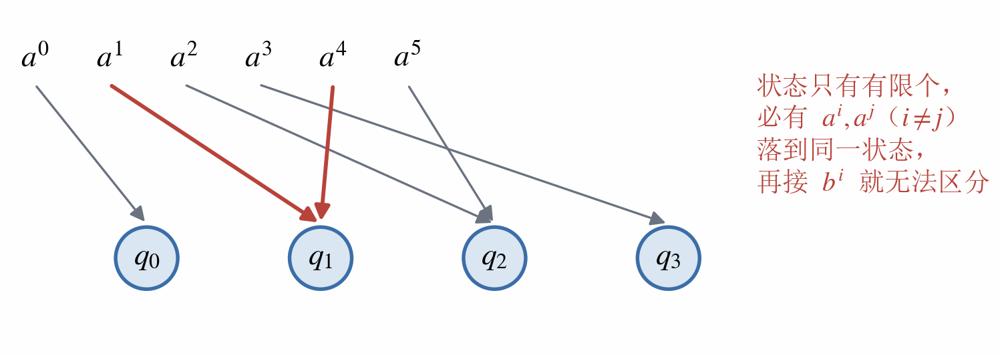

若预先规定 \(n\le100\)，语言变成有限集合，可以构造足够大的 DFA 处理。理论结论依赖输入不设固定上界，不能把它误读成任何现实中有限长度的匹配任务都无法完成。下推自动机用栈保存更多信息，能处理这一典型匹配语言；图灵机则进一步允许一般读写存储。

## 12. 图灵机的计算机制

图灵机包含有限控制状态、带字母表、可读写带、读写头和转移规则。标准单带模型中，规则根据当前状态与读到的符号，指定写入符号、向左或右移动以及下一状态；停机接受或拒绝状态不再继续普通转移。带在理论上没有预设固定长度，但一次有限计算只访问有限区域。

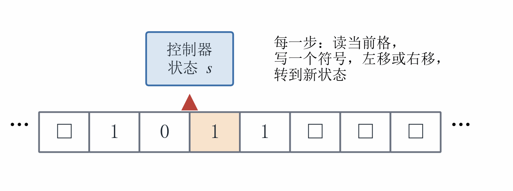

可以用配置记录整个计算瞬间：当前状态、读写头位置和带上非空内容。一步转移把一个配置变成下一个配置。程序执行中的变量和程序位置也是机器状态的一部分，因此“有限控制器加可扩展存储”比只有有限个状态的自动机具有更强表达能力。

**一元数加一。** 用连续 \(n\) 个符号一表示自然数 \(n\)，读写头起初位于最左符号；零用空白带表示。取扫描状态 q：读到一，原样写一、向右、保持 q；读到空白，写一并进入停机状态。输入 `111` 时连续跨过三个一，遇到右侧空白写一，得到 `1111`。输入零时第一格即空白，写一得到 `1`。算法覆盖零与正数，不需要把空输入留成未定义情况。

终止依据是输入最初只有有限多个一，读写头每步向右，最终必遇到第一个空白；正确性依据是原有一从未删除或改变，只在末尾增加一个。若输入允许出现其他符号，需要事先规定拒绝规则，不能把它们也默认为合法一元数。

**匹配语言的思路。** 对 \(a^nb^n\)，图灵机可先检查串是否由一段 a 接一段 b 组成；再把最左未标记 a 改为 X，向右找到一个未标记 b 改为 Y，再回到左侧重复。若某次找不到所需 b，拒绝；若所有 a 用完后仍有未标记 b，也拒绝；恰好配完则接受。每轮减少一个未标记 a，扫描又限定在有限输入区间及邻近空白，故整个过程有限。新增的标记和反复往返提供了 DFA 没有的可扩展记忆。

**课堂的形式定义。** 俄语课程把图灵机（машина Тьюринга，МТ）记作

\[
\text{МТ}=\langle S,\ s_0,\ X,\ \delta,\ D\rangle ,\qquad \delta:\ S\times X\to S\times X\times D ,
\]

其中 \(S\) 为状态集合，\(s_0\) 为初始状态，\(X\) 为带字母表（含空白符号），\(D\) 为读写头动作的集合。课堂取 \(D=\{L,\ R,\ H\}\)，即左移一格（Left）、右移一格（Right）、停机（Halt）；有的教材用“不动”（Н，на месте）代替停机，另设停机状态，两种写法等价。一条命令

\[
(s,\ x)\ \to\ (s',\ x',\ d)
\]

读作：在状态 \(s\) 读到 \(x\)，把这一格改写为 \(x'\)，按 \(d\) 移动，进入 \(s'\)。与有限自动机的命令 \((s,x)\to(s',y)\) 相比，右边多了“往哪走”。定义中没有输出字母表 \(Y\)：只有一条纸带，写下的符号以后可能再被读到，读与写必须用同一个字母表 \(X\)；停机时纸带上剩下的内容就是结果。命令条数的上限与有限自动机相同，为 \(|S|\cdot|X|\)，即每个“（状态，读到的符号）”组合至多一条；用不到的组合可以不写，多数教材约定查不到命令即停机。

**讲解例：逐位取反。** 带上写着由 0、1 组成的串，读头在最左一格，只用一个状态 \(q_0\)：

| 状态 | 读到 0 | 读到 1 | 读到空白 |
|---|---|---|---|
| \(q_0\) | 写 1，R，\(q_0\) | 写 0，R，\(q_0\) | 写空白，H |

输入 101：读到 1 写 0 右移，带为 0 0 1；读到 0 写 1 右移，带为 0 1 1；读到 1 写 0 右移，带为 0 1 0；读到空白停机。结果 010，每一位都取反了。命令共 \(1\times3=3\) 条，正好填满上表。图灵机改写了输入：纸带是它唯一的记忆，相当于草稿纸，必须在上面标记、改写才能计算，前面 \(a^nb^n\) 的标记 X、Y 就是例子。若要保留原始输入，可以先复制一份再在副本上计算，或使用多带图灵机；多带机与单带机能力相同，只是更方便。

**为什么纸带要无限长。** 图灵机回答的是“原则上能不能算”，而不是“某台机器的存储够不够”。若纸带长度固定为 \(L\) 格，机器在某一时刻的全部情况（格局，конфигурация）由状态、纸带内容和读头位置决定，总数至多为

\[
|S|\cdot|X|^L\cdot L ,
\]

虽可能极大，却是有限的，这样的机器本质上就是一台很大的有限自动机，输入长度一旦超过 \(L\) 就无法处理。反过来，格局有限时停机问题可以判定：运行步数超过格局总数时，必有某个格局重复出现，机器从此进入循环，永不停机。“无限”的意思是潜在无限（потенциально бесконечная лента）：任一时刻实际用到的格子都只有有限个，需要时总能再往旁边添一格。若纸带长度不固定、而与输入长度成正比，得到的是线性有界自动机（линейно ограниченный автомат），它的能力介于下推自动机与图灵机之间：

\[
\text{КА}\ \subset\ \text{下推自动机}\ \subset\ \text{线性有界自动机}\ \subset\ \text{МТ}.
\]

真实计算机的存储有限，严格说属于有限的情形，但格局数大到天文数字，实际研究中仍把它当作图灵机。

**图灵机与有限自动机的关系。** 两者的控制部分都是有限个状态的自动机，区别在于怎样使用纸带：有限自动机的读头只向右，读过的东西不能回看，纸带只是输入输出的通道；图灵机的读写头能读、能写、能左右移动，纸带成为可以反复翻看、修改的记忆。有限自动机不能在同一条带上又读又写并往回走，这是有意加的限制，一旦去掉，它就成了图灵机。受到限制换来的是简单与可分析：任意有限自动机是否停止、两台是否等价都能判定，硬件实现也便宜，交通灯、闸机、编译器的词法分析和正则表达式都用它。用途上，有限自动机用来设计具体设备，图灵机造不出来，用来研究什么能算、什么不能算。

**算法的直观概念与图灵论题。** 图灵把人用纸笔计算的过程拆成最简单的机械动作：读一格（чтение），按当前状态查表分析（анализ），写一格并移动（запись），然后重复，直到停机。“理解”被这三个动作取代。此前“算法”只是直观的说法（интуитивное понятие алгоритма），图灵机给了它精确的定义。图灵论题（тезис Тьюринга）断言：凡直观上可以计算的，都能由图灵机计算。左边的“直观”不是数学概念，所以它无法证明，称为论题而不称定理，但至今没有发现反例。有了精确定义，才能证明某些问题根本没有算法，第 13 节的停机问题就是这样得到的。图灵机的论文发表于 1936 年；1940 至 1950 年代是图灵参与破译密码和早期计算机设计的时期，1950 年他还提出了图灵测试。

## 13. 通用计算与停机问题

如果把一台图灵机的状态、符号和转移表编码为有限串，另一台机器可以读取这段编码并模拟它。这就是通用机器的基本想法。现代计算机存储程序并执行不同程序，与这种可编码、可模拟的思想有联系，但通用性不表示所有数学问题都有算法。

停机问题询问：给定程序 \(P\) 和输入 \(x\)，\(P(x)\) 最终是否停止？它要求一个统一判定器在每一种合法编码输入上都给出正确答案，并且自身总能停止。逐步模拟能发现已经停机的情况，却不能仅凭“至今没有停止”证明以后永不停止。

**对角论证。** 假设存在总正确且总停止的判定器 \(H(P,x)\)。构造程序 D，以程序编码 y 为输入：若 H 判断 y 运行自身会停机，D 就进入无限循环；若 H 判断不会停机，D 就立刻停止。D 本身也是程序，具有可输入的编码，因此可以研究 D(D)。

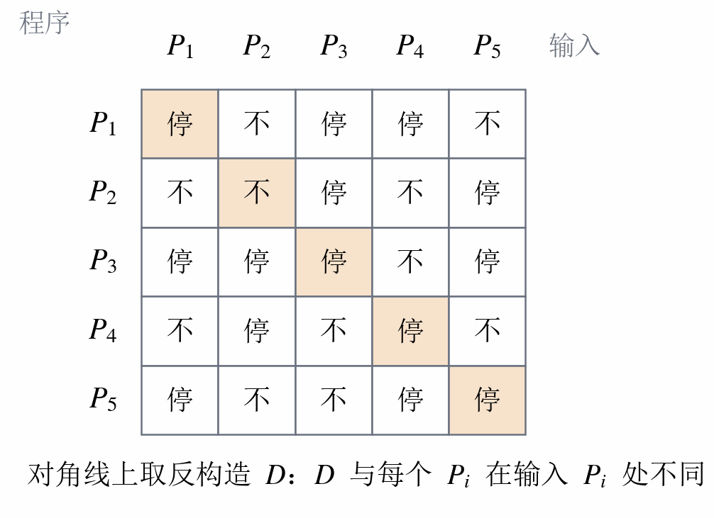

若 H 判断 D(D) 会停机，按 D 的定义它会无限循环，H 错；若 H 判断不会停机，D 又立刻停止，H 仍错。两种可能都矛盾，因此假设的统一判定器不存在。证明依赖程序可以被编码并作为输入，不是一个脱离机器规则的语言悖论。

这个结论不意味着任何具体程序的终止都无法分析。最大值扫描和欧几里得算法已经给出了终止证明；固定次数循环也容易分析。不可判定否定的是覆盖全部程序与全部输入的万能总算法，不否定受限类别、具体实例和部分自动分析工具。

## 14. 抽象层次之间的联系

信息编码规定同一位串如何解释；逻辑函数规定输入位怎样映射到输出位；存储与状态让结果依赖历史；算法说明求解步骤及其正确性；程序选择类型和运行接口；计算模型研究哪些问题原则上可解，复杂度再研究资源需求。这些层次构成相互支持的知识结构，不能用某一条课堂箭头替代全部定义。

例如一个自动售货程序可以先用 DFA 描述控制状态，再用寄存器保存状态编码，用逻辑电路或程序计算下一状态。若系统需要记录无固定上限的账户数据，有限控制图只能描述部分流程，还要把数据存储纳入模型。模型选择取决于问题需要保留什么信息，而不是看图是否画得简单。

本册依据可读的计算基础白板讲解、进制转换、科技俄语设备概念和 C 语言算法对话编排。历史标题为图片生成的会话，正文确有计算基础内容；但白板原图在导出文本中未完整保留，本册不冒称重新读到了每一处字迹。状态机、图灵机操作及停机论证的详细例子为教学重构，信息表示是其先修基础，具体 C 实现与逻辑门实现分别衔接本套对应分册。

2026-11-03增补依据 claude.ai 网页对话《输出与状态的区别》中的有限自动机课堂白板：新增 9.1 节“带输出的有限自动机：米利型与摩尔型”（六元组、结构图 F 与 M、状态与输出的区别、箭头与 δ、λ 等式、确定性与完全定义的检查、板书状态图的改正、红绿灯拆分黄灯状态、状态数必须有限）与 9.2 节“有限自动机的实现：状态编码、流程图与命令表”。板书中 s₂ 读 2 的输出未写出，正文取 y₄ 作示范；售货机例为示范模型。
